# EasyVoca｜完成教材カード Batch 001（global_order 1–80）

採用済み語義（`decision == "accepted"`）を `index`・`candidate_id` 昇順に並べた第1バッチです。例文・和訳・説明・図は本教材用のオリジナルです。

---

## 001｜the
**品詞：** 構文・語法（construction）　**発音：** /ðə, ðiː/
<sub>よく知られている意味：その（定冠詞）</sub>

### 見落としやすい意味
**the＋比較級 ..., the＋比較級 ...：〜すればするほど…する**

**例文：** The more carefully you read, the more you notice.
**和訳：** 注意深く読めば読むほど、気づくことが増える。

**コアイメージ：** 単独のtheは対象を特定するが、この形では比較級を2つ結びつける目印となる。前半の程度が増すにつれて、後半も変化すると捉える。

**図：**
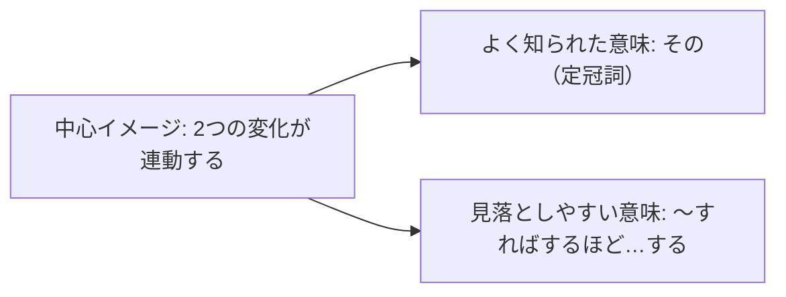

**重要語法：** the＋比較級, the＋比較級

<sub>index: 1 ／ candidate_id: `ev-00001-ai-01`</sub>

---

## 002｜be
**品詞：** 構文・語法（construction）　**発音：** /biː/
<sub>よく知られている意味：〜である、いる</sub>

### 見落としやすい意味
**be to do：〜することになっている（予定・義務などを表す）**

**例文：** The committee is to meet on Friday.
**和訳：** 委員会は金曜日に会合を開く予定だ。

**コアイメージ：** beはもともと状態を表す語である。be to doのまとまりでは、これからの行為が予定・義務などとして定められていることを表す。

**図：**
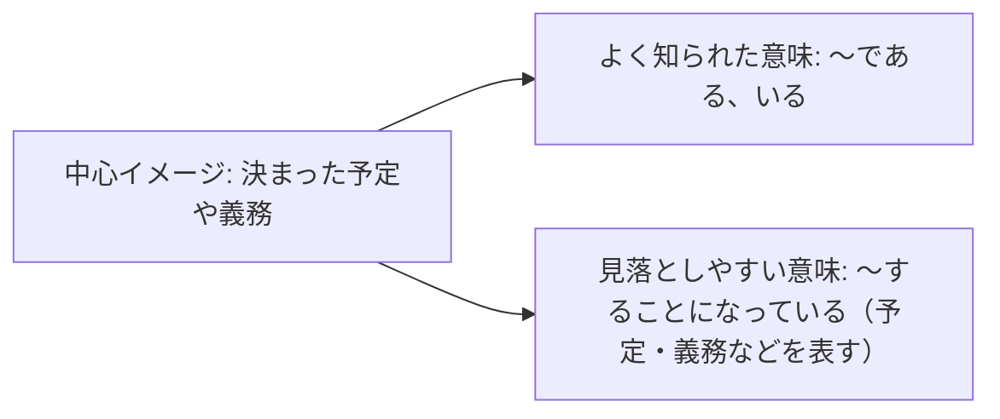

**重要語法：** be to doは文脈によって予定・義務・可能などを表す

<sub>index: 2 ／ candidate_id: `ev-00002-ai-01`</sub>

---

## 003｜of
**品詞：** 構文・語法（construction）　**発音：** /əv/
<sub>よく知られている意味：〜の</sub>

### 見落としやすい意味
**of＋抽象名詞：〜な、〜という性質を持つ**

**例文：** Her advice was of great value to us.
**和訳：** 彼女の助言は私たちにとって非常に価値があった。

**コアイメージ：** ofは物事のつながりや所属を示す。of＋抽象名詞は形容詞のように働き、対象がどのような性質を持つかを説明できる。

**図：**
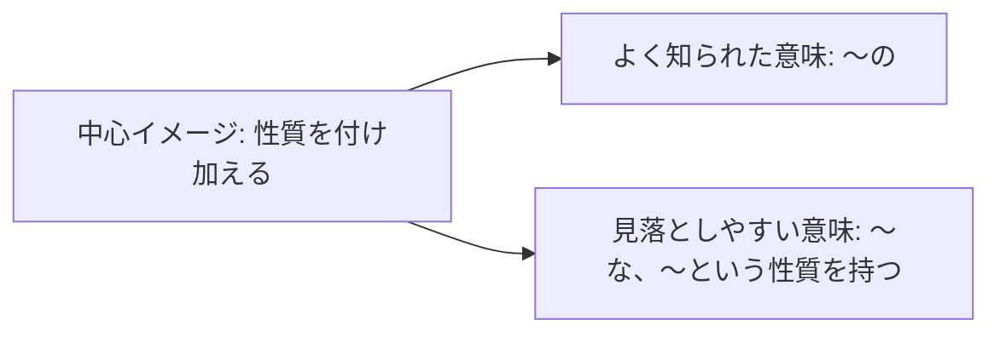

**重要語法：** of great importance ≒ very important

<sub>index: 3 ／ candidate_id: `ev-00003-ai-01`</sub>

---

## 004｜and
**品詞：** 構文・語法（construction）　**発音：** /ænd/
<sub>よく知られている意味：そして、〜と</sub>

### 見落としやすい意味
**命令文＋and ...：〜しなさい、そうすれば…**

**例文：** Read this paragraph again, and you'll understand the point.
**和訳：** この段落をもう一度読めば、要点が分かるだろう。

**コアイメージ：** andは2つの内容を結びつける。命令文の後で使うと、前の行動を条件、後ろをその結果として結びつける。

**図：**
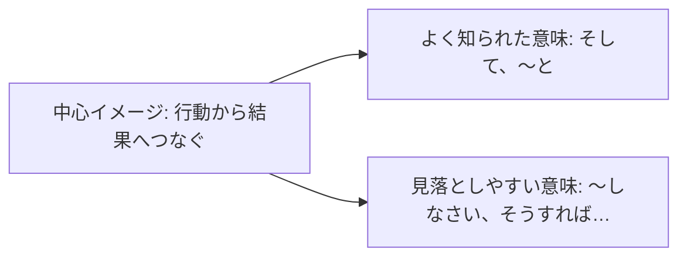

**重要語法：** 命令文＋and＋平叙文

<sub>index: 4 ／ candidate_id: `ev-00004-ai-01`</sub>

---

## 005｜to
**品詞：** 構文・語法（construction）　**発音：** /tuː, tə/
<sub>よく知られている意味：〜へ、〜に</sub>

### 見落としやすい意味
**to one's surprise：驚いたことに**

**例文：** To my surprise, the door was already open.
**和訳：** 驚いたことに、ドアはすでに開いていた。

**コアイメージ：** toは方向や到達先を表す。to one's surpriseでは出来事が人にもたらした反応を示し、「驚いたことに」と文全体に添える。

**図：**
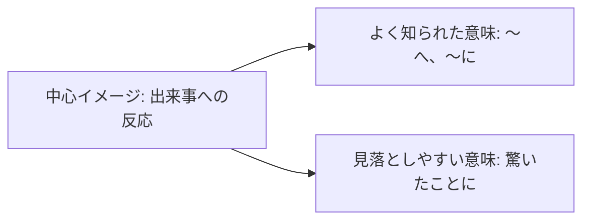

**重要語法：** to my surprise／to our relief

<sub>index: 5 ／ candidate_id: `ev-00005-ai-01`</sub>

---

## 006｜in
**品詞：** 接続詞（conjunction）　**発音：** /ɪn/
<sub>よく知られている意味：〜の中に</sub>

### 見落としやすい意味
**in that ...：〜という点で**

**例文：** The plan is useful in that it saves time.
**和訳：** その計画は時間を節約できるという点で役立つ。

**コアイメージ：** inはある範囲の内部を示す語である。in that以下で、評価や主張が成り立つ具体的な理由・側面を限定する。

**図：**
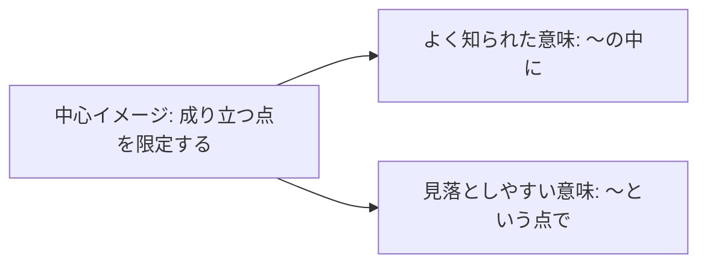

**重要語法：** in that＋節

<sub>index: 7 ／ candidate_id: `ev-00007-ai-01`</sub>

---

## 007｜that
**品詞：** 副詞（adverb）　**発音：** /ðæt/
<sub>よく知られている意味：それ、あの</sub>

### 見落としやすい意味
**それほど、そんなに（not that ... など）**

**例文：** The test wasn't that difficult.
**和訳：** その試験はそれほど難しくなかった。

**コアイメージ：** thatは何かを指し示す働きを持つ。副詞としては性質の程度を指し、「そんなに」「それほど」の強さを表す。

**図：**
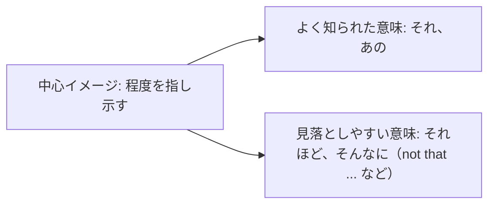

**重要語法：** not that＋形容詞

<sub>index: 8 ／ candidate_id: `ev-00008-ai-01`</sub>

---

## 008｜have
**品詞：** 構文・語法（construction）　**発音：** /hæv, həv/
<sub>よく知られている意味：持つ</sub>

### 見落としやすい意味
**have＋目的語＋過去分詞：〜してもらう、〜される**

**例文：** I had my bike repaired yesterday.
**和訳：** 私は昨日、自転車を修理してもらった。

**コアイメージ：** haveは何かを自分に関係する状態にする感覚を持つ。目的語＋過去分詞を続けると、誰かにしてもらった結果や、意図せず受けた出来事を表せる。

**図：**
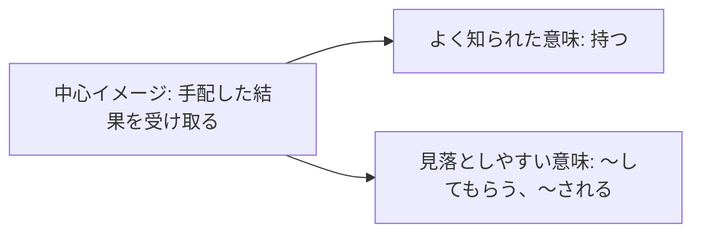

**重要語法：** have＋目的語＋過去分詞（使役・被害）

<sub>index: 9 ／ candidate_id: `ev-00009-ai-01`</sub>

---

## 009｜for
**品詞：** 構文・語法（construction）　**発音：** /fɔːr, fər/
<sub>よく知られている意味：〜のために</sub>

### 見落としやすい意味
**for all ...：〜にもかかわらず**

**例文：** For all his experience, he made a simple mistake.
**和訳：** 豊富な経験があるにもかかわらず、彼は単純な間違いをした。

**コアイメージ：** for allは「それだけの事情があっても」と、前提を認めながら逆の事実を導く。for単体の「ために」と訳さず、句全体で逆接を読み取る。

**図：**
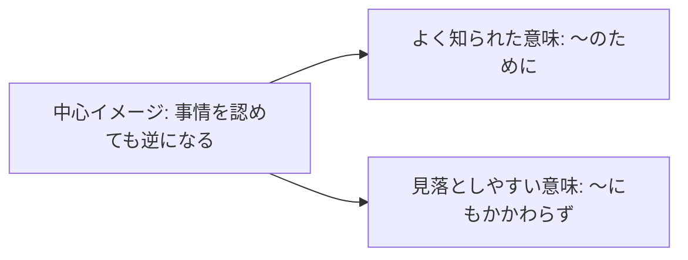

**重要語法：** for all＋名詞句

<sub>index: 10 ／ candidate_id: `ev-00010-ai-01`</sub>

---

## 010｜on
**品詞：** 構文・語法（construction）　**発音：** /ɑːn/
<sub>よく知られている意味：〜の上に</sub>

### 見落としやすい意味
**on＋動名詞：〜するとすぐに**

**例文：** On hearing the news, she called her mother.
**和訳：** 知らせを聞くとすぐに、彼女は母親に電話した。

**コアイメージ：** onは物事との接触点を表す。on＋動名詞ではある出来事に接した時点を表し、次の行動がすぐ続くことを示す。

**図：**
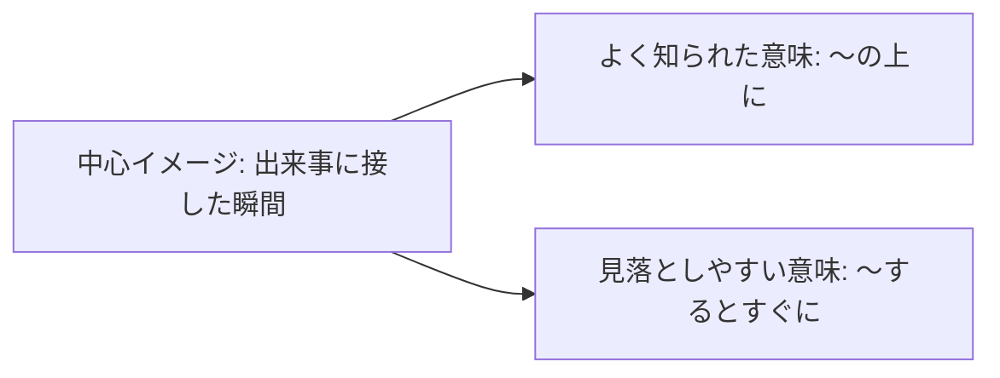

**重要語法：** on＋動名詞 ≒ as soon as＋節

<sub>index: 11 ／ candidate_id: `ev-00011-ai-01`</sub>

---

## 011｜as
**品詞：** 構文・語法（construction）　**発音：** /æz, əz/
<sub>よく知られている意味：〜として、〜のように</sub>

### 見落としやすい意味
**as it were：いわば、言ってみれば**

**例文：** The museum is, as it were, a bridge between generations.
**和訳：** その博物館は、いわば世代をつなぐ架け橋だ。

**コアイメージ：** asは見方や例え方を示すことがある。as it wereは比喩が厳密な名称ではないと断りながら、理解しやすい表現に言い換える挿入句である。

**図：**
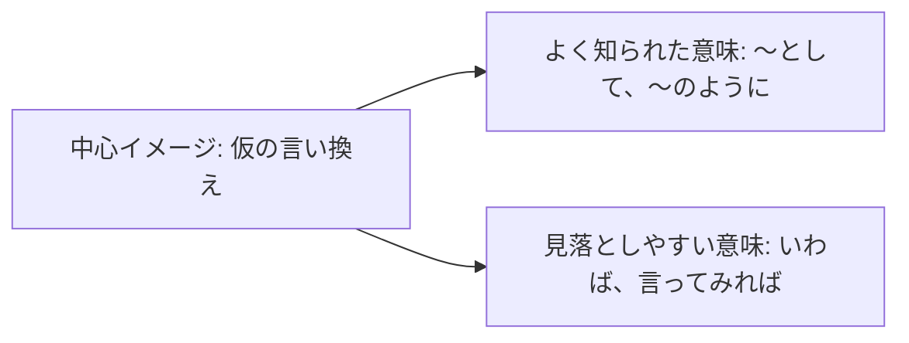

**重要語法：** as it wereは挿入的に使う

<sub>index: 12 ／ candidate_id: `ev-00012-ai-01`</sub>

---

## 012｜with
**品詞：** 構文・語法（construction）　**発音：** /wɪð, wɪθ/
<sub>よく知られている意味：〜と一緒に</sub>

### 見落としやすい意味
**with＋目的語＋補語：〜が…の状態で**

**例文：** She sat with her eyes closed.
**和訳：** 彼女は目を閉じたまま座っていた。

**コアイメージ：** withは物事が一緒にあることを示す。目的語と補語を続けると、主な動作に伴ってどんな状態が続いているかを付け加えられる。

**図：**
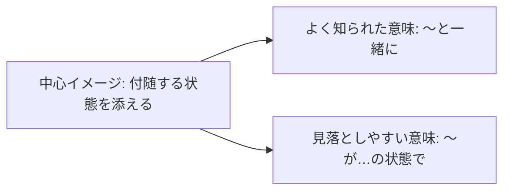

**重要語法：** with＋名詞＋過去分詞・形容詞など

<sub>index: 14 ／ candidate_id: `ev-00014-ai-01`</sub>

---

## 013｜by
**品詞：** 構文・語法（construction）　**発音：** /baɪ/
<sub>よく知られている意味：〜によって、〜のそばに</sub>

### 見落としやすい意味
**by the time ...：〜する時までに**

**例文：** By the time we arrived, the movie had started.
**和訳：** 私たちが着いたときには、映画はすでに始まっていた。

**コアイメージ：** byは到達点や期限の境界を示すことがある。by the timeの後でその境界となる出来事を示し、主節ではそこまでに何が起きたかを述べる。

**図：**
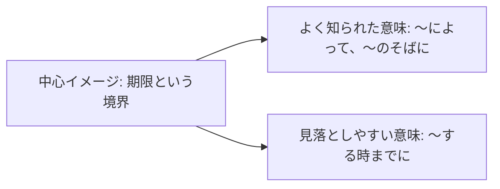

**重要語法：** by the time＋節／主節の完了形に注意

<sub>index: 15 ／ candidate_id: `ev-00015-ai-01`</sub>

---

## 014｜not
**品詞：** 構文・語法（construction）　**発音：** /nɑːt/
<sub>よく知られている意味：〜ない</sub>

### 見落としやすい意味
**not so much A as B：AというよりむしろB**

**例文：** The problem is not so much cost as time.
**和訳：** 問題は費用というより、むしろ時間だ。

**コアイメージ：** notは否定する語だが、この比較構文ではAよりBを重視する。Aを完全に排除するとは限らず、どちらが実態に近いかを示す。

**図：**
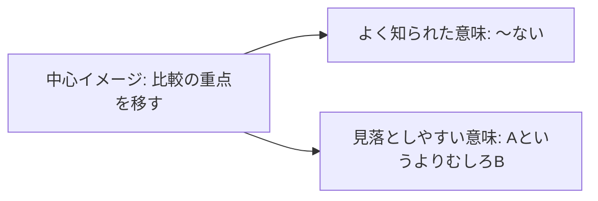

**重要語法：** not so much A as B

<sub>index: 16 ／ candidate_id: `ev-00016-ai-01`</sub>

---

## 015｜this
**品詞：** 副詞（adverb）　**発音：** /ðɪs/
<sub>よく知られている意味：これ、この</sub>

### 見落としやすい意味
**これほど、こんなに（this much など）**

**例文：** I didn't expect the room to be this quiet.
**和訳：** 部屋がこんなに静かだとは思わなかった。

**コアイメージ：** thisは近くにある物事を指す。副詞用法では話し手が今感じている程度を指し、形容詞などの強さを表す。

**図：**
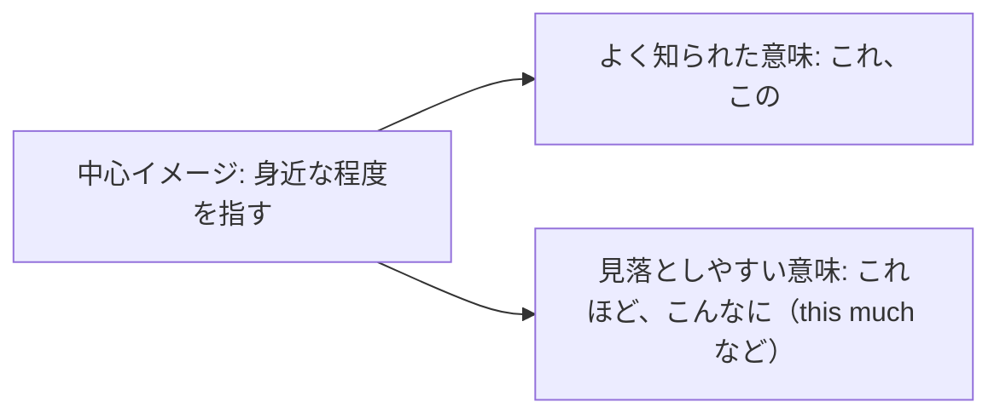

**重要語法：** this＋形容詞／this much

<sub>index: 18 ／ candidate_id: `ev-00018-ai-01`</sub>

---

## 016｜at
**品詞：** 構文・語法（construction）　**発音：** /æt, ət/
<sub>よく知られている意味：〜で、〜に</sub>

### 見落としやすい意味
**at best：よくても、せいぜい**

**例文：** The repair will take three days at best.
**和訳：** その修理には、最短でも3日かかる。

**コアイメージ：** atはある地点・条件を示す。at bestは最も良い条件を考えた評価を表すため、期待値の上限や好条件でも避けられない限界を示す。

**図：**
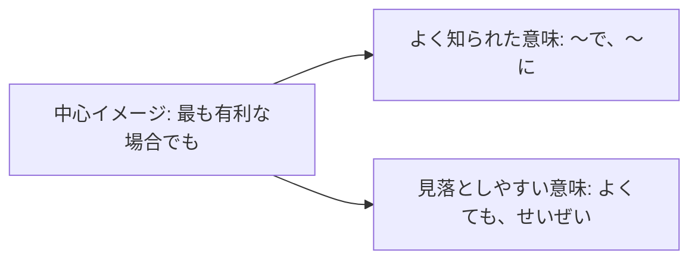

**重要語法：** at best／at worst

<sub>index: 19 ／ candidate_id: `ev-00019-ai-01`</sub>

---

## 017｜but
**品詞：** 構文・語法（construction）　**発音：** /bʌt/
<sub>よく知られている意味：しかし、ただし</sub>

### 見落としやすい意味
**anything but ...：決して〜ではない**

**例文：** His answer was anything but clear.
**和訳：** 彼の答えは決して明確ではなかった。

**コアイメージ：** butには例外・除外を表す働きがある。anything butでは「それ以外なら何でも」という強調から、後ろの性質を強く否定する。

**図：**
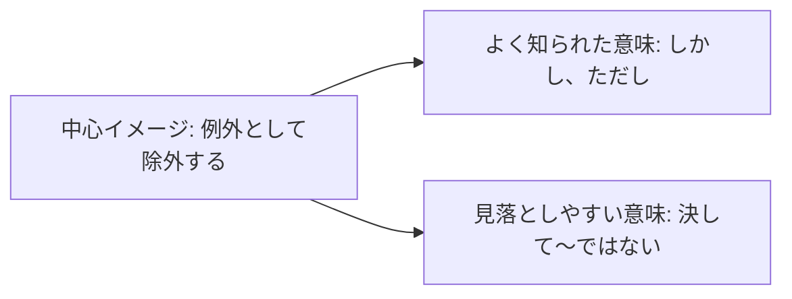

**重要語法：** anything but＋形容詞・名詞

<sub>index: 21 ／ candidate_id: `ev-00021-ai-01`</sub>

---

## 018｜but
**品詞：** 構文・語法（construction）　**発音：** /bʌt/
<sub>よく知られている意味：しかし、ただし</sub>

### 見落としやすい意味
**cannot but do：〜せざるを得ない**

**例文：** I cannot but admire her courage.
**和訳：** 私は彼女の勇気に感心せずにはいられない。

**コアイメージ：** butは「〜を除いて」の働きも持つ。cannot but doではその行為以外の選択ができない感覚から、「〜せざるを得ない」となる。

**図：**
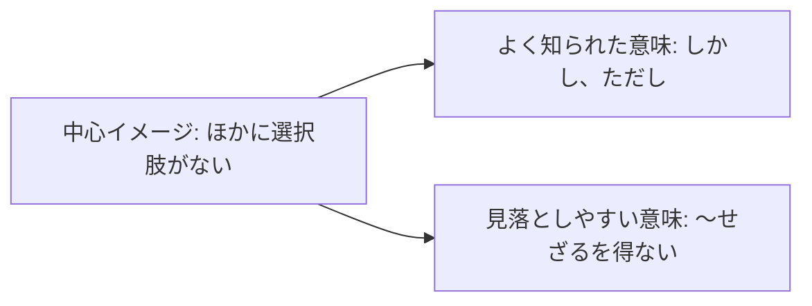

**重要語法：** cannot but doはやや改まった表現

<sub>index: 21 ／ candidate_id: `ev-00021-ai-02`</sub>

---

## 019｜or
**品詞：** 構文・語法（construction）　**発音：** /ɔːr/
<sub>よく知られている意味：または</sub>

### 見落としやすい意味
**or else：さもなければ**

**例文：** Take an umbrella, or else you'll get wet.
**和訳：** 傘を持っていきなさい。さもないとぬれてしまうよ。

**コアイメージ：** orは選択肢を分ける語である。or elseでは「前の行動をしない場合は別の結果になる」と示し、警告を表すことが多い。

**図：**
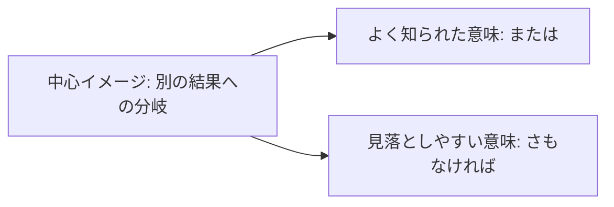

**重要語法：** 命令文＋or else＋節

<sub>index: 22 ／ candidate_id: `ev-00022-ai-01`</sub>

---

## 020｜do
**品詞：** 構文・語法（construction）　**発音：** /duː/
<sub>よく知られている意味：する</sub>

### 見落としやすい意味
**do without ...：〜なしで済ませる**

**例文：** We can do without a car in this town.
**和訳：** この町では車がなくても生活できる。

**コアイメージ：** doは行動や物事が進むことを広く表す。do withoutは必要そうな物がない状況でも何とかやっていくことを表すまとまりである。

**図：**
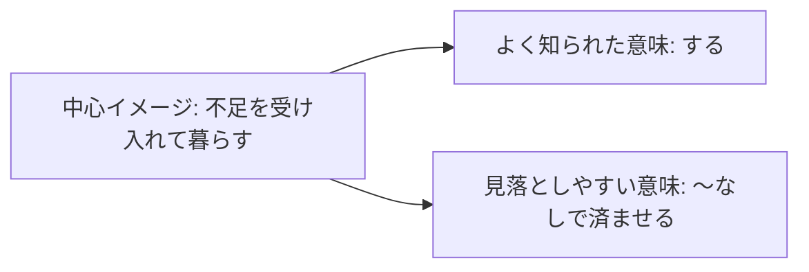

**重要語法：** do without＋名詞

<sub>index: 29 ／ candidate_id: `ev-00029-ai-01`</sub>

---

## 021｜do
**品詞：** 動詞（verb）　**発音：** /duː/
<sub>よく知られている意味：する</sub>

### 見落としやすい意味
**間に合う、十分である（That will do.）**

**例文：** A short break will do.
**和訳：** 短い休憩で十分だ。

**コアイメージ：** doには行為を行うだけでなく、目的に対して役立つという使い方がある。必要な条件を満たすとき、「それで足りる」という意味になる。

**図：**
```mermaid
flowchart LR
    A["中心イメージ: 必要な役割を果たす"]
    B["よく知られた意味: する"]
    C["見落としやすい意味: 間に合う、十分である（That will do.）"]
    A --> B
    A --> C
```

**重要語法：** That will do.／Either will do.

<sub>index: 29 ／ candidate_id: `ev-00029-ai-02`</sub>

---

## 022｜more
**品詞：** 構文・語法（construction）　**発音：** /mɔːr/
<sub>よく知られている意味：もっと多い</sub>

### 見落としやすい意味
**no more than ...：ほんの〜しか**

**例文：** He had no more than ten minutes to finish.
**和訳：** 彼には終わらせるまで、ほんの10分しかなかった。

**コアイメージ：** moreは数量の増加を表す。no more thanは「それを超えることはない」と範囲を絞ることで、少なさを強く意識させる。

**図：**
```mermaid
flowchart LR
    A["中心イメージ: 数量を上限ぎりぎりに抑える"]
    B["よく知られた意味: もっと多い"]
    C["見落としやすい意味: ほんの〜しか"]
    A --> B
    A --> C
```

**重要語法：** no more than＋数量（少なさを強調）

<sub>index: 30 ／ candidate_id: `ev-00030-ai-01`</sub>

---

## 023｜more
**品詞：** 構文・語法（construction）　**発音：** /mɔːr/
<sub>よく知られている意味：もっと多い</sub>

### 見落としやすい意味
**no more ... than ...：〜でないのは…でないのと同じ**

**例文：** A whale is no more a fish than a bat is a bird.
**和訳：** コウモリが鳥でないのと同じように、クジラも魚ではない。

**コアイメージ：** moreを使う比較の形でも、この構文は優劣を述べない。後半の明らかな否定を手がかりに、前半も同様に成り立たないと読む。

**図：**
```mermaid
flowchart LR
    A["中心イメージ: 二つを比べてともに否定する"]
    B["よく知られた意味: もっと多い"]
    C["見落としやすい意味: 〜でないのは…でないのと同じ"]
    A --> B
    A --> C
```

**重要語法：** no more A than B（両方の否定）

<sub>index: 30 ／ candidate_id: `ev-00030-ai-02`</sub>

---

## 024｜will
**品詞：** 名詞（noun）　**発音：** /wɪl/
<sub>よく知られている意味：〜するだろう</sub>

### 見落としやすい意味
**意志、意欲**

**例文：** She showed a strong will to succeed.
**和訳：** 彼女は成功しようとする強い意志を示した。

**コアイメージ：** 助動詞willは未来や意思を表す。名詞のwillでは、人が自分で何かをしようとする内側の決意を指す。

**図：**
```mermaid
flowchart LR
    A["中心イメージ: 行動を支える内側の決意"]
    B["よく知られた意味: 〜するだろう"]
    C["見落としやすい意味: 意志、意欲"]
    A --> B
    A --> C
```

**重要語法：** a strong will／the will to do

<sub>index: 33 ／ candidate_id: `ev-00033-ai-01`</sub>

---

## 025｜will
**品詞：** 名詞（noun）　**発音：** /wɪl/
<sub>よく知られている意味：〜するだろう</sub>

### 見落としやすい意味
**遺言、遺言書**

**例文：** He left a will explaining how to divide his property.
**和訳：** 彼は財産の分け方を記した遺言書を残した。

**コアイメージ：** willには本人の意思という中心的な意味がある。遺言書は本人が亡くなった後の財産などについて、あらかじめ意思を示す文書である。

**図：**
```mermaid
flowchart LR
    A["中心イメージ: 死後に残す意思"]
    B["よく知られた意味: 〜するだろう"]
    C["見落としやすい意味: 遺言、遺言書"]
    A --> B
    A --> C
```

**重要語法：** make a will／leave a will

<sub>index: 33 ／ candidate_id: `ev-00033-ai-02`</sub>

---

## 026｜can
**品詞：** 動詞（verb）　**発音：** /kæn/
<sub>よく知られている意味：〜できる</sub>

### 見落としやすい意味
**缶詰にする**

**例文：** The factory cans tomatoes in August.
**和訳：** その工場では8月にトマトを缶詰にする。

**コアイメージ：** 助動詞canとは別に、名詞canは缶を表す。動詞として使うと、食品を缶などに詰めて保存できる状態にすることを表す。

**図：**
```mermaid
flowchart LR
    A["中心イメージ: 容器に詰めて保存する"]
    B["よく知られた意味: 〜できる"]
    C["見落としやすい意味: 缶詰にする"]
    A --> B
    A --> C
```

**重要語法：** can tomatoes（動詞canの三単現はcans）

<sub>index: 34 ／ candidate_id: `ev-00034-verb-01`</sub>

---

## 027｜all
**品詞：** 構文・語法（construction）　**発音：** /ɔːl/
<sub>よく知られている意味：全部の</sub>

### 見落としやすい意味
**all but ...：ほとんど〜、〜も同然**

**例文：** The town was all but deserted after the storm.
**和訳：** 嵐の後、その町はほとんど人がいなくなっていた。

**コアイメージ：** allは全体を示し、butには除外の働きがある。all butは文字どおりの一部を残してほぼ全部という感覚から、「ほとんど〜」を表す。

**図：**
```mermaid
flowchart LR
    A["中心イメージ: ほとんど残っていない"]
    B["よく知られた意味: 全部の"]
    C["見落としやすい意味: ほとんど〜、〜も同然"]
    A --> B
    A --> C
```

**重要語法：** all but＋形容詞・過去分詞

<sub>index: 36 ／ candidate_id: `ev-00036-ai-01`</sub>

---

## 028｜say
**品詞：** 名詞（noun）　**発音：** /seɪ/
<sub>よく知られている意味：言う</sub>

### 見落としやすい意味
**発言権**

**例文：** Everyone should have a say in the decision.
**和訳：** その決定については、全員に発言権があるべきだ。

**コアイメージ：** sayは意見を口にする行為を表す。名詞では発言する機会や、その決定に自分の意見を反映できる権利を指す。

**図：**
```mermaid
flowchart LR
    A["中心イメージ: 意見を言える立場"]
    B["よく知られた意味: 言う"]
    C["見落としやすい意味: 発言権"]
    A --> B
    A --> C
```

**重要語法：** have a say in＋名詞

<sub>index: 38 ／ candidate_id: `ev-00038-noun-01`</sub>

---

## 029｜about
**品詞：** 構文・語法（construction）　**発音：** /əˈbaʊt/
<sub>よく知られている意味：〜について</sub>

### 見落としやすい意味
**be about to do：まさに〜しようとしている**

**例文：** The concert is about to begin.
**和訳：** コンサートはまさに始まろうとしている。

**コアイメージ：** aboutには「周辺・近く」という感覚がある。be about to doでは行為が起こる直前にいることを示し、今にも始まりそうな状態を表す。

**図：**
```mermaid
flowchart LR
    A["中心イメージ: 動作の直前にいる"]
    B["よく知られた意味: 〜について"]
    C["見落としやすい意味: まさに〜しようとしている"]
    A --> B
    A --> C
```

**重要語法：** be about to do

<sub>index: 39 ／ candidate_id: `ev-00039-ai-01`</sub>

---

## 030｜other
**品詞：** 構文・語法（construction）　**発音：** /ˈʌðər/
<sub>よく知られている意味：ほかの</sub>

### 見落としやすい意味
**other than ...：〜以外に**

**例文：** No one other than Maya knew the answer.
**和訳：** マヤ以外は誰も答えを知らなかった。

**コアイメージ：** otherは別のものを示す。other thanではある人や物を基準にして、そこに含まれない対象を取り出す。

**図：**
```mermaid
flowchart LR
    A["中心イメージ: 比較対象から除外する"]
    B["よく知られた意味: ほかの"]
    C["見落としやすい意味: 〜以外に"]
    A --> B
    A --> C
```

**重要語法：** other than＋名詞・代名詞

<sub>index: 40 ／ candidate_id: `ev-00040-ai-01`</sub>

---

## 031｜make
**品詞：** 構文・語法（construction）　**発音：** /meɪk/
<sub>よく知られている意味：作る</sub>

### 見落としやすい意味
**make for ...：〜に役立つ、〜に寄与する**

**例文：** Regular feedback makes for better teamwork.
**和訳：** 定期的なフィードバックは、より良いチームワークにつながる。

**コアイメージ：** makeには結果を生み出すという感覚がある。make forは何かがある結果に向かうことを示し、改善に役立つ場合に使える。

**図：**
```mermaid
flowchart LR
    A["中心イメージ: 好ましい結果につながる"]
    B["よく知られた意味: 作る"]
    C["見落としやすい意味: 〜に役立つ、〜に寄与する"]
    A --> B
    A --> C
```

**重要語法：** make for＋良い結果・性質

<sub>index: 42 ／ candidate_id: `ev-00042-ai-01`</sub>

---

## 032｜if
**品詞：** 構文・語法（construction）　**発音：** /ɪf/
<sub>よく知られている意味：もし〜なら</sub>

### 見落としやすい意味
**if anything：どちらかといえば**

**例文：** The room was, if anything, too warm.
**和訳：** その部屋は、どちらかといえば暑すぎるくらいだった。

**コアイメージ：** ifは条件を提示する。if anythingは「何か言い直すとすれば」と判断を控えめに補正し、むしろ逆の程度だと示す。

**図：**
```mermaid
flowchart LR
    A["中心イメージ: 控えめな修正"]
    B["よく知られた意味: もし〜なら"]
    C["見落としやすい意味: どちらかといえば"]
    A --> B
    A --> C
```

**重要語法：** if anything（挿入句）

<sub>index: 43 ／ candidate_id: `ev-00043-ai-01`</sub>

---

## 033｜if
**品詞：** 構文・語法（construction）　**発音：** /ɪf/
<sub>よく知られている意味：もし〜なら</sub>

### 見落としやすい意味
**if only ...：〜でさえあればよいのに**

**例文：** If only we had more time!
**和訳：** もっと時間さえあればいいのに。

**コアイメージ：** ifは実現を仮定する語である。if onlyは望む条件だけでも満たされればという気持ちを強く表し、実現していない願望を示す。

**図：**
```mermaid
flowchart LR
    A["中心イメージ: 願う条件を一つ挙げる"]
    B["よく知られた意味: もし〜なら"]
    C["見落としやすい意味: 〜でさえあればよいのに"]
    A --> B
    A --> C
```

**重要語法：** if only＋仮定法過去・過去完了

<sub>index: 43 ／ candidate_id: `ev-00043-ai-02`</sub>

---

## 034｜there
**品詞：** 構文・語法（construction）　**発音：** /ðer/
<sub>よく知られている意味：そこに</sub>

### 見落としやすい意味
**there is no -ing：〜することはできない**

**例文：** There is no telling when the train will arrive.
**和訳：** 列車がいつ到着するかは分からない。

**コアイメージ：** there isは存在を示す構文である。no＋動名詞が続くと、その行為を行う方法や可能性がないという意味になる。

**図：**
```mermaid
flowchart LR
    A["中心イメージ: 可能な方法が存在しない"]
    B["よく知られた意味: そこに"]
    C["見落としやすい意味: 〜することはできない"]
    A --> B
    A --> C
```

**重要語法：** There is no knowing／There is no telling

<sub>index: 45 ／ candidate_id: `ev-00045-ai-01`</sub>

---

## 035｜when
**品詞：** 構文・語法（construction）　**発音：** /wen/
<sub>よく知られている意味：いつ</sub>

### 見落としやすい意味
**when it comes to ...：〜のこととなると**

**例文：** When it comes to cooking, my father is the expert.
**和訳：** 料理のこととなると、父が専門家だ。

**コアイメージ：** whenは時点を示す語である。when it comes toは話がある題目に及ぶ場面を設定し、その話題について述べる。

**図：**
```mermaid
flowchart LR
    A["中心イメージ: 話題をそこへ向ける"]
    B["よく知られた意味: いつ"]
    C["見落としやすい意味: 〜のこととなると"]
    A --> B
    A --> C
```

**重要語法：** when it comes to＋名詞・動名詞

<sub>index: 47 ／ candidate_id: `ev-00047-ai-01`</sub>

---

## 036｜use
**品詞：** 構文・語法（construction）　**発音：** /juːs/
<sub>よく知られている意味：使用、利用</sub>

### 見落としやすい意味
**have no use for ...：〜を必要としない、〜を好まない**

**例文：** She has no use for excuses.
**和訳：** 彼女は言い訳など必要としていない。

**コアイメージ：** useには役立つことという意味がある。have no use forは役立つと思わないことから、必要としない、好まないという態度を示す。

**図：**
```mermaid
flowchart LR
    A["中心イメージ: 必要性を認めない"]
    B["よく知られた意味: 使用、利用"]
    C["見落としやすい意味: 〜を必要としない、〜を好まない"]
    A --> B
    A --> C
```

**重要語法：** have no use for＋名詞

<sub>index: 49 ／ candidate_id: `ev-00049-ai-01`</sub>

---

## 037｜some
**品詞：** 形容詞（adjective）　**発音：** /sʌm/
<sub>よく知られている意味：いくつかの、多少の</sub>

### 見落としやすい意味
**かなりの、相当な（some distance など）**

**例文：** They live some distance from the station.
**和訳：** 彼らは駅からかなり離れた所に住んでいる。

**コアイメージ：** someは数量をはっきり限定しない語である。距離や時間などに付くと、単なる少量よりも「相当ある」という程度を含む場合がある。

**図：**
```mermaid
flowchart LR
    A["中心イメージ: 無視できない程度"]
    B["よく知られた意味: いくつかの、多少の"]
    C["見落としやすい意味: かなりの、相当な（some distance など）"]
    A --> B
    A --> C
```

**重要語法：** some distance／some time

<sub>index: 50 ／ candidate_id: `ev-00050-ai-01`</sub>

---

## 038｜out
**品詞：** 構文・語法（construction）　**発音：** /aʊt/
<sub>よく知られている意味：外へ</sub>

### 見落としやすい意味
**out of the question：論外で、問題にならない**

**例文：** Skipping the safety check is out of the question.
**和訳：** 安全確認を省くことなど論外だ。

**コアイメージ：** outは範囲の外を示す。out of the questionは議論できる選択肢の外にある感覚から、到底認められないことを表す。

**図：**
```mermaid
flowchart LR
    A["中心イメージ: 議論の外に置く"]
    B["よく知られた意味: 外へ"]
    C["見落としやすい意味: 論外で、問題にならない"]
    A --> B
    A --> C
```

**重要語法：** out of the question（不可能・許容できない）

<sub>index: 51 ／ candidate_id: `ev-00051-ai-01`</sub>

---

## 039｜so
**品詞：** 構文・語法（construction）　**発音：** /soʊ/
<sub>よく知られている意味：とても、だから</sub>

### 見落としやすい意味
**so as to do：〜するために**

**例文：** He left early so as to avoid the traffic.
**和訳：** 彼は渋滞を避けるために早く出発した。

**コアイメージ：** soは前後の内容の関係を示す。so as to doは後ろの動作を目標として示し、「〜するために」と目的を表す。

**図：**
```mermaid
flowchart LR
    A["中心イメージ: 目的へ向かう"]
    B["よく知られた意味: とても、だから"]
    C["見落としやすい意味: 〜するために"]
    A --> B
    A --> C
```

**重要語法：** so as to＋動詞原形

<sub>index: 52 ／ candidate_id: `ev-00052-ai-01`</sub>

---

## 040｜what
**品詞：** 構文・語法（construction）　**発音：** /wʌt/
<sub>よく知られている意味：何、どんな</sub>

### 見落としやすい意味
**what with A and B：AやらBやらで**

**例文：** What with the rain and the traffic, we arrived late.
**和訳：** 雨やら渋滞やらで、私たちは遅れて到着した。

**コアイメージ：** whatは複数の事情を取り上げる表現にも使われる。what with A and Bは原因をあれこれ挙げ、それらが重なった結果を示す。

**図：**
```mermaid
flowchart LR
    A["中心イメージ: 原因が重なり合う"]
    B["よく知られた意味: 何、どんな"]
    C["見落としやすい意味: AやらBやらで"]
    A --> B
    A --> C
```

**重要語法：** what with A and B

<sub>index: 53 ／ candidate_id: `ev-00053-ai-01`</sub>

---

## 041｜no
**品詞：** 構文・語法（construction）　**発音：** /noʊ/
<sub>よく知られている意味：いいえ、〜ない</sub>

### 見落としやすい意味
**no sooner ... than ...：〜するとすぐに…**

**例文：** No sooner had I sat down than the phone rang.
**和訳：** 私が座るとすぐに電話が鳴った。

**コアイメージ：** no soonerは時間の隔たりがほとんどないことを表す。前の出来事が起きると直ちに次が続くと示し、文頭では倒置を伴いやすい。

**図：**
```mermaid
flowchart LR
    A["中心イメージ: 出来事が間髪を入れず続く"]
    B["よく知られた意味: いいえ、〜ない"]
    C["見落としやすい意味: 〜するとすぐに…"]
    A --> B
    A --> C
```

**重要語法：** No sooner had S＋過去分詞 than ...

<sub>index: 54 ／ candidate_id: `ev-00054-ai-01`</sub>

---

## 042｜time
**品詞：** 動詞（verb）　**発音：** /taɪm/
<sub>よく知られている意味：時間</sub>

### 見落としやすい意味
**時間を測る**

**例文：** She timed her speech with a stopwatch.
**和訳：** 彼女はストップウォッチでスピーチの時間を測った。

**コアイメージ：** 名詞timeは時間を示す。動詞ではある行動がどのくらい続くかを測ったり、行う時機を決めたりする。

**図：**
```mermaid
flowchart LR
    A["中心イメージ: 経過時間を測定する"]
    B["よく知られた意味: 時間"]
    C["見落としやすい意味: 時間を測る"]
    A --> B
    A --> C
```

**重要語法：** time a speech／time a race

<sub>index: 55 ／ candidate_id: `ev-00055-verb-01`</sub>

---

## 043｜good
**品詞：** 構文・語法（construction）　**発音：** /ɡʊd/
<sub>よく知られている意味：良い</sub>

### 見落としやすい意味
**for good：永久に、これを最後に**

**例文：** She decided to quit the club for good.
**和訳：** 彼女はそのクラブをきっぱり辞めることにした。

**コアイメージ：** good単体の評価とは別に、for goodは終わりまで確定した状態を表す慣用句である。一時的な変化ではなく、もう元に戻らないことを強調する。

**図：**
```mermaid
flowchart LR
    A["中心イメージ: 終わりまでずっと"]
    B["よく知られた意味: 良い"]
    C["見落としやすい意味: 永久に、これを最後に"]
    A --> B
    A --> C
```

**重要語法：** for good＝permanently

<sub>index: 57 ／ candidate_id: `ev-00057-ai-01`</sub>

---

## 044｜take
**品詞：** 動詞（verb）　**発音：** /teɪk/
<sub>よく知られている意味：取る、持っていく</sub>

### 見落としやすい意味
**（科目を）履修する**

**例文：** I am taking a history course this term.
**和訳：** 私は今学期、歴史の講座を履修している。

**コアイメージ：** takeには何かを自分の活動に取り入れる感覚がある。科目や授業が目的語になると、それを選んで受講する意味になる。

**図：**
```mermaid
flowchart LR
    A["中心イメージ: 授業を自分の学習に取り入れる"]
    B["よく知られた意味: 取る、持っていく"]
    C["見落としやすい意味: （科目を）履修する"]
    A --> B
    A --> C
```

**重要語法：** take a course／take a class

<sub>index: 58 ／ candidate_id: `ev-00058-verb-01`</sub>

---

## 045｜only
**品詞：** 構文・語法（construction）　**発音：** /ˈoʊnli/
<sub>よく知られている意味：〜だけ</sub>

### 見落としやすい意味
**only to do：結局〜するだけで終わる**

**例文：** She hurried to the station, only to miss the last train.
**和訳：** 彼女は駅へ急いだが、結局終電に乗り遅れた。

**コアイメージ：** onlyは結果を狭く限定する。only to doは先行する行動の後で予想外の結果だけが残ったことを表し、失望を伴うことが多い。

**図：**
```mermaid
flowchart LR
    A["中心イメージ: 期待した結末に届かない"]
    B["よく知られた意味: 〜だけ"]
    C["見落としやすい意味: 結局〜するだけで終わる"]
    A --> B
    A --> C
```

**重要語法：** ..., only to＋動詞原形

<sub>index: 59 ／ candidate_id: `ev-00059-ai-01`</sub>

---

## 046｜up
**品詞：** 構文・語法（construction）　**発音：** /ʌp/
<sub>よく知られている意味：上へ</sub>

### 見落としやすい意味
**be up to ...：〜次第である、〜の責任である**

**例文：** It's up to you to choose the venue.
**和訳：** 会場を選ぶのはあなた次第だ。

**コアイメージ：** upにはある位置・段階まで達する感覚がある。be up toでは判断や責任が誰に属するかを示し、その人に任されていると表す。

**図：**
```mermaid
flowchart LR
    A["中心イメージ: 決定を任された側にある"]
    B["よく知られた意味: 上へ"]
    C["見落としやすい意味: 〜次第である、〜の責任である"]
    A --> B
    A --> C
```

**重要語法：** It's up to you.／be up to＋人

<sub>index: 60 ／ candidate_id: `ev-00060-ai-01`</sub>

---

## 047｜into
**品詞：** 構文・語法（construction）　**発音：** /ˈɪntuː/
<sub>よく知られている意味：〜の中へ</sub>

### 見落としやすい意味
**be into ...：〜に夢中である**

**例文：** My brother is really into astronomy.
**和訳：** 弟は天文学に夢中だ。

**コアイメージ：** intoは何かの内部に向かう方向を示す。関心の対象に深く入り込む感覚から、「夢中になっている」を表す。

**図：**
```mermaid
flowchart LR
    A["中心イメージ: 興味の中に入り込む"]
    B["よく知られた意味: 〜の中へ"]
    C["見落としやすい意味: 〜に夢中である"]
    A --> B
    A --> C
```

**重要語法：** be into＋趣味・分野

<sub>index: 61 ／ candidate_id: `ev-00061-ai-01`</sub>

---

## 048｜see
**品詞：** 構文・語法（construction）　**発音：** /siː/
<sub>よく知られている意味：見る</sub>

### 見落としやすい意味
**see to it that ...：必ず〜するよう取り計らう**

**例文：** Please see to it that every window is locked.
**和訳：** すべての窓に確実に鍵がかかっているようにしてください。

**コアイメージ：** seeには見て確かめる働きがある。see to it thatでは単に見るだけでなく、その状態になるよう責任を持って手配する。

**図：**
```mermaid
flowchart LR
    A["中心イメージ: 結果を確実に見届ける"]
    B["よく知られた意味: 見る"]
    C["見落としやすい意味: 必ず〜するよう取り計らう"]
    A --> B
    A --> C
```

**重要語法：** see to it that＋節

<sub>index: 62 ／ candidate_id: `ev-00062-ai-01`</sub>

---

## 049｜people
**品詞：** 名詞（noun）　**発音：** /ˈpiːpəl/
<sub>よく知られている意味：人々</sub>

### 見落としやすい意味
**一つの民族、国民集団（a people）**

**例文：** The island is home to a people with a unique language.
**和訳：** その島には独自の言語を持つ一つの民族が暮らしている。

**コアイメージ：** peopleは通常、人々をまとめて指す。一方a peopleでは共通の文化などを持つ一つの民族や国民集団を数える名詞として扱う。

**図：**
```mermaid
flowchart LR
    A["中心イメージ: 一つにまとまった民族集団"]
    B["よく知られた意味: 人々"]
    C["見落としやすい意味: 一つの民族、国民集団（a people）"]
    A --> B
    A --> C
```

**重要語法：** a people／different peoples

<sub>index: 63 ／ candidate_id: `ev-00063-ai-01`</sub>

---

## 050｜such
**品詞：** 構文・語法（construction）　**発音：** /sʌtʃ/
<sub>よく知られている意味：そのような</sub>

### 見落としやすい意味
**such ... that ...：とても〜なので…**

**例文：** It was such a clear night that we could see many stars.
**和訳：** とても澄んだ夜だったので、たくさんの星が見えた。

**コアイメージ：** suchは性質がどんなものかを強調する。such ... that ...はその程度が非常に大きかったために後ろの結果が起きたと示す。

**図：**
```mermaid
flowchart LR
    A["中心イメージ: 程度が結果を生む"]
    B["よく知られた意味: そのような"]
    C["見落としやすい意味: とても〜なので…"]
    A --> B
    A --> C
```

**重要語法：** such＋a/an＋形容詞＋名詞＋that節

<sub>index: 66 ／ candidate_id: `ev-00066-ai-01`</sub>

---

## 051｜like
**品詞：** 構文・語法（construction）　**発音：** /laɪk/
<sub>よく知られている意味：好き、〜のような</sub>

### 見落としやすい意味
**the likes of ...：〜のような人々や物**

**例文：** The museum displays works by the likes of Monet and Renoir.
**和訳：** その美術館にはモネやルノワールのような画家の作品が展示されている。

**コアイメージ：** likeには似ている・同類という感覚がある。the likes ofはある人物や物を同じ類の代表として挙げ、ほかの例も含む表現になる。

**図：**
```mermaid
flowchart LR
    A["中心イメージ: 同じ種類の代表例"]
    B["よく知られた意味: 好き、〜のような"]
    C["見落としやすい意味: 〜のような人々や物"]
    A --> B
    A --> C
```

**重要語法：** the likes of＋人名・名詞

<sub>index: 67 ／ candidate_id: `ev-00067-ai-01`</sub>

---

## 052｜many
**品詞：** 構文・語法（construction）　**発音：** /ˈmeni/
<sub>よく知られている意味：たくさんの</sub>

### 見落としやすい意味
**many a＋単数名詞：多くの〜**

**例文：** Many a student has struggled with this problem.
**和訳：** 多くの生徒がこの問題に苦戦してきた。

**コアイメージ：** manyは数が多いことを表す。many aでは各人・各物を一つずつ思い浮かべながら、多数に当てはまることを表す。

**図：**
```mermaid
flowchart LR
    A["中心イメージ: 一人ずつ数えた多数"]
    B["よく知られた意味: たくさんの"]
    C["見落としやすい意味: 多くの〜"]
    A --> B
    A --> C
```

**重要語法：** many a＋単数名詞＋単数動詞

<sub>index: 68 ／ candidate_id: `ev-00068-ai-01`</sub>

---

## 053｜work
**品詞：** 名詞（noun）　**発音：** /wɜːrk/
<sub>よく知られている意味：仕事、労働</sub>

### 見落としやすい意味
**（作家・芸術家の）作品**

**例文：** This novel is one of her best works.
**和訳：** この小説は彼女の代表的な作品の一つだ。

**コアイメージ：** workは努力や活動を表す。芸術や著作の場面では、その活動の結果として完成した作品そのものを指す。

**図：**
```mermaid
flowchart LR
    A["中心イメージ: 作り上げられた成果物"]
    B["よく知られた意味: 仕事、労働"]
    C["見落としやすい意味: （作家・芸術家の）作品"]
    A --> B
    A --> C
```

**重要語法：** a work of art／literary works

<sub>index: 69 ／ candidate_id: `ev-00069-noun-02`</sub>

---

## 054｜work
**品詞：** 動詞（verb）　**発音：** /wɜːrk/
<sub>よく知られている意味：働く</sub>

### 見落としやすい意味
**（機械・方法が）機能する**

**例文：** The new system works even without internet access.
**和訳：** 新しいシステムはインターネット接続がなくても機能する。

**コアイメージ：** workは人が働く意味から広がり、物事が役割を果たすことにも使う。機械や方法が主語なら「うまく作動する」と読む。

**図：**
```mermaid
flowchart LR
    A["中心イメージ: 仕組みが期待どおり動く"]
    B["よく知られた意味: 働く"]
    C["見落としやすい意味: （機械・方法が）機能する"]
    A --> B
    A --> C
```

**重要語法：** The plan works.／The device doesn't work.

<sub>index: 69 ／ candidate_id: `ev-00069-verb-01`</sub>

---

## 055｜get
**品詞：** 構文・語法（construction）　**発音：** /ɡet/
<sub>よく知られている意味：手に入れる</sub>

### 見落としやすい意味
**get away with ...：〜をしても罰・非難を免れる**

**例文：** She got away with breaking the rules.
**和訳：** 彼女は規則を破ったのに、罰を受けずに済んだ。

**コアイメージ：** awayは離れる感覚を表す。get away withでは不適切な行為をしても、その結果生じる罰や非難を免れてしまうことを示す。

**図：**
```mermaid
flowchart LR
    A["中心イメージ: 行為をした後の責任から逃れる"]
    B["よく知られた意味: 手に入れる"]
    C["見落としやすい意味: 〜をしても罰・非難を免れる"]
    A --> B
    A --> C
```

**重要語法：** get away with＋名詞・動名詞

<sub>index: 72 ／ candidate_id: `ev-00072-ai-01`</sub>

---

## 056｜get
**品詞：** 構文・語法（construction）　**発音：** /ɡet/
<sub>よく知られている意味：得る、手に入れる</sub>

### 見落としやすい意味
**get to do：〜する機会を得る**

**例文：** I finally got to meet the author.
**和訳：** 私はついにその作家に会う機会を得た。

**コアイメージ：** getは何かを得たり到達したりすることを示す。get to doでは特定の行為ができる機会や許可に恵まれる感覚になる。

**図：**
```mermaid
flowchart LR
    A["中心イメージ: 機会を手に入れる"]
    B["よく知られた意味: 得る、手に入れる"]
    C["見落としやすい意味: 〜する機会を得る"]
    A --> B
    A --> C
```

**重要語法：** get to＋動詞原形

<sub>index: 72 ／ candidate_id: `ev-00072-ai-02`</sub>

---

## 057｜get
**品詞：** 構文・語法（construction）　**発音：** /ɡet/
<sub>よく知られている意味：得る、手に入れる</sub>

### 見落としやすい意味
**get＋目的語＋過去分詞：〜してもらう、〜を…の状態にする**

**例文：** We got the window fixed before winter.
**和訳：** 私たちは冬になる前に窓を修理してもらった。

**コアイメージ：** getは状態の変化や到達を表す。目的語＋過去分詞を続け、手配や働きかけによって物事をある状態にする。

**図：**
```mermaid
flowchart LR
    A["中心イメージ: 望む状態を実現する"]
    B["よく知られた意味: 得る、手に入れる"]
    C["見落としやすい意味: 〜してもらう、〜を…の状態にする"]
    A --> B
    A --> C
```

**重要語法：** get＋目的語＋過去分詞

<sub>index: 72 ／ candidate_id: `ev-00072-ai-03`</sub>

---

## 058｜even
**品詞：** 形容詞（adjective）　**発音：** /ˈiːvən/
<sub>よく知られている意味：〜さえ</sub>

### 見落としやすい意味
**偶数の**

**例文：** Six is an even number.
**和訳：** 6は偶数だ。

**コアイメージ：** evenには均等で平らという意味がある。数が2つずつ余りなく分かれることから、偶数を表す形容詞になる。

**図：**
```mermaid
flowchart LR
    A["中心イメージ: 二つずつきれいに分かれる"]
    B["よく知られた意味: 〜さえ"]
    C["見落としやすい意味: 偶数の"]
    A --> B
    A --> C
```

**重要語法：** even number ↔ odd number

<sub>index: 73 ／ candidate_id: `ev-00073-adjective-01`</sub>

---

## 059｜over
**品詞：** 形容詞（adjective）　**発音：** /ˈoʊvər/
<sub>よく知られている意味：〜の上に、〜を越えて</sub>

### 見落としやすい意味
**終わっている**

**例文：** The discussion is over.
**和訳：** 議論は終わった。

**コアイメージ：** overにはある範囲を越える感覚がある。出来事の終わりまで進んでその先にいることから、「もう終わっている」を表す。

**図：**
```mermaid
flowchart LR
    A["中心イメージ: 出来事の終点を越えた"]
    B["よく知られた意味: 〜の上に、〜を越えて"]
    C["見落としやすい意味: 終わっている"]
    A --> B
    A --> C
```

**重要語法：** be over（終了している）

<sub>index: 74 ／ candidate_id: `ev-00074-adjective-01`</sub>

---

## 060｜may
**品詞：** 構文・語法（construction）　**発音：** /meɪ/
<sub>よく知られている意味：〜かもしれない</sub>

### 見落としやすい意味
**may well do：〜するのももっともだ、十分あり得る**

**例文：** You may well feel tired after such a long trip.
**和訳：** そんなに長い旅の後なら、疲れるのももっともだ。

**コアイメージ：** mayは可能性を示す。wellが加わると可能性や妥当性を強め、「そうなるのも自然だ」と評価することがある。

**図：**
```mermaid
flowchart LR
    A["中心イメージ: そうなる理由が十分ある"]
    B["よく知られた意味: 〜かもしれない"]
    C["見落としやすい意味: 〜するのももっともだ、十分あり得る"]
    A --> B
    A --> C
```

**重要語法：** may well do（十分あり得る／もっともだ）

<sub>index: 75 ／ candidate_id: `ev-00075-ai-01`</sub>

---

## 061｜now
**品詞：** 接続詞（conjunction）　**発音：** /naʊ/
<sub>よく知られている意味：今</sub>

### 見落としやすい意味
**now that ...：今や〜なのだから**

**例文：** Now that the rain has stopped, we can go outside.
**和訳：** 雨がやんだのだから、外に出られる。

**コアイメージ：** nowは現在という時点を示す。now thatは以前と状況が変わった現在を前提に、その結果や判断を述べる接続表現である。

**図：**
```mermaid
flowchart LR
    A["中心イメージ: 変化した現在を理由にする"]
    B["よく知られた意味: 今"]
    C["見落としやすい意味: 今や〜なのだから"]
    A --> B
    A --> C
```

**重要語法：** now that＋節

<sub>index: 76 ／ candidate_id: `ev-00076-ai-01`</sub>

---

## 062｜report
**品詞：** 動詞（verb）　**発音：** /rɪˈpɔːrt/
<sub>よく知られている意味：報告する</sub>

### 見落としやすい意味
**（職場・上官などに）出頭する**

**例文：** All visitors must report to the front desk.
**和訳：** 来訪者は全員、受付に出向かなければならない。

**コアイメージ：** reportには自分の状況を知らせる意味がある。職場や受付などにreportすると、そこへ姿を見せて指示や確認を受けることを表す。

**図：**
```mermaid
flowchart LR
    A["中心イメージ: 指定場所に現れて届け出る"]
    B["よく知られた意味: 報告する"]
    C["見落としやすい意味: （職場・上官などに）出頭する"]
    A --> B
    A --> C
```

**重要語法：** report to＋上司・場所

<sub>index: 77 ／ candidate_id: `ev-00077-verb-01`</sub>

---

## 063｜after
**品詞：** 構文・語法（construction）　**発音：** /ˈæftər/
<sub>よく知られている意味：〜の後に</sub>

### 見落としやすい意味
**be after ...：〜を探し求める、狙う**

**例文：** What I'm after is a simple explanation.
**和訳：** 私が求めているのは、簡潔な説明だ。

**コアイメージ：** afterは何かの後を追う位置関係を表す。be afterでは目標となる物を追い求める感覚から、「探している」「狙っている」となる。

**図：**
```mermaid
flowchart LR
    A["中心イメージ: 目標を追っている"]
    B["よく知られた意味: 〜の後に"]
    C["見落としやすい意味: 〜を探し求める、狙う"]
    A --> B
    A --> C
```

**重要語法：** be after＋名詞

<sub>index: 79 ／ candidate_id: `ev-00079-ai-01`</sub>

---

## 064｜should
**品詞：** 構文・語法（construction）　**発音：** /ʃʊd/
<sub>よく知られている意味：〜すべきだ</sub>

### 見落としやすい意味
**if ... should ...：万一〜するようなことがあれば**

**例文：** If you should need help, call this number.
**和訳：** 万一助けが必要になったら、この番号に電話してください。

**コアイメージ：** shouldには想定や当然さを表す働きがある。if節内では実際に起こる可能性を控えめに見積もり、「万一〜なら」と条件を述べる。

**図：**
```mermaid
flowchart LR
    A["中心イメージ: 万一という低い可能性"]
    B["よく知られた意味: 〜すべきだ"]
    C["見落としやすい意味: 万一〜するようなことがあれば"]
    A --> B
    A --> C
```

**重要語法：** If S should do, ...（万一なら）

<sub>index: 80 ／ candidate_id: `ev-00080-ai-01`</sub>

---

## 065｜could
**品詞：** 構文・語法（construction）　**発音：** /kʊd/
<sub>よく知られている意味：〜できた、〜できるだろう</sub>

### 見落としやすい意味
**could do with ...：〜があればありがたい**

**例文：** I could do with a cup of tea right now.
**和訳：** 今は紅茶を一杯飲めるとありがたい。

**コアイメージ：** do withにはある物を役立てる感覚がある。couldで控えめな希望を表し、「〜があると助かる」となる。

**図：**
```mermaid
flowchart LR
    A["中心イメージ: あれば助かるもの"]
    B["よく知られた意味: 〜できた、〜できるだろう"]
    C["見落としやすい意味: 〜があればありがたい"]
    A --> B
    A --> C
```

**重要語法：** could do with＋名詞

<sub>index: 81 ／ candidate_id: `ev-00081-ai-01`</sub>

---

## 066｜because
**品詞：** 構文・語法（construction）　**発音：** /bɪˈkɔːz/
<sub>よく知られている意味：〜だから</sub>

### 見落としやすい意味
**just because ... does not mean ...：〜だからといって…とは限らない**

**例文：** Just because a book is popular doesn't mean it's easy to read.
**和訳：** 本が人気だからといって、読みやすいとは限らない。

**コアイメージ：** becauseは理由を導く語である。just because ... doesn't mean ...は一つの理由だけから結論を決められないと反論する。

**図：**
```mermaid
flowchart LR
    A["中心イメージ: 理由だけで結論にしない"]
    B["よく知られた意味: 〜だから"]
    C["見落としやすい意味: 〜だからといって…とは限らない"]
    A --> B
    A --> C
```

**重要語法：** Just because A doesn't mean B.

<sub>index: 83 ／ candidate_id: `ev-00083-ai-01`</sub>

---

## 067｜find
**品詞：** 構文・語法（construction）　**発音：** /faɪnd/
<sub>よく知られている意味：見つける</sub>

### 見落としやすい意味
**find it＋形容詞＋to do：〜することが…だと分かる**

**例文：** I found it difficult to explain the idea.
**和訳：** 私はその考えを説明するのが難しいと感じた。

**コアイメージ：** findは探して発見する意味から、経験して判断に至ることも表す。仮目的語itの後に評価を置き、to doで本当の対象を説明する。

**図：**
```mermaid
flowchart LR
    A["中心イメージ: 経験から評価を見いだす"]
    B["よく知られた意味: 見つける"]
    C["見落としやすい意味: 〜することが…だと分かる"]
    A --> B
    A --> C
```

**重要語法：** find it＋形容詞＋to do

<sub>index: 84 ／ candidate_id: `ev-00084-ai-01`</sub>

---

## 068｜way
**品詞：** 副詞（adverb）　**発音：** /weɪ/
<sub>よく知られている意味：道、方法</sub>

### 見落としやすい意味
**はるかに、ずっと（way too expensive など）**

**例文：** This bag is way too heavy for me.
**和訳：** このかばんは私には重すぎて、とても持てない。

**コアイメージ：** wayには距離や方向の感覚がある。副詞では程度が基準から大きく離れていることを強調し、「はるかに」「ずっと」となる。

**図：**
```mermaid
flowchart LR
    A["中心イメージ: 程度が大きく離れている"]
    B["よく知られた意味: 道、方法"]
    C["見落としやすい意味: はるかに、ずっと（way too expensive など）"]
    A --> B
    A --> C
```

**重要語法：** way too＋形容詞／way better

<sub>index: 85 ／ candidate_id: `ev-00085-ai-01`</sub>

---

## 069｜just
**品詞：** 構文・語法（construction）　**発音：** /dʒʌst/
<sub>よく知られている意味：ちょうど、ただ</sub>

### 見落としやすい意味
**just as ...：まさに〜と同じように**

**例文：** Just as plants need sunlight, people need rest.
**和訳：** 植物に日光が必要なのと同じように、人間には休息が必要だ。

**コアイメージ：** justは一致の正確さを強める。just asは二つの状況が対応することを際立たせ、比較や類推を導く。

**図：**
```mermaid
flowchart LR
    A["中心イメージ: 二つがぴったり対応する"]
    B["よく知られた意味: ちょうど、ただ"]
    C["見落としやすい意味: まさに〜と同じように"]
    A --> B
    A --> C
```

**重要語法：** just as A, B

<sub>index: 87 ／ candidate_id: `ev-00087-ai-01`</sub>

---

## 070｜give
**品詞：** 構文・語法（construction）　**発音：** /ɡɪv/
<sub>よく知られている意味：与える</sub>

### 見落としやすい意味
**give way to ...：〜に道を譲る、〜に取って代わられる**

**例文：** The old shops gave way to new apartments.
**和訳：** 古い商店は新しい集合住宅に取って代わられた。

**コアイメージ：** giveは自分の側から何かを渡す語である。give way toでは自分が占めていた場所や役割を別のものに譲ることを示す。

**図：**
```mermaid
flowchart LR
    A["中心イメージ: 進路を譲って入れ替わる"]
    B["よく知られた意味: 与える"]
    C["見落としやすい意味: 〜に道を譲る、〜に取って代わられる"]
    A --> B
    A --> C
```

**重要語法：** give way to＋名詞

<sub>index: 89 ／ candidate_id: `ev-00089-ai-01`</sub>

---

## 071｜give
**品詞：** 構文・語法（construction）　**発音：** /ɡɪv/
<sub>よく知られている意味：与える</sub>

### 見落としやすい意味
**give rise to ...：〜を引き起こす**

**例文：** The new policy gave rise to confusion.
**和訳：** 新しい方針は混乱を引き起こした。

**コアイメージ：** giveは何かをもたらす感覚を持つ。riseは生じて現れることを表し、give rise toは新たな現象の原因になることを示す。

**図：**
```mermaid
flowchart LR
    A["中心イメージ: 新しい出来事を生じさせる"]
    B["よく知られた意味: 与える"]
    C["見落としやすい意味: 〜を引き起こす"]
    A --> B
    A --> C
```

**重要語法：** give rise to＋問題・変化など

<sub>index: 89 ／ candidate_id: `ev-00089-ai-02`</sub>

---

## 072｜how
**品詞：** 構文・語法（construction）　**発音：** /haʊ/
<sub>よく知られている意味：どのように</sub>

### 見落としやすい意味
**how come ...?：どうして〜なのか**

**例文：** How come you're still here?
**和訳：** どうしてまだここにいるの？

**コアイメージ：** howは方法や様子を尋ねる。how comeは会話で理由や事情を直接尋ねる定型表現となり、「どうして」と訳す。

**図：**
```mermaid
flowchart LR
    A["中心イメージ: 理由を直接たずねる"]
    B["よく知られた意味: どのように"]
    C["見落としやすい意味: どうして〜なのか"]
    A --> B
    A --> C
```

**重要語法：** How come＋主語＋動詞（通常の疑問文の語順にしない）

<sub>index: 90 ／ candidate_id: `ev-00090-ai-01`</sub>

---

## 073｜any
**品詞：** 構文・語法（construction）　**発音：** /ˈeni/
<sub>よく知られている意味：何か、どんな〜でも</sub>

### 見落としやすい意味
**not ... any longer：もはや〜ない**

**例文：** He doesn't work here any longer.
**和訳：** 彼はもうここでは働いていない。

**コアイメージ：** anyは程度や期間を広く指し示す。否定文のany longerは時間の延長がこれ以上ないことを表し、「もはや〜ない」となる。

**図：**
```mermaid
flowchart LR
    A["中心イメージ: 継続がここで途切れる"]
    B["よく知られた意味: 何か、どんな〜でも"]
    C["見落としやすい意味: もはや〜ない"]
    A --> B
    A --> C
```

**重要語法：** not ... any longer ≒ no longer ...

<sub>index: 91 ／ candidate_id: `ev-00091-ai-01`</sub>

---

## 074｜know
**品詞：** 構文・語法（construction）　**発音：** /noʊ/
<sub>よく知られている意味：知る</sub>

### 見落としやすい意味
**know better than to do：〜するほど愚かではない**

**例文：** She knows better than to trust a rumor.
**和訳：** 彼女はうわさを信じるほど愚かではない。

**コアイメージ：** knowは知識を持つことを示す。know better than to doはその行為を避けるだけの分別があることを表す。

**図：**
```mermaid
flowchart LR
    A["中心イメージ: 判断力があるので避ける"]
    B["よく知られた意味: 知る"]
    C["見落としやすい意味: 〜するほど愚かではない"]
    A --> B
    A --> C
```

**重要語法：** know better than to＋動詞原形

<sub>index: 92 ／ candidate_id: `ev-00092-ai-01`</sub>

---

## 075｜call
**品詞：** 構文・語法（construction）　**発音：** /kɔːl/
<sub>よく知られている意味：呼ぶ、電話する</sub>

### 見落としやすい意味
**call for ...：〜を必要とする、要求する**

**例文：** This situation calls for patience.
**和訳：** この状況では忍耐が必要だ。

**コアイメージ：** callは人や物に働きかける意味を持つ。call forは状況がある対応を求めているという感覚から、「必要とする」となる。

**図：**
```mermaid
flowchart LR
    A["中心イメージ: 状況が必要性を呼び出す"]
    B["よく知られた意味: 呼ぶ、電話する"]
    C["見落としやすい意味: 〜を必要とする、要求する"]
    A --> B
    A --> C
```

**重要語法：** call for＋名詞

<sub>index: 94 ／ candidate_id: `ev-00094-ai-01`</sub>

---

## 076｜call
**品詞：** 構文・語法（construction）　**発音：** /kɔːl/
<sub>よく知られている意味：呼ぶ、電話する</sub>

### 見落としやすい意味
**call off ...：〜を中止する**

**例文：** They called off the match because of heavy rain.
**和訳：** 大雨のため、彼らは試合を中止した。

**コアイメージ：** callは決定や指示を告げることも表す。call offは予定していた行事などを実施しないと決め、取りやめることを示す。

**図：**
```mermaid
flowchart LR
    A["中心イメージ: 予定を取り下げる"]
    B["よく知られた意味: 呼ぶ、電話する"]
    C["見落としやすい意味: 〜を中止する"]
    A --> B
    A --> C
```

**重要語法：** call off＋行事・計画

<sub>index: 94 ／ candidate_id: `ev-00094-ai-02`</sub>

---

## 077｜come
**品詞：** 構文・語法（construction）　**発音：** /kʌm/
<sub>よく知られている意味：来る</sub>

### 見落としやすい意味
**come to：意識を取り戻す**

**例文：** She fainted but came to a few minutes later.
**和訳：** 彼女は気を失ったが、数分後に意識を取り戻した。

**コアイメージ：** comeはある場所や状態に近づく変化を表す。come toは一時的に失った意識が戻ってくることを示す慣用的な動詞句でもある。

**図：**
```mermaid
flowchart LR
    A["中心イメージ: 意識が元の状態へ戻る"]
    B["よく知られた意味: 来る"]
    C["見落としやすい意味: 意識を取り戻す"]
    A --> B
    A --> C
```

**重要語法：** come to（自動詞的に意識が戻る）

<sub>index: 95 ／ candidate_id: `ev-00095-ai-01`</sub>

---

## 078｜come
**品詞：** 構文・語法（construction）　**発音：** /kʌm/
<sub>よく知られている意味：来る</sub>

### 見落としやすい意味
**come across ...：〜に偶然出会う**

**例文：** I came across an old photo in the drawer.
**和訳：** 私は引き出しの中で偶然古い写真を見つけた。

**コアイメージ：** comeはある所に至る動きを表す。come acrossは移動や探索の途中で偶然対象に出会うことを表す。

**図：**
```mermaid
flowchart LR
    A["中心イメージ: 思いがけない接点が生じる"]
    B["よく知られた意味: 来る"]
    C["見落としやすい意味: 〜に偶然出会う"]
    A --> B
    A --> C
```

**重要語法：** come across＋人・物

<sub>index: 95 ／ candidate_id: `ev-00095-ai-02`</sub>

---

## 079｜go
**品詞：** 構文・語法（construction）　**発音：** /ɡoʊ/
<sub>よく知られている意味：行く</sub>

### 見落としやすい意味
**go by ...：〜を基準にする、〜に従う**

**例文：** We should go by the facts, not by rumors.
**和訳：** 私たちはうわさではなく、事実に基づいて判断すべきだ。

**コアイメージ：** goはある方向に進むことを示す。go byでは基準や規則に沿って判断・行動することを表す。

**図：**
```mermaid
flowchart LR
    A["中心イメージ: 判断の基準に沿って進む"]
    B["よく知られた意味: 行く"]
    C["見落としやすい意味: 〜を基準にする、〜に従う"]
    A --> B
    A --> C
```

**重要語法：** go by＋規則・事実・情報

<sub>index: 97 ／ candidate_id: `ev-00097-ai-01`</sub>

---

## 080｜go
**品詞：** 構文・語法（construction）　**発音：** /ɡoʊ/
<sub>よく知られている意味：行く</sub>

### 見落としやすい意味
**go without ...：〜なしで済ませる**

**例文：** Many homes went without electricity during the storm.
**和訳：** 嵐の間、多くの家庭が電気なしで過ごした。

**コアイメージ：** goはある状態で進み続けることも表す。go withoutは必要な物が得られないまま生活や活動を続ける意味になる。

**図：**
```mermaid
flowchart LR
    A["中心イメージ: 必要な物がなくても進む"]
    B["よく知られた意味: 行く"]
    C["見落としやすい意味: 〜なしで済ませる"]
    A --> B
    A --> C
```

**重要語法：** go without＋名詞

<sub>index: 97 ／ candidate_id: `ev-00097-ai-02`</sub>

---

