# EasyVoca 完成教材｜Batch 002

担当範囲：採用済み語義 global_order **81〜160**（全80カード）。

main の `data/candidates/` の `decision == "accepted"` を `index` → `candidate_id` 順に整列したデータに基づく。各カードの例文・和訳・コアイメージ文・Mermaid模式図は本バッチ用に作成したオリジナル教材。

よく知られている意味は補足とし、見落としやすい意味を中心に示す。構文・熟語では、辞書的な逐語訳よりも実際の文脈での働きを重視する。同綴りでも意味のつながらない語は図上で無理に共通の意味を設定しない。

---

## 081. state

**品詞：** 動詞　　**発音：** /steɪt/

<small>よく知られている意味：状態</small>

### 見落としやすい意味：明言する、はっきり述べる

**例文**

The report states that the river is getting cleaner.

**和訳**

その報告書は、川の水質が改善していると明記している。

**コアイメージ**

state には、ある状態や事実を言葉で明確に示す感覚がある。動詞では単に話すのでなく、内容をはっきり述べる意味になる。

**図**

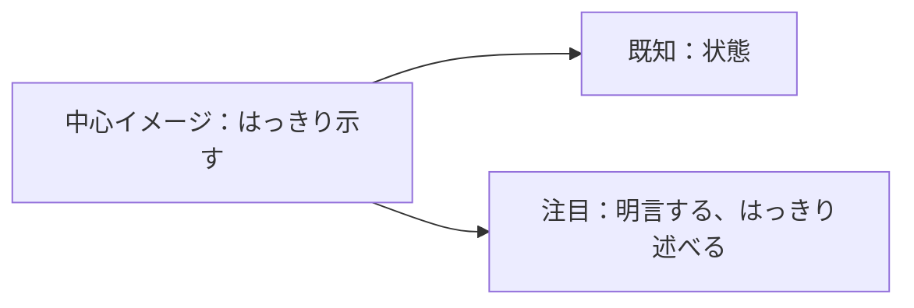

**重要語法**

- state that ...：〜と明言する

<small>出典データ：index 98 / candidate_id `ev-00098-ai-01` / global_order 81</small>

---

## 082. much

**品詞：** 接続詞　　**発音：** /mʌtʃ/

<small>よく知られている意味：多く</small>

### 見落としやすい意味：much as ...：〜だけれども

**例文**

Much as I respect his opinion, I cannot agree with it.

**和訳**

彼の意見はとても尊重しているが、賛成はできない。

**コアイメージ**

much は程度の大きさを表す。much as ... では、その程度を十分に認めても結論は変わらないという譲歩を示す。

**図**

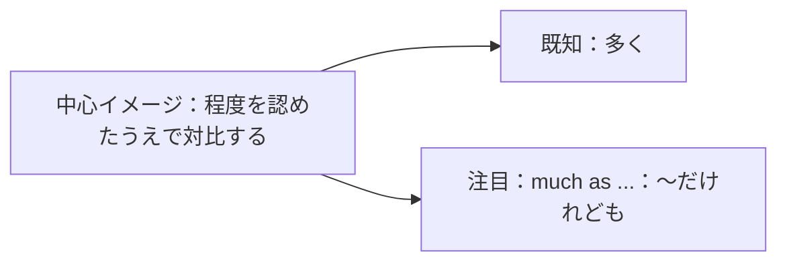

**重要語法**

- much as S V：SがVするけれども

<small>出典データ：index 100 / candidate_id `ev-00100-ai-01` / global_order 82</small>

---

## 083. then

**品詞：** 形容詞　　**発音：** /ðen/

<small>よく知られている意味：そのとき</small>

### 見落としやすい意味：その当時の（the then president など）

**例文**

The then manager introduced the new policy.

**和訳**

当時の支配人がその新しい方針を導入した。

**コアイメージ**

then は過去や未来のある時点を指す。名詞の前に置けば、その時点でその役職にあった人などを限定できる。

**図**

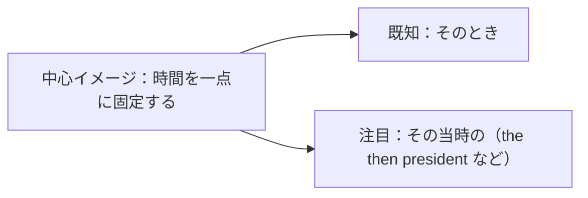

**重要語法**

- the then president：当時の大統領

<small>出典データ：index 103 / candidate_id `ev-00103-ai-01` / global_order 83</small>

---

## 084. become

**品詞：** 動詞　　**発音：** /bɪˈkʌm/

<small>よく知られている意味：〜になる</small>

### 見落としやすい意味：（人・服装などに）似合う、ふさわしい

**例文**

That blue jacket really becomes you.

**和訳**

その青い上着はあなたによく似合う。

**コアイメージ**

become には、ある姿になるという基本用法とは別に、服装などが人にふさわしく見えるという用法がある。身に着けたものと本人がよく調和するイメージで捉える。

**図**

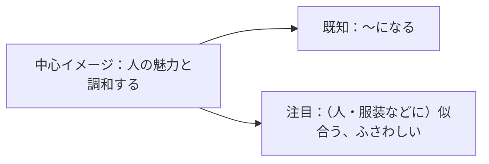

**重要語法**

- become + 人：人に似合う

<small>出典データ：index 107 / candidate_id `ev-00107-ai-01` / global_order 84</small>

---

## 085. most

**品詞：** 構文・熟語　　**発音：** /moʊst/

<small>よく知られている意味：最も多く</small>

### 見落としやすい意味：at most：多くても、せいぜい

**例文**

The repair will take two days at most.

**和訳**

修理には長くても2日しかかからない。

**コアイメージ**

most は量や程度の最大を指す。at most はその最大値を超えないことを表す。

**図**

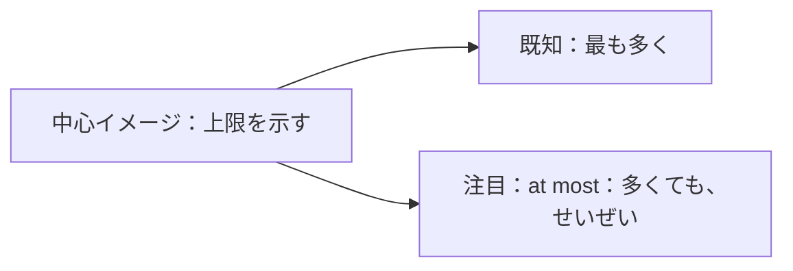

**重要語法**

- at most：多くても

<small>出典データ：index 108 / candidate_id `ev-00108-ai-01` / global_order 85</small>

---

## 086. through

**品詞：** 構文・熟語　　**発音：** /θruː/

<small>よく知られている意味：〜を通り抜けて</small>

### 見落としやすい意味：be through with ...：〜を終えている

**例文**

I'm finally through with my homework.

**和訳**

ようやく宿題を全部終えた。

**コアイメージ**

through は始まりから終わりまで通り抜ける感覚を持つ。be through with ... では、作業の終点に達してもう終えている状態を表す。

**図**

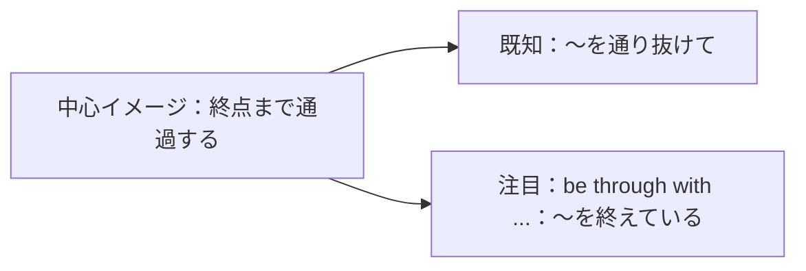

**重要語法**

- be through with ...：〜を終えている

<small>出典データ：index 109 / candidate_id `ev-00109-ai-01` / global_order 86</small>

---

## 087. think

**品詞：** 構文・熟語　　**発音：** /θɪŋk/

<small>よく知られている意味：考える</small>

### 見落としやすい意味：think little of ...：〜を大して評価しない

**例文**

He thinks little of the new proposal.

**和訳**

彼はその新しい提案をあまり評価していない。

**コアイメージ**

think of は対象に対する考えや評価にも使う。little を添えると、その対象に与える評価が低いことになる。

**図**

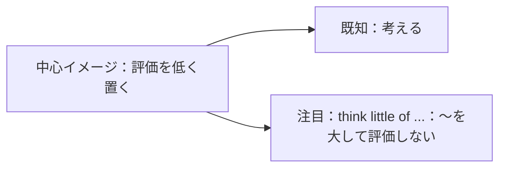

**重要語法**

- think highly of ...：〜を高く評価する

<small>出典データ：index 110 / candidate_id `ev-00110-ai-01` / global_order 87</small>

---

## 088. provide

**品詞：** 接続詞　　**発音：** /prəˈvaɪd/

<small>よく知られている意味：提供する</small>

### 見落としやすい意味：provided that ...：〜という条件ならば

**例文**

You may use this room provided that you keep it clean.

**和訳**

きれいに使うという条件なら、この部屋を使ってよい。

**コアイメージ**

provided that は条件を表す接続表現である。ある条件が満たされることを前提に、主節の内容を認める。

**図**

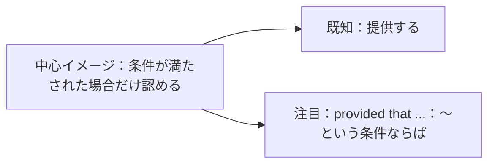

**重要語法**

- provided that S V：SがVするという条件なら

<small>出典データ：index 111 / candidate_id `ev-00111-ai-01` / global_order 88</small>

---

## 089. day

**品詞：** 構文・熟語　　**発音：** /deɪ/

<small>よく知られている意味：日</small>

### 見落としやすい意味：any day now：今にも、近いうちに

**例文**

The results should arrive any day now.

**和訳**

結果はもういつ届いてもおかしくない。

**コアイメージ**

any day now は、今を起点に近いうちのどの日でも起こり得るという感覚を表す。もう間もなくという期待や予測になる。

**図**

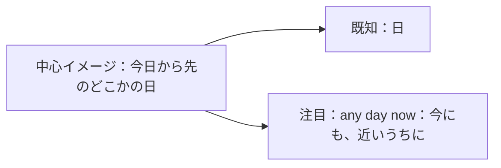

**重要語法**

- any day now：今にも

<small>出典データ：index 112 / candidate_id `ev-00112-ai-01` / global_order 89</small>

---

## 090. story

**品詞：** 名詞　　**発音：** /ˈstɔːri/

<small>よく知られている意味：物語</small>

### 見落としやすい意味：（建物の）階（米語）

**例文**

They live in a three-story house.

**和訳**

彼らは3階建ての家に住んでいる。

**コアイメージ**

story は物語の意味だけでなく、建物を上下に分けた一つの階も表す。米語では建物の階数を言うときによく使う。

**図**

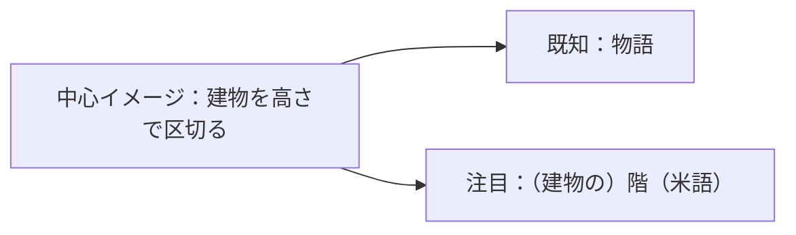

**重要語法**

- three-story house：3階建ての家

<small>出典データ：index 114 / candidate_id `ev-00114-ai-01` / global_order 90</small>

---

## 091. case

**品詞：** 構文・熟語　　**発音：** /keɪs/

<small>よく知られている意味：場合</small>

### 見落としやすい意味：in case ...：〜するといけないので、〜の場合に備えて

**例文**

Take a jacket in case it gets cold.

**和訳**

寒くなるといけないので、上着を持っていきなさい。

**コアイメージ**

case は起こり得る場合を指す。in case ... は、その場合に困らないよう事前に行動することを表す。

**図**

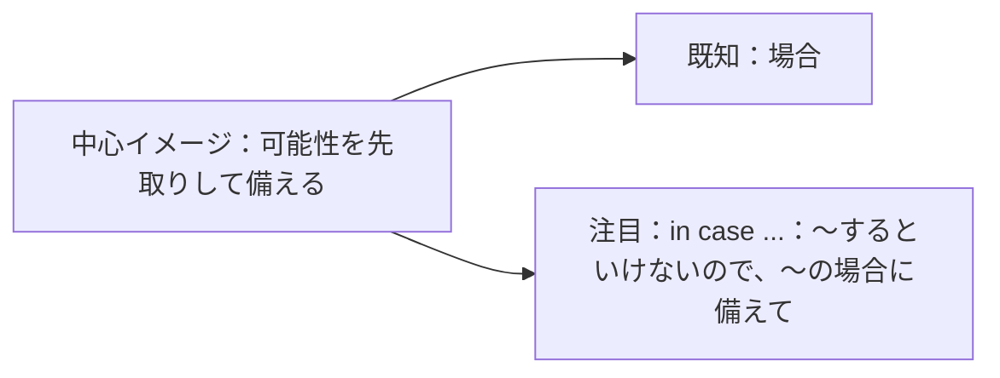

**重要語法**

- in case S V：SがVするといけないので

<small>出典データ：index 115 / candidate_id `ev-00115-ai-01` / global_order 91</small>

---

## 092. well

**品詞：** 形容詞　　**発音：** /wel/

<small>よく知られている意味：上手に</small>

### 見落としやすい意味：健康な

**例文**

She is well enough to return to school.

**和訳**

彼女は学校に戻れるくらい元気だ。

**コアイメージ**

well は物事がうまくいっている状態を表すことがある。形容詞で人に用いれば、体調がよいことを表す。

**図**

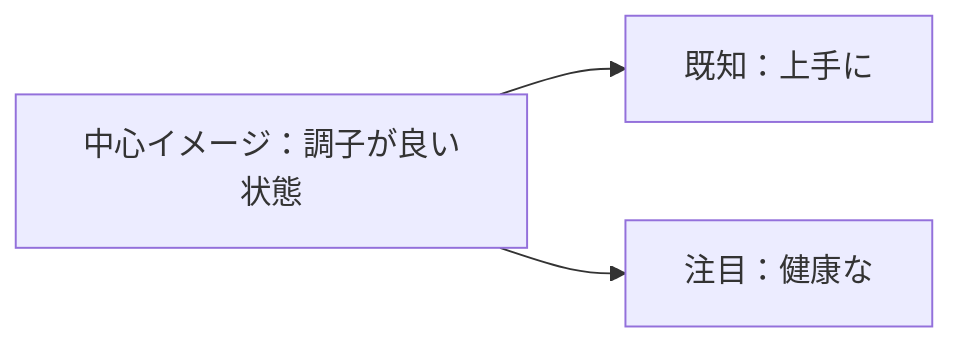

**重要語法**

- feel well：体調がよい

<small>出典データ：index 117 / candidate_id `ev-00117-adjective-01` / global_order 92</small>

---

## 093. well

**品詞：** 名詞　　**発音：** /wel/

<small>よく知られている意味：上手に</small>

### 見落としやすい意味：井戸

**例文**

The village gets its drinking water from a well.

**和訳**

その村は飲み水を井戸から得ている。

**コアイメージ**

この well は副詞の「上手に」と同じつづりだが、別の意味を持つ名詞である。地下水をくみ上げるための井戸を指すので、文中の品詞で区別する。

**図**

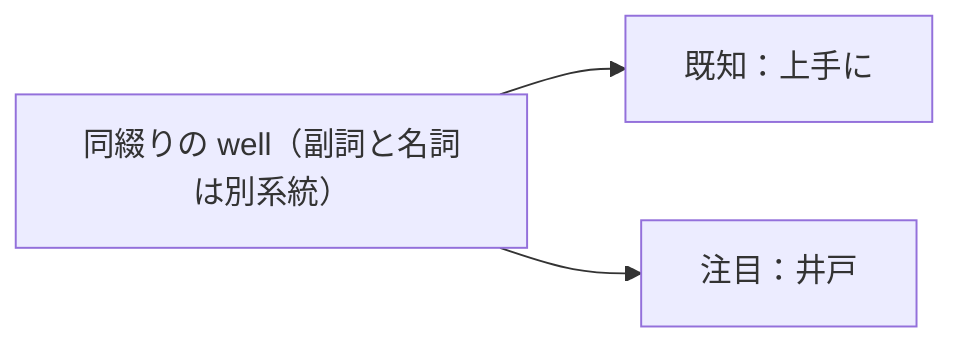

**重要語法**

- a deep well：深い井戸

<small>出典データ：index 117 / candidate_id `ev-00117-noun-02` / global_order 93</small>

---

## 094. well

**品詞：** 動詞　　**発音：** /wel/

<small>よく知られている意味：上手に</small>

### 見落としやすい意味：（液体が）湧き出る

**例文**

Water welled up from a crack in the ground.

**和訳**

地面の割れ目から水が湧き出た。

**コアイメージ**

動詞 well は液体が内側から外へ湧き上がる動きを表す。水のほか、涙などがあふれ出る場合にも使う。

**図**

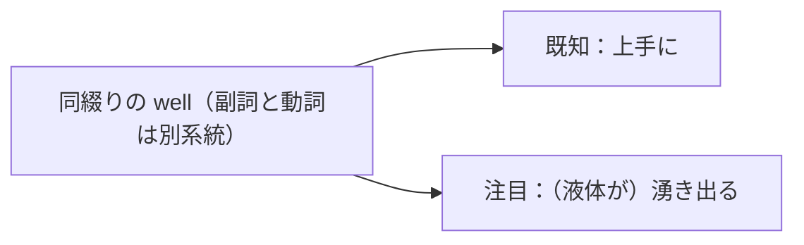

**重要語法**

- well up：湧き上がる

<small>出典データ：index 117 / candidate_id `ev-00117-verb-03` / global_order 94</small>

---

## 095. while

**品詞：** 接続詞　　**発音：** /waɪl/

<small>よく知られている意味：〜する間に</small>

### 見落としやすい意味：一方で、〜だが（対比・譲歩を表す）

**例文**

I prefer trains, while my sister likes buses.

**和訳**

私は電車の方が好きだが、姉はバスが好きだ。

**コアイメージ**

while は二つの出来事が並行することを表す。そこから二つの立場や事情を並べて対比する意味にもなる。

**図**

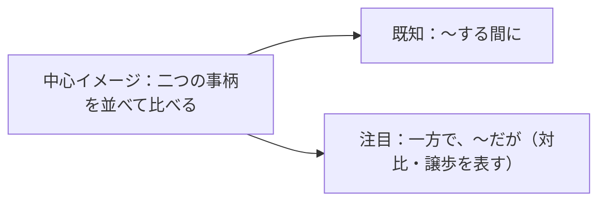

**重要語法**

- while S V：一方でSはV

<small>出典データ：index 118 / candidate_id `ev-00118-ai-01` / global_order 95</small>

---

## 096. still

**品詞：** 形容詞　　**発音：** /stɪl/

<small>よく知られている意味：まだ</small>

### 見落としやすい意味：動かない、静止した

**例文**

The lake was completely still in the morning.

**和訳**

朝、その湖はまったく波立っていなかった。

**コアイメージ**

still は続いて変わらないという感覚を持つ。形容詞では動かず、静止している状態を表す。

**図**

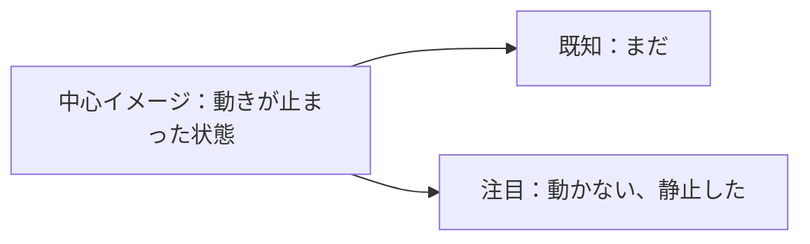

**重要語法**

- stand still：じっと立つ

<small>出典データ：index 120 / candidate_id `ev-00120-ai-01` / global_order 96</small>

---

## 097. name

**品詞：** 構文・熟語　　**発音：** /neɪm/

<small>よく知られている意味：名前</small>

### 見落としやすい意味：name A after B：BにちなんでAを名付ける

**例文**

They named the baby after her grandmother.

**和訳**

彼らは赤ちゃんに祖母にちなんだ名前を付けた。

**コアイメージ**

name は名前を付けることを表す。name A after B では、B の名前を受け継ぐ形で A を名付ける。

**図**

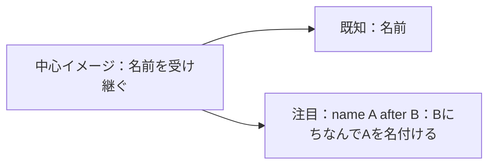

**重要語法**

- name A after B：BにちなんでAを名付ける

<small>出典データ：index 123 / candidate_id `ev-00123-ai-01` / global_order 97</small>

---

## 098. lead

**品詞：** 名詞　　**発音：** /led/

<small>よく知られている意味：導く</small>

### 見落としやすい意味：鉛（金属。手がかりのleadと発音が異なる）

**例文**

The old roof contained lead.

**和訳**

その古い屋根には鉛が含まれていた。

**コアイメージ**

金属の lead は、人を導く lead と同じ綴りだが発音と意味が異なる。金属の鉛を表す名詞で、文脈から見分ける。

**図**

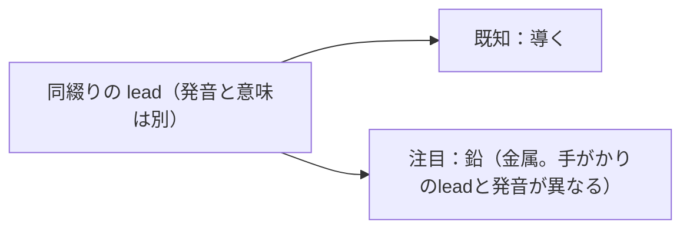

**重要語法**

- lead /led/：鉛（動詞の lead は /liːd/）

<small>出典データ：index 124 / candidate_id `ev-00124-ai-01` / global_order 98</small>

---

## 099. lead

**品詞：** 名詞　　**発音：** /liːd/

<small>よく知られている意味：導く</small>

### 見落としやすい意味：手がかり

**例文**

The detective followed an important lead.

**和訳**

刑事は重要な手がかりを追った。

**コアイメージ**

lead は人をある方向へ導く感覚を持つ。名詞では、事件の解決などに向かうための手がかりを指す。

**図**

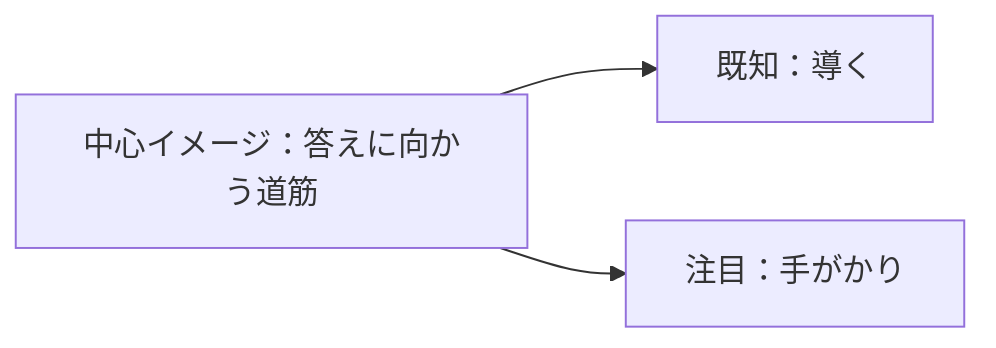

**重要語法**

- follow a lead：手がかりを追う

<small>出典データ：index 124 / candidate_id `ev-00124-noun-01` / global_order 99</small>

---

## 100. word

**品詞：** 構文・熟語　　**発音：** /wɝːd/

<small>よく知られている意味：言葉</small>

### 見落としやすい意味：send word：知らせを送る

**例文**

She sent word that she would arrive late.

**和訳**

彼女は到着が遅れるという知らせを送った。

**コアイメージ**

word は単語だけでなく、言葉で伝えられる知らせにもなる。send word はその知らせを相手へ届けるという表現である。

**図**

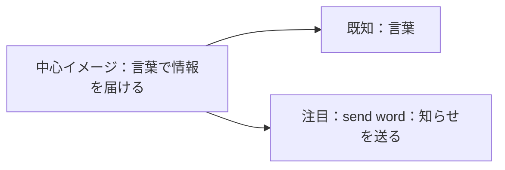

**重要語法**

- send word that ...：〜と知らせる

<small>出典データ：index 125 / candidate_id `ev-00125-ai-01` / global_order 100</small>

---

## 101. word

**品詞：** 名詞　　**発音：** /wɝːd/

<small>よく知られている意味：言葉</small>

### 見落としやすい意味：約束

**例文**

He gave me his word that he would return.

**和訳**

彼は必ず戻ると私に約束した。

**コアイメージ**

word は口にした言葉を指す。give one's word では、自分の発言に責任を持つという意味で約束を表す。

**図**

```mermaid

flowchart LR
    A["中心イメージ：言葉に責任を持つ"]
    B["既知：言葉"]
    C["注目：約束"]
    A --> B
    A --> C

```

**重要語法**

- give one's word：約束する

<small>出典データ：index 125 / candidate_id `ev-00125-noun-01` / global_order 101</small>

---

## 102. cost

**品詞：** 動詞　　**発音：** /kɔːst/

<small>よく知られている意味：費用がかかる</small>

### 見落としやすい意味：〜を犠牲にさせる

**例文**

His careless mistake cost him his job.

**和訳**

彼は不注意なミスのせいで仕事を失った。

**コアイメージ**

cost は何かを得たり起こしたりした際の代償を表す。お金に限らず、職や時間など大切なものを失わせる場合にも使える。

**図**

```mermaid

flowchart LR
    A["中心イメージ：支払う代償"]
    B["既知：費用がかかる"]
    C["注目：〜を犠牲にさせる"]
    A --> B
    A --> C

```

**重要語法**

- cost A B：AにBを失わせる

<small>出典データ：index 126 / candidate_id `ev-00126-verb-01` / global_order 102</small>

---

## 103. might

**品詞：** 名詞　　**発音：** /maɪt/

<small>よく知られている意味：〜かもしれない</small>

### 見落としやすい意味：力、威力

**例文**

The team fought with all its might.

**和訳**

チームは全力を尽くして戦った。

**コアイメージ**

名詞の might は強い力や威力を表す。助動詞 might と同じ綴りでも、ここでは名詞として使われている。

**図**

```mermaid

flowchart LR
    A["同綴りの might（助動詞と名詞）"]
    B["既知：〜かもしれない"]
    C["注目：力、威力"]
    A --> B
    A --> C

```

**重要語法**

- with all one's might：全力で

<small>出典データ：index 128 / candidate_id `ev-00128-noun-01` / global_order 103</small>

---

## 104. own

**品詞：** 構文・熟語　　**発音：** /oʊn/

<small>よく知られている意味：自分自身の</small>

### 見落としやすい意味：own up to ...：〜を正直に認める

**例文**

She finally owned up to the mistake.

**和訳**

彼女はとうとうその間違いを正直に認めた。

**コアイメージ**

own は自分のものとする感覚を持つ。own up to ... では、自分に責任がある事実を逃げずに認める。

**図**

```mermaid

flowchart LR
    A["中心イメージ：自分のものとして引き受ける"]
    B["既知：自分自身の"]
    C["注目：own up to ...：〜を正直に認める"]
    A --> B
    A --> C

```

**重要語法**

- own up to ...：〜を正直に認める

<small>出典データ：index 130 / candidate_id `ev-00130-ai-01` / global_order 104</small>

---

## 105. point

**品詞：** 構文・熟語　　**発音：** /pɔɪnt/

<small>よく知られている意味：点</small>

### 見落としやすい意味：there is no point in -ing：〜しても無駄だ

**例文**

There is no point in worrying about it now.

**和訳**

今それを心配しても仕方がない。

**コアイメージ**

point は要点や目的にも使われる。there is no point in ... は、その行為をしても得るものがないと伝える。

**図**

```mermaid

flowchart LR
    A["中心イメージ：目的に結び付く意義"]
    B["既知：点"]
    C["注目：there is no point in -ing：〜しても無駄だ"]
    A --> B
    A --> C

```

**重要語法**

- There is no point in -ing：〜しても無駄だ

<small>出典データ：index 131 / candidate_id `ev-00131-ai-01` / global_order 105</small>

---

## 106. point

**品詞：** 構文・熟語　　**発音：** /pɔɪnt/

<small>よく知られている意味：点</small>

### 見落としやすい意味：point to ...：〜を示唆する、〜を指し示す

**例文**

The evidence points to another explanation.

**和訳**

その証拠は別の説明が正しい可能性を示している。

**コアイメージ**

point の基本はある方向を指すこと。point to ... では、証拠などが結論へ向かう方向を示す。

**図**

```mermaid

flowchart LR
    A["中心イメージ：方向を指し示す"]
    B["既知：点"]
    C["注目：point to ...：〜を示唆する、〜を指し示す"]
    A --> B
    A --> C

```

**重要語法**

- point to ...：〜を示唆する

<small>出典データ：index 131 / candidate_id `ev-00131-ai-02` / global_order 106</small>

---

## 107. change

**品詞：** 名詞　　**発音：** /tʃeɪndʒ/

<small>よく知られている意味：変化</small>

### 見落としやすい意味：お釣り、釣り銭

**例文**

You can keep the change.

**和訳**

お釣りは取っておいてください。

**コアイメージ**

change は変えることや変化を表す。お金のやり取りでは、払った額と代金との差として戻るお釣りを指す。

**図**

```mermaid

flowchart LR
    A["中心イメージ：支払い後に戻る差額"]
    B["既知：変化"]
    C["注目：お釣り、釣り銭"]
    A --> B
    A --> C

```

**重要語法**

- keep the change：お釣りは取っておいて

<small>出典データ：index 134 / candidate_id `ev-00134-noun-01` / global_order 107</small>

---

## 108. show

**品詞：** 構文・熟語　　**発音：** /ʃoʊ/

<small>よく知られている意味：見せる</small>

### 見落としやすい意味：show up：姿を現す

**例文**

Only six people showed up for the meeting.

**和訳**

その会議には6人しか姿を見せなかった。

**コアイメージ**

show は見えるようにすることを表す。show up は人がその場に現れて、姿が見える状態になること。

**図**

```mermaid

flowchart LR
    A["中心イメージ：人前に姿が現れる"]
    B["既知：見せる"]
    C["注目：show up：姿を現す"]
    A --> B
    A --> C

```

**重要語法**

- show up：現れる

<small>出典データ：index 135 / candidate_id `ev-00135-ai-01` / global_order 108</small>

---

## 109. few

**品詞：** 構文・熟語　　**発音：** /fjuː/

<small>よく知られている意味：少数の</small>

### 見落としやすい意味：quite a few：かなり多くの

**例文**

Quite a few people attended the lecture.

**和訳**

その講演にはかなり多くの人が出席した。

**コアイメージ**

a few は少数ながら存在することを表す。quite a few は意外にも少なくない量を指し、かなり多いという意味になる。

**図**

```mermaid

flowchart LR
    A["中心イメージ：少なくないという強調"]
    B["既知：少数の"]
    C["注目：quite a few：かなり多くの"]
    A --> B
    A --> C

```

**重要語法**

- quite a few＋複数名詞

<small>出典データ：index 137 / candidate_id `ev-00137-ai-01` / global_order 109</small>

---

## 110. right

**品詞：** 名詞　　**発音：** /raɪt/

<small>よく知られている意味：正しい</small>

### 見落としやすい意味：権利、正当な請求権

**例文**

Everyone has the right to express an opinion.

**和訳**

誰もが意見を表明する権利を持っている。

**コアイメージ**

right は正しいことや正当性に関係する。名詞では、自分が正当に行使できる権利を表す。

**図**

```mermaid

flowchart LR
    A["中心イメージ：正当に持てるもの"]
    B["既知：正しい"]
    C["注目：権利、正当な請求権"]
    A --> B
    A --> C

```

**重要語法**

- the right to do：〜する権利

<small>出典データ：index 138 / candidate_id `ev-00138-ai-01` / global_order 110</small>

---

## 111. last

**品詞：** 動詞　　**発音：** /læst/

<small>よく知られている意味：最後の</small>

### 見落としやすい意味：続く、持続する

**例文**

The lecture lasted for nearly two hours.

**和訳**

その講義はほぼ2時間続いた。

**コアイメージ**

last は最後という位置を表す語でもある。動詞では、ある状態が終わるまで続くことを表す。

**図**

```mermaid

flowchart LR
    A["中心イメージ：終わりまで続く"]
    B["既知：最後の"]
    C["注目：続く、持続する"]
    A --> B
    A --> C

```

**重要語法**

- last for ...：〜の間続く

<small>出典データ：index 139 / candidate_id `ev-00139-verb-01` / global_order 111</small>

---

## 112. place

**品詞：** 構文・熟語　　**発音：** /pleɪs/

<small>よく知られている意味：場所</small>

### 見落としやすい意味：in place：所定の位置に、整って

**例文**

The new rules are already in place.

**和訳**

新しい規則はすでに整っている。

**コアイメージ**

in place は物が所定の位置にある状態を表す。制度や準備については、必要なものが整っているという意味になる。

**図**

```mermaid

flowchart LR
    A["中心イメージ：あるべき位置に収まる"]
    B["既知：場所"]
    C["注目：in place：所定の位置に、整って"]
    A --> B
    A --> C

```

**重要語法**

- in place：整って、所定の位置に

<small>出典データ：index 140 / candidate_id `ev-00140-ai-01` / global_order 112</small>

---

## 113. want

**品詞：** 構文・熟語　　**発音：** /wɑːnt/

<small>よく知られている意味：欲しい</small>

### 見落としやすい意味：for want of ...：〜がないために

**例文**

The event was canceled for want of staff.

**和訳**

人手が足りなかったため、その催しは中止になった。

**コアイメージ**

名詞の want には不足という意味がある。for want of ... は、必要なものがないことを理由にする表現である。

**図**

```mermaid

flowchart LR
    A["中心イメージ：必要なものが欠けている"]
    B["既知：欲しい"]
    C["注目：for want of ...：〜がないために"]
    A --> B
    A --> C

```

**重要語法**

- for want of ...：〜がないために

<small>出典データ：index 141 / candidate_id `ev-00141-ai-01` / global_order 113</small>

---

## 114. another

**品詞：** 構文・熟語　　**発音：** /əˈnʌðər/

<small>よく知られている意味：もう一つの</small>

### 見落としやすい意味：another＋数詞＋複数名詞：さらに〜だけ

**例文**

We need another three days to finish the work.

**和訳**

その仕事を終えるには、さらに3日必要だ。

**コアイメージ**

another はもう一つ追加する感覚を持つ。数詞と複数名詞を続けると、さらにその数だけという意味になる。

**図**

```mermaid

flowchart LR
    A["中心イメージ：今ある量に追加する"]
    B["既知：もう一つの"]
    C["注目：another＋数詞＋複数名詞：さらに〜だけ"]
    A --> B
    A --> C

```

**重要語法**

- another three days：さらに3日

<small>出典データ：index 142 / candidate_id `ev-00142-ai-01` / global_order 114</small>

---

## 115. look

**品詞：** 名詞　　**発音：** /lʊk/

<small>よく知られている意味：見る</small>

### 見落としやすい意味：雰囲気、印象

**例文**

The café has a relaxed look.

**和訳**

そのカフェには落ち着いた雰囲気がある。

**コアイメージ**

look は見ることだけでなく、見た目そのものも表す。そこから人や場所が与える印象や雰囲気を指す名詞になる。

**図**

```mermaid

flowchart LR
    A["中心イメージ：見た目から受ける印象"]
    B["既知：見る"]
    C["注目：雰囲気、印象"]
    A --> B
    A --> C

```

**重要語法**

- have a ... look：〜な印象がある

<small>出典データ：index 143 / candidate_id `ev-00143-noun-01` / global_order 115</small>

---

## 116. too

**品詞：** 構文・熟語　　**発音：** /tuː/

<small>よく知られている意味：〜もまた</small>

### 見落としやすい意味：only too ...：非常に〜、まさに〜

**例文**

I'm only too happy to answer your questions.

**和訳**

ご質問にお答えできて本当にうれしいです。

**コアイメージ**

too は通常、程度が過剰であることを示す。only too ... では、強い気持ちや程度を表して、非常にという肯定的な意味になることがある。

**図**

```mermaid

flowchart LR
    A["中心イメージ：程度が十分すぎるほど高い"]
    B["既知：〜もまた"]
    C["注目：only too ...：非常に〜、まさに〜"]
    A --> B
    A --> C

```

**重要語法**

- only too happy to do：喜んで〜する

<small>出典データ：index 145 / candidate_id `ev-00145-ai-01` / global_order 116</small>

---

## 117. write

**品詞：** 構文・熟語　　**発音：** /raɪt/

<small>よく知られている意味：書く</small>

### 見落としやすい意味：write off ...：〜を損失として処理する、見限る

**例文**

The bank decided to write off the old debt.

**和訳**

銀行はその古い債務を損失処理することにした。

**コアイメージ**

write は帳簿に記すことにも使う。write off は帳簿上の価値を取り除き、回収不能な額などを損失として扱うこと。

**図**

```mermaid

flowchart LR
    A["中心イメージ：帳簿から価値を外す"]
    B["既知：書く"]
    C["注目：write off ...：〜を損失として処理する、見限る"]
    A --> B
    A --> C

```

**重要語法**

- write off a debt：債務を損失処理する

<small>出典データ：index 146 / candidate_id `ev-00146-ai-01` / global_order 117</small>

---

## 118. service

**品詞：** 名詞　　**発音：** /ˈsɝːvɪs/

<small>よく知られている意味：サービス</small>

### 見落としやすい意味：礼拝

**例文**

The church holds a service every Sunday.

**和訳**

その教会では毎週日曜日に礼拝が行われる。

**コアイメージ**

service は誰かや何かに仕えることから広がった語である。宗教の文脈では、定められた礼拝や宗教儀式を指す。

**図**

```mermaid

flowchart LR
    A["中心イメージ：共同で行う奉仕・儀式"]
    B["既知：サービス"]
    C["注目：礼拝"]
    A --> B
    A --> C

```

**重要語法**

- attend a service：礼拝に出席する

<small>出典データ：index 147 / candidate_id `ev-00147-noun-01` / global_order 118</small>

---

## 119. very

**品詞：** 形容詞　　**発音：** /ˈveri/

<small>よく知られている意味：とても</small>

### 見落としやすい意味：まさにその、ほかならぬ（the very ...）

**例文**

This is the very book I wanted to read.

**和訳**

これこそまさに私が読みたかった本だ。

**コアイメージ**

very は程度を強めるだけではない。名詞の前で、そのものにほかならないと対象を強調する形容詞にもなる。

**図**

```mermaid

flowchart LR
    A["中心イメージ：ほかでもない対象を強調する"]
    B["既知：とても"]
    C["注目：まさにその、ほかならぬ（the very ...）"]
    A --> B
    A --> C

```

**重要語法**

- the very ...：まさにその〜

<small>出典データ：index 149 / candidate_id `ev-00149-ai-01` / global_order 119</small>

---

## 120. number

**品詞：** 構文・熟語　　**発音：** /ˈnʌmbər/

<small>よく知られている意味：数</small>

### 見落としやすい意味：a number of＋複数名詞：多数の〜

**例文**

A number of students volunteered to help.

**和訳**

多くの生徒が手伝いを申し出た。

**コアイメージ**

number は数を表す。a number of ... では、個々のものがある程度まとまった数として存在することを示す。

**図**

```mermaid

flowchart LR
    A["中心イメージ：まとまった人数を表す"]
    B["既知：数"]
    C["注目：a number of＋複数名詞：多数の〜"]
    A --> B
    A --> C

```

**重要語法**

- a number of＋複数名詞：動詞も原則複数扱い

<small>出典データ：index 152 / candidate_id `ev-00152-ai-01` / global_order 120</small>

---

## 121. help

**品詞：** 構文・熟語　　**発音：** /help/

<small>よく知られている意味：助ける</small>

### 見落としやすい意味：cannot help -ing：〜せずにはいられない

**例文**

I couldn't help smiling at the news.

**和訳**

その知らせを聞いて、思わず笑顔になった。

**コアイメージ**

help は行為を助ける意味が基本だが、cannot help -ing は行動を止められないという決まった表現である。自然に起きる反応を抑えられない。

**図**

```mermaid

flowchart LR
    A["中心イメージ：反応を抑えられない"]
    B["既知：助ける"]
    C["注目：cannot help -ing：〜せずにはいられない"]
    A --> B
    A --> C

```

**重要語法**

- cannot help -ing：〜せずにはいられない

<small>出典データ：index 153 / candidate_id `ev-00153-ai-01` / global_order 121</small>

---

## 122. man

**品詞：** 動詞　　**発音：** /mæn/

<small>よく知られている意味：男性</small>

### 見落としやすい意味：（持ち場などに）人員を配置する

**例文**

Two volunteers manned the information desk.

**和訳**

2人のボランティアが案内所の担当についた。

**コアイメージ**

man は人を意味する名詞だけではない。動詞では、必要な場所に人を配置して担当させることを表す。

**図**

```mermaid

flowchart LR
    A["中心イメージ：持ち場に人を置く"]
    B["既知：男性"]
    C["注目：（持ち場などに）人員を配置する"]
    A --> B
    A --> C

```

**重要語法**

- man a desk：受付などを担当する

<small>出典データ：index 154 / candidate_id `ev-00154-ai-01` / global_order 122</small>

---

## 123. issue

**品詞：** 名詞　　**発音：** /ˈɪʃuː/

<small>よく知られている意味：問題</small>

### 見落としやすい意味：（雑誌などの）号

**例文**

I bought the latest issue of the magazine.

**和訳**

私はその雑誌の最新号を買った。

**コアイメージ**

issue は問題のほかに、発行されたものを指す。定期刊行物では、ある時期に出された一冊分を意味する。

**図**

```mermaid

flowchart LR
    A["中心イメージ：定期的に出される一回分"]
    B["既知：問題"]
    C["注目：（雑誌などの）号"]
    A --> B
    A --> C

```

**重要語法**

- the latest issue：最新号

<small>出典データ：index 155 / candidate_id `ev-00155-noun-02` / global_order 123</small>

---

## 124. issue

**品詞：** 動詞　　**発音：** /ˈɪʃuː/

<small>よく知られている意味：問題</small>

### 見落としやすい意味：（文書などを）公式に発行する

**例文**

The city issued a warning about the storm.

**和訳**

市は嵐について警報を正式に出した。

**コアイメージ**

issue には何かを公に出すという感覚がある。動詞では、組織が文書や警告を正式に発行することを表す。

**図**

```mermaid

flowchart LR
    A["中心イメージ：情報を外に出す"]
    B["既知：問題"]
    C["注目：（文書などを）公式に発行する"]
    A --> B
    A --> C

```

**重要語法**

- issue a warning：警告を出す

<small>出典データ：index 155 / candidate_id `ev-00155-verb-01` / global_order 124</small>

---

## 125. part

**品詞：** 動詞　　**発音：** /pɑːrt/

<small>よく知られている意味：部分</small>

### 見落としやすい意味：別れる、離れる

**例文**

We parted at the station after the trip.

**和訳**

旅行の後、私たちは駅で別れた。

**コアイメージ**

part は全体の一部分を表す。動詞では、一緒にいた人たちが離れて別々になることを指す。

**図**

```mermaid

flowchart LR
    A["中心イメージ：一緒だったものが離れる"]
    B["既知：部分"]
    C["注目：別れる、離れる"]
    A --> B
    A --> C

```

**重要語法**

- part with ...：〜を手放す

<small>出典データ：index 158 / candidate_id `ev-00158-verb-01` / global_order 125</small>

---

## 126. public

**品詞：** 名詞　　**発音：** /ˈpʌblɪk/

<small>よく知られている意味：公の</small>

### 見落としやすい意味：一般大衆

**例文**

The garden is open to the public.

**和訳**

その庭園は一般の人々に開放されている。

**コアイメージ**

public は公のものという意味を持つ。the public とすると、特定の個人でなく一般の人々全体を指す名詞になる。

**図**

```mermaid

flowchart LR
    A["中心イメージ：社会全体の人々"]
    B["既知：公の"]
    C["注目：一般大衆"]
    A --> B
    A --> C

```

**重要語法**

- the public：一般大衆

<small>出典データ：index 159 / candidate_id `ev-00159-noun-01` / global_order 126</small>

---

## 127. since

**品詞：** 接続詞　　**発音：** /sɪns/

<small>よく知られている意味：〜以来</small>

### 見落としやすい意味：〜なので、〜であるから

**例文**

Since the roads were icy, we stayed home.

**和訳**

道路が凍結していたので、私たちは家にいた。

**コアイメージ**

since は時間の起点だけでなく、理由を導く接続詞にもなる。ある事情を前提として、その結果や判断を述べる。

**図**

```mermaid

flowchart LR
    A["中心イメージ：事情を前提に結論を述べる"]
    B["既知：〜以来"]
    C["注目：〜なので、〜であるから"]
    A --> B
    A --> C

```

**重要語法**

- since S V：SがVなので

<small>出典データ：index 160 / candidate_id `ev-00160-ai-01` / global_order 127</small>

---

## 128. back

**品詞：** 動詞　　**発音：** /bæk/

<small>よく知られている意味：後ろ</small>

### 見落としやすい意味：（人・計画などを）支持する、後援する

**例文**

Many local businesses backed the plan.

**和訳**

地元の多くの企業がその計画を支持した。

**コアイメージ**

back は背中や後ろを表す。動詞では、背後で支えるように人や計画を支持することを表す。

**図**

```mermaid

flowchart LR
    A["中心イメージ：背後から支える"]
    B["既知：後ろ"]
    C["注目：（人・計画などを）支持する、後援する"]
    A --> B
    A --> C

```

**重要語法**

- back a plan：計画を支持する

<small>出典データ：index 162 / candidate_id `ev-00162-ai-01` / global_order 128</small>

---

## 129. under

**品詞：** 構文・熟語　　**発音：** /ˈʌndər/

<small>よく知られている意味：〜の下に</small>

### 見落としやすい意味：under way：進行中で

**例文**

Preparations for the festival are under way.

**和訳**

祭りの準備は進行中だ。

**コアイメージ**

way は進む道筋を表す。under way は計画や作業がすでに動き始め、進行中である状態を指す。

**図**

```mermaid

flowchart LR
    A["中心イメージ：物事が動き始めている"]
    B["既知：〜の下に"]
    C["注目：under way：進行中で"]
    A --> B
    A --> C

```

**重要語法**

- under way：進行中で

<small>出典データ：index 163 / candidate_id `ev-00163-ai-01` / global_order 129</small>

---

## 130. must

**品詞：** 構文・熟語　　**発音：** /mʌst/

<small>よく知られている意味：〜しなければならない</small>

### 見落としやすい意味：must have＋過去分詞：〜したに違いない

**例文**

She must have forgotten the appointment.

**和訳**

彼女は約束を忘れたに違いない。

**コアイメージ**

must は必要性だけでなく、確信の強い推量も表す。must have＋過去分詞 で、過去にそうだったはずだと判断する。

**図**

```mermaid

flowchart LR
    A["中心イメージ：過去についての強い推量"]
    B["既知：〜しなければならない"]
    C["注目：must have＋過去分詞：〜したに違いない"]
    A --> B
    A --> C

```

**重要語法**

- must have＋過去分詞：〜したに違いない

<small>出典データ：index 165 / candidate_id `ev-00165-ai-01` / global_order 130</small>

---

## 131. against

**品詞：** preposition　　**発音：** /əˈɡenst/

<small>よく知られている意味：〜に反対して</small>

### 見落としやすい意味：〜に備えて（insure against loss など）

**例文**

They bought insurance against fire damage.

**和訳**

彼らは火災被害に備えて保険に入った。

**コアイメージ**

against は何かに向かって抵抗・対抗する感覚を持つ。危険について用いれば、その危険に備える意味になる。

**図**

```mermaid

flowchart LR
    A["中心イメージ：害を防ぐために対抗する"]
    B["既知：〜に反対して"]
    C["注目：〜に備えて（insure against loss など）"]
    A --> B
    A --> C

```

**重要語法**

- insure against ...：〜に備えて保険をかける

<small>出典データ：index 166 / candidate_id `ev-00166-ai-01` / global_order 131</small>

---

## 132. less

**品詞：** 構文・熟語　　**発音：** /les/

<small>よく知られている意味：より少ない</small>

### 見落としやすい意味：no less than ...：〜も、少なくとも〜

**例文**

No less than 300 people came to the event.

**和訳**

その催しには300人もの人が来た。

**コアイメージ**

less は少ないことを表す。no less than ... は、その数より少ないわけではないと強調して、〜もという驚きを表せる。

**図**

```mermaid

flowchart LR
    A["中心イメージ：少なくない数を強く示す"]
    B["既知：より少ない"]
    C["注目：no less than ...：〜も、少なくとも〜"]
    A --> B
    A --> C

```

**重要語法**

- no less than ...：〜も

<small>出典データ：index 168 / candidate_id `ev-00168-ai-01` / global_order 132</small>

---

## 133. however

**品詞：** 構文・熟語　　**発音：** /haʊˈevər/

<small>よく知られている意味：しかし</small>

### 見落としやすい意味：however＋形容詞・副詞＋主語＋動詞：どんなに〜でも

**例文**

However carefully you plan, problems may arise.

**和訳**

どれほど慎重に計画しても、問題が起こることはある。

**コアイメージ**

however は逆接だけでなく程度の幅を問わない表現にもなる。形容詞や副詞を続けると、どれほど〜であってもという譲歩を作る。

**図**

```mermaid

flowchart LR
    A["中心イメージ：程度がどれほど大きくても"]
    B["既知：しかし"]
    C["注目：however＋形容詞・副詞＋主語＋動詞：どんなに〜でも"]
    A --> B
    A --> C

```

**重要語法**

- however＋形容詞・副詞＋S＋V

<small>出典データ：index 169 / candidate_id `ev-00169-ai-01` / global_order 133</small>

---

## 134. long

**品詞：** 動詞　　**発音：** /lɔːŋ/

<small>よく知られている意味：長い</small>

### 見落としやすい意味：切望する

**例文**

He longs to see his hometown again.

**和訳**

彼は故郷をもう一度見たいと切望している。

**コアイメージ**

long は長さを表す語としてよく知られる。動詞では、願いが強く続くことから切望する意味になる。

**図**

```mermaid

flowchart LR
    A["中心イメージ：気持ちが強く向かい続ける"]
    B["既知：長い"]
    C["注目：切望する"]
    A --> B
    A --> C

```

**重要語法**

- long to do：〜することを切望する

<small>出典データ：index 171 / candidate_id `ev-00171-verb-01` / global_order 134</small>

---

## 135. law

**品詞：** 名詞　　**発音：** /lɔː/

<small>よく知られている意味：法律</small>

### 見落としやすい意味：（自然・科学などの）法則

**例文**

The law of gravity affects every object.

**和訳**

重力の法則はあらゆる物体に作用する。

**コアイメージ**

law は社会の法律だけでなく、一定の現象に成り立つ規則も指す。自然界で繰り返し観察される法則を表す。

**図**

```mermaid

flowchart LR
    A["中心イメージ：例外なく成り立つ規則"]
    B["既知：法律"]
    C["注目：（自然・科学などの）法則"]
    A --> B
    A --> C

```

**重要語法**

- a law of nature：自然法則

<small>出典データ：index 172 / candidate_id `ev-00172-ai-01` / global_order 135</small>

---

## 136. end

**品詞：** 構文・熟語　　**発音：** /end/

<small>よく知られている意味：終わり</small>

### 見落としやすい意味：to this end：この目的のために

**例文**

We wanted to save energy, and to this end we replaced the lights.

**和訳**

省エネを目指し、その目的のために照明を交換した。

**コアイメージ**

end は終わりだけでなく目的や到達点にもなる。to this end は、その目標を実現するために行うことを導く。

**図**

```mermaid

flowchart LR
    A["中心イメージ：目指している到達点"]
    B["既知：終わり"]
    C["注目：to this end：この目的のために"]
    A --> B
    A --> C

```

**重要語法**

- to this end：この目的のために

<small>出典データ：index 173 / candidate_id `ev-00173-ai-01` / global_order 136</small>

---

## 137. end

**品詞：** 構文・熟語　　**発音：** /end/

<small>よく知られている意味：終わる</small>

### 見落としやすい意味：end up -ing：結局〜することになる

**例文**

We ended up walking home in the rain.

**和訳**

私たちは結局、雨の中を歩いて帰ることになった。

**コアイメージ**

end は物事の終点を表す。end up -ing は、いろいろあった末にある行動をする結果に行き着くこと。

**図**

```mermaid

flowchart LR
    A["中心イメージ：最後に行き着いた結果"]
    B["既知：終わる"]
    C["注目：end up -ing：結局〜することになる"]
    A --> B
    A --> C

```

**重要語法**

- end up -ing：結局〜することになる

<small>出典データ：index 173 / candidate_id `ev-00173-ai-02` / global_order 137</small>

---

## 138. country

**品詞：** 名詞　　**発音：** /ˈkʌntri/

<small>よく知られている意味：国</small>

### 見落としやすい意味：田舎、地方（the country）

**例文**

They moved to the country for a quieter life.

**和訳**

彼らは静かな生活を求めて田舎に引っ越した。

**コアイメージ**

country は国土や土地を指す。the country とすると、都市部と対比した田園や地方を指すことがある。

**図**

```mermaid

flowchart LR
    A["中心イメージ：都市の外に広がる地域"]
    B["既知：国"]
    C["注目：田舎、地方（the country）"]
    A --> B
    A --> C

```

**重要語法**

- live in the country：田舎に住む

<small>出典データ：index 175 / candidate_id `ev-00175-ai-01` / global_order 138</small>

---

## 139. book

**品詞：** 動詞　　**発音：** /bʊk/

<small>よく知られている意味：本</small>

### 見落としやすい意味：予約する

**例文**

I booked a seat on the early train.

**和訳**

私は早朝の列車の座席を予約した。

**コアイメージ**

book は本や記録帳を指す。動詞では、名前や予定を記録して席などを確保することを表す。

**図**

```mermaid

flowchart LR
    A["中心イメージ：台帳に予約を記す"]
    B["既知：本"]
    C["注目：予約する"]
    A --> B
    A --> C

```

**重要語法**

- book a seat：席を予約する

<small>出典データ：index 176 / candidate_id `ev-00176-verb-01` / global_order 139</small>

---

## 140. book

**品詞：** 動詞　　**発音：** /bʊk/

<small>よく知られている意味：本</small>

### 見落としやすい意味：（警察が容疑者を）記録する

**例文**

The police booked the driver for speeding.

**和訳**

警察はその運転手を速度違反で記録した。

**コアイメージ**

book は記録帳に関係する語である。警察の文脈では、違反や容疑を公式記録に載せることを意味する。

**図**

```mermaid

flowchart LR
    A["中心イメージ：公式の記録に載せる"]
    B["既知：本"]
    C["注目：（警察が容疑者を）記録する"]
    A --> B
    A --> C

```

**重要語法**

- book someone for speeding：速度違反で検挙・記録する

<small>出典データ：index 176 / candidate_id `ev-00176-verb-02` / global_order 140</small>

---

## 141. tell

**品詞：** 構文・熟語　　**発音：** /tel/

<small>よく知られている意味：話す</small>

### 見落としやすい意味：tell A from B：AとBを見分ける

**例文**

She can tell real pearls from fake ones.

**和訳**

彼女は本物の真珠と偽物を見分けられる。

**コアイメージ**

tell は情報を伝えるほか、判断できることも表す。tell A from B では、特徴を見てAとBを区別できる。

**図**

```mermaid

flowchart LR
    A["中心イメージ：違いを判断して言い当てる"]
    B["既知：話す"]
    C["注目：tell A from B：AとBを見分ける"]
    A --> B
    A --> C

```

**重要語法**

- tell A from B：AとBを見分ける

<small>出典データ：index 177 / candidate_id `ev-00177-ai-01` / global_order 141</small>

---

## 142. tell

**品詞：** 構文・熟語　　**発音：** /tel/

<small>よく知られている意味：話す</small>

### 見落としやすい意味：tell on ...：〜に悪影響が出る

**例文**

The stress began to tell on his health.

**和訳**

そのストレスは彼の健康に悪影響を及ぼし始めた。

**コアイメージ**

tell on ... は、負担や習慣などの影響が対象に現れることを表す。特に健康や状態への悪影響について用いる。

**図**

```mermaid

flowchart LR
    A["中心イメージ：影響が表面に現れる"]
    B["既知：話す"]
    C["注目：tell on ...：〜に悪影響が出る"]
    A --> B
    A --> C

```

**重要語法**

- tell on one's health：健康にこたえる

<small>出典データ：index 177 / candidate_id `ev-00177-ai-02` / global_order 142</small>

---

## 143. mean

**品詞：** 形容詞　　**発音：** /miːn/

<small>よく知られている意味：意味する</small>

### 見落としやすい意味：意地悪な

**例文**

It was mean of him to mock her efforts.

**和訳**

彼女の努力をばかにするなんて、彼は意地悪だった。

**コアイメージ**

mean には動詞の「意味する」と異なる形容詞用法がある。人の行動が思いやりを欠き、意地悪であることを表す。

**図**

```mermaid

flowchart LR
    A["同綴りの mean（動詞と形容詞）"]
    B["既知：意味する"]
    C["注目：意地悪な"]
    A --> B
    A --> C

```

**重要語法**

- It is mean of A to do：〜するとはAは意地悪だ

<small>出典データ：index 178 / candidate_id `ev-00178-adjective-01` / global_order 143</small>

---

## 144. mean

**品詞：** 名詞　　**発音：** /miːn/

<small>よく知られている意味：意味する</small>

### 見落としやすい意味：平均値

**例文**

The mean of 2, 4, and 6 is 4.

**和訳**

2、4、6の平均値は4だ。

**コアイメージ**

名詞の mean は数値の中心となる平均値を指す。日常語の動詞「意味する」とは品詞で区別する。

**図**

```mermaid

flowchart LR
    A["同綴りの mean（動詞と名詞）"]
    B["既知：意味する"]
    C["注目：平均値"]
    A --> B
    A --> C

```

**重要語法**

- arithmetic mean：算術平均

<small>出典データ：index 178 / candidate_id `ev-00178-noun-02` / global_order 144</small>

---

## 145. paper

**品詞：** 名詞　　**発音：** /ˈpeɪpər/

<small>よく知られている意味：紙</small>

### 見落としやすい意味：論文、研究報告

**例文**

Her paper appeared in a medical journal.

**和訳**

彼女の論文は医学雑誌に掲載された。

**コアイメージ**

paper は紙そのものを指す。学術の場では、紙などにまとめて発表した研究論文を意味する。

**図**

```mermaid

flowchart LR
    A["中心イメージ：紙に書かれた研究成果"]
    B["既知：紙"]
    C["注目：論文、研究報告"]
    A --> B
    A --> C

```

**重要語法**

- publish a paper：論文を発表する

<small>出典データ：index 179 / candidate_id `ev-00179-noun-01` / global_order 145</small>

---

## 146. large

**品詞：** 構文・熟語　　**発音：** /lɑːrdʒ/

<small>よく知られている意味：大きい</small>

### 見落としやすい意味：at large：（容疑者などが）逃走中で

**例文**

The escaped prisoner is still at large.

**和訳**

脱走した囚人は今も逃走中だ。

**コアイメージ**

at large は拘束や制限を受けず、自由に動ける状態を表す。犯罪関係の文脈では、容疑者などが捕まらず逃走中である意味になる。

**図**

```mermaid

flowchart LR
    A["中心イメージ：拘束されず自由に動く"]
    B["既知：大きい"]
    C["注目：at large：（容疑者などが）逃走中で"]
    A --> B
    A --> C

```

**重要語法**

- at large：逃走中で

<small>出典データ：index 180 / candidate_id `ev-00180-ai-01` / global_order 146</small>

---

## 147. company

**品詞：** 名詞　　**発音：** /ˈkʌmpəni/

<small>よく知られている意味：会社</small>

### 見落としやすい意味：一緒にいること、同席

**例文**

I enjoyed his company during the journey.

**和訳**

私は旅行中、彼と一緒に過ごすのを楽しんだ。

**コアイメージ**

company は仲間が一緒にいることを表す語でもある。会社という組織だけでなく、同席や付き合いそのものを指す。

**図**

```mermaid

flowchart LR
    A["中心イメージ：人と一緒にいる状態"]
    B["既知：会社"]
    C["注目：一緒にいること、同席"]
    A --> B
    A --> C

```

**重要語法**

- enjoy someone's company：人と一緒にいるのを楽しむ

<small>出典データ：index 183 / candidate_id `ev-00183-noun-01` / global_order 147</small>

---

## 148. down

**品詞：** 構文・熟語　　**発音：** /daʊn/

<small>よく知られている意味：下へ</small>

### 見落としやすい意味：be down to ...：〜の責任にかかっている、〜次第である

**例文**

It's down to us to make the final choice.

**和訳**

最後の選択をするのは私たち次第だ。

**コアイメージ**

be down to ... は、誰に責任や決定がかかるかを示す。選択の最終的な行き先がその人にあるイメージで捉える。

**図**

```mermaid

flowchart LR
    A["中心イメージ：判断の行き着く先を示す"]
    B["既知：下へ"]
    C["注目：be down to ...：〜の責任にかかっている、〜次第である"]
    A --> B
    A --> C

```

**重要語法**

- be down to someone：人次第である

<small>出典データ：index 185 / candidate_id `ev-00185-ai-01` / global_order 148</small>

---

## 149. little

**品詞：** 構文・熟語　　**発音：** /ˈlɪtəl/

<small>よく知られている意味：少し</small>

### 見落としやすい意味：little did ... know：〜とは夢にも思わなかった

**例文**

Little did I know that the news would change my plans.

**和訳**

その知らせが私の予定を変えるとは、夢にも思わなかった。

**コアイメージ**

little は量がほとんどないことを表す。文頭に出して倒置すると、まったく知らなかったという驚きを強調する。

**図**

```mermaid

flowchart LR
    A["中心イメージ：知識がほとんどないことを強調する"]
    B["既知：少し"]
    C["注目：little did ... know：〜とは夢にも思わなかった"]
    A --> B
    A --> C

```

**重要語法**

- Little did I know ...：〜とは思いもしなかった

<small>出典データ：index 186 / candidate_id `ev-00186-ai-01` / global_order 149</small>

---

## 150. question

**品詞：** 構文・熟語　　**発音：** /ˈkwestʃən/

<small>よく知られている意味：質問</small>

### 見落としやすい意味：call ... into question：〜に疑問を投げかける

**例文**

The new findings call that theory into question.

**和訳**

新たな発見はその理論の妥当性に疑問を投げかける。

**コアイメージ**

question は問いや疑問を表す。call ... into question は、正しいと考えていたことを疑いの対象にする表現である。

**図**

```mermaid

flowchart LR
    A["中心イメージ：確かだと思っていたものを問い直す"]
    B["既知：質問"]
    C["注目：call ... into question：〜に疑問を投げかける"]
    A --> B
    A --> C

```

**重要語法**

- call ... into question：〜に疑問を投げかける

<small>出典データ：index 187 / candidate_id `ev-00187-ai-01` / global_order 150</small>

---

## 151. result

**品詞：** 構文・熟語　　**発音：** /rɪˈzʌlt/

<small>よく知られている意味：結果</small>

### 見落としやすい意味：result in ...：結果として〜をもたらす

**例文**

The storm resulted in widespread flooding.

**和訳**

嵐は広い範囲で洪水を引き起こした。

**コアイメージ**

result は結果を表す。result in ... は、ある出来事から先の結果へつながる向きを示す。

**図**

```mermaid

flowchart LR
    A["中心イメージ：原因から結果へ進む"]
    B["既知：結果"]
    C["注目：result in ...：結果として〜をもたらす"]
    A --> B
    A --> C

```

**重要語法**

- result in ...：〜をもたらす

<small>出典データ：index 188 / candidate_id `ev-00188-ai-01` / global_order 151</small>

---

## 152. result

**品詞：** 構文・熟語　　**発音：** /rɪˈzʌlt/

<small>よく知られている意味：結果</small>

### 見落としやすい意味：result from ...：〜に起因する

**例文**

The error resulted from a simple misunderstanding.

**和訳**

その誤りは単純な誤解から生じた。

**コアイメージ**

result は結果を表す。result from ... は、結果がどこから生じたのか原因をさかのぼって示す。

**図**

```mermaid

flowchart LR
    A["中心イメージ：結果から原因をさかのぼる"]
    B["既知：結果"]
    C["注目：result from ...：〜に起因する"]
    A --> B
    A --> C

```

**重要語法**

- result from ...：〜に起因する

<small>出典データ：index 188 / candidate_id `ev-00188-ai-02` / global_order 152</small>

---

## 153. rule

**品詞：** 動詞　　**発音：** /ruːl/

<small>よく知られている意味：規則</small>

### 見落としやすい意味：（裁判所が）裁定する

**例文**

The judge ruled that the evidence was inadmissible.

**和訳**

裁判官は、その証拠は採用できないと裁定した。

**コアイメージ**

rule は規則を定めたり統治したりする意味を持つ。裁判では、裁判官が権限に基づいて判断を正式に示すことを表す。

**図**

```mermaid

flowchart LR
    A["中心イメージ：権限を持って判断を下す"]
    B["既知：規則"]
    C["注目：（裁判所が）裁定する"]
    A --> B
    A --> C

```

**重要語法**

- rule that ...：〜と裁定する

<small>出典データ：index 189 / candidate_id `ev-00189-verb-01` / global_order 153</small>

---

## 154. run

**品詞：** 動詞　　**発音：** /rʌn/

<small>よく知られている意味：走る</small>

### 見落としやすい意味：（企業・事業などを）経営・運営する

**例文**

My aunt runs a small bookstore.

**和訳**

叔母は小さな書店を経営している。

**コアイメージ**

run は走るだけでなく、物事を動かして機能させることを表す。店舗や事業については経営・運営する意味になる。

**図**

```mermaid

flowchart LR
    A["中心イメージ：物事を動かし続ける"]
    B["既知：走る"]
    C["注目：（企業・事業などを）経営・運営する"]
    A --> B
    A --> C

```

**重要語法**

- run a business：事業を経営する

<small>出典データ：index 191 / candidate_id `ev-00191-ai-01` / global_order 154</small>

---

## 155. run

**品詞：** 動詞　　**発音：** /rʌn/

<small>よく知られている意味：走る</small>

### 見落としやすい意味：（川・道路などが）延びる、流れる

**例文**

A narrow road runs along the river.

**和訳**

細い道路が川沿いに延びている。

**コアイメージ**

run は移動する動きから広がり、道や川がある方向へ続くことにも使われる。道路が実際に走るわけではなく、延びる方向を示す。

**図**

```mermaid

flowchart LR
    A["中心イメージ：線状に続いて進む"]
    B["既知：走る"]
    C["注目：（川・道路などが）延びる、流れる"]
    A --> B
    A --> C

```

**重要語法**

- run along ...：〜に沿って延びる

<small>出典データ：index 191 / candidate_id `ev-00191-ai-02` / global_order 155</small>

---

## 156. run

**品詞：** 動詞　　**発音：** /rʌn/

<small>よく知られている意味：走る</small>

### 見落としやすい意味：立候補する

**例文**

She decided to run for class president.

**和訳**

彼女は学級委員長に立候補することを決めた。

**コアイメージ**

run は競争に参加して前へ進むことにも使われる。選挙の文脈では、役職を目指して立候補するという意味になる。

**図**

```mermaid

flowchart LR
    A["中心イメージ：役職を目指して選挙に出る"]
    B["既知：走る"]
    C["注目：立候補する"]
    A --> B
    A --> C

```

**重要語法**

- run for office：公職に立候補する

<small>出典データ：index 191 / candidate_id `ev-00191-verb-01` / global_order 156</small>

---

## 157. support

**品詞：** 動詞　　**発音：** /səˈpɔːrt/

<small>よく知られている意味：支える</small>

### 見落としやすい意味：（主張・理論などを）裏付ける

**例文**

Several studies support this explanation.

**和訳**

いくつかの研究がこの説明を裏付けている。

**コアイメージ**

support は物を支える意味を持つ。主張については、証拠や研究がその確かさを支えることを表す。

**図**

```mermaid

flowchart LR
    A["中心イメージ：下から支えて確かさを与える"]
    B["既知：支える"]
    C["注目：（主張・理論などを）裏付ける"]
    A --> B
    A --> C

```

**重要語法**

- support a claim：主張を裏付ける

<small>出典データ：index 192 / candidate_id `ev-00192-ai-01` / global_order 157</small>

---

## 158. off

**品詞：** 構文・熟語　　**発音：** /ɔːf/

<small>よく知られている意味：離れて</small>

### 見落としやすい意味：off the record：非公式に、公表しない条件で

**例文**

The interview was conducted off the record.

**和訳**

そのインタビューは非公開を前提に行われた。

**コアイメージ**

record は公式に残る記録を指す。off the record はその記録に載せて公表する対象から外すことを表す。

**図**

```mermaid

flowchart LR
    A["中心イメージ：公式記録から外す"]
    B["既知：離れて"]
    C["注目：off the record：非公式に、公表しない条件で"]
    A --> B
    A --> C

```

**重要語法**

- off the record：非公式に、公表しない条件で

<small>出典データ：index 193 / candidate_id `ev-00193-ai-01` / global_order 158</small>

---

## 159. agency

**品詞：** 名詞　　**発音：** /ˈeɪdʒənsi/

<small>よく知られている意味：代理店</small>

### 見落としやすい意味：行為主体性、自分で判断して行動する力

**例文**

The project gave students more agency over their learning.

**和訳**

その企画によって、生徒は自分の学びをより主体的に決められるようになった。

**コアイメージ**

agency には行為する主体であることを表す用法がある。誰かに決めてもらうのではなく、自分で選び行動できる力を指す。

**図**

```mermaid

flowchart LR
    A["中心イメージ：自分で行動を起こす力"]
    B["既知：代理店"]
    C["注目：行為主体性、自分で判断して行動する力"]
    A --> B
    A --> C

```

**重要語法**

- a sense of agency：自分で決めて動ける感覚

<small>出典データ：index 195 / candidate_id `ev-00195-ai-01` / global_order 159</small>

---

## 160. begin

**品詞：** 構文・熟語　　**発音：** /bɪˈɡɪn/

<small>よく知られている意味：始める</small>

### 見落としやすい意味：to begin with：そもそも、まず第一に

**例文**

To begin with, let's check the basic facts.

**和訳**

まず第一に、基本的な事実を確認しましょう。

**コアイメージ**

begin は始めるという意味を持つ。to begin with は説明や議論を始める際、最初に扱うことを示す表現である。

**図**

```mermaid

flowchart LR
    A["中心イメージ：話の出発点を示す"]
    B["既知：始める"]
    C["注目：to begin with：そもそも、まず第一に"]
    A --> B
    A --> C

```

**重要語法**

- to begin with：まず第一に、そもそも

<small>出典データ：index 196 / candidate_id `ev-00196-ai-01` / global_order 160</small>
