# EasyVoca 完成教材｜バッチ003（global_order 161〜240）

採用済み候補のみを教材化。既知の意味は補足、見落としやすい意味を主役として表示する。図は意味の使い分けを説明する模式図であり、必ずしも語源上の関係を意味しない。

### 161. plan

**品詞**：noun　**発音**：/plæn/

<small>よく知られている意味：計画</small>

**見落としやすい意味：設計図、平面図**

**例文**：The architect spread the plans across the table.

**和訳**：建築家は設計図をテーブルに広げた。

**コアイメージ**：planは、これから何をどう配置・実行するかを示す見取り図を表す。行動については「計画」、建物については「設計図」となる。

**図**：

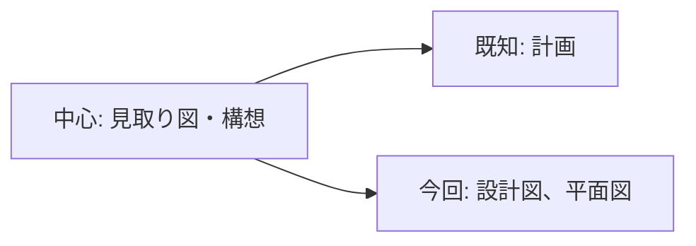

---

### 162. every

**品詞**：構文・語法　**発音**：/ˈevri/

<small>よく知られている意味：すべての</small>

**見落としやすい意味：every other ...：一つおきの〜**

**例文**：The nurse visits the patient every other day.

**和訳**：看護師はその患者を一日おきに訪問する。

**コアイメージ**：everyは一つ一つの単位に目を向ける語。every otherでは並びの中から一つおきに単位を拾う。

**図**：

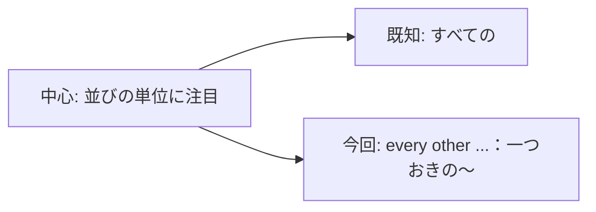

**重要語法**：`every other + 単数名詞：一つおきの〜`

---

### 163. leave

**品詞**：構文・語法　**発音**：/liːv/

<small>よく知られている意味：去る、残す</small>

**見落としやすい意味：leave＋目的語＋補語：〜を…のままにしておく**

**例文**：Please leave the window open.

**和訳**：窓を開けたままにしてください。

**コアイメージ**：leaveは、何かをその場所や状態に残して離れる感覚がある。目的語の後に状態を表す語を置くと「その状態のままにする」と読める。

**図**：

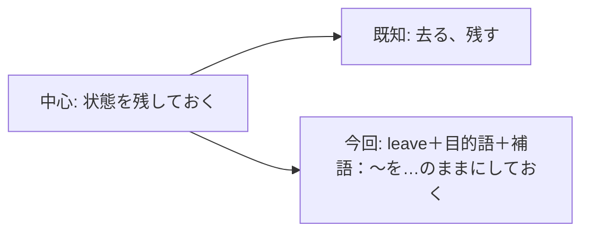

**重要語法**：`leave + 目的語 + 形容詞・分詞など`

---

### 164. leave

**品詞**：noun　**発音**：/liːv/

<small>よく知られている意味：去る</small>

**見落としやすい意味：休暇**

**例文**：She is on leave from work this month.

**和訳**：彼女は今月、仕事を休んでいる。

**コアイメージ**：leaveには職場などから離れることを認められた期間という名詞の意味がある。単に「去る」行為ではなく、正式な休暇を指す。

**図**：

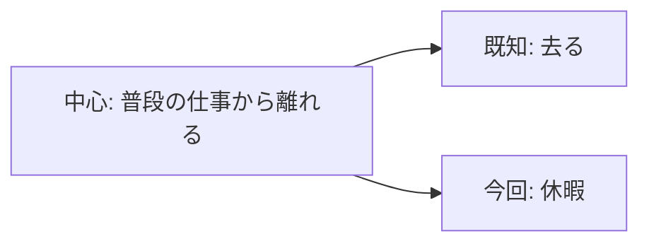

**重要語法**：`on leave：休暇中で`

---

### 165. early

**品詞**：構文・語法　**発音**：/ˈɝːli/

<small>よく知られている意味：早い、早く</small>

**見落としやすい意味：early on：早い段階で**

**例文**：We noticed the mistake early on.

**和訳**：私たちは早い段階でその間違いに気づいた。

**コアイメージ**：early onは物事の進み始めを基準にしている。時間が早いというより、進行の初期だと意識すると読みやすい。

**図**：

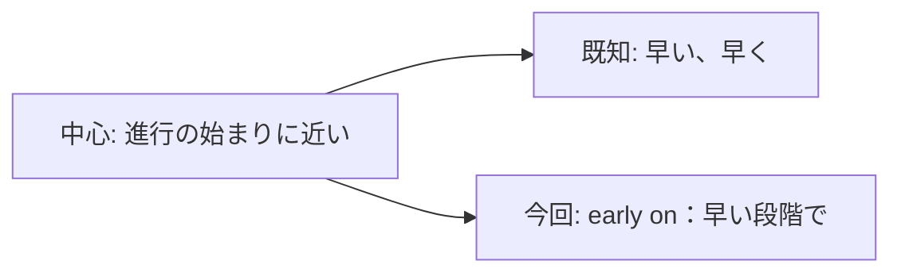

**重要語法**：`early on in the project：計画の初期に`

---

### 166. turn

**品詞**：構文・語法　**発音**：/tɝːn/

<small>よく知られている意味：回る、向きを変える</small>

**見落としやすい意味：turn out to do：結局〜と判明する**

**例文**：The missing key turned out to be in my bag.

**和訳**：なくした鍵は、結局私のかばんの中にあると分かった。

**コアイメージ**：turnには状況が変わっていく感覚がある。turn outは、その展開の末に事実がはっきりすることを表す。

**図**：

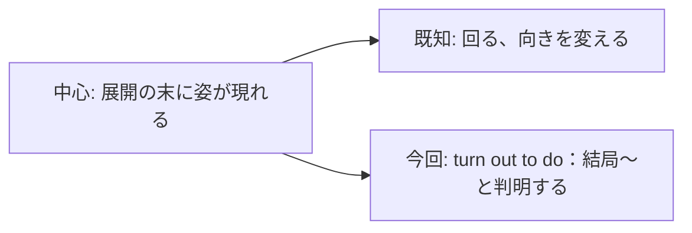

**重要語法**：`turn out to be + 名詞・形容詞`／`It turns out that ...：…ということが分かる`

---

### 167. turn

**品詞**：構文・語法　**発音**：/tɝːn/

<small>よく知られている意味：回る、順番</small>

**見落としやすい意味：in turn：順番に、今度は**

**例文**：Each student explained the result in turn.

**和訳**：生徒たちは順番に結果を説明した。

**コアイメージ**：turnには役割や順番が回ってくるという意味がある。in turnは順番が一人から次の人へ移る様子を表す。

**図**：

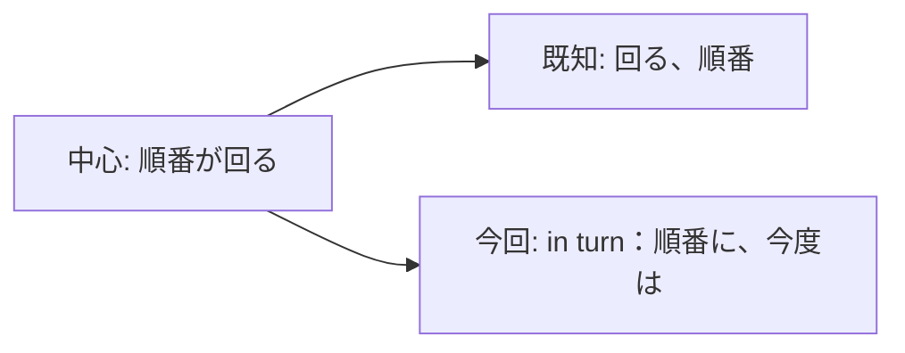

**重要語法**：`in turn：順に／それが今度は`

---

### 168. try

**品詞**：verb　**発音**：/traɪ/

<small>よく知られている意味：試す、挑戦する</small>

**見落としやすい意味：（被告を）裁判にかける**

**例文**：The defendant will be tried next month.

**和訳**：その被告人は来月裁判にかけられる。

**コアイメージ**：tryは、結果がまだ定まらないことを試して確かめる語でもある。法廷では訴えを審理して判断する意味になる。

**図**：

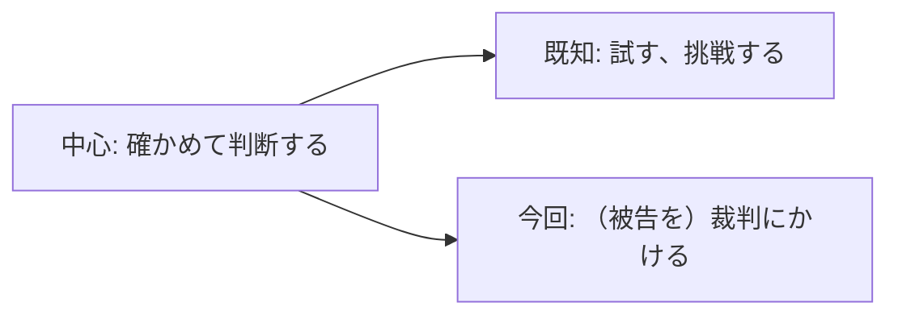

**重要語法**：`try a defendant：被告人を裁判にかける`

---

### 169. set

**品詞**：verb　**発音**：/set/

<small>よく知られている意味：置く、設定する</small>

**見落としやすい意味：（太陽などが）沈む**

**例文**：The sun sets earlier in winter.

**和訳**：冬は太陽がより早く沈む。

**コアイメージ**：setには、ある位置に落ち着くという感覚がある。太陽について使うと、地平線の下へ沈んでいくことを表す。

**図**：

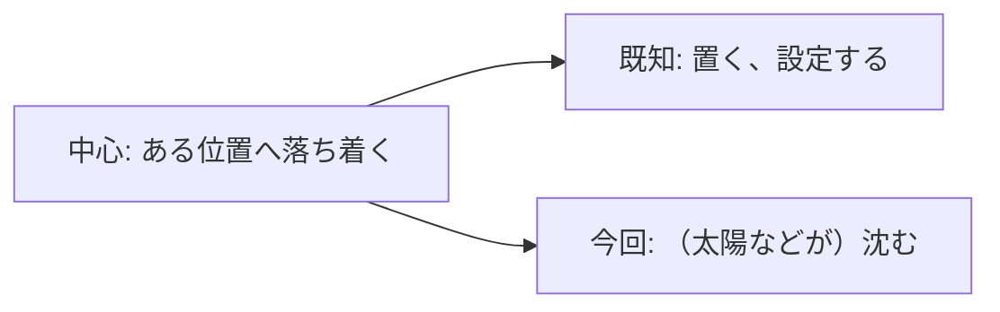

**重要語法**：`sunrise and sunset：日の出と日没`

---

### 170. set

**品詞**：verb　**発音**：/set/

<small>よく知られている意味：置く、設定する</small>

**見落としやすい意味：（ゼリーなどが）固まる**

**例文**：Leave the jelly in the fridge until it sets.

**和訳**：ゼリーが固まるまで冷蔵庫に入れておいてください。

**コアイメージ**：setはものが一定の状態に落ち着くことにも使う。液体が動かない形に落ち着くと「固まる」という意味になる。

**図**：

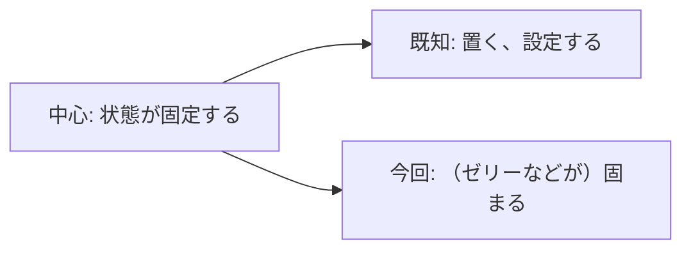

**重要語法**：`let the jelly set：ゼリーを固める`

---

### 171. though

**品詞**：adverb　**発音**：/ðoʊ/

<small>よく知られている意味：〜だけれども</small>

**見落としやすい意味：もっとも、とはいえ（文末のthough）**

**例文**：It's expensive. I might buy it, though.

**和訳**：高価だ。それでも買うかもしれない。

**コアイメージ**：thoughは前の内容との逆接を示す。文末では、前の発言に「とはいえ」と軽く付け加える働きをする。

**図**：

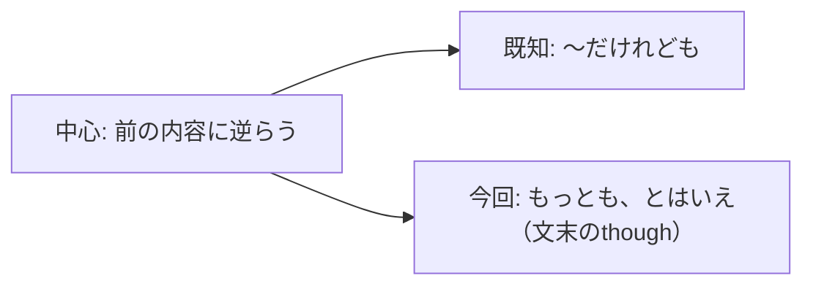

**重要語法**：`文末のthoughは接続詞ではなく副詞`

---

### 172. business

**品詞**：構文・語法　**発音**：/ˈbɪznəs/

<small>よく知られている意味：仕事、商売</small>

**見落としやすい意味：have no business -ing：〜する筋合いがない**

**例文**：You have no business reading my messages.

**和訳**：あなたには私のメッセージを読む筋合いがない。

**コアイメージ**：businessには仕事のほか、関わるべき用件という意味がある。have no business -ingで、その行動をする正当な立場や理由がないと伝える。

**図**：

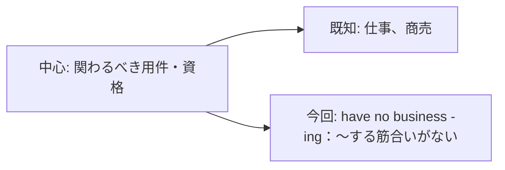

**重要語法**：`have no business -ing：〜する筋合いはない`

---

### 173. market

**品詞**：verb　**発音**：/ˈmɑːrkɪt/

<small>よく知られている意味：市場</small>

**見落としやすい意味：（製品を）販売促進する**

**例文**：The company markets its products overseas.

**和訳**：その会社は製品を海外で売り込んでいる。

**コアイメージ**：marketは売り買いの場を表す名詞だけではない。動詞では、商品を市場に出して売れるよう働きかけることを指す。

**図**：

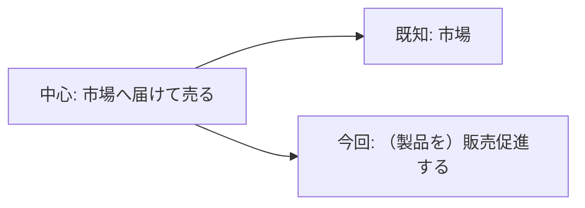

**重要語法**：`market a product：製品を売り込む`

---

### 174. ask

**品詞**：構文・語法　**発音**：/æsk/

<small>よく知られている意味：尋ねる、頼む</small>

**見落としやすい意味：ask after ...：〜の安否を尋ねる**

**例文**：He asked after your grandmother.

**和訳**：彼はあなたのおばあさんの具合を尋ねた。

**コアイメージ**：ask afterは本人に何かを頼む表現ではない。ある人の近況や健康状態について尋ねるときに使う。

**図**：

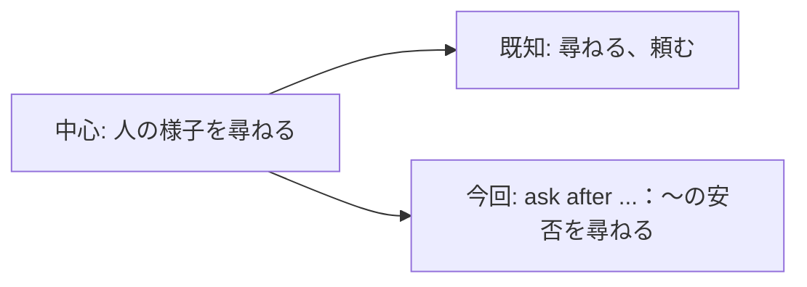

**重要語法**：`ask after + 人：人の安否・近況を尋ねる`

---

### 175. hold

**品詞**：verb　**発音**：/hoʊld/

<small>よく知られている意味：手に持つ、保つ</small>

**見落としやすい意味：（会議を）開催する**

**例文**：They will hold a meeting on Friday.

**和訳**：彼らは金曜日に会議を開く。

**コアイメージ**：holdは物を保っておくことから、会合を一定の時間・場所で行う意味にも広がる。meetingなどの行事が目的語になる。

**図**：

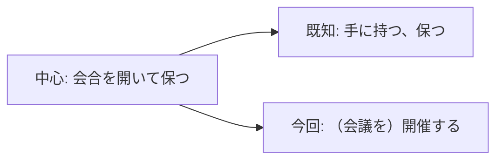

**重要語法**：`hold a meeting / conference：会議を開く`

---

### 176. hold

**品詞**：verb　**発音**：/hoʊld/

<small>よく知られている意味：手に持つ、保つ</small>

**見落としやすい意味：〜という見解を持つ、主張する**

**例文**：The scientist holds that the results are reliable.

**和訳**：その科学者は、その結果は信頼できるという見解を持っている。

**コアイメージ**：holdは手に持つだけでなく、考えや立場を保持することも表す。that節が続くと、どんな見解を持つのかが述べられる。

**図**：

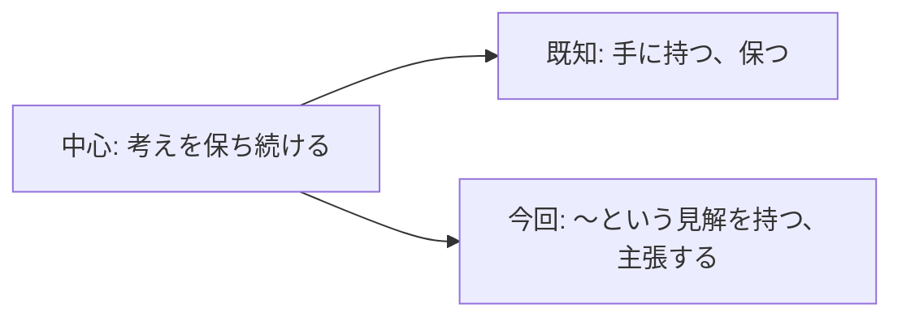

**重要語法**：`hold that ...：…だと考える・主張する`

---

### 177. pay

**品詞**：verb　**発音**：/peɪ/

<small>よく知られている意味：支払う</small>

**見落としやすい意味：割に合う、報われる**

**例文**：Hard work pays in the long run.

**和訳**：努力は長い目で見れば報われる。

**コアイメージ**：payには対価を支払う意味がある。主語が努力や方法なら、その行動から価値ある結果が返ってくる意味になる。

**図**：

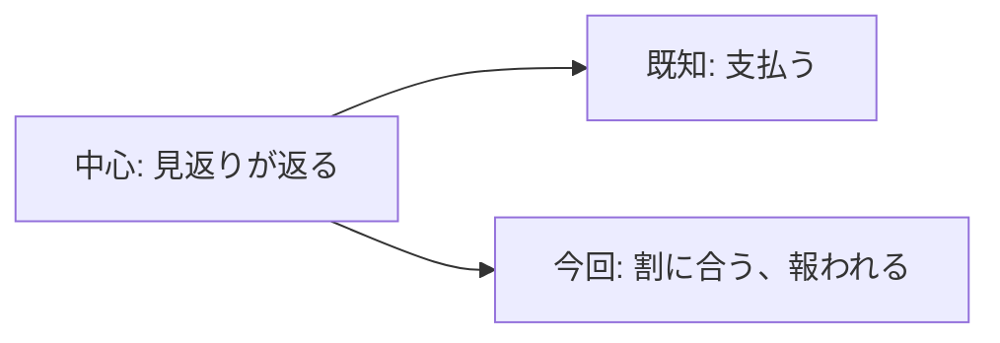

**重要語法**：`It pays to do ...：…すると得になる`

---

### 178. home

**品詞**：構文・語法　**発音**：/hoʊm/

<small>よく知られている意味：家、故郷</small>

**見落としやすい意味：home in on ...：〜に狙いを定める、焦点を合わせる**

**例文**：The team homed in on the main cause.

**和訳**：チームは主な原因に焦点を絞った。

**コアイメージ**：homeには帰り着く目標地点という感覚がある。home in onは、その目標に向かって注意や調査の焦点を絞る表現。

**図**：

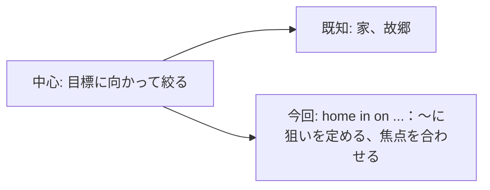

**重要語法**：`home in on + 対象：〜に照準・焦点を合わせる`

---

### 179. once

**品詞**：conjunction　**発音**：/wʌns/

<small>よく知られている意味：一度、かつて</small>

**見落としやすい意味：いったん〜すると**

**例文**：Once you understand the rule, the problem is easy.

**和訳**：いったんその規則を理解すれば、その問題は簡単だ。

**コアイメージ**：onceは「一度その時点に達したら」という境目を示す。接続詞では、ある条件が成立した後の状況を述べる。

**図**：

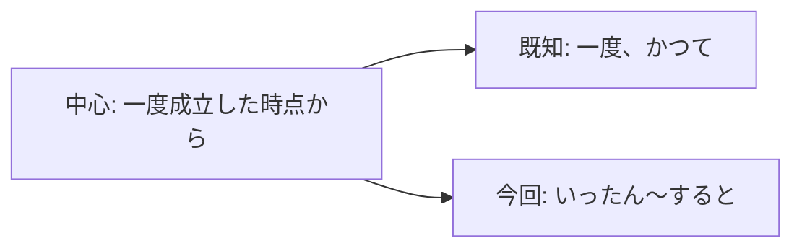

**重要語法**：`once + 主語 + 動詞：いったん〜すれば`

---

### 180. view

**品詞**：構文・語法　**発音**：/vjuː/

<small>よく知られている意味：眺め、見方</small>

**見落としやすい意味：in view of ...：〜を考慮して**

**例文**：In view of the weather, we stayed indoors.

**和訳**：天候を考慮して、私たちは屋内にいた。

**コアイメージ**：viewは目に入る範囲だけでなく、判断の視野も表す。in view ofは、ある事情を判断材料として視野に入れること。

**図**：

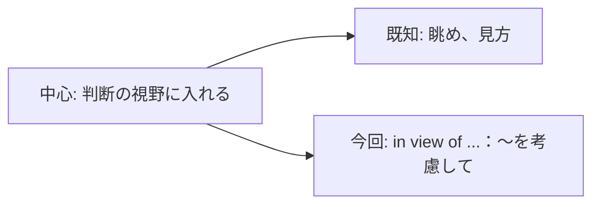

**重要語法**：`in view of + 名詞：〜を考慮して`

---

### 181. order

**品詞**：構文・語法　**発音**：/ˈɔːrdər/

<small>よく知られている意味：順序、命令</small>

**見落としやすい意味：in order that ...：〜するために**

**例文**：She spoke slowly in order that everyone could follow her.

**和訳**：全員が理解できるように、彼女はゆっくり話した。

**コアイメージ**：orderには物事を整えて目的に向かわせる感覚がある。in order thatは、行動が何のために行われるかを節で示す。

**図**：

```mermaid
flowchart LR
    A["中心: 目的に合わせて整える"]
    B["既知: 順序、命令"]
    C["今回: in order that ...：〜するために"]
    A --> B
    A --> C
```

**重要語法**：`in order that + 節：〜するために`

---

### 182. course

**品詞**：noun　**発音**：/kɔːrs/

<small>よく知られている意味：授業、講座</small>

**見落としやすい意味：経過、展開**

**例文**：The course of events surprised everyone.

**和訳**：事態の展開は皆を驚かせた。

**コアイメージ**：courseは何かが進んでいく道筋を表す。授業の一連の流れにも、事件がどう展開したかにも使われる。

**図**：

```mermaid
flowchart LR
    A["中心: 進んでいく道筋"]
    B["既知: 授業、講座"]
    C["今回: 経過、展開"]
    A --> B
    A --> C
```

**重要語法**：`the course of events：事態の経過`

---

### 183. control

**品詞**：noun　**発音**：/kənˈtroʊl/

<small>よく知られている意味：管理、支配</small>

**見落としやすい意味：（実験の）対照群、対照条件**

**例文**：The experiment used a control group.

**和訳**：その実験では対照群を用いた。

**コアイメージ**：controlは実験では比較の基準になる条件を指すことがある。処置の効果を見極めるため、処置群と比べる対象を置く。

**図**：

```mermaid
flowchart LR
    A["中心: 比較の基準を保つ"]
    B["既知: 管理、支配"]
    C["今回: （実験の）対照群、対照条件"]
    A --> B
    A --> C
```

**重要語法**：`control group：対照群`

---

### 184. school

**品詞**：構文・語法　**発音**：/skuːl/

<small>よく知られている意味：学校</small>

**見落としやすい意味：school of thought：学派、考え方の流派**

**例文**：Two schools of thought disagree on this issue.

**和訳**：この問題について二つの学派は意見が異なる。

**コアイメージ**：schoolは学ぶ場所だけでなく、考え方を共有する人々の集まりも表す。思想や研究の流派を示すときに使う。

**図**：

```mermaid
flowchart LR
    A["中心: 考えを共有する集まり"]
    B["既知: 学校"]
    C["今回: school of thought：学派、考え方の流派"]
    A --> B
    A --> C
```

**重要語法**：`school of thought：学派・思想の流派`

---

### 185. play

**品詞**：構文・語法　**発音**：/pleɪ/

<small>よく知られている意味：遊ぶ、演じる</small>

**見落としやすい意味：play down ...：〜を軽視する、小さく見せる**

**例文**：The report played down the risks.

**和訳**：報告書はその危険性を小さく見せた。

**コアイメージ**：play downは重要さを実際より低く扱う句動詞。問題や危険を強調せず、小さく見せる場面で使う。

**図**：

```mermaid
flowchart LR
    A["中心: 取り上げ方を弱める"]
    B["既知: 遊ぶ、演じる"]
    C["今回: play down ...：〜を軽視する、小さく見せる"]
    A --> B
    A --> C
```

**重要語法**：`play down the risks：危険性を軽く見せる`

---

### 186. remain

**品詞**：構文・語法　**発音**：/rɪˈmeɪn/

<small>よく知られている意味：残る、〜のままである</small>

**見落としやすい意味：remain to be seen：まだ分からない、今後明らかになる**

**例文**：It remains to be seen whether the plan will work.

**和訳**：その計画がうまくいくかは、まだ分からない。

**コアイメージ**：remainは何かがまだ残っていることを表す。この表現では「確かめられること」が残っているため、結論はまだ出ていない。

**図**：

```mermaid
flowchart LR
    A["中心: 判明することが残る"]
    B["既知: 残る、〜のままである"]
    C["今回: remain to be seen：まだ分からない、今後明らかになる"]
    A --> B
    A --> C
```

**重要語法**：`It remains to be seen whether ...：…かどうかはまだ不明`

---

### 187. site

**品詞**：verb　**発音**：/saɪt/

<small>よく知られている意味：場所、敷地</small>

**見落としやすい意味：設置場所を決める**

**例文**：The factory was sited near the river.

**和訳**：その工場は川の近くに配置された。

**コアイメージ**：siteは建物を置く場所を表す。動詞になると、建物や施設の設置場所を選び、そこに位置づける意味になる。

**図**：

```mermaid
flowchart LR
    A["中心: 設置する場所を選ぶ"]
    B["既知: 場所、敷地"]
    C["今回: 設置場所を決める"]
    A --> B
    A --> C
```

**重要語法**：`be sited near ...：〜の近くに配置される`

---

### 188. keep

**品詞**：構文・語法　**発音**：/kiːp/

<small>よく知られている意味：保つ、持ち続ける</small>

**見落としやすい意味：keep A from -ing：Aが〜するのを防ぐ**

**例文**：Warm clothes keep us from getting cold.

**和訳**：暖かい服は私たちが寒くなるのを防ぐ。

**コアイメージ**：keepはある状態を維持することを表す。from -ingを伴うと、好ましくない変化が起きない状態に保つ意味になる。

**図**：

```mermaid
flowchart LR
    A["中心: 変化を遠ざけて保つ"]
    B["既知: 保つ、持ち続ける"]
    C["今回: keep A from -ing：Aが〜するのを防ぐ"]
    A --> B
    A --> C
```

**重要語法**：`keep A from -ing：Aが〜するのを防ぐ`

---

### 189. build

**品詞**：構文・語法　**発音**：/bɪld/

<small>よく知られている意味：建てる</small>

**見落としやすい意味：build on ...：〜を土台にして発展させる**

**例文**：Her research builds on earlier studies.

**和訳**：彼女の研究は以前の研究を土台に発展している。

**コアイメージ**：buildは土台の上に少しずつ積み上げる感覚がある。建物だけでなく、既存の知識や成果を基礎に発展させる場合にも使う。

**図**：

```mermaid
flowchart LR
    A["中心: 土台の上に積み上げる"]
    B["既知: 建てる"]
    C["今回: build on ...：〜を土台にして発展させる"]
    A --> B
    A --> C
```

**重要語法**：`build on previous work：先行研究・成果を基にする`

---

### 190. put

**品詞**：構文・語法　**発音**：/pʊt/

<small>よく知られている意味：置く</small>

**見落としやすい意味：put up with ...：〜を我慢する**

**例文**：I can't put up with that noise any longer.

**和訳**：私はもうあの騒音を我慢できない。

**コアイメージ**：put up withは一まとまりで覚える句動詞。嫌なものを抱えながら耐える状況を表し、put単独の「置く」から直訳しない。

**図**：

```mermaid
flowchart LR
    A["中心: 不快なものに耐える"]
    B["既知: 置く"]
    C["今回: put up with ...：〜を我慢する"]
    A --> B
    A --> C
```

**重要語法**：`put up with + 名詞：〜を我慢する`

---

### 191. put

**品詞**：構文・語法　**発音**：/pʊt/

<small>よく知られている意味：置く</small>

**見落としやすい意味：put forward ...：〜を提案する、提示する**

**例文**：He put forward a new idea at the meeting.

**和訳**：彼は会議で新しい案を提示した。

**コアイメージ**：put forwardは案を人々の前へ差し出すイメージ。会議などで提案や意見を正式に示すときに使う。

**図**：

```mermaid
flowchart LR
    A["中心: 案を前へ差し出す"]
    B["既知: 置く"]
    C["今回: put forward ...：〜を提案する、提示する"]
    A --> B
    A --> C
```

**重要語法**：`put forward a proposal：提案を提示する`

---

### 192. process

**品詞**：verb　**発音**：/ˈprɑːses/

<small>よく知られている意味：過程、手順</small>

**見落としやすい意味：（情報・材料・申請などを）処理・加工する**

**例文**：The office processes applications online.

**和訳**：その事務所は申請をオンラインで処理する。

**コアイメージ**：processは結果に至るまでの段階を表す。動詞では、情報や申請を所定の段階に沿って扱い、処理する意味になる。

**図**：

```mermaid
flowchart LR
    A["中心: 段階を踏んで扱う"]
    B["既知: 過程、手順"]
    C["今回: （情報・材料・申請などを）処理・加工する"]
    A --> B
    A --> C
```

**重要語法**：`process an application：申請を処理する`

---

### 193. tax

**品詞**：verb　**発音**：/tæks/

<small>よく知られている意味：税金</small>

**見落としやすい意味：（能力・忍耐などを）酷使する**

**例文**：The long journey taxed everyone's patience.

**和訳**：長旅は皆の忍耐に大きな負担をかけた。

**コアイメージ**：taxは税という負担を課すことから、能力や忍耐に重い負担をかける意味にも使う。主語が経験や仕事なら比喩的な負担を考える。

**図**：

```mermaid
flowchart LR
    A["中心: 重い負担を課す"]
    B["既知: 税金"]
    C["今回: （能力・忍耐などを）酷使する"]
    A --> B
    A --> C
```

**重要語法**：`tax someone's patience：人の忍耐を試す`

---

### 194. form

**品詞**：noun　**発音**：/fɔːrm/

<small>よく知られている意味：形、形成する</small>

**見落としやすい意味：記入用紙、書式**

**例文**：Please complete this form by Monday.

**和訳**：月曜日までにこの用紙に記入してください。

**コアイメージ**：formは決まった形を表す。記入欄が所定の形に整えられた紙や画面もformと呼ぶ。

**図**：

```mermaid
flowchart LR
    A["中心: 情報のための決まった形"]
    B["既知: 形、形成する"]
    C["今回: 記入用紙、書式"]
    A --> B
    A --> C
```

**重要語法**：`fill in / fill out a form：用紙に記入する`

---

### 195. rather

**品詞**：構文・語法　**発音**：/ˈræðər/

<small>よく知られている意味：むしろ</small>

**見落としやすい意味：would rather A than B：BするよりAしたい**

**例文**：I'd rather walk than take a taxi.

**和訳**：私はタクシーに乗るより歩きたい。

**コアイメージ**：ratherは二つの選択肢を比べて、片方を選ぶ気持ちを表す。would rather A than BではAをBより好む。

**図**：

```mermaid
flowchart LR
    A["中心: 二択の一方を選ぶ"]
    B["既知: むしろ"]
    C["今回: would rather A than B：BするよりAしたい"]
    A --> B
    A --> C
```

**重要語法**：`would rather do A than do B：BするよりAしたい`

---

### 196. design

**品詞**：verb　**発音**：/dɪˈzaɪn/

<small>よく知られている意味：設計する、デザインする</small>

**見落としやすい意味：〜を意図する、目的とする**

**例文**：This program is designed to help beginners.

**和訳**：このプログラムは初心者を助けるために作られている。

**コアイメージ**：designは形を整える前に、何を実現したいかを考えて設計すること。be designed to doでは意図された目的が前面に出る。

**図**：

```mermaid
flowchart LR
    A["中心: 目的から形を考える"]
    B["既知: 設計する、デザインする"]
    C["今回: 〜を意図する、目的とする"]
    A --> B
    A --> C
```

**重要語法**：`be designed to do：〜するように作られている`

---

### 197. rate

**品詞**：verb　**発音**：/reɪt/

<small>よく知られている意味：割合、料金</small>

**見落としやすい意味：（人・物などを）評価する、格付けする**

**例文**：Customers rated the service highly.

**和訳**：利用者はそのサービスを高く評価した。

**コアイメージ**：rateは程度や水準を定めることに関わる語。動詞では、基準に照らして質や価値に評価を付ける。

**図**：

```mermaid
flowchart LR
    A["中心: 水準を測って位置づける"]
    B["既知: 割合、料金"]
    C["今回: （人・物などを）評価する、格付けする"]
    A --> B
    A --> C
```

**重要語法**：`rate A highly：Aを高く評価する`

---

### 198. force

**品詞**：構文・語法　**発音**：/fɔːrs/

<small>よく知られている意味：力、強制する</small>

**見落としやすい意味：come into force：法律・規則が施行される**

**例文**：The new rule comes into force in April.

**和訳**：新しい規則は4月に施行される。

**コアイメージ**：forceは働く力や効力を表す。法律や規則がcome into forceすると、正式に効力を持ち始める。

**図**：

```mermaid
flowchart LR
    A["中心: 効力が働き始める"]
    B["既知: 力、強制する"]
    C["今回: come into force：法律・規則が施行される"]
    A --> B
    A --> C
```

**重要語法**：`come into force：施行される`

---

### 199. bring

**品詞**：構文・語法　**発音**：/brɪŋ/

<small>よく知られている意味：持って来る</small>

**見落としやすい意味：bring about ...：〜を引き起こす、実現する**

**例文**：The policy brought about major changes.

**和訳**：その政策は大きな変化をもたらした。

**コアイメージ**：bringは何かをこちらへ生じさせる感覚がある。bring aboutは変化や結果が起こるようにすることを指す。

**図**：

```mermaid
flowchart LR
    A["中心: 結果を現れさせる"]
    B["既知: 持って来る"]
    C["今回: bring about ...：〜を引き起こす、実現する"]
    A --> B
    A --> C
```

**重要語法**：`bring about change：変化をもたらす`

---

### 200. house

**品詞**：verb　**発音**：/haʊz/

<small>よく知られている意味：家、住宅</small>

**見落としやすい意味：（人・物を建物などに）収容する**

**例文**：The museum houses a rare collection.

**和訳**：その博物館には貴重なコレクションが収蔵されている。

**コアイメージ**：houseは人や物を入れておく建物のこと。動詞では、その中に収容したり保管したりする働きを表す。

**図**：

```mermaid
flowchart LR
    A["中心: 建物の中に収める"]
    B["既知: 家、住宅"]
    C["今回: （人・物を建物などに）収容する"]
    A --> B
    A --> C
```

**重要語法**：`動詞houseは /haʊz/ と発音する`

