# EasyVoca 完成教材｜バッチ003（global_order 161〜240）

採用済み候補のみを教材化。既知の意味は補足、見落としやすい意味を主役として表示する。図は意味の使い分けを説明する模式図であり、必ずしも語源上の関係を意味しない。

### 161. plan

**品詞**：noun　**発音**：/plæn/

<small>よく知られている意味：計画</small>

**見落としやすい意味：設計図、平面図**

**例文**：The architect spread the plans across the table.

**和訳**：建築家は設計図をテーブルに広げた。

**コアイメージ**：planは、これから何をどう配置・実行するかを示す見取り図を表す。行動については「計画」、建物については「設計図」となる。

**図**：

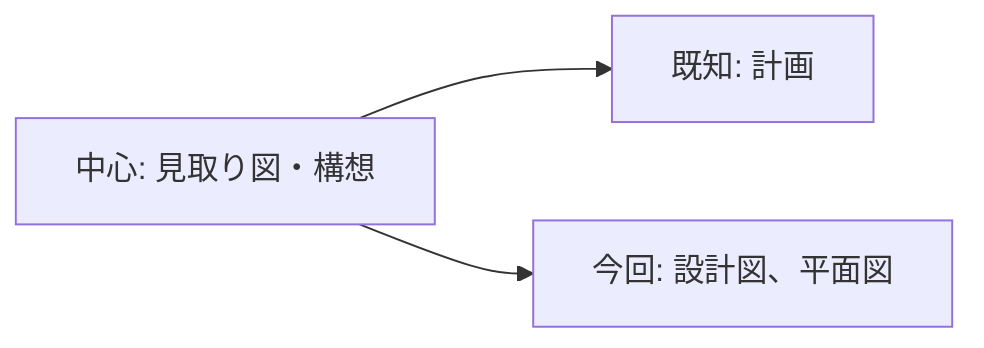

---

### 162. every

**品詞**：構文・語法　**発音**：/ˈevri/

<small>よく知られている意味：すべての</small>

**見落としやすい意味：every other ...：一つおきの〜**

**例文**：The nurse visits the patient every other day.

**和訳**：看護師はその患者を一日おきに訪問する。

**コアイメージ**：everyは一つ一つの単位に目を向ける語。every otherでは並びの中から一つおきに単位を拾う。

**図**：

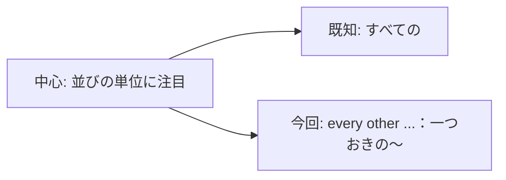

**重要語法**：`every other + 単数名詞：一つおきの〜`

---

### 163. leave

**品詞**：構文・語法　**発音**：/liːv/

<small>よく知られている意味：去る、残す</small>

**見落としやすい意味：leave＋目的語＋補語：〜を…のままにしておく**

**例文**：Please leave the window open.

**和訳**：窓を開けたままにしてください。

**コアイメージ**：leaveは、何かをその場所や状態に残して離れる感覚がある。目的語の後に状態を表す語を置くと「その状態のままにする」と読める。

**図**：

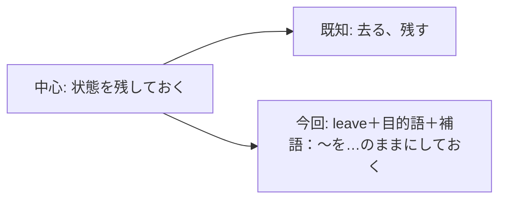

**重要語法**：`leave + 目的語 + 形容詞・分詞など`

---

### 164. leave

**品詞**：noun　**発音**：/liːv/

<small>よく知られている意味：去る</small>

**見落としやすい意味：休暇**

**例文**：She is on leave from work this month.

**和訳**：彼女は今月、仕事を休んでいる。

**コアイメージ**：leaveには職場などから離れることを認められた期間という名詞の意味がある。単に「去る」行為ではなく、正式な休暇を指す。

**図**：

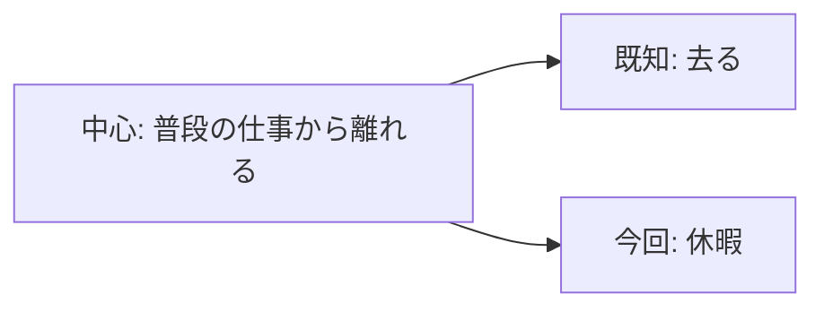

**重要語法**：`on leave：休暇中で`

---

### 165. early

**品詞**：構文・語法　**発音**：/ˈɝːli/

<small>よく知られている意味：早い、早く</small>

**見落としやすい意味：early on：早い段階で**

**例文**：We noticed the mistake early on.

**和訳**：私たちは早い段階でその間違いに気づいた。

**コアイメージ**：early onは物事の進み始めを基準にしている。時間が早いというより、進行の初期だと意識すると読みやすい。

**図**：

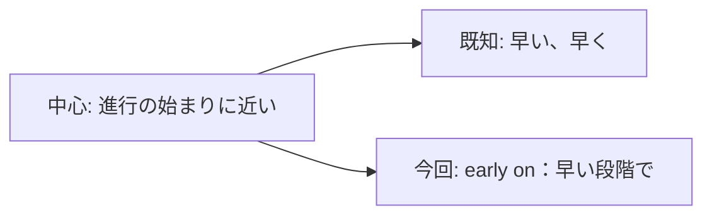

**重要語法**：`early on in the project：計画の初期に`

---

### 166. turn

**品詞**：構文・語法　**発音**：/tɝːn/

<small>よく知られている意味：回る、向きを変える</small>

**見落としやすい意味：turn out to do：結局〜と判明する**

**例文**：The missing key turned out to be in my bag.

**和訳**：なくした鍵は、結局私のかばんの中にあると分かった。

**コアイメージ**：turnには状況が変わっていく感覚がある。turn outは、その展開の末に事実がはっきりすることを表す。

**図**：

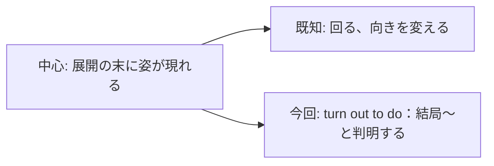

**重要語法**：`turn out to be + 名詞・形容詞`／`It turns out that ...：…ということが分かる`

---

### 167. turn

**品詞**：構文・語法　**発音**：/tɝːn/

<small>よく知られている意味：回る、順番</small>

**見落としやすい意味：in turn：順番に、今度は**

**例文**：Each student explained the result in turn.

**和訳**：生徒たちは順番に結果を説明した。

**コアイメージ**：turnには役割や順番が回ってくるという意味がある。in turnは順番が一人から次の人へ移る様子を表す。

**図**：

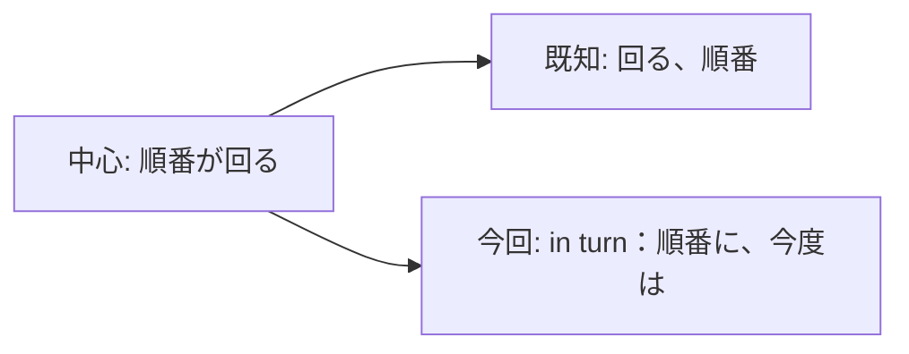

**重要語法**：`in turn：順に／それが今度は`

---

### 168. try

**品詞**：verb　**発音**：/traɪ/

<small>よく知られている意味：試す、挑戦する</small>

**見落としやすい意味：（被告を）裁判にかける**

**例文**：The defendant will be tried next month.

**和訳**：その被告人は来月裁判にかけられる。

**コアイメージ**：tryは、結果がまだ定まらないことを試して確かめる語でもある。法廷では訴えを審理して判断する意味になる。

**図**：

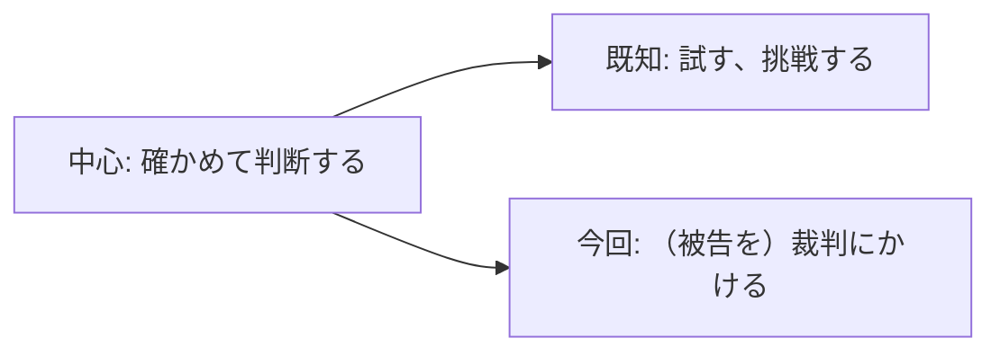

**重要語法**：`try a defendant：被告人を裁判にかける`

---

### 169. set

**品詞**：verb　**発音**：/set/

<small>よく知られている意味：置く、設定する</small>

**見落としやすい意味：（太陽などが）沈む**

**例文**：The sun sets earlier in winter.

**和訳**：冬は太陽がより早く沈む。

**コアイメージ**：setには、ある位置に落ち着くという感覚がある。太陽について使うと、地平線の下へ沈んでいくことを表す。

**図**：

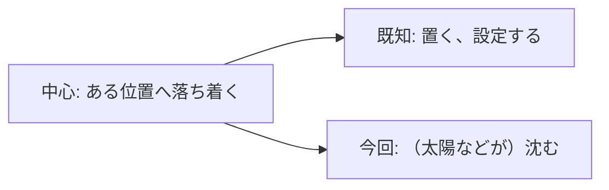

**重要語法**：`sunrise and sunset：日の出と日没`

---

### 170. set

**品詞**：verb　**発音**：/set/

<small>よく知られている意味：置く、設定する</small>

**見落としやすい意味：（ゼリーなどが）固まる**

**例文**：Leave the jelly in the fridge until it sets.

**和訳**：ゼリーが固まるまで冷蔵庫に入れておいてください。

**コアイメージ**：setはものが一定の状態に落ち着くことにも使う。液体が動かない形に落ち着くと「固まる」という意味になる。

**図**：

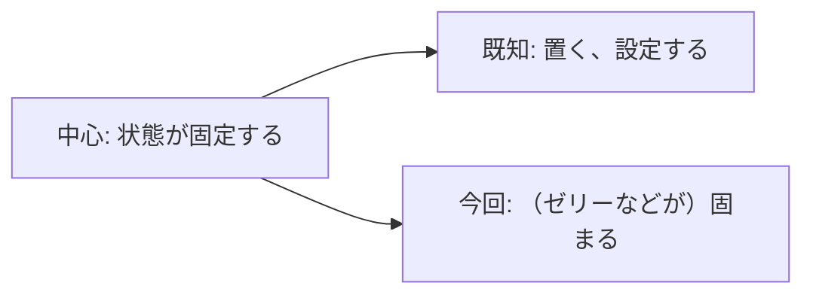

**重要語法**：`let the jelly set：ゼリーを固める`

---

### 171. though

**品詞**：adverb　**発音**：/ðoʊ/

<small>よく知られている意味：〜だけれども</small>

**見落としやすい意味：もっとも、とはいえ（文末のthough）**

**例文**：It's expensive. I might buy it, though.

**和訳**：高価だ。それでも買うかもしれない。

**コアイメージ**：thoughは前の内容との逆接を示す。文末では、前の発言に「とはいえ」と軽く付け加える働きをする。

**図**：

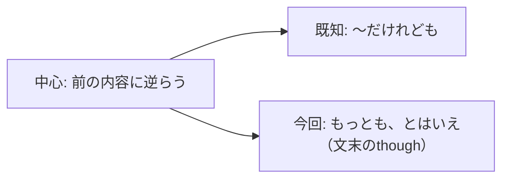

**重要語法**：`文末のthoughは接続詞ではなく副詞`

---

### 172. business

**品詞**：構文・語法　**発音**：/ˈbɪznəs/

<small>よく知られている意味：仕事、商売</small>

**見落としやすい意味：have no business -ing：〜する筋合いがない**

**例文**：You have no business reading my messages.

**和訳**：あなたには私のメッセージを読む筋合いがない。

**コアイメージ**：businessには仕事のほか、関わるべき用件という意味がある。have no business -ingで、その行動をする正当な立場や理由がないと伝える。

**図**：

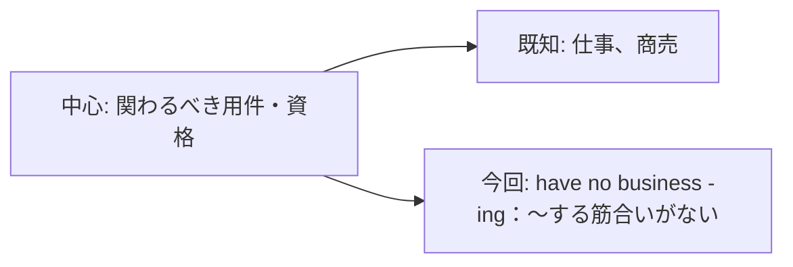

**重要語法**：`have no business -ing：〜する筋合いはない`

---

### 173. market

**品詞**：verb　**発音**：/ˈmɑːrkɪt/

<small>よく知られている意味：市場</small>

**見落としやすい意味：（製品を）販売促進する**

**例文**：The company markets its products overseas.

**和訳**：その会社は製品を海外で売り込んでいる。

**コアイメージ**：marketは売り買いの場を表す名詞だけではない。動詞では、商品を市場に出して売れるよう働きかけることを指す。

**図**：

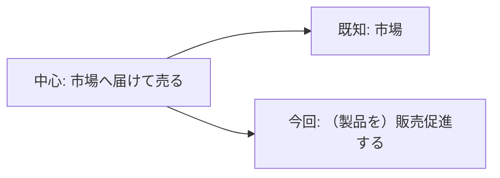

**重要語法**：`market a product：製品を売り込む`

---

### 174. ask

**品詞**：構文・語法　**発音**：/æsk/

<small>よく知られている意味：尋ねる、頼む</small>

**見落としやすい意味：ask after ...：〜の安否を尋ねる**

**例文**：He asked after your grandmother.

**和訳**：彼はあなたのおばあさんの具合を尋ねた。

**コアイメージ**：ask afterは本人に何かを頼む表現ではない。ある人の近況や健康状態について尋ねるときに使う。

**図**：

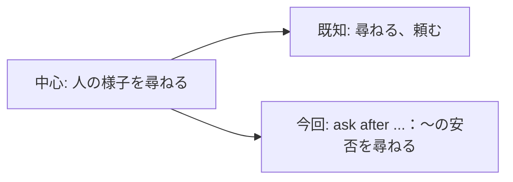

**重要語法**：`ask after + 人：人の安否・近況を尋ねる`

---

### 175. hold

**品詞**：verb　**発音**：/hoʊld/

<small>よく知られている意味：手に持つ、保つ</small>

**見落としやすい意味：（会議を）開催する**

**例文**：They will hold a meeting on Friday.

**和訳**：彼らは金曜日に会議を開く。

**コアイメージ**：holdは物を保っておくことから、会合を一定の時間・場所で行う意味にも広がる。meetingなどの行事が目的語になる。

**図**：

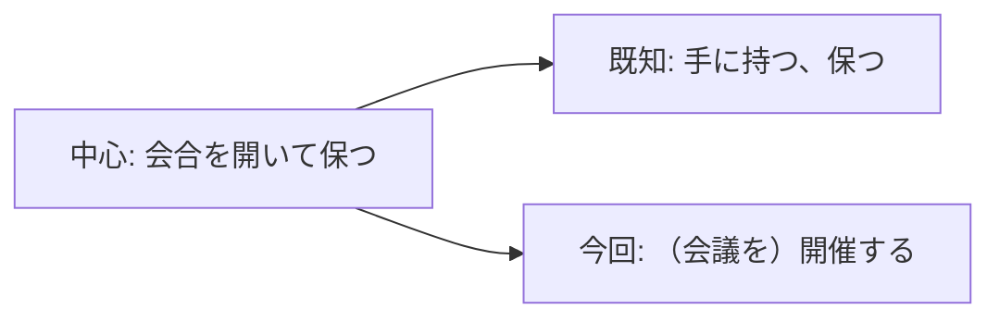

**重要語法**：`hold a meeting / conference：会議を開く`

---

### 176. hold

**品詞**：verb　**発音**：/hoʊld/

<small>よく知られている意味：手に持つ、保つ</small>

**見落としやすい意味：〜という見解を持つ、主張する**

**例文**：The scientist holds that the results are reliable.

**和訳**：その科学者は、その結果は信頼できるという見解を持っている。

**コアイメージ**：holdは手に持つだけでなく、考えや立場を保持することも表す。that節が続くと、どんな見解を持つのかが述べられる。

**図**：

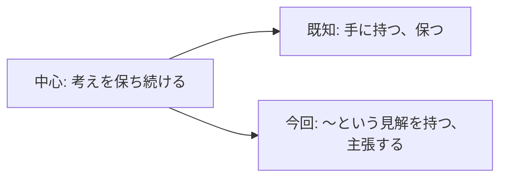

**重要語法**：`hold that ...：…だと考える・主張する`

---

### 177. pay

**品詞**：verb　**発音**：/peɪ/

<small>よく知られている意味：支払う</small>

**見落としやすい意味：割に合う、報われる**

**例文**：Hard work pays in the long run.

**和訳**：努力は長い目で見れば報われる。

**コアイメージ**：payには対価を支払う意味がある。主語が努力や方法なら、その行動から価値ある結果が返ってくる意味になる。

**図**：

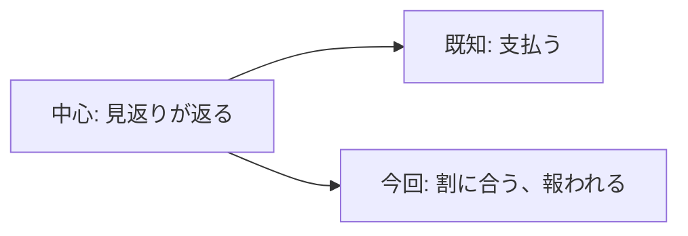

**重要語法**：`It pays to do ...：…すると得になる`

---

### 178. home

**品詞**：構文・語法　**発音**：/hoʊm/

<small>よく知られている意味：家、故郷</small>

**見落としやすい意味：home in on ...：〜に狙いを定める、焦点を合わせる**

**例文**：The team homed in on the main cause.

**和訳**：チームは主な原因に焦点を絞った。

**コアイメージ**：homeには帰り着く目標地点という感覚がある。home in onは、その目標に向かって注意や調査の焦点を絞る表現。

**図**：

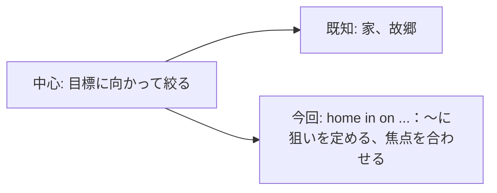

**重要語法**：`home in on + 対象：〜に照準・焦点を合わせる`

---

### 179. once

**品詞**：conjunction　**発音**：/wʌns/

<small>よく知られている意味：一度、かつて</small>

**見落としやすい意味：いったん〜すると**

**例文**：Once you understand the rule, the problem is easy.

**和訳**：いったんその規則を理解すれば、その問題は簡単だ。

**コアイメージ**：onceは「一度その時点に達したら」という境目を示す。接続詞では、ある条件が成立した後の状況を述べる。

**図**：

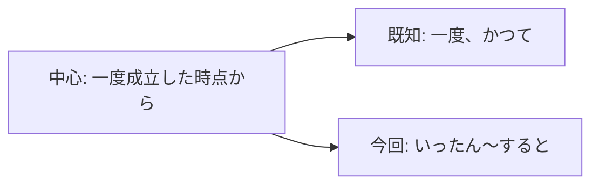

**重要語法**：`once + 主語 + 動詞：いったん〜すれば`

---

### 180. view

**品詞**：構文・語法　**発音**：/vjuː/

<small>よく知られている意味：眺め、見方</small>

**見落としやすい意味：in view of ...：〜を考慮して**

**例文**：In view of the weather, we stayed indoors.

**和訳**：天候を考慮して、私たちは屋内にいた。

**コアイメージ**：viewは目に入る範囲だけでなく、判断の視野も表す。in view ofは、ある事情を判断材料として視野に入れること。

**図**：

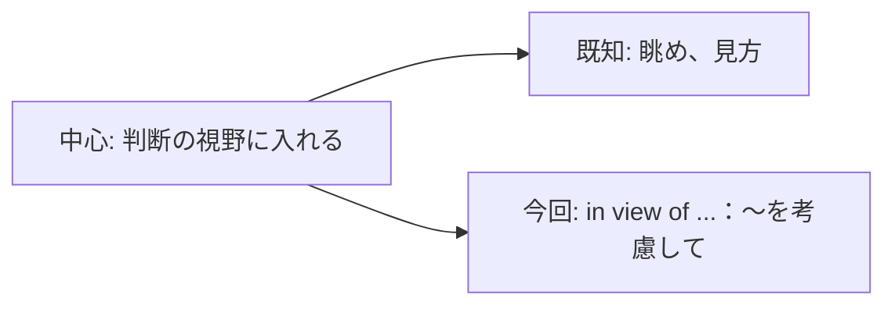

**重要語法**：`in view of + 名詞：〜を考慮して`

---

### 181. order

**品詞**：構文・語法　**発音**：/ˈɔːrdər/

<small>よく知られている意味：順序、命令</small>

**見落としやすい意味：in order that ...：〜するために**

**例文**：She spoke slowly in order that everyone could follow her.

**和訳**：全員が理解できるように、彼女はゆっくり話した。

**コアイメージ**：orderには物事を整えて目的に向かわせる感覚がある。in order thatは、行動が何のために行われるかを節で示す。

**図**：

```mermaid
flowchart LR
    A["中心: 目的に合わせて整える"]
    B["既知: 順序、命令"]
    C["今回: in order that ...：〜するために"]
    A --> B
    A --> C
```

**重要語法**：`in order that + 節：〜するために`

---

### 182. course

**品詞**：noun　**発音**：/kɔːrs/

<small>よく知られている意味：授業、講座</small>

**見落としやすい意味：経過、展開**

**例文**：The course of events surprised everyone.

**和訳**：事態の展開は皆を驚かせた。

**コアイメージ**：courseは何かが進んでいく道筋を表す。授業の一連の流れにも、事件がどう展開したかにも使われる。

**図**：

```mermaid
flowchart LR
    A["中心: 進んでいく道筋"]
    B["既知: 授業、講座"]
    C["今回: 経過、展開"]
    A --> B
    A --> C
```

**重要語法**：`the course of events：事態の経過`

---

### 183. control

**品詞**：noun　**発音**：/kənˈtroʊl/

<small>よく知られている意味：管理、支配</small>

**見落としやすい意味：（実験の）対照群、対照条件**

**例文**：The experiment used a control group.

**和訳**：その実験では対照群を用いた。

**コアイメージ**：controlは実験では比較の基準になる条件を指すことがある。処置の効果を見極めるため、処置群と比べる対象を置く。

**図**：

```mermaid
flowchart LR
    A["中心: 比較の基準を保つ"]
    B["既知: 管理、支配"]
    C["今回: （実験の）対照群、対照条件"]
    A --> B
    A --> C
```

**重要語法**：`control group：対照群`

---

### 184. school

**品詞**：構文・語法　**発音**：/skuːl/

<small>よく知られている意味：学校</small>

**見落としやすい意味：school of thought：学派、考え方の流派**

**例文**：Two schools of thought disagree on this issue.

**和訳**：この問題について二つの学派は意見が異なる。

**コアイメージ**：schoolは学ぶ場所だけでなく、考え方を共有する人々の集まりも表す。思想や研究の流派を示すときに使う。

**図**：

```mermaid
flowchart LR
    A["中心: 考えを共有する集まり"]
    B["既知: 学校"]
    C["今回: school of thought：学派、考え方の流派"]
    A --> B
    A --> C
```

**重要語法**：`school of thought：学派・思想の流派`

---

### 185. play

**品詞**：構文・語法　**発音**：/pleɪ/

<small>よく知られている意味：遊ぶ、演じる</small>

**見落としやすい意味：play down ...：〜を軽視する、小さく見せる**

**例文**：The report played down the risks.

**和訳**：報告書はその危険性を小さく見せた。

**コアイメージ**：play downは重要さを実際より低く扱う句動詞。問題や危険を強調せず、小さく見せる場面で使う。

**図**：

```mermaid
flowchart LR
    A["中心: 取り上げ方を弱める"]
    B["既知: 遊ぶ、演じる"]
    C["今回: play down ...：〜を軽視する、小さく見せる"]
    A --> B
    A --> C
```

**重要語法**：`play down the risks：危険性を軽く見せる`

---

### 186. remain

**品詞**：構文・語法　**発音**：/rɪˈmeɪn/

<small>よく知られている意味：残る、〜のままである</small>

**見落としやすい意味：remain to be seen：まだ分からない、今後明らかになる**

**例文**：It remains to be seen whether the plan will work.

**和訳**：その計画がうまくいくかは、まだ分からない。

**コアイメージ**：remainは何かがまだ残っていることを表す。この表現では「確かめられること」が残っているため、結論はまだ出ていない。

**図**：

```mermaid
flowchart LR
    A["中心: 判明することが残る"]
    B["既知: 残る、〜のままである"]
    C["今回: remain to be seen：まだ分からない、今後明らかになる"]
    A --> B
    A --> C
```

**重要語法**：`It remains to be seen whether ...：…かどうかはまだ不明`

---

### 187. site

**品詞**：verb　**発音**：/saɪt/

<small>よく知られている意味：場所、敷地</small>

**見落としやすい意味：設置場所を決める**

**例文**：The factory was sited near the river.

**和訳**：その工場は川の近くに配置された。

**コアイメージ**：siteは建物を置く場所を表す。動詞になると、建物や施設の設置場所を選び、そこに位置づける意味になる。

**図**：

```mermaid
flowchart LR
    A["中心: 設置する場所を選ぶ"]
    B["既知: 場所、敷地"]
    C["今回: 設置場所を決める"]
    A --> B
    A --> C
```

**重要語法**：`be sited near ...：〜の近くに配置される`

---

### 188. keep

**品詞**：構文・語法　**発音**：/kiːp/

<small>よく知られている意味：保つ、持ち続ける</small>

**見落としやすい意味：keep A from -ing：Aが〜するのを防ぐ**

**例文**：Warm clothes keep us from getting cold.

**和訳**：暖かい服は私たちが寒くなるのを防ぐ。

**コアイメージ**：keepはある状態を維持することを表す。from -ingを伴うと、好ましくない変化が起きない状態に保つ意味になる。

**図**：

```mermaid
flowchart LR
    A["中心: 変化を遠ざけて保つ"]
    B["既知: 保つ、持ち続ける"]
    C["今回: keep A from -ing：Aが〜するのを防ぐ"]
    A --> B
    A --> C
```

**重要語法**：`keep A from -ing：Aが〜するのを防ぐ`

---

### 189. build

**品詞**：構文・語法　**発音**：/bɪld/

<small>よく知られている意味：建てる</small>

**見落としやすい意味：build on ...：〜を土台にして発展させる**

**例文**：Her research builds on earlier studies.

**和訳**：彼女の研究は以前の研究を土台に発展している。

**コアイメージ**：buildは土台の上に少しずつ積み上げる感覚がある。建物だけでなく、既存の知識や成果を基礎に発展させる場合にも使う。

**図**：

```mermaid
flowchart LR
    A["中心: 土台の上に積み上げる"]
    B["既知: 建てる"]
    C["今回: build on ...：〜を土台にして発展させる"]
    A --> B
    A --> C
```

**重要語法**：`build on previous work：先行研究・成果を基にする`

---

### 190. put

**品詞**：構文・語法　**発音**：/pʊt/

<small>よく知られている意味：置く</small>

**見落としやすい意味：put up with ...：〜を我慢する**

**例文**：I can't put up with that noise any longer.

**和訳**：私はもうあの騒音を我慢できない。

**コアイメージ**：put up withは一まとまりで覚える句動詞。嫌なものを抱えながら耐える状況を表し、put単独の「置く」から直訳しない。

**図**：

```mermaid
flowchart LR
    A["中心: 不快なものに耐える"]
    B["既知: 置く"]
    C["今回: put up with ...：〜を我慢する"]
    A --> B
    A --> C
```

**重要語法**：`put up with + 名詞：〜を我慢する`

---

### 191. put

**品詞**：構文・語法　**発音**：/pʊt/

<small>よく知られている意味：置く</small>

**見落としやすい意味：put forward ...：〜を提案する、提示する**

**例文**：He put forward a new idea at the meeting.

**和訳**：彼は会議で新しい案を提示した。

**コアイメージ**：put forwardは案を人々の前へ差し出すイメージ。会議などで提案や意見を正式に示すときに使う。

**図**：

```mermaid
flowchart LR
    A["中心: 案を前へ差し出す"]
    B["既知: 置く"]
    C["今回: put forward ...：〜を提案する、提示する"]
    A --> B
    A --> C
```

**重要語法**：`put forward a proposal：提案を提示する`

---

### 192. process

**品詞**：verb　**発音**：/ˈprɑːses/

<small>よく知られている意味：過程、手順</small>

**見落としやすい意味：（情報・材料・申請などを）処理・加工する**

**例文**：The office processes applications online.

**和訳**：その事務所は申請をオンラインで処理する。

**コアイメージ**：processは結果に至るまでの段階を表す。動詞では、情報や申請を所定の段階に沿って扱い、処理する意味になる。

**図**：

```mermaid
flowchart LR
    A["中心: 段階を踏んで扱う"]
    B["既知: 過程、手順"]
    C["今回: （情報・材料・申請などを）処理・加工する"]
    A --> B
    A --> C
```

**重要語法**：`process an application：申請を処理する`

---

### 193. tax

**品詞**：verb　**発音**：/tæks/

<small>よく知られている意味：税金</small>

**見落としやすい意味：（能力・忍耐などを）酷使する**

**例文**：The long journey taxed everyone's patience.

**和訳**：長旅は皆の忍耐に大きな負担をかけた。

**コアイメージ**：taxは税という負担を課すことから、能力や忍耐に重い負担をかける意味にも使う。主語が経験や仕事なら比喩的な負担を考える。

**図**：

```mermaid
flowchart LR
    A["中心: 重い負担を課す"]
    B["既知: 税金"]
    C["今回: （能力・忍耐などを）酷使する"]
    A --> B
    A --> C
```

**重要語法**：`tax someone's patience：人の忍耐を試す`

---

### 194. form

**品詞**：noun　**発音**：/fɔːrm/

<small>よく知られている意味：形、形成する</small>

**見落としやすい意味：記入用紙、書式**

**例文**：Please complete this form by Monday.

**和訳**：月曜日までにこの用紙に記入してください。

**コアイメージ**：formは決まった形を表す。記入欄が所定の形に整えられた紙や画面もformと呼ぶ。

**図**：

```mermaid
flowchart LR
    A["中心: 情報のための決まった形"]
    B["既知: 形、形成する"]
    C["今回: 記入用紙、書式"]
    A --> B
    A --> C
```

**重要語法**：`fill in / fill out a form：用紙に記入する`

---

### 195. rather

**品詞**：構文・語法　**発音**：/ˈræðər/

<small>よく知られている意味：むしろ</small>

**見落としやすい意味：would rather A than B：BするよりAしたい**

**例文**：I'd rather walk than take a taxi.

**和訳**：私はタクシーに乗るより歩きたい。

**コアイメージ**：ratherは二つの選択肢を比べて、片方を選ぶ気持ちを表す。would rather A than BではAをBより好む。

**図**：

```mermaid
flowchart LR
    A["中心: 二択の一方を選ぶ"]
    B["既知: むしろ"]
    C["今回: would rather A than B：BするよりAしたい"]
    A --> B
    A --> C
```

**重要語法**：`would rather do A than do B：BするよりAしたい`

---

### 196. design

**品詞**：verb　**発音**：/dɪˈzaɪn/

<small>よく知られている意味：設計する、デザインする</small>

**見落としやすい意味：〜を意図する、目的とする**

**例文**：This program is designed to help beginners.

**和訳**：このプログラムは初心者を助けるために作られている。

**コアイメージ**：designは形を整える前に、何を実現したいかを考えて設計すること。be designed to doでは意図された目的が前面に出る。

**図**：

```mermaid
flowchart LR
    A["中心: 目的から形を考える"]
    B["既知: 設計する、デザインする"]
    C["今回: 〜を意図する、目的とする"]
    A --> B
    A --> C
```

**重要語法**：`be designed to do：〜するように作られている`

---

### 197. rate

**品詞**：verb　**発音**：/reɪt/

<small>よく知られている意味：割合、料金</small>

**見落としやすい意味：（人・物などを）評価する、格付けする**

**例文**：Customers rated the service highly.

**和訳**：利用者はそのサービスを高く評価した。

**コアイメージ**：rateは程度や水準を定めることに関わる語。動詞では、基準に照らして質や価値に評価を付ける。

**図**：

```mermaid
flowchart LR
    A["中心: 水準を測って位置づける"]
    B["既知: 割合、料金"]
    C["今回: （人・物などを）評価する、格付けする"]
    A --> B
    A --> C
```

**重要語法**：`rate A highly：Aを高く評価する`

---

### 198. force

**品詞**：構文・語法　**発音**：/fɔːrs/

<small>よく知られている意味：力、強制する</small>

**見落としやすい意味：come into force：法律・規則が施行される**

**例文**：The new rule comes into force in April.

**和訳**：新しい規則は4月に施行される。

**コアイメージ**：forceは働く力や効力を表す。法律や規則がcome into forceすると、正式に効力を持ち始める。

**図**：

```mermaid
flowchart LR
    A["中心: 効力が働き始める"]
    B["既知: 力、強制する"]
    C["今回: come into force：法律・規則が施行される"]
    A --> B
    A --> C
```

**重要語法**：`come into force：施行される`

---

### 199. bring

**品詞**：構文・語法　**発音**：/brɪŋ/

<small>よく知られている意味：持って来る</small>

**見落としやすい意味：bring about ...：〜を引き起こす、実現する**

**例文**：The policy brought about major changes.

**和訳**：その政策は大きな変化をもたらした。

**コアイメージ**：bringは何かをこちらへ生じさせる感覚がある。bring aboutは変化や結果が起こるようにすることを指す。

**図**：

```mermaid
flowchart LR
    A["中心: 結果を現れさせる"]
    B["既知: 持って来る"]
    C["今回: bring about ...：〜を引き起こす、実現する"]
    A --> B
    A --> C
```

**重要語法**：`bring about change：変化をもたらす`

---

### 200. house

**品詞**：verb　**発音**：/haʊz/

<small>よく知られている意味：家、住宅</small>

**見落としやすい意味：（人・物を建物などに）収容する**

**例文**：The museum houses a rare collection.

**和訳**：その博物館には貴重なコレクションが収蔵されている。

**コアイメージ**：houseは人や物を入れておく建物のこと。動詞では、その中に収容したり保管したりする働きを表す。

**図**：

```mermaid
flowchart LR
    A["中心: 建物の中に収める"]
    B["既知: 家、住宅"]
    C["今回: （人・物を建物などに）収容する"]
    A --> B
    A --> C
```

**重要語法**：`動詞houseは /haʊz/ と発音する`

---

### 201. next

**品詞**：構文・語法　**発音**：/nekst/

<small>よく知られている意味：次の、隣の</small>

**見落としやすい意味：next to impossible：ほとんど不可能な**

**例文**：Finishing this in an hour is next to impossible.

**和訳**：これを1時間で終えるのは、ほとんど不可能だ。

**コアイメージ**：next toは何かのすぐ隣にあるという距離を表す。impossibleのすぐ近くにある状態、つまり「ほぼ不可能」という意味になる。

**図**：

```mermaid
flowchart LR
    A["中心: 不可能のすぐ隣"]
    B["既知: 次の、隣の"]
    C["今回: next to impossible：ほとんど不可能な"]
    A --> B
    A --> C
```

**重要語法**：`next to impossible：ほとんど不可能`

---

### 202. power

**品詞**：verb　**発音**：/ˈpaʊər/

<small>よく知られている意味：力、電力</small>

**見落としやすい意味：（機械に）動力を供給する**

**例文**：Solar panels power the lights.

**和訳**：太陽光パネルが照明に電力を供給している。

**コアイメージ**：powerはものを動かす力のこと。動詞では機械や設備にその動力を与えて働かせることを表す。

**図**：

```mermaid
flowchart LR
    A["中心: 動かす力を与える"]
    B["既知: 力、電力"]
    C["今回: （機械に）動力を供給する"]
    A --> B
    A --> C
```

**重要語法**：`be powered by ...：〜を動力源とする`

---

### 203. page

**品詞**：verb　**発音**：/peɪdʒ/

<small>よく知られている意味：（本などの）ページ</small>

**見落としやすい意味：（放送・呼び出し装置で）呼び出す**

**例文**：The doctor was paged during dinner.

**和訳**：医師は夕食中に呼び出された。

**コアイメージ**：pageには本のページのほか、人を通信機器などで呼び出す動詞の用法がある。共通イメージを無理に作らず、呼び出しの場面で使われる別の語義として区別する。

**図**：

```mermaid
flowchart LR
    A["中心: 同じ形の異なる用法"]
    B["既知: （本などの）ページ"]
    C["今回: （放送・呼び出し装置で）呼び出す"]
    A --> B
    A --> C
```

**重要語法**：`page someone：人を呼び出す`

---

### 204. allow

**品詞**：構文・語法　**発音**：/əˈlaʊ/

<small>よく知られている意味：許す</small>

**見落としやすい意味：allow for ...：〜を考慮に入れる**

**例文**：Allow for delays when planning the trip.

**和訳**：旅行を計画するときは、遅れも見込んでおこう。

**コアイメージ**：allow forは余地をあけておく表現。計画どおりにいかない可能性も考えて、時間や予算に余裕を持たせる。

**図**：

```mermaid
flowchart LR
    A["中心: 起こりうる余地を残す"]
    B["既知: 許す"]
    C["今回: allow for ...：〜を考慮に入れる"]
    A --> B
    A --> C
```

**重要語法**：`allow for delays：遅れを見込む`

---

### 205. cover

**品詞**：verb　**発音**：/ˈkʌvər/

<small>よく知られている意味：覆う、カバーする</small>

**見落としやすい意味：（事件などを）取材・報道する**

**例文**：The journalist covered the election.

**和訳**：その記者は選挙を取材・報道した。

**コアイメージ**：coverには対象を広く扱うという感覚がある。事件や選挙なら、情報を集めて内容を伝える取材・報道の意味になる。

**図**：

```mermaid
flowchart LR
    A["中心: 対象を広く扱う"]
    B["既知: 覆う、カバーする"]
    C["今回: （事件などを）取材・報道する"]
    A --> B
    A --> C
```

**重要語法**：`cover an event：出来事を取材・報道する`

---

### 206. cover

**品詞**：verb　**発音**：/ˈkʌvər/

<small>よく知られている意味：覆う、カバーする</small>

**見落としやすい意味：保険で保障する**

**例文**：The insurance policy covers flood damage.

**和訳**：その保険は洪水による損害を保障する。

**コアイメージ**：coverは一定の範囲を覆うイメージ。保険では、補償する対象をその範囲内に含めることを指す。

**図**：

```mermaid
flowchart LR
    A["中心: 保護の範囲に入れる"]
    B["既知: 覆う、カバーする"]
    C["今回: 保険で保障する"]
    A --> B
    A --> C
```

**重要語法**：`cover damage：損害を保障する`

---

### 207. far

**品詞**：構文・語法　**発音**：/fɑːr/

<small>よく知られている意味：遠く、遠い</small>

**見落としやすい意味：far from ...：〜どころか、〜からほど遠い**

**例文**：His explanation was far from clear.

**和訳**：彼の説明は明確とはほど遠かった。

**コアイメージ**：farは距離が大きいことを表す。far fromは場所だけでなく、ある性質や評価から大きく隔たっていることを示す。

**図**：

```mermaid
flowchart LR
    A["中心: 性質から遠く離れる"]
    B["既知: 遠く、遠い"]
    C["今回: far from ...：〜どころか、〜からほど遠い"]
    A --> B
    A --> C
```

**重要語法**：`far from + 形容詞：決して〜ではない`

---

### 208. interest

**品詞**：noun　**発音**：/ˈɪntrəst/

<small>よく知られている意味：興味、関心</small>

**見落としやすい意味：利子、利息**

**例文**：The bank charges interest on the loan.

**和訳**：その銀行はその融資に利息を課す。

**コアイメージ**：interestには関心とは別に、金銭的な利益という意味もある。貸し借りの文脈では、借りた金額に上乗せして支払う利息を表す。

**図**：

```mermaid
flowchart LR
    A["中心: 関わりから生じる利益"]
    B["既知: 興味、関心"]
    C["今回: 利子、利息"]
    A --> B
    A --> C
```

**重要語法**：`pay / charge interest：利息を払う／課す`

---

### 209. line

**品詞**：noun　**発音**：/laɪn/

<small>よく知られている意味：線、列</small>

**見落としやすい意味：（劇・映画などの）せりふ**

**例文**：The actor forgot his lines.

**和訳**：その俳優はせりふを忘れた。

**コアイメージ**：lineは文字やものが一列に並ぶイメージ。演劇では、台本に並ぶ一続きの発言を指して「せりふ」となる。

**図**：

```mermaid
flowchart LR
    A["中心: 言葉のひと続き"]
    B["既知: 線、列"]
    C["今回: （劇・映画などの）せりふ"]
    A --> B
    A --> C
```

**重要語法**：`learn one's lines：せりふを覚える`

---

### 210. line

**品詞**：noun　**発音**：/laɪn/

<small>よく知られている意味：線、列</small>

**見落としやすい意味：業種、職業分野**

**例文**：She works in the same line of business as her father.

**和訳**：彼女は父親と同じ業種で働いている。

**コアイメージ**：lineは同じ方向へ続く系列を表すことがある。仕事について使うと、活動内容によって分けられる業界や職業分野を示す。

**図**：

```mermaid
flowchart LR
    A["中心: 仕事の系列・分野"]
    B["既知: 線、列"]
    C["今回: 業種、職業分野"]
    A --> B
    A --> C
```

**重要語法**：`line of business：業種`

---

### 211. something

**品詞**：構文・語法　**発音**：/ˈsʌmθɪŋ/

<small>よく知られている意味：何か、あるもの</small>

**見落としやすい意味：something of a ...：ちょっとした〜、かなりの〜**

**例文**：He is something of a scientist himself.

**和訳**：彼自身もちょっとした科学者だ。

**コアイメージ**：something of aは、ある性質を完全ではなくとも相当程度持っていると述べる言い方。単なる「何か」ではなく、人や物の評価を和らげて示す。

**図**：

```mermaid
flowchart LR
    A["中心: ある程度その性質がある"]
    B["既知: 何か、あるもの"]
    C["今回: something of a ...：ちょっとした〜、かなりの〜"]
    A --> B
    A --> C
```

**重要語法**：`something of a + 名詞：ちょっとした〜`

---

### 212. claim

**品詞**：verb　**発音**：/kleɪm/

<small>よく知られている意味：主張する、要求する</small>

**見落としやすい意味：（災害や事故が）命を奪う**

**例文**：The storm claimed several lives.

**和訳**：その嵐で数人が命を落とした。

**コアイメージ**：claimには何かを自分のものとして求める意味がある。災害などが主語になると、命を奪うことを表す。

**図**：

```mermaid
flowchart LR
    A["中心: 奪い取る"]
    B["既知: 主張する、要求する"]
    C["今回: （災害や事故が）命を奪う"]
    A --> B
    A --> C
```

**重要語法**：`claim lives：命を奪う`

---

### 213. until

**品詞**：構文・語法　**発音**：/ənˈtɪl/

<small>よく知られている意味：〜まで</small>

**見落としやすい意味：not until ... の倒置：〜して初めて…**

**例文**：Not until midnight did the rain stop.

**和訳**：雨が止んだのは、真夜中になってからだった。

**コアイメージ**：not untilはその時点までは起こらなかったことを強調する。文頭に置くと、後ろの主節が疑問文と同じ語順に倒置される。

**図**：

```mermaid
flowchart LR
    A["中心: その時点まで起こらない"]
    B["既知: 〜まで"]
    C["今回: not until ... の倒置：〜して初めて…"]
    A --> B
    A --> C
```

**重要語法**：`Not until ... + 助動詞 + 主語 + 動詞：〜して初めて…`

---

### 214. live

**品詞**：adjective　**発音**：/laɪv/

<small>よく知られている意味：生きる（動詞）</small>

**見落としやすい意味：生放送・生演奏の**

**例文**：They watched a live concert online.

**和訳**：彼らは生演奏のコンサートをオンラインで見た。

**コアイメージ**：liveという形容詞は、録音や録画ではなく、その場で行われていることを表す。「生きる」の動詞とは発音も異なるので区別する。

**図**：

```mermaid
flowchart LR
    A["中心: いま実際に行われる"]
    B["既知: 生きる（動詞）"]
    C["今回: 生放送・生演奏の"]
    A --> B
    A --> C
```

**重要語法**：`形容詞live /laɪv/、動詞live /lɪv/`

---

### 215. live

**品詞**：adjective　**発音**：/laɪv/

<small>よく知られている意味：生きる（動詞）</small>

**見落としやすい意味：通電している**

**例文**：Do not touch a live wire.

**和訳**：通電している電線には触れないでください。

**コアイメージ**：形容詞liveは現在働いている状態を示す。電線や回路では、電気が通っているという意味で使われる。

**図**：

```mermaid
flowchart LR
    A["中心: いま働いている状態"]
    B["既知: 生きる（動詞）"]
    C["今回: 通電している"]
    A --> B
    A --> C
```

**重要語法**：`live wire：通電中の電線`

---

### 216. feel

**品詞**：構文・語法　**発音**：/fiːl/

<small>よく知られている意味：感じる</small>

**見落としやすい意味：feel like -ing：〜したい気分である**

**例文**：I feel like taking a short walk.

**和訳**：少し散歩したい気分だ。

**コアイメージ**：feelは内側に生じる感覚を表す。feel like -ingは、その行動をしたい気持ちがあることを表現する。

**図**：

```mermaid
flowchart LR
    A["中心: 気持ちがその行動へ向く"]
    B["既知: 感じる"]
    C["今回: feel like -ing：〜したい気分である"]
    A --> B
    A --> C
```

**重要語法**：`feel like -ing：〜したい気分だ`

---

### 217. open

**品詞**：構文・語法　**発音**：/ˈoʊpən/

<small>よく知られている意味：開いている</small>

**見落としやすい意味：be open to ...：〜を受け入れる用意がある**

**例文**：She is open to new suggestions.

**和訳**：彼女は新しい提案を受け入れる用意がある。

**コアイメージ**：openは閉ざされていない状態を表す。意見や提案に対して使うと、拒まず受け入れる余地がある意味になる。

**図**：

```mermaid
flowchart LR
    A["中心: 受け入れる余地が開く"]
    B["既知: 開いている"]
    C["今回: be open to ...：〜を受け入れる用意がある"]
    A --> B
    A --> C
```

**重要語法**：`be open to + 名詞・動名詞：〜を受け入れる用意がある`

---

### 218. base

**品詞**：構文・語法　**発音**：/beɪs/

<small>よく知られている意味：土台、基地</small>

**見落としやすい意味：base A on B：Aの根拠をBに置く**

**例文**：The movie is based on a true story.

**和訳**：その映画は実話に基づいている。

**コアイメージ**：baseは建物を支える土台のイメージ。意見や作品については、根拠や材料となるものを土台にする意味になる。

**図**：

```mermaid
flowchart LR
    A["中心: 根拠を土台に置く"]
    B["既知: 土台、基地"]
    C["今回: base A on B：Aの根拠をBに置く"]
    A --> B
    A --> C
```

**重要語法**：`base A on B / be based on B`

---

### 219. second

**品詞**：verb　**発音**：/sɪˈkɑːnd/

<small>よく知られている意味：2番目の、秒</small>

**見落としやすい意味：（動議・提案などに）賛成する、支持する**

**例文**：I second the proposal.

**和訳**：私もその提案に賛成です。

**コアイメージ**：secondは2番目に続くことを表す。会議では最初の提案者に続いて、その提案を支持する動詞として用いられる。

**図**：

```mermaid
flowchart LR
    A["中心: 提案に続いて支持する"]
    B["既知: 2番目の、秒"]
    C["今回: （動議・提案などに）賛成する、支持する"]
    A --> B
    A --> C
```

**重要語法**：`second a motion：動議に賛成する`／`動詞は /sɪˈkɑːnd/（米語）のように後ろを強く読む`

---

### 220. water

**品詞**：verb　**発音**：/ˈwɔːtər/

<small>よく知られている意味：水</small>

**見落としやすい意味：水をやる**

**例文**：Water the plants every two days.

**和訳**：2日ごとに植物に水をやってください。

**コアイメージ**：waterは水という物質を表す名詞。動詞では植物などに水を与える動作を表す。

**図**：

```mermaid
flowchart LR
    A["中心: 水を与える"]
    B["既知: 水"]
    C["今回: 水をやる"]
    A --> B
    A --> C
```

**重要語法**：`water the plants：植物に水をやる`

---

### 221. yet

**品詞**：構文・語法　**発音**：/jet/

<small>よく知られている意味：まだ、しかし</small>

**見落としやすい意味：as yet：今のところ、これまでのところ**

**例文**：No decision has been made as yet.

**和訳**：今のところ、何の決定も下されていない。

**コアイメージ**：yetは今という時点までの状況に目を向ける。as yetは「これまでのところ」と現状を区切って述べる表現。

**図**：

```mermaid
flowchart LR
    A["中心: 今までの時点を区切る"]
    B["既知: まだ、しかし"]
    C["今回: as yet：今のところ、これまでのところ"]
    A --> B
    A --> C
```

**重要語法**：`as yet：今のところ`

---

### 222. level

**品詞**：構文・語法　**発音**：/ˈlevəl/

<small>よく知られている意味：水準、水平な</small>

**見落としやすい意味：level with ...：〜に本当のことを言う**

**例文**：Please level with me about the cost.

**和訳**：費用について本当のことを話してください。

**コアイメージ**：levelは同じ高さ・対等な状態を連想させる。level with someoneは相手に隠さず率直に話すという決まった表現。

**図**：

```mermaid
flowchart LR
    A["中心: 同じ目線で率直に話す"]
    B["既知: 水準、水平な"]
    C["今回: level with ...：〜に本当のことを言う"]
    A --> B
    A --> C
```

**重要語法**：`level with someone：相手に正直に話す`

---

### 223. always

**品詞**：構文・語法　**発音**：/ˈɔːlweɪz/

<small>よく知られている意味：いつも</small>

**見落としやすい意味：be always -ing：しょっちゅう〜している（いらだちなど）**

**例文**：He is always leaving his books on the floor.

**和訳**：彼はしょっちゅう本を床に置きっぱなしにする。

**コアイメージ**：alwaysは反復の多さを表す。進行形と組み合わさると、繰り返される行動へのいらだちや驚きを込める場合がある。

**図**：

```mermaid
flowchart LR
    A["中心: 繰り返しが目立つ"]
    B["既知: いつも"]
    C["今回: be always -ing：しょっちゅう〜している（いらだちなど）"]
    A --> B
    A --> C
```

**重要語法**：`be always -ing：しょっちゅう〜している`

---

### 224. major

**品詞**：verb　**発音**：/ˈmeɪdʒər/

<small>よく知られている意味：主要な、大きな</small>

**見落としやすい意味：〜を専攻する**

**例文**：She majors in physics.

**和訳**：彼女は物理学を専攻している。

**コアイメージ**：majorは中心・主要であることを表す。大学の学びでは、主に取り組む分野を選ぶことを動詞で表現する。

**図**：

```mermaid
flowchart LR
    A["中心: 中心に据える"]
    B["既知: 主要な、大きな"]
    C["今回: 〜を専攻する"]
    A --> B
    A --> C
```

**重要語法**：`major in + 学問：〜を専攻する`

---

### 225. value

**品詞**：verb　**発音**：/ˈvæljuː/

<small>よく知られている意味：価値、値</small>

**見落としやすい意味：高く評価する**

**例文**：We value your feedback.

**和訳**：私たちはあなたの意見を大切にしています。

**コアイメージ**：valueは何かの価値を表す。動詞では、その大切さを認めて高く評価することを示す。

**図**：

```mermaid
flowchart LR
    A["中心: 大切さを認める"]
    B["既知: 価値、値"]
    C["今回: 高く評価する"]
    A --> B
    A --> C
```

**重要語法**：`value someone's opinion：人の意見を重んじる`

---

### 226. price

**品詞**：構文・語法　**発音**：/praɪs/

<small>よく知られている意味：価格</small>

**見落としやすい意味：at the price of ...：〜を犠牲にして**

**例文**：He achieved success at the price of his health.

**和訳**：彼は健康を犠牲にして成功を収めた。

**コアイメージ**：priceは物を得るために払う代金のこと。at the price ofでは、目的を得る代わりに失ったものや犠牲を表す。

**図**：

```mermaid
flowchart LR
    A["中心: 得るために代償を払う"]
    B["既知: 価格"]
    C["今回: at the price of ...：〜を犠牲にして"]
    A --> B
    A --> C
```

**重要語法**：`at the price of + 名詞：〜を犠牲にして`

---

### 227. past

**品詞**：preposition　**発音**：/pæst/

<small>よく知られている意味：過去、過ぎ去った</small>

**見落としやすい意味：〜を過ぎて、〜の先へ**

**例文**：Walk past the library and turn left.

**和訳**：図書館を通り過ぎて、左に曲がってください。

**コアイメージ**：pastは基準となる時点や地点を越えるイメージ。前置詞では場所を通り越して先へ行くことを示す。

**図**：

```mermaid
flowchart LR
    A["中心: 基準点を越えて先へ"]
    B["既知: 過去、過ぎ去った"]
    C["今回: 〜を過ぎて、〜の先へ"]
    A --> B
    A --> C
```

**重要語法**：`walk past + 場所：〜を通り過ぎる`

---

### 228. follow

**品詞**：verb　**発音**：/ˈfɑːloʊ/

<small>よく知られている意味：後についていく</small>

**見落としやすい意味：（説明・話の筋を）理解する、ついていく**

**例文**：I couldn't follow his explanation.

**和訳**：私は彼の説明についていけなかった。

**コアイメージ**：followは進むものを追いかける感覚。話や議論なら、筋道を追って理解することを表す。

**図**：

```mermaid
flowchart LR
    A["中心: 話の流れを追う"]
    B["既知: 後についていく"]
    C["今回: （説明・話の筋を）理解する、ついていく"]
    A --> B
    A --> C
```

**重要語法**：`follow an explanation：説明を理解する`

---

### 229. return

**品詞**：構文・語法　**発音**：/rɪˈtɝːn/

<small>よく知られている意味：戻る、返す</small>

**見落としやすい意味：in return：見返りとして**

**例文**：She helped me, so I bought her lunch in return.

**和訳**：彼女が助けてくれたので、お返しに昼食をごちそうした。

**コアイメージ**：returnは何かが相手へ戻ること。in returnでは受けた好意や行為に対して、お返しが返ることを表す。

**図**：

```mermaid
flowchart LR
    A["中心: 受けたことに返す"]
    B["既知: 戻る、返す"]
    C["今回: in return：見返りとして"]
    A --> B
    A --> C
```

**重要語法**：`in return：お返しに、見返りとして`

---

### 230. return

**品詞**：noun　**発音**：/rɪˈtɝːn/

<small>よく知られている意味：戻る、返す</small>

**見落としやすい意味：収益、見返り**

**例文**：The investment produced a steady return.

**和訳**：その投資は安定した収益を生んだ。

**コアイメージ**：returnは戻ってくるものを表す名詞にもなる。投資の文脈では、お金を投じた結果として返ってくる収益を指す。

**図**：

```mermaid
flowchart LR
    A["中心: 投じたものが価値とともに戻る"]
    B["既知: 戻る、返す"]
    C["今回: 収益、見返り"]
    A --> B
    A --> C
```

**重要語法**：`return on investment：投資収益`

---

### 231. term

**品詞**：構文・語法　**発音**：/tɝːm/

<small>よく知られている意味：用語、言葉</small>

**見落としやすい意味：in terms of ...：〜の観点から、〜に関して**

**例文**：In terms of cost, this option is better.

**和訳**：費用の面では、こちらの選択肢のほうがよい。

**コアイメージ**：termはある事柄を説明・区切るための単位や表現でもある。in terms ofは話題を特定の観点に絞って評価する表現。

**図**：

```mermaid
flowchart LR
    A["中心: 評価する観点を区切る"]
    B["既知: 用語、言葉"]
    C["今回: in terms of ...：〜の観点から、〜に関して"]
    A --> B
    A --> C
```

**重要語法**：`in terms of + 名詞：〜の観点から`

---

### 232. term

**品詞**：noun　**発音**：/tɝːm/

<small>よく知られている意味：用語、言葉</small>

**見落としやすい意味：学期、任期、一定の期間**

**例文**：The president served a four-year term.

**和訳**：その大統領は4年間の任期を務めた。

**コアイメージ**：termには始まりと終わりのある、区切られた期間という意味がある。学期や任期は、決まった長さをもつ活動期間の例。

**図**：

```mermaid
flowchart LR
    A["中心: 始まりと終わりがある期間"]
    B["既知: 用語、言葉"]
    C["今回: 学期、任期、一定の期間"]
    A --> B
    A --> C
```

**重要語法**：`school term：学期`／`term of office：任期`

---

### 233. reason

**品詞**：構文・語法　**発音**：/ˈriːzən/

<small>よく知られている意味：理由、理性</small>

**見落としやすい意味：reason with ...：〜に道理を説いて説得する**

**例文**：I tried to reason with him, but he wouldn't listen.

**和訳**：彼に道理を説いて説得しようとしたが、彼は聞かなかった。

**コアイメージ**：reasonは筋道立てて考えることにも関わる。reason with someoneは理由を示し、話し合って納得してもらおうとすること。

**図**：

```mermaid
flowchart LR
    A["中心: 道理を使って話す"]
    B["既知: 理由、理性"]
    C["今回: reason with ...：〜に道理を説いて説得する"]
    A --> B
    A --> C
```

**重要語法**：`reason with + 人：道理を説いて説得する`

---

### 234. move

**品詞**：verb　**発音**：/muːv/

<small>よく知られている意味：動く、動かす</small>

**見落としやすい意味：（人の心を）動かす**

**例文**：Her words moved the audience.

**和訳**：彼女の言葉は聴衆の心を動かした。

**コアイメージ**：moveは位置を動かすことから、気持ちを変化させることにも使われる。人が目的語なら「感動させる」と読むことがある。

**図**：

```mermaid
flowchart LR
    A["中心: 心に変化を起こす"]
    B["既知: 動く、動かす"]
    C["今回: （人の心を）動かす"]
    A --> B
    A --> C
```

**重要語法**：`be deeply moved：深く感動する`

---

### 235. develop

**品詞**：verb　**発音**：/dɪˈveləp/

<small>よく知られている意味：発展する、開発する</small>

**見落としやすい意味：（病気などを）発症する**

**例文**：He developed a high fever overnight.

**和訳**：彼は一晩で高熱を出した。

**コアイメージ**：developは時間とともに何かが現れたり進んだりすること。病気や症状なら、新たに発症する意味になる。

**図**：

```mermaid
flowchart LR
    A["中心: 状態が生じて進む"]
    B["既知: 発展する、開発する"]
    C["今回: （病気などを）発症する"]
    A --> B
    A --> C
```

**重要語法**：`develop a disease / fever：病気を発症する／熱を出す`

---

### 236. meet

**品詞**：verb　**発音**：/miːt/

<small>よく知られている意味：会う</small>

**見落としやすい意味：（条件・基準を）満たす**

**例文**：The product meets safety standards.

**和訳**：その製品は安全基準を満たしている。

**コアイメージ**：meetは二つのものが出会い、接するイメージ。数値や品質が基準に達して一致すると、「条件を満たす」という意味になる。

**図**：

```mermaid
flowchart LR
    A["中心: 基準に達して一致する"]
    B["既知: 会う"]
    C["今回: （条件・基準を）満たす"]
    A --> B
    A --> C
```

**重要語法**：`meet a requirement / standard：要件・基準を満たす`

---

### 237. low

**品詞**：構文・語法　**発音**：/loʊ/

<small>よく知られている意味：低い</small>

**見落としやすい意味：be low on ...：〜が不足している**

**例文**：We're low on paper.

**和訳**：紙が残り少ない。

**コアイメージ**：lowは高さだけでなく、量が小さいことにも使う。be low onは必要なものの残量が少ない状態を表す。

**図**：

```mermaid
flowchart LR
    A["中心: 残量の水準が低い"]
    B["既知: 低い"]
    C["今回: be low on ...：〜が不足している"]
    A --> B
    A --> C
```

**重要語法**：`be low on + 物：〜が不足している`

---

### 238. kind

**品詞**：構文・語法　**発音**：/kaɪnd/

<small>よく知られている意味：種類、親切な</small>

**見落としやすい意味：kind of ...：いくらか、どちらかといえば**

**例文**：I'm kind of tired today.

**和訳**：今日はちょっと疲れている。

**コアイメージ**：kind ofは話し言葉で程度を和らげる表現。はっきり断言せず「少し」「どちらかといえば」と伝える。

**図**：

```mermaid
flowchart LR
    A["中心: 程度をぼかして述べる"]
    B["既知: 種類、親切な"]
    C["今回: kind of ...：いくらか、どちらかといえば"]
    A --> B
    A --> C
```

**重要語法**：`kind of + 形容詞：少し〜、どちらかといえば〜`

---

### 239. suggest

**品詞**：構文・語法　**発音**：/səˈdʒest/

<small>よく知られている意味：提案する、示唆する</small>

**見落としやすい意味：suggest that＋主語＋（should）＋動詞原形：〜するよう提案する**

**例文**：The teacher suggested that we take a break.

**和訳**：先生は私たちが休憩を取るよう提案した。

**コアイメージ**：suggestが「提案する」という意味なら、その内容はまだ実現していない行動を表す。that節では動詞の原形を使う形があり、shouldを入れることもできる。

**図**：

```mermaid
flowchart LR
    A["中心: 未実現の行動を提案する"]
    B["既知: 提案する、示唆する"]
    C["今回: suggest that＋主語＋（should）＋動詞原形：〜するよう提案する"]
    A --> B
    A --> C
```

**重要語法**：`suggest that S (should) + 動詞原形：Sが〜するよう提案する`

---

### 240. black

**品詞**：構文・語法　**発音**：/blæk/

<small>よく知られている意味：黒い</small>

**見落としやすい意味：in the black：黒字で**

**例文**：The shop has been in the black for three months.

**和訳**：その店は3か月間黒字を維持している。

**コアイメージ**：in the blackは会計で利益が出ている状態を表す。赤字と黒字の色分けから、損失ではなく黒字であることを示す。

**図**：

```mermaid
flowchart LR
    A["中心: 帳簿上の黒字"]
    B["既知: 黒い"]
    C["今回: in the black：黒字で"]
    A --> B
    A --> C
```

**重要語法**：`in the black：黒字で`／`in the red：赤字で`

