# EasyVoca 完成教材｜バッチ004

担当：global_order 241〜320（80カード）。`main` に採用済みの候補を `index` → `candidate_id` の順に教材化。語義の追加・再選定はしていません。

## 241. hand

**品詞：** 構文・語法（construction）

**発音：** /hænd/

**よく知られている意味：** <small>手</small>

**見落としやすい意味：** **have a hand in ...：〜に関与している**

**例文：** She had a hand in designing the new library.

**和訳：** 彼女は新しい図書館の設計に関わった。

**コアイメージ：** hand は実際の「手」だけでなく、仕事に加わる働きかけも表す。have a hand in は計画や出来事に何らかの役割を果たすことを示す。

**図：**

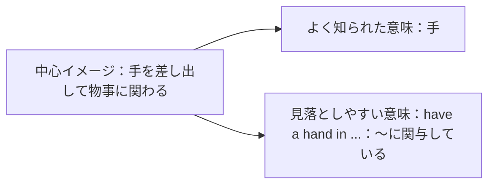

**重要語法：** have a hand in + 名詞・動名詞

<small>原データ：index 328 / candidate_id `ev-00328-ai-01`</small>

---

## 242. present

**品詞：** 形容詞（adjective）

**発音：** /ˈprezənt/

**よく知られている意味：** <small>現在の</small>

**見落としやすい意味：** **その場にいる、出席している**

**例文：** All the members present agreed with the decision.

**和訳：** その場にいた全員がその決定に賛成した。

**コアイメージ：** present は「今ここにある」という位置づけを表す。時間的な現在だけでなく、人がその場にいるという意味にもつながる。

**図：**

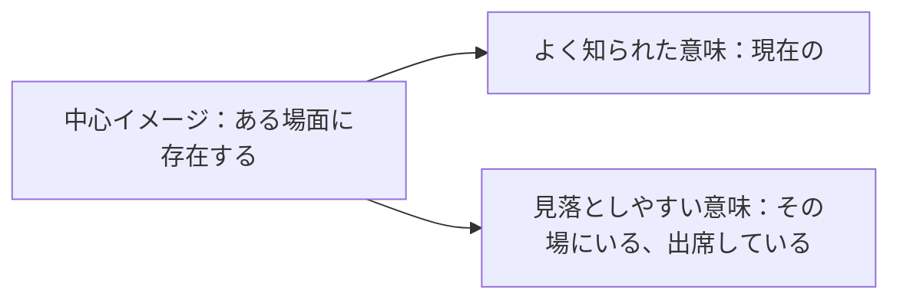

**重要語法：** members present（出席していたメンバー）

<small>原データ：index 329 / candidate_id `ev-00329-adjective-01`</small>

---

## 243. present

**品詞：** 動詞（verb）

**発音：** /prɪˈzent/

**よく知られている意味：** <small>贈る</small>

**見落としやすい意味：** **提示する、発表する**

**例文：** The scientist will present her findings tomorrow.

**和訳：** その科学者は明日、研究結果を発表する。

**コアイメージ：** present は相手の前に何かを差し出す動作を表す。贈り物だけでなく、考えや成果を提示する場合にも使う。

**図：**

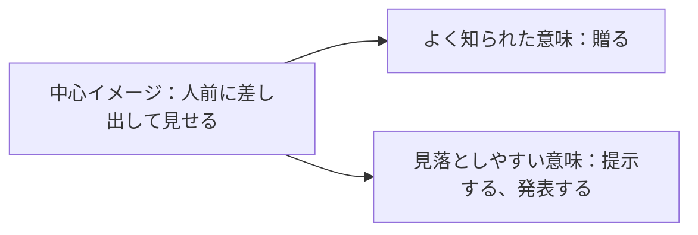

**重要語法：** present A to B

<small>原データ：index 329 / candidate_id `ev-00329-verb-02`</small>

---

## 244. office

**品詞：** 構文・語法（construction）

**発音：** /ˈɔːfɪs/

**よく知られている意味：** <small>事務所</small>

**見落としやすい意味：** **hold office：公職に就いている**

**例文：** She held office as mayor for eight years.

**和訳：** 彼女は8年間市長を務めた。

**コアイメージ：** office は仕事をする場所に加え、公的な職務や地位も意味する。hold office はその地位を占め職務を果たしている状態を表す。

**図：**

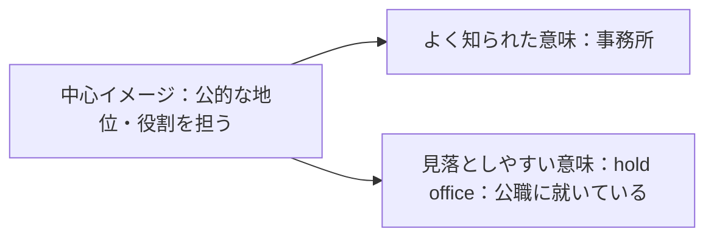

**重要語法：** hold office as + 役職

<small>原データ：index 330 / candidate_id `ev-00330-ai-01`</small>

---

## 245. side

**品詞：** 構文・語法（construction）

**発音：** /saɪd/

**よく知られている意味：** <small>側</small>

**見落としやすい意味：** **side with ...：〜の味方をする**

**例文：** Several students sided with the teacher.

**和訳：** 数人の生徒が先生の味方をした。

**コアイメージ：** side は物の側面や立場を表す。side with は議論や対立で誰かと同じ側に立ち支持する意味になる。

**図：**

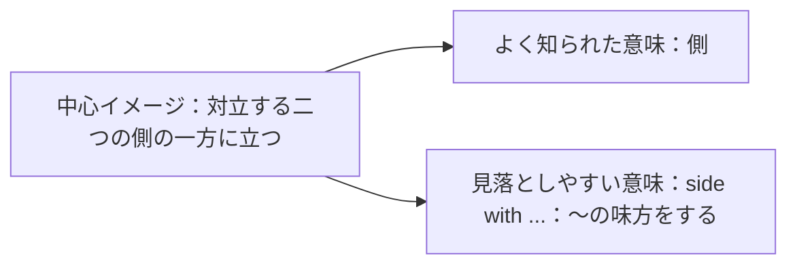

**重要語法：** side with + 人・集団

<small>原データ：index 331 / candidate_id `ev-00331-ai-01`</small>

---

## 246. cut

**品詞：** 構文・語法（construction）

**発音：** /kʌt/

**よく知られている意味：** <small>切る</small>

**見落としやすい意味：** **be cut out for ...：〜に向いている**

**例文：** I don't think I'm cut out for office work.

**和訳：** 私は事務仕事に向いていないと思う。

**コアイメージ：** cut out は形に合わせて切り抜くことを表す。be cut out for は比喩的に、能力や性格がある役割に合っていることをいう。

**図：**

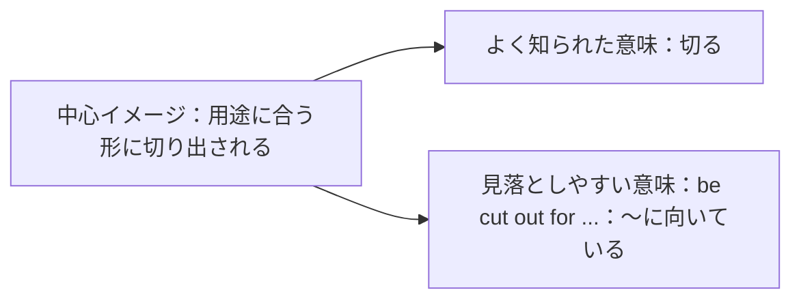

**重要語法：** be cut out for + 名詞

<small>原データ：index 334 / candidate_id `ev-00334-ai-01`</small>

---

## 247. ever

**品詞：** 構文・語法（construction）

**発音：** /ˈevər/

**よく知られている意味：** <small>これまでに</small>

**見落としやすい意味：** **ever since ...：〜以来ずっと**

**例文：** I have loved science ever since I was a child.

**和訳：** 私は子どものころからずっと科学が好きだ。

**コアイメージ：** since は起点を示し、ever が継続を強める。ever since はその時から現在まで続いていることを強調する。

**図：**

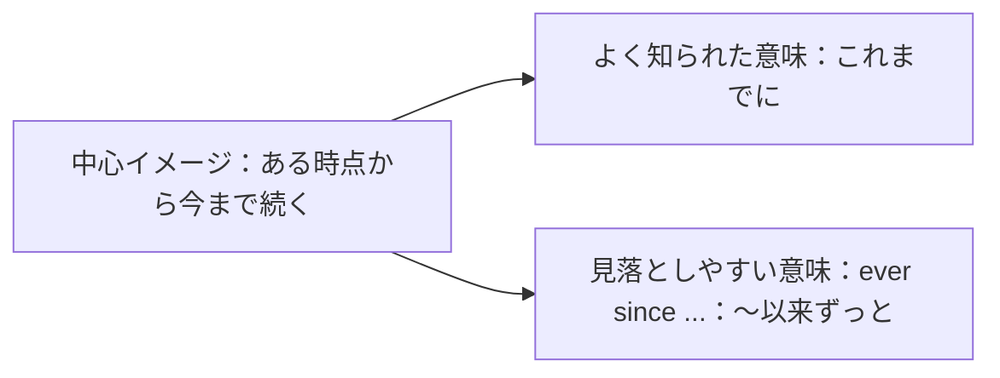

**重要語法：** ever since + 過去の時点・節

<small>原データ：index 335 / candidate_id `ev-00335-ai-01`</small>

---

## 248. serve

**品詞：** 動詞（verb）

**発音：** /sɝːv/

**よく知られている意味：** <small>食事を出す</small>

**見落としやすい意味：** **（目的・役割を）果たす**

**例文：** This small room serves as a meeting space.

**和訳：** この小さな部屋は会議スペースとして使われている。

**コアイメージ：** serve は誰かのために働くことから、何かの役に立つことも表す。人だけでなく、部屋や制度が特定の目的を果たす場合にも使える。

**図：**

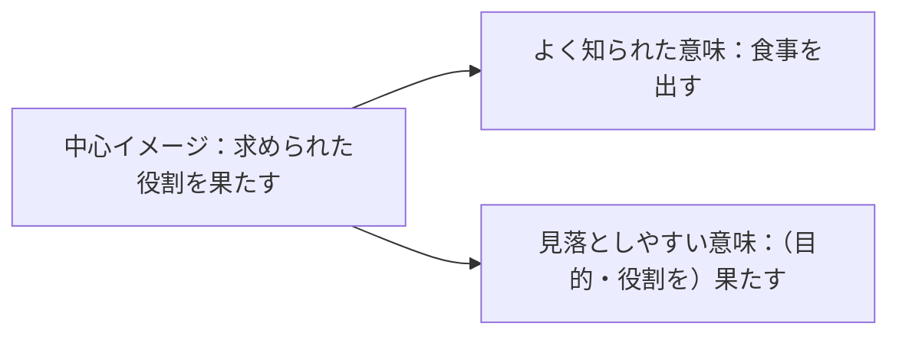

**重要語法：** serve as + 役割

<small>原データ：index 336 / candidate_id `ev-00336-verb-01`</small>

---

## 249. serve

**品詞：** 動詞（verb）

**発音：** /sɝːv/

**よく知られている意味：** <small>食事を出す</small>

**見落としやすい意味：** **（刑期を）服する**

**例文：** He served a five-year prison sentence.

**和訳：** 彼は5年間の刑期を務めた。

**コアイメージ：** serve は与えられた務めを果たす意味を持つ。刑について使うと、定められた期間を服することを表す。

**図：**

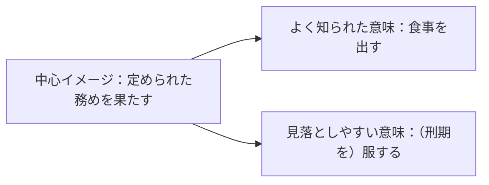

**重要語法：** serve a sentence

<small>原データ：index 336 / candidate_id `ev-00336-verb-02`</small>

---

## 250. performance

**品詞：** 名詞（noun）

**発音：** /pərˈfɔːrməns/

**よく知られている意味：** <small>演奏・演技</small>

**見落としやすい意味：** **業績、実績、実際の働き**

**例文：** The team's performance improved this year.

**和訳：** そのチームの成績は今年向上した。

**コアイメージ：** performance は人前での演技に限らず、取り組みの結果として現れた働きも指す。仕事や機械の性能、組織の業績にも使う。

**図：**

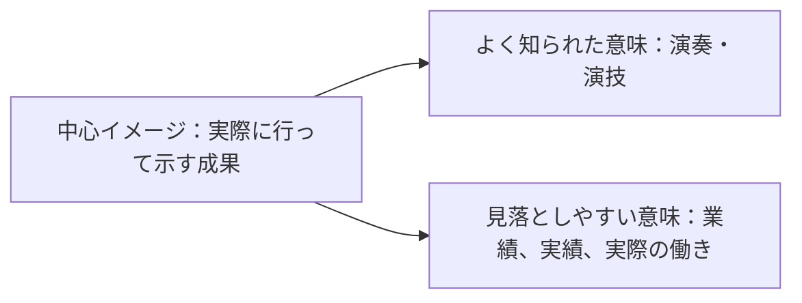

**重要語法：** job performance / academic performance

<small>原データ：index 340 / candidate_id `ev-00340-ai-01`</small>

---

## 251. center

**品詞：** 構文・語法（construction）

**発音：** /ˈsentər/

**よく知られている意味：** <small>中心</small>

**見落としやすい意味：** **center on ...：〜に焦点を当てる**

**例文：** The discussion centered on climate change.

**和訳：** 議論は気候変動を中心に進んだ。

**コアイメージ：** center は空間の中央を表す。center on は話題や関心の中心が何にあるかを示す。

**図：**

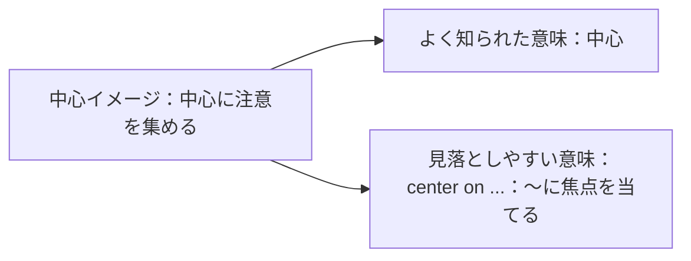

**重要語法：** center on + 名詞

<small>原データ：index 342 / candidate_id `ev-00342-ai-01`</small>

---

## 252. art

**品詞：** 名詞（noun）

**発音：** /ɑːrt/

**よく知られている意味：** <small>美術</small>

**見落としやすい意味：** **技術、こつ（the art of ...）**

**例文：** Learning the art of listening takes time.

**和訳：** 人の話を聞くこつを身につけるには時間がかかる。

**コアイメージ：** art は作品を作る技術だけでなく、熟練によって身につくこつを指す。the art of はある行為をうまく行う技術という意味になる。

**図：**

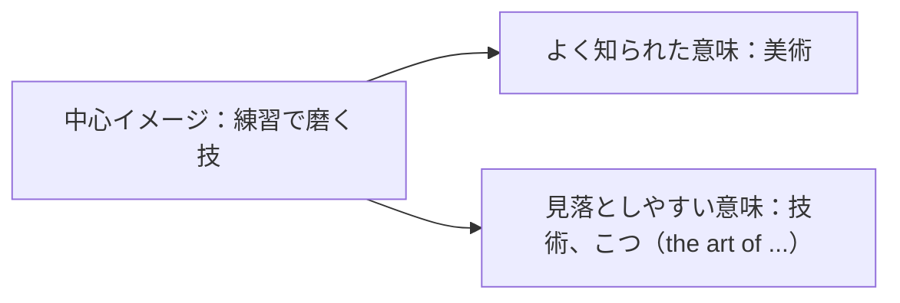

**重要語法：** the art of + 動名詞

<small>原データ：index 343 / candidate_id `ev-00343-ai-01`</small>

---

## 253. history

**品詞：** 名詞（noun）

**発音：** /ˈhɪstəri/

**よく知られている意味：** <small>歴史</small>

**見落としやすい意味：** **（特に医療分野での）病歴、既往歴**

**例文：** The doctor asked about my medical history.

**和訳：** 医師は私の病歴について尋ねた。

**コアイメージ：** history は社会の歴史だけでなく個人に起きたことの経過も表す。医療では、過去の病気や治療についての記録を意味する。

**図：**

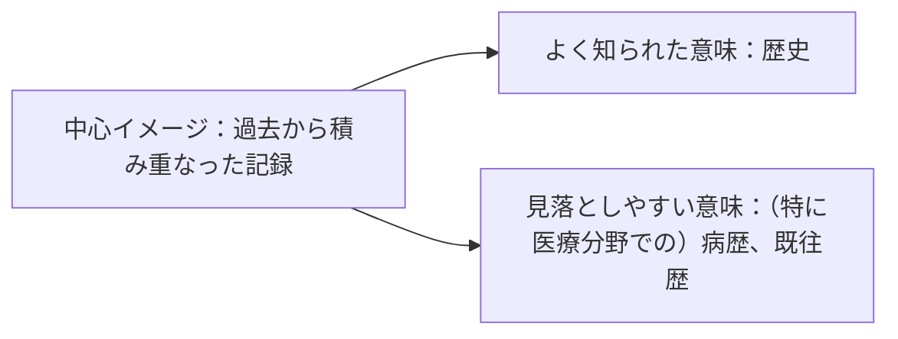

**重要語法：** medical history

<small>原データ：index 344 / candidate_id `ev-00344-ai-01`</small>

---

## 254. review

**品詞：** 動詞（verb）

**発音：** /rɪˈvjuː/

**よく知られている意味：** <small>復習する</small>

**見落としやすい意味：** **再検討する、見直す**

**例文：** The committee will review the current rules.

**和訳：** 委員会は現行の規則を見直す予定だ。

**コアイメージ：** review の中心は対象を再び詳しく見ることにある。学習の復習だけでなく方針や決定の妥当性を再検討するときにも使う。

**図：**

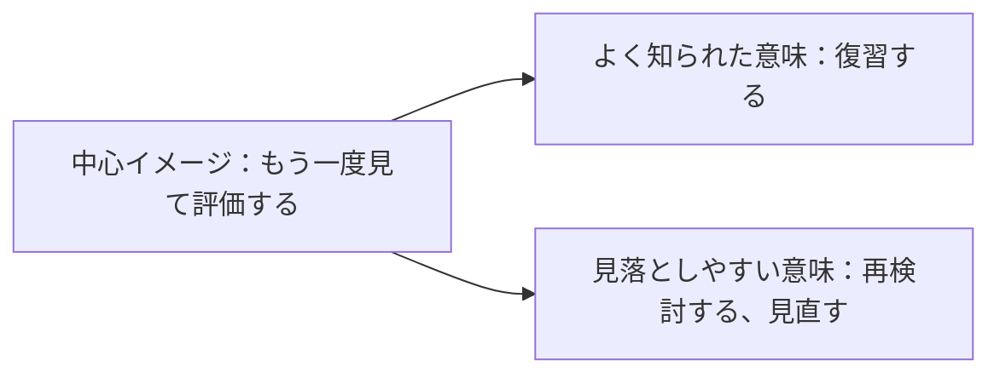

**重要語法：** review a policy / review a decision

<small>原データ：index 345 / candidate_id `ev-00345-verb-01`</small>

---

## 255. action

**品詞：** 構文・語法（construction）

**発音：** /ˈækʃən/

**よく知られている意味：** <small>行動</small>

**見落としやすい意味：** **legal action：法的措置、訴訟**

**例文：** The company may take legal action against the supplier.

**和訳：** その会社は供給業者に対して法的措置を取る可能性がある。

**コアイメージ：** action は単なる動作ではなく、問題に対して取る措置にもなる。legal action は法律に基づく対応や訴訟を指す。

**図：**

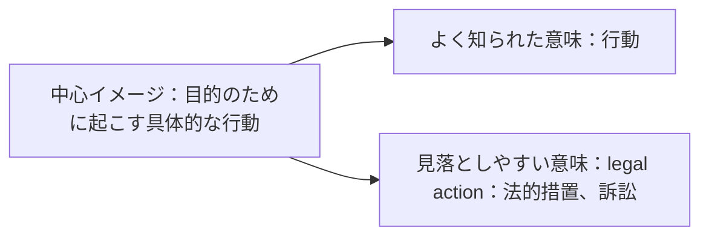

**重要語法：** take legal action against + 相手

<small>原データ：index 349 / candidate_id `ev-00349-ai-01`</small>

---

## 256. policy

**品詞：** 名詞（noun）

**発音：** /ˈpɑːləsi/

**よく知られている意味：** <small>方針</small>

**見落としやすい意味：** **保険証券**

**例文：** Keep a copy of your insurance policy.

**和訳：** 保険証券の写しを保管しておきなさい。

**コアイメージ：** policy は組織の方針を意味する一方、保険では契約内容を示す文書を指す。文脈が保険なら単に「方針」と訳さない。

**図：**

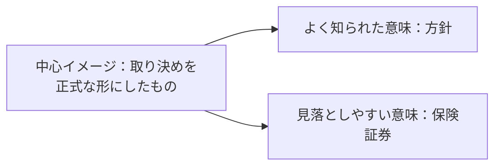

**重要語法：** insurance policy

<small>原データ：index 352 / candidate_id `ev-00352-noun-01`</small>

---

## 257. practice

**品詞：** 動詞（verb）

**発音：** /ˈpræktɪs/

**よく知られている意味：** <small>練習する</small>

**見落としやすい意味：** **（思想・方法を）実行する**

**例文：** She practices what she teaches.

**和訳：** 彼女は自分が教えていることを実践している。

**コアイメージ：** practice は練習だけでなく、考えや信念を日常の行動に移すことも表す。言っている内容を実際に行うかが焦点になる。

**図：**

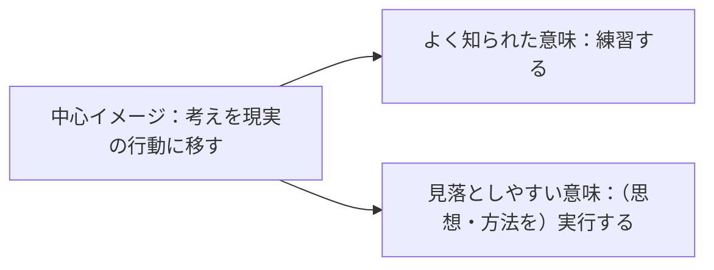

**重要語法：** practice what you preach

<small>原データ：index 353 / candidate_id `ev-00353-verb-01`</small>

---

## 258. matter

**品詞：** 動詞（verb）

**発音：** /ˈmætər/

**よく知られている意味：** <small>事柄</small>

**見落としやすい意味：** **重要である**

**例文：** Small details matter in scientific experiments.

**和訳：** 科学実験では小さな細部が重要だ。

**コアイメージ：** matter は「物事」を表す名詞にもなるが、動詞では重要性があることを示す。主語に何が大切なのかを置ける。

**図：**

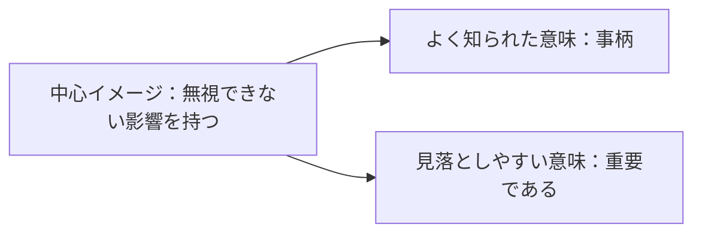

**重要語法：** It matters whether ...

<small>原データ：index 354 / candidate_id `ev-00354-verb-01`</small>

---

## 259. read

**品詞：** 動詞（verb）

**発音：** /riːd/

**よく知られている意味：** <small>読む</small>

**見落としやすい意味：** **（標識・文書などに）〜と書いてある**

**例文：** The sign reads "No Parking."

**和訳：** その標識には「駐車禁止」と書いてある。

**コアイメージ：** read は人が文章を読む行為を表す。標識や文書を主語にすると、そこに書かれた内容を伝える意味になる。

**図：**

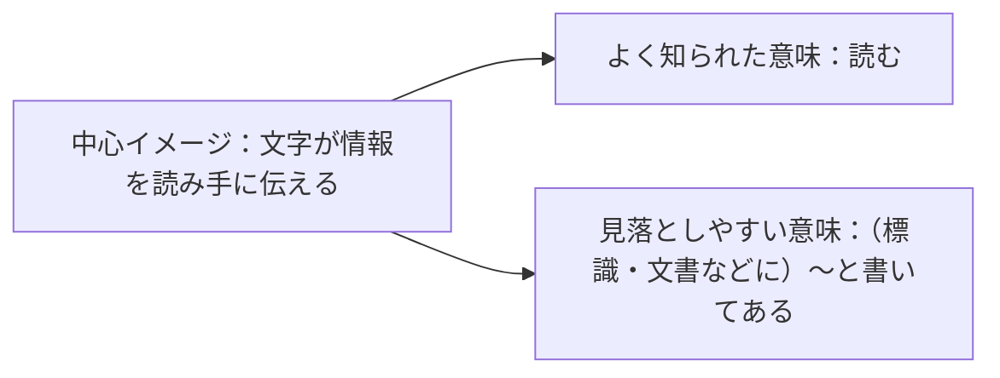

**重要語法：** The sign reads ...

<small>原データ：index 356 / candidate_id `ev-00356-ai-01`</small>

---

## 260. read

**品詞：** 発音上の注意（pronunciation）

**発音：** /riːd/・/red/

**よく知られている意味：** <small>読む</small>

**見落としやすい意味：** **read の現在形と過去・過去分詞形は同綴りで発音が違う**

**例文：** I read the news every morning, but yesterday I read it at night.

**和訳：** 私は毎朝ニュースを読むが、昨日は夜に読んだ。

**コアイメージ：** read は現在形と過去形・過去分詞形のつづりが同じである。現在形は /riːd/、過去形・過去分詞形は /red/ と発音するため、文の時制で判断する。

**図：**

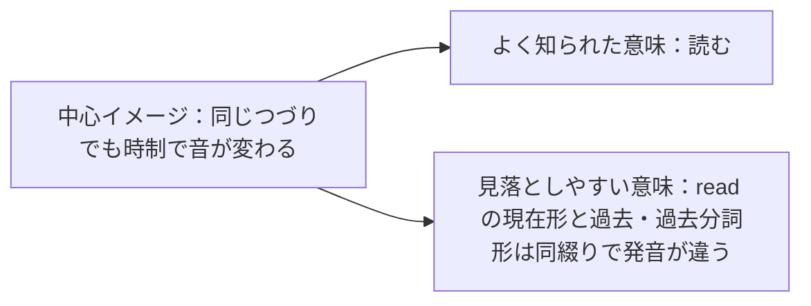

**重要語法：** 現在形 /riːd/、過去・過去分詞形 /red/

<small>原データ：index 356 / candidate_id `ev-00356-ai-02`</small>

---

## 261. effort

**品詞：** 構文・語法（construction）

**発音：** /ˈefərt/

**よく知られている意味：** <small>努力</small>

**見落としやすい意味：** **in an effort to do：〜しようとして**

**例文：** They planted trees in an effort to protect the river.

**和訳：** 川を守ろうとして、彼らは木を植えた。

**コアイメージ：** effort は目的を達成するための働きかけを表す。in an effort to do は、これから示す行動の目的を述べる表現である。

**図：**

```mermaid
flowchart LR
    A["中心イメージ：目標に向けて力を注ぐ"]
    B["よく知られた意味：努力"]
    C["見落としやすい意味：in an effort to do：〜しようとして"]
    A --> B
    A --> C
```

**重要語法：** in an effort to + 動詞の原形

<small>原データ：index 358 / candidate_id `ev-00358-ai-01`</small>

---

## 262. fund

**品詞：** 動詞（verb）

**発音：** /fʌnd/

**よく知られている意味：** <small>基金</small>

**見落としやすい意味：** **資金を提供する**

**例文：** The city funded the new research project.

**和訳：** 市はその新しい研究計画に資金を提供した。

**コアイメージ：** fund は活動に使う資金そのものを指す。動詞になると、計画や組織が動けるようにお金を出す意味になる。

**図：**

```mermaid
flowchart LR
    A["中心イメージ：活動のための資金を用意する"]
    B["よく知られた意味：基金"]
    C["見落としやすい意味：資金を提供する"]
    A --> B
    A --> C
```

**重要語法：** fund a project

<small>原データ：index 359 / candidate_id `ev-00359-verb-01`</small>

---

## 263. sense

**品詞：** 構文・語法（construction）

**発音：** /sens/

**よく知られている意味：** <small>感覚</small>

**見落としやすい意味：** **make sense of ...：〜を理解する**

**例文：** I couldn't make sense of his explanation.

**和訳：** 私は彼の説明を理解できなかった。

**コアイメージ：** sense は感覚や意味を表す。make sense of は複雑な情報を整理して理解できる形にすることをいう。

**図：**

```mermaid
flowchart LR
    A["中心イメージ：情報から意味をつかむ"]
    B["よく知られた意味：感覚"]
    C["見落としやすい意味：make sense of ...：〜を理解する"]
    A --> B
    A --> C
```

**重要語法：** make sense of + 名詞

<small>原データ：index 360 / candidate_id `ev-00360-ai-01`</small>

---

## 264. sense

**品詞：** 構文・語法（construction）

**発音：** /sens/

**よく知られている意味：** <small>感覚</small>

**見落としやすい意味：** **in a sense：ある意味では**

**例文：** In a sense, both answers are correct.

**和訳：** ある意味では、どちらの答えも正しい。

**コアイメージ：** sense は意味や捉え方も表す。in a sense は特定の観点から見ればそう言えるという限定を加える。

**図：**

```mermaid
flowchart LR
    A["中心イメージ：一つの見方を取る"]
    B["よく知られた意味：感覚"]
    C["見落としやすい意味：in a sense：ある意味では"]
    A --> B
    A --> C
```

**重要語法：** in a sense

<small>原データ：index 360 / candidate_id `ev-00360-ai-02`</small>

---

## 265. add

**品詞：** 構文・語法（construction）

**発音：** /æd/

**よく知られている意味：** <small>加える</small>

**見落としやすい意味：** **add up：つじつまが合う**

**例文：** His story doesn't add up.

**和訳：** 彼の話はつじつまが合わない。

**コアイメージ：** add up は数を足して合計を出す動作を表す。話の各部分が一致するかに使うと、筋が通るという意味になる。

**図：**

```mermaid
flowchart LR
    A["中心イメージ：部分を足して全体が合う"]
    B["よく知られた意味：加える"]
    C["見落としやすい意味：add up：つじつまが合う"]
    A --> B
    A --> C
```

**重要語法：** The numbers don't add up.

<small>原データ：index 361 / candidate_id `ev-00361-ai-01`</small>

---

## 266. add

**品詞：** 構文・語法（construction）

**発音：** /æd/

**よく知られている意味：** <small>加える</small>

**見落としやすい意味：** **add up to ...：合計〜になる、結局〜を意味する**

**例文：** The costs add up to over $1,000.

**和訳：** 費用は合計で1,000ドルを超える。

**コアイメージ：** add up to は小さな部分を足し合わせて結果に到達することを表す。金額の合計だけでなく、出来事の最終的な意味にも使える。

**図：**

```mermaid
flowchart LR
    A["中心イメージ：積み重なった結果に達する"]
    B["よく知られた意味：加える"]
    C["見落としやすい意味：add up to ...：合計〜になる、結局〜を意味する"]
    A --> B
    A --> C
```

**重要語法：** add up to + 数量・結果

<small>原データ：index 361 / candidate_id `ev-00361-ai-02`</small>

---

## 267. late

**品詞：** 形容詞（adjective）

**発音：** /leɪt/

**よく知られている意味：** <small>遅い</small>

**見落としやすい意味：** **故人の、亡くなった**

**例文：** Her late father was a talented musician.

**和訳：** 彼女の亡くなった父親は才能ある音楽家だった。

**コアイメージ：** late は普段は時刻が遅いことを示す。人を表す名詞の前では、今は亡くなっていることを丁寧に示す語になる。

**図：**

```mermaid
flowchart LR
    A["中心イメージ：すでにこの世にいない人を指す"]
    B["よく知られた意味：遅い"]
    C["見落としやすい意味：故人の、亡くなった"]
    A --> B
    A --> C
```

**重要語法：** my late grandfather

<small>原データ：index 362 / candidate_id `ev-00362-adjective-01`</small>

---

## 268. face

**品詞：** 動詞（verb）

**発音：** /feɪs/

**よく知られている意味：** <small>顔</small>

**見落としやすい意味：** **（問題に）直面する**

**例文：** Many families face serious challenges.

**和訳：** 多くの家庭が深刻な課題に直面している。

**コアイメージ：** face は顔を意味するほか、何かに向かい合う動作を表す。困難や問題が目的語なら、それに直面している意味になる。

**図：**

```mermaid
flowchart LR
    A["中心イメージ：物事に正面から向き合う"]
    B["よく知られた意味：顔"]
    C["見落としやすい意味：（問題に）直面する"]
    A --> B
    A --> C
```

**重要語法：** face a problem

<small>原データ：index 366 / candidate_id `ev-00366-verb-01`</small>

---

## 269. appear

**品詞：** 動詞（verb）

**発音：** /əˈpɪr/

**よく知られている意味：** <small>現れる</small>

**見落としやすい意味：** **（映画・舞台などに）出演する**

**例文：** She appeared in several popular films.

**和訳：** 彼女はいくつかの人気映画に出演した。

**コアイメージ：** appear は姿を現すことを意味する。舞台や映画の中に現れる場合は出演するという意味になる。

**図：**

```mermaid
flowchart LR
    A["中心イメージ：人前・画面上に姿を見せる"]
    B["よく知られた意味：現れる"]
    C["見落としやすい意味：（映画・舞台などに）出演する"]
    A --> B
    A --> C
```

**重要語法：** appear in a film

<small>原データ：index 368 / candidate_id `ev-00368-verb-01`</small>

---

## 270. private

**品詞：** 構文・語法（construction）

**発音：** /ˈpraɪvət/

**よく知られている意味：** <small>個人的な</small>

**見落としやすい意味：** **in private：人目を避けて、内密に**

**例文：** Can we discuss this matter in private?

**和訳：** この件を人目のないところで話せますか。

**コアイメージ：** private は公に開かれていないことを表す。in private は他人の目や耳が届かない状況で行うことをいう。

**図：**

```mermaid
flowchart LR
    A["中心イメージ：公の場から離れた領域"]
    B["よく知られた意味：個人的な"]
    C["見落としやすい意味：in private：人目を避けて、内密に"]
    A --> B
    A --> C
```

**重要語法：** in private

<small>原データ：index 370 / candidate_id `ev-00370-ai-01`</small>

---

## 271. across

**品詞：** 構文・語法（construction）

**発音：** /əˈkrɔːs/

**よく知られている意味：** <small>横切って</small>

**見落としやすい意味：** **across the board：全面的に、一律に**

**例文：** The company raised salaries across the board.

**和訳：** その会社は全社員の給与を一律に引き上げた。

**コアイメージ：** across は一方から他方まで横断することを表す。across the board は対象全体に同じ対応が及ぶことを意味する。

**図：**

```mermaid
flowchart LR
    A["中心イメージ：端から端まで例外なく"]
    B["よく知られた意味：横切って"]
    C["見落としやすい意味：across the board：全面的に、一律に"]
    A --> B
    A --> C
```

**重要語法：** across the board

<small>原データ：index 371 / candidate_id `ev-00371-ai-01`</small>

---

## 272. effect

**品詞：** 動詞（verb）

**発音：** /ɪˈfekt/

**よく知られている意味：** <small>結果・効果</small>

**見落としやすい意味：** **（変化などを）実現させる**

**例文：** The new leader effected major changes.

**和訳：** 新しい指導者は大きな変革を実現した。

**コアイメージ：** effect は「効果」という名詞がよく知られる。動詞では、ある変化や結果を現実に起こすことを示す。

**図：**

```mermaid
flowchart LR
    A["中心イメージ：結果を実際に生じさせる"]
    B["よく知られた意味：結果・効果"]
    C["見落としやすい意味：（変化などを）実現させる"]
    A --> B
    A --> C
```

**重要語法：** effect change

<small>原データ：index 373 / candidate_id `ev-00373-verb-01`</small>

---

## 273. accord

**品詞：** 動詞（verb）

**発音：** /əˈkɔːrd/

**よく知られている意味：** <small>一致する</small>

**見落としやすい意味：** **〜を与える、認める**

**例文：** The law accords equal rights to all citizens.

**和訳：** その法律はすべての市民に平等な権利を与えている。

**コアイメージ：** accord は一致や調和に関係する語である。動詞では、権利や待遇を相手に正式に認めて与える意味になる。

**図：**

```mermaid
flowchart LR
    A["中心イメージ：相手にふさわしいものを認め与える"]
    B["よく知られた意味：一致する"]
    C["見落としやすい意味：〜を与える、認める"]
    A --> B
    A --> C
```

**重要語法：** accord A to B

<small>原データ：index 374 / candidate_id `ev-00374-verb-01`</small>

---

## 274. source

**品詞：** 動詞（verb）

**発音：** /sɔːrs/

**よく知られている意味：** <small>源</small>

**見落としやすい意味：** **（資材・部品・製品などを）調達する**

**例文：** The firm sources its materials locally.

**和訳：** その会社は原材料を地元で調達している。

**コアイメージ：** source は物事の出どころを示す。動詞になると必要な物の供給元を探し、そこから調達することをいう。

**図：**

```mermaid
flowchart LR
    A["中心イメージ：必要なものの供給元を見つける"]
    B["よく知られた意味：源"]
    C["見落としやすい意味：（資材・部品・製品などを）調達する"]
    A --> B
    A --> C
```

**重要語法：** source materials from ...

<small>原データ：index 375 / candidate_id `ev-00375-ai-01`</small>

---

## 275. fall

**品詞：** 構文・語法（construction）

**発音：** /fɔːl/

**よく知られている意味：** <small>落ちる</small>

**見落としやすい意味：** **fall short of ...：〜に達しない**

**例文：** The result fell short of our expectations.

**和訳：** 結果は私たちの期待に届かなかった。

**コアイメージ：** fall は下へ落ちることを表す。fall short of は基準や目標に対して不足していることを示す。

**図：**

```mermaid
flowchart LR
    A["中心イメージ：目標までの距離が足りない"]
    B["よく知られた意味：落ちる"]
    C["見落としやすい意味：fall short of ...：〜に達しない"]
    A --> B
    A --> C
```

**重要語法：** fall short of + 目標

<small>原データ：index 376 / candidate_id `ev-00376-ai-01`</small>

---

## 276. fall

**品詞：** 動詞（verb）

**発音：** /fɔːl/

**よく知られている意味：** <small>落ちる</small>

**見落としやすい意味：** **（分類・範囲に）属する**

**例文：** This example falls into a different category.

**和訳：** この例は別の分類に属する。

**コアイメージ：** fall は場所や状態が変わる動きにも使う。fall into はある分類や範囲に入ることを表し、実際に落下するとは限らない。

**図：**

```mermaid
flowchart LR
    A["中心イメージ：ある範囲の中に入る"]
    B["よく知られた意味：落ちる"]
    C["見落としやすい意味：（分類・範囲に）属する"]
    A --> B
    A --> C
```

**重要語法：** fall into a category

<small>原データ：index 376 / candidate_id `ev-00376-verb-01`</small>

---

## 277. lose

**品詞：** 構文・語法（construction）

**発音：** /luːz/

**よく知られている意味：** <small>失う</small>

**見落としやすい意味：** **lose oneself in ...：〜に没頭する**

**例文：** She lost herself in the novel for hours.

**和訳：** 彼女は何時間も小説に没頭した。

**コアイメージ：** lose oneself は自分を見失うほど夢中になる比喩である。in がその意識の向かう対象を示し、没頭を表す。

**図：**

```mermaid
flowchart LR
    A["中心イメージ：意識が別のものに吸い込まれる"]
    B["よく知られた意味：失う"]
    C["見落としやすい意味：lose oneself in ...：〜に没頭する"]
    A --> B
    A --> C
```

**重要語法：** lose oneself in + 名詞

<small>原データ：index 380 / candidate_id `ev-00380-ai-01`</small>

---

## 278. student

**品詞：** 名詞（noun）

**発音：** /ˈstuːdənt/

**よく知られている意味：** <small>学生</small>

**見落としやすい意味：** **〜の研究者・熱心な学習者（a student of ...）**

**例文：** He is a lifelong student of history.

**和訳：** 彼は生涯にわたり歴史を研究し学び続ける人だ。

**コアイメージ：** student は学校に通う人だけを指すわけではない。a student of はある分野を深く研究する人や熱心に学ぶ人を表す。

**図：**

```mermaid
flowchart LR
    A["中心イメージ：ある分野を学び続ける人"]
    B["よく知られた意味：学生"]
    C["見落としやすい意味：〜の研究者・熱心な学習者（a student of ...）"]
    A --> B
    A --> C
```

**重要語法：** a student of + 分野

<small>原データ：index 381 / candidate_id `ev-00381-ai-01`</small>

---

## 279. general

**品詞：** 名詞（noun）

**発音：** /ˈdʒenərəl/

**よく知られている意味：** <small>一般的な</small>

**見落としやすい意味：** **将軍**

**例文：** The general commanded the troops.

**和訳：** その将軍は部隊を指揮した。

**コアイメージ：** general は形容詞では全般的であることを表す。名詞では軍隊の高い階級にある指揮官を指す。

**図：**

```mermaid
flowchart LR
    A["中心イメージ：集団全体を率いる役職"]
    B["よく知られた意味：一般的な"]
    C["見落としやすい意味：将軍"]
    A --> B
    A --> C
```

**重要語法：** a general in the army

<small>原データ：index 382 / candidate_id `ev-00382-noun-01`</small>

---

## 280. available

**品詞：** 形容詞（adjective）

**発音：** /əˈveɪləbəl/

**よく知られている意味：** <small>利用できる</small>

**見落としやすい意味：** **（人が）会う時間がある、手が空いている**

**例文：** Is the teacher available after class?

**和訳：** 先生は授業の後、お時間がありますか。

**コアイメージ：** available は物やサービスを利用できることを表す。人について使うと時間が空いていて会ったり話したりできることを示す。

**図：**

```mermaid
flowchart LR
    A["中心イメージ：求められたときに対応できる状態"]
    B["よく知られた意味：利用できる"]
    C["見落としやすい意味：（人が）会う時間がある、手が空いている"]
    A --> B
    A --> C
```

**重要語法：** available for a meeting

<small>原データ：index 383 / candidate_id `ev-00383-ai-01`</small>
