# EasyVoca 完成教材｜バッチ004

担当：global_order 241〜320（80カード）。`main` に採用済みの候補を `index` → `candidate_id` の順に教材化。語義の追加・再選定はしていません。

## 241. hand

**品詞：** 構文・語法（construction）

**発音：** /hænd/

**よく知られている意味：** <small>手</small>

**見落としやすい意味：** **have a hand in ...：〜に関与している**

**例文：** She had a hand in designing the new library.

**和訳：** 彼女は新しい図書館の設計に関わった。

**コアイメージ：** hand は実際の「手」だけでなく、仕事に加わる働きかけも表す。have a hand in は計画や出来事に何らかの役割を果たすことを示す。

**図：**

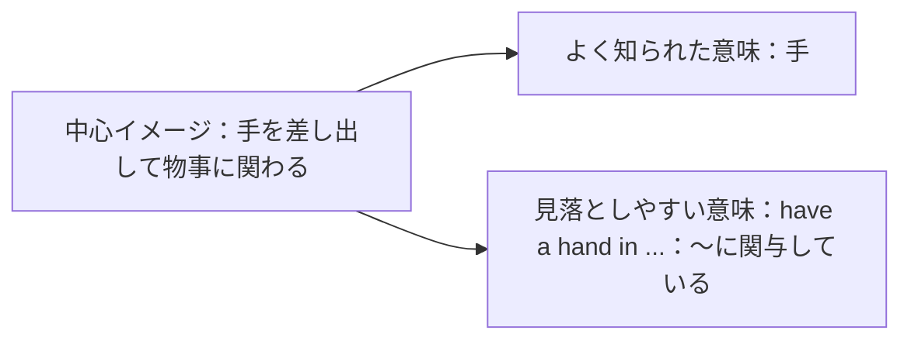

**重要語法：** have a hand in + 名詞・動名詞

<small>原データ：index 328 / candidate_id `ev-00328-ai-01`</small>

---

## 242. present

**品詞：** 形容詞（adjective）

**発音：** /ˈprezənt/

**よく知られている意味：** <small>現在の</small>

**見落としやすい意味：** **その場にいる、出席している**

**例文：** All the members present agreed with the decision.

**和訳：** その場にいた全員がその決定に賛成した。

**コアイメージ：** present は「今ここにある」という位置づけを表す。時間的な現在だけでなく、人がその場にいるという意味にもつながる。

**図：**

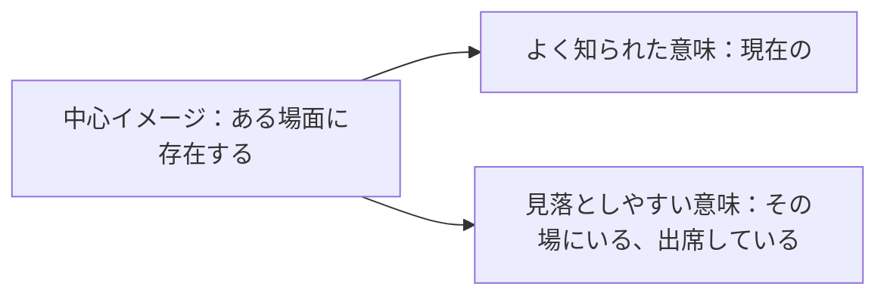

**重要語法：** members present（出席していたメンバー）

<small>原データ：index 329 / candidate_id `ev-00329-adjective-01`</small>

---

## 243. present

**品詞：** 動詞（verb）

**発音：** /prɪˈzent/

**よく知られている意味：** <small>贈る</small>

**見落としやすい意味：** **提示する、発表する**

**例文：** The scientist will present her findings tomorrow.

**和訳：** その科学者は明日、研究結果を発表する。

**コアイメージ：** present は相手の前に何かを差し出す動作を表す。贈り物だけでなく、考えや成果を提示する場合にも使う。

**図：**

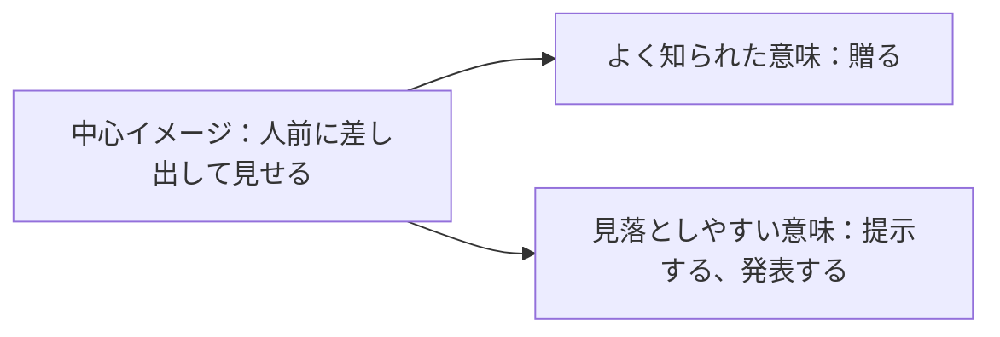

**重要語法：** present A to B

<small>原データ：index 329 / candidate_id `ev-00329-verb-02`</small>

---

## 244. office

**品詞：** 構文・語法（construction）

**発音：** /ˈɔːfɪs/

**よく知られている意味：** <small>事務所</small>

**見落としやすい意味：** **hold office：公職に就いている**

**例文：** She held office as mayor for eight years.

**和訳：** 彼女は8年間市長を務めた。

**コアイメージ：** office は仕事をする場所に加え、公的な職務や地位も意味する。hold office はその地位を占め職務を果たしている状態を表す。

**図：**

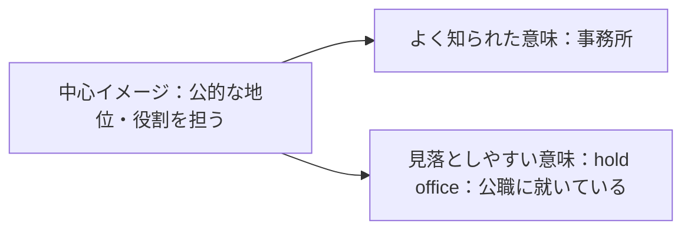

**重要語法：** hold office as + 役職

<small>原データ：index 330 / candidate_id `ev-00330-ai-01`</small>

---

## 245. side

**品詞：** 構文・語法（construction）

**発音：** /saɪd/

**よく知られている意味：** <small>側</small>

**見落としやすい意味：** **side with ...：〜の味方をする**

**例文：** Several students sided with the teacher.

**和訳：** 数人の生徒が先生の味方をした。

**コアイメージ：** side は物の側面や立場を表す。side with は議論や対立で誰かと同じ側に立ち支持する意味になる。

**図：**

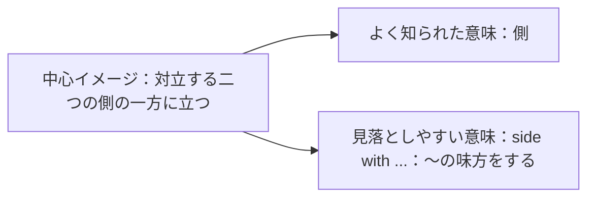

**重要語法：** side with + 人・集団

<small>原データ：index 331 / candidate_id `ev-00331-ai-01`</small>

---

## 246. cut

**品詞：** 構文・語法（construction）

**発音：** /kʌt/

**よく知られている意味：** <small>切る</small>

**見落としやすい意味：** **be cut out for ...：〜に向いている**

**例文：** I don't think I'm cut out for office work.

**和訳：** 私は事務仕事に向いていないと思う。

**コアイメージ：** cut out は形に合わせて切り抜くことを表す。be cut out for は比喩的に、能力や性格がある役割に合っていることをいう。

**図：**

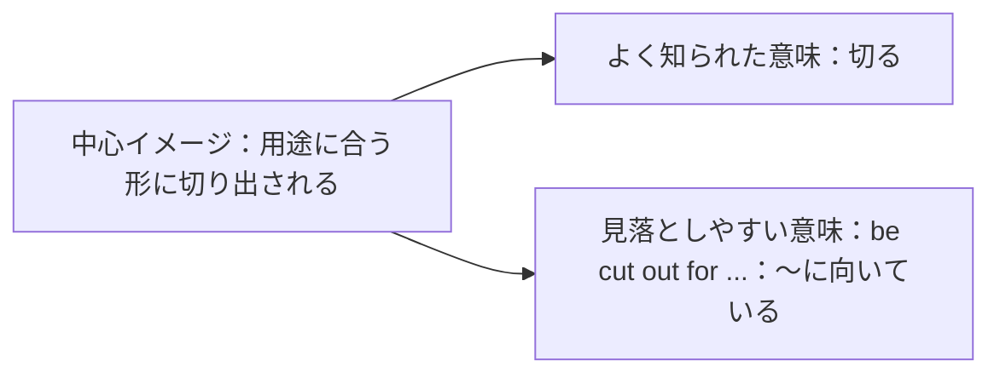

**重要語法：** be cut out for + 名詞

<small>原データ：index 334 / candidate_id `ev-00334-ai-01`</small>

---

## 247. ever

**品詞：** 構文・語法（construction）

**発音：** /ˈevər/

**よく知られている意味：** <small>これまでに</small>

**見落としやすい意味：** **ever since ...：〜以来ずっと**

**例文：** I have loved science ever since I was a child.

**和訳：** 私は子どものころからずっと科学が好きだ。

**コアイメージ：** since は起点を示し、ever が継続を強める。ever since はその時から現在まで続いていることを強調する。

**図：**

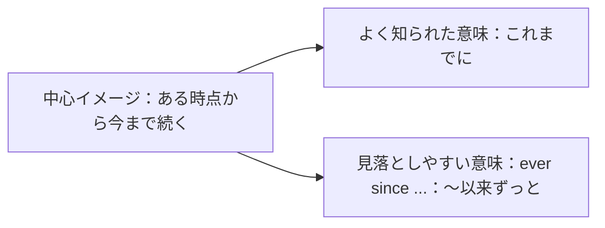

**重要語法：** ever since + 過去の時点・節

<small>原データ：index 335 / candidate_id `ev-00335-ai-01`</small>

---

## 248. serve

**品詞：** 動詞（verb）

**発音：** /sɝːv/

**よく知られている意味：** <small>食事を出す</small>

**見落としやすい意味：** **（目的・役割を）果たす**

**例文：** This small room serves as a meeting space.

**和訳：** この小さな部屋は会議スペースとして使われている。

**コアイメージ：** serve は誰かのために働くことから、何かの役に立つことも表す。人だけでなく、部屋や制度が特定の目的を果たす場合にも使える。

**図：**

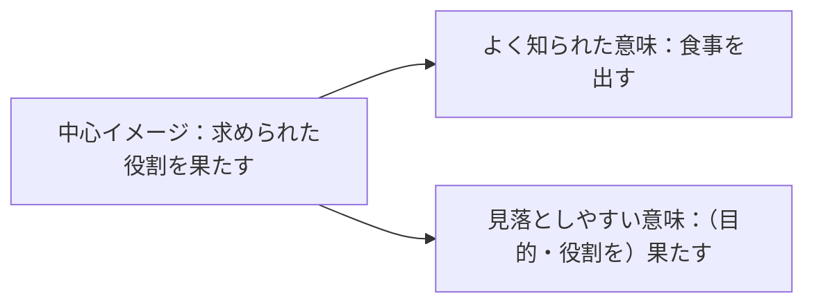

**重要語法：** serve as + 役割

<small>原データ：index 336 / candidate_id `ev-00336-verb-01`</small>

---

## 249. serve

**品詞：** 動詞（verb）

**発音：** /sɝːv/

**よく知られている意味：** <small>食事を出す</small>

**見落としやすい意味：** **（刑期を）服する**

**例文：** He served a five-year prison sentence.

**和訳：** 彼は5年間の刑期を務めた。

**コアイメージ：** serve は与えられた務めを果たす意味を持つ。刑について使うと、定められた期間を服することを表す。

**図：**

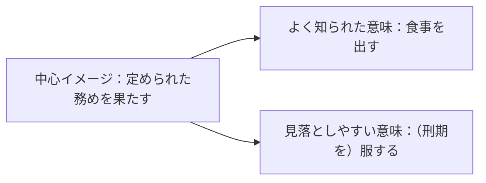

**重要語法：** serve a sentence

<small>原データ：index 336 / candidate_id `ev-00336-verb-02`</small>

---

## 250. performance

**品詞：** 名詞（noun）

**発音：** /pərˈfɔːrməns/

**よく知られている意味：** <small>演奏・演技</small>

**見落としやすい意味：** **業績、実績、実際の働き**

**例文：** The team's performance improved this year.

**和訳：** そのチームの成績は今年向上した。

**コアイメージ：** performance は人前での演技に限らず、取り組みの結果として現れた働きも指す。仕事や機械の性能、組織の業績にも使う。

**図：**

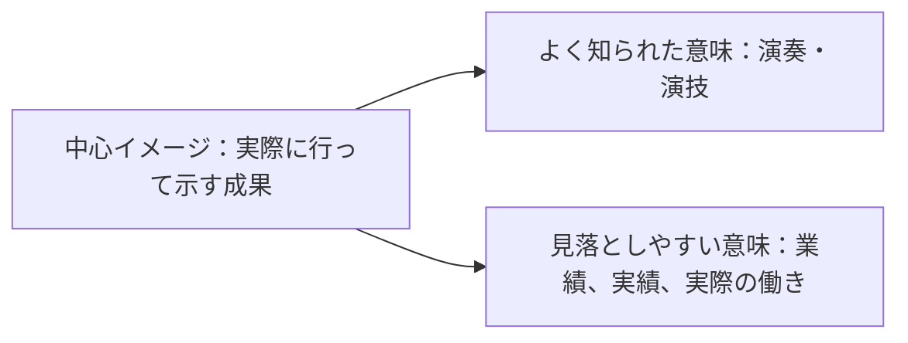

**重要語法：** job performance / academic performance

<small>原データ：index 340 / candidate_id `ev-00340-ai-01`</small>

---

## 251. center

**品詞：** 構文・語法（construction）

**発音：** /ˈsentər/

**よく知られている意味：** <small>中心</small>

**見落としやすい意味：** **center on ...：〜に焦点を当てる**

**例文：** The discussion centered on climate change.

**和訳：** 議論は気候変動を中心に進んだ。

**コアイメージ：** center は空間の中央を表す。center on は話題や関心の中心が何にあるかを示す。

**図：**

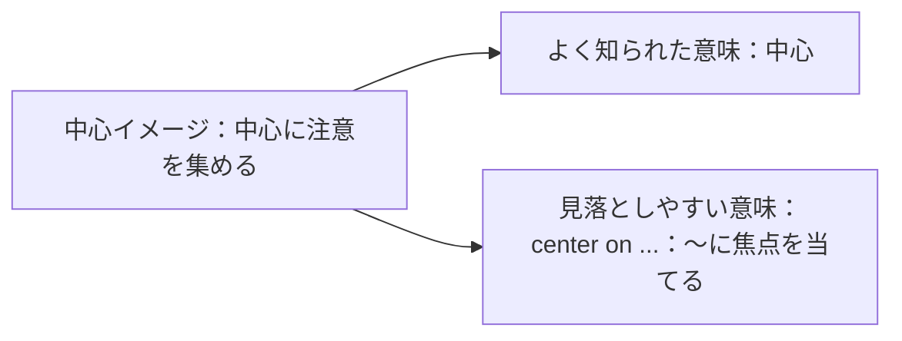

**重要語法：** center on + 名詞

<small>原データ：index 342 / candidate_id `ev-00342-ai-01`</small>

---

## 252. art

**品詞：** 名詞（noun）

**発音：** /ɑːrt/

**よく知られている意味：** <small>美術</small>

**見落としやすい意味：** **技術、こつ（the art of ...）**

**例文：** Learning the art of listening takes time.

**和訳：** 人の話を聞くこつを身につけるには時間がかかる。

**コアイメージ：** art は作品を作る技術だけでなく、熟練によって身につくこつを指す。the art of はある行為をうまく行う技術という意味になる。

**図：**

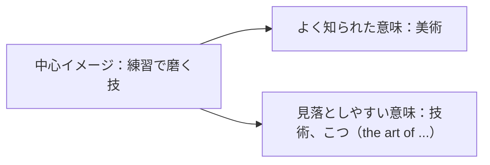

**重要語法：** the art of + 動名詞

<small>原データ：index 343 / candidate_id `ev-00343-ai-01`</small>

---

## 253. history

**品詞：** 名詞（noun）

**発音：** /ˈhɪstəri/

**よく知られている意味：** <small>歴史</small>

**見落としやすい意味：** **（特に医療分野での）病歴、既往歴**

**例文：** The doctor asked about my medical history.

**和訳：** 医師は私の病歴について尋ねた。

**コアイメージ：** history は社会の歴史だけでなく個人に起きたことの経過も表す。医療では、過去の病気や治療についての記録を意味する。

**図：**

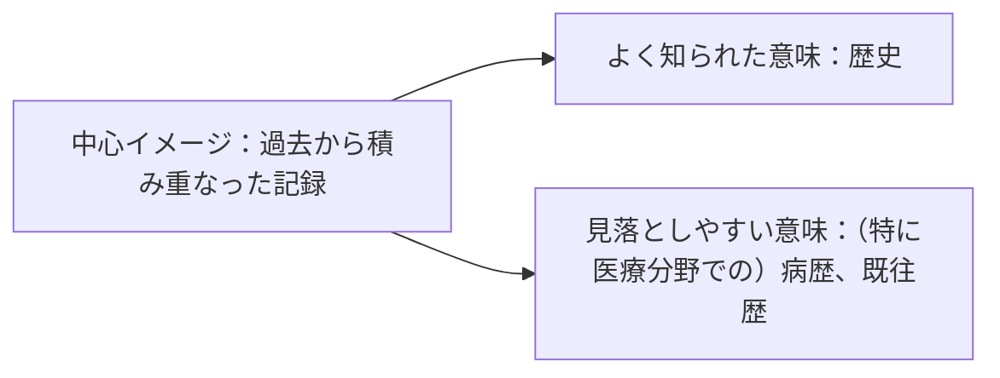

**重要語法：** medical history

<small>原データ：index 344 / candidate_id `ev-00344-ai-01`</small>

---

## 254. review

**品詞：** 動詞（verb）

**発音：** /rɪˈvjuː/

**よく知られている意味：** <small>復習する</small>

**見落としやすい意味：** **再検討する、見直す**

**例文：** The committee will review the current rules.

**和訳：** 委員会は現行の規則を見直す予定だ。

**コアイメージ：** review の中心は対象を再び詳しく見ることにある。学習の復習だけでなく方針や決定の妥当性を再検討するときにも使う。

**図：**

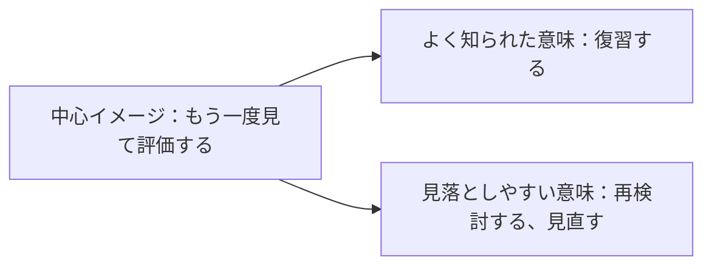

**重要語法：** review a policy / review a decision

<small>原データ：index 345 / candidate_id `ev-00345-verb-01`</small>

---

## 255. action

**品詞：** 構文・語法（construction）

**発音：** /ˈækʃən/

**よく知られている意味：** <small>行動</small>

**見落としやすい意味：** **legal action：法的措置、訴訟**

**例文：** The company may take legal action against the supplier.

**和訳：** その会社は供給業者に対して法的措置を取る可能性がある。

**コアイメージ：** action は単なる動作ではなく、問題に対して取る措置にもなる。legal action は法律に基づく対応や訴訟を指す。

**図：**

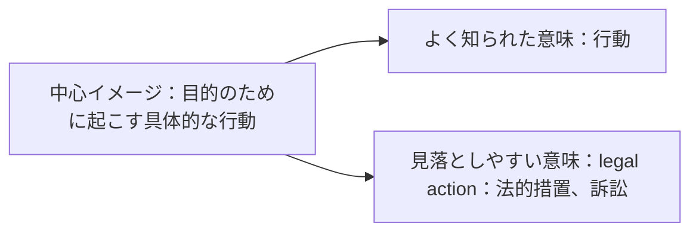

**重要語法：** take legal action against + 相手

<small>原データ：index 349 / candidate_id `ev-00349-ai-01`</small>

---

## 256. policy

**品詞：** 名詞（noun）

**発音：** /ˈpɑːləsi/

**よく知られている意味：** <small>方針</small>

**見落としやすい意味：** **保険証券**

**例文：** Keep a copy of your insurance policy.

**和訳：** 保険証券の写しを保管しておきなさい。

**コアイメージ：** policy は組織の方針を意味する一方、保険では契約内容を示す文書を指す。文脈が保険なら単に「方針」と訳さない。

**図：**

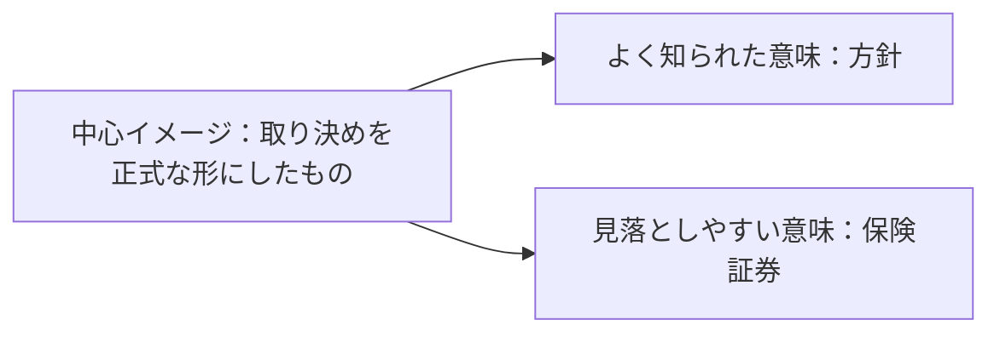

**重要語法：** insurance policy

<small>原データ：index 352 / candidate_id `ev-00352-noun-01`</small>

---

## 257. practice

**品詞：** 動詞（verb）

**発音：** /ˈpræktɪs/

**よく知られている意味：** <small>練習する</small>

**見落としやすい意味：** **（思想・方法を）実行する**

**例文：** She practices what she teaches.

**和訳：** 彼女は自分が教えていることを実践している。

**コアイメージ：** practice は練習だけでなく、考えや信念を日常の行動に移すことも表す。言っている内容を実際に行うかが焦点になる。

**図：**

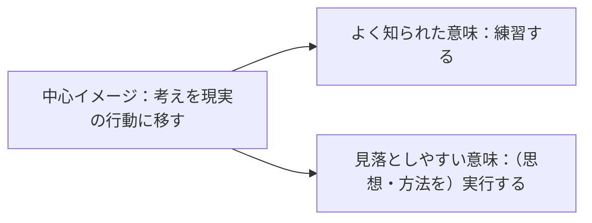

**重要語法：** practice what you preach

<small>原データ：index 353 / candidate_id `ev-00353-verb-01`</small>

---

## 258. matter

**品詞：** 動詞（verb）

**発音：** /ˈmætər/

**よく知られている意味：** <small>事柄</small>

**見落としやすい意味：** **重要である**

**例文：** Small details matter in scientific experiments.

**和訳：** 科学実験では小さな細部が重要だ。

**コアイメージ：** matter は「物事」を表す名詞にもなるが、動詞では重要性があることを示す。主語に何が大切なのかを置ける。

**図：**

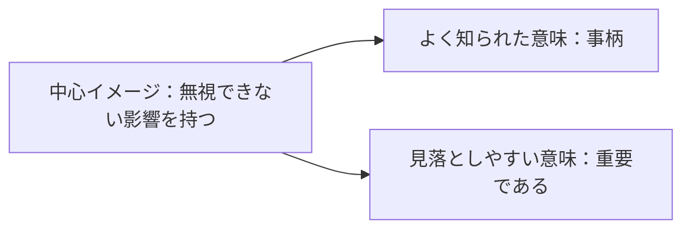

**重要語法：** It matters whether ...

<small>原データ：index 354 / candidate_id `ev-00354-verb-01`</small>

---

## 259. read

**品詞：** 動詞（verb）

**発音：** /riːd/

**よく知られている意味：** <small>読む</small>

**見落としやすい意味：** **（標識・文書などに）〜と書いてある**

**例文：** The sign reads "No Parking."

**和訳：** その標識には「駐車禁止」と書いてある。

**コアイメージ：** read は人が文章を読む行為を表す。標識や文書を主語にすると、そこに書かれた内容を伝える意味になる。

**図：**

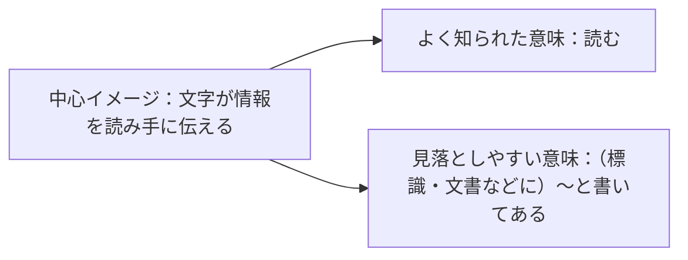

**重要語法：** The sign reads ...

<small>原データ：index 356 / candidate_id `ev-00356-ai-01`</small>

---

## 260. read

**品詞：** 発音上の注意（pronunciation）

**発音：** /riːd/・/red/

**よく知られている意味：** <small>読む</small>

**見落としやすい意味：** **read の現在形と過去・過去分詞形は同綴りで発音が違う**

**例文：** I read the news every morning, but yesterday I read it at night.

**和訳：** 私は毎朝ニュースを読むが、昨日は夜に読んだ。

**コアイメージ：** read は現在形と過去形・過去分詞形のつづりが同じである。現在形は /riːd/、過去形・過去分詞形は /red/ と発音するため、文の時制で判断する。

**図：**

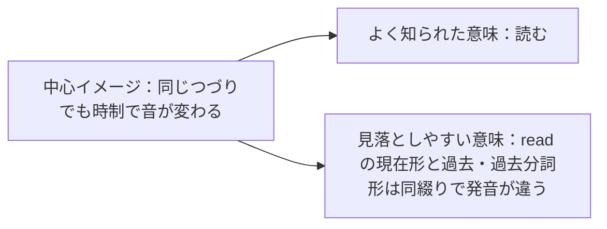

**重要語法：** 現在形 /riːd/、過去・過去分詞形 /red/

<small>原データ：index 356 / candidate_id `ev-00356-ai-02`</small>

---

## 261. effort

**品詞：** 構文・語法（construction）

**発音：** /ˈefərt/

**よく知られている意味：** <small>努力</small>

**見落としやすい意味：** **in an effort to do：〜しようとして**

**例文：** They planted trees in an effort to protect the river.

**和訳：** 川を守ろうとして、彼らは木を植えた。

**コアイメージ：** effort は目的を達成するための働きかけを表す。in an effort to do は、これから示す行動の目的を述べる表現である。

**図：**

```mermaid
flowchart LR
    A["中心イメージ：目標に向けて力を注ぐ"]
    B["よく知られた意味：努力"]
    C["見落としやすい意味：in an effort to do：〜しようとして"]
    A --> B
    A --> C
```

**重要語法：** in an effort to + 動詞の原形

<small>原データ：index 358 / candidate_id `ev-00358-ai-01`</small>

---

## 262. fund

**品詞：** 動詞（verb）

**発音：** /fʌnd/

**よく知られている意味：** <small>基金</small>

**見落としやすい意味：** **資金を提供する**

**例文：** The city funded the new research project.

**和訳：** 市はその新しい研究計画に資金を提供した。

**コアイメージ：** fund は活動に使う資金そのものを指す。動詞になると、計画や組織が動けるようにお金を出す意味になる。

**図：**

```mermaid
flowchart LR
    A["中心イメージ：活動のための資金を用意する"]
    B["よく知られた意味：基金"]
    C["見落としやすい意味：資金を提供する"]
    A --> B
    A --> C
```

**重要語法：** fund a project

<small>原データ：index 359 / candidate_id `ev-00359-verb-01`</small>

---

## 263. sense

**品詞：** 構文・語法（construction）

**発音：** /sens/

**よく知られている意味：** <small>感覚</small>

**見落としやすい意味：** **make sense of ...：〜を理解する**

**例文：** I couldn't make sense of his explanation.

**和訳：** 私は彼の説明を理解できなかった。

**コアイメージ：** sense は感覚や意味を表す。make sense of は複雑な情報を整理して理解できる形にすることをいう。

**図：**

```mermaid
flowchart LR
    A["中心イメージ：情報から意味をつかむ"]
    B["よく知られた意味：感覚"]
    C["見落としやすい意味：make sense of ...：〜を理解する"]
    A --> B
    A --> C
```

**重要語法：** make sense of + 名詞

<small>原データ：index 360 / candidate_id `ev-00360-ai-01`</small>

---

## 264. sense

**品詞：** 構文・語法（construction）

**発音：** /sens/

**よく知られている意味：** <small>感覚</small>

**見落としやすい意味：** **in a sense：ある意味では**

**例文：** In a sense, both answers are correct.

**和訳：** ある意味では、どちらの答えも正しい。

**コアイメージ：** sense は意味や捉え方も表す。in a sense は特定の観点から見ればそう言えるという限定を加える。

**図：**

```mermaid
flowchart LR
    A["中心イメージ：一つの見方を取る"]
    B["よく知られた意味：感覚"]
    C["見落としやすい意味：in a sense：ある意味では"]
    A --> B
    A --> C
```

**重要語法：** in a sense

<small>原データ：index 360 / candidate_id `ev-00360-ai-02`</small>

---

## 265. add

**品詞：** 構文・語法（construction）

**発音：** /æd/

**よく知られている意味：** <small>加える</small>

**見落としやすい意味：** **add up：つじつまが合う**

**例文：** His story doesn't add up.

**和訳：** 彼の話はつじつまが合わない。

**コアイメージ：** add up は数を足して合計を出す動作を表す。話の各部分が一致するかに使うと、筋が通るという意味になる。

**図：**

```mermaid
flowchart LR
    A["中心イメージ：部分を足して全体が合う"]
    B["よく知られた意味：加える"]
    C["見落としやすい意味：add up：つじつまが合う"]
    A --> B
    A --> C
```

**重要語法：** The numbers don't add up.

<small>原データ：index 361 / candidate_id `ev-00361-ai-01`</small>

---

## 266. add

**品詞：** 構文・語法（construction）

**発音：** /æd/

**よく知られている意味：** <small>加える</small>

**見落としやすい意味：** **add up to ...：合計〜になる、結局〜を意味する**

**例文：** The costs add up to over $1,000.

**和訳：** 費用は合計で1,000ドルを超える。

**コアイメージ：** add up to は小さな部分を足し合わせて結果に到達することを表す。金額の合計だけでなく、出来事の最終的な意味にも使える。

**図：**

```mermaid
flowchart LR
    A["中心イメージ：積み重なった結果に達する"]
    B["よく知られた意味：加える"]
    C["見落としやすい意味：add up to ...：合計〜になる、結局〜を意味する"]
    A --> B
    A --> C
```

**重要語法：** add up to + 数量・結果

<small>原データ：index 361 / candidate_id `ev-00361-ai-02`</small>

---

## 267. late

**品詞：** 形容詞（adjective）

**発音：** /leɪt/

**よく知られている意味：** <small>遅い</small>

**見落としやすい意味：** **故人の、亡くなった**

**例文：** Her late father was a talented musician.

**和訳：** 彼女の亡くなった父親は才能ある音楽家だった。

**コアイメージ：** late は普段は時刻が遅いことを示す。人を表す名詞の前では、今は亡くなっていることを丁寧に示す語になる。

**図：**

```mermaid
flowchart LR
    A["中心イメージ：すでにこの世にいない人を指す"]
    B["よく知られた意味：遅い"]
    C["見落としやすい意味：故人の、亡くなった"]
    A --> B
    A --> C
```

**重要語法：** my late grandfather

<small>原データ：index 362 / candidate_id `ev-00362-adjective-01`</small>

---

## 268. face

**品詞：** 動詞（verb）

**発音：** /feɪs/

**よく知られている意味：** <small>顔</small>

**見落としやすい意味：** **（問題に）直面する**

**例文：** Many families face serious challenges.

**和訳：** 多くの家庭が深刻な課題に直面している。

**コアイメージ：** face は顔を意味するほか、何かに向かい合う動作を表す。困難や問題が目的語なら、それに直面している意味になる。

**図：**

```mermaid
flowchart LR
    A["中心イメージ：物事に正面から向き合う"]
    B["よく知られた意味：顔"]
    C["見落としやすい意味：（問題に）直面する"]
    A --> B
    A --> C
```

**重要語法：** face a problem

<small>原データ：index 366 / candidate_id `ev-00366-verb-01`</small>

---

## 269. appear

**品詞：** 動詞（verb）

**発音：** /əˈpɪr/

**よく知られている意味：** <small>現れる</small>

**見落としやすい意味：** **（映画・舞台などに）出演する**

**例文：** She appeared in several popular films.

**和訳：** 彼女はいくつかの人気映画に出演した。

**コアイメージ：** appear は姿を現すことを意味する。舞台や映画の中に現れる場合は出演するという意味になる。

**図：**

```mermaid
flowchart LR
    A["中心イメージ：人前・画面上に姿を見せる"]
    B["よく知られた意味：現れる"]
    C["見落としやすい意味：（映画・舞台などに）出演する"]
    A --> B
    A --> C
```

**重要語法：** appear in a film

<small>原データ：index 368 / candidate_id `ev-00368-verb-01`</small>

---

## 270. private

**品詞：** 構文・語法（construction）

**発音：** /ˈpraɪvət/

**よく知られている意味：** <small>個人的な</small>

**見落としやすい意味：** **in private：人目を避けて、内密に**

**例文：** Can we discuss this matter in private?

**和訳：** この件を人目のないところで話せますか。

**コアイメージ：** private は公に開かれていないことを表す。in private は他人の目や耳が届かない状況で行うことをいう。

**図：**

```mermaid
flowchart LR
    A["中心イメージ：公の場から離れた領域"]
    B["よく知られた意味：個人的な"]
    C["見落としやすい意味：in private：人目を避けて、内密に"]
    A --> B
    A --> C
```

**重要語法：** in private

<small>原データ：index 370 / candidate_id `ev-00370-ai-01`</small>

---

## 271. across

**品詞：** 構文・語法（construction）

**発音：** /əˈkrɔːs/

**よく知られている意味：** <small>横切って</small>

**見落としやすい意味：** **across the board：全面的に、一律に**

**例文：** The company raised salaries across the board.

**和訳：** その会社は全社員の給与を一律に引き上げた。

**コアイメージ：** across は一方から他方まで横断することを表す。across the board は対象全体に同じ対応が及ぶことを意味する。

**図：**

```mermaid
flowchart LR
    A["中心イメージ：端から端まで例外なく"]
    B["よく知られた意味：横切って"]
    C["見落としやすい意味：across the board：全面的に、一律に"]
    A --> B
    A --> C
```

**重要語法：** across the board

<small>原データ：index 371 / candidate_id `ev-00371-ai-01`</small>

---

## 272. effect

**品詞：** 動詞（verb）

**発音：** /ɪˈfekt/

**よく知られている意味：** <small>結果・効果</small>

**見落としやすい意味：** **（変化などを）実現させる**

**例文：** The new leader effected major changes.

**和訳：** 新しい指導者は大きな変革を実現した。

**コアイメージ：** effect は「効果」という名詞がよく知られる。動詞では、ある変化や結果を現実に起こすことを示す。

**図：**

```mermaid
flowchart LR
    A["中心イメージ：結果を実際に生じさせる"]
    B["よく知られた意味：結果・効果"]
    C["見落としやすい意味：（変化などを）実現させる"]
    A --> B
    A --> C
```

**重要語法：** effect change

<small>原データ：index 373 / candidate_id `ev-00373-verb-01`</small>

---

## 273. accord

**品詞：** 動詞（verb）

**発音：** /əˈkɔːrd/

**よく知られている意味：** <small>一致する</small>

**見落としやすい意味：** **〜を与える、認める**

**例文：** The law accords equal rights to all citizens.

**和訳：** その法律はすべての市民に平等な権利を与えている。

**コアイメージ：** accord は一致や調和に関係する語である。動詞では、権利や待遇を相手に正式に認めて与える意味になる。

**図：**

```mermaid
flowchart LR
    A["中心イメージ：相手にふさわしいものを認め与える"]
    B["よく知られた意味：一致する"]
    C["見落としやすい意味：〜を与える、認める"]
    A --> B
    A --> C
```

**重要語法：** accord A to B

<small>原データ：index 374 / candidate_id `ev-00374-verb-01`</small>

---

## 274. source

**品詞：** 動詞（verb）

**発音：** /sɔːrs/

**よく知られている意味：** <small>源</small>

**見落としやすい意味：** **（資材・部品・製品などを）調達する**

**例文：** The firm sources its materials locally.

**和訳：** その会社は原材料を地元で調達している。

**コアイメージ：** source は物事の出どころを示す。動詞になると必要な物の供給元を探し、そこから調達することをいう。

**図：**

```mermaid
flowchart LR
    A["中心イメージ：必要なものの供給元を見つける"]
    B["よく知られた意味：源"]
    C["見落としやすい意味：（資材・部品・製品などを）調達する"]
    A --> B
    A --> C
```

**重要語法：** source materials from ...

<small>原データ：index 375 / candidate_id `ev-00375-ai-01`</small>

---

## 275. fall

**品詞：** 構文・語法（construction）

**発音：** /fɔːl/

**よく知られている意味：** <small>落ちる</small>

**見落としやすい意味：** **fall short of ...：〜に達しない**

**例文：** The result fell short of our expectations.

**和訳：** 結果は私たちの期待に届かなかった。

**コアイメージ：** fall は下へ落ちることを表す。fall short of は基準や目標に対して不足していることを示す。

**図：**

```mermaid
flowchart LR
    A["中心イメージ：目標までの距離が足りない"]
    B["よく知られた意味：落ちる"]
    C["見落としやすい意味：fall short of ...：〜に達しない"]
    A --> B
    A --> C
```

**重要語法：** fall short of + 目標

<small>原データ：index 376 / candidate_id `ev-00376-ai-01`</small>

---

## 276. fall

**品詞：** 動詞（verb）

**発音：** /fɔːl/

**よく知られている意味：** <small>落ちる</small>

**見落としやすい意味：** **（分類・範囲に）属する**

**例文：** This example falls into a different category.

**和訳：** この例は別の分類に属する。

**コアイメージ：** fall は場所や状態が変わる動きにも使う。fall into はある分類や範囲に入ることを表し、実際に落下するとは限らない。

**図：**

```mermaid
flowchart LR
    A["中心イメージ：ある範囲の中に入る"]
    B["よく知られた意味：落ちる"]
    C["見落としやすい意味：（分類・範囲に）属する"]
    A --> B
    A --> C
```

**重要語法：** fall into a category

<small>原データ：index 376 / candidate_id `ev-00376-verb-01`</small>

---

## 277. lose

**品詞：** 構文・語法（construction）

**発音：** /luːz/

**よく知られている意味：** <small>失う</small>

**見落としやすい意味：** **lose oneself in ...：〜に没頭する**

**例文：** She lost herself in the novel for hours.

**和訳：** 彼女は何時間も小説に没頭した。

**コアイメージ：** lose oneself は自分を見失うほど夢中になる比喩である。in がその意識の向かう対象を示し、没頭を表す。

**図：**

```mermaid
flowchart LR
    A["中心イメージ：意識が別のものに吸い込まれる"]
    B["よく知られた意味：失う"]
    C["見落としやすい意味：lose oneself in ...：〜に没頭する"]
    A --> B
    A --> C
```

**重要語法：** lose oneself in + 名詞

<small>原データ：index 380 / candidate_id `ev-00380-ai-01`</small>

---

## 278. student

**品詞：** 名詞（noun）

**発音：** /ˈstuːdənt/

**よく知られている意味：** <small>学生</small>

**見落としやすい意味：** **〜の研究者・熱心な学習者（a student of ...）**

**例文：** He is a lifelong student of history.

**和訳：** 彼は生涯にわたり歴史を研究し学び続ける人だ。

**コアイメージ：** student は学校に通う人だけを指すわけではない。a student of はある分野を深く研究する人や熱心に学ぶ人を表す。

**図：**

```mermaid
flowchart LR
    A["中心イメージ：ある分野を学び続ける人"]
    B["よく知られた意味：学生"]
    C["見落としやすい意味：〜の研究者・熱心な学習者（a student of ...）"]
    A --> B
    A --> C
```

**重要語法：** a student of + 分野

<small>原データ：index 381 / candidate_id `ev-00381-ai-01`</small>

---

## 279. general

**品詞：** 名詞（noun）

**発音：** /ˈdʒenərəl/

**よく知られている意味：** <small>一般的な</small>

**見落としやすい意味：** **将軍**

**例文：** The general commanded the troops.

**和訳：** その将軍は部隊を指揮した。

**コアイメージ：** general は形容詞では全般的であることを表す。名詞では軍隊の高い階級にある指揮官を指す。

**図：**

```mermaid
flowchart LR
    A["中心イメージ：集団全体を率いる役職"]
    B["よく知られた意味：一般的な"]
    C["見落としやすい意味：将軍"]
    A --> B
    A --> C
```

**重要語法：** a general in the army

<small>原データ：index 382 / candidate_id `ev-00382-noun-01`</small>

---

## 280. available

**品詞：** 形容詞（adjective）

**発音：** /əˈveɪləbəl/

**よく知られている意味：** <small>利用できる</small>

**見落としやすい意味：** **（人が）会う時間がある、手が空いている**

**例文：** Is the teacher available after class?

**和訳：** 先生は授業の後、お時間がありますか。

**コアイメージ：** available は物やサービスを利用できることを表す。人について使うと時間が空いていて会ったり話したりできることを示す。

**図：**

```mermaid
flowchart LR
    A["中心イメージ：求められたときに対応できる状態"]
    B["よく知られた意味：利用できる"]
    C["見落としやすい意味：（人が）会う時間がある、手が空いている"]
    A --> B
    A --> C
```

**重要語法：** available for a meeting

<small>原データ：index 383 / candidate_id `ev-00383-ai-01`</small>

---

## 281. close

**品詞：** 形容詞（adjective）

**発音：** /kloʊs/

**よく知られている意味：** <small>近い</small>

**見落としやすい意味：** **（競争などが）接戦の**

**例文：** It was a close race until the end.

**和訳：** 最後まで接戦だった。

**コアイメージ：** close は距離が近いことを表す。試合や競争では実力・得点の差が小さいことを意味する。

**図：**

```mermaid
flowchart LR
    A["中心イメージ：二つのものの間隔が小さい"]
    B["よく知られた意味：近い"]
    C["見落としやすい意味：（競争などが）接戦の"]
    A --> B
    A --> C
```

**重要語法：** a close race / a close game

<small>原データ：index 384 / candidate_id `ev-00384-adjective-01`</small>

---

## 282. close

**品詞：** 発音上の注意（pronunciation）

**発音：** /kloʊs/・/kloʊz/

**よく知られている意味：** <small>近い・閉じる</small>

**見落としやすい意味：** **close は形容詞「近い」と動詞「閉じる」で語末の子音が異なる**

**例文：** Stand close to the door, but don't close it.

**和訳：** ドアの近くに立って。ただしドアは閉めないで。

**コアイメージ：** close は形容詞「近い」では語末が /s/、動詞「閉じる」では /z/ になる。同じつづりでも文中の品詞を見て発音を区別する。

**図：**

```mermaid
flowchart LR
    A["中心イメージ：同じつづりが役割で異なる音になる"]
    B["よく知られた意味：近い・閉じる"]
    C["見落としやすい意味：close は形容詞「近い」と動詞「閉じる」で語末の子音が異なる"]
    A --> B
    A --> C
```

**重要語法：** 形容詞 /kloʊs/・動詞 /kloʊz/

<small>原データ：index 384 / candidate_id `ev-00384-ai-01`</small>

---

## 283. grow

**品詞：** 構文・語法（construction）

**発音：** /ɡroʊ/

**よく知られている意味：** <small>育つ</small>

**見落としやすい意味：** **grow to do：しだいに〜するようになる**

**例文：** I grew to appreciate her advice.

**和訳：** 私は次第に彼女の助言のありがたさが分かるようになった。

**コアイメージ：** grow は植物や人が成長することを表す。grow to do は経験や時間の経過を通じてある考えや感情を持つようになることを示す。

**図：**

```mermaid
flowchart LR
    A["中心イメージ：時間をかけて状態が変化する"]
    B["よく知られた意味：育つ"]
    C["見落としやすい意味：grow to do：しだいに〜するようになる"]
    A --> B
    A --> C
```

**重要語法：** grow to understand / grow to like

<small>原データ：index 385 / candidate_id `ev-00385-ai-01`</small>

---

## 284. head

**品詞：** 動詞（verb）

**発音：** /hed/

**よく知られている意味：** <small>頭</small>

**見落としやすい意味：** **（集団・組織を）率いる**

**例文：** She heads the research team.

**和訳：** 彼女はその研究チームを率いている。

**コアイメージ：** head は体の頭や物の先端を表す。動詞では集団の先頭に立ち全体を指揮する意味になる。

**図：**

```mermaid
flowchart LR
    A["中心イメージ：先頭に立ち方向を決める"]
    B["よく知られた意味：頭"]
    C["見落としやすい意味：（集団・組織を）率いる"]
    A --> B
    A --> C
```

**重要語法：** head a team

<small>原データ：index 386 / candidate_id `ev-00386-verb-01`</small>

---

## 285. whose

**品詞：** 代名詞（pronoun）

**発音：** /huːz/

**よく知られている意味：** <small>だれの</small>

**見落としやすい意味：** **人以外の先行詞にも使う所有格関係代名詞**

**例文：** We visited a house whose roof was painted blue.

**和訳：** 私たちは屋根が青く塗られた家を訪れた。

**コアイメージ：** whose は所有・所属の関係を表す関係代名詞である。人だけでなく家や組織のようなものを先行詞にしても使える。

**図：**

```mermaid
flowchart LR
    A["中心イメージ：先行詞に属するものを結びつける"]
    B["よく知られた意味：だれの"]
    C["見落としやすい意味：人以外の先行詞にも使う所有格関係代名詞"]
    A --> B
    A --> C
```

**重要語法：** a house whose roof ...

<small>原データ：index 387 / candidate_id `ev-00387-ai-01`</small>

---

## 286. current

**品詞：** 名詞（noun）

**発音：** /ˈkɝːənt/

**よく知られている意味：** <small>現在の</small>

**見落としやすい意味：** **電流**

**例文：** An electric current flows through the wire.

**和訳：** その導線には電流が流れている。

**コアイメージ：** current は「今の」という形容詞がよく知られる。名詞では電気が回路を流れる現象を表す。

**図：**

```mermaid
flowchart LR
    A["中心イメージ：一定の方向へ流れるもの"]
    B["よく知られた意味：現在の"]
    C["見落としやすい意味：電流"]
    A --> B
    A --> C
```

**重要語法：** electric current

<small>原データ：index 390 / candidate_id `ev-00390-noun-01`</small>

---

## 287. current

**品詞：** 名詞（noun）

**発音：** /ˈkɝːənt/

**よく知られている意味：** <small>現在の</small>

**見落としやすい意味：** **潮流、流れ**

**例文：** The boat was carried away by the strong current.

**和訳：** その船は強い流れに押し流された。

**コアイメージ：** current の名詞の中心は「流れ」である。水や空気の流れに使い、比喩的には思想や世論の潮流も表せる。

**図：**

```mermaid
flowchart LR
    A["中心イメージ：ある方向へ持続して動く流れ"]
    B["よく知られた意味：現在の"]
    C["見落としやすい意味：潮流、流れ"]
    A --> B
    A --> C
```

**重要語法：** ocean current / current of opinion

<small>原データ：index 390 / candidate_id `ev-00390-noun-02`</small>

---

## 288. subject

**品詞：** 形容詞（adjective）

**発音：** /ˈsʌbdʒɪkt/

**よく知られている意味：** <small>科目・主題</small>

**見落としやすい意味：** **影響を受けやすい**

**例文：** This area is subject to frequent flooding.

**和訳：** この地域は頻繁に洪水の影響を受けやすい。

**コアイメージ：** subject は研究や話題の対象を表す。形容詞の subject to は何かの影響を受けたり、あることが起こりやすかったりする状態を示す。

**図：**

```mermaid
flowchart LR
    A["中心イメージ：外側からの作用を受ける立場"]
    B["よく知られた意味：科目・主題"]
    C["見落としやすい意味：影響を受けやすい"]
    A --> B
    A --> C
```

**重要語法：** be subject to flooding / delays

<small>原データ：index 391 / candidate_id `ev-00391-adjective-02`</small>

---

## 289. subject

**品詞：** 構文・語法（construction）

**発音：** /ˈsʌbdʒɪkt/

**よく知られている意味：** <small>科目・主題</small>

**見落としやすい意味：** **be subject to ...：〜を条件とする、〜に従う**

**例文：** The offer is subject to final approval.

**和訳：** その申し出は最終承認を条件としている。

**コアイメージ：** subject to は何かの支配・条件の下に置かれる関係を表す。契約や予定では承認などが成立の条件になっていることを示す。

**図：**

```mermaid
flowchart LR
    A["中心イメージ：別の条件や規則の下に置かれる"]
    B["よく知られた意味：科目・主題"]
    C["見落としやすい意味：be subject to ...：〜を条件とする、〜に従う"]
    A --> B
    A --> C
```

**重要語法：** be subject to approval

<small>原データ：index 391 / candidate_id `ev-00391-ai-01`</small>

---

## 290. subject

**品詞：** 動詞（verb）

**発音：** /səbˈdʒekt/

**よく知られている意味：** <small>科目・主題</small>

**見落としやすい意味：** **〜を（苦痛や危険などに）さらす**

**例文：** The workers were subjected to extreme heat.

**和訳：** 労働者たちは極度の暑さにさらされた。

**コアイメージ：** subject を動詞で使うと相手を特定の状態や影響の下に置く意味になる。好ましくない経験や負担を強いる文脈でよく使う。

**図：**

```mermaid
flowchart LR
    A["中心イメージ：人や物を作用の下に置く"]
    B["よく知られた意味：科目・主題"]
    C["見落としやすい意味：〜を（苦痛や危険などに）さらす"]
    A --> B
    A --> C
```

**重要語法：** subject A to B

<small>原データ：index 391 / candidate_id `ev-00391-verb-01`</small>

---

## 291. share

**品詞：** 名詞（noun）

**発音：** /ʃer/

**よく知られている意味：** <small>分け前</small>

**見落としやすい意味：** **株式、持ち分**

**例文：** She bought ten shares in the company.

**和訳：** 彼女はその会社の株式を10株買った。

**コアイメージ：** share は分かち合うという動詞がよく知られる。名詞では全体に対する持ち分を指し、会社なら株式を表す。

**図：**

```mermaid
flowchart LR
    A["中心イメージ：全体を分けた一部分"]
    B["よく知られた意味：分け前"]
    C["見落としやすい意味：株式、持ち分"]
    A --> B
    A --> C
```

**重要語法：** shares in a company

<small>原データ：index 392 / candidate_id `ev-00392-noun-01`</small>

---

## 292. evidence

**品詞：** 動詞（verb）

**発音：** /ˈevɪdəns/

**よく知られている意味：** <small>証拠</small>

**見落としやすい意味：** **〜の証拠となる、裏付ける**

**例文：** The data evidence a clear change in temperature.

**和訳：** そのデータは気温の明確な変化を裏付けている。

**コアイメージ：** evidence は証拠を表す名詞としてよく使われる。動詞では観察や資料がある事実の証拠となる意味になる。

**図：**

```mermaid
flowchart LR
    A["中心イメージ：証拠として事実を示す"]
    B["よく知られた意味：証拠"]
    C["見落としやすい意味：〜の証拠となる、裏付ける"]
    A --> B
    A --> C
```

**重要語法：** be evidenced by ...

<small>原データ：index 395 / candidate_id `ev-00395-verb-01`</small>

---

## 293. cause

**品詞：** 名詞（noun）

**発音：** /kɔːz/

**よく知られている意味：** <small>原因</small>

**見落としやすい意味：** **大義、社会運動の目標**

**例文：** Thousands joined the cause of protecting the forest.

**和訳：** 何千人もの人が森を守るという大義のために活動に加わった。

**コアイメージ：** cause は出来事を引き起こす原因を表す。人が支持して行動する理由になると社会的な理念や大義を意味する。

**図：**

```mermaid
flowchart LR
    A["中心イメージ：行動を起こす理由・目標"]
    B["よく知られた意味：原因"]
    C["見落としやすい意味：大義、社会運動の目標"]
    A --> B
    A --> C
```

**重要語法：** support a cause

<small>原データ：index 396 / candidate_id `ev-00396-noun-01`</small>

---

## 294. free

**品詞：** 動詞（verb）

**発音：** /friː/

**よく知られている意味：** <small>自由な</small>

**見落としやすい意味：** **〜を解放する**

**例文：** The rescuers freed the trapped animals.

**和訳：** 救助隊は閉じ込められた動物たちを解放した。

**コアイメージ：** free は制限のない状態を表す形容詞である。動詞ではその状態にするために束縛や拘束を取り除くことを表す。

**図：**

```mermaid
flowchart LR
    A["中心イメージ：束縛を取り除いて自由にする"]
    B["よく知られた意味：自由な"]
    C["見落としやすい意味：〜を解放する"]
    A --> B
    A --> C
```

**重要語法：** free A from B

<small>原データ：index 397 / candidate_id `ev-00397-verb-01`</small>

---

## 295. article

**品詞：** 名詞（noun）

**発音：** /ˈɑːrtɪkəl/

**よく知られている意味：** <small>記事</small>

**見落としやすい意味：** **（法律・条約などの）条項**

**例文：** Article 5 of the treaty protects these rights.

**和訳：** その条約の第5条はこれらの権利を保護している。

**コアイメージ：** article は新聞などの一つの記事を表す。法律や条約では文書を区切った個々の条項を意味する。

**図：**

```mermaid
flowchart LR
    A["中心イメージ：文書を構成する一つの区切り"]
    B["よく知られた意味：記事"]
    C["見落としやすい意味：（法律・条約などの）条項"]
    A --> B
    A --> C
```

**重要語法：** Article 5 / an article of a treaty

<small>原データ：index 399 / candidate_id `ev-00399-ai-01`</small>

---

## 296. person

**品詞：** 構文・語法（construction）

**発音：** /ˈpɝːsən/

**よく知られている意味：** <small>人</small>

**見落としやすい意味：** **in person：本人が直接、対面で**

**例文：** You must apply in person.

**和訳：** 申請は本人が直接行わなければならない。

**コアイメージ：** person は一人の人間を指す。in person は代理やオンラインではなく本人が実際に出向いて行うことを表す。

**図：**

```mermaid
flowchart LR
    A["中心イメージ：本人がその場にいる"]
    B["よく知られた意味：人"]
    C["見落としやすい意味：in person：本人が直接、対面で"]
    A --> B
    A --> C
```

**重要語法：** apply in person / meet in person

<small>原データ：index 402 / candidate_id `ev-00402-ai-01`</small>

---

## 297. party

**品詞：** 名詞（noun）

**発音：** /ˈpɑːrti/

**よく知られている意味：** <small>パーティー</small>

**見落としやすい意味：** **（契約・訴訟の）当事者**

**例文：** Both parties signed the agreement.

**和訳：** 両当事者がその契約書に署名した。

**コアイメージ：** party は人が集まる会だけでなくある関係を構成する人や集団も指す。契約や裁判ではその当事者を意味する。

**図：**

```mermaid
flowchart LR
    A["中心イメージ：同じ出来事に関わる一方の側"]
    B["よく知られた意味：パーティー"]
    C["見落としやすい意味：（契約・訴訟の）当事者"]
    A --> B
    A --> C
```

**重要語法：** both parties / a party to a contract

<small>原データ：index 403 / candidate_id `ev-00403-noun-01`</small>

---

## 298. top

**品詞：** 動詞（verb）

**発音：** /tɑːp/

**よく知られている意味：** <small>頂上</small>

**見落としやすい意味：** **〜を上回る**

**例文：** This year's sales topped last year's total.

**和訳：** 今年の売上高は昨年の合計を上回った。

**コアイメージ：** top は一番高い部分を指す。動詞では比較対象より上に出ることから数値や記録を上回る意味になる。

**図：**

```mermaid
flowchart LR
    A["中心イメージ：上に位置する・上へ超える"]
    B["よく知られた意味：頂上"]
    C["見落としやすい意味：〜を上回る"]
    A --> B
    A --> C
```

**重要語法：** top a record

<small>原データ：index 404 / candidate_id `ev-00404-verb-01`</small>

---

## 299. raise

**品詞：** 動詞（verb）

**発音：** /reɪz/

**よく知られている意味：** <small>上げる</small>

**見落としやすい意味：** **（資金・寄付などを）集める**

**例文：** The students raised money for the shelter.

**和訳：** 生徒たちはその保護施設のために資金を集めた。

**コアイメージ：** raise は物を持ち上げる意味から数値や量を増やす場面にも使う。資金については寄付などでお金を集めることをいう。

**図：**

```mermaid
flowchart LR
    A["中心イメージ：必要なものを集めて量を増やす"]
    B["よく知られた意味：上げる"]
    C["見落としやすい意味：（資金・寄付などを）集める"]
    A --> B
    A --> C
```

**重要語法：** raise funds / raise money for ...

<small>原データ：index 405 / candidate_id `ev-00405-ai-01`</small>

---

## 300. raise

**品詞：** 動詞（verb）

**発音：** /reɪz/

**よく知られている意味：** <small>上げる</small>

**見落としやすい意味：** **（問題・疑問を）提起する**

**例文：** Her comment raised an important question.

**和訳：** 彼女の発言は重要な疑問を提起した。

**コアイメージ：** raise は下にあるものを上へ出す動きを表す。問題や疑問を目的語にすると人々が議論できるよう表に出す意味になる。

**図：**

```mermaid
flowchart LR
    A["中心イメージ：注意を向けられる位置に持ち上げる"]
    B["よく知られた意味：上げる"]
    C["見落としやすい意味：（問題・疑問を）提起する"]
    A --> B
    A --> C
```

**重要語法：** raise a question / raise an issue

<small>原データ：index 405 / candidate_id `ev-00405-verb-01`</small>

---

## 301. buy

**品詞：** 動詞（verb）

**発音：** /baɪ/

**よく知られている意味：** <small>買う</small>

**見落としやすい意味：** **（話・主張などを）信じる、受け入れる**

**例文：** I don't buy his explanation.

**和訳：** 私は彼の説明を信じない。

**コアイメージ：** buy は商品を対価と引き換えに手に入れることを表す。話や主張については受け入れて信じるという比喩的な意味になる。

**図：**

```mermaid
flowchart LR
    A["中心イメージ：相手が示すものを受け入れる"]
    B["よく知られた意味：買う"]
    C["見落としやすい意味：（話・主張などを）信じる、受け入れる"]
    A --> B
    A --> C
```

**重要語法：** I don't buy it.

<small>原データ：index 406 / candidate_id `ev-00406-ai-01`</small>

---

## 302. sell

**品詞：** 構文・語法（construction）

**発音：** /sel/

**よく知られている意味：** <small>売る</small>

**見落としやすい意味：** **sell out：信念を売る、裏切る**

**例文：** He refused to sell out for a better job.

**和訳：** 彼はより良い仕事のために信念を売ることを拒んだ。

**コアイメージ：** sell out は商品をすべて売り切る意味を持つ。価値観や仲間について使うと利益のために信念や人を裏切ることを表す。

**図：**

```mermaid
flowchart LR
    A["中心イメージ：大切なものを利益と引き換えに手放す"]
    B["よく知られた意味：売る"]
    C["見落としやすい意味：sell out：信念を売る、裏切る"]
    A --> B
    A --> C
```

**重要語法：** sell out one's principles

<small>原データ：index 407 / candidate_id `ev-00407-ai-01`</small>

---

## 303. sell

**品詞：** 動詞（verb）

**発音：** /sel/

**よく知られている意味：** <small>売る</small>

**見落としやすい意味：** **（商品が）売れる**

**例文：** This new model sells well overseas.

**和訳：** この新型モデルは海外でよく売れる。

**コアイメージ：** sell は売り手が物を売る動作だけでなく商品を主語にして売れ行きを表せる。ここでは商品が自分で販売するわけではない。

**図：**

```mermaid
flowchart LR
    A["中心イメージ：商品が買い手に受け入れられる"]
    B["よく知られた意味：売る"]
    C["見落としやすい意味：（商品が）売れる"]
    A --> B
    A --> C
```

**重要語法：** sell well

<small>原データ：index 407 / candidate_id `ev-00407-ai-02`</small>

---

## 304. care

**品詞：** 構文・語法（construction）

**発音：** /ker/

**よく知られている意味：** <small>世話</small>

**見落としやすい意味：** **care to do：〜したいと思う（丁寧な依頼にも使う）**

**例文：** Would you care to join us for lunch?

**和訳：** 私たちと昼食をご一緒しませんか。

**コアイメージ：** care は関心や配慮を示す。care to do は何かをしたい気持ちがあるかを表し、依頼や誘いでは丁寧な響きになる。

**図：**

```mermaid
flowchart LR
    A["中心イメージ：相手の希望を気にかける"]
    B["よく知られた意味：世話"]
    C["見落としやすい意味：care to do：〜したいと思う（丁寧な依頼にも使う）"]
    A --> B
    A --> C
```

**重要語法：** Would you care to ...?

<small>原データ：index 411 / candidate_id `ev-00411-ai-01`</small>

---

## 305. pass

**品詞：** 構文・語法（construction）

**発音：** /pæs/

**よく知られている意味：** <small>通る</small>

**見落としやすい意味：** **pass for ...：〜として通用する**

**例文：** He could easily pass for a college student.

**和訳：** 彼は大学生として十分通用しそうだ。

**コアイメージ：** pass は通過する動きを表す。pass for は周囲から何かとして認められたりそう見なされたりすることをいう。

**図：**

```mermaid
flowchart LR
    A["中心イメージ：ある基準や判断を通り抜ける"]
    B["よく知られた意味：通る"]
    C["見落としやすい意味：pass for ...：〜として通用する"]
    A --> B
    A --> C
```

**重要語法：** pass for + 人・属性

<small>原データ：index 412 / candidate_id `ev-00412-ai-01`</small>

---

## 306. pass

**品詞：** 構文・語法（construction）

**発音：** /pæs/

**よく知られている意味：** <small>通る</small>

**見落としやすい意味：** **pass out：意識を失う**

**例文：** She passed out from the heat.

**和訳：** 彼女は暑さで意識を失った。

**コアイメージ：** pass out は気を失って意識がなくなることを表す。文脈によっては配布する意味もあるため主語や目的語に注意する。

**図：**

```mermaid
flowchart LR
    A["中心イメージ：意識が途切れる"]
    B["よく知られた意味：通る"]
    C["見落としやすい意味：pass out：意識を失う"]
    A --> B
    A --> C
```

**重要語法：** pass out from ...

<small>原データ：index 412 / candidate_id `ev-00412-ai-02`</small>

---

## 307. age

**品詞：** 動詞（verb）

**発音：** /eɪdʒ/

**よく知られている意味：** <small>年齢</small>

**見落としやすい意味：** **年を取る、老化する**

**例文：** The wooden bridge has aged badly.

**和訳：** その木の橋はかなり傷んで古びてしまった。

**コアイメージ：** age は年数を表す名詞としてよく使われる。動詞では人が年を取るほか、物が古びたり劣化したりすることを示す。

**図：**

```mermaid
flowchart LR
    A["中心イメージ：時間の経過によって状態が変わる"]
    B["よく知られた意味：年齢"]
    C["見落としやすい意味：年を取る、老化する"]
    A --> B
    A --> C
```

**重要語法：** age well / age badly

<small>原データ：index 414 / candidate_id `ev-00414-verb-01`</small>

---

## 308. management

**品詞：** 名詞（noun）

**発音：** /ˈmænɪdʒmənt/

**よく知られている意味：** <small>管理</small>

**見落としやすい意味：** **経営陣、管理職の人々（the management）**

**例文：** Management has decided to change the schedule.

**和訳：** 経営陣は予定を変更することを決定した。

**コアイメージ：** management は管理という行為・仕組みを指す。それを担う人々の集団をまとめて表すこともある。

**図：**

```mermaid
flowchart LR
    A["中心イメージ：組織を管理する役割を担う人々"]
    B["よく知られた意味：管理"]
    C["見落としやすい意味：経営陣、管理職の人々（the management）"]
    A --> B
    A --> C
```

**重要語法：** the management

<small>原データ：index 415 / candidate_id `ev-00415-ai-01`</small>

---

## 309. stand

**品詞：** 名詞（noun）

**発音：** /stænd/

**よく知られている意味：** <small>立つ</small>

**見落としやすい意味：** **立場、見解**

**例文：** The minister made her stand clear.

**和訳：** 大臣は自分の立場を明確にした。

**コアイメージ：** stand は身体を立てることを表す。名詞では議論や問題に対してどの位置を取るかという立場・見解を表せる。

**図：**

```mermaid
flowchart LR
    A["中心イメージ：ある位置に立ち続ける"]
    B["よく知られた意味：立つ"]
    C["見落としやすい意味：立場、見解"]
    A --> B
    A --> C
```

**重要語法：** take a stand on ...

<small>原データ：index 418 / candidate_id `ev-00418-noun-03`</small>

---

## 310. stand

**品詞：** 動詞（verb）

**発音：** /stænd/

**よく知られている意味：** <small>立つ</small>

**見落としやすい意味：** **耐える、我慢する**

**例文：** I can't stand this noise any longer.

**和訳：** 私はこの騒音にもう耐えられない。

**コアイメージ：** stand は倒れずに立っている状態を表す。そこから不快なものや困難を我慢して受け止める意味になる。

**図：**

```mermaid
flowchart LR
    A["中心イメージ：つらい状況の中でも持ちこたえる"]
    B["よく知られた意味：立つ"]
    C["見落としやすい意味：耐える、我慢する"]
    A --> B
    A --> C
```

**重要語法：** can't stand + 名詞・動名詞

<small>原データ：index 418 / candidate_id `ev-00418-verb-01`</small>

---

## 311. stand

**品詞：** 動詞（verb）

**発音：** /stænd/

**よく知られている意味：** <small>立つ</small>

**見落としやすい意味：** **（規則などが）効力を持つ**

**例文：** The original decision still stands.

**和訳：** 当初の決定は今も有効である。

**コアイメージ：** stand はある位置や状態を保つことを表す。規則や判決については変更されず効力を持ち続ける意味になる。

**図：**

```mermaid
flowchart LR
    A["中心イメージ：取り消されずそのまま残る"]
    B["よく知られた意味：立つ"]
    C["見落としやすい意味：（規則などが）効力を持つ"]
    A --> B
    A --> C
```

**重要語法：** The decision stands.

<small>原データ：index 418 / candidate_id `ev-00418-verb-02`</small>

---

## 312. establish

**品詞：** 動詞（verb）

**発音：** /ɪˈstæblɪʃ/

**よく知られている意味：** <small>設立する</small>

**見落としやすい意味：** **立証する、確立して示す**

**例文：** The investigation established the cause of the accident.

**和訳：** 調査によって事故の原因が明らかになった。

**コアイメージ：** establish は組織を設立するだけでなく事実を確かなものにする意味を持つ。証拠や調査によって主張を立証する場合に使う。

**図：**

```mermaid
flowchart LR
    A["中心イメージ：確かなものとして据える"]
    B["よく知られた意味：設立する"]
    C["見落としやすい意味：立証する、確立して示す"]
    A --> B
    A --> C
```

**重要語法：** establish a fact

<small>原データ：index 419 / candidate_id `ev-00419-verb-01`</small>

---

## 313. deal

**品詞：** 構文・語法（construction）

**発音：** /diːl/

**よく知られている意味：** <small>取引</small>

**見落としやすい意味：** **deal with ...：〜に対処する、取り扱う**

**例文：** We need to deal with the problem today.

**和訳：** 私たちは今日その問題に対処する必要がある。

**コアイメージ：** deal は分配や取引に関係する語である。deal with は問題や人に向き合って扱うことを表す。

**図：**

```mermaid
flowchart LR
    A["中心イメージ：目の前の対象を扱う"]
    B["よく知られた意味：取引"]
    C["見落としやすい意味：deal with ...：〜に対処する、取り扱う"]
    A --> B
    A --> C
```

**重要語法：** deal with a problem

<small>原データ：index 421 / candidate_id `ev-00421-ai-01`</small>

---

## 314. deal

**品詞：** 名詞（noun）

**発音：** /diːl/

**よく知られている意味：** <small>取引</small>

**見落としやすい意味：** **多量**

**例文：** He knows a great deal about astronomy.

**和訳：** 彼は天文学について非常に多くのことを知っている。

**コアイメージ：** deal は取引の意味に加えて数量を表す名詞にもなる。a great deal は多量を示し、of を付ければ名詞を修飾できる。

**図：**

```mermaid
flowchart LR
    A["中心イメージ：まとまった量"]
    B["よく知られた意味：取引"]
    C["見落としやすい意味：多量"]
    A --> B
    A --> C
```

**重要語法：** a great deal of + 不可算名詞

<small>原データ：index 421 / candidate_id `ev-00421-noun-01`</small>

---

## 315. reach

**品詞：** 構文・語法（construction）

**発音：** /riːtʃ/

**よく知られている意味：** <small>届く</small>

**見落としやすい意味：** **reach out to ...：〜に連絡する、働きかける**

**例文：** The school reached out to local volunteers.

**和訳：** 学校は地元のボランティアに連絡を取った。

**コアイメージ：** reach は目的地に届くことを表す。reach out to は人に向かって働きかけ連絡や援助を求める意味になる。

**図：**

```mermaid
flowchart LR
    A["中心イメージ：手を遠くへ伸ばしてつながる"]
    B["よく知られた意味：届く"]
    C["見落としやすい意味：reach out to ...：〜に連絡する、働きかける"]
    A --> B
    A --> C
```

**重要語法：** reach out to + 人・組織

<small>原データ：index 422 / candidate_id `ev-00422-ai-01`</small>

---

## 316. record

**品詞：** 発音上の注意（pronunciation）

**発音：** 名詞 /ˈrekərd/・動詞 /rɪˈkɔːrd/

**よく知られている意味：** <small>記録する</small>

**見落としやすい意味：** **record は名詞と動詞で通常アクセントの位置が異なる**

**例文：** I record the results and keep a record of each test.

**和訳：** 私は結果を記録し、それぞれの試験の記録を保管している。

**コアイメージ：** record は名詞では通常第1音節、動詞では第2音節に強勢がある。文中の働きを判断すると発音を選べる。

**図：**

```mermaid
flowchart LR
    A["中心イメージ：同じつづりでも品詞で強勢が動く"]
    B["よく知られた意味：記録する"]
    C["見落としやすい意味：record は名詞と動詞で通常アクセントの位置が異なる"]
    A --> B
    A --> C
```

**重要語法：** 名詞 /ˈrekərd/・動詞 /rɪˈkɔːrd/

<small>原データ：index 423 / candidate_id `ev-00423-ai-01`</small>

---

## 317. record

**品詞：** 動詞（verb）

**発音：** /rɪˈkɔːrd/

**よく知られている意味：** <small>記録する</small>

**見落としやすい意味：** **（計器が）数値を示す**

**例文：** The thermometer recorded 38 degrees.

**和訳：** 温度計は38度を示した。

**コアイメージ：** record は起きたことを記録する動作を表す。計器を主語にすると測定した値を表示・記録することを意味する。

**図：**

```mermaid
flowchart LR
    A["中心イメージ：測定した値を記録として示す"]
    B["よく知られた意味：記録する"]
    C["見落としやすい意味：（計器が）数値を示す"]
    A --> B
    A --> C
```

**重要語法：** record a temperature

<small>原データ：index 423 / candidate_id `ev-00423-verb-01`</small>

---

## 318. development

**品詞：** 名詞（noun）

**発音：** /dɪˈveləpmənt/

**よく知られている意味：** <small>発展</small>

**見落としやすい意味：** **新たな展開、新事実**

**例文：** There has been a new development in the case.

**和訳：** その事件に新たな展開があった。

**コアイメージ：** development は成長や開発を表す。出来事については状況を変える新しい事実や進展を指す。

**図：**

```mermaid
flowchart LR
    A["中心イメージ：物事が進んで新しい段階になる"]
    B["よく知られた意味：発展"]
    C["見落としやすい意味：新たな展開、新事実"]
    A --> B
    A --> C
```

**重要語法：** a new development in ...

<small>原データ：index 425 / candidate_id `ev-00425-ai-01`</small>

---

## 319. happen

**品詞：** 構文・語法（construction）

**発音：** /ˈhæpən/

**よく知られている意味：** <small>起こる</small>

**見落としやすい意味：** **happen to do：たまたま〜する**

**例文：** I happened to meet my old teacher at the station.

**和訳：** 私は駅で偶然、昔の先生に会った。

**コアイメージ：** happen は出来事が起こることを表す。happen to do は意図や計画によらずたまたまその行動をしたことを示す。

**図：**

```mermaid
flowchart LR
    A["中心イメージ：予定せずに出来事が生じる"]
    B["よく知られた意味：起こる"]
    C["見落としやすい意味：happen to do：たまたま〜する"]
    A --> B
    A --> C
```

**重要語法：** happen to + 動詞の原形

<small>原データ：index 426 / candidate_id `ev-00426-ai-01`</small>

---

## 320. risk

**品詞：** 構文・語法（construction）

**発音：** /rɪsk/

**よく知られている意味：** <small>危険</small>

**見落としやすい意味：** **risk -ing：〜する危険を冒す**

**例文：** You risk losing your data if you skip the backup.

**和訳：** バックアップを省くと、データを失う危険を冒すことになる。

**コアイメージ：** risk は危険という名詞のほか危険を冒す動詞でもある。risk -ing ではある行為や結果が起こる危険を承知で進むことを表す。

**図：**

```mermaid
flowchart LR
    A["中心イメージ：悪い結果になる可能性を引き受ける"]
    B["よく知られた意味：危険"]
    C["見落としやすい意味：risk -ing：〜する危険を冒す"]
    A --> B
    A --> C
```

**重要語法：** risk + 動名詞

<small>原データ：index 427 / candidate_id `ev-00427-ai-01`</small>
