# EasyVoca 完成教材｜Batch 005

採用済み語義の global_order 321〜400。よく知られている意味は補助情報、見落としやすい意味を学習の中心とする。

## 321. risk

**品詞**：verb　**発音**：/rɪsk/

<small>よく知られている意味：危険・リスク</small>

### 見落としやすい意味：〜を危険にさらす

**例文**：The delay could risk the entire project.

**和訳**：その遅れはプロジェクト全体を危険にさらしかねない。

**コアイメージ**：risk は「悪い結果が起こる可能性」を表す。その可能性に何かをさらす行為を動詞で表せば「危険にさらす」になる。

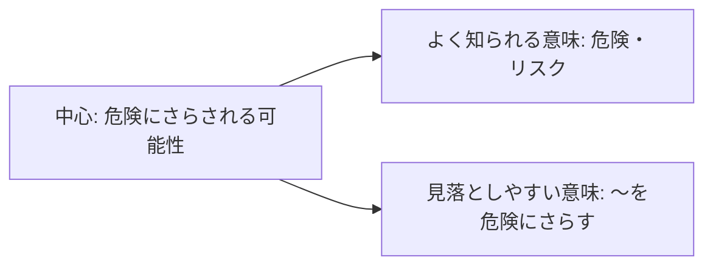

**重要語法**：risk one's life：命を危険にさらす

---

## 322. security

**品詞**：noun　**発音**：/sɪˈkjʊrəti/

<small>よく知られている意味：安全・安心</small>

### 見落としやすい意味：証券、有価証券

**例文**：The fund invests mainly in government securities.

**和訳**：その基金は主に国債などの政府証券に投資している。

**コアイメージ**：security はもともと「安全・保証」と関係する語。金融では価値や権利を裏づける書類・金融商品を securities と呼ぶ。

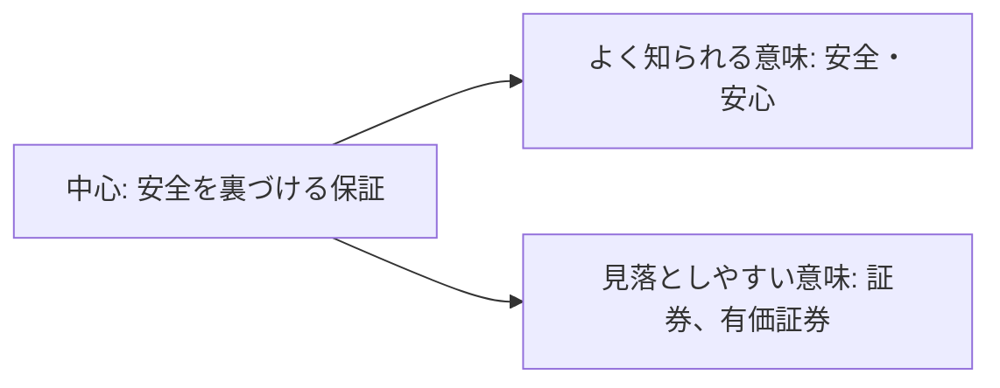

**重要語法**：securities は証券の意味では複数形でよく用いる

---

## 323. win

**品詞**：construction　**発音**：/wɪn/

<small>よく知られている意味：勝つ</small>

### 見落としやすい意味：win ... over：〜を説得して味方にする

**例文**：The teacher gradually won the class over.

**和訳**：先生は少しずつクラスの生徒たちを説得して味方につけた。

**コアイメージ**：win は競争で「勝ち取る」こと。win someone over では相手の支持や賛同を勝ち取る方向に意味が広がる。

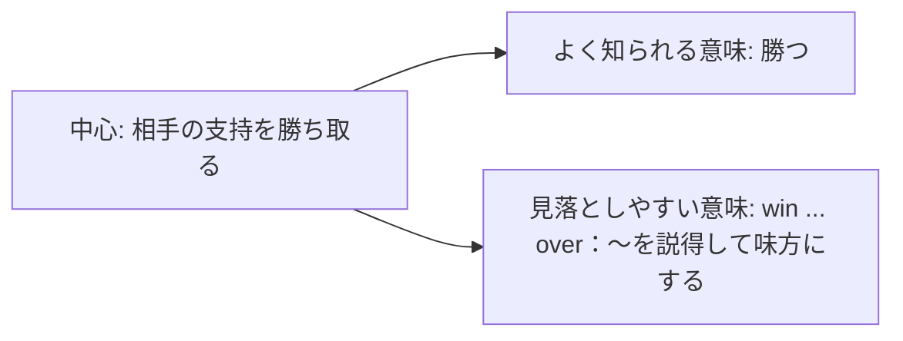

**重要語法**：win 人 over / win over 人

---

## 324. either

**品詞**：adverb　**発音**：/ˈiːðər/

<small>よく知られている意味：どちらか一方</small>

### 見落としやすい意味：（否定文で）〜もまた…ない

**例文**：I don't enjoy crowded places either.

**和訳**：私も混雑した場所は好きではない。

**コアイメージ**：either は二つの選択肢に関わる語だが、否定文の末尾では「こちらもそうではない」と同意する。「〜も」と訳しても肯定文の too とは文の極性が異なる。

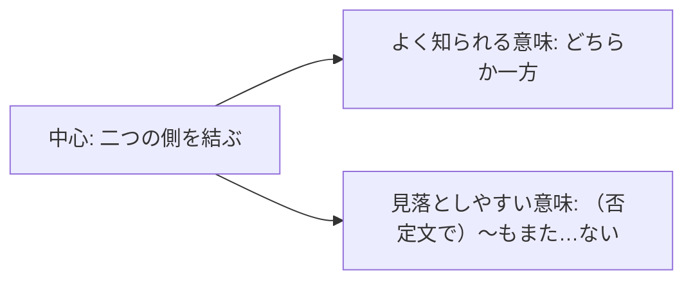

**重要語法**：否定文では too でなく either を使うのが基本

---

## 325. demand

**品詞**：construction　**発音**：/dɪˈmænd/

<small>よく知られている意味：要求する</small>

### 見落としやすい意味：demand that＋主語＋（should）＋動詞原形：〜することを要求する

**例文**：The manager demanded that the report be revised.

**和訳**：管理者はその報告書を修正するよう要求した。

**コアイメージ**：demand は強く要求すること。that 節で要求の内容を示すときは、実現した事実ではなく求められる行為なので動詞原形を用いる形がある。

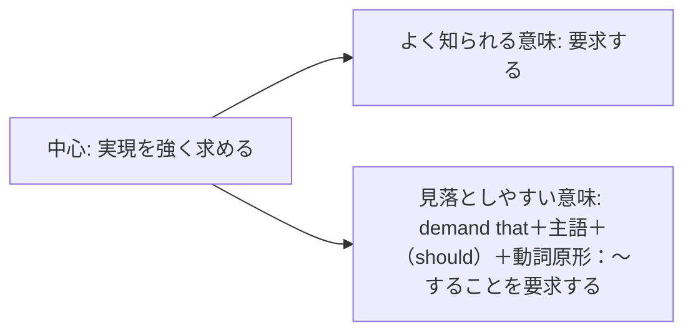

**重要語法**：demand that S (should) do：要求を表す that 節

---

## 326. demand

**品詞**：noun　**発音**：/dɪˈmænd/

<small>よく知られている意味：要求</small>

### 見落としやすい意味：需要

**例文**：There is strong demand for affordable housing.

**和訳**：手頃な価格の住宅には強い需要がある。

**コアイメージ**：demand は「求めること」を表す。市場で人々が商品やサービスを求める状態を指すと「需要」になる。

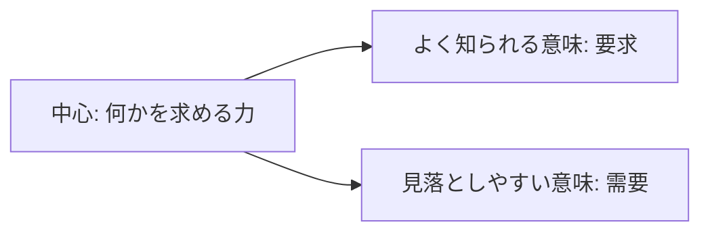

**重要語法**：demand for ...：〜に対する需要

---

## 327. court

**品詞**：verb　**発音**：/kɔːrt/

<small>よく知られている意味：裁判所</small>

### 見落としやすい意味：（支持や好意を）得ようとする

**例文**：The candidate courted support from younger voters.

**和訳**：その候補者は若い有権者の支持を得ようと働きかけた。

**コアイメージ**：court の動詞は相手の好意や支持を積極的に求める意味を持つ。ここでは裁判をするのではなく、支持を得るために働きかけることを表す。

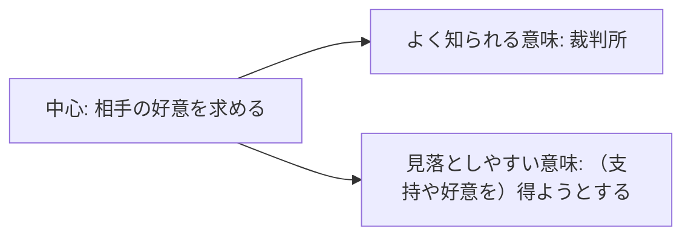

**重要語法**：court support / court favor：支持・好意を得ようとする

---

## 328. model

**品詞**：construction　**発音**：/ˈmɑːdəl/

<small>よく知られている意味：模型・模範</small>

### 見落としやすい意味：model ... on/after ...：〜を手本にして作る

**例文**：The new park was modeled on a famous Japanese garden.

**和訳**：その新しい公園は有名な日本庭園を手本にして造られた。

**コアイメージ**：model は「手本・模型」。何かを model on 別のものと言えば、その形や仕組みを手本として作ることになる。

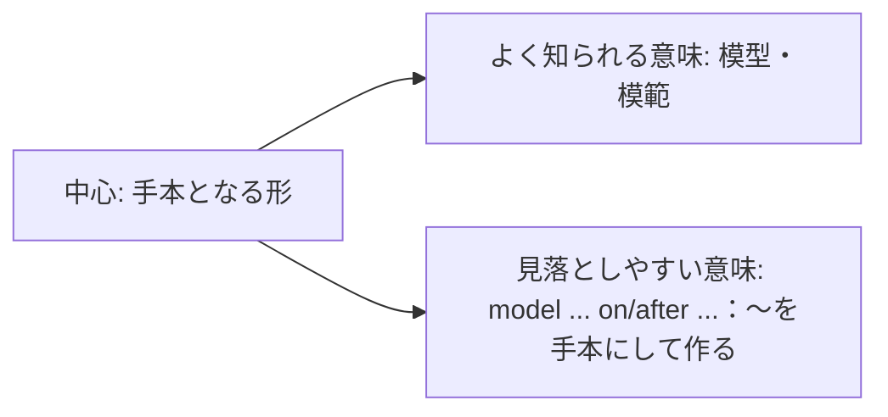

**重要語法**：model A on / after B：AをBにならって作る

---

## 329. explain

**品詞**：construction　**発音**：/ɪkˈspleɪn/

<small>よく知られている意味：説明する</small>

### 見落としやすい意味：explain away ...：〜を言い訳で正当化する

**例文**：He tried to explain away the mistake as a minor error.

**和訳**：彼はその失敗を小さなミスだったと言って正当化しようとした。

**コアイメージ**：explain は理由を述べること。explain away では理由を並べて問題の重大さや責任を消そうとするニュアンスが加わる。

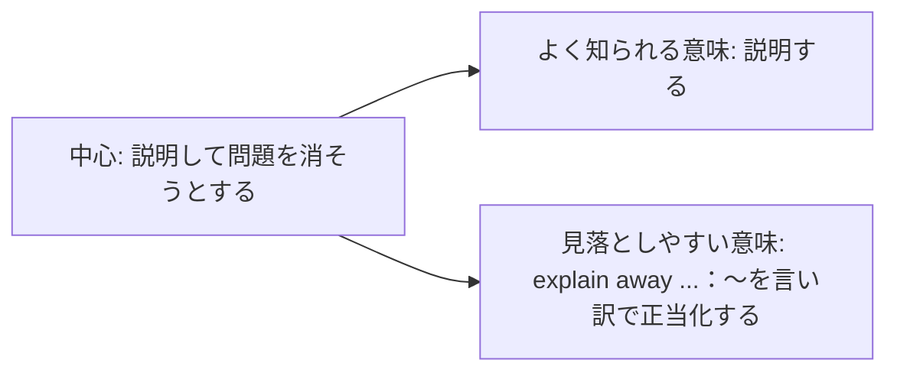

**重要語法**：explain away a mistake：失敗を言い訳で片づける

---

## 330. produce

**品詞**：noun　**発音**：/ˈproʊduːs/

<small>よく知られている意味：生産する</small>

### 見落としやすい意味：生鮮農産物、青果物

**例文**：This market sells fresh produce from local farms.

**和訳**：この市場では地元の農場から届いた新鮮な青果物を売っている。

**コアイメージ**：produce は動詞では「生産する」。名詞では生産されたもののうち、とくに野菜や果物などの農産物を指す。

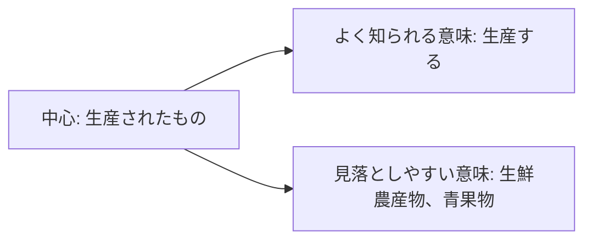

**重要語法**：名詞 produce は通常不可算で、動詞と強勢位置が異なる

---

## 331. event

**品詞**：construction　**発音**：/ɪˈvent/

<small>よく知られている意味：出来事・行事</small>

### 見落としやすい意味：in the event of ...：万一〜の場合

**例文**：In the event of heavy snow, classes will be canceled.

**和訳**：大雪の場合には授業が中止される。

**コアイメージ**：event は起こる出来事を表す。in the event of は「その出来事が起きた場合には」と条件を示す定型表現。

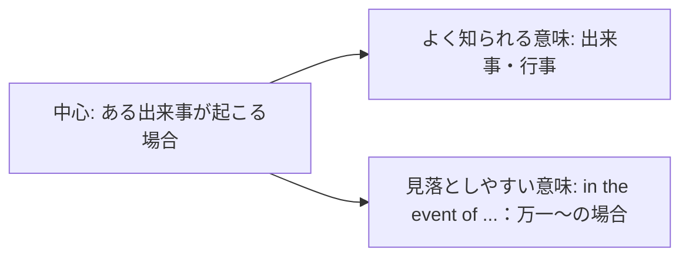

**重要語法**：in the event of + 名詞：万一〜の場合

---

## 332. event

**品詞**：construction　**発音**：/ɪˈvent/

<small>よく知られている意味：出来事・行事</small>

### 見落としやすい意味：in any event：いずれにせよ

**例文**：In any event, we need to finish the task today.

**和訳**：いずれにせよ、私たちは今日その作業を終える必要がある。

**コアイメージ**：event は出来事や成り行きを指す。in any event は「どのような成り行きになっても」と考えると「いずれにせよ」につながる。

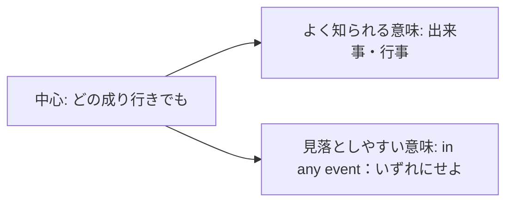

**重要語法**：in any event：いずれにしても

---

## 333. talk

**品詞**：construction　**発音**：/tɔːk/

<small>よく知られている意味：話す</small>

### 見落としやすい意味：talk A into -ing：Aを説得して〜させる

**例文**：My brother talked me into joining the science club.

**和訳**：兄は私を説得して科学部に入らせた。

**コアイメージ**：talk は言葉を交わすこと。talk A into -ing は話しかけてAの判断を変え、ある行動へ導くことを表す。

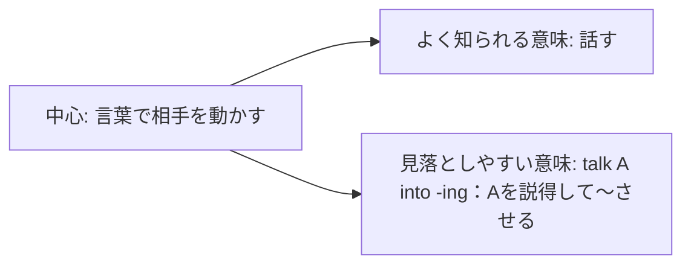

**重要語法**：talk A into -ing / talk A out of -ing

---

## 334. capital

**品詞**：adjective　**発音**：/ˈkæpɪtəl/

<small>よく知られている意味：首都・資本</small>

### 見落としやすい意味：非常に重要な

**例文**：Access to clean water is of capital importance.

**和訳**：清潔な水を利用できることは極めて重要だ。

**コアイメージ**：capital には「中心的な・第一級の」という形容詞の使い方がある。単なる「首都」ではなく、重要度が非常に高いことを表す。

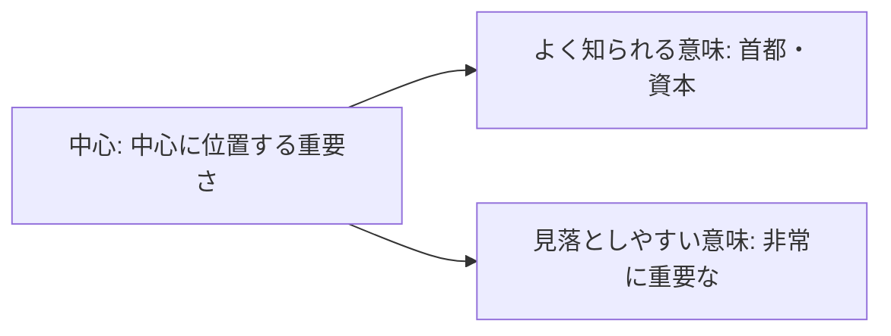

**重要語法**：of capital importance：極めて重要な（やや硬い表現）

---

## 335. capital

**品詞**：noun　**発音**：/ˈkæpɪtəl/

<small>よく知られている意味：首都</small>

### 見落としやすい意味：資本

**例文**：The company needs more capital to expand its business.

**和訳**：その会社が事業を拡大するには、さらに資本が必要だ。

**コアイメージ**：capital は「中心となるもの」を表す語として広がった。事業を動かす基盤となる資金や財産を指せば「資本」となる。

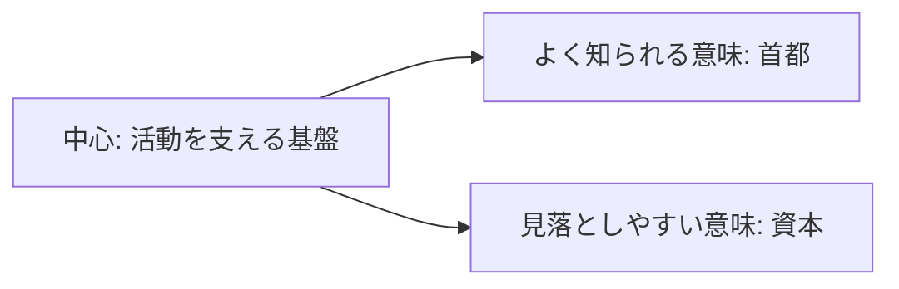

**重要語法**：raise capital：資本を調達する

---

## 336. expect

**品詞**：construction　**発音**：/ɪkˈspekt/

<small>よく知られている意味：予想する・期待する</small>

### 見落としやすい意味：be expected to do：〜することを求められる、予定されている

**例文**：All students are expected to arrive by eight.

**和訳**：生徒全員が8時までに到着することを求められている。

**コアイメージ**：expect は「そうなると見込む・期待する」。受け身の be expected to は、周囲や組織から期待される行動を表し、文脈によって「求められる」になる。

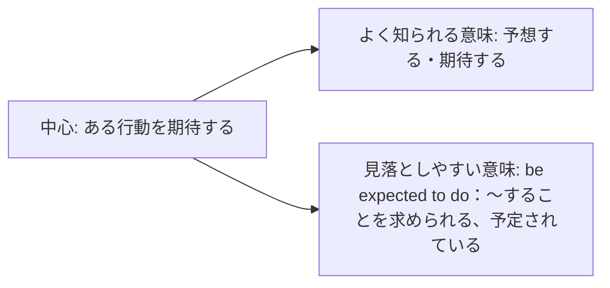

**重要語法**：be expected to do は「予想される」と「求められる」を文脈で区別

---

## 337. concern

**品詞**：construction　**発音**：/kənˈsɜːrn/

<small>よく知られている意味：心配・関心</small>

### 見落としやすい意味：as far as ... is concerned：〜に関する限り

**例文**：As far as I am concerned, this plan is reasonable.

**和訳**：私としては、この計画は妥当だと思う。

**コアイメージ**：concern は関わりや関心を表す。as far as ... is concerned は「〜に関わる範囲では」という枠を作り、意見や話題の範囲を示す。

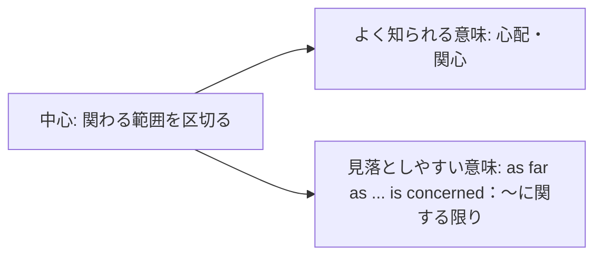

**重要語法**：as far as I'm concerned：私に関する限り・私としては

---

## 338. concern

**品詞**：verb　**発音**：/kənˈsɜːrn/

<small>よく知られている意味：心配</small>

### 見落としやすい意味：〜に関係する

**例文**：The new rule concerns everyone in the school.

**和訳**：その新しい規則は学校の全員に関係する。

**コアイメージ**：concern は単に心配することだけではなく「関わりを持つ」という意味が中心にある。ある話題や規則が人に関わるとき「関係する」と読む。

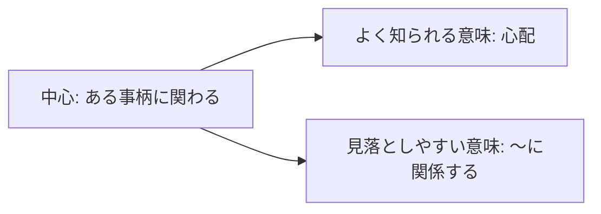

**重要語法**：concern 人：人に関係する

---

## 339. answer

**品詞**：verb　**発音**：/ˈænsər/

<small>よく知られている意味：答える</small>

### 見落としやすい意味：（行為や結果に）責任を負う

**例文**：Officials must answer for their decisions.

**和訳**：公職にある人は自分たちの決定に責任を負わなければならない。

**コアイメージ**：answer は問いに答えること。answer for では自分の行為について説明や弁明を求められる立場になるため「責任を負う」となる。

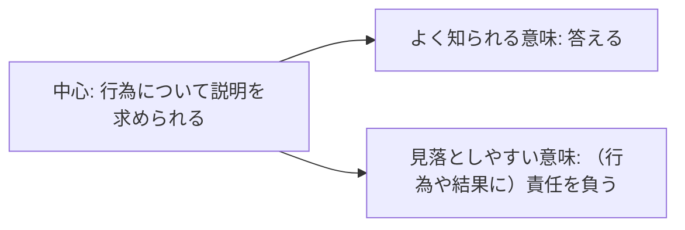

**重要語法**：answer for ...：〜に責任を負う

---

## 340. let

**品詞**：construction　**発音**：/let/

<small>よく知られている意味：〜させる</small>

### 見落としやすい意味：let alone ...：まして〜はなおさらだ

**例文**：He can barely walk, let alone run.

**和訳**：彼は歩くことさえままならない。まして走るなど無理だ。

**コアイメージ**：let alone は難易度の低いことすら成立しないなら、さらに難しいことはなおさらだと述べる。二つの事柄を段階的に比較する表現。

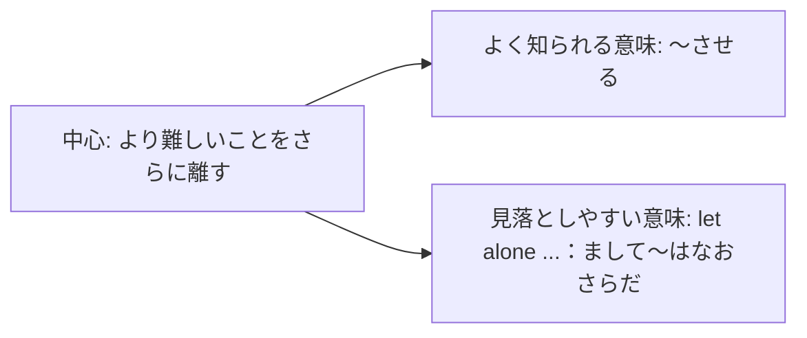

**重要語法**：let alone は前半に否定や否定的な内容が来やすい

---

## 341. let

**品詞**：verb　**発音**：/let/

<small>よく知られている意味：〜させる</small>

### 見落としやすい意味：（建物・土地などを）賃貸する

**例文**：They let the apartment to a family for a year.

**和訳**：彼らはそのアパートを1年間ある家族に貸した。

**コアイメージ**：let には何かを相手に使わせる意味がある。建物や土地を契約によって使わせる場合には「賃貸する」になる。

```mermaid
flowchart LR
    A["中心: 相手に使わせる"]
    B["よく知られる意味: 〜させる"]
    C["見落としやすい意味: （建物・土地などを）賃貸する"]
    A --> B
    A --> C
```

**重要語法**：let a house to ... は主にイギリス英語

---

## 342. film

**品詞**：noun　**発音**：/fɪlm/

<small>よく知られている意味：映画・フィルム</small>

### 見落としやすい意味：薄膜、薄い層

**例文**：A thin film of oil covered the surface of the water.

**和訳**：水面は薄い油の膜で覆われていた。

**コアイメージ**：film は薄く広がる層を表す。映画のフィルムだけでなく、水面や物体を覆う薄膜にも使う。

```mermaid
flowchart LR
    A["中心: 表面を覆う薄い層"]
    B["よく知られる意味: 映画・フィルム"]
    C["見落としやすい意味: 薄膜、薄い層"]
    A --> B
    A --> C
```

**重要語法**：a film of oil / dust：薄い油膜・ほこりの層

---

## 343. charge

**品詞**：verb　**発音**：/tʃɑːrdʒ/

<small>よく知られている意味：責任・告発</small>

### 見落としやすい意味：（人に料金を）請求する

**例文**：The shop charged me 500 yen for the notebook.

**和訳**：その店はそのノート代として私に500円請求した。

**コアイメージ**：charge は相手に負担を課すという発想を持つ。金額を負担として課すと「料金を請求する」となる。

```mermaid
flowchart LR
    A["中心: 相手に負担を課す"]
    B["よく知られる意味: 責任・告発"]
    C["見落としやすい意味: （人に料金を）請求する"]
    A --> B
    A --> C
```

**重要語法**：charge 人 金額 for 物：物の代金を人に請求する

---

## 344. charge

**品詞**：construction　**発音**：/tʃɑːrdʒ/

<small>よく知られている意味：料金・請求</small>

### 見落としやすい意味：charge A with B：AをBの罪で告発する

**例文**：The police charged the driver with dangerous driving.

**和訳**：警察はその運転手を危険運転の罪で訴追した。

**コアイメージ**：charge は負担や責任を人に課すこと。法律の文脈では具体的な罪を帰するため「告発する・訴追する」となる。

```mermaid
flowchart LR
    A["中心: 責任を人に負わせる"]
    B["よく知られる意味: 料金・請求"]
    C["見落としやすい意味: charge A with B：AをBの罪で告発する"]
    A --> B
    A --> C
```

**重要語法**：charge A with B：AをBで告発・訴追する

---

## 345. charge

**品詞**：noun　**発音**：/tʃɑːrdʒ/

<small>よく知られている意味：料金</small>

### 見落としやすい意味：容疑、告発

**例文**：The charges against her were later dropped.

**和訳**：彼女に対する容疑はその後取り下げられた。

**コアイメージ**：charge は人に課されるものを広く指す。法律の場面で課された非難や罪の申し立てが「容疑・告発」になる。

```mermaid
flowchart LR
    A["中心: 人に課される責任"]
    B["よく知られる意味: 料金"]
    C["見落としやすい意味: 容疑、告発"]
    A --> B
    A --> C
```

**重要語法**：criminal charges / drop charges：刑事訴追・告発を取り下げる

---

## 346. charge

**品詞**：noun　**発音**：/tʃɑːrdʒ/

<small>よく知られている意味：料金・請求</small>

### 見落としやすい意味：管理責任、世話

**例文**：The children were left in their aunt's charge.

**和訳**：子どもたちは叔母の世話に任された。

**コアイメージ**：charge には何かを引き受け、責任を持って管理する意味がある。人を誰かの charge に置けば、世話や管理を任せることになる。

```mermaid
flowchart LR
    A["中心: 引き受けた管理責任"]
    B["よく知られる意味: 料金・請求"]
    C["見落としやすい意味: 管理責任、世話"]
    A --> B
    A --> C
```

**重要語法**：in someone's charge：〜の世話・管理下に

---

## 347. charge

**品詞**：verb　**発音**：/tʃɑːrdʒ/

<small>よく知られている意味：料金を請求する</small>

### 見落としやすい意味：充電する

**例文**：Please charge your phone before the trip.

**和訳**：旅行前にスマートフォンを充電してください。

**コアイメージ**：charge はある対象に何かを与えたり満たしたりする意味でも使う。電池に電気エネルギーを蓄える文脈では「充電する」となる。

```mermaid
flowchart LR
    A["中心: 電気を蓄える"]
    B["よく知られる意味: 料金を請求する"]
    C["見落としやすい意味: 充電する"]
    A --> B
    A --> C
```

**重要語法**：charge a battery / phone：電池・携帯電話を充電する

---

## 348. send

**品詞**：construction　**発音**：/send/

<small>よく知られている意味：送る</small>

### 見落としやすい意味：send for ...：〜を呼びにやる、取りに行かせる

**例文**：We sent for a doctor when he suddenly fell ill.

**和訳**：彼が突然病気になったので、私たちは医者を呼びにやった。

**コアイメージ**：send は人や物をある方向へ送り出すこと。send for では必要な人や物を求めて誰かを送り出すため「呼びにやる」になる。

```mermaid
flowchart LR
    A["中心: 必要なものを求めて送り出す"]
    B["よく知られる意味: 送る"]
    C["見落としやすい意味: send for ...：〜を呼びにやる、取りに行かせる"]
    A --> B
    A --> C
```

**重要語法**：send for a doctor：医者を呼びにやる

---

## 349. carry

**品詞**：construction　**発音**：/ˈkæri/

<small>よく知られている意味：運ぶ</small>

### 見落としやすい意味：carry out ...：〜を実行する

**例文**：The researchers carried out a detailed survey.

**和訳**：研究者たちは詳細な調査を実施した。

**コアイメージ**：carry は何かを持って運ぶこと。carry out では計画や指示を最後まで進めて実際に行うことを表す。

```mermaid
flowchart LR
    A["中心: 計画を最後まで運ぶ"]
    B["よく知られる意味: 運ぶ"]
    C["見落としやすい意味: carry out ...：〜を実行する"]
    A --> B
    A --> C
```

**重要語法**：carry out an experiment / plan：実験・計画を実行する

---

## 350. carry

**品詞**：verb　**発音**：/ˈkæri/

<small>よく知られている意味：運ぶ</small>

### 見落としやすい意味：（店が商品を）取り扱っている

**例文**：Does this store carry that brand of pencils?

**和訳**：この店ではそのブランドの鉛筆を扱っていますか。

**コアイメージ**：carry は物を持ち運ぶことから、店が商品を保有して販売する意味にも広がる。文脈が小売店なら「取り扱う」と読める。

```mermaid
flowchart LR
    A["中心: 商品を店に置いておく"]
    B["よく知られる意味: 運ぶ"]
    C["見落としやすい意味: （店が商品を）取り扱っている"]
    A --> B
    A --> C
```

**重要語法**：carry a brand / product：商品を取り扱う

---

## 351. address

**品詞**：noun　**発音**：/ˈædres/

<small>よく知られている意味：住所</small>

### 見落としやすい意味：演説、講話

**例文**：The principal gave an address at the graduation ceremony.

**和訳**：校長先生は卒業式で演説を行った。

**コアイメージ**：address は相手に言葉を向ける行為と関わる。聴衆に向けたまとまった話を名詞で表すと「演説・講話」になる。

```mermaid
flowchart LR
    A["中心: 聴衆へ言葉を向ける"]
    B["よく知られる意味: 住所"]
    C["見落としやすい意味: 演説、講話"]
    A --> B
    A --> C
```

**重要語法**：give / deliver an address：演説する

---

## 352. address

**品詞**：verb　**発音**：/əˈdres/

<small>よく知られている意味：住所</small>

### 見落としやすい意味：（問題に）取り組む

**例文**：We must address the causes of the problem.

**和訳**：私たちはその問題の原因に取り組まなければならない。

**コアイメージ**：address はある対象に向き合って言葉や行動を向けること。問題を対象にすれば、解決を目指して取り組む意味になる。

```mermaid
flowchart LR
    A["中心: 対象に正面から向き合う"]
    B["よく知られる意味: 住所"]
    C["見落としやすい意味: （問題に）取り組む"]
    A --> B
    A --> C
```

**重要語法**：address a problem / issue：問題に対処する

---

## 353. measure

**品詞**：construction　**発音**：/ˈmeʒər/

<small>よく知られている意味：測る</small>

### 見落としやすい意味：measure up to ...：〜という期待・基準に達する

**例文**：The results did not measure up to our expectations.

**和訳**：その結果は私たちの期待に達しなかった。

**コアイメージ**：measure は測定して基準と比べること。measure up to は期待や水準を物差しとして、そこに届くかどうかを表す。

```mermaid
flowchart LR
    A["中心: 基準と照らして測る"]
    B["よく知られる意味: 測る"]
    C["見落としやすい意味: measure up to ...：〜という期待・基準に達する"]
    A --> B
    A --> C
```

**重要語法**：measure up to expectations：期待に応える

---

## 354. measure

**品詞**：noun　**発音**：/ˈmeʒər/

<small>よく知られている意味：測定する</small>

### 見落としやすい意味：対策、手段

**例文**：The city introduced new measures to reduce waste.

**和訳**：市はごみを減らすための新しい対策を導入した。

**コアイメージ**：measure は物事を評価し、適切な対応を考えることにもつながる。問題に対して講じる具体的な措置が名詞の「対策」。

```mermaid
flowchart LR
    A["中心: 状況に応じて取る対応"]
    B["よく知られる意味: 測定する"]
    C["見落としやすい意味: 対策、手段"]
    A --> B
    A --> C
```

**重要語法**：take measures to do：〜するための対策を講じる

---

## 355. estimate

**品詞**：noun　**発音**：/ˈestəmət/

<small>よく知られている意味：見積もる</small>

### 見落としやすい意味：見積書、概算額

**例文**：The contractor sent us an estimate for the repairs.

**和訳**：請負業者は修理の見積書を送ってきた。

**コアイメージ**：estimate は費用や量をおおよそ計算すること。その計算結果や提示書類を名詞で呼べば「見積額・見積書」になる。

```mermaid
flowchart LR
    A["中心: おおよその金額を算出する"]
    B["よく知られる意味: 見積もる"]
    C["見落としやすい意味: 見積書、概算額"]
    A --> B
    A --> C
```

**重要語法**：get an estimate for ...：〜の見積もりを取る

---

## 356. nothing

**品詞**：construction　**発音**：/ˈnʌθɪŋ/

<small>よく知られている意味：何もない</small>

### 見落としやすい意味：nothing but ...：〜だけ、〜にすぎない

**例文**：There was nothing but silence in the room.

**和訳**：部屋には静けさだけがあった。

**コアイメージ**：nothing は「何もない」。nothing but X は X 以外には何もないという形で、X だけに限定する。

```mermaid
flowchart LR
    A["中心: それ以外は何もない"]
    B["よく知られる意味: 何もない"]
    C["見落としやすい意味: nothing but ...：〜だけ、〜にすぎない"]
    A --> B
    A --> C
```

**重要語法**：nothing but ...：〜だけ・〜にすぎない

---

## 357. nothing

**品詞**：construction　**発音**：/ˈnʌθɪŋ/

<small>よく知られている意味：何もない</small>

### 見落としやすい意味：nothing like ...：〜とはまったく違う

**例文**：The new building is nothing like the old one.

**和訳**：新しい建物は古い建物とはまったく違う。

**コアイメージ**：like は似ていることを示す。nothing like X と言えば X に似たところがないため「まったく違う」となる。

```mermaid
flowchart LR
    A["中心: 似ているところがない"]
    B["よく知られる意味: 何もない"]
    C["見落としやすい意味: nothing like ...：〜とはまったく違う"]
    A --> B
    A --> C
```

**重要語法**：nothing like ...：〜とは似ても似つかない

---

## 358. culture

**品詞**：noun　**発音**：/ˈkʌltʃər/

<small>よく知られている意味：文化</small>

### 見落としやすい意味：（細菌・細胞などの）培養、培養物

**例文**：The scientist examined a bacterial culture under the microscope.

**和訳**：科学者は細菌の培養物を顕微鏡で調べた。

**コアイメージ**：culture は人間の文化だけでなく、微生物や細胞を育てる行為やその結果を表す専門語でもある。生物学の文脈では「培養・培養物」を選ぶ。

```mermaid
flowchart LR
    A["中心: 育てて増やす営み"]
    B["よく知られる意味: 文化"]
    C["見落としやすい意味: （細菌・細胞などの）培養、培養物"]
    A --> B
    A --> C
```

**重要語法**：a bacterial culture：細菌の培養物

---

## 359. act

**品詞**：construction　**発音**：/ækt/

<small>よく知られている意味：行動する</small>

### 見落としやすい意味：act on ...：〜に作用する、〜に従って行動する

**例文**：This chemical acts on the surface of the metal.

**和訳**：この化学物質は金属の表面に作用する。

**コアイメージ**：act は何かが働くこと。act on は作用が及ぶ対象を示し、物質の働きにも助言に従う行動にも使う。

```mermaid
flowchart LR
    A["中心: 働きが対象に及ぶ"]
    B["よく知られる意味: 行動する"]
    C["見落としやすい意味: act on ...：〜に作用する、〜に従って行動する"]
    A --> B
    A --> C
```

**重要語法**：act on advice：助言に従って行動する

---

## 360. act

**品詞**：noun　**発音**：/ækt/

<small>よく知られている意味：行動・演技</small>

### 見落としやすい意味：法律、制定法

**例文**：The new Act protects personal information.

**和訳**：その新しい法律は個人情報を保護する。

**コアイメージ**：act は行為そのものを表す。議会が正式に成立させた決定・行為として、法律を Act と呼ぶ用法がある。

```mermaid
flowchart LR
    A["中心: 正式に成立した行為"]
    B["よく知られる意味: 行動・演技"]
    C["見落としやすい意味: 法律、制定法"]
    A --> B
    A --> C
```

**重要語法**：Act は法律名で大文字になることが多い

---

## 361. main

**品詞**：construction　**発音**：/meɪn/

<small>よく知られている意味：主な・主要な</small>

### 見落としやすい意味：in the main：概して、大体は

**例文**：In the main, the students supported the proposal.

**和訳**：概して、生徒たちはその提案に賛成した。

**コアイメージ**：main は全体の中の中心・主要部分を指す。in the main は細部の例外を除いて主要部分を見るため「概して」となる。

```mermaid
flowchart LR
    A["中心: 全体の主な部分を見る"]
    B["よく知られる意味: 主な・主要な"]
    C["見落としやすい意味: in the main：概して、大体は"]
    A --> B
    A --> C
```

**重要語法**：in the main：大体は・概して

---

## 362. figure

**品詞**：verb　**発音**：/ˈfɪɡjər/

<small>よく知られている意味：数字・図</small>

### 見落としやすい意味：〜と考える、推測する

**例文**：I figure that the train will arrive soon.

**和訳**：電車はもうすぐ到着するだろうと私は思う。

**コアイメージ**：figure は数や形を頭で捉えることと関わる。状況を頭の中で計算して判断すれば「〜と考える・推測する」になる。

```mermaid
flowchart LR
    A["中心: 頭の中で見積もる"]
    B["よく知られる意味: 数字・図"]
    C["見落としやすい意味: 〜と考える、推測する"]
    A --> B
    A --> C
```

**重要語法**：I figure (that) ...：〜だと思う（主に口語）

---

## 363. figure

**品詞**：verb　**発音**：/ˈfɪɡjər/

<small>よく知られている意味：数字・図形</small>

### 見落としやすい意味：理解する

**例文**：I finally figured out why the machine stopped.

**和訳**：私はついにその機械が止まった理由を理解した。

**コアイメージ**：figure は情報を整理して答えを出す感覚と結びつく。figure out では不明なことを考え抜いて理解することを表す。

```mermaid
flowchart LR
    A["中心: 考えて答えを導く"]
    B["よく知られる意味: 数字・図形"]
    C["見落としやすい意味: 理解する"]
    A --> B
    A --> C
```

**重要語法**：figure out why / how ...：なぜ・どうやってかを理解する

---

## 364. hope

**品詞**：construction　**発音**：/hoʊp/

<small>よく知られている意味：希望する</small>

### 見落としやすい意味：hope against hope：望みが薄くても期待し続ける

**例文**：We hoped against hope that the missing dog would return.

**和訳**：私たちは望みが薄くても、行方不明の犬が戻ることを願い続けた。

**コアイメージ**：hope は望みを持つこと。hope against hope は望みを失わせる事情に逆らって、それでも期待し続ける状態を強調する。

```mermaid
flowchart LR
    A["中心: 厳しい状況に逆らって希望を持つ"]
    B["よく知られる意味: 希望する"]
    C["見落としやすい意味: hope against hope：望みが薄くても期待し続ける"]
    A --> B
    A --> C
```

**重要語法**：hope against hope that ...：望みが薄くても〜を願う

---

## 365. learn

**品詞**：construction　**発音**：/lɜːrn/

<small>よく知られている意味：学ぶ</small>

### 見落としやすい意味：learn of ...：〜のことを知らされる、耳にする

**例文**：I learned of the award through a newspaper article.

**和訳**：私は新聞記事を通じてその受賞のことを知った。

**コアイメージ**：learn は知識を得ること。learn of X は X について新たな情報が耳に入り、存在や出来事を知ることを指す。

```mermaid
flowchart LR
    A["中心: 新しい情報を得る"]
    B["よく知られる意味: 学ぶ"]
    C["見落としやすい意味: learn of ...：〜のことを知らされる、耳にする"]
    A --> B
    A --> C
```

**重要語法**：learn of ...：〜のことを耳にする

---

## 366. whole

**品詞**：construction　**発音**：/hoʊl/

<small>よく知られている意味：全体の</small>

### 見落としやすい意味：on the whole：全体として、概して

**例文**：On the whole, the school festival was a success.

**和訳**：全体として、文化祭は成功だった。

**コアイメージ**：whole は細部を含めた全体のこと。on the whole は個々の例外にとらわれず、全体を評価するときに使う。

```mermaid
flowchart LR
    A["中心: 細部でなく全体を見る"]
    B["よく知られる意味: 全体の"]
    C["見落としやすい意味: on the whole：全体として、概して"]
    A --> B
    A --> C
```

**重要語法**：on the whole：全体として・おおむね

---

## 367. clear

**品詞**：construction　**発音**：/klɪr/

<small>よく知られている意味：明らかな・片づける</small>

### 見落としやすい意味：clear up ...：〜を解決する、解明する

**例文**：The teacher cleared up our confusion about the rule.

**和訳**：先生はその規則についての私たちの疑問を解消した。

**コアイメージ**：clear には障害物や曇りがない状態という感覚がある。clear up は混乱や不明点を取り除き、状況をすっきりさせる。

```mermaid
flowchart LR
    A["中心: 曇りや障害を取り除く"]
    B["よく知られる意味: 明らかな・片づける"]
    C["見落としやすい意味: clear up ...：〜を解決する、解明する"]
    A --> B
    A --> C
```

**重要語法**：clear up a misunderstanding：誤解を解く

---

## 368. room

**品詞**：noun　**発音**：/ruːm/

<small>よく知られている意味：部屋</small>

### 見落としやすい意味：余地、可能性

**例文**：There is still room for improvement in this essay.

**和訳**：この作文にはまだ改善の余地がある。

**コアイメージ**：room は人や物が入る空間。物理的な部屋から、変化や改善を受け入れられる「余地」に意味が広がる。

```mermaid
flowchart LR
    A["中心: 何かが入り込める空き"]
    B["よく知られる意味: 部屋"]
    C["見落としやすい意味: 余地、可能性"]
    A --> B
    A --> C
```

**重要語法**：room for improvement：改善の余地

---

## 369. identify

**品詞**：construction　**発音**：/aɪˈdentɪfaɪ/

<small>よく知られている意味：特定する</small>

### 見落としやすい意味：identify A with B：AをBと同一視する

**例文**：Some people identify success with wealth.

**和訳**：成功を富と同一視する人もいる。

**コアイメージ**：identify は何であるかを見定めること。identify A with B は二つを同じものとして結びつけて捉える表現。

```mermaid
flowchart LR
    A["中心: 同じものとして認識する"]
    B["よく知られる意味: 特定する"]
    C["見落としやすい意味: identify A with B：AをBと同一視する"]
    A --> B
    A --> C
```

**重要語法**：identify A with B：AをBと同一視する

---

## 370. agree

**品詞**：construction　**発音**：/əˈɡriː/

<small>よく知られている意味：同意する</small>

### 見落としやすい意味：agree with ...：（食べ物や気候などが）体質に合う

**例文**：Very spicy food doesn't agree with me.

**和訳**：辛すぎる食べ物は私の体質に合わない。

**コアイメージ**：agree は考えが一致して調和すること。食べ物や気候を主語にすると、体との相性がよい・悪いという意味になる。

```mermaid
flowchart LR
    A["中心: 相手とうまく調和する"]
    B["よく知られる意味: 同意する"]
    C["見落としやすい意味: agree with ...：（食べ物や気候などが）体質に合う"]
    A --> B
    A --> C
```

**重要語法**：agree with 人：食べ物・気候などが人に合う

---

## 371. hard

**品詞**：adverb　**発音**：/hɑːrd/

<small>よく知られている意味：難しい・硬い</small>

### 見落としやすい意味：懸命に、力を込めて

**例文**：She worked hard to finish the experiment.

**和訳**：彼女は実験を終えるために懸命に取り組んだ。

**コアイメージ**：hard は力が必要な難しさや強さを表す。副詞では力を込めて行動する様子を指し「懸命に」となる。

```mermaid
flowchart LR
    A["中心: 強い力を注ぐ"]
    B["よく知られる意味: 難しい・硬い"]
    C["見落としやすい意味: 懸命に、力を込めて"]
    A --> B
    A --> C
```

**重要語法**：hard（懸命に）と hardly（ほとんど〜ない）を区別

---

## 372. vote

**品詞**：construction　**発音**：/voʊt/

<small>よく知られている意味：投票する</small>

### 見落としやすい意味：vote down ...：投票で〜を否決する

**例文**：The committee voted down the proposal.

**和訳**：委員会はその提案を投票で否決した。

**コアイメージ**：vote は投票で意思を示すこと。down が加わると提案を退ける方向が明確になり「否決する」となる。

```mermaid
flowchart LR
    A["中心: 投票で退ける"]
    B["よく知られる意味: 投票する"]
    C["見落としやすい意味: vote down ...：投票で〜を否決する"]
    A --> B
    A --> C
```

**重要語法**：vote down a bill / proposal：法案・提案を否決する

---

## 373. one

**品詞**：construction　**発音**：/wʌn/

<small>よく知られている意味：一つ・一人</small>

### 見落としやすい意味：the one ... the other ...：一方は…、もう一方は…

**例文**：I considered two solutions: the one was cheap, but the other was faster.

**和訳**：私は二つの解決策を検討した。一方は安かったが、もう一方は速かった。

**コアイメージ**：one は先に述べたものを指し直す働きを持つ。the one と the other を対応させると、二つのうち一方ともう一方を対比できる。

```mermaid
flowchart LR
    A["中心: 二つを対応させて指す"]
    B["よく知られる意味: 一つ・一人"]
    C["見落としやすい意味: the one ... the other ...：一方は…、もう一方は…"]
    A --> B
    A --> C
```

**重要語法**：the one ... the other ... はやや改まった対比表現

---

## 374. stop

**品詞**：construction　**発音**：/stɑːp/

<small>よく知られている意味：止まる・やめる</small>

### 見落としやすい意味：stop to do と stop -ing：〜するために立ち止まる／〜するのをやめる

**例文**：He stopped running to drink some water.

**和訳**：彼は水を飲むために走るのをやめた。

**コアイメージ**：stop -ing は今している行為を止めること。stop to do は別のことをするために立ち止まることなので、動名詞と不定詞で意味が変わる。

```mermaid
flowchart LR
    A["中心: 行為を中断して次に進む"]
    B["よく知られる意味: 止まる・やめる"]
    C["見落としやすい意味: stop to do と stop -ing：〜するために立ち止まる／〜するのをやめる"]
    A --> B
    A --> C
```

**重要語法**：stop -ing（〜するのをやめる）/ stop to do（〜するために止まる）

---

## 375. economy

**品詞**：noun　**発音**：/ɪˈkɑːnəmi/

<small>よく知られている意味：経済</small>

### 見落としやすい意味：節約、資源の効率的利用

**例文**：Fuel economy is important when choosing a car.

**和訳**：車を選ぶときには燃料の効率的な使用が重要だ。

**コアイメージ**：economy は資源を無駄なく扱うことも表す。国家全体の「経済」だけでなく、費用や燃料の「節約・効率」の意味で使う。

```mermaid
flowchart LR
    A["中心: 資源を無駄なく使う"]
    B["よく知られる意味: 経済"]
    C["見落としやすい意味: 節約、資源の効率的利用"]
    A --> B
    A --> C
```

**重要語法**：fuel economy：燃費・燃料効率

---

## 376. feature

**品詞**：noun　**発音**：/ˈfiːtʃər/

<small>よく知られている意味：特徴</small>

### 見落としやすい意味：（新聞などの）特集記事

**例文**：I read a feature about ocean life in the newspaper.

**和訳**：私は新聞で海の生き物に関する特集記事を読んだ。

**コアイメージ**：feature は目立つ特徴や注目点を指す。その特徴的なテーマを掘り下げて扱う記事を、名詞で feature と呼ぶ。

```mermaid
flowchart LR
    A["中心: 注目点を大きく取り上げる"]
    B["よく知られる意味: 特徴"]
    C["見落としやすい意味: （新聞などの）特集記事"]
    A --> B
    A --> C
```

**重要語法**：a feature on / about ...：〜についての特集記事

---

## 377. save

**品詞**：preposition　**発音**：/seɪv/

<small>よく知られている意味：救う・保存する</small>

### 見落としやすい意味：〜を除いて（save for ...）

**例文**：Everyone was ready, save for one student.

**和訳**：一人の生徒を除いて、全員準備ができていた。

**コアイメージ**：save には前置詞として「〜を除いて」という別の用法がある。save for は例外を一つ取り出す表現として覚えるとよく、動詞「救う」と無理につなげない。

```mermaid
flowchart LR
    A["中心: 全体から例外を取り除く"]
    B["よく知られる意味: 救う・保存する"]
    C["見落としやすい意味: 〜を除いて（save for ...）"]
    A --> B
    A --> C
```

**重要語法**：save for ...：〜を除いて（やや改まった表現）

---

## 378. save

**品詞**：verb　**発音**：/seɪv/

<small>よく知られている意味：救う・保存する</small>

### 見落としやすい意味：（時間・費用・手間を）省く

**例文**：This shortcut will save us ten minutes.

**和訳**：この近道を使えば、私たちは10分節約できる。

**コアイメージ**：save は失われそうなものを守ること。時間や費用を失わずに済ませる場合には「省く・節約する」となる。

```mermaid
flowchart LR
    A["中心: 失われる分を残す"]
    B["よく知られる意味: 救う・保存する"]
    C["見落としやすい意味: （時間・費用・手間を）省く"]
    A --> B
    A --> C
```

**重要語法**：save 人 時間 / 金額：人の時間・費用を節約する

---

## 379. further

**品詞**：verb　**発音**：/ˈfɜːrðər/

<small>よく知られている意味：さらに・もっと遠く</small>

### 見落としやすい意味：〜を促進する

**例文**：The new fund will further scientific research.

**和訳**：その新しい基金は科学研究を促進するだろう。

**コアイメージ**：further は距離や程度をさらに先へ進める感覚を持つ。動詞では事業や研究を前に進めるため「促進する」になる。

```mermaid
flowchart LR
    A["中心: より先へ進める"]
    B["よく知られる意味: さらに・もっと遠く"]
    C["見落としやすい意味: 〜を促進する"]
    A --> B
    A --> C
```

**重要語法**：further a goal / cause：目標・活動を推進する

---

## 380. short

**品詞**：adjective　**発音**：/ʃɔːrt/

<small>よく知られている意味：短い</small>

### 見落としやすい意味：不足している

**例文**：We are short of volunteers for the event.

**和訳**：私たちはその行事のボランティアが不足している。

**コアイメージ**：short は必要な長さ・量に届かないことを表す。長さ以外の数量にも使えるため、必要数を下回ると「不足している」になる。

```mermaid
flowchart LR
    A["中心: 必要な量に届かない"]
    B["よく知られる意味: 短い"]
    C["見落としやすい意味: 不足している"]
    A --> B
    A --> C
```

**重要語法**：be short of ...：〜が不足している

---

## 381. above

**品詞**：construction　**発音**：/əˈbʌv/

<small>よく知られている意味：〜の上に</small>

### 見落としやすい意味：above all：何よりも、とりわけ

**例文**：Above all, remember to check your sources.

**和訳**：何よりも、情報源を確認することを忘れないでください。

**コアイメージ**：above は他のものより高い位置を示す。above all は多くの項目の中で最も上に置くことから「何よりも」となる。

```mermaid
flowchart LR
    A["中心: 他より上に位置する"]
    B["よく知られる意味: 〜の上に"]
    C["見落としやすい意味: above all：何よりも、とりわけ"]
    A --> B
    A --> C
```

**重要語法**：above all：何よりもまず

---

## 382. argue

**品詞**：construction　**発音**：/ˈɑːrɡjuː/

<small>よく知られている意味：口論する</small>

### 見落としやすい意味：argue for/against ...：〜に賛成・反対する論拠を述べる

**例文**：The students argued for a longer lunch break.

**和訳**：生徒たちは昼休みを長くすることに賛成する理由を述べた。

**コアイメージ**：argue は理由を挙げて自分の立場を主張すること。for / against を付ければ、賛成・反対のどちらを論じるかが分かる。

```mermaid
flowchart LR
    A["中心: 理由を挙げて主張する"]
    B["よく知られる意味: 口論する"]
    C["見落としやすい意味: argue for/against ...：〜に賛成・反対する論拠を述べる"]
    A --> B
    A --> C
```

**重要語法**：argue for ... / argue against ...：賛成・反対を論じる

---

## 383. argue

**品詞**：verb　**発音**：/ˈɑːrɡjuː/

<small>よく知られている意味：口論する</small>

### 見落としやすい意味：〜を示唆する、裏づける

**例文**：The evidence argues that the painting is genuine.

**和訳**：その証拠はその絵が本物であることを示唆している。

**コアイメージ**：argue は論拠を示して結論を支えること。証拠を主語にすると、証拠がある結論を裏づけるという意味になる。

```mermaid
flowchart LR
    A["中心: 根拠から結論を支える"]
    B["よく知られる意味: 口論する"]
    C["見落としやすい意味: 〜を示唆する、裏づける"]
    A --> B
    A --> C
```

**重要語法**：evidence argues that ...：証拠は〜であることを示している

---

## 384. ground

**品詞**：adjective　**発音**：/ɡraʊnd/

<small>よく知られている意味：地面</small>

### 見落としやすい意味：挽いた、すりつぶした（grind の過去分詞形 ground）

**例文**：She added ground coffee to the hot water.

**和訳**：彼女は挽いたコーヒー豆をお湯に入れた。

**コアイメージ**：この ground は名詞「地面」ではなく、動詞 grind（挽く・すりつぶす）の過去分詞。綴りと発音が同じなので、文中で何を修飾しているかに注目する。

```mermaid
flowchart LR
    A["中心: grind の結果として細かくなる"]
    B["よく知られる意味: 地面"]
    C["見落としやすい意味: 挽いた、すりつぶした（grind の過去分詞形 ground）"]
    A --> B
    A --> C
```

**重要語法**：ground coffee：挽いたコーヒー豆

---

## 385. ground

**品詞**：noun　**発音**：/ɡraʊnd/

<small>よく知られている意味：地面・土地</small>

### 見落としやすい意味：根拠、理由

**例文**：There are good grounds for questioning that claim.

**和訳**：その主張を疑う十分な根拠がある。

**コアイメージ**：ground は何かを支える地面や土台。考えや判断を支える理由にも意味が広がり、grounds で「根拠」を表すことが多い。

```mermaid
flowchart LR
    A["中心: 判断を支える土台"]
    B["よく知られる意味: 地面・土地"]
    C["見落としやすい意味: 根拠、理由"]
    A --> B
    A --> C
```

**重要語法**：grounds for ...：〜する根拠

---

## 386. ground

**品詞**：verb　**発音**：/ɡraʊnd/

<small>よく知られている意味：地面</small>

### 見落としやすい意味：〜の根拠を置く

**例文**：The conclusion is grounded in careful observation.

**和訳**：その結論は慎重な観察に基づいている。

**コアイメージ**：ground は土台を与えることにも使う。考えを証拠や事実の上に置くと「根拠を置く・基づかせる」となる。

```mermaid
flowchart LR
    A["中心: 考えに土台を与える"]
    B["よく知られる意味: 地面"]
    C["見落としやすい意味: 〜の根拠を置く"]
    A --> B
    A --> C
```

**重要語法**：be grounded in ...：〜に基づいている

---

## 387. stock

**品詞**：adjective　**発音**：/stɑːk/

<small>よく知られている意味：在庫・株式</small>

### 見落としやすい意味：定番の・型どおりの

**例文**：He gave a stock answer to every question.

**和訳**：彼はどの質問にも型どおりの答えを返した。

**コアイメージ**：stock はあらかじめ用意された蓄えを指す。stock answer ではその場で考えたものではなく、使い回せる定型の返答を表す。

```mermaid
flowchart LR
    A["中心: あらかじめ用意されたもの"]
    B["よく知られる意味: 在庫・株式"]
    C["見落としやすい意味: 定番の・型どおりの"]
    A --> B
    A --> C
```

**重要語法**：a stock phrase / answer：決まり文句・型どおりの答え

---

## 388. stock

**品詞**：verb　**発音**：/stɑːk/

<small>よく知られている意味：在庫・株式</small>

### 見落としやすい意味：商品を取りそろえる、（場所を物で）満たす

**例文**：The bookstore stocks several kinds of dictionaries.

**和訳**：その書店はいくつかの種類の辞書を取りそろえている。

**コアイメージ**：stock は店に置いてある商品や在庫。動詞ではその在庫を備える行為を表し「商品を取りそろえる」になる。

```mermaid
flowchart LR
    A["中心: 商品を備えておく"]
    B["よく知られる意味: 在庫・株式"]
    C["見落としやすい意味: 商品を取りそろえる、（場所を物で）満たす"]
    A --> B
    A --> C
```

**重要語法**：stock a product / stock shelves：商品をそろえる・棚に補充する

---

## 389. press

**品詞**：noun　**発音**：/pres/

<small>よく知られている意味：押す</small>

### 見落としやすい意味：報道機関・報道関係者の総称

**例文**：The press reported the discovery the next day.

**和訳**：報道機関は翌日その発見を報じた。

**コアイメージ**：press は印刷に使う圧力や印刷機と関わる語。印刷媒体からニュースを伝える組織全体に意味が広がり「報道機関」となる。

```mermaid
flowchart LR
    A["中心: 印刷物から情報を伝える"]
    B["よく知られる意味: 押す"]
    C["見落としやすい意味: 報道機関・報道関係者の総称"]
    A --> B
    A --> C
```

**重要語法**：the press：報道機関の総称（集合的に扱う）

---

## 390. press

**品詞**：verb　**発音**：/pres/

<small>よく知られている意味：押す</small>

### 見落としやすい意味：強く要求する、要求を押し通そうとする

**例文**：Parents pressed the school to improve its facilities.

**和訳**：保護者たちは学校に設備の改善を強く求めた。

**コアイメージ**：press は物理的に強く押すこと。相手に働きかけて決断を迫る場合も、比喩的に「圧力をかける・強く要求する」となる。

```mermaid
flowchart LR
    A["中心: 相手に強い圧力をかける"]
    B["よく知られる意味: 押す"]
    C["見落としやすい意味: 強く要求する、要求を押し通そうとする"]
    A --> B
    A --> C
```

**重要語法**：press A to do：Aに〜するよう強く求める

---

## 391. position

**品詞**：noun phrase　**発音**：/pəˈzɪʃən/

<small>よく知られている意味：位置・立場</small>

### 見落としやすい意味：be in a position to do：〜できる立場・条件にある

**例文**：We are not in a position to make that promise.

**和訳**：私たちにはその約束ができる立場にない。

**コアイメージ**：position は人や物が置かれた位置や立場。その立場が行動を可能にする条件を備えているかを示すのが be in a position to do。

```mermaid
flowchart LR
    A["中心: 行動できる立場・条件"]
    B["よく知られる意味: 位置・立場"]
    C["見落としやすい意味: be in a position to do：〜できる立場・条件にある"]
    A --> B
    A --> C
```

**重要語法**：be in a position to do：〜できる立場にある

---

## 392. sign

**品詞**：verb　**発音**：/saɪn/

<small>よく知られている意味：印・標識</small>

### 見落としやすい意味：身ぶりで意思を伝える、手話を用いる

**例文**：The guide signed for us to follow him.

**和訳**：案内人は私たちについてくるよう身ぶりで合図した。

**コアイメージ**：sign は意味を伝えるしるし。動詞では手や身ぶりを使ってそのしるしを示すことから「合図する・手話を使う」となる。

```mermaid
flowchart LR
    A["中心: しるしで意味を伝える"]
    B["よく知られる意味: 印・標識"]
    C["見落としやすい意味: 身ぶりで意思を伝える、手話を用いる"]
    A --> B
    A --> C
```

**重要語法**：sign to 人 / sign for 人 to do：身ぶりで合図する

---

## 393. account

**品詞**：noun　**発音**：/əˈkaʊnt/

<small>よく知られている意味：口座・説明</small>

### 見落としやすい意味：出来事の説明・経緯の記述

**例文**：The witness gave a detailed account of the accident.

**和訳**：目撃者は事故の経緯を詳しく説明した。

**コアイメージ**：account は物事を順序立てて説明することにも使う。出来事について何があったかをまとめた記述なら「経緯・説明」となる。

```mermaid
flowchart LR
    A["中心: 出来事を説明としてまとめる"]
    B["よく知られる意味: 口座・説明"]
    C["見落としやすい意味: 出来事の説明・経緯の記述"]
    A --> B
    A --> C
```

**重要語法**：give an account of ...：〜の経緯を説明する

---

## 394. account

**品詞**：noun phrase　**発音**：/əˈkaʊnt/

<small>よく知られている意味：口座・説明</small>

### 見落としやすい意味：on no account：決して〜ない

**例文**：On no account should you ignore the warning.

**和訳**：決してその警告を無視してはならない。

**コアイメージ**：on no account はどのような事情・理由があっても認めないという強い否定。文頭に置くと否定語の前置によって倒置が起きる。

```mermaid
flowchart LR
    A["中心: どんな理由でも例外なし"]
    B["よく知られる意味: 口座・説明"]
    C["見落としやすい意味: on no account：決して〜ない"]
    A --> B
    A --> C
```

**重要語法**：文頭の On no account の後は助動詞などが主語の前に来る

---

## 395. account

**品詞**：phrasal verb　**発音**：/əˈkaʊnt/

<small>よく知られている意味：口座・説明</small>

### 見落としやすい意味：理由を説明する、説明がつく

**例文**：How do you account for this sudden change?

**和訳**：この突然の変化をどう説明しますか。

**コアイメージ**：account には理由や経緯を説明する感覚がある。account for はある結果がなぜ生じたかを説明するため「理由を説明する」となる。

```mermaid
flowchart LR
    A["中心: 結果に説明を与える"]
    B["よく知られる意味: 口座・説明"]
    C["見落としやすい意味: 理由を説明する、説明がつく"]
    A --> B
    A --> C
```

**重要語法**：account for a difference / change：違い・変化の理由を説明する

---

## 396. account

**品詞**：phrasal verb　**発音**：/əˈkaʊnt/

<small>よく知られている意味：口座・説明</small>

### 見落としやすい意味：全体のうち一定割合を占める

**例文**：Online sales account for 40 percent of our revenue.

**和訳**：オンライン販売は売上高の40パーセントを占めている。

**コアイメージ**：account for は全体の中の内訳を説明する表現にもなる。数字を示すときには、その部分が全体の何割に当たるかを表す。

```mermaid
flowchart LR
    A["中心: 全体の内訳を説明する"]
    B["よく知られる意味: 口座・説明"]
    C["見落としやすい意味: 全体のうち一定割合を占める"]
    A --> B
    A --> C
```

**重要語法**：account for + 割合 + of 全体：全体の〜を占める

---

## 397. period

**品詞**：noun　**発音**：/ˈpɪriəd/

<small>よく知られている意味：期間・時期</small>

### 見落としやすい意味：月経、生理

**例文**：She has painful cramps during her period.

**和訳**：彼女は月経期間中に痛みを伴うけいれんがある。

**コアイメージ**：period はある区切られた期間を表す。身体の周期のうち月経が起こる期間を指す日常的な用法もある。

```mermaid
flowchart LR
    A["中心: 周期の中の一区間"]
    B["よく知られる意味: 期間・時期"]
    C["見落としやすい意味: 月経、生理"]
    A --> B
    A --> C
```

**重要語法**：have one's period：月経中である

---

## 398. full

**品詞**：adverb　**発音**：/fʊl/

<small>よく知られている意味：いっぱいの</small>

### 見落としやすい意味：真正面に、まっすぐ

**例文**：Sunlight shone full in our faces.

**和訳**：日光が私たちの顔に真正面から差し込んだ。

**コアイメージ**：full は満ちていることを表す形容詞だが、副詞的に方向や力の程度を強める使い方もある。full in the face は正面からまともに当たる意味。

```mermaid
flowchart LR
    A["中心: 真正面から十分に当たる"]
    B["よく知られる意味: いっぱいの"]
    C["見落としやすい意味: 真正面に、まっすぐ"]
    A --> B
    A --> C
```

**重要語法**：full in the face：真正面に・顔にまともに

---

## 399. date

**品詞**：noun　**発音**：/deɪt/

<small>よく知られている意味：日付・日取り</small>

### 見落としやすい意味：デートの相手

**例文**：She brought a date to the university party.

**和訳**：彼女は大学のパーティーにデートの相手を連れてきた。

**コアイメージ**：date は会う日取りを指すだけでなく、その日に一緒に出かける相手も指す。日時から人物へ指す対象が移っている。

```mermaid
flowchart LR
    A["中心: 会う予定とその相手"]
    B["よく知られる意味: 日付・日取り"]
    C["見落としやすい意味: デートの相手"]
    A --> B
    A --> C
```

**重要語法**：bring a date to ...：〜にデートの相手を連れて行く

---

## 400. date

**品詞**：verb　**発音**：/deɪt/

<small>よく知られている意味：日付</small>

### 見落としやすい意味：恋愛関係で付き合う

**例文**：They dated for a short time after meeting at university.

**和訳**：二人は大学で知り合った後、しばらく交際した。

**コアイメージ**：date は会う日付や約束のこと。動詞では特に恋愛を目的として会う・交際することを表す。

```mermaid
flowchart LR
    A["中心: 会う約束を重ねる"]
    B["よく知られる意味: 日付"]
    C["見落としやすい意味: 恋愛関係で付き合う"]
    A --> B
    A --> C
```

**重要語法**：date someone：人と交際する
