# EasyVoca 完成教材｜バッチ006

- 対象：採用語義の global_order 401〜480（80カード）
- データ源：main の `data/candidates`、`decision == "accepted"` を index・candidate_id 昇順に整列
- 構成：既知の意味は補助、見落としやすい意味を中心に掲載

## 01. collection（noun）

**発音**：/kəˈlekʃən/

<small>よく知られている意味：収集・コレクション</small>

**見落としやすい意味：募金・寄付金の取りまとめ**

**例文**：The students organized a collection for families affected by the flood.

**和訳**：生徒たちは洪水の被災家庭のために募金を行った。

**コアイメージ**：ばらばらのものを集めて一つにするのが中心。集める対象がお金になれば、寄付金を集める活動やそのお金を表す。

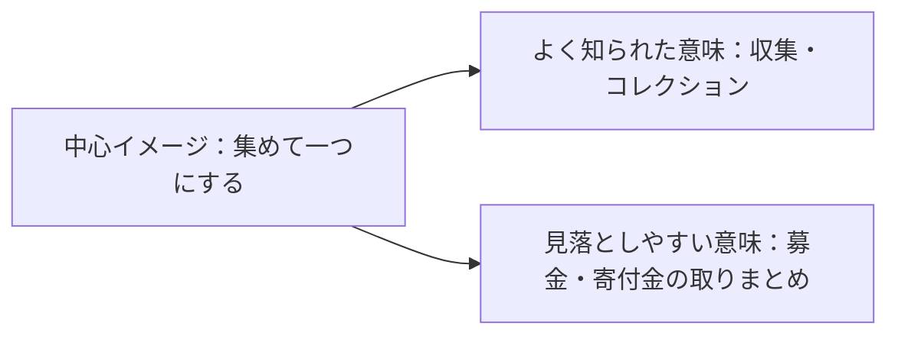

**重要語法**：`a collection for charity`

<small>global_order: 401 / index: 509 / candidate_id: `ev-00509-noun-01`</small>

---

## 02. focus（noun）

**発音**：/ˈfoʊkəs/

<small>よく知られている意味：焦点・注目点</small>

**見落としやすい意味：地震の震源、波が集まる焦点**

**例文**：The earthquake's focus was deep beneath the sea.

**和訳**：その地震の震源は海底深くにあった。

**コアイメージ**：さまざまな動きが一つの点に集中するイメージ。光の焦点だけでなく、地震が地下で発生した点も指せる。

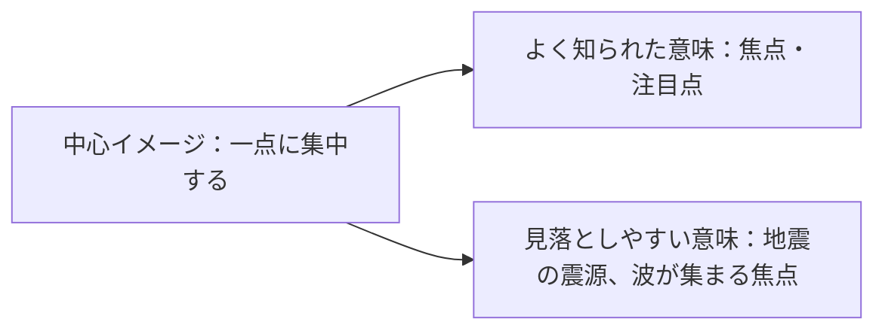

**重要語法**：`focus は地下の震源、epicenter は地表の震央`

<small>global_order: 402 / index: 510 / candidate_id: `ev-00510-noun-01`</small>

---

## 03. parent（noun）

**発音**：/ˈperənt/

<small>よく知られている意味：親</small>

**見落としやすい意味：親会社・母体組織**

**例文**：The parent owns three smaller companies in Asia.

**和訳**：その親会社はアジアに三つの小会社を所有している。

**コアイメージ**：子どもを支える親という関係を組織に広げた表現。別の企業を所有・統括する母体が parent になる。

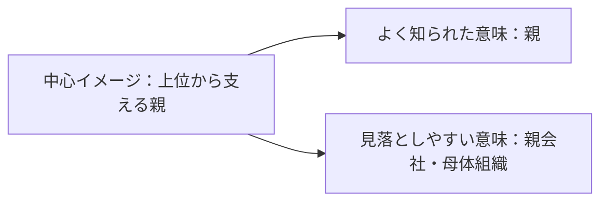

**重要語法**：`a parent company（親会社）`

<small>global_order: 403 / index: 511 / candidate_id: `ev-00511-noun-01`</small>

---

## 04. foreign（adjective phrase）

**発音**：/ˈfɔːrən/

<small>よく知られている意味：外国の</small>

**見落としやすい意味：人にとってなじみがない、経験の範囲外である**

**例文**：Speaking in public without notes is foreign to me.

**和訳**：原稿を見ずに人前で話すことは、私にはなじみがない。

**コアイメージ**：自分の属する世界の外にあるという感覚が中心。国境ではなく知識や経験の範囲の外にあるとき、「なじみがない」になる。

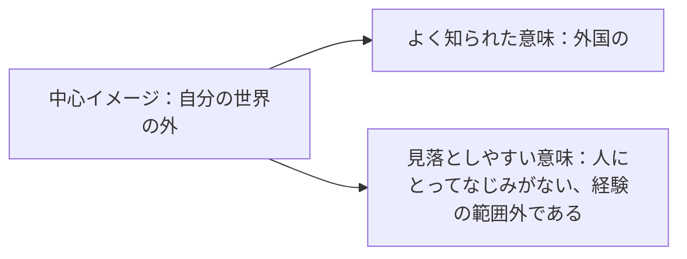

**重要語法**：`be foreign to someone`

<small>global_order: 404 / index: 513 / candidate_id: `ev-00513-adjective-phrase-01`</small>

---

## 05. kill（verb）

**発音**：/kɪl/

<small>よく知られている意味：殺す</small>

**見落としやすい意味：装置やエンジンを止める**

**例文**：Please kill the engine while we wait here.

**和訳**：ここで待つ間はエンジンを止めてください。

**コアイメージ**：働いているものの活動を終わらせるイメージ。生き物だけでなく、エンジンや装置の動作を止める場合にも使う。

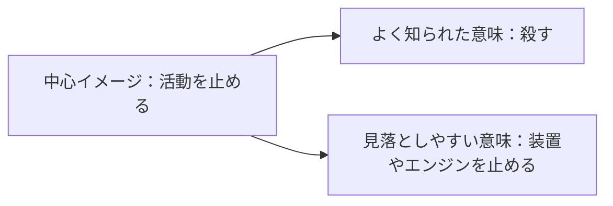

**重要語法**：`kill the engine`

<small>global_order: 405 / index: 514 / candidate_id: `ev-00514-verb-01`</small>

---

## 06. kill（verb phrase）

**発音**：/kɪl/

<small>よく知られている意味：殺す</small>

**見落としやすい意味：kill time：待ち時間をつぶす**

**例文**：We played a word game to kill time before the train arrived.

**和訳**：列車が来るまでの時間をつぶすために言葉遊びをした。

**コアイメージ**：kill には何かを終わらせるイメージがある。退屈な待ち時間をやり過ごして過ぎ去らせると考えると、kill time の意味が分かる。

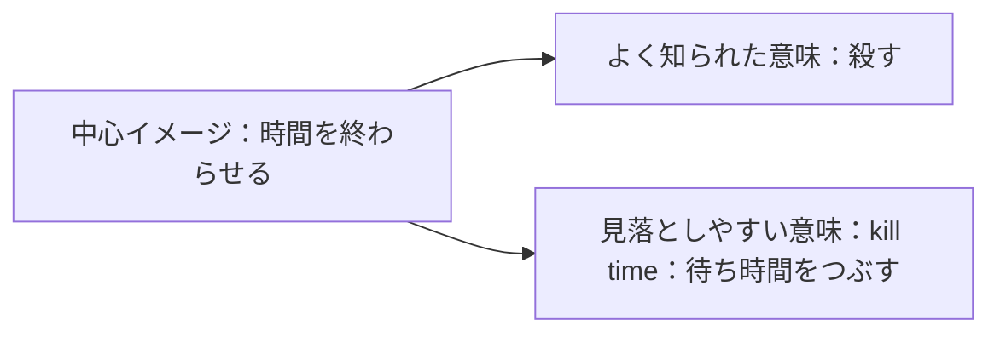

**重要語法**：`kill time（時間をつぶす）`

<small>global_order: 406 / index: 514 / candidate_id: `ev-00514-verb-phrase-01`</small>

---

## 07. travel（verb）

**発音**：/ˈtrævəl/

<small>よく知られている意味：旅行する</small>

**見落としやすい意味：光・音・信号などが伝わる、進む**

**例文**：Sound travels faster through water than through air.

**和訳**：音は空気中よりも水中のほうが速く伝わる。

**コアイメージ**：ある場所から別の場所へ進むのが中心。進む主体が人でなくても、音や光、信号が伝わることを表せる。

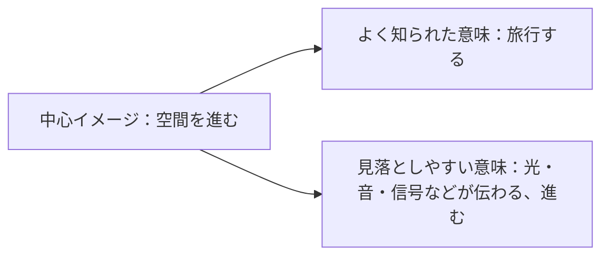

**重要語法**：`sound travels through ...`

<small>global_order: 407 / index: 516 / candidate_id: `ev-00516-verb-01`</small>

---

## 08. speak（phrasal verb）

**発音**：/spiːk/

<small>よく知られている意味：話す</small>

**見落としやすい意味：人の立場を代弁する**

**例文**：I can't speak for everyone, but I agree with the proposal.

**和訳**：全員の意見を代弁することはできないが、私はその提案に賛成だ。

**コアイメージ**：自分の声で言葉を述べるという基本義から広がる。ほかの人の代わりに声を出せば、その立場を代弁することになる。

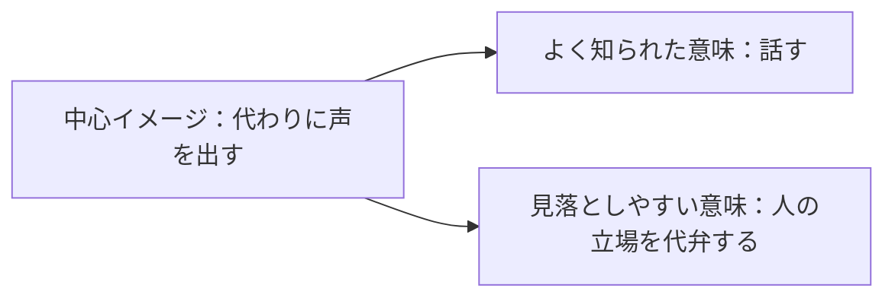

**重要語法**：`speak for someone`

<small>global_order: 408 / index: 517 / candidate_id: `ev-00517-phrasal-verb-01`</small>

---

## 09. per（prepositional phrase）

**発音**：/pɝː/

<small>よく知られている意味：〜につき・〜当たり</small>

**見落としやすい意味：～に従って、～のとおりに**

**例文**：As per our agreement, the files will be sent on Monday.

**和訳**：取り決めに従って、ファイルは月曜日に送られる。

**コアイメージ**：per には基準に沿って考える感覚がある。数量を数える基準だけでなく、決まりや取り決めを基準にする表現にもなる。

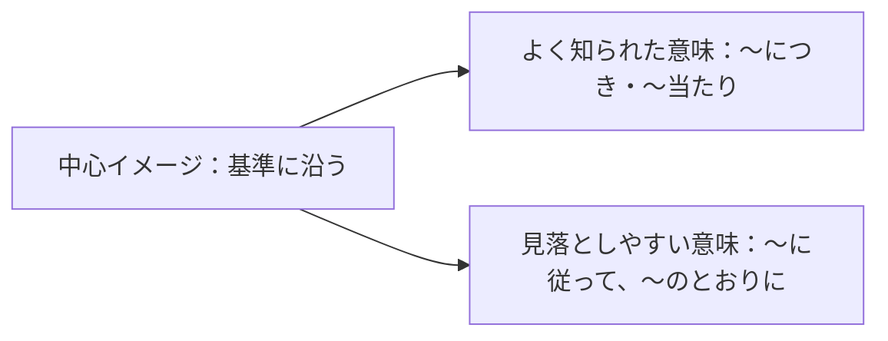

**重要語法**：`as per the agreement（取り決めどおりに）`

<small>global_order: 409 / index: 518 / candidate_id: `ev-00518-prepositional-phrase-01`</small>

---

## 10. drive（noun）

**発音**：/draɪv/

<small>よく知られている意味：運転・ドライブ</small>

**見落としやすい意味：目標達成に向けた意欲・推進力**

**例文**：Her drive to learn helped her master the difficult subject.

**和訳**：学ぼうとする彼女の強い意欲が、その難しい科目の習得を支えた。

**コアイメージ**：何かを前へ進ませる力が中心。車を進ませる力から、人を目標へ向かわせる内面的な推進力へ意味が広がる。

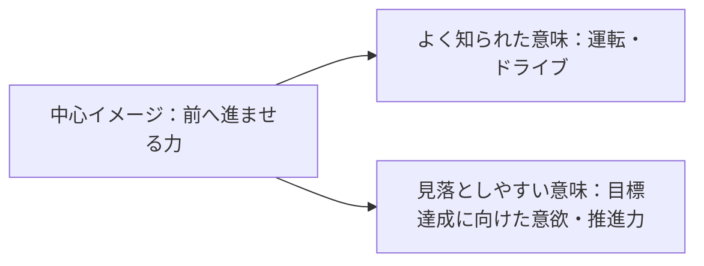

**重要語法**：`a drive to succeed`

<small>global_order: 410 / index: 519 / candidate_id: `ev-00519-noun-01`</small>

---

## 11. drive（noun）

**発音**：/draɪv/

<small>よく知られている意味：運転・ドライブ</small>

**見落としやすい意味：特定の目的を達成しようとする組織的な運動**

**例文**：The school launched a book drive for the local library.

**和訳**：学校は地元の図書館のために本を集める運動を始めた。

**コアイメージ**：目標へ向かって物事を進める力というイメージ。多くの人を動かして一つの目的を達成しようとする活動にも使う。

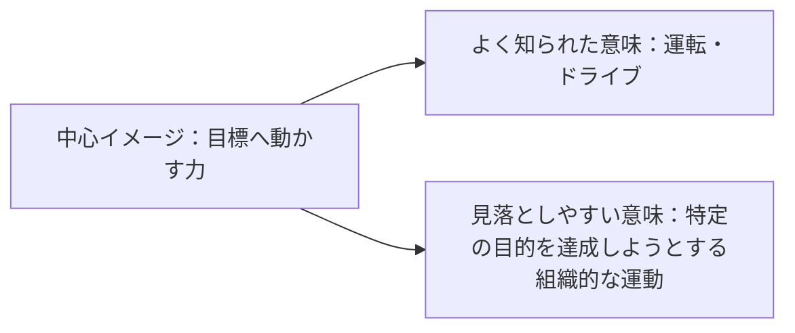

**重要語法**：`a book drive`、`a fundraising drive`

<small>global_order: 411 / index: 519 / candidate_id: `ev-00519-noun-02`</small>

---

## 12. drive（phrasal verb）

**発音**：/draɪv/

<small>よく知られている意味：運転する</small>

**見落としやすい意味：言おうとしている、意図している**

**例文**：I'm not sure what you're driving at.

**和訳**：あなたが何を言おうとしているのか、よく分からない。

**コアイメージ**：drive はある方向へ進めること。発言を特定の結論へ向けて進めるイメージから、drive at は「言いたいことを指す」になる。

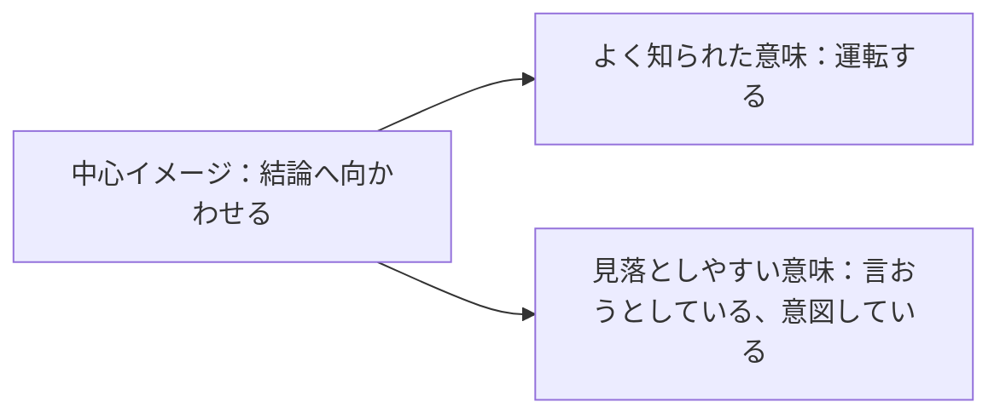

**重要語法**：`What are you driving at?`

<small>global_order: 412 / index: 519 / candidate_id: `ev-00519-phrasal-verb-01`</small>

---

## 13. drive（verb）

**発音**：/draɪv/

<small>よく知られている意味：運転する</small>

**見落としやすい意味：人をある行動や状態に追い込む**

**例文**：The constant noise drove her to leave the room.

**和訳**：絶え間ない騒音のせいで、彼女は部屋を出ざるを得なかった。

**コアイメージ**：何かを力で押し動かすイメージが中心。人の気持ちや行動を強くある方向へ動かすと、ある状態に追い込む意味になる。

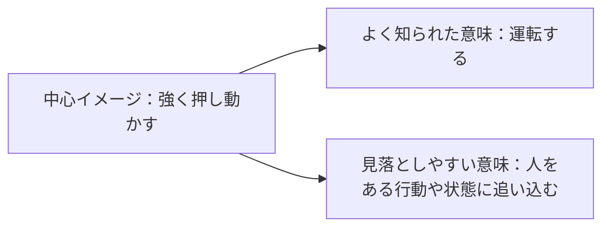

**重要語法**：`drive someone to do`、`drive someone to despair`

<small>global_order: 413 / index: 519 / candidate_id: `ev-00519-verb-01`</small>

---

## 14. staff（verb）

**発音**：/stæf/

<small>よく知られている意味：職員・スタッフ</small>

**見落としやすい意味：職場や施設に人員を配置する**

**例文**：The clinic is staffed by experienced nurses.

**和訳**：その診療所には経験豊富な看護師が配置されている。

**コアイメージ**：staff という名詞は組織を支える人員の集まり。動詞では、その人員を施設や職場に配置して運営できる状態にする。

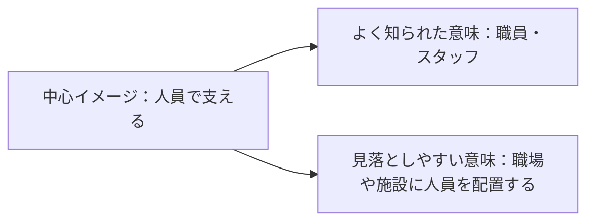

**重要語法**：`be staffed by ...（〜が配置されている）`

<small>global_order: 414 / index: 520 / candidate_id: `ev-00520-verb-01`</small>

---

## 15. land（verb）

**発音**：/lænd/

<small>よく知られている意味：陸地・着陸する</small>

**見落としやすい意味：望んでいた仕事などを手に入れる**

**例文**：She landed a job at a research laboratory.

**和訳**：彼女は研究所での仕事を手に入れた。

**コアイメージ**：空中や移動中のものが目的の場所に着くイメージ。仕事や契約を自分のものとして「獲得する」ことにも広がる。

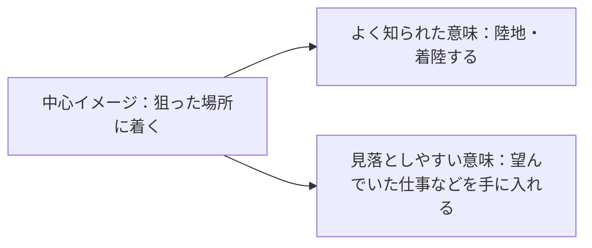

**重要語法**：`land a job`、`land a contract`

<small>global_order: 415 / index: 523 / candidate_id: `ev-00523-verb-01`</small>

---

## 16. land（verb）

**発音**：/lænd/

<small>よく知られている意味：着陸する</small>

**見落としやすい意味：人を困難な状況に陥らせる**

**例文**：A careless remark landed him in trouble.

**和訳**：軽率な発言のせいで、彼は面倒なことになった。

**コアイメージ**：land はどこかに落ち着かせること。人を好ましくない状況の中に着地させるイメージで、困った状態に陥らせる。

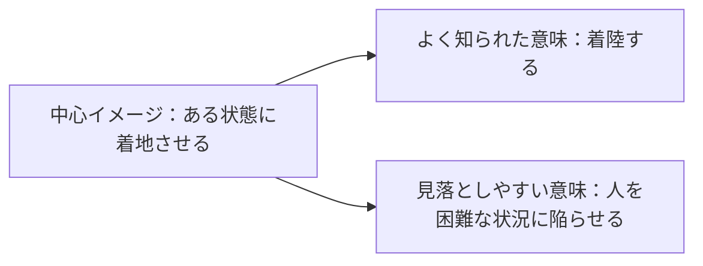

**重要語法**：`land someone in trouble`

<small>global_order: 416 / index: 523 / candidate_id: `ev-00523-verb-02`</small>

---

## 17. air（verb）

**発音**：/er/

<small>よく知られている意味：空気</small>

**見落としやすい意味：番組・意見などを放送する、放映する**

**例文**：The network will air the documentary tonight.

**和訳**：その放送局は今夜そのドキュメンタリーを放送する。

**コアイメージ**：air はもともと空気を表す。内容を電波に乗せて多くの人に届けることから、番組などを放送する動詞になる。

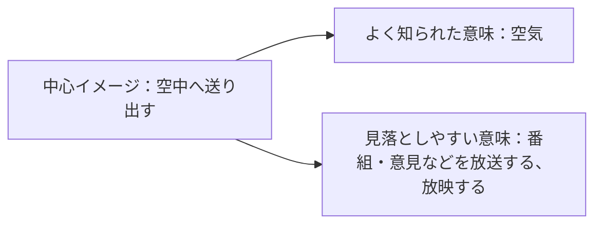

**重要語法**：`air a program`、`be aired on TV`

<small>global_order: 417 / index: 524 / candidate_id: `ev-00524-verb-01`</small>

---

## 18. air（verb）

**発音**：/er/

<small>よく知られている意味：空気</small>

**見落としやすい意味：不満や懸念を公に表明する**

**例文**：Residents aired their concerns at the public meeting.

**和訳**：住民たちは公開会議で懸念を表明した。

**コアイメージ**：閉じ込めていたものを外の空気に触れさせるイメージ。心の中にあった不満や心配を人前に出すことにも使う。

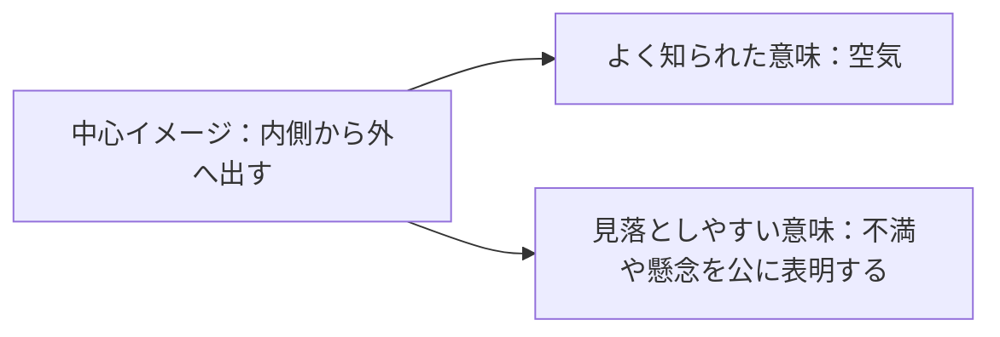

**重要語法**：`air one's concerns`、`air a complaint`

<small>global_order: 418 / index: 524 / candidate_id: `ev-00524-verb-02`</small>

---

## 19. unit（noun）

**発音**：/ˈjuːnɪt/

<small>よく知られている意味：単位</small>

**見落としやすい意味：特定の診療を行う病院の部署**

**例文**：The hospital opened a new neonatal unit.

**和訳**：その病院は新たに新生児診療部門を開設した。

**コアイメージ**：まとまって一つとして働く部分が unit の中心。病院の中で特定の患者や治療を担当する独立した部署も指す。

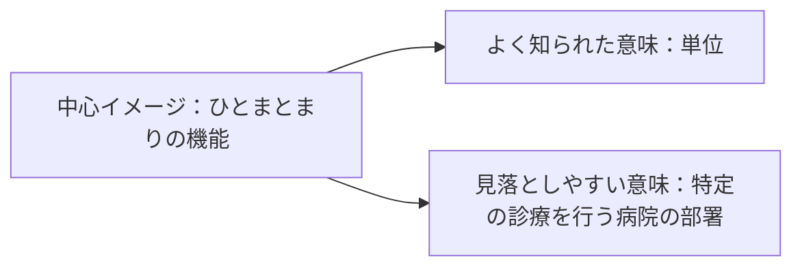

**重要語法**：`an intensive care unit（集中治療室）`

<small>global_order: 419 / index: 525 / candidate_id: `ev-00525-noun-01`</small>

---

## 20. common（noun phrase）

**発音**：/ˈkɑːmən/

<small>よく知られている意味：共通の</small>

**見落としやすい意味：共通の立場・合意できる点**

**例文**：The two groups found common ground on the need for safety.

**和訳**：その二つの団体は、安全の必要性について共通の立場を見いだした。

**コアイメージ**：複数の人に共通するものという感覚が中心。意見が違っていても、重なる考えの部分を「共通の土台」として捉える。

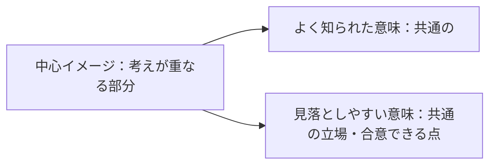

**重要語法**：`find common ground`

<small>global_order: 420 / index: 527 / candidate_id: `ev-00527-noun-phrase-01`</small>

---

## 21. executive（noun）

**発音**：/ɪɡˈzekjətɪv/

<small>よく知られている意味：経営幹部</small>

**見落としやすい意味：行政機関のうち政策・法律を実施する部門**

**例文**：The executive is responsible for carrying out the laws.

**和訳**：行政府は法律を執行する責任を負う。

**コアイメージ**：executive は物事を実行する側を指す。会社では経営を実行する幹部、国家では法律や政策を実施する行政部門を表す。

```mermaid
flowchart LR
    A["中心イメージ：決定を実行する側"]
    B["よく知られた意味：経営幹部"]
    C["見落としやすい意味：行政機関のうち政策・法律を実施する部門"]
    A --> B
    A --> C
```

**重要語法**：`the executive branch（行政部門）`

<small>global_order: 421 / index: 528 / candidate_id: `ev-00528-noun-01`</small>

---

## 22. single（phrasal verb）

**発音**：/ˈsɪŋɡəl/

<small>よく知られている意味：一つの</small>

**見落としやすい意味：集団から特定の人や物だけを選び出して特別扱いする**

**例文**：The teacher singled out Maya for her careful research.

**和訳**：先生は丁寧な調査をしたマヤを特に取り上げて褒めた。

**コアイメージ**：集団から一つだけを切り離して注目するイメージ。評価がよい場合にも悪い場合にも、特定の相手を選んで目立たせる。

```mermaid
flowchart LR
    A["中心イメージ：一つだけ取り出す"]
    B["よく知られた意味：一つの"]
    C["見落としやすい意味：集団から特定の人や物だけを選び出して特別扱いする"]
    A --> B
    A --> C
```

**重要語法**：`single someone out for ...`

<small>global_order: 422 / index: 529 / candidate_id: `ev-00529-phrasal-verb-01`</small>

---

## 23. involve（verb）

**発音**：/ɪnˈvɑːlv/

<small>よく知られている意味：関わらせる・巻き込む</small>

**見落としやすい意味：必然的に伴う、必要とする**

**例文**：The project involves collecting data every day.

**和訳**：その計画には毎日データを集める作業が必要だ。

**コアイメージ**：ある活動の内部に何かが組み込まれているイメージ。実行するために避けられない作業が含まれる場合、「必要とする」になる。

```mermaid
flowchart LR
    A["中心イメージ：活動の中に含む"]
    B["よく知られた意味：関わらせる・巻き込む"]
    C["見落としやすい意味：必然的に伴う、必要とする"]
    A --> B
    A --> C
```

**重要語法**：`involve doing（〜することを伴う）`

<small>global_order: 423 / index: 530 / candidate_id: `ev-00530-verb-01`</small>

---

## 24. complete（adjective）

**発音**：/kəmˈpliːt/

<small>よく知られている意味：完全な</small>

**見落としやすい意味：まったくの、徹底した**

**例文**：His explanation was complete nonsense.

**和訳**：彼の説明はまったくのでたらめだった。

**コアイメージ**：欠けている部分がないほど全体に行き渡るイメージ。程度を強く言うときには「まったくの」「徹底した」という強調になる。

```mermaid
flowchart LR
    A["中心イメージ：余すところがない"]
    B["よく知られた意味：完全な"]
    C["見落としやすい意味：まったくの、徹底した"]
    A --> B
    A --> C
```

**重要語法**：`complete nonsense`、`a complete stranger`

<small>global_order: 424 / index: 531 / candidate_id: `ev-00531-adjective-01`</small>

---

## 25. step（noun phrase）

**発音**：/step/

<small>よく知られている意味：一歩・段階</small>

**見落としやすい意味：目的のために措置を講じる**

**例文**：The city took steps to reduce traffic accidents.

**和訳**：市は交通事故を減らすための措置を講じた。

**コアイメージ**：目的へ進むための一歩が step の中心。実際に足を動かすのではなく、目標へ向けて具体的な行動を起こす意味になる。

```mermaid
flowchart LR
    A["中心イメージ：目標への一歩"]
    B["よく知られた意味：一歩・段階"]
    C["見落としやすい意味：目的のために措置を講じる"]
    A --> B
    A --> C
```

**重要語法**：`take steps to do（〜するために措置を講じる）`

<small>global_order: 425 / index: 534 / candidate_id: `ev-00534-noun-phrase-01`</small>

---

## 26. near（verb）

**発音**：/nɪr/

<small>よく知られている意味：近い</small>

**見落としやすい意味：時期や完成などが近づく**

**例文**：The construction project is nearing completion.

**和訳**：その建設計画は完成に近づいている。

**コアイメージ**：距離が小さいという near の感覚を、時間や進み具合にも使う。動詞では終点や完成に向かって距離が縮まっていくことを表す。

```mermaid
flowchart LR
    A["中心イメージ：終点との距離が縮む"]
    B["よく知られた意味：近い"]
    C["見落としやすい意味：時期や完成などが近づく"]
    A --> B
    A --> C
```

**重要語法**：`near completion`

<small>global_order: 426 / index: 535 / candidate_id: `ev-00535-verb-01`</small>

---

## 27. project（verb）

**発音**：/prəˈdʒekt/

<small>よく知られている意味：計画・企画</small>

**見落としやすい意味：将来の数字・結果を予測する**

**例文**：Experts project that demand will rise next year.

**和訳**：専門家は需要が来年増えると予測している。

**コアイメージ**：現在の情報から先へ線を延ばすようなイメージ。今ある傾向を未来に投影して数値や結果を予測する。

```mermaid
flowchart LR
    A["中心イメージ：現在から未来へ投影"]
    B["よく知られた意味：計画・企画"]
    C["見落としやすい意味：将来の数字・結果を予測する"]
    A --> B
    A --> C
```

**重要語法**：`be projected to do（〜すると予測される）`

<small>global_order: 427 / index: 536 / candidate_id: `ev-00536-verb-01`</small>

---

## 28. seek（verb）

**発音**：/siːk/

<small>よく知られている意味：探し求める</small>

**見落としやすい意味：～しようと努める**

**例文**：The committee seeks to improve access to education.

**和訳**：委員会は教育へのアクセスを改善しようと努めている。

**コアイメージ**：ほしいものへ向かって積極的に働きかけるイメージ。ものを探すだけでなく、実現したい行動を目指すときにも使う。

```mermaid
flowchart LR
    A["中心イメージ：目標を追い求める"]
    B["よく知られた意味：探し求める"]
    C["見落としやすい意味：～しようと努める"]
    A --> B
    A --> C
```

**重要語法**：`seek to do（〜しようと努める）`

<small>global_order: 428 / index: 537 / candidate_id: `ev-00537-verb-01`</small>

---

## 29. trade（noun）

**発音**：/treɪd/

<small>よく知られている意味：貿易・取引</small>

**見落としやすい意味：専門技術を必要とする職業**

**例文**：Carpentry is a trade that requires patience and skill.

**和訳**：大工仕事は忍耐と技術を必要とする職業だ。

**コアイメージ**：trade には技能や仕事を通じて価値をやり取りする感覚がある。とくに訓練や専門技術を必要とする職業を指せる。

```mermaid
flowchart LR
    A["中心イメージ：技能を生かす仕事"]
    B["よく知られた意味：貿易・取引"]
    C["見落としやすい意味：専門技術を必要とする職業"]
    A --> B
    A --> C
```

**重要語法**：`learn a trade（専門技能を身につける）`

<small>global_order: 429 / index: 539 / candidate_id: `ev-00539-noun-01`</small>

---

## 30. trade（verb）

**発音**：/treɪd/

<small>よく知られている意味：貿易・取引</small>

**見落としやすい意味：言葉や非難を互いに交わす**

**例文**：The two leaders traded sharp remarks during the debate.

**和訳**：その二人の指導者は討論中に厳しい言葉を応酬した。

**コアイメージ**：二者の間で何かを交換するのが中心。商品だけでなく、言葉や非難を互いに投げ合う場合にも使う。

```mermaid
flowchart LR
    A["中心イメージ：互いにやり取りする"]
    B["よく知られた意味：貿易・取引"]
    C["見落としやすい意味：言葉や非難を互いに交わす"]
    A --> B
    A --> C
```

**重要語法**：`trade insults`、`trade remarks`

<small>global_order: 430 / index: 539 / candidate_id: `ev-00539-verb-01`</small>

---

## 31. total（verb）

**発音**：/ˈtoʊtəl/

<small>よく知られている意味：合計・総額</small>

**見落としやすい意味：合計で～になる**

**例文**：The repair costs totaled eight hundred dollars.

**和訳**：修理費の合計は800ドルになった。

**コアイメージ**：個々のものを足して全体にする感覚が中心。動詞では、複数の金額や数量を合わせた結果がある値になることを表す。

```mermaid
flowchart LR
    A["中心イメージ：全体の合計になる"]
    B["よく知られた意味：合計・総額"]
    C["見落としやすい意味：合計で～になる"]
    A --> B
    A --> C
```

**重要語法**：`total $800`、`total more than ...`

<small>global_order: 431 / index: 540 / candidate_id: `ev-00540-verb-01`</small>

---

## 32. sound（adjective）

**発音**：/saʊnd/

<small>よく知られている意味：音</small>

**見落としやすい意味：健全な、信頼できる、理にかなった**

**例文**：The plan is based on sound evidence.

**和訳**：その計画は確かな証拠に基づいている。

**コアイメージ**：しっかりしていて欠陥がないという性質を表す用法。判断や根拠がぐらつかず、信頼できる場合に使う。

```mermaid
flowchart LR
    A["中心イメージ：土台がしっかりしている"]
    B["よく知られた意味：音"]
    C["見落としやすい意味：健全な、信頼できる、理にかなった"]
    A --> B
    A --> C
```

**重要語法**：`sound judgment`、`sound evidence`

<small>global_order: 432 / index: 543 / candidate_id: `ev-00543-adjective-01`</small>

---

## 33. sound（phrasal verb）

**発音**：/saʊnd/

<small>よく知られている意味：音・音を出す</small>

**見落としやすい意味：相手の考えや意向を探る**

**例文**：I sounded her out about joining the team.

**和訳**：私は彼女にチームへ加わる気があるか、それとなく探りを入れた。

**コアイメージ**：sound は反応を確かめるという用法にもつながる。相手に少し話を向けて反応を聞き、考えや意向を探る表現。

```mermaid
flowchart LR
    A["中心イメージ：反応を確かめる"]
    B["よく知られた意味：音・音を出す"]
    C["見落としやすい意味：相手の考えや意向を探る"]
    A --> B
    A --> C
```

**重要語法**：`sound someone out about ...`

<small>global_order: 433 / index: 543 / candidate_id: `ev-00543-phrasal-verb-01`</small>

---

## 34. fine（verb）

**発音**：/faɪn/

<small>よく知られている意味：よい・細かい</small>

**見落としやすい意味：罰として罰金を科す**

**例文**：The city fined the company for violating the rules.

**和訳**：市は規則違反を理由にその会社へ罰金を科した。

**コアイメージ**：fine は罰金を意味する名詞としても使われる。動詞では、その罰金を相手に支払わせるという意味になる。

```mermaid
flowchart LR
    A["中心イメージ：罰金を課す"]
    B["よく知られた意味：よい・細かい"]
    C["見落としやすい意味：罰として罰金を科す"]
    A --> B
    A --> C
```

**重要語法**：`fine someone for ...`

<small>global_order: 434 / index: 544 / candidate_id: `ev-00544-verb-01`</small>

---

## 35. shop（phrasal verb）

**発音**：/ʃɑːp/

<small>よく知られている意味：店・買い物をする</small>

**見落としやすい意味：複数の店や商品を比較して探す**

**例文**：We shopped around before choosing a new computer.

**和訳**：私たちは新しいコンピューターを選ぶ前に複数の商品を比較した。

**コアイメージ**：shop は買い物をすること。around が加わると、一か所で決めずあちこちを見て比べる動きを表す。

```mermaid
flowchart LR
    A["中心イメージ：あちこちを見て回る"]
    B["よく知られた意味：店・買い物をする"]
    C["見落としやすい意味：複数の店や商品を比較して探す"]
    A --> B
    A --> C
```

**重要語法**：`shop around for a better price`

<small>global_order: 435 / index: 545 / candidate_id: `ev-00545-phrasal-verb-01`</small>

---

## 36. fail（verb）

**発音**：/feɪl/

<small>よく知られている意味：失敗する</small>

**見落としやすい意味：人の期待に背く、見捨てる**

**例文**：I promised that I would not fail the team.

**和訳**：私はチームの期待を裏切らないと約束した。

**コアイメージ**：期待されている役割を果たせないことが fail の中心。自分の失敗だけでなく、頼りにしていた相手を失望させる意味になる。

```mermaid
flowchart LR
    A["中心イメージ：期待を満たせない"]
    B["よく知られた意味：失敗する"]
    C["見落としやすい意味：人の期待に背く、見捨てる"]
    A --> B
    A --> C
```

**重要語法**：`fail someone（人の期待を裏切る）`

<small>global_order: 436 / index: 546 / candidate_id: `ev-00546-verb-01`</small>

---

## 37. fail（verb phrase）

**発音**：/feɪl/

<small>よく知られている意味：失敗する</small>

**見落としやすい意味：必ず～する**

**例文**：She never fails to bring a notebook to class.

**和訳**：彼女は授業に必ずノートを持ってくる。

**コアイメージ**：fail to do は「〜しない・できない」。それを never で否定すると「しないことがない」、つまり必ずするという意味になる。

```mermaid
flowchart LR
    A["中心イメージ：しないことが一度もない"]
    B["よく知られた意味：失敗する"]
    C["見落としやすい意味：必ず～する"]
    A --> B
    A --> C
```

**重要語法**：`never fail to do`

<small>global_order: 437 / index: 546 / candidate_id: `ev-00546-verb-phrase-01`</small>

---

## 38. amount（phrasal verb）

**発音**：/əˈmaʊnt/

<small>よく知られている意味：量・金額</small>

**見落としやすい意味：amount to：結局〜に等しい、〜を意味する**

**例文**：Ignoring the warning amounts to accepting the risk.

**和訳**：その警告を無視することは、その危険を受け入れるのと同じだ。

**コアイメージ**：個々のものを合わせた結果がある値に達するという感覚。抽象的な行為について使うと、結局どんな意味や結果になるかを示す。

```mermaid
flowchart LR
    A["中心イメージ：最終的に行き着く"]
    B["よく知られた意味：量・金額"]
    C["見落としやすい意味：amount to：結局〜に等しい、〜を意味する"]
    A --> B
    A --> C
```

**重要語法**：`amount to ...（結局〜に等しい）`

<small>global_order: 438 / index: 547 / candidate_id: `ev-00547-phrasal-verb-01`</small>

---

## 39. range（verb）

**発音**：/reɪndʒ/

<small>よく知られている意味：範囲</small>

**見落としやすい意味：範囲が〜から〜に及ぶ**

**例文**：Ticket prices range from ten to forty dollars.

**和訳**：チケットの価格は10ドルから40ドルまで幅がある。

**コアイメージ**：始点から終点まで広がる範囲が中心。動詞では、数値や種類などがどこからどこまで及ぶかを表す。

```mermaid
flowchart LR
    A["中心イメージ：始点から終点へ広がる"]
    B["よく知られた意味：範囲"]
    C["見落としやすい意味：範囲が〜から〜に及ぶ"]
    A --> B
    A --> C
```

**重要語法**：`range from A to B`

<small>global_order: 439 / index: 548 / candidate_id: `ev-00548-verb-01`</small>

---

## 40. contain（verb）

**発音**：/kənˈteɪn/

<small>よく知られている意味：含む・入っている</small>

**見落としやすい意味：感染拡大や感情を抑え込む**

**例文**：Quick action helped contain the outbreak.

**和訳**：素早い対応が感染の拡大を抑えるのに役立った。

**コアイメージ**：ものを一定の範囲の内側に収めるというイメージ。広がろうとする感染や感情を外へ出さないことから「抑え込む」になる。

```mermaid
flowchart LR
    A["中心イメージ：範囲の内にとどめる"]
    B["よく知られた意味：含む・入っている"]
    C["見落としやすい意味：感染拡大や感情を抑え込む"]
    A --> B
    A --> C
```

**重要語法**：`contain an outbreak`、`contain one's anger`

<small>global_order: 440 / index: 554 / candidate_id: `ev-00554-verb-01`</small>

---

## 41. discuss（usage）

**発音**：/dɪˈskʌs/

<small>よく知られている意味：議論する</small>

**見落としやすい意味：discussは通常aboutなしで目的語を取る**

**例文**：We discussed the problem after class.

**和訳**：私たちは授業後にその問題について話し合った。

**コアイメージ**：discuss は話し合う対象をそのまま目的語に取る動詞。about を後ろにつけなくても、何について議論するかを直接示せる。

```mermaid
flowchart LR
    A["中心イメージ：対象を直接話し合う"]
    B["よく知られた意味：議論する"]
    C["見落としやすい意味：discussは通常aboutなしで目的語を取る"]
    A --> B
    A --> C
```

**重要語法**：`discuss the issue（通常 discuss about the issue としない）`

<small>global_order: 441 / index: 557 / candidate_id: `ev-00557-usage-01`</small>

---

## 42. letter（idiom）

**発音**：/ˈletər/

<small>よく知られている意味：手紙・文字</small>

**見落としやすい意味：指示や規則を一字一句そのとおりに**

**例文**：She followed the safety instructions to the letter.

**和訳**：彼女は安全上の指示を一字一句そのとおりに守った。

**コアイメージ**：letter は一つ一つの文字も指す。書かれた指示の文字どおりという考えから、少しも変えず厳密に従う意味になる。

```mermaid
flowchart LR
    A["中心イメージ：書かれた文字どおり"]
    B["よく知られた意味：手紙・文字"]
    C["見落としやすい意味：指示や規則を一字一句そのとおりに"]
    A --> B
    A --> C
```

**重要語法**：`to the letter`、`follow ... to the letter`

<small>global_order: 442 / index: 558 / candidate_id: `ev-00558-idiom-01`</small>

---

## 43. hear（verb）

**発音**：/hɪr/

<small>よく知られている意味：聞く</small>

**見落としやすい意味：訴訟や事件を審理する**

**例文**：The court will hear the case next month.

**和訳**：裁判所は来月その事件を審理する。

**コアイメージ**：hear は耳を傾けて話を受け取ること。裁判所が当事者の主張や証言を聞き、事件を扱うことから「審理する」になる。

```mermaid
flowchart LR
    A["中心イメージ：話を聞いて判断する"]
    B["よく知られた意味：聞く"]
    C["見落としやすい意味：訴訟や事件を審理する"]
    A --> B
    A --> C
```

**重要語法**：`hear a case`

<small>global_order: 443 / index: 560 / candidate_id: `ev-00560-verb-01`</small>

---

## 44. space（phrasal verb）

**発音**：/speɪs/

<small>よく知られている意味：空間</small>

**見落としやすい意味：ぼんやりして注意がそれる**

**例文**：I spaced out for a minute during the lecture.

**和訳**：私は講義中に少しの間ぼんやりしていた。

**コアイメージ**：space out は意識が目の前のことから離れてしまう感覚。気持ちがその場の話題から外れ、注意がそれることを表す。

```mermaid
flowchart LR
    A["中心イメージ：意識がその場から離れる"]
    B["よく知られた意味：空間"]
    C["見落としやすい意味：ぼんやりして注意がそれる"]
    A --> B
    A --> C
```

**重要語法**：`space out during ...`

<small>global_order: 444 / index: 562 / candidate_id: `ev-00562-phrasal-verb-01`</small>

---

## 45. choose（verb）

**発音**：/tʃuːz/

<small>よく知られている意味：選ぶ</small>

**見落としやすい意味：自ら選んで～する**

**例文**：He chose to tell the truth, even though it was difficult.

**和訳**：難しいことだったが、彼は自分の意思で本当のことを話すと決めた。

**コアイメージ**：いくつかの選択肢から一つを選ぶイメージ。選ぶ対象が行動になると、自分の意思でその行動をすることを意味する。

```mermaid
flowchart LR
    A["中心イメージ：行動を自分で選ぶ"]
    B["よく知られた意味：選ぶ"]
    C["見落としやすい意味：自ら選んで～する"]
    A --> B
    A --> C
```

**重要語法**：`choose to do`

<small>global_order: 445 / index: 563 / candidate_id: `ev-00563-verb-01`</small>

---

## 46. reduce（verb phrase）

**発音**：/rɪˈduːs/

<small>よく知られている意味：減らす</small>

**見落としやすい意味：人を～の状態に追い込む**

**例文**：The moving speech reduced several listeners to tears.

**和訳**：その感動的なスピーチを聞いて、何人かが涙を流した。

**コアイメージ**：reduce は状態や程度を変化させる語でもある。人がある状態になるほど強い影響を与える場合、「〜の状態に追い込む」となる。

```mermaid
flowchart LR
    A["中心イメージ：ある状態へ変えてしまう"]
    B["よく知られた意味：減らす"]
    C["見落としやすい意味：人を～の状態に追い込む"]
    A --> B
    A --> C
```

**重要語法**：`reduce someone to tears`

<small>global_order: 446 / index: 565 / candidate_id: `ev-00565-verb-phrase-01`</small>

---

## 47. understand（verb）

**発音**：/ˌʌndərˈstænd/

<small>よく知られている意味：理解する</small>

**見落としやすい意味：～だと聞いている、認識している**

**例文**：I understand that the meeting has been postponed.

**和訳**：会議は延期されたと聞いています。

**コアイメージ**：情報を受け取って頭の中で把握していることが中心。自分で理解した場合だけでなく、伝え聞いてそう認識している場合にも使う。

```mermaid
flowchart LR
    A["中心イメージ：情報を把握している"]
    B["よく知られた意味：理解する"]
    C["見落としやすい意味：～だと聞いている、認識している"]
    A --> B
    A --> C
```

**重要語法**：`I understand that ...（〜と承知している）`

<small>global_order: 447 / index: 566 / candidate_id: `ev-00566-verb-01`</small>

---

## 48. game（adjective）

**発音**：/ɡeɪm/

<small>よく知られている意味：ゲーム・試合</small>

**見落としやすい意味：乗り気である、やってみようと思う**

**例文**：If you're game, we can try a different approach.

**和訳**：やってみる気があるなら、別の方法を試せるよ。

**コアイメージ**：ここでの game は形容詞で、挑戦や活動への意欲を表す。「参加する気がある」「乗り気だ」という意味で使われる。

```mermaid
flowchart LR
    A["中心イメージ：挑戦に前向き"]
    B["よく知られた意味：ゲーム・試合"]
    C["見落としやすい意味：乗り気である、やってみようと思う"]
    A --> B
    A --> C
```

**重要語法**：`be game for ...`、`be game to do`

<small>global_order: 448 / index: 567 / candidate_id: `ev-00567-adjective-01`</small>

---

## 49. game（noun）

**発音**：/ɡeɪm/

<small>よく知られている意味：ゲーム・試合</small>

**見落としやすい意味：狩猟の対象となる動物**

**例文**：The reserve protects large game such as deer.

**和訳**：その保護区はシカなどの大型の狩猟対象動物を保護している。

**コアイメージ**：game は競技の対象を表す語としても使われてきた。狩猟の文脈では、獲物として対象にされる野生動物を指す。

```mermaid
flowchart LR
    A["中心イメージ：狙う対象"]
    B["よく知られた意味：ゲーム・試合"]
    C["見落としやすい意味：狩猟の対象となる動物"]
    A --> B
    A --> C
```

**重要語法**：`big game（大型の狩猟対象動物）`

<small>global_order: 449 / index: 567 / candidate_id: `ev-00567-noun-01`</small>

---

## 50. break（phrasal verb）

**発音**：/breɪk/

<small>よく知られている意味：壊す</small>

**見落としやすい意味：組織や慣行と決別する**

**例文**：The school decided to break with tradition and hold the event outdoors.

**和訳**：学校は慣例と決別し、その行事を屋外で開催することにした。

**コアイメージ**：つながっていたものを切り離すイメージ。長く続いた慣習や組織との結びつきを断つことから「決別する」になる。

```mermaid
flowchart LR
    A["中心イメージ：つながりを断つ"]
    B["よく知られた意味：壊す"]
    C["見落としやすい意味：組織や慣行と決別する"]
    A --> B
    A --> C
```

**重要語法**：`break with tradition`

<small>global_order: 450 / index: 569 / candidate_id: `ev-00569-phrasal-verb-01`</small>

---

## 51. true（adjective phrase）

**発音**：/truː/

<small>よく知られている意味：本当の</small>

**見落としやすい意味：～についても当てはまる**

**例文**：This is also true of younger children.

**和訳**：このことは、より年少の子どもにも当てはまる。

**コアイメージ**：true はある説明が事実に一致していること。of を使うと、ある人や対象についてその説明が正しく当てはまることを示す。

```mermaid
flowchart LR
    A["中心イメージ：説明が事実に合う"]
    B["よく知られた意味：本当の"]
    C["見落としやすい意味：～についても当てはまる"]
    A --> B
    A --> C
```

**重要語法**：`be true of ...（〜にも当てはまる）`

<small>global_order: 451 / index: 571 / candidate_id: `ev-00571-adjective-phrase-01`</small>

---

## 52. enjoy（verb）

**発音**：/ɪnˈdʒɔɪ/

<small>よく知られている意味：楽しむ</small>

**見落としやすい意味：権利や恩恵を享受する**

**例文**：All citizens should enjoy equal protection under the law.

**和訳**：すべての市民は法律の下で平等な保護を享受すべきだ。

**コアイメージ**：よいものを自分のものとして受け取る感覚が中心。楽しさだけでなく、権利や利益を実際に受けられる場合にも使う。

```mermaid
flowchart LR
    A["中心イメージ：利益を受け取る"]
    B["よく知られた意味：楽しむ"]
    C["見落としやすい意味：権利や恩恵を享受する"]
    A --> B
    A --> C
```

**重要語法**：`enjoy legal protection`、`enjoy a right`

<small>global_order: 452 / index: 573 / candidate_id: `ev-00573-verb-01`</small>

---

## 53. detail（verb）

**発音**：/dɪˈteɪl/

<small>よく知られている意味：詳細</small>

**見落としやすい意味：詳細を述べる、列挙する**

**例文**：The report details the causes of the failure.

**和訳**：その報告書は失敗の原因を詳しく述べている。

**コアイメージ**：detail は細かい部分という名詞。動詞では、細かな点を一つずつ示して具体的に説明することを表す。

```mermaid
flowchart LR
    A["中心イメージ：細部まで示す"]
    B["よく知られた意味：詳細"]
    C["見落としやすい意味：詳細を述べる、列挙する"]
    A --> B
    A --> C
```

**重要語法**：`detail the findings`

<small>global_order: 453 / index: 574 / candidate_id: `ev-00574-verb-01`</small>

---

## 54. authority（noun）

**発音**：/əˈθɔːrəti/

<small>よく知られている意味：権威・権限</small>

**見落としやすい意味：ある分野に詳しい権威者・専門家**

**例文**：She is a leading authority on ancient history.

**和訳**：彼女は古代史の第一人者だ。

**コアイメージ**：authority は信頼して従える力や根拠を表す。知識が十分で、ある分野について頼りにされる人にも使う。

```mermaid
flowchart LR
    A["中心イメージ：信頼される専門性"]
    B["よく知られた意味：権威・権限"]
    C["見落としやすい意味：ある分野に詳しい権威者・専門家"]
    A --> B
    A --> C
```

**重要語法**：`an authority on ...`

<small>global_order: 454 / index: 582 / candidate_id: `ev-00582-noun-01`</small>

---

## 55. authority（noun）

**発音**：/əˈθɔːrəti/

<small>よく知られている意味：権威・権限</small>

**見落としやすい意味：行政当局・権限を持つ機関**

**例文**：Local authorities issued a flood warning.

**和訳**：地元当局は洪水警報を発表した。

**コアイメージ**：authority は物事を決めたり動かしたりする権限。権限を持つ役所や行政組織そのものを指す場合がある。

```mermaid
flowchart LR
    A["中心イメージ：公的な権限を持つ"]
    B["よく知られた意味：権威・権限"]
    C["見落としやすい意味：行政当局・権限を持つ機関"]
    A --> B
    A --> C
```

**重要語法**：`the local authorities`

<small>global_order: 455 / index: 582 / candidate_id: `ev-00582-noun-02`</small>

---

## 56. access（verb）

**発音**：/ˈækses/

<small>よく知られている意味：利用・接近</small>

**見落としやすい意味：情報・施設などにアクセスし利用する**

**例文**：Students can access the database from home.

**和訳**：生徒は自宅からそのデータベースにアクセスして利用できる。

**コアイメージ**：access は何かに到達できること。動詞では、情報や施設に実際につながり、利用する行為を表す。

```mermaid
flowchart LR
    A["中心イメージ：必要な場所へ到達する"]
    B["よく知られた意味：利用・接近"]
    C["見落としやすい意味：情報・施設などにアクセスし利用する"]
    A --> B
    A --> C
```

**重要語法**：`access the database（通常 access to the database としない）`

<small>global_order: 456 / index: 586 / candidate_id: `ev-00586-verb-01`</small>

---

## 57. final（noun）

**発音**：/ˈfaɪnəl/

<small>よく知られている意味：最後の</small>

**見落としやすい意味：決勝戦、決勝試合**

**例文**：Our team reached the final for the first time.

**和訳**：私たちのチームは初めて決勝戦に進んだ。

**コアイメージ**：final は一連の過程の最後にあるもの。競技の進行で最後に行われ、優勝を決める試合を名詞で the final と呼ぶ。

```mermaid
flowchart LR
    A["中心イメージ：最後に残る試合"]
    B["よく知られた意味：最後の"]
    C["見落としやすい意味：決勝戦、決勝試合"]
    A --> B
    A --> C
```

**重要語法**：`reach the final`、`the finals（大会による用法差あり）`

<small>global_order: 457 / index: 588 / candidate_id: `ev-00588-noun-01`</small>

---

## 58. particular（adjective）

**発音**：/pərˈtɪkjələr/

<small>よく知られている意味：特定の</small>

**見落としやすい意味：好みや細部にうるさい、選り好みする**

**例文**：He's very particular about how his desk is arranged.

**和訳**：彼は机の上の配置にとてもこだわる。

**コアイメージ**：細かな点を特別に区別して重視するイメージ。何でもよいとは思わず、好みや条件を厳しく選ぶ性格を表せる。

```mermaid
flowchart LR
    A["中心イメージ：細部を重視する"]
    B["よく知られた意味：特定の"]
    C["見落としやすい意味：好みや細部にうるさい、選り好みする"]
    A --> B
    A --> C
```

**重要語法**：`be particular about ...`

<small>global_order: 458 / index: 591 / candidate_id: `ev-00591-adjective-01`</small>

---

## 59. difference（idiom）

**発音**：/ˈdɪfrəns/

<small>よく知られている意味：違い</small>

**見落としやすい意味：重要な違い・影響をもたらす**

**例文**：A small change can make a big difference.

**和訳**：小さな変更でも大きな効果をもたらすことがある。

**コアイメージ**：difference は二つの状態の間に生まれる違い。何かをした結果として状況が変わるため、「重要な影響を与える」という意味になる。

```mermaid
flowchart LR
    A["中心イメージ：結果に違いが生まれる"]
    B["よく知られた意味：違い"]
    C["見落としやすい意味：重要な違い・影響をもたらす"]
    A --> B
    A --> C
```

**重要語法**：`make a difference to ...`

<small>global_order: 459 / index: 592 / candidate_id: `ev-00592-idiom-01`</small>

---

## 60. behind（adverb）

**発音**：/bɪˈhaɪnd/

<small>よく知られている意味：後ろに</small>

**見落としやすい意味：支払いや作業が予定より遅れている**

**例文**：We're behind on our homework this week.

**和訳**：今週は宿題の進み具合が予定より遅れている。

**コアイメージ**：基準となる位置より後ろにいる感覚を時間や進捗に広げる。予定のペースに追いついていない状態を表す。

```mermaid
flowchart LR
    A["中心イメージ：予定より後ろ"]
    B["よく知られた意味：後ろに"]
    C["見落としやすい意味：支払いや作業が予定より遅れている"]
    A --> B
    A --> C
```

**重要語法**：`be behind on work`、`fall behind`

<small>global_order: 460 / index: 593 / candidate_id: `ev-00593-adverb-01`</small>

---

## 61. behind（preposition）

**発音**：/bɪˈhaɪnd/

<small>よく知られている意味：後ろに</small>

**見落としやすい意味：ある行為や変化を引き起こした原因・原動力である**

**例文**：A lack of funding was behind the delay.

**和訳**：資金不足がその遅れの原因だった。

**コアイメージ**：何かの後ろにあって動きを支えるイメージ。表面に見える出来事の背後にある原因や力を示すときに使う。

```mermaid
flowchart LR
    A["中心イメージ：出来事の背後で動かす"]
    B["よく知られた意味：後ろに"]
    C["見落としやすい意味：ある行為や変化を引き起こした原因・原動力である"]
    A --> B
    A --> C
```

**重要語法**：`be behind a decision`

<small>global_order: 461 / index: 593 / candidate_id: `ev-00593-preposition-01`</small>

---

## 62. decide（phrasal verb）

**発音**：/dɪˈsaɪd/

<small>よく知られている意味：決める</small>

**見落としやすい意味：～をしないことに決める**

**例文**：We decided against taking the early train.

**和訳**：私たちは早朝の列車には乗らないことに決めた。

**コアイメージ**：decide は選択を確定すること。against を続けると、その選択肢を採らない側に決める意味になる。

```mermaid
flowchart LR
    A["中心イメージ：選択肢を退ける"]
    B["よく知られた意味：決める"]
    C["見落としやすい意味：～をしないことに決める"]
    A --> B
    A --> C
```

**重要語法**：`decide against doing`

<small>global_order: 462 / index: 594 / candidate_id: `ev-00594-phrasal-verb-01`</small>

---

## 63. significant（adjective）

**発音**：/sɪɡˈnɪfɪkənt/

<small>よく知られている意味：重要な</small>

**見落としやすい意味：統計上の偶然では説明しにくい、有意な**

**例文**：The researchers found a statistically significant difference.

**和訳**：研究者たちは統計的に有意な差を発見した。

**コアイメージ**：significant は無視できない意味があること。統計では、観測された差が偶然だけで生じたとは考えにくい場合に使われる。

```mermaid
flowchart LR
    A["中心イメージ：無視できない差"]
    B["よく知られた意味：重要な"]
    C["見落としやすい意味：統計上の偶然では説明しにくい、有意な"]
    A --> B
    A --> C
```

**重要語法**：`statistically significant（統計的に有意な）`

<small>global_order: 463 / index: 595 / candidate_id: `ev-00595-adjective-01`</small>

---

## 64. represent（verb）

**発音**：/ˌreprɪˈzent/

<small>よく知られている意味：代表する</small>

**見落としやすい意味：数値・割合などに相当する、表す**

**例文**：Online orders represent twenty percent of total sales.

**和訳**：オンライン注文は売上全体の20パーセントを占める。

**コアイメージ**：あるものが別のものを表すというイメージ。数字や割合を示す文脈では、全体の中のどれだけに当たるかを表せる。

```mermaid
flowchart LR
    A["中心イメージ：全体の一部分を表す"]
    B["よく知られた意味：代表する"]
    C["見落としやすい意味：数値・割合などに相当する、表す"]
    A --> B
    A --> C
```

**重要語法**：`represent 20% of ...`

<small>global_order: 464 / index: 600 / candidate_id: `ev-00600-verb-01`</small>

---

## 65. propose（verb）

**発音**：/prəˈpoʊz/

<small>よく知られている意味：提案する</small>

**見落としやすい意味：～するつもりである（提案する、とは異なる）**

**例文**：She proposes to open a small café next year.

**和訳**：彼女は来年、小さなカフェを開くつもりだ。

**コアイメージ**：propose には考えや計画を前に出す感覚がある。特に propose to do は、文脈によって人に提案するのではなく自分の予定や意図を述べる。

```mermaid
flowchart LR
    A["中心イメージ：計画を心に描く"]
    B["よく知られた意味：提案する"]
    C["見落としやすい意味：～するつもりである（提案する、とは異なる）"]
    A --> B
    A --> C
```

**重要語法**：`propose to do（〜するつもりだ）`

<small>global_order: 465 / index: 603 / candidate_id: `ev-00603-verb-01`</small>

---

## 66. budget（verb）

**発音**：/ˈbʌdʒɪt/

<small>よく知られている意味：予算</small>

**見落としやすい意味：予算を計画・割り当てる**

**例文**：We budgeted for higher electricity costs this winter.

**和訳**：私たちはこの冬の電気代の増加を見込んで予算を組んだ。

**コアイメージ**：使えるお金の枠を決めるのが budget の中心。動詞では、必要な費用を予想し、使う金額をあらかじめ計画する。

```mermaid
flowchart LR
    A["中心イメージ：お金の枠を決める"]
    B["よく知られた意味：予算"]
    C["見落としやすい意味：予算を計画・割り当てる"]
    A --> B
    A --> C
```

**重要語法**：`budget for ...（〜の費用を見込む）`

<small>global_order: 466 / index: 609 / candidate_id: `ev-00609-verb-01`</small>

---

## 67. certain（adjective）

**発音**：/ˈsɝːtən/

<small>よく知られている意味：確かな</small>

**見落としやすい意味：名前を伏せたある特定の**

**例文**：A certain student left an anonymous note on my desk.

**和訳**：ある生徒が私の机に匿名のメモを残した。

**コアイメージ**：ある一つの対象が定まっているという感覚が中心。話し手には特定の相手が念頭にあるが、名前を明かさない言い方になる。

```mermaid
flowchart LR
    A["中心イメージ：特定されているが名前は伏せる"]
    B["よく知られた意味：確かな"]
    C["見落としやすい意味：名前を伏せたある特定の"]
    A --> B
    A --> C
```

**重要語法**：`a certain person`

<small>global_order: 467 / index: 610 / candidate_id: `ev-00610-adjective-01`</small>

---

## 68. character（idiom）

**発音**：/ˈkærəktər/

<small>よく知られている意味：性格・文字</small>

**見落としやすい意味：その人らしくない、いつもと違う**

**例文**：It was out of character for her to arrive late.

**和訳**：彼女が遅れて来るのは、普段の彼女らしくなかった。

**コアイメージ**：character はその人を特徴づける性格や振る舞い。そこから外れているなら、普段の姿とは違うという意味になる。

```mermaid
flowchart LR
    A["中心イメージ：普段の性格から外れる"]
    B["よく知られた意味：性格・文字"]
    C["見落としやすい意味：その人らしくない、いつもと違う"]
    A --> B
    A --> C
```

**重要語法**：`out of character for someone`

<small>global_order: 468 / index: 612 / candidate_id: `ev-00612-idiom-01`</small>

---

## 69. die（phrasal verb）

**発音**：/daɪ/

<small>よく知られている意味：死ぬ</small>

**見落としやすい意味：勢いや音・風などがおさまる**

**例文**：The wind finally died down before dawn.

**和訳**：夜明け前に、ようやく風が弱まった。

**コアイメージ**：die には活動や勢いが消えていくイメージがある。down と組み合わさると、音や風や興奮などの勢いが次第に弱まる。

```mermaid
flowchart LR
    A["中心イメージ：勢いが消えていく"]
    B["よく知られた意味：死ぬ"]
    C["見落としやすい意味：勢いや音・風などがおさまる"]
    A --> B
    A --> C
```

**重要語法**：`die down（風`、`騒ぎなどがおさまる）`

<small>global_order: 469 / index: 616 / candidate_id: `ev-00616-phrasal-verb-01`</small>

---

## 70. material（adjective）

**発音**：/məˈtɪriəl/

<small>よく知られている意味：材料・物質</small>

**見落としやすい意味：重要な、判断に実質的な影響をもつ**

**例文**：The missing figures could have a material effect on the decision.

**和訳**：欠けている数値は、その判断に実質的に重要な影響を及ぼしかねない。

**コアイメージ**：material は実体のある重要な要素という感覚と結びつく。判断を左右するほど実質的な影響があることを表す形容詞になる。

```mermaid
flowchart LR
    A["中心イメージ：判断を左右するほど実質的"]
    B["よく知られた意味：材料・物質"]
    C["見落としやすい意味：重要な、判断に実質的な影響をもつ"]
    A --> B
    A --> C
```

**重要語法**：`a material difference`、`material evidence`

<small>global_order: 470 / index: 618 / candidate_id: `ev-00618-adjective-01`</small>

---

## 71. condition（verb）

**発音**：/kənˈdɪʃən/

<small>よく知られている意味：状態・条件</small>

**見落としやすい意味：特定の反応や行動をするよう習慣づける**

**例文**：The experiment conditioned the dog to respond to a bell.

**和訳**：その実験では、ベルに反応するよう犬を条件づけた。

**コアイメージ**：ある条件に合わせて反応が起きるようにするのが中心。繰り返し学習によって特定の刺激に特定の行動を結びつける意味になる。

```mermaid
flowchart LR
    A["中心イメージ：反応の条件を作る"]
    B["よく知られた意味：状態・条件"]
    C["見落としやすい意味：特定の反応や行動をするよう習慣づける"]
    A --> B
    A --> C
```

**重要語法**：`condition someone to do`

<small>global_order: 471 / index: 619 / candidate_id: `ev-00619-verb-01`</small>

---

## 72. condition（verb）

**発音**：/kənˈdɪʃən/

<small>よく知られている意味：状態・条件</small>

**見落としやすい意味：結果や状況を左右する、条件づける**

**例文**：His reaction was conditioned by his past experiences.

**和訳**：彼の反応は過去の経験によって左右されていた。

**コアイメージ**：出来事が起こるための条件を考えるイメージ。その条件が結果を形づくるとき、状況や反応を「左右する」という意味になる。

```mermaid
flowchart LR
    A["中心イメージ：結果を決める条件"]
    B["よく知られた意味：状態・条件"]
    C["見落としやすい意味：結果や状況を左右する、条件づける"]
    A --> B
    A --> C
```

**重要語法**：`be conditioned by ...`

<small>global_order: 472 / index: 619 / candidate_id: `ev-00619-verb-02`</small>

---

## 73. watch（phrasal verb）

**発音**：/wɑːtʃ/

<small>よく知られている意味：見る</small>

**見落としやすい意味：危険や問題に気をつける**

**例文**：Watch out for bicycles at this crossing.

**和訳**：この横断場所では自転車に気をつけて。

**コアイメージ**：watch は注意して見守ること。out が加わると周囲へ目を向け、危険なものを見逃さないという注意喚起になる。

```mermaid
flowchart LR
    A["中心イメージ：周囲へ注意を向ける"]
    B["よく知られた意味：見る"]
    C["見落としやすい意味：危険や問題に気をつける"]
    A --> B
    A --> C
```

**重要語法**：`watch out for ...`

<small>global_order: 473 / index: 624 / candidate_id: `ev-00624-phrasal-verb-01`</small>

---

## 74. mention（phrase）

**発音**：/ˈmenʃən/

<small>よく知られている意味：言及する</small>

**見落としやすい意味：～は言うまでもなく**

**例文**：The route is long, not to mention expensive.

**和訳**：その道順は長いし、費用が高いことは言うまでもない。

**コアイメージ**：mention は話題として挙げること。not to mention は「わざわざ挙げるまでもなく」と付け加え、さらに強い理由を示す。

```mermaid
flowchart LR
    A["中心イメージ：言うまでもない追加点"]
    B["よく知られた意味：言及する"]
    C["見落としやすい意味：～は言うまでもなく"]
    A --> B
    A --> C
```

**重要語法**：`not to mention ...`

<small>global_order: 474 / index: 625 / candidate_id: `ev-00625-phrase-01`</small>

---

## 75. quality（noun）

**発音**：/ˈkwɑːləti/

<small>よく知られている意味：品質</small>

**見落としやすい意味：性格上の特質・資質**

**例文**：Patience is an important quality in a teacher.

**和訳**：忍耐力は教師にとって重要な資質だ。

**コアイメージ**：quality はものや人が備えている性質を表す。製品の良し悪しだけでなく、人の能力や性格上の長所にも使う。

```mermaid
flowchart LR
    A["中心イメージ：そのものが備える性質"]
    B["よく知られた意味：品質"]
    C["見落としやすい意味：性格上の特質・資質"]
    A --> B
    A --> C
```

**重要語法**：`leadership qualities`

<small>global_order: 475 / index: 626 / candidate_id: `ev-00626-noun-01`</small>

---

## 76. recognize（verb）

**発音**：/ˈrekəɡnaɪz/

<small>よく知られている意味：認識する</small>

**見落としやすい意味：国家や権利を正式に承認する**

**例文**：Several countries recognized the new government.

**和訳**：複数の国がその新政府を正式に承認した。

**コアイメージ**：recognized は何かの存在や地位を認めること。国家や政府などの正当性を公的に認めるとき、「正式に承認する」になる。

```mermaid
flowchart LR
    A["中心イメージ：地位を正式に認める"]
    B["よく知られた意味：認識する"]
    C["見落としやすい意味：国家や権利を正式に承認する"]
    A --> B
    A --> C
```

**重要語法**：`recognize a government`

<small>global_order: 476 / index: 629 / candidate_id: `ev-00629-verb-01`</small>

---

## 77. approach（verb）

**発音**：/əˈproʊtʃ/

<small>よく知られている意味：近づく</small>

**見落としやすい意味：話を持ちかける、交渉を打診する**

**例文**：She approached the principal about starting a debate club.

**和訳**：彼女は討論部の設立について校長に相談を持ちかけた。

**コアイメージ**：approach は相手との距離を縮めること。目的を持って話しかける場合は、相談や提案を持ちかけることを表す。

```mermaid
flowchart LR
    A["中心イメージ：目的を持って近づく"]
    B["よく知られた意味：近づく"]
    C["見落としやすい意味：話を持ちかける、交渉を打診する"]
    A --> B
    A --> C
```

**重要語法**：`approach someone about ...`

<small>global_order: 477 / index: 631 / candidate_id: `ev-00631-verb-01`</small>

---

## 78. anything（idiom）

**発音**：/ˈeniθɪŋ/

<small>よく知られている意味：何でも</small>

**見落としやすい意味：決して～ではない**

**例文**：The task was anything but easy.

**和訳**：その仕事は決して簡単ではなかった。

**コアイメージ**：anything but は「〜以外なら何でも」という強い除外の表現。形容詞などの前では、その性質とは正反対だと強調する。

```mermaid
flowchart LR
    A["中心イメージ：ある性質を強く除外"]
    B["よく知られた意味：何でも"]
    C["見落としやすい意味：決して～ではない"]
    A --> B
    A --> C
```

**重要語法**：`anything but easy`、`anything but ordinary`

<small>global_order: 478 / index: 632 / candidate_id: `ev-00632-idiom-01`</small>

---

## 79. field（verb）

**発音**：/fiːld/

<small>よく知られている意味：野原・分野</small>

**見落としやすい意味：質問などに対応する、受けさばく**

**例文**：The scientist fielded questions from reporters.

**和訳**：その科学者は記者たちからの質問に次々と対応した。

**コアイメージ**：field には現場で受け止めて処理する感覚がある。飛んでくる質問や要求を受け、適切にさばく動詞として使う。

```mermaid
flowchart LR
    A["中心イメージ：受け止めてさばく"]
    B["よく知られた意味：野原・分野"]
    C["見落としやすい意味：質問などに対応する、受けさばく"]
    A --> B
    A --> C
```

**重要語法**：`field questions`

<small>global_order: 479 / index: 634 / candidate_id: `ev-00634-verb-01`</small>

---

## 80. quite（adverb）

**発音**：/kwaɪt/

<small>よく知られている意味：かなり</small>

**見落としやすい意味：程度を表すとき『かなり』にも『完全に』にもなる**

**例文**：The plan is quite impossible without more time.

**和訳**：もっと時間がなければ、その計画はまったく実現不可能だ。

**コアイメージ**：quite は程度を示すが、修飾する語や地域によって強さが変わる。quite good なら「かなり良い」、quite impossible なら「まったく不可能」という解釈になりやすい。

```mermaid
flowchart LR
    A["中心イメージ：程度を強める・満たす"]
    B["よく知られた意味：かなり"]
    C["見落としやすい意味：程度を表すとき『かなり』にも『完全に』にもなる"]
    A --> B
    A --> C
```

**重要語法**：`quite good（かなり良い）`、`quite impossible（まったく不可能）`

<small>global_order: 480 / index: 642 / candidate_id: `ev-00642-adverb-01`</small>

---
