# EasyVoca 完成教材｜担当 007

採用済み語義を global_order 順に教材化。発音は参考として主に米語の代表形を記載。

## 481. indeed

**品詞**：adverb　**発音**：/ɪnˈdiːd/

<small>よく知られている意味：確かに・実に</small>

**見落としやすい意味：それどころか、むしろ実際には**

**例文**：The task is difficult; indeed, it may be impossible without help.

**和訳**：その課題は難しい。それどころか、助けがなければ不可能かもしれない。

**コアイメージ**：indeed は直前の説明を事実として強く認め、さらに一段踏み込んだ内容を導くことがある。「実に」という強調から「それどころか」という追加・強調へつながる。

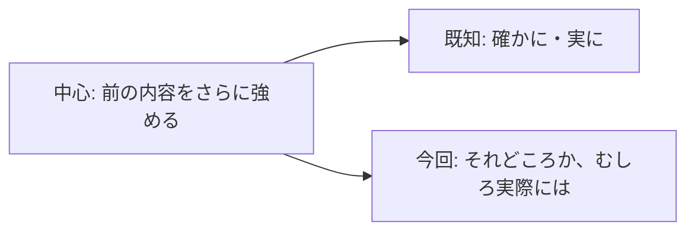

**重要語法**：indeed, S may ...

## 482. apply

**品詞**：verb　**発音**：/əˈplaɪ/

<small>よく知られている意味：申し込む</small>

**見落としやすい意味：規則や条件が人・事柄に当てはまる**

**例文**：These rules apply to all applicants.

**和訳**：この規則は応募者全員に適用される。

**コアイメージ**：apply には「あるものが特定の対象に向けて働く」という方向性がある。規則が対象に及べば「当てはまる」となる。

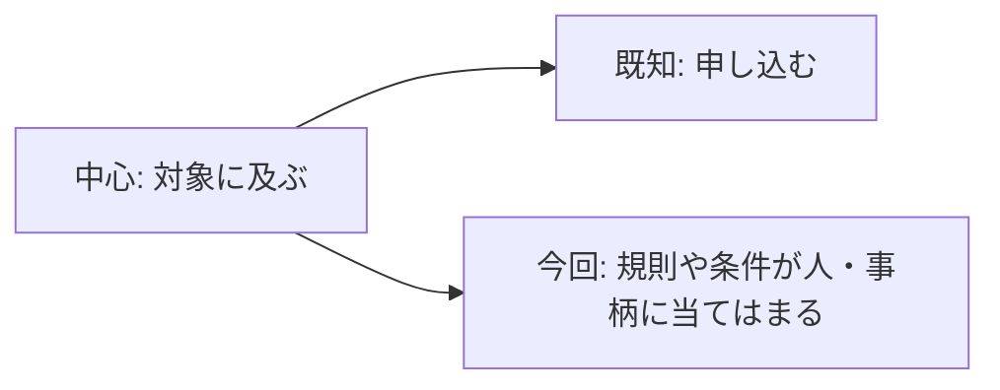

**重要語法**：apply to A

## 483. apply

**品詞**：verb　**発音**：/əˈplaɪ/

<small>よく知られている意味：申し込む</small>

**見落としやすい意味：理論・知識・方法を実際に活用する**

**例文**：The researchers applied the same method to a new problem.

**和訳**：研究者たちは同じ方法を新しい問題に応用した。

**コアイメージ**：知識や方法を対象へ向けて働かせるのが中心。そこから「実際に使う・応用する」という意味になる。

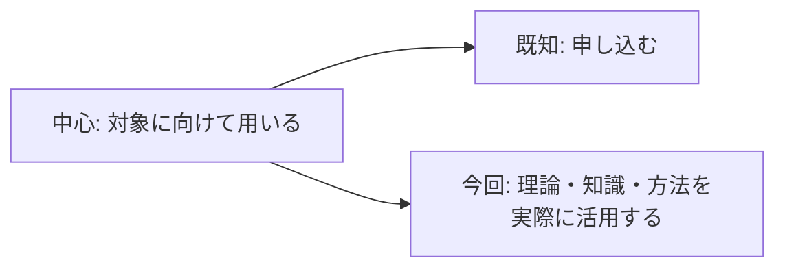

**重要語法**：apply A to B

## 484. apply

**品詞**：verb phrase　**発音**：/əˈplaɪ/

<small>よく知られている意味：申し込む</small>

**見落としやすい意味：課題に一生懸命取り組む**

**例文**：She applied herself to learning Japanese.

**和訳**：彼女は日本語の学習に熱心に取り組んだ。

**コアイメージ**：apply oneself は、自分自身の力や注意を特定の仕事に向ける表現。集中して取り組むという意味になる。

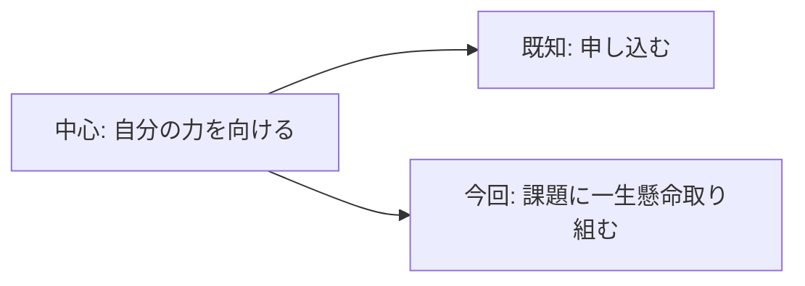

**重要語法**：apply oneself to A：A は名詞・動名詞

## 485. regard

**品詞**：preposition　**発音**：/rɪˈɡɑːrd/

<small>よく知られている意味：尊重する・みなす</small>

**見落としやすい意味：～に関して**

**例文**：As regards the cost, we need more information.

**和訳**：費用に関しては、さらに情報が必要だ。

**コアイメージ**：regard は「目を向ける・考慮する」という感覚がある。as regards は話題を指定し「〜に関して」と述べる定型表現。

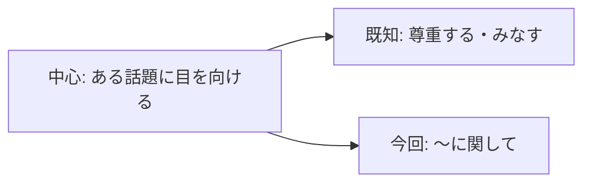

**重要語法**：as regards A

## 486. regard

**品詞**：verb　**発音**：/rɪˈɡɑːrd/

<small>よく知られている意味：尊重する・考える</small>

**見落としやすい意味：〜を…と見なす**

**例文**：We regard this result as a success.

**和訳**：私たちはこの結果を成功だとみなしている。

**コアイメージ**：regard は対象をある観点から見ること。その対象に評価や分類を結びつけると「AをBとみなす」になる。

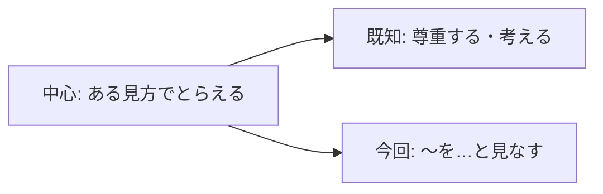

**重要語法**：regard A as B

## 487. firm

**品詞**：adjective　**発音**：/fɜːrm/

<small>よく知られている意味：硬い・しっかりした</small>

**見落としやすい意味：揺るぎない、断固とした**

**例文**：She made a firm promise to return.

**和訳**：彼女は戻ると固く約束した。

**コアイメージ**：firm の中心は、押されても揺らがない安定性。物理的な硬さから、決意や態度の揺るぎなさにも使う。

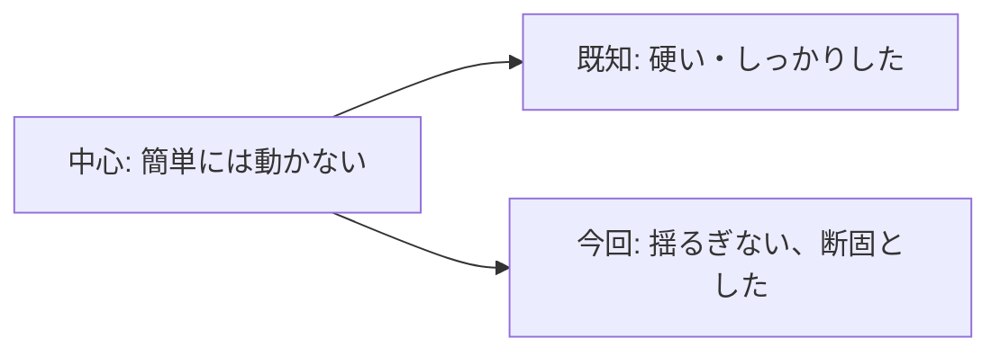

**重要語法**：a firm decision / commitment

## 488. firm

**品詞**：noun　**発音**：/fɜːrm/

<small>よく知られている意味：硬い・しっかりした</small>

**見落としやすい意味：会社、企業**

**例文**：He works at a small design firm.

**和訳**：彼は小さなデザイン会社で働いている。

**コアイメージ**：名詞 firm は、まとまって事業を行う会社・事業体を指す。形容詞の「硬い」から無理に導かず、別の品詞の基本用法として覚える。

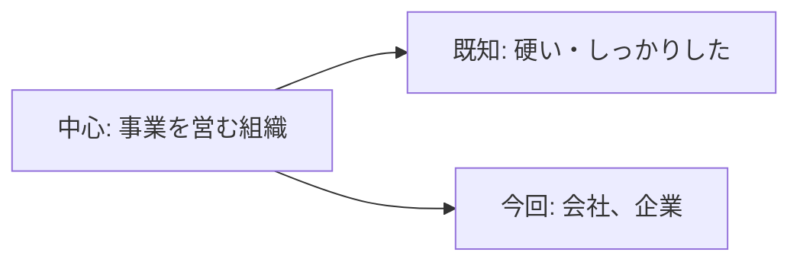

**重要語法**：a law firm / a design firm

## 489. refer

**品詞**：verb　**発音**：/rɪˈfɜːr/

<small>よく知られている意味：言及する・参照する</small>

**見落としやすい意味：専門家・機関などに紹介する、回す**

**例文**：The doctor referred her to a specialist.

**和訳**：医師は彼女を専門医に紹介した。

**コアイメージ**：refer の中心には「注意や対応を別の先へ向ける」がある。人を適切な担当者のもとへ回すと「紹介する」となる。

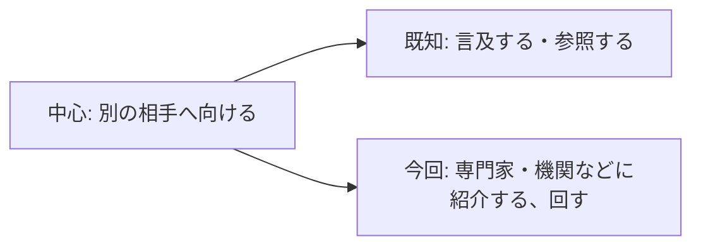

**重要語法**：refer A to B

## 490. fire

**品詞**：verb　**発音**：/ˈfaɪər/

<small>よく知られている意味：火・火をつける</small>

**見落としやすい意味：人を解雇する**

**例文**：The company fired the manager after repeated mistakes.

**和訳**：会社は繰り返しのミスを理由にその管理職を解雇した。

**コアイメージ**：fire には仕事から人を外す口語的な動詞用法がある。火のイメージをこじつけず、「解雇する」という独立した慣用的意味として覚える。

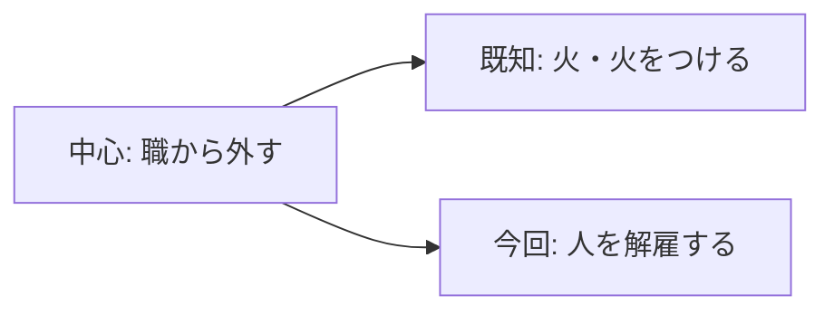

**重要語法**：fire someone：比較的くだけた表現

## 491. beyond

**品詞**：adjective phrase　**発音**：/bɪˈjɑːnd/

<small>よく知られている意味：〜を越えて</small>

**見落としやすい意味：人の理解や能力を超えている**

**例文**：Why he gave up is beyond me.

**和訳**：彼がなぜ諦めたのか、私には理解できない。

**コアイメージ**：beyond は境界を越えた向こう側を表す。理解力の範囲を越えれば「理解できない」という意味になる。

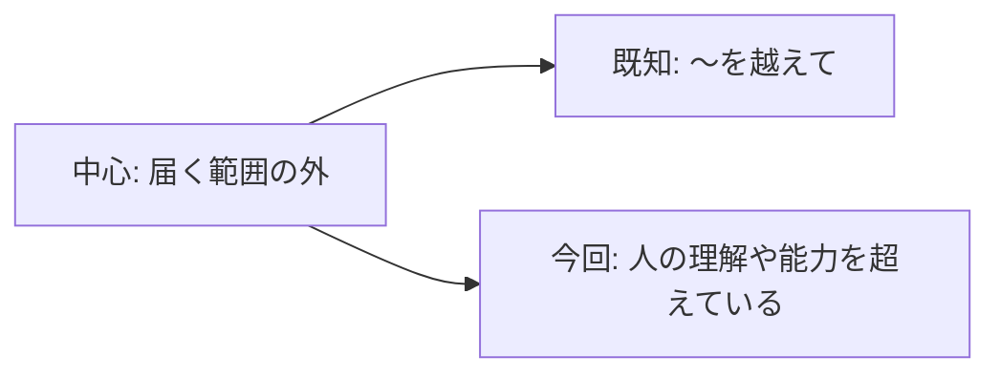

**重要語法**：be beyond someone

## 492. class

**品詞**：verb　**発音**：/klæs/

<small>よく知られている意味：授業・階級</small>

**見落としやすい意味：～を…に分類する**

**例文**：Biologists class whales as mammals.

**和訳**：生物学者はクジラを哺乳類に分類する。

**コアイメージ**：class は共通の性質でまとめた集団を指す。動詞では対象をその集団に入れ、「分類する」となる。

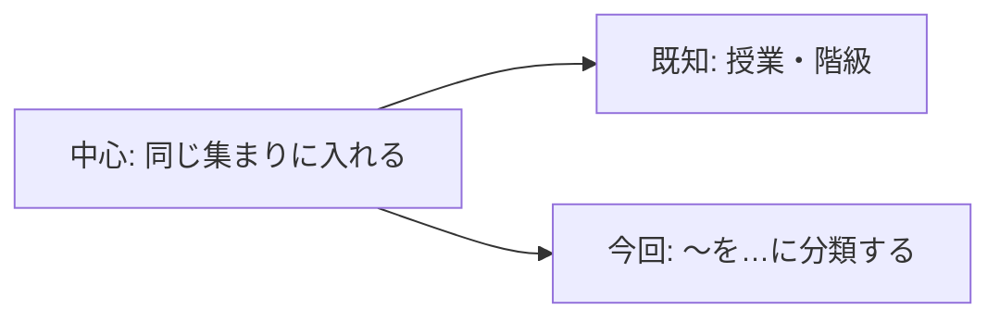

**重要語法**：class A as B

## 493. bill

**品詞**：noun　**発音**：/bɪl/

<small>よく知られている意味：請求書・勘定</small>

**見落としやすい意味：議会に提出された法案**

**例文**：Parliament passed the bill after a long debate.

**和訳**：議会は長い討論の末、その法案を可決した。

**コアイメージ**：bill は支払いの書類だけでなく、議会に提出される法律案の文書も指す。何についての書類かを文脈で区別する。

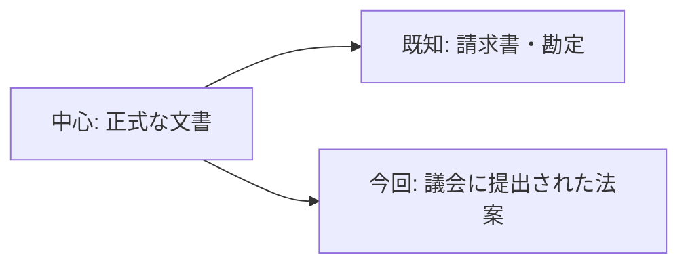

**重要語法**：pass a bill / introduce a bill

## 494. bill

**品詞**：verb　**発音**：/bɪl/

<small>よく知られている意味：請求書・勘定</small>

**見落としやすい意味：料金を請求する**

**例文**：The hotel billed us for the extra night.

**和訳**：ホテルは追加の一泊分を私たちに請求した。

**コアイメージ**：名詞の bill は請求書。そこから動詞では請求書を発行して料金を求める行為を表す。

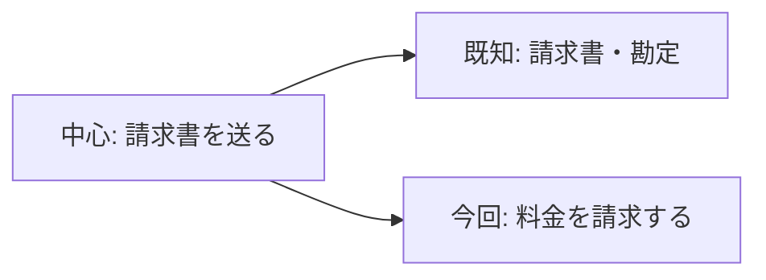

**重要語法**：bill A for B

## 495. nearly

**品詞**：adverb　**発音**：/ˈnɪrli/

<small>よく知られている意味：ほとんど・まもなく</small>

**見落としやすい意味：到底～でない、～には遠く及ばない**

**例文**：The second film was not nearly as exciting as the first.

**和訳**：二作目は一作目ほど面白くは到底なかった。

**コアイメージ**：nearly はある水準に近い状態を表す。否定と組み合わさると、その水準に全く近づかないことを強調できる。

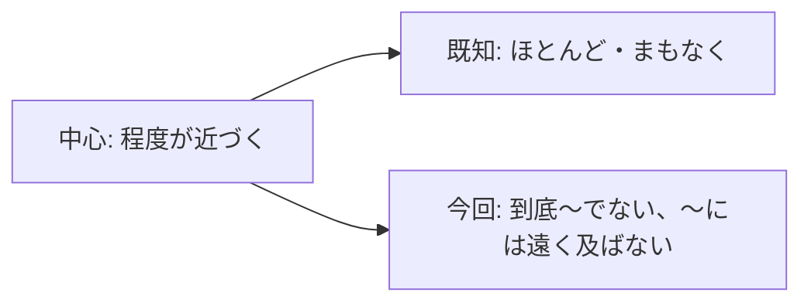

**重要語法**：not nearly as ... as

## 496. kid

**品詞**：verb　**発音**：/kɪd/

<small>よく知られている意味：子ども</small>

**見落としやすい意味：冗談を言う、からかう**

**例文**：I was only kidding when I said that.

**和訳**：そう言ったとき、私はただ冗談を言っていただけだ。

**コアイメージ**：kid は口語で相手をからかったり冗談を言ったりすることを表す。名詞の「子ども」とは区別して、会話の動詞として覚える。

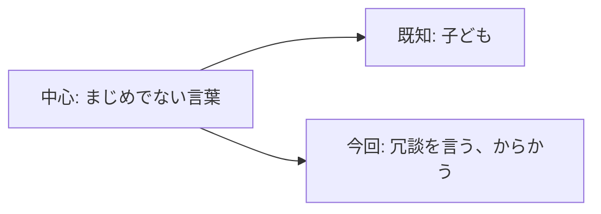

**重要語法**：just kidding / Are you kidding?

## 497. challenge

**品詞**：verb　**発音**：/ˈtʃælɪndʒ/

<small>よく知られている意味：挑戦する</small>

**見落としやすい意味：主張・決定などに異議を唱える**

**例文**：The lawyer challenged the decision in court.

**和訳**：弁護士は法廷でその決定に異議を唱えた。

**コアイメージ**：challenge は相手に試練を与えるだけでなく、主張や決定が正しいかを問い直すこと。そこから「異議を唱える」となる。

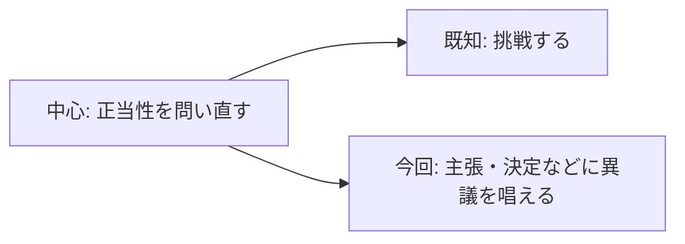

**重要語法**：challenge a decision / ruling

## 498. determine

**品詞**：verb　**発音**：/dɪˈtɜːrmɪn/

<small>よく知られている意味：決める</small>

**見落としやすい意味：結果・性質などを決定づける、左右する**

**例文**：The amount of sunlight determines how fast the plants grow.

**和訳**：日光の量が植物の成長速度を左右する。

**コアイメージ**：determine は人が意志で決める場合だけではない。条件や要因が結果のあり方を決める場合にも使う。

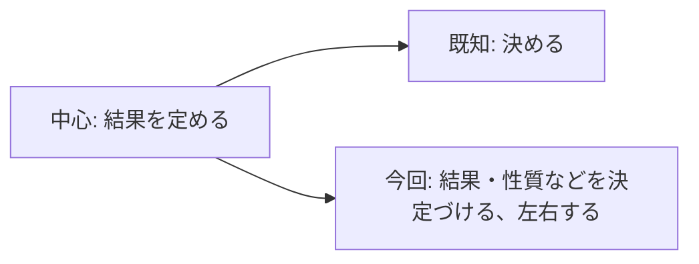

**重要語法**：determine whether / how ...

## 499. couple

**品詞**：verb　**発音**：/ˈkʌpəl/

<small>よく知られている意味：一組・二人組</small>

**見落としやすい意味：～と…を結びつける**

**例文**：The teacher coupled advice with practical exercises.

**和訳**：先生は助言に実践練習を組み合わせた。

**コアイメージ**：couple の中心は、別々のものを二つ組にすること。動詞では物事を結びつけたり組み合わせたりする。

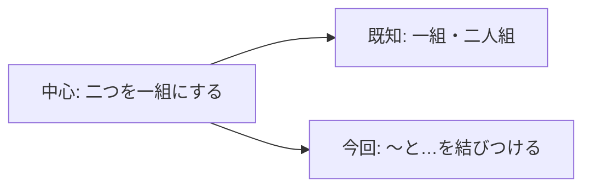

**重要語法**：couple A with B

## 500. document

**品詞**：verb　**発音**：/ˈdɑːkjəment/

<small>よく知られている意味：文書・資料</small>

**見落としやすい意味：証拠や記録で裏づける**

**例文**：The report documents the effects of the policy.

**和訳**：その報告書は政策の影響を証拠や記録によって示している。

**コアイメージ**：document は証拠を記録に残すことを表せる。記録を示すことで事実を裏づける意味へつながる。

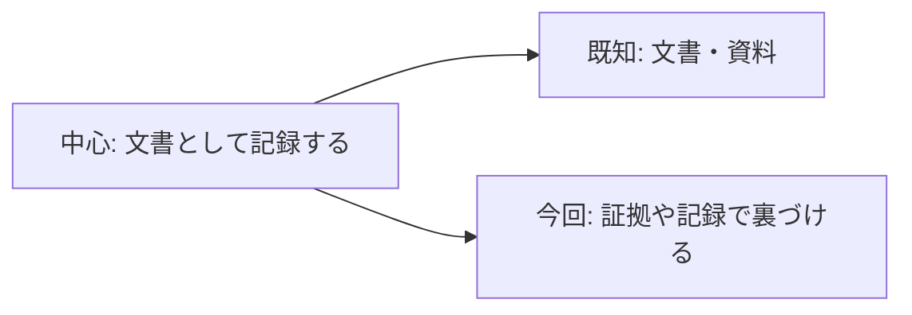

**重要語法**：document a claim / findings

## 501. key

**品詞**：adjective　**発音**：/kiː/

<small>よく知られている意味：鍵</small>

**見落としやすい意味：重要な、決定的な**

**例文**：Trust is a key part of teamwork.

**和訳**：信頼はチームワークの重要な要素だ。

**コアイメージ**：鍵は扉を開くのに欠かせないもの。形容詞 key は、結果を生むうえで欠かせない「重要な」を表す。

```mermaid
flowchart LR
    A["中心: 開くために欠かせないもの"]
    B["既知: 鍵"]
    C["今回: 重要な、決定的な"]
    A --> B
    A --> C
```

**重要語法**：a key factor / key role

## 502. intelligence

**品詞**：noun　**発音**：/ɪnˈtelɪdʒəns/

<small>よく知られている意味：知能・理解力</small>

**見落としやすい意味：諜報・機密情報**

**例文**：The agency gathered intelligence about the situation.

**和訳**：その機関は状況に関する機密情報を集めた。

**コアイメージ**：intelligence は物事を理解して判断する力を指す。そこから判断の材料となる、収集・分析された情報を指す。

```mermaid
flowchart LR
    A["中心: 判断に役立つ情報"]
    B["既知: 知能・理解力"]
    C["今回: 諜報・機密情報"]
    A --> B
    A --> C
```

**重要語法**：gather intelligence

## 503. volume

**品詞**：noun　**発音**：/ˈvɑːljuːm/

<small>よく知られている意味：音量・容量</small>

**見落としやすい意味：書籍の一巻、一冊**

**例文**：The story continues in the second volume.

**和訳**：その物語は第2巻へ続く。

**コアイメージ**：volume には一定のまとまった量という感覚がある。書籍ではまとまった一冊、特にシリーズ中の一巻を表す。

```mermaid
flowchart LR
    A["中心: まとまった分量"]
    B["既知: 音量・容量"]
    C["今回: 書籍の一巻、一冊"]
    A --> B
    A --> C
```

**重要語法**：the first volume / volume two

## 504. sort

**品詞**：adverb phrase　**発音**：/sɔːrt/

<small>よく知られている意味：種類・分類する</small>

**見落としやすい意味：多少、ある意味では**

**例文**：I felt sort of nervous before the speech.

**和訳**：スピーチの前、私は少し緊張していた。

**コアイメージ**：sort of は厳密に断定せず「そんな種類の感じ」とぼかす。程度を弱める「多少・ちょっと」の働きになる。

```mermaid
flowchart LR
    A["中心: おおまかな言い方"]
    B["既知: 種類・分類する"]
    C["今回: 多少、ある意味では"]
    A --> B
    A --> C
```

**重要語法**：sort of + 形容詞・動詞（口語）

## 505. sort

**品詞**：phrasal verb　**発音**：/sɔːrt/

<small>よく知られている意味：種類・分類する</small>

**見落としやすい意味：問題を解決する、整理する**

**例文**：We need to sort out this misunderstanding.

**和訳**：私たちはこの誤解を解消する必要がある。

**コアイメージ**：sort は物を分けて整えること。複雑になった問題を整理して片づけると「解決する」になる。

```mermaid
flowchart LR
    A["中心: 乱れを整理する"]
    B["既知: 種類・分類する"]
    C["今回: 問題を解決する、整理する"]
    A --> B
    A --> C
```

**重要語法**：sort out a problem

## 506. society

**品詞**：noun　**発音**：/səˈsaɪəti/

<small>よく知られている意味：社会</small>

**見落としやすい意味：学会・専門団体**

**例文**：She joined a society for young scientists.

**和訳**：彼女は若い科学者のための学会に入った。

**コアイメージ**：society は人々が作る集まりを表す。社会全体だけでなく、関心や専門を共有する団体も指せる。

```mermaid
flowchart LR
    A["中心: 共通点で集まる人々"]
    B["既知: 社会"]
    C["今回: 学会・専門団体"]
    A --> B
    A --> C
```

**重要語法**：a scientific society

## 507. rest

**品詞**：phrasal verb　**発音**：/rest/

<small>よく知られている意味：休む・残り</small>

**見落としやすい意味：根拠や前提として～に依拠する**

**例文**：The argument rests on one untested assumption.

**和訳**：その議論は、まだ検証されていない一つの仮定に基づいている。

**コアイメージ**：rest on は物が何かに支えられている状態を表す。議論が前提に支えられるなら「〜に依拠する」となる。

```mermaid
flowchart LR
    A["中心: 下から支える"]
    B["既知: 休む・残り"]
    C["今回: 根拠や前提として～に依拠する"]
    A --> B
    A --> C
```

**重要語法**：rest on an assumption

## 508. rest

**品詞**：verb　**発音**：/rest/

<small>よく知られている意味：休む・残り</small>

**見落としやすい意味：決定権・責任が〜にある**

**例文**：The final decision rests with the principal.

**和訳**：最終的な決定権は校長にある。

**コアイメージ**：rest with は権限や責任が特定の人のところにあることを示す。物理的に休む意味ではない。

```mermaid
flowchart LR
    A["中心: そこに置かれる"]
    B["既知: 休む・残り"]
    C["今回: 決定権・責任が〜にある"]
    A --> B
    A --> C
```

**重要語法**：the decision rests with A

## 509. magazine

**品詞**：noun　**発音**：/ˈmæɡəziːn/

<small>よく知られている意味：雑誌</small>

**見落としやすい意味：弾倉（装填用の容器）**

**例文**：A magazine from an old rifle was displayed behind glass at the museum.

**和訳**：博物館では古い小銃の弾倉がガラスケース内に展示されていた。

**コアイメージ**：magazine には物を一定量まとめて収める場所・容器という意味がある。雑誌とは異なる、専用の容器を指す語義もある。

```mermaid
flowchart LR
    A["中心: 収める容器"]
    B["既知: 雑誌"]
    C["今回: 弾倉（装填用の容器）"]
    A --> B
    A --> C
```

**重要語法**：展示品などの文脈では「雑誌」と誤訳しない

## 510. wrong

**品詞**：verb　**発音**：/rɔːŋ/

<small>よく知られている意味：間違った</small>

**見落としやすい意味：人に不当な扱いをする**

**例文**：She felt wronged by the unfair decision.

**和訳**：彼女は不公平な決定によって不当な扱いを受けたと感じた。

**コアイメージ**：wrong は正しくない状態を表す。動詞になると人に対して不当な行為をするという意味になる。

```mermaid
flowchart LR
    A["中心: 正しくないことをする"]
    B["既知: 間違った"]
    C["今回: 人に不当な扱いをする"]
    A --> B
    A --> C
```

**重要語法**：feel wronged

## 511. store

**品詞**：idiom　**発音**：/stɔːr/

<small>よく知られている意味：店・蓄える</small>

**見落としやすい意味：将来～を待ち受ける、用意されている**

**例文**：Nobody knows what the future has in store for us.

**和訳**：将来私たちに何が待ち受けているかは誰にも分からない。

**コアイメージ**：store は物事を蓄え、後で使えるように置くこと。in store はこれから起こる事柄が先に控えているように表す。

```mermaid
flowchart LR
    A["中心: 先に備えられている"]
    B["既知: 店・蓄える"]
    C["今回: 将来～を待ち受ける、用意されている"]
    A --> B
    A --> C
```

**重要語法**：have ... in store for A

## 512. conduct

**品詞**：noun　**発音**：/ˈkɑːndʌkt/

<small>よく知られている意味：行う・指揮する</small>

**見落としやすい意味：行為・振る舞い**

**例文**：The school praised his responsible conduct.

**和訳**：学校は彼の責任ある行動を称賛した。

**コアイメージ**：conduct は行動の進め方と結びついた語。名詞では実際の振る舞い・行為を指す。

```mermaid
flowchart LR
    A["中心: 行動を取り仕切る"]
    B["既知: 行う・指揮する"]
    C["今回: 行為・振る舞い"]
    A --> B
    A --> C
```

**重要語法**：名詞は先頭強勢 /ˈkɑːndʌkt/

## 513. conduct

**品詞**：verb　**発音**：/kənˈdʌkt/

<small>よく知られている意味：行う・指揮する</small>

**見落としやすい意味：電気・熱などを伝導する**

**例文**：Copper conducts electricity well.

**和訳**：銅は電気をよく伝える。

**コアイメージ**：conduct は何かをある方向へ導くこと。電気や熱を通して伝える場合にも使う。

```mermaid
flowchart LR
    A["中心: 通り道をつくる"]
    B["既知: 行う・指揮する"]
    C["今回: 電気・熱などを伝導する"]
    A --> B
    A --> C
```

**重要語法**：conduct electricity / heat

## 514. complex

**品詞**：noun　**発音**：/ˈkɑːmpleks/

<small>よく知られている意味：複雑な</small>

**見落としやすい意味：複数の施設が集まった複合施設**

**例文**：A new sports complex opened near the station.

**和訳**：駅の近くに新しい複合スポーツ施設がオープンした。

**コアイメージ**：complex は複数の部分が結びついた全体を連想させる。施設が集まった一体の建物群にも使う。

```mermaid
flowchart LR
    A["中心: 複数が組み合わさる"]
    B["既知: 複雑な"]
    C["今回: 複数の施設が集まった複合施設"]
    A --> B
    A --> C
```

**重要語法**：a sports / office complex

## 515. compare

**品詞**：verb phrase　**発音**：/kəmˈper/

<small>よく知られている意味：比較する</small>

**見落としやすい意味：～を…になぞらえる、たとえる**

**例文**：The writer compared memory to a library.

**和訳**：その作家は記憶を図書館にたとえた。

**コアイメージ**：compare は二つのものを並べて関係を考えること。共通する特徴を使って一方を他方にたとえる意味にもなる。

```mermaid
flowchart LR
    A["中心: 共通点を見つける"]
    B["既知: 比較する"]
    C["今回: ～を…になぞらえる、たとえる"]
    A --> B
    A --> C
```

**重要語法**：compare A to B（たとえる）

## 516. picture

**品詞**：verb　**発音**：/ˈpɪktʃər/

<small>よく知られている意味：写真・絵</small>

**見落としやすい意味：心に思い描く、想像する**

**例文**：Can you picture yourself living in another country?

**和訳**：自分が外国で暮らしている姿を想像できますか。

**コアイメージ**：picture は目に見える画像を表す。動詞では心の中に画像を描くように具体的な場面を想像する。

```mermaid
flowchart LR
    A["中心: 頭の中に絵をつくる"]
    B["既知: 写真・絵"]
    C["今回: 心に思い描く、想像する"]
    A --> B
    A --> C
```

**重要語法**：picture oneself doing

## 517. draw

**品詞**：noun　**発音**：/drɔː/

<small>よく知られている意味：描く・引く</small>

**見落としやすい意味：人を集める魅力・目玉**

**例文**：The famous artist was the main draw of the event.

**和訳**：その有名な芸術家が催しの最大の呼び物だった。

**コアイメージ**：draw には人や関心を引きつける働きがある。名詞では人が集まる理由となる魅力や目玉を指す。

```mermaid
flowchart LR
    A["中心: 人を引き寄せる"]
    B["既知: 描く・引く"]
    C["今回: 人を集める魅力・目玉"]
    A --> B
    A --> C
```

**重要語法**：a big draw

## 518. draw

**品詞**：phrasal verb　**発音**：/drɔː/

<small>よく知られている意味：描く・引く</small>

**見落としやすい意味：蓄積・資源・経験などを活用する**

**例文**：She drew on her experience to solve the problem.

**和訳**：彼女は問題を解決するため経験を生かした。

**コアイメージ**：draw on は蓄えられたものから必要な力を引き出すイメージ。経験・知識・資源を活用するときに使う。

```mermaid
flowchart LR
    A["中心: 蓄えから引き出す"]
    B["既知: 描く・引く"]
    C["今回: 蓄積・資源・経験などを活用する"]
    A --> B
    A --> C
```

**重要語法**：draw on experience / knowledge

## 519. draw

**品詞**：phrasal verb　**発音**：/drɔː/

<small>よく知られている意味：描く・引く</small>

**見落としやすい意味：文書・計画を正式に作成する**

**例文**：The two sides drew up an agreement.

**和訳**：双方は合意書を作成した。

**コアイメージ**：draw up は内容を整えて正式な形にする表現。契約や計画などの文書を作成するときによく使う。

```mermaid
flowchart LR
    A["中心: 形ある文書にまとめる"]
    B["既知: 描く・引く"]
    C["今回: 文書・計画を正式に作成する"]
    A --> B
    A --> C
```

**重要語法**：draw up an agreement / plan

## 520. draw

**品詞**：verb　**発音**：/drɔː/

<small>よく知られている意味：描く・引く</small>

**見落としやすい意味：結論を導く**

**例文**：We cannot draw a conclusion from this single example.

**和訳**：この一例だけから結論を導くことはできない。

**コアイメージ**：draw は何かを引き出す動きが中心。情報や証拠から判断を引き出せば「結論を導く」となる。

```mermaid
flowchart LR
    A["中心: 材料から引き出す"]
    B["既知: 描く・引く"]
    C["今回: 結論を導く"]
    A --> B
    A --> C
```

**重要語法**：draw a conclusion from A

## 521. conservative

**品詞**：adjective　**発音**：/kənˈsɜːrvətɪv/

<small>よく知られている意味：保守的な</small>

**見落としやすい意味：見積もりなどが控えめな、慎重な**

**例文**：A conservative estimate puts the cost at two million yen.

**和訳**：控えめに見積もっても費用は200万円になる。

**コアイメージ**：conservative は急激な変化を避ける慎重な姿勢を表す。数字を出す場面では過大にならない慎重な見積もりを指す。

```mermaid
flowchart LR
    A["中心: 大きく見積もりすぎない"]
    B["既知: 保守的な"]
    C["今回: 見積もりなどが控えめな、慎重な"]
    A --> B
    A --> C
```

**重要語法**：a conservative estimate

## 522. grant

**品詞**：idiom　**発音**：/ɡrænt/

<small>よく知られている意味：与える・認める</small>

**見落としやすい意味：ありがたみを忘れて当然視する**

**例文**：We often take clean water for granted.

**和訳**：私たちはきれいな水があることを当然だと思いがちだ。

**コアイメージ**：grant には認める・与えるという意味がある。take ... for granted は、何かが当然あるものとして受け止め、ありがたみや疑問を意識しない表現。

```mermaid
flowchart LR
    A["中心: 確かなものとして受け取る"]
    B["既知: 与える・認める"]
    C["今回: ありがたみを忘れて当然視する"]
    A --> B
    A --> C
```

**重要語法**：take A for granted

## 523. grant

**品詞**：verb　**発音**：/ɡrænt/

<small>よく知られている意味：与える・許可する</small>

**見落としやすい意味：ある主張を正しいと一応認める**

**例文**：I grant that the plan has some weaknesses.

**和訳**：その計画にいくつか欠点があることは認める。

**コアイメージ**：grant は相手に何かを与えるだけでなく、議論の一部を認めることにも使う。全面的な同意とは限らず、譲歩して認める場合が多い。

```mermaid
flowchart LR
    A["中心: 相手の主張を受け入れる"]
    B["既知: 与える・許可する"]
    C["今回: ある主張を正しいと一応認める"]
    A --> B
    A --> C
```

**重要語法**：grant that S V

## 524. light

**品詞**：prepositional phrase　**発音**：/laɪt/

<small>よく知られている意味：光・明かり</small>

**見落としやすい意味：～を考慮して、～に照らして**

**例文**：In light of the new evidence, we changed our view.

**和訳**：新たな証拠を踏まえて、私たちは考えを変えた。

**コアイメージ**：light は物事を見えるようにする光。in light of は、新しい事情に照らして判断するという比喩的表現。

```mermaid
flowchart LR
    A["中心: 光を当てて見直す"]
    B["既知: 光・明かり"]
    C["今回: ～を考慮して、～に照らして"]
    A --> B
    A --> C
```

**重要語法**：in light of A

## 525. else

**品詞**：idiom　**発音**：/els/

<small>よく知られている意味：ほかに</small>

**見落としやすい意味：さもないと、そうでなければ**

**例文**：Leave now, or else you'll miss the train.

**和訳**：今出発しなさい。さもないと電車に乗り遅れます。

**コアイメージ**：else は「それ以外」を表す。or else では前に示した行動を取らない別の場合を示し、その結果を警告する。

```mermaid
flowchart LR
    A["中心: 別の場合を示す"]
    B["既知: ほかに"]
    C["今回: さもないと、そうでなければ"]
    A --> B
    A --> C
```

**重要語法**：or else + 文

## 526. appropriate

**品詞**：verb　**発音**：/əˈproʊprieɪt/

<small>よく知られている意味：適切な</small>

**見落としやすい意味：（しばしば無断で）自分の用途に流用する**

**例文**：He was accused of appropriating the group's ideas as his own.

**和訳**：彼はその団体のアイデアを自分のものとして流用したと非難された。

**コアイメージ**：動詞 appropriate は何かを自分の用途に取り込むこと。持ち主の許可がない場合には「無断で流用する」という否定的な意味になる。

```mermaid
flowchart LR
    A["中心: 自分のものとして取り込む"]
    B["既知: 適切な"]
    C["今回: （しばしば無断で）自分の用途に流用する"]
    A --> B
    A --> C
```

**重要語法**：appropriate A as one's own

## 527. appropriate

**品詞**：verb　**発音**：/əˈproʊprieɪt/

<small>よく知られている意味：適切な</small>

**見落としやすい意味：予算などを特定目的に割り当てる**

**例文**：The city appropriated funds for new libraries.

**和訳**：市は新しい図書館のために予算を割り当てた。

**コアイメージ**：appropriate は資金などをある目的のために確保することも表す。勝手に流用する用法とは、文脈で区別する。

```mermaid
flowchart LR
    A["中心: 特定の用途に取り分ける"]
    B["既知: 適切な"]
    C["今回: 予算などを特定目的に割り当てる"]
    A --> B
    A --> C
```

**重要語法**：appropriate funds for A

## 528. administration

**品詞**：noun　**発音**：/ədˌmɪnɪˈstreɪʃən/

<small>よく知られている意味：管理・政権</small>

**見落としやすい意味：薬などの投与、処置の実施**

**例文**：The report describes the administration of the medicine.

**和訳**：報告書には、その薬の投与について書かれている。

**コアイメージ**：administration は物事の運営・実施を表す。医療の文脈では薬を与える処置の実施を指す。

```mermaid
flowchart LR
    A["中心: 決められた処置を実施する"]
    B["既知: 管理・政権"]
    C["今回: 薬などの投与、処置の実施"]
    A --> B
    A --> C
```

**重要語法**：administration of medicine

## 529. minute

**品詞**：adjective　**発音**：/maɪˈnuːt/

<small>よく知られている意味：分・一瞬</small>

**見落としやすい意味：極めて小さい、微細な**

**例文**：The scientist noticed a minute change in temperature.

**和訳**：科学者は温度のごくわずかな変化に気づいた。

**コアイメージ**：形容詞 minute は非常に小さく、注意しないと見逃すほど細かいことを表す。時間の単位の名詞とは意味も発音も異なる。

```mermaid
flowchart LR
    A["中心: 細部まで小さい"]
    B["既知: 分・一瞬"]
    C["今回: 極めて小さい、微細な"]
    A --> B
    A --> C
```

**重要語法**：形容詞 /maɪˈnuːt/、名詞 /ˈmɪnɪt/

## 530. enter

**品詞**：phrasal verb　**発音**：/ˈentər/

<small>よく知られている意味：入る</small>

**見落としやすい意味：契約・交渉・議論などを始める**

**例文**：The two companies entered into an agreement.

**和訳**：その二社は契約を結んだ。

**コアイメージ**：enter は場所の中へ入るだけでなく、合意や交渉という関係に入ることを表せる。enter into は契約などを始める定型表現。

```mermaid
flowchart LR
    A["中心: 関係の中に入る"]
    B["既知: 入る"]
    C["今回: 契約・交渉・議論などを始める"]
    A --> B
    A --> C
```

**重要語法**：enter into an agreement

## 531. arrive

**品詞**：verb phrase　**発音**：/əˈraɪv/

<small>よく知られている意味：到着する</small>

**見落としやすい意味：結論・決定などに到達する**

**例文**：After a long discussion, we arrived at a decision.

**和訳**：長い話し合いの末、私たちは結論に達した。

**コアイメージ**：arrive は移動の終点に至ること。考えを進めた末の決定・結論も、到達点として表す。

```mermaid
flowchart LR
    A["中心: 目的地へたどり着く"]
    B["既知: 到着する"]
    C["今回: 結論・決定などに到達する"]
    A --> B
    A --> C
```

**重要語法**：arrive at a decision / conclusion

## 532. mind

**品詞**：usage　**発音**：/maɪnd/

<small>よく知られている意味：心・気にする</small>

**見落としやすい意味：Do you mind if ...?は許可を求め、Yesが断りを表しうる**

**例文**：Do you mind if I sit here?

**和訳**：ここに座ってもよいですか。

**コアイメージ**：Do you mind if ...? は相手がその行動を嫌だと思うかを聞く表現。許可を求める場面で使われ、Yes は「気にするので困る」の意味になりうる。

```mermaid
flowchart LR
    A["中心: 相手が嫌がるかを尋ねる"]
    B["既知: 心・気にする"]
    C["今回: Do you mind if ...?は許可を求め、Yesが断りを表しうる"]
    A --> B
    A --> C
```

**重要語法**：快く承諾するなら No, not at all. など

## 533. mind

**品詞**：verb　**発音**：/maɪnd/

<small>よく知られている意味：心・気にする</small>

**見落としやすい意味：注意する、気をつける**

**例文**：Mind the step as you leave the bus.

**和訳**：バスを降りるときは段差に注意してください。

**コアイメージ**：mind は心に留める・気にかけること。命令文では危険や注意点を意識するよう促す。

```mermaid
flowchart LR
    A["中心: 意識を向ける"]
    B["既知: 心・気にする"]
    C["今回: 注意する、気をつける"]
    A --> B
    A --> C
```

**重要語法**：Mind the gap / Mind your head

## 534. production

**品詞**：noun　**発音**：/prəˈdʌkʃən/

<small>よく知られている意味：生産</small>

**見落としやすい意味：演劇や番組などの上演・制作作品**

**例文**：The school's new production of Hamlet starts on Friday.

**和訳**：学校の新しい『ハムレット』公演は金曜日に始まる。

**コアイメージ**：production は作る過程やその成果を表す。舞台や番組では、制作して上演・公開する作品そのものを指す。

```mermaid
flowchart LR
    A["中心: 作り上げて見せるもの"]
    B["既知: 生産"]
    C["今回: 演劇や番組などの上演・制作作品"]
    A --> B
    A --> C
```

**重要語法**：a stage production

## 535. nor

**品詞**：usage　**発音**：/nɔːr/

<small>よく知られている意味：〜もまた…ない</small>

**見落としやすい意味：norが文頭に出ると主語と助動詞が倒置する**

**例文**：He did not apologize, nor did he explain his actions.

**和訳**：彼は謝らなかったし、自分の行動について説明もしなかった。

**コアイメージ**：nor は前の否定を受けて「〜もまたない」と続ける語。文頭で節をつなぐとき、助動詞が主語の前に出ることがある。

```mermaid
flowchart LR
    A["中心: 否定をさらに加える"]
    B["既知: 〜もまた…ない"]
    C["今回: norが文頭に出ると主語と助動詞が倒置する"]
    A --> B
    A --> C
```

**重要語法**：nor + 助動詞 + 主語 + 動詞

## 536. sit

**品詞**：verb　**発音**：/sɪt/

<small>よく知られている意味：座る</small>

**見落としやすい意味：試験を受ける（主に英国英語）**

**例文**：She will sit the entrance exam in June.

**和訳**：彼女は6月に入学試験を受ける。

**コアイメージ**：sit は座る動作を表す。特にイギリス英語では、試験に臨むことを sit an exam と言う。

```mermaid
flowchart LR
    A["中心: 所定の場に座って臨む"]
    B["既知: 座る"]
    C["今回: 試験を受ける（主に英国英語）"]
    A --> B
    A --> C
```

**重要語法**：sit an exam（主に英）

## 537. sit

**品詞**：verb phrase　**発音**：/sɪt/

<small>よく知られている意味：座る</small>

**見落としやすい意味：委員会などの委員を務める**

**例文**：My aunt sits on the school committee.

**和訳**：私のおばは学校の委員会の委員を務めている。

**コアイメージ**：sit は席に座るだけでなく、組織の一員として席を持つことも表す。sit on a committee は委員を務めるという意味。

```mermaid
flowchart LR
    A["中心: 席を占めて参加する"]
    B["既知: 座る"]
    C["今回: 委員会などの委員を務める"]
    A --> B
    A --> C
```

**重要語法**：sit on a committee

## 538. assume

**品詞**：verb　**発音**：/əˈsuːm/

<small>よく知られている意味：仮定する</small>

**見落としやすい意味：役割や責任を引き受ける**

**例文**：He assumed responsibility for the project.

**和訳**：彼はその企画の責任を引き受けた。

**コアイメージ**：assume は何かを自分のものとして受け取る意味を持つ。責任や役職を引き受ける場面でも使われる。

```mermaid
flowchart LR
    A["中心: 自分の側に引き受ける"]
    B["既知: 仮定する"]
    C["今回: 役割や責任を引き受ける"]
    A --> B
    A --> C
```

**重要語法**：assume responsibility / office

## 539. coast

**品詞**：verb　**発音**：/koʊst/

<small>よく知られている意味：海岸</small>

**見落としやすい意味：惰性で進む、努力せずに難関を通る**

**例文**：He coasted through the course without much effort.

**和訳**：彼はあまり努力せず、その課程を難なく終えた。

**コアイメージ**：coast は惰性で滑るように進む動きを表せる。そこから大きな努力をせずに物事を進める意味になる。

```mermaid
flowchart LR
    A["中心: 勢いのまま進む"]
    B["既知: 海岸"]
    C["今回: 惰性で進む、努力せずに難関を通る"]
    A --> B
    A --> C
```

**重要語法**：coast through A

## 540. strike

**品詞**：idiom　**発音**：/straɪk/

<small>よく知られている意味：打つ・襲う</small>

**見落としやすい意味：対立するものの均衡を取る**

**例文**：We must strike a balance between speed and accuracy.

**和訳**：私たちは速度と正確さの間でバランスを取らなければならない。

**コアイメージ**：strike a balance は相反する条件の間に適切な均衡を作る定型表現。strike の「打つ」を逐語訳せず、まとまりで理解する。

```mermaid
flowchart LR
    A["中心: 釣り合いを作り出す"]
    B["既知: 打つ・襲う"]
    C["今回: 対立するものの均衡を取る"]
    A --> B
    A --> C
```

**重要語法**：strike a balance between A and B

## 541. strike

**品詞**：verb phrase　**発音**：/straɪk/

<small>よく知られている意味：打つ・襲う</small>

**見落としやすい意味：人に～という印象を与える**

**例文**：Her answer struck me as unusually honest.

**和訳**：彼女の答えは私には非常に正直なものに思えた。

**コアイメージ**：strike は何かが強く当たるという動きから、印象が人の心に残ることを表す。strike A as B は A に B という印象を与える。

```mermaid
flowchart LR
    A["中心: 印象が心に届く"]
    B["既知: 打つ・襲う"]
    C["今回: 人に～という印象を与える"]
    A --> B
    A --> C
```

**重要語法**：strike A as B

## 542. natural

**品詞**：noun　**発音**：/ˈnætʃərəl/

<small>よく知られている意味：自然の・自然な</small>

**見落としやすい意味：生まれつき才能のある人**

**例文**：He is a natural at explaining difficult ideas.

**和訳**：彼は難しい考えを説明するのが生まれつき上手だ。

**コアイメージ**：natural は無理なく自然な状態を表す。名詞 a natural は、特に努力して身につけたように見えないほど才能がある人を指す。

```mermaid
flowchart LR
    A["中心: 自然にできる"]
    B["既知: 自然の・自然な"]
    C["今回: 生まれつき才能のある人"]
    A --> B
    A --> C
```

**重要語法**：a natural at A

## 543. senior

**品詞**：adjective　**発音**：/ˈsiːniər/

<small>よく知られている意味：年上の・上級の</small>

**見落としやすい意味：～より地位や年齢が上である（比較はto）**

**例文**：She is senior to me at the company.

**和訳**：彼女は会社では私より上の立場だ。

**コアイメージ**：senior は年齢や地位の序列で上にある状態を示す。比較対象には than でなく to を用いる。

```mermaid
flowchart LR
    A["中心: 序列で上に位置する"]
    B["既知: 年上の・上級の"]
    C["今回: ～より地位や年齢が上である（比較はto）"]
    A --> B
    A --> C
```

**重要語法**：senior to A

## 544. patient

**品詞**：adjective　**発音**：/ˈpeɪʃənt/

<small>よく知られている意味：患者</small>

**見落としやすい意味：辛抱強い、我慢強い**

**例文**：Please be patient with beginners.

**和訳**：初心者には辛抱強く接してください。

**コアイメージ**：patient は時間や手間がかかっても感情的にならず待てる性質を表す。名詞の「患者」とは別の品詞である。

```mermaid
flowchart LR
    A["中心: 落ち着いて待つ"]
    B["既知: 患者"]
    C["今回: 辛抱強い、我慢強い"]
    A --> B
    A --> C
```

**重要語法**：be patient with A

## 545. upon

**品詞**：preposition　**発音**：/əˈpɑːn/

<small>よく知られている意味：〜の上に</small>

**見落としやすい意味：～するとすぐに**

**例文**：Upon hearing the news, she called her family.

**和訳**：その知らせを聞くとすぐに、彼女は家族に電話した。

**コアイメージ**：upon は on に近く、ある出来事に接する時点を表せる。upon doing で「〜するとすぐに」という時間の関係になる。

```mermaid
flowchart LR
    A["中心: ある時点に接して"]
    B["既知: 〜の上に"]
    C["今回: ～するとすぐに"]
    A --> B
    A --> C
```

**重要語法**：upon + 動名詞

## 546. bar

**品詞**：preposition　**発音**：/bɑːr/

<small>よく知られている意味：棒・バー</small>

**見落としやすい意味：〜を除いて**

**例文**：Bar one small error, your answer is correct.

**和訳**：小さな誤りを一つ除けば、あなたの答えは正しい。

**コアイメージ**：bar は障害物で通れないようにするイメージから、除外を示すことがある。前置詞では「〜を除いて」を意味する。

```mermaid
flowchart LR
    A["中心: あるものを外に置く"]
    B["既知: 棒・バー"]
    C["今回: 〜を除いて"]
    A --> B
    A --> C
```

**重要語法**：bar A（主に英・やや形式的）

## 547. bar

**品詞**：verb　**発音**：/bɑːr/

<small>よく知られている意味：棒・バー</small>

**見落としやすい意味：人が～するのを禁止する**

**例文**：The rules bar visitors from entering this room.

**和訳**：規則により、来訪者はこの部屋に入ることを禁じられている。

**コアイメージ**：bar は棒などで進路をふさぐこと。行動を妨げる意味に広がり、人が何かをするのを禁止する表現になる。

```mermaid
flowchart LR
    A["中心: 通行をさえぎる"]
    B["既知: 棒・バー"]
    C["今回: 人が～するのを禁止する"]
    A --> B
    A --> C
```

**重要語法**：bar A from doing

## 548. population

**品詞**：noun　**発音**：/ˌpɑːpjəˈleɪʃən/

<small>よく知られている意味：人口</small>

**見落としやすい意味：研究・統計の対象となる集団**

**例文**：The study population included 200 volunteers.

**和訳**：その研究の対象集団には200人のボランティアが含まれていた。

**コアイメージ**：population は特定の範囲に属する人やものの集まりを表す。統計・研究では調べたい対象の集団を指し、国や地域の人口に限らない。

```mermaid
flowchart LR
    A["中心: 対象として数える全体"]
    B["既知: 人口"]
    C["今回: 研究・統計の対象となる集団"]
    A --> B
    A --> C
```

**重要語法**：study population

## 549. request

**品詞**：usage　**発音**：/rɪˈkwest/

<small>よく知られている意味：依頼する</small>

**見落としやすい意味：request thatの後に動詞の原形を用いる構文**

**例文**：The committee requested that he be present.

**和訳**：委員会は彼が出席するよう求めた。

**コアイメージ**：request は相手に行動を要求すること。request that ... の節では、要求内容を表すため動詞の原形が使われることがある。

```mermaid
flowchart LR
    A["中心: 行動を求める"]
    B["既知: 依頼する"]
    C["今回: request thatの後に動詞の原形を用いる構文"]
    A --> B
    A --> C
```

**重要語法**：request that S + 動詞の原形（米語で一般的）

## 550. success

**品詞**：noun　**発音**：/səkˈses/

<small>よく知られている意味：成功</small>

**見落としやすい意味：成功した人・物・催し**

**例文**：The concert was a great success.

**和訳**：その演奏会は大成功だった。

**コアイメージ**：success は成功という抽象的な結果を示すだけでなく、成功した行事や人・物も数えて表せる。a success の冠詞に注目する。

```mermaid
flowchart LR
    A["中心: 成功した具体例"]
    B["既知: 成功"]
    C["今回: 成功した人・物・催し"]
    A --> B
    A --> C
```

**重要語法**：be a success

## 551. manage

**品詞**：verb　**発音**：/ˈmænɪdʒ/

<small>よく知られている意味：管理する</small>

**見落としやすい意味：困難ながらどうにか成し遂げる**

**例文**：We managed to finish the report on time.

**和訳**：私たちは何とか時間どおりに報告書を仕上げた。

**コアイメージ**：manage は状況をうまく扱うことを表す。manage to do では困難があってもどうにか実現する意味になる。

```mermaid
flowchart LR
    A["中心: 難しい状況を切り抜ける"]
    B["既知: 管理する"]
    C["今回: 困難ながらどうにか成し遂げる"]
    A --> B
    A --> C
```

**重要語法**：manage to do

## 552. instance

**品詞**：idiom　**発音**：/ˈɪnstəns/

<small>よく知られている意味：例・場合</small>

**見落としやすい意味：まず初めに、最初の段階では**

**例文**：In the first instance, please contact your teacher.

**和訳**：まずは先生に連絡してください。

**コアイメージ**：instance は特定の事例・場面を表す。in the first instance は最初の場面・段階では、という意味の定型表現。

```mermaid
flowchart LR
    A["中心: 最初の段階を示す"]
    B["既知: 例・場合"]
    C["今回: まず初めに、最初の段階では"]
    A --> B
    A --> C
```

**重要語法**：in the first instance

## 553. floor

**品詞**：noun phrase　**発音**：/flɔːr/

<small>よく知られている意味：床・階</small>

**見落としやすい意味：会議での発言権**

**例文**：The chair gave her the floor.

**和訳**：議長は彼女に発言の機会を与えた。

**コアイメージ**：floor は人が立つ場所を意味する。会議では発言する人に与えられる「場」から、発言権を表す。

```mermaid
flowchart LR
    A["中心: 発言者が占める場"]
    B["既知: 床・階"]
    C["今回: 会議での発言権"]
    A --> B
    A --> C
```

**重要語法**：give A the floor

## 554. floor

**品詞**：verb　**発音**：/flɔːr/

<small>よく知られている意味：床・階</small>

**見落としやすい意味：非常に驚かせ、言葉を失わせる**

**例文**：His unexpected reply completely floored me.

**和訳**：彼の意外な返答には本当に驚かされた。

**コアイメージ**：floor は人を床に倒すことから、比喩的に強い驚きで圧倒することを表す。特に受け身や口語でよく使う。

```mermaid
flowchart LR
    A["中心: 立っていられないほど圧倒する"]
    B["既知: 床・階"]
    C["今回: 非常に驚かせ、言葉を失わせる"]
    A --> B
    A --> C
```

**重要語法**：be floored by A

## 555. drop

**品詞**：phrasal verb　**発音**：/drɑːp/

<small>よく知られている意味：落とす・落ちる</small>

**見落としやすい意味：退学・脱退する**

**例文**：He dropped out of the competition because of an injury.

**和訳**：彼はけがのため大会を途中で棄権した。

**コアイメージ**：drop out は集団や活動の中から抜け落ちること。学校・大会・計画などから途中で離れる意味になる。

```mermaid
flowchart LR
    A["中心: 集団や進行から外れる"]
    B["既知: 落とす・落ちる"]
    C["今回: 退学・脱退する"]
    A --> B
    A --> C
```

**重要語法**：drop out of A

## 556. drop

**品詞**：phrasal verb　**発音**：/drɑːp/

<small>よく知られている意味：落とす・落ちる</small>

**見落としやすい意味：短時間立ち寄る**

**例文**：I'll drop by your office tomorrow.

**和訳**：明日あなたのオフィスに少し立ち寄ります。

**コアイメージ**：drop by は予定の途中で気軽に寄るような動き。長時間滞在せず「ちょっと立ち寄る」という意味で使う。

```mermaid
flowchart LR
    A["中心: 短く訪れて去る"]
    B["既知: 落とす・落ちる"]
    C["今回: 短時間立ち寄る"]
    A --> B
    A --> C
```

**重要語法**：drop by A / drop by

## 557. facility

**品詞**：noun　**発音**：/fəˈsɪləti/

<small>よく知られている意味：施設</small>

**見落としやすい意味：あることを難なくこなす才能・能力**

**例文**：She has a remarkable facility for languages.

**和訳**：彼女には語学を容易に身につける素晴らしい才能がある。

**コアイメージ**：facility は何かをしやすくするものや状態を表す。人については物事を簡単にこなせる能力・器用さを指す。

```mermaid
flowchart LR
    A["中心: 容易にできる能力"]
    B["既知: 施設"]
    C["今回: あることを難なくこなす才能・能力"]
    A --> B
    A --> C
```

**重要語法**：a facility for A

## 558. bit

**品詞**：idiom　**発音**：/bɪt/

<small>よく知られている意味：少量・一片</small>

**見落としやすい意味：少しも～でない**

**例文**：He was not a bit surprised by the news.

**和訳**：彼はその知らせに少しも驚かなかった。

**コアイメージ**：a bit はわずかな程度を表す。not a bit ではその最小限の程度さえ否定するため「少しも〜ない」になる。

```mermaid
flowchart LR
    A["中心: ほんの少しすらない"]
    B["既知: 少量・一片"]
    C["今回: 少しも～でない"]
    A --> B
    A --> C
```

**重要語法**：not a bit + 形容詞

## 559. body

**品詞**：noun　**発音**：/ˈbɑːdi/

<small>よく知られている意味：体・身体</small>

**見落としやすい意味：団体・機関・集団**

**例文**：The new body will oversee school safety.

**和訳**：新しい機関が学校の安全管理を監督する。

**コアイメージ**：body は部分がまとまって一つになったものを指せる。人々が役割をもって集まった組織や機関にも広がる。

```mermaid
flowchart LR
    A["中心: 一つにまとまった集まり"]
    B["既知: 体・身体"]
    C["今回: 団体・機関・集団"]
    A --> B
    A --> C
```

**重要語法**：a governing body

## 560. body

**品詞**：noun phrase　**発音**：/ˈbɑːdi/

<small>よく知られている意味：体・身体</small>

**見落としやすい意味：まとまった大量の～**

**例文**：The researchers collected a large body of evidence.

**和訳**：研究者たちは大量の証拠を集めた。

**コアイメージ**：body は個々の部分からなる一つのまとまり。a body of evidence は証拠がまとまって蓄積した全体を指す。

```mermaid
flowchart LR
    A["中心: まとまりをなす全体"]
    B["既知: 体・身体"]
    C["今回: まとまった大量の～"]
    A --> B
    A --> C
```

**重要語法**：a body of evidence / research
