# EasyVoca 完成教材｜バッチ008

採用済み語義の global_order 561〜640。語義の採否・IDは main の元データを維持する。

### 561. temple（名詞）

**発音：** /ˈtempəl/

<small>よく知られている意味：寺院</small>

**見落としやすい意味：こめかみ**

**例文：** She gently rubbed her temples after a long day.

**和訳：** 長い一日の終わりに、彼女はこめかみをそっとさすった。

**コアイメージ：** temple には寺院とは別に、頭の左右にある「こめかみ」という意味がある。現代英語では別々の意味として覚え、身体の文脈を手がかりにする。

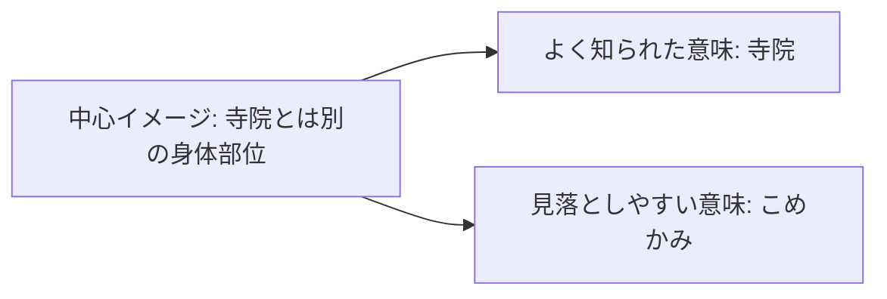

**重要語法：** rub one's temples：こめかみをさする

### 562. plant（名詞）

**発音：** /plænt/

<small>よく知られている意味：植物</small>

**見落としやすい意味：工場・製造施設・発電施設**

**例文：** The car plant employs hundreds of workers.

**和訳：** その自動車工場では何百人もの従業員が働いている。

**コアイメージ：** plant は植物だけでなく、製品を生み出すための施設全体も指す。生産の場を一つのまとまりとして捉えると、工場という意味を思い出しやすい。

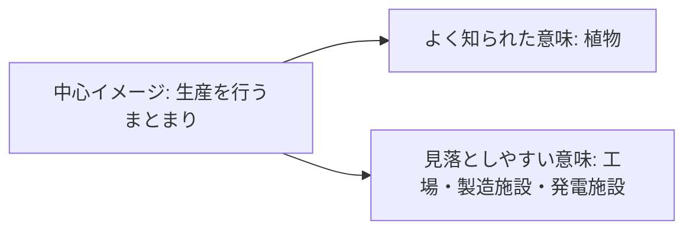

**重要語法：** a power plant：発電所

### 563. plant（名詞）

**発音：** /plænt/

<small>よく知られている意味：植物</small>

**見落としやすい意味：工場で用いる設備・機械類の総称**

**例文：** The company bought new plant and machinery.

**和訳：** その会社は新しい設備や機械を購入した。

**コアイメージ：** 工業の文脈では plant が工場そのものだけでなく、そこに据え付けられた設備の集合を表す。建物の意味か設備の意味かは周囲の名詞から判断する。

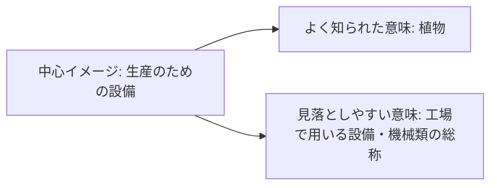

**重要語法：** plant and machinery：設備および機械類

### 564. plant（動詞）

**発音：** /plænt/

<small>よく知られている意味：植える</small>

**見落としやすい意味：証拠などをひそかに置いて仕込む**

**例文：** The thief planted false evidence in the room.

**和訳：** その泥棒は部屋に偽の証拠をひそかに仕込んだ。

**コアイメージ：** plant の「植える」は、ある場所にものを置いて残す動作を表す。そこから、証拠などを人に気づかれないように置くという意味になる。

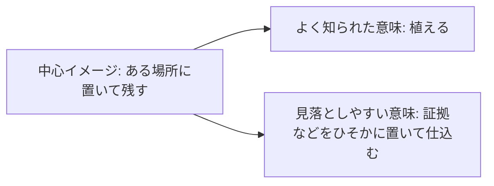

**重要語法：** plant evidence：証拠を仕込む

### 565. sale（句）

**発音：** /seɪl/

<small>よく知られている意味：販売・セール</small>

**見落としやすい意味：on saleは米国では値下げ、英国では販売中を意味しうる**

**例文：** Tickets for the concert went on sale in London today.

**和訳：** そのコンサートのチケットは今日ロンドンで発売された。

**コアイメージ：** sale の中心は商品を売る行為であり、値下げそのものではない。on sale は米国では特売を意味することが多い一方、英国では単に販売中を表すこともある。

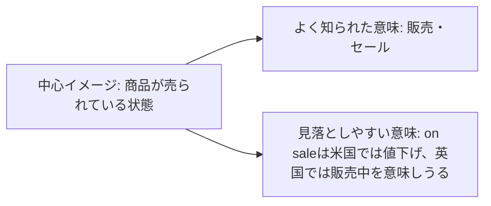

**重要語法：** go on sale：発売される。価格が下がったかは文脈で判断する。

### 566. argument（名詞）

**発音：** /ˈɑːrɡjəmənt/

<small>よく知られている意味：口論</small>

**見落としやすい意味：主張を支える論拠・推論**

**例文：** Her argument is supported by clear evidence.

**和訳：** 彼女の主張には明確な証拠による裏付けがある。

**コアイメージ：** argument の中心は、理由を示して自分の立場を論じることにある。人と対立すれば「口論」、文章で根拠を組み立てれば「論拠・主張」になる。

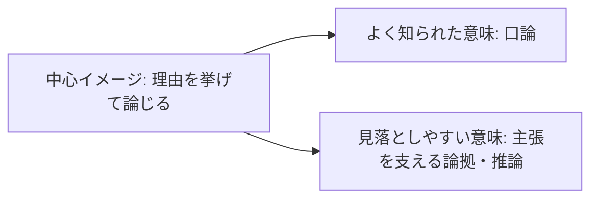

**重要語法：** support an argument with evidence：主張を証拠で裏付ける

### 567. decline（動詞）

**発音：** /dɪˈklaɪn/

<small>よく知られている意味：減少する</small>

**見落としやすい意味：丁重に断る、辞退する**

**例文：** He politely declined the offer.

**和訳：** 彼はその申し出を丁重に断った。

**コアイメージ：** decline には数量が下がる意味と、申し出を受け入れず退ける意味がある。後者では offer や invitation などが目的語になる。

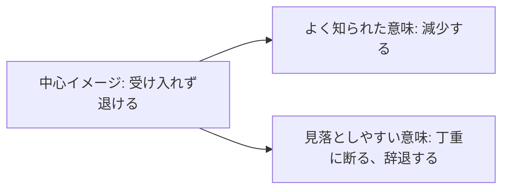

**重要語法：** decline an invitation：招待を辞退する

### 568. labor（名詞）

**発音：** /ˈleɪbər/

<small>よく知られている意味：労働</small>

**見落としやすい意味：出産に関わる陣痛・分娩**

**例文：** She went into labor late at night.

**和訳：** 彼女は夜遅くに陣痛が始まった。

**コアイメージ：** labor は強い身体的負担を伴う働きを表す。出産も身体が大きく働く過程なので、分娩や陣痛を表す用法がある。

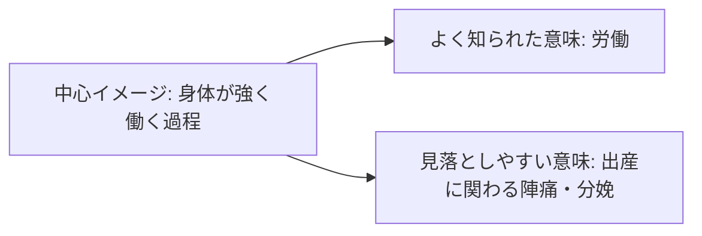

**重要語法：** go into labor：陣痛が始まる

### 569. aid（名詞）

**発音：** /eɪd/

<small>よく知られている意味：援助</small>

**見落としやすい意味：補助器具、補助手段**

**例文：** A hearing aid helps him follow conversations.

**和訳：** 補聴器のおかげで彼は会話を聞き取りやすくなっている。

**コアイメージ：** aid は人を助ける行為だけでなく、助けとなる道具も指す。何を補助する道具なのかを前の名詞で示すことが多い。

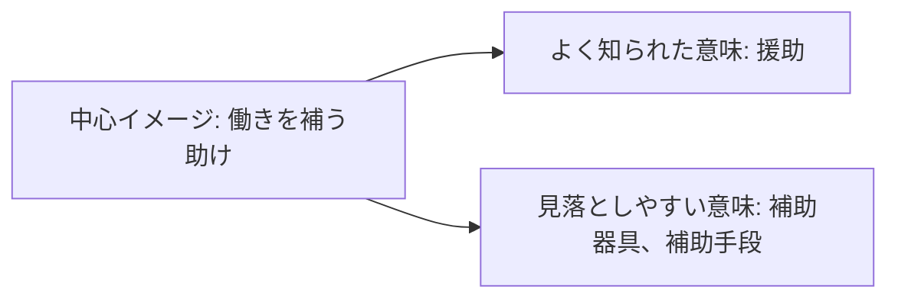

**重要語法：** hearing aid：補聴器

### 570. alternative（熟語）

**発音：** /ɔːlˈtɜːrnətɪv/

<small>よく知られている意味：代替案</small>

**見落としやすい意味：～する以外に選択肢がない**

**例文：** We had no alternative but to wait for the bus.

**和訳：** 私たちはバスを待つ以外に選択肢がなかった。

**コアイメージ：** alternative は二つ以上の選択肢のうち、別の道を表す。ほかの道が一つもないときは「〜するしかない」という表現になる。

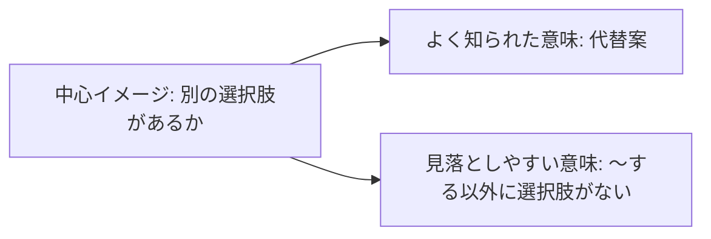

**重要語法：** have no alternative but to do：〜するほかない

### 571. saving（名詞）

**発音：** /ˈseɪvɪŋ/

<small>よく知られている意味：節約</small>

**見落としやすい意味：貯蓄、蓄え（複数形）**

**例文：** She used her savings to pay for the course.

**和訳：** 彼女はその講座の費用を払うために貯蓄を使った。

**コアイメージ：** saving は支出を抑えて残すことを表す。複数形 savings になると、残して蓄えたお金そのものを表すことが多い。

**重要語法：** one's savings：その人の貯蓄

### 572. heart（熟語）

**発音：** /hɑːrt/

<small>よく知られている意味：心・心臓</small>

**見落としやすい意味：暗記して、そらで**

**例文：** I know the opening lines of the speech by heart.

**和訳：** 私はそのスピーチの冒頭部分を暗記している。

**コアイメージ：** heart は気持ちや内面と結びつく語である。by heart は知識を自分の内側にしっかり収め、見なくても言える状態を表す熟語として覚える。

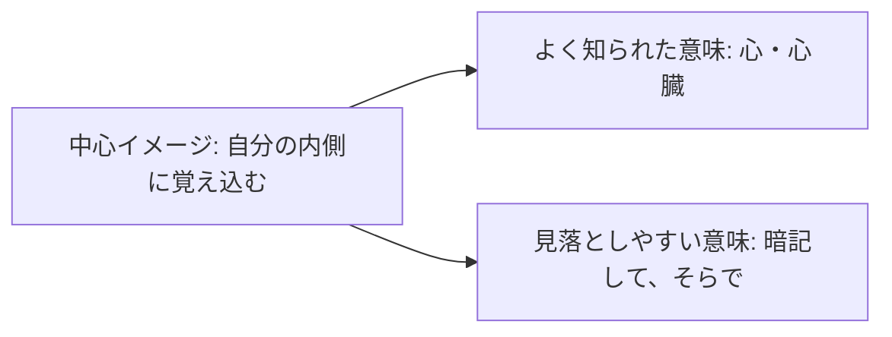

**重要語法：** learn something by heart：〜を暗記する

### 573. eye（動詞）

**発音：** /aɪ/

<small>よく知られている意味：目</small>

**見落としやすい意味：注目する、注意深く見る**

**例文：** Several companies are eyeing the same building.

**和訳：** 複数の企業が同じ建物に注目している。

**コアイメージ：** eye は名詞の「目」から、目を向けて注意深く見る動詞としても使われる。買収や計画などを検討する場面では「狙う・目を付ける」に近い。

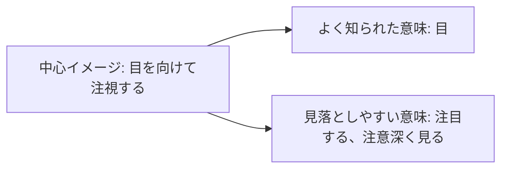

**重要語法：** eye a possible purchase：購入候補に目を付ける

### 574. table（動詞）

**発音：** /ˈteɪbəl/

<small>よく知られている意味：テーブル</small>

**見落としやすい意味：（議案などを）提出して審議の対象とする**

**例文：** The minister tabled a proposal for discussion in Parliament.

**和訳：** 大臣は議会で討議するために提案を提出した。

**コアイメージ：** table を議案の動詞として使うと、英国英語では議論の場に載せることを表す。一方、米国英語では審議を延期する意味になり得るため、地域と文脈が重要である。

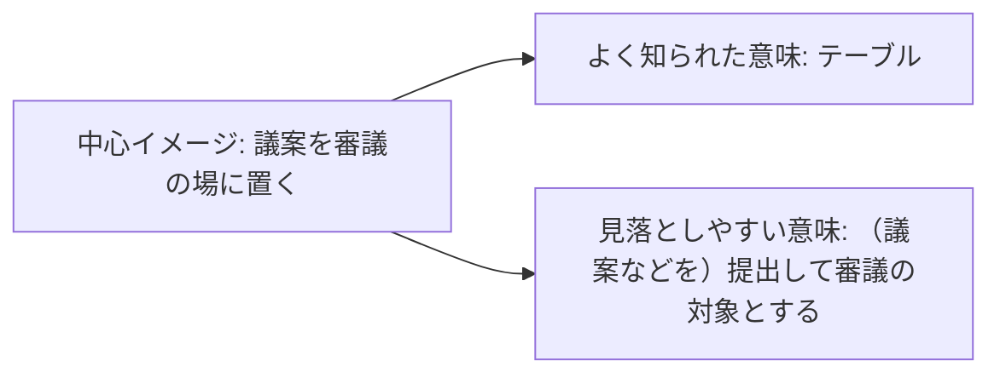

**重要語法：** 英国英語の table a proposal：提案を提出する

### 575. table（動詞）

**発音：** /ˈteɪbəl/

<small>よく知られている意味：テーブル</small>

**見落としやすい意味：（議題などの）審議を後回しにする**

**例文：** The US committee tabled the motion until next week.

**和訳：** その米国の委員会は動議の審議を翌週まで先送りした。

**コアイメージ：** 議案を table するという表現は、米国英語ではいったん脇に置いて審議を後回しにする意味になり得る。英国英語の「提出する」と取り違えないことが重要である。

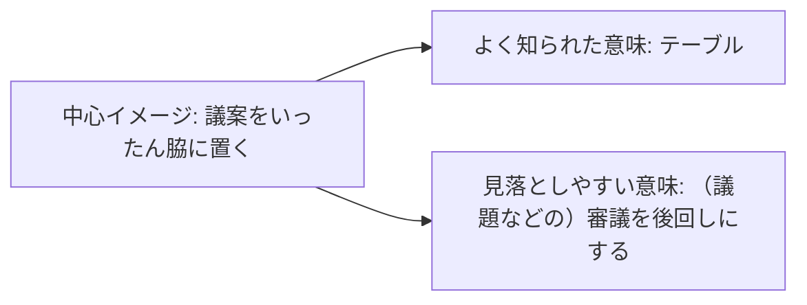

**重要語法：** 米国英語の table a motion：動議の審議を延期する

### 576. check（名詞）

**発音：** /tʃek/

<small>よく知られている意味：確認</small>

**見落としやすい意味：飲食店の勘定書**

**例文：** Could we have the check, please?

**和訳：** お勘定をお願いします。

**コアイメージ：** check には確認する動作だけでなく、金額を確認して支払うための勘定書という名詞の意味もある。特に米国の飲食店でよく使われる。

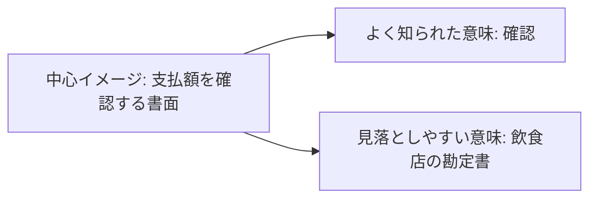

**重要語法：** ask for the check：勘定を頼む。英国では bill が一般的。

### 577. check（動詞）

**発音：** /tʃek/

<small>よく知られている意味：確認する</small>

**見落としやすい意味：増加や進行を抑える、阻止する**

**例文：** The new rules helped check the spread of the fire.

**和訳：** 新しい規則は火災の拡大を抑えるのに役立った。

**コアイメージ：** check は調べるだけでなく、動いているものを食い止めるという意味も持つ。広がりや増加を途中で止める場面で使われる。

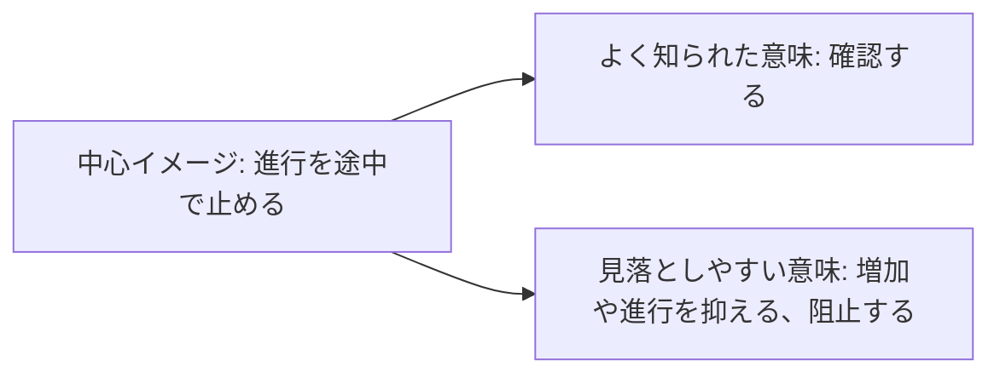

**重要語法：** check the spread of ～：〜の拡大を抑える

### 578. check（動詞）

**発音：** /tʃek/

<small>よく知られている意味：確認する</small>

**見落としやすい意味：荷物を預ける**

**例文：** We checked our bags before going through security.

**和訳：** 私たちは保安検査を受ける前に荷物を預けた。

**コアイメージ：** check には持ち物を管理のために係員へ預ける意味もある。空港やホテルでは、単なる確認ではなく荷物の預け入れを指すことがある。

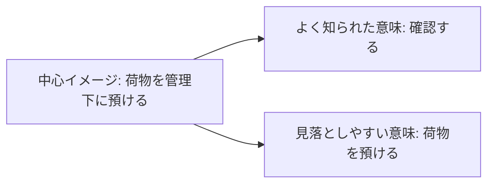

**重要語法：** check a bag：荷物を預ける

### 579. spin（動詞）

**発音：** /spɪn/

<small>よく知られている意味：回転させる</small>

**見落としやすい意味：出来事を都合よく解釈・説明する**

**例文：** The spokesperson tried to spin the delay as a success.

**和訳：** 広報担当者はその遅れを成功であるかのように説明しようとした。

**コアイメージ：** spin は物体を回すことから、事実の見せ方を自分に有利な方向へ回すという比喩で使われる。報道や政治では説明の偏りを含むことが多い。

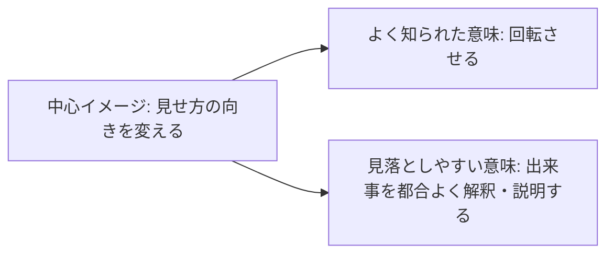

**重要語法：** spin something as ～：〜を…として都合よく説明する

### 580. critical（形容詞）

**発音：** /ˈkrɪtɪkəl/

<small>よく知られている意味：危機的な</small>

**見落としやすい意味：極めて重要な、決定的な**

**例文：** Clean drinking water is critical to public health.

**和訳：** 安全な飲み水は公衆衛生にとって極めて重要だ。

**コアイメージ：** critical は物事の結果を大きく左右する局面を表す。危機的な状況だけでなく、欠かせない要因という意味にも広がる。

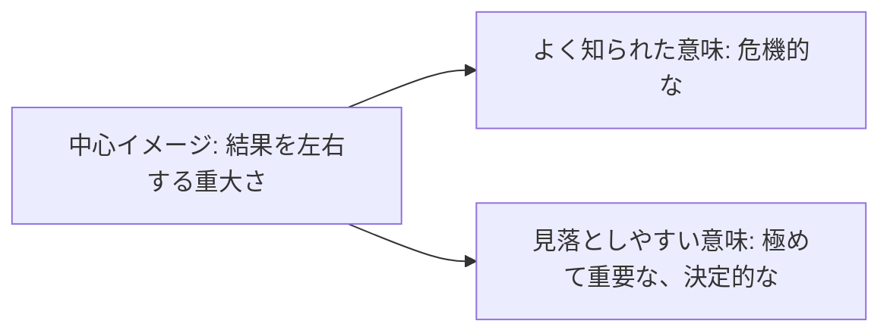

**重要語法：** be critical to ～：〜にとって極めて重要である

