# EasyVoca 完成教材｜バッチ008

採用済み語義の global_order 561〜640。語義の採否・IDは main の元データを維持する。

### 561. temple（名詞）

**発音：** /ˈtempəl/

<small>よく知られている意味：寺院</small>

**見落としやすい意味：こめかみ**

**例文：** She gently rubbed her temples after a long day.

**和訳：** 長い一日の終わりに、彼女はこめかみをそっとさすった。

**コアイメージ：** temple には寺院とは別に、頭の左右にある「こめかみ」という意味がある。現代英語では別々の意味として覚え、身体の文脈を手がかりにする。

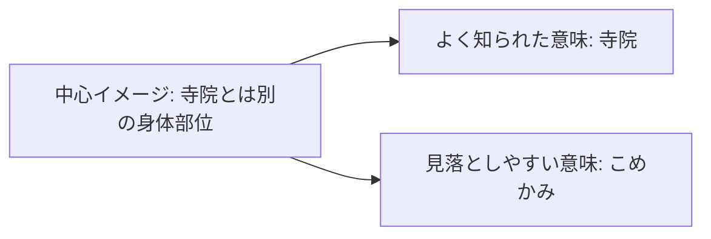

**重要語法：** rub one's temples：こめかみをさする

### 562. plant（名詞）

**発音：** /plænt/

<small>よく知られている意味：植物</small>

**見落としやすい意味：工場・製造施設・発電施設**

**例文：** The car plant employs hundreds of workers.

**和訳：** その自動車工場では何百人もの従業員が働いている。

**コアイメージ：** plant は植物だけでなく、製品を生み出すための施設全体も指す。生産の場を一つのまとまりとして捉えると、工場という意味を思い出しやすい。

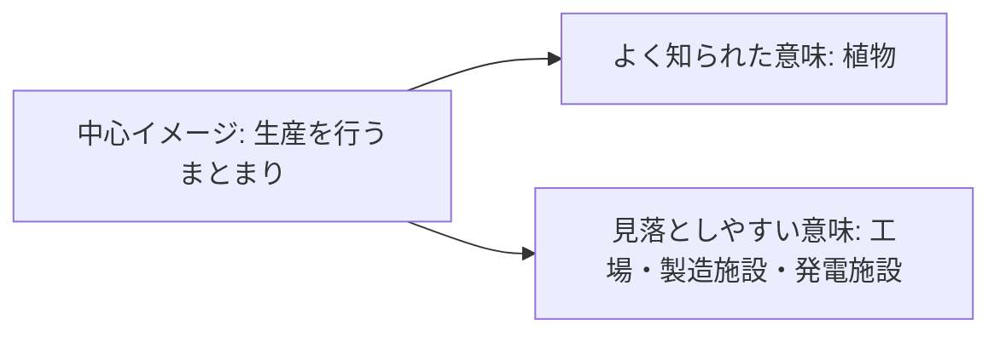

**重要語法：** a power plant：発電所

### 563. plant（名詞）

**発音：** /plænt/

<small>よく知られている意味：植物</small>

**見落としやすい意味：工場で用いる設備・機械類の総称**

**例文：** The company bought new plant and machinery.

**和訳：** その会社は新しい設備や機械を購入した。

**コアイメージ：** 工業の文脈では plant が工場そのものだけでなく、そこに据え付けられた設備の集合を表す。建物の意味か設備の意味かは周囲の名詞から判断する。

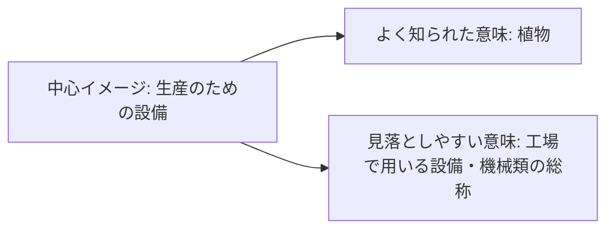

**重要語法：** plant and machinery：設備および機械類

### 564. plant（動詞）

**発音：** /plænt/

<small>よく知られている意味：植える</small>

**見落としやすい意味：証拠などをひそかに置いて仕込む**

**例文：** The thief planted false evidence in the room.

**和訳：** その泥棒は部屋に偽の証拠をひそかに仕込んだ。

**コアイメージ：** plant の「植える」は、ある場所にものを置いて残す動作を表す。そこから、証拠などを人に気づかれないように置くという意味になる。

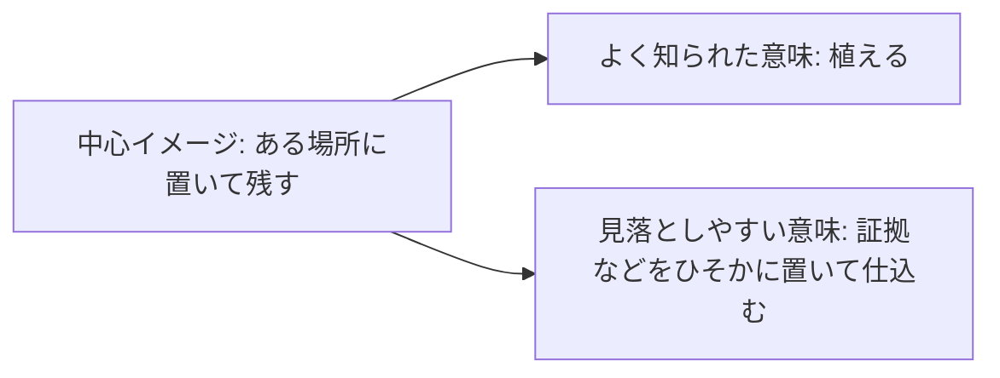

**重要語法：** plant evidence：証拠を仕込む

### 565. sale（句）

**発音：** /seɪl/

<small>よく知られている意味：販売・セール</small>

**見落としやすい意味：on saleは米国では値下げ、英国では販売中を意味しうる**

**例文：** Tickets for the concert went on sale in London today.

**和訳：** そのコンサートのチケットは今日ロンドンで発売された。

**コアイメージ：** sale の中心は商品を売る行為であり、値下げそのものではない。on sale は米国では特売を意味することが多い一方、英国では単に販売中を表すこともある。

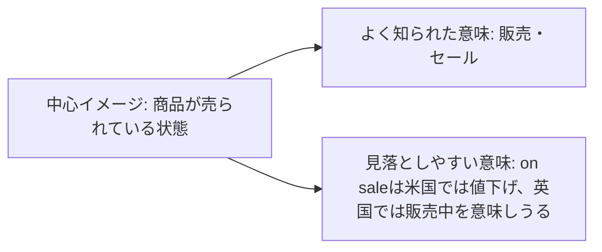

**重要語法：** go on sale：発売される。価格が下がったかは文脈で判断する。

### 566. argument（名詞）

**発音：** /ˈɑːrɡjəmənt/

<small>よく知られている意味：口論</small>

**見落としやすい意味：主張を支える論拠・推論**

**例文：** Her argument is supported by clear evidence.

**和訳：** 彼女の主張には明確な証拠による裏付けがある。

**コアイメージ：** argument の中心は、理由を示して自分の立場を論じることにある。人と対立すれば「口論」、文章で根拠を組み立てれば「論拠・主張」になる。

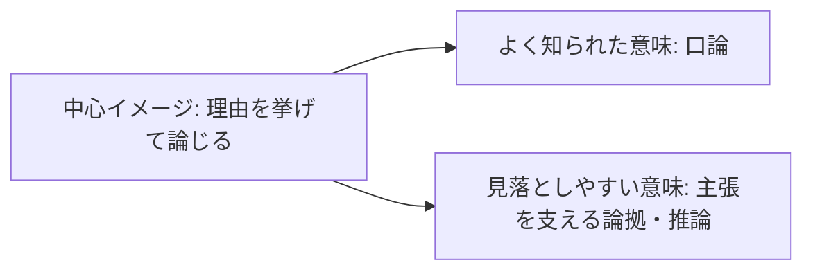

**重要語法：** support an argument with evidence：主張を証拠で裏付ける

### 567. decline（動詞）

**発音：** /dɪˈklaɪn/

<small>よく知られている意味：減少する</small>

**見落としやすい意味：丁重に断る、辞退する**

**例文：** He politely declined the offer.

**和訳：** 彼はその申し出を丁重に断った。

**コアイメージ：** decline には数量が下がる意味と、申し出を受け入れず退ける意味がある。後者では offer や invitation などが目的語になる。

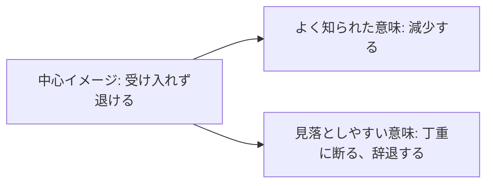

**重要語法：** decline an invitation：招待を辞退する

### 568. labor（名詞）

**発音：** /ˈleɪbər/

<small>よく知られている意味：労働</small>

**見落としやすい意味：出産に関わる陣痛・分娩**

**例文：** She went into labor late at night.

**和訳：** 彼女は夜遅くに陣痛が始まった。

**コアイメージ：** labor は強い身体的負担を伴う働きを表す。出産も身体が大きく働く過程なので、分娩や陣痛を表す用法がある。

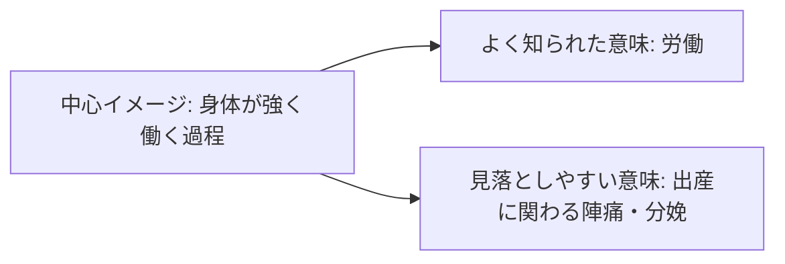

**重要語法：** go into labor：陣痛が始まる

### 569. aid（名詞）

**発音：** /eɪd/

<small>よく知られている意味：援助</small>

**見落としやすい意味：補助器具、補助手段**

**例文：** A hearing aid helps him follow conversations.

**和訳：** 補聴器のおかげで彼は会話を聞き取りやすくなっている。

**コアイメージ：** aid は人を助ける行為だけでなく、助けとなる道具も指す。何を補助する道具なのかを前の名詞で示すことが多い。

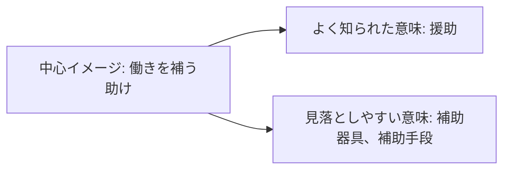

**重要語法：** hearing aid：補聴器

### 570. alternative（熟語）

**発音：** /ɔːlˈtɜːrnətɪv/

<small>よく知られている意味：代替案</small>

**見落としやすい意味：～する以外に選択肢がない**

**例文：** We had no alternative but to wait for the bus.

**和訳：** 私たちはバスを待つ以外に選択肢がなかった。

**コアイメージ：** alternative は二つ以上の選択肢のうち、別の道を表す。ほかの道が一つもないときは「〜するしかない」という表現になる。

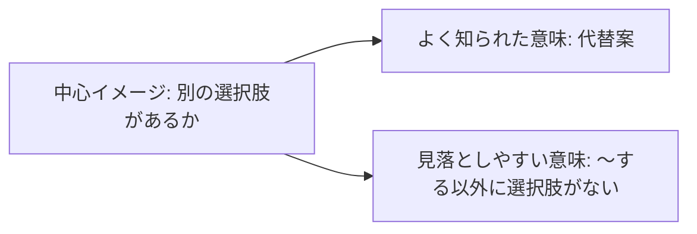

**重要語法：** have no alternative but to do：〜するほかない

### 571. saving（名詞）

**発音：** /ˈseɪvɪŋ/

<small>よく知られている意味：節約</small>

**見落としやすい意味：貯蓄、蓄え（複数形）**

**例文：** She used her savings to pay for the course.

**和訳：** 彼女はその講座の費用を払うために貯蓄を使った。

**コアイメージ：** saving は支出を抑えて残すことを表す。複数形 savings になると、残して蓄えたお金そのものを表すことが多い。


**重要語法：** one's savings：その人の貯蓄

### 572. heart（熟語）

**発音：** /hɑːrt/

<small>よく知られている意味：心・心臓</small>

**見落としやすい意味：暗記して、そらで**

**例文：** I know the opening lines of the speech by heart.

**和訳：** 私はそのスピーチの冒頭部分を暗記している。

**コアイメージ：** heart は気持ちや内面と結びつく語である。by heart は知識を自分の内側にしっかり収め、見なくても言える状態を表す熟語として覚える。

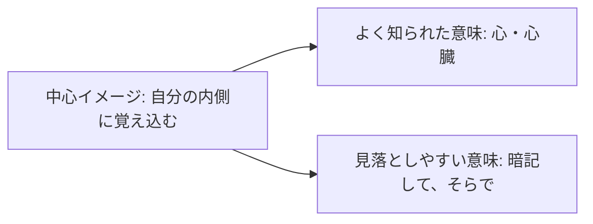

**重要語法：** learn something by heart：〜を暗記する

### 573. eye（動詞）

**発音：** /aɪ/

<small>よく知られている意味：目</small>

**見落としやすい意味：注目する、注意深く見る**

**例文：** Several companies are eyeing the same building.

**和訳：** 複数の企業が同じ建物に注目している。

**コアイメージ：** eye は名詞の「目」から、目を向けて注意深く見る動詞としても使われる。買収や計画などを検討する場面では「狙う・目を付ける」に近い。

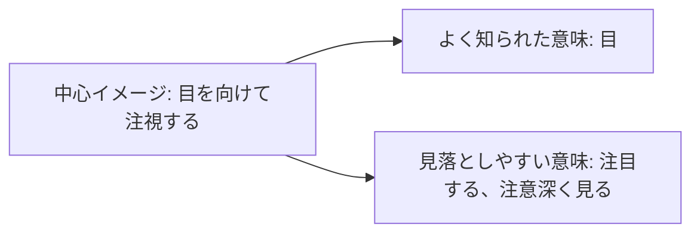

**重要語法：** eye a possible purchase：購入候補に目を付ける

### 574. table（動詞）

**発音：** /ˈteɪbəl/

<small>よく知られている意味：テーブル</small>

**見落としやすい意味：（議案などを）提出して審議の対象とする**

**例文：** The minister tabled a proposal for discussion in Parliament.

**和訳：** 大臣は議会で討議するために提案を提出した。

**コアイメージ：** table を議案の動詞として使うと、英国英語では議論の場に載せることを表す。一方、米国英語では審議を延期する意味になり得るため、地域と文脈が重要である。

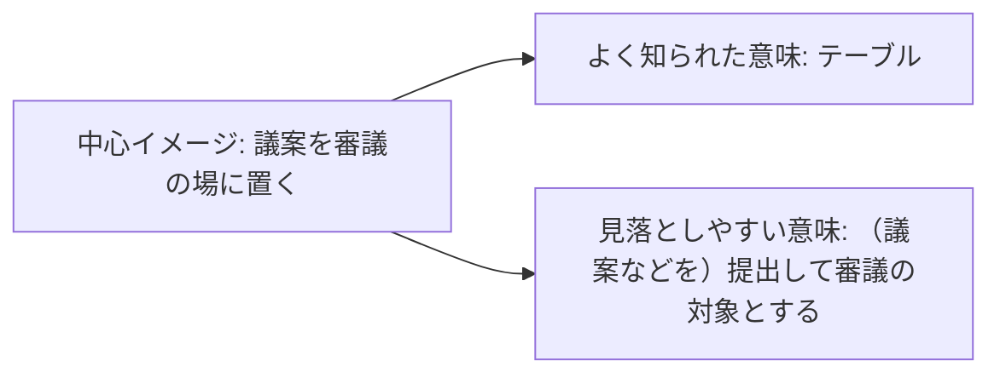

**重要語法：** 英国英語の table a proposal：提案を提出する

### 575. table（動詞）

**発音：** /ˈteɪbəl/

<small>よく知られている意味：テーブル</small>

**見落としやすい意味：（議題などの）審議を後回しにする**

**例文：** The US committee tabled the motion until next week.

**和訳：** その米国の委員会は動議の審議を翌週まで先送りした。

**コアイメージ：** 議案を table するという表現は、米国英語ではいったん脇に置いて審議を後回しにする意味になり得る。英国英語の「提出する」と取り違えないことが重要である。

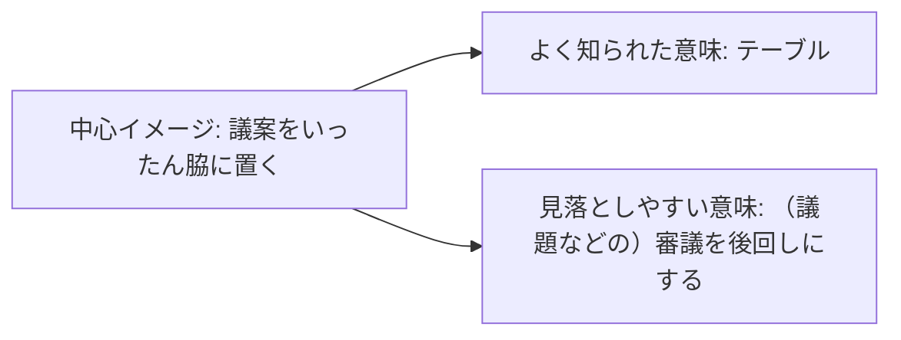

**重要語法：** 米国英語の table a motion：動議の審議を延期する

### 576. check（名詞）

**発音：** /tʃek/

<small>よく知られている意味：確認</small>

**見落としやすい意味：飲食店の勘定書**

**例文：** Could we have the check, please?

**和訳：** お勘定をお願いします。

**コアイメージ：** check には確認する動作だけでなく、金額を確認して支払うための勘定書という名詞の意味もある。特に米国の飲食店でよく使われる。

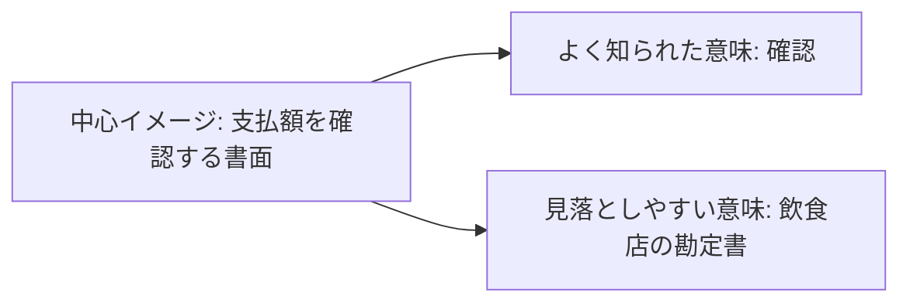

**重要語法：** ask for the check：勘定を頼む。英国では bill が一般的。

### 577. check（動詞）

**発音：** /tʃek/

<small>よく知られている意味：確認する</small>

**見落としやすい意味：増加や進行を抑える、阻止する**

**例文：** The new rules helped check the spread of the fire.

**和訳：** 新しい規則は火災の拡大を抑えるのに役立った。

**コアイメージ：** check は調べるだけでなく、動いているものを食い止めるという意味も持つ。広がりや増加を途中で止める場面で使われる。

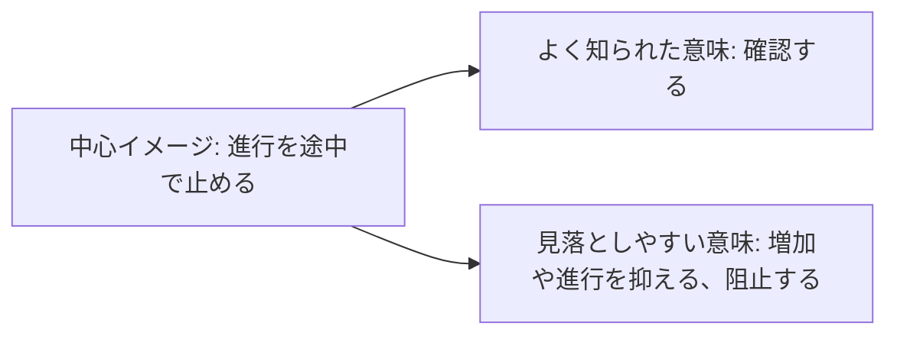

**重要語法：** check the spread of ～：〜の拡大を抑える

### 578. check（動詞）

**発音：** /tʃek/

<small>よく知られている意味：確認する</small>

**見落としやすい意味：荷物を預ける**

**例文：** We checked our bags before going through security.

**和訳：** 私たちは保安検査を受ける前に荷物を預けた。

**コアイメージ：** check には持ち物を管理のために係員へ預ける意味もある。空港やホテルでは、単なる確認ではなく荷物の預け入れを指すことがある。

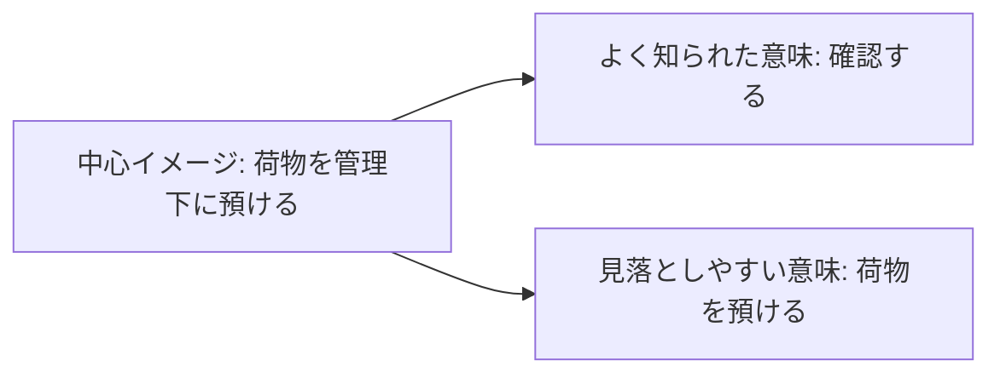

**重要語法：** check a bag：荷物を預ける

### 579. spin（動詞）

**発音：** /spɪn/

<small>よく知られている意味：回転させる</small>

**見落としやすい意味：出来事を都合よく解釈・説明する**

**例文：** The spokesperson tried to spin the delay as a success.

**和訳：** 広報担当者はその遅れを成功であるかのように説明しようとした。

**コアイメージ：** spin は物体を回すことから、事実の見せ方を自分に有利な方向へ回すという比喩で使われる。報道や政治では説明の偏りを含むことが多い。

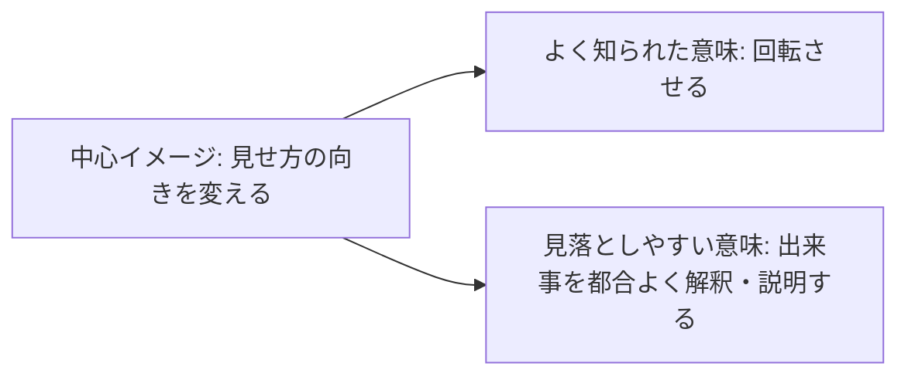

**重要語法：** spin something as ～：〜を…として都合よく説明する

### 580. critical（形容詞）

**発音：** /ˈkrɪtɪkəl/

<small>よく知られている意味：危機的な</small>

**見落としやすい意味：極めて重要な、決定的な**

**例文：** Clean drinking water is critical to public health.

**和訳：** 安全な飲み水は公衆衛生にとって極めて重要だ。

**コアイメージ：** critical は物事の結果を大きく左右する局面を表す。危機的な状況だけでなく、欠かせない要因という意味にも広がる。

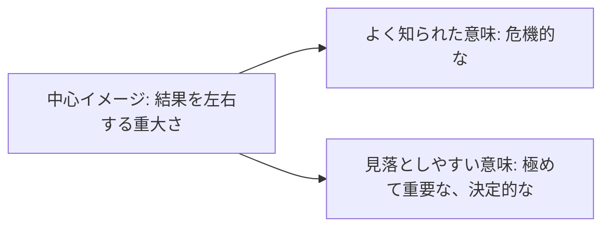

**重要語法：** be critical to ～：〜にとって極めて重要である

### 581. critical（形容詞）

**発音：** /ˈkrɪtɪkəl/

<small>よく知られている意味：危機的な・極めて重要な</small>

**見落としやすい意味：批判的な、欠点を厳しく指摘する**

**例文：** The reviewer was critical of the website's design.

**和訳：** その評論家はウェブサイトのデザインを批判的に評価した。

**コアイメージ：** critical には物事を注意深く吟味する意味がある。問題点を見極めて指摘する場面では「批判的な」という意味になる。

```mermaid
flowchart LR
    A["中心イメージ: 吟味して問題点を見極める"]
    B["よく知られた意味: 危機的な・極めて重要な"]
    C["見落としやすい意味: 批判的な、欠点を厳しく指摘する"]
    A --> B
    A --> C
```

**重要語法：** be critical of ～：〜を批判する

### 582. reflect（句動詞）

**発音：** /rɪˈflekt/

<small>よく知られている意味：反射する・映す</small>

**見落としやすい意味：～について振り返り、熟考する**

**例文：** She reflected on what she had learned that day.

**和訳：** 彼女はその日に学んだことを振り返って考えた。

**コアイメージ：** reflect は鏡が像を返すように、心の中でも出来事をもう一度取り上げる意味に広がる。reflect on で経験や問題を振り返り、深く考える。

```mermaid
flowchart LR
    A["中心イメージ: 出来事を心の中に映し直す"]
    B["よく知られた意味: 反射する・映す"]
    C["見落としやすい意味: ～について振り返り、熟考する"]
    A --> B
    A --> C
```

**重要語法：** reflect on one's experience：経験を振り返る

### 583. principle（熟語）

**発音：** /ˈprɪnsəpəl/

<small>よく知られている意味：原理・信念</small>

**見落としやすい意味：原理上は、原則として**

**例文：** In principle, all students can join the project.

**和訳：** 原則として、すべての生徒がその企画に参加できる。

**コアイメージ：** principle は判断の基礎となる原理や原則を表す。in principle は実際の例外や制約とは分けて、原則のレベルで述べるときに使う。

```mermaid
flowchart LR
    A["中心イメージ: 個別の事情より基本原則"]
    B["よく知られた意味: 原理・信念"]
    C["見落としやすい意味: 原理上は、原則として"]
    A --> B
    A --> C
```

**重要語法：** in principle：原則として、理論上は

### 584. editorial（名詞）

**発音：** /ˌedəˈtɔːriəl/

<small>よく知られている意味：編集に関する</small>

**見落としやすい意味：新聞などの社説**

**例文：** The newspaper published an editorial about public transport.

**和訳：** その新聞は公共交通についての社説を掲載した。

**コアイメージ：** editorial は編集者の判断や方針に関わる語である。新聞では編集部の意見を示す記事、すなわち社説を名詞で表す。

```mermaid
flowchart LR
    A["中心イメージ: 編集部としての意見"]
    B["よく知られた意味: 編集に関する"]
    C["見落としやすい意味: 新聞などの社説"]
    A --> B
    A --> C
```

**重要語法：** write an editorial：社説を書く

### 585. quote（名詞）

**発音：** /kwoʊt/

<small>よく知られている意味：引用・引用する</small>

**見落としやすい意味：見積価格、見積書**

**例文：** We asked three builders for a quote.

**和訳：** 私たちは3社の建設業者に見積もりを依頼した。

**コアイメージ：** quote は言葉をそのまま挙げるだけでなく、価格を具体的な数字として提示することも表す。名詞では提示された見積額や見積書になる。

```mermaid
flowchart LR
    A["中心イメージ: 言葉や数字を提示する"]
    B["よく知られた意味: 引用・引用する"]
    C["見落としやすい意味: 見積価格、見積書"]
    A --> B
    A --> C
```

**重要語法：** get a quote：見積もりを取る

### 586. associate（名詞）

**発音：** /əˈsoʊsiət/

<small>よく知られている意味：関連づける</small>

**見落としやすい意味：仕事上の知人・協力者、同僚**

**例文：** She asked a business associate for advice.

**和訳：** 彼女は仕事上の知人に助言を求めた。

**コアイメージ：** associate は人や物が結びつくという意味を持つ。名詞になると、仕事などを通じてつながりのある人物を指す。

```mermaid
flowchart LR
    A["中心イメージ: 人と人が関係で結びつく"]
    B["よく知られた意味: 関連づける"]
    C["見落としやすい意味: 仕事上の知人・協力者、同僚"]
    A --> B
    A --> C
```

**重要語法：** business associate：仕事上の知人・取引関係者

### 587. associate（動詞）

**発音：** /əˈsoʊsieɪt/

<small>よく知られている意味：関連づける</small>

**見落としやすい意味：（人と）交際する、付き合う**

**例文：** He rarely associates with people outside his field.

**和訳：** 彼は自分の専門分野以外の人とはめったに付き合わない。

**コアイメージ：** associate の結びつくイメージが人間関係に向くと、交際するという意味になる。associate with は人と行動や時間を共にすることを表せる。

```mermaid
flowchart LR
    A["中心イメージ: 人とつながりを持つ"]
    B["よく知られた意味: 関連づける"]
    C["見落としやすい意味: （人と）交際する、付き合う"]
    A --> B
    A --> C
```

**重要語法：** associate with ～：〜と付き合う

### 588. effective（形容詞）

**発音：** /ɪˈfektɪv/

<small>よく知られている意味：効果的な</small>

**見落としやすい意味：その日付から効力を持つ**

**例文：** The new rule will be effective from April 1.

**和訳：** 新しい規則は4月1日から効力を持つ。

**コアイメージ：** effective の中心には、何かが実際に作用するという意味がある。規則や契約では「効果的」ではなく、いつから法的・制度的に効力を持つかを表す。

```mermaid
flowchart LR
    A["中心イメージ: 実際に効力を発揮する"]
    B["よく知られた意味: 効果的な"]
    C["見落としやすい意味: その日付から効力を持つ"]
    A --> B
    A --> C
```

**重要語法：** effective from ～：〜から有効な

### 589. civil（形容詞）

**発音：** /ˈsɪvəl/

<small>よく知られている意味：市民の・民間の</small>

**見落としやすい意味：礼儀正しい、丁重な**

**例文：** Despite their disagreement, both speakers remained civil.

**和訳：** 意見が対立していたが、両者は礼儀正しい態度を保った。

**コアイメージ：** civil は市民社会の中での振る舞いにも関わる語である。人に使うと、対立していても社会的な礼儀を守るという意味になる。

```mermaid
flowchart LR
    A["中心イメージ: 社会で求められる礼儀"]
    B["よく知られた意味: 市民の・民間の"]
    C["見落としやすい意味: 礼儀正しい、丁重な"]
    A --> B
    A --> C
```

**重要語法：** be civil to ～：〜に礼儀正しく接する

### 590. lie（句動詞）

**発音：** /laɪ/

<small>よく知られている意味：うそをつく</small>

**見落としやすい意味：問題の本質・原因が～にある**

**例文：** The main difficulty lies in finding enough volunteers.

**和訳：** 主な難しさは、十分な人数のボランティアを見つけることにある。

**コアイメージ：** 横たわる意味の lie は、物や状態がある場所に位置することを表す。抽象的な問題に使うと、その本質や原因がどこにあるかを示す。

```mermaid
flowchart LR
    A["中心イメージ: 問題の所在がそこにある"]
    B["よく知られた意味: うそをつく"]
    C["見落としやすい意味: 問題の本質・原因が～にある"]
    A --> B
    A --> C
```

**重要語法：** lie in ～：〜にある、〜に起因する

### 591. lie（動詞）

**発音：** /laɪ/

<small>よく知られている意味：うそをつく</small>

**見落としやすい意味：横たわる、横になっている**

**例文：** The dog was lying under the table.

**和訳：** 犬はテーブルの下に横たわっていた。

**コアイメージ：** lie は「うそをつく」と「横たわる」で別の動詞として使われる。姿勢や位置の話なら「横たわる」であり、過去形は lay、過去分詞は lain になる。

```mermaid
flowchart LR
    A["中心イメージ: 身体が横向きに位置する"]
    B["よく知られた意味: うそをつく"]
    C["見落としやすい意味: 横たわる、横になっている"]
    A --> B
    A --> C
```

**重要語法：** lie–lay–lain（横たわる）と lie–lied–lied（うそをつく）を区別

### 592. judge（句）

**発音：** /dʒʌdʒ/

<small>よく知られている意味：裁判官・判断する</small>

**見落としやすい意味：～から判断すると**

**例文：** Judging from the empty seats, the event is not full.

**和訳：** 空席の様子から判断すると、その催しは満席ではない。

**コアイメージ：** judge は情報をもとに判断することを表す。judging from は観察した材料を根拠に、話し手がどう判断するかを示す定型表現である。

```mermaid
flowchart LR
    A["中心イメージ: 見える手がかりから判断する"]
    B["よく知られた意味: 裁判官・判断する"]
    C["見落としやすい意味: ～から判断すると"]
    A --> B
    A --> C
```

**重要語法：** judging from ～：〜から判断すると

### 593. resort（名詞句）

**発音：** /rɪˈzɔːrt/

<small>よく知られている意味：行楽地・保養地</small>

**見落としやすい意味：ほかに手段がない場合の最終手段**

**例文：** As a last resort, we asked a neighbor for help.

**和訳：** 最後の手段として、私たちは近所の人に助けを求めた。

**コアイメージ：** resort には人が行き着く場所や頼る先という発想がある。last resort はほかの方法が尽きたあと、最後に頼る手段を表す。

```mermaid
flowchart LR
    A["中心イメージ: 困った末に頼る先"]
    B["よく知られた意味: 行楽地・保養地"]
    C["見落としやすい意味: ほかに手段がない場合の最終手段"]
    A --> B
    A --> C
```

**重要語法：** as a last resort：最後の手段として

### 594. resort（句動詞）

**発音：** /rɪˈzɔːrt/

<small>よく知られている意味：行楽地・保養地</small>

**見落としやすい意味：ほかに方法がなく、不本意な手段に頼る**

**例文：** Without a map, we resorted to asking for directions.

**和訳：** 地図がなかったので、私たちは道を尋ねるという手段に頼った。

**コアイメージ：** resort to は、ほかに適当な方法がなく、ある手段を使うことを表す。好んで選ぶよりも、やむを得ず頼るニュアンスがある。

```mermaid
flowchart LR
    A["中心イメージ: 他に方法がなく頼る"]
    B["よく知られた意味: 行楽地・保養地"]
    C["見落としやすい意味: ほかに方法がなく、不本意な手段に頼る"]
    A --> B
    A --> C
```

**重要語法：** resort to doing：やむを得ず〜する

### 595. object（名詞）

**発音：** /ˈɑːbdʒekt/

<small>よく知られている意味：物体・もの</small>

**見落としやすい意味：目的、狙い**

**例文：** The object of the game is to find three hidden keys.

**和訳：** そのゲームの目的は、隠された3本の鍵を見つけることだ。

**コアイメージ：** object には意識や行動が向けられる対象という意味がある。手で触れられる対象なら物体、行動が向かう到達点なら目的を表す。

```mermaid
flowchart LR
    A["中心イメージ: 意識や行動が向かう対象"]
    B["よく知られた意味: 物体・もの"]
    C["見落としやすい意味: 目的、狙い"]
    A --> B
    A --> C
```

**重要語法：** the object of ～：〜の目的

### 596. object（動詞）

**発音：** /əbˈdʒekt/

<small>よく知られている意味：物体・もの</small>

**見落としやすい意味：反対する、異議を唱える**

**例文：** Many residents objected to the proposed road.

**和訳：** 多くの住民がその道路建設案に反対した。

**コアイメージ：** 動詞 object はある考えに異議を唱えることを表す。名詞の「物体」とは品詞も発音のアクセントも異なるので、文中で動詞になっていないか確認する。

```mermaid
flowchart LR
    A["中心イメージ: 意見に対して異議を示す"]
    B["よく知られた意味: 物体・もの"]
    C["見落としやすい意味: 反対する、異議を唱える"]
    A --> B
    A --> C
```

**重要語法：** object to ～：〜に反対する。to は前置詞。

### 597. flight（名詞）

**発音：** /flaɪt/

<small>よく知られている意味：飛行・航空便</small>

**見落としやすい意味：一続きの階段**

**例文：** Her office is two flights of stairs above the entrance.

**和訳：** 彼女の事務所は入り口から階段を2区間上がったところにある。

**コアイメージ：** flight は空中を飛ぶこと以外にも、一続きになった移動のまとまりを表す。階段では踊り場から次の踊り場までの一続きの段を数える。

```mermaid
flowchart LR
    A["中心イメージ: ひと続きの移動区間"]
    B["よく知られた意味: 飛行・航空便"]
    C["見落としやすい意味: 一続きの階段"]
    A --> B
    A --> C
```

**重要語法：** a flight of stairs：一続きの階段

### 598. flight（名詞）

**発音：** /flaɪt/

<small>よく知られている意味：飛行・航空便</small>

**見落としやすい意味：逃亡、逃走**

**例文：** The sudden noise sent the birds into flight.

**和訳：** 突然の音で鳥たちは飛び去った。

**コアイメージ：** flight は飛ぶ動きから、危険などを避けてその場から去る行為も指す。人の逃亡にも使われ、単なる飛行とは文脈が異なる。

```mermaid
flowchart LR
    A["中心イメージ: その場からすばやく離れる"]
    B["よく知られた意味: 飛行・航空便"]
    C["見落としやすい意味: 逃亡、逃走"]
    A --> B
    A --> C
```

**重要語法：** take flight：逃げ出す、飛び立つ

### 599. prove（動詞）

**発音：** /pruːv/

<small>よく知られている意味：証明する</small>

**見落としやすい意味：結局〜だと分かる、〜という結果になる**

**例文：** The extra practice proved useful before the match.

**和訳：** その追加練習は試合前に役立つことが分かった。

**コアイメージ：** prove は証明するだけでなく、後になって実際の性質が明らかになることも表す。prove + 形容詞で「結局〜だと分かる」という意味になる。

```mermaid
flowchart LR
    A["中心イメージ: 結果によって性質が明らかになる"]
    B["よく知られた意味: 証明する"]
    C["見落としやすい意味: 結局〜だと分かる、〜という結果になる"]
    A --> B
    A --> C
```

**重要語法：** prove useful / difficult：役立つ／難しいと分かる

### 600. function（名詞）

**発音：** /ˈfʌŋkʃən/

<small>よく知られている意味：機能・働き</small>

**見落としやすい意味：社交的な催し・公式行事**

**例文：** The school held a formal function for its former students.

**和訳：** その学校は卒業生のために正式な催しを開いた。

**コアイメージ：** function は物事が果たす役割や働きを表す。社会的な場面では、一定の目的や役割を持って開かれる公式な催しを指す。

```mermaid
flowchart LR
    A["中心イメージ: 特定の役割を持つ行事"]
    B["よく知られた意味: 機能・働き"]
    C["見落としやすい意味: 社交的な催し・公式行事"]
    A --> B
    A --> C
```

**重要語法：** a formal function：公式行事

### 601. function（名詞句）

**発音：** /ˈfʌŋkʃən/

<small>よく知られている意味：機能・働き</small>

**見落としやすい意味：〜によって決まる結果・関数関係である**

**例文：** The result is a function of time and temperature.

**和訳：** その結果は時間と温度によって決まる。

**コアイメージ：** function は数学では入力と出力の対応関係を表す。一般の文章でも a function of を使い、ある結果が何によって左右されるかを示せる。

```mermaid
flowchart LR
    A["中心イメージ: 条件によって結果が決まる"]
    B["よく知られた意味: 機能・働き"]
    C["見落としやすい意味: 〜によって決まる結果・関数関係である"]
    A --> B
    A --> C
```

**重要語法：** be a function of ～：〜によって決まる

### 602. function（動詞）

**発音：** /ˈfʌŋkʃən/

<small>よく知られている意味：機能・働き（名詞）</small>

**見落としやすい意味：機能する、正しく働く**

**例文：** The printer does not function without paper.

**和訳：** そのプリンターは紙がなければ動作しない。

**コアイメージ：** function は名詞だけでなく、ある目的に沿って働く動詞にもなる。機械や制度が正常に働いているかを述べるときに使う。

```mermaid
flowchart LR
    A["中心イメージ: 役割どおりに働く"]
    B["よく知られた意味: 機能・働き（名詞）"]
    C["見落としやすい意味: 機能する、正しく働く"]
    A --> B
    A --> C
```

**重要語法：** function properly：正常に機能する

### 603. director（名詞）

**発音：** /dəˈrektər/

<small>よく知られている意味：映画監督・指導者</small>

**見落としやすい意味：企業・団体の取締役、理事**

**例文：** She joined the company as a director last year.

**和訳：** 彼女は昨年、その会社の取締役に就任した。

**コアイメージ：** director は組織や活動の方向を決める人を指す。映画の監督に限らず、企業では経営上の意思決定に関わる取締役や理事を表す。

```mermaid
flowchart LR
    A["中心イメージ: 組織の方向を決める人"]
    B["よく知られた意味: 映画監督・指導者"]
    C["見落としやすい意味: 企業・団体の取締役、理事"]
    A --> B
    A --> C
```

**重要語法：** board of directors：取締役会

### 604. worth（語法）

**発音：** /wɜːrθ/

<small>よく知られている意味：価値がある</small>

**見落としやすい意味：worthの後は動名詞を取る（worth to doではない）**

**例文：** This museum is worth visiting.

**和訳：** この博物館は訪れる価値がある。

**コアイメージ：** worth は「〜の価値がある」を表すが、後ろに動作を置くときは動名詞を用いる。worth to visit のような不定詞の形にしないことが重要である。

```mermaid
flowchart LR
    A["中心イメージ: その行為をする価値"]
    B["よく知られた意味: 価値がある"]
    C["見落としやすい意味: worthの後は動名詞を取る（worth to doではない）"]
    A --> B
    A --> C
```

**重要語法：** be worth doing：〜する価値がある

### 605. factor（句動詞）

**発音：** /ˈfæktər/

<small>よく知られている意味：要因</small>

**見落としやすい意味：要因として計算・考慮に入れる**

**例文：** We must factor the travel costs into our budget.

**和訳：** 私たちは旅費を予算に織り込まなければならない。

**コアイメージ：** factor は結果に影響する要因を表す。動詞ではその要因を計算や判断の中に入れ、無視せず織り込む意味になる。

```mermaid
flowchart LR
    A["中心イメージ: 結果を左右する要因を組み入れる"]
    B["よく知られた意味: 要因"]
    C["見落としやすい意味: 要因として計算・考慮に入れる"]
    A --> B
    A --> C
```

**重要語法：** factor A into B：AをBに織り込む

### 606. spot（熟語）

**発音：** /spɑːt/

<small>よく知られている意味：場所・地点</small>

**見落としやすい意味：人を返事や判断に困る立場に置く**

**例文：** The unexpected question put me on the spot.

**和訳：** 予想外の質問をされ、私はその場で答えに困った。

**コアイメージ：** spot はその場・位置を表す。put someone on the spot は人を逃げにくい立場に置き、すぐ返事や判断を求める表現である。

```mermaid
flowchart LR
    A["中心イメージ: 逃げ場のないその場に置く"]
    B["よく知られた意味: 場所・地点"]
    C["見落としやすい意味: 人を返事や判断に困る立場に置く"]
    A --> B
    A --> C
```

**重要語法：** put someone on the spot：人を返答に困らせる

### 607. spot（動詞）

**発音：** /spɑːt/

<small>よく知られている意味：場所・しみ</small>

**見落としやすい意味：見つける、見抜く、気づく**

**例文：** She spotted a small error in the chart.

**和訳：** 彼女は図表の小さな誤りに気づいた。

**コアイメージ：** spot は見分けられる小さな点や場所を表す。動詞になると、視界や情報の中から特定のものを見つけ出す意味になる。

```mermaid
flowchart LR
    A["中心イメージ: 多数の中から一点を見つける"]
    B["よく知られた意味: 場所・しみ"]
    C["見落としやすい意味: 見つける、見抜く、気づく"]
    A --> B
    A --> C
```

**重要語法：** spot a mistake：間違いを見つける

### 608. sport（熟語）

**発音：** /spɔːrt/

<small>よく知られている意味：スポーツ</small>

**見落としやすい意味：不利でも快く応じる人、潔い人**

**例文：** He was a good sport about losing the game.

**和訳：** 彼は試合に負けても潔く振る舞った。

**コアイメージ：** sport は競技そのものだけでなく、競技で求められる公平で気持ちのよい態度にもつながる。a good sport は不利な結果も快く受け入れる人をいう。

```mermaid
flowchart LR
    A["中心イメージ: 競技での気持ちのよい態度"]
    B["よく知られた意味: スポーツ"]
    C["見落としやすい意味: 不利でも快く応じる人、潔い人"]
    A --> B
    A --> C
```

**重要語法：** be a good sport：潔く応じる

### 609. wear（句動詞）

**発音：** /wer/

<small>よく知られている意味：着る・身につける</small>

**見落としやすい意味：効果・感情などが次第に薄れる**

**例文：** The excitement wore off after a few hours.

**和訳：** 数時間後、その興奮は次第に薄れた。

**コアイメージ：** wear には使ううちにすり減るという意味がある。wear off は効き目や感情が時間とともに薄れ、消えていくことを表す。

```mermaid
flowchart LR
    A["中心イメージ: 時間とともにすり減って消える"]
    B["よく知られた意味: 着る・身につける"]
    C["見落としやすい意味: 効果・感情などが次第に薄れる"]
    A --> B
    A --> C
```

**重要語法：** wear off：効き目・興奮などが薄れる

### 610. wear（句動詞）

**発音：** /wer/

<small>よく知られている意味：着る・身につける</small>

**見落としやすい意味：使い古す、疲れ果てさせる**

**例文：** The long walk wore us out.

**和訳：** 長い散歩で私たちはすっかり疲れ果てた。

**コアイメージ：** wear は繰り返しの使用で物が消耗するイメージを持つ。wear out は物を使い古すだけでなく、人の体力を使い切ることにも使う。

```mermaid
flowchart LR
    A["中心イメージ: 使い続けて消耗させる"]
    B["よく知られた意味: 着る・身につける"]
    C["見落としやすい意味: 使い古す、疲れ果てさせる"]
    A --> B
    A --> C
```

**重要語法：** wear someone out：人を疲れ果てさせる

### 611. respond（動詞）

**発音：** /rɪˈspɑːnd/

<small>よく知られている意味：返事をする</small>

**見落としやすい意味：治療・刺激などに反応を示す**

**例文：** The patient responded well to the new treatment.

**和訳：** その患者は新しい治療によく反応した。

**コアイメージ：** respond は言葉で返答するだけでなく、外からの働きかけに変化を示すことも表す。治療や刺激に身体が反応する場合にも使う。

```mermaid
flowchart LR
    A["中心イメージ: 働きかけに反応を返す"]
    B["よく知られた意味: 返事をする"]
    C["見落としやすい意味: 治療・刺激などに反応を示す"]
    A --> B
    A --> C
```

**重要語法：** respond well to treatment：治療に良好な反応を示す

### 612. entity（名詞）

**発音：** /ˈentəti/

<small>よく知られている意味：存在・実体</small>

**見落としやすい意味：独立した法人、法的主体**

**例文：** The two branches are separate legal entities.

**和訳：** その二つの支店は別々の法人として扱われる。

**コアイメージ：** entity は一つの独立した存在やまとまりを意味する。法律や経済の文章では、権利や義務を持つ独立した組織を指す。

```mermaid
flowchart LR
    A["中心イメージ: 独立した一つの主体"]
    B["よく知られた意味: 存在・実体"]
    C["見落としやすい意味: 独立した法人、法的主体"]
    A --> B
    A --> C
```

**重要語法：** legal entity：法人・法的主体

### 613. promise（名詞）

**発音：** /ˈprɑːmɪs/

<small>よく知られている意味：約束</small>

**見落としやすい意味：将来性、成功の見込み**

**例文：** The young researcher showed great promise.

**和訳：** その若い研究者には大きな将来性が感じられた。

**コアイメージ：** promise は将来の実現を期待させる約束を表す。人や計画について使うと、将来よい成果を生む見込みという意味になる。

```mermaid
flowchart LR
    A["中心イメージ: 将来に期待できる見込み"]
    B["よく知られた意味: 約束"]
    C["見落としやすい意味: 将来性、成功の見込み"]
    A --> B
    A --> C
```

**重要語法：** show promise：将来性を示す

### 614. reference（名詞）

**発音：** /ˈrefərəns/

<small>よく知られている意味：参照・参考</small>

**見落としやすい意味：推薦状・推薦人（採用などで）**

**例文：** Please provide two references with your application.

**和訳：** 応募書類には推薦人を2名記載してください。

**コアイメージ：** reference は情報を照らし合わせるための手がかりを表す。採用では応募者について照会できる人物や、その人が書いた推薦状を指す。

```mermaid
flowchart LR
    A["中心イメージ: 人物を評価するための照会先"]
    B["よく知られた意味: 参照・参考"]
    C["見落としやすい意味: 推薦状・推薦人（採用などで）"]
    A --> B
    A --> C
```

**重要語法：** provide references：推薦人・推薦状を提出する

### 615. pretty（副詞）

**発音：** /ˈprɪti/

<small>よく知られている意味：かわいい・きれいな</small>

**見落としやすい意味：かなり、比較的**

**例文：** The instructions are pretty simple.

**和訳：** その説明書の内容はかなり簡単だ。

**コアイメージ：** pretty は形容詞では見た目の美しさを表すが、副詞では程度を表す。pretty simple のように形容詞の前に置かれ、「かなり」という意味になる。

```mermaid
flowchart LR
    A["中心イメージ: 程度をそれなりに強める"]
    B["よく知られた意味: かわいい・きれいな"]
    C["見落としやすい意味: かなり、比較的"]
    A --> B
    A --> C
```

**重要語法：** pretty good：かなりよい（口語的）

### 616. tend（動詞）

**発音：** /tend/

<small>よく知られている意味：〜する傾向がある</small>

**見落としやすい意味：人・動物・植物などの世話をする**

**例文：** He tends the flowers in the school garden.

**和訳：** 彼は学校の花壇の花の世話をしている。

**コアイメージ：** tend には状態に注意を向ける動詞の用法がある。人や動植物を相手にすると、手入れしたり面倒を見たりする意味になる。

```mermaid
flowchart LR
    A["中心イメージ: 注意を向けて世話をする"]
    B["よく知られた意味: 〜する傾向がある"]
    C["見落としやすい意味: 人・動物・植物などの世話をする"]
    A --> B
    A --> C
```

**重要語法：** tend a garden：庭の手入れをする

### 617. western（名詞）

**発音：** /ˈwestərn/

<small>よく知られている意味：西の・西洋の</small>

**見落としやすい意味：西部劇**

**例文：** We watched a western set in the American West.

**和訳：** 私たちはアメリカ西部を舞台にした西部劇を見た。

**コアイメージ：** western は西の地域に関する形容詞である。名詞として映画を指すときは、アメリカ西部を舞台にした西部劇というジャンル名になる。

```mermaid
flowchart LR
    A["中心イメージ: アメリカ西部を舞台にする"]
    B["よく知られた意味: 西の・西洋の"]
    C["見落としやすい意味: 西部劇"]
    A --> B
    A --> C
```

**重要語法：** a western：西部劇

### 618. alone（熟語）

**発音：** /əˈloʊn/

<small>よく知られている意味：ひとりで・単独で</small>

**見落としやすい意味：まして～は言うまでもなく**

**例文：** He cannot swim ten meters, let alone cross the lake.

**和訳：** 彼は10メートルも泳げないのだから、まして湖を渡るなどできない。

**コアイメージ：** alone には「それだけでも」という含みがある。let alone は先に述べたことさえ難しいのに、さらに難しいことはなおさらだと続ける。

```mermaid
flowchart LR
    A["中心イメージ: 前のことさえ無理ならなおさら"]
    B["よく知られた意味: ひとりで・単独で"]
    C["見落としやすい意味: まして～は言うまでもなく"]
    A --> B
    A --> C
```

**重要語法：** let alone ～：まして〜は言うまでもない

### 619. network（動詞）

**発音：** /ˈnetwɜːrk/

<small>よく知られている意味：通信網・ネットワーク</small>

**見落としやすい意味：仕事上の人脈を築く**

**例文：** She networked with other teachers at the conference.

**和訳：** 彼女は会議でほかの教師たちと人脈を築いた。

**コアイメージ：** network は点と点がつながった網を表す。人間関係に使う動詞では、仕事や活動に役立つ人とのつながりを広げることをいう。

```mermaid
flowchart LR
    A["中心イメージ: 人と人をつないで網を作る"]
    B["よく知られた意味: 通信網・ネットワーク"]
    C["見落としやすい意味: 仕事上の人脈を築く"]
    A --> B
    A --> C
```

**重要語法：** network with ～：〜と人脈を築く

### 620. foot（熟語）

**発音：** /fʊt/

<small>よく知られている意味：足</small>

**見落としやすい意味：請求額や費用を支払う**

**例文：** The company footed the bill for dinner.

**和訳：** その会社が夕食代を負担した。

**コアイメージ：** foot the bill は請求書の金額を引き受けて支払う定型表現である。foot を「足」と直訳せず、費用の負担を表す熟語として捉える。

```mermaid
flowchart LR
    A["中心イメージ: 請求額を引き受ける"]
    B["よく知られた意味: 足"]
    C["見落としやすい意味: 請求額や費用を支払う"]
    A --> B
    A --> C
```

**重要語法：** foot the bill：費用を負担する

### 621. trial（名詞）

**発音：** /ˈtraɪəl/

<small>よく知られている意味：試み・試用</small>

**見落としやすい意味：法廷での裁判**

**例文：** The witness gave evidence during the trial.

**和訳：** 証人は裁判中に証言した。

**コアイメージ：** trial は結果が決まる前に何かを試す過程を表す。法的な場面では、証拠や証言を検討して結論を出す裁判を指す。

```mermaid
flowchart LR
    A["中心イメージ: 証拠を検討して結論を出す"]
    B["よく知られた意味: 試み・試用"]
    C["見落としやすい意味: 法廷での裁判"]
    A --> B
    A --> C
```

**重要語法：** stand trial：裁判を受ける

### 622. generation（名詞）

**発音：** /ˌdʒenəˈreɪʃən/

<small>よく知られている意味：世代</small>

**見落としやすい意味：電力などの発生・生成**

**例文：** The island relies on wind power for electricity generation.

**和訳：** その島は発電のために風力に頼っている。

**コアイメージ：** generation は何かが生み出されることを表す。人の世代だけでなく、電力や熱などを作り出す過程にも用いる。

```mermaid
flowchart LR
    A["中心イメージ: 新しいものを生み出す"]
    B["よく知られた意味: 世代"]
    C["見落としやすい意味: 電力などの発生・生成"]
    A --> B
    A --> C
```

**重要語法：** electricity generation：発電

### 623. author（動詞）

**発音：** /ˈɔːθər/

<small>よく知られている意味：著者・作者</small>

**見落としやすい意味：文書・本などを著す**

**例文：** She authored a report on local wildlife.

**和訳：** 彼女は地域の野生動物についての報告書を執筆した。

**コアイメージ：** author は文章を書いた人を表す名詞として知られる。同じ語が動詞になると、文章や本を自分で書いて作り上げることを表す。

```mermaid
flowchart LR
    A["中心イメージ: 文章の作り手になる"]
    B["よく知られた意味: 著者・作者"]
    C["見落としやすい意味: 文書・本などを著す"]
    A --> B
    A --> C
```

**重要語法：** author a report：報告書を執筆する

### 624. artist（名詞句）

**発音：** /ˈɑːrtɪst/

<small>よく知られている意味：芸術家</small>

**見落としやすい意味：人をだます詐欺師**

**例文：** The police warned visitors about a con artist.

**和訳：** 警察は来訪者に詐欺師への注意を呼びかけた。

**コアイメージ：** artist は技術に熟達した人を指すことがある。con artist は人をだますことに長けた人物を表す定型的な言い方で、芸術とは関係しない。

```mermaid
flowchart LR
    A["中心イメージ: ある手口に巧みな人"]
    B["よく知られた意味: 芸術家"]
    C["見落としやすい意味: 人をだます詐欺師"]
    A --> B
    A --> C
```

**重要語法：** con artist：詐欺師

### 625. maintain（動詞）

**発音：** /meɪnˈteɪn/

<small>よく知られている意味：維持する・保つ</small>

**見落としやすい意味：〜だと強く主張し続ける**

**例文：** The scientist maintained that the method was safe.

**和訳：** その科学者は、その方法は安全だと主張し続けた。

**コアイメージ：** maintain は状態を変えず保つという意味を持つ。意見に使えば、自分の主張を変えずに言い続けることを表す。

```mermaid
flowchart LR
    A["中心イメージ: 考えや立場を保ち続ける"]
    B["よく知られた意味: 維持する・保つ"]
    C["見落としやすい意味: 〜だと強く主張し続ける"]
    A --> B
    A --> C
```

**重要語法：** maintain that ...：〜だと主張し続ける

### 626. maintain（動詞）

**発音：** /meɪnˈteɪn/

<small>よく知られている意味：維持する・保つ</small>

**見落としやすい意味：生活に必要なものを養う・扶養する**

**例文：** His earnings were enough to maintain his family.

**和訳：** 彼の収入は家族を養うのに十分だった。

**コアイメージ：** maintain は状態や生活を保つために必要なものを与えるという意味がある。人を目的語にすると、生活を支え養うという意味になる。

```mermaid
flowchart LR
    A["中心イメージ: 生活を保てるよう支える"]
    B["よく知られた意味: 維持する・保つ"]
    C["見落としやすい意味: 生活に必要なものを養う・扶養する"]
    A --> B
    A --> C
```

**重要語法：** maintain one's family：家族を養う

### 627. bank（名詞）

**発音：** /bæŋk/

<small>よく知られている意味：銀行</small>

**見落としやすい意味：川岸、土手**

**例文：** They sat on the grassy bank of the river.

**和訳：** 彼らは川の草の生えた土手に座った。

**コアイメージ：** bank には金融機関とは別に、川や水辺に沿った高い地面を指す意味がある。river と一緒に使われたら「銀行」と解釈しない。

```mermaid
flowchart LR
    A["中心イメージ: 水辺に沿った土地の縁"]
    B["よく知られた意味: 銀行"]
    C["見落としやすい意味: 川岸、土手"]
    A --> B
    A --> C
```

**重要語法：** river bank：川岸、土手

### 628. bank（句動詞）

**発音：** /bæŋk/

<small>よく知られている意味：銀行</small>

**見落としやすい意味：～を当てにする、頼りにする**

**例文：** You can bank on her to keep her promise.

**和訳：** 彼女が約束を守ることは当てにできる。

**コアイメージ：** bank は預ける先としての信頼感を連想させる。bank on は人や出来事を確実なものと見込んで頼りにする定型表現である。

```mermaid
flowchart LR
    A["中心イメージ: 確実だと考えて頼る"]
    B["よく知られた意味: 銀行"]
    C["見落としやすい意味: ～を当てにする、頼りにする"]
    A --> B
    A --> C
```

**重要語法：** bank on someone to do：人が〜することを当てにする

### 629. size（句動詞）

**発音：** /saɪz/

<small>よく知られている意味：大きさ・サイズ</small>

**見落としやすい意味：相手を値踏みする、評価する**

**例文：** The interviewer quickly sized up the applicant.

**和訳：** 面接官は応募者をすばやく見極めた。

**コアイメージ：** size は大きさを測ることから、対象の特徴や力量を見積もる意味に広がる。size up は人や状況を観察して評価することをいう。

```mermaid
flowchart LR
    A["中心イメージ: 特徴や力量を測って判断する"]
    B["よく知られた意味: 大きさ・サイズ"]
    C["見落としやすい意味: 相手を値踏みする、評価する"]
    A --> B
    A --> C
```

**重要語法：** size up ～：〜を評価する、見極める

### 630. police（動詞）

**発音：** /pəˈliːs/

<small>よく知られている意味：警察</small>

**見落としやすい意味：規則を取り締まり、監視する**

**例文：** An independent group polices the industry's rules.

**和訳：** 独立した団体がその業界の規則の遵守を監視している。

**コアイメージ：** police は警察組織という名詞だけでなく、規則が守られるように監視・取り締まる動詞にもなる。行為者は警察に限らない。

```mermaid
flowchart LR
    A["中心イメージ: 規則が守られるよう監視する"]
    B["よく知られた意味: 警察"]
    C["見落としやすい意味: 規則を取り締まり、監視する"]
    A --> B
    A --> C
```

**重要語法：** police compliance：法令順守を監視する

### 631. remember（語法）

**発音：** /rɪˈmembər/

<small>よく知られている意味：覚えている・思い出す</small>

**見落としやすい意味：remember doingは過去の記憶、remember to doは今後の行為を忘れないこと**

**例文：** I remember locking the door, but I must remember to bring my key tomorrow.

**和訳：** ドアに鍵をかけた記憶はあるが、明日は鍵を持っていくのを忘れないようにしなければ。

**コアイメージ：** remember doing はすでに行った行為を覚えていることを表す。一方 remember to do は、これから行うべき行為を忘れずに実行することを表す。

```mermaid
flowchart LR
    A["中心イメージ: 過去の記憶と未来の予定を区別"]
    B["よく知られた意味: 覚えている・思い出す"]
    C["見落としやすい意味: remember doingは過去の記憶、remember to doは今後の行為を忘れないこと"]
    A --> B
    A --> C
```

**重要語法：** remember doing：した記憶がある／remember to do：忘れずにする

### 632. occur（句動詞）

**発音：** /əˈkɜːr/

<small>よく知られている意味：起こる・発生する</small>

**見落としやすい意味：考え・可能性が頭に浮かぶ**

**例文：** It never occurred to me that the shop might be closed.

**和訳：** その店が閉まっているかもしれないとは思いもよらなかった。

**コアイメージ：** occur は出来事が起こるという意味を持つ。考えを主語に見立てると、考えが人の頭の中に生じるという意味になる。

```mermaid
flowchart LR
    A["中心イメージ: 考えが頭の中に起こる"]
    B["よく知られた意味: 起こる・発生する"]
    C["見落としやすい意味: 考え・可能性が頭に浮かぶ"]
    A --> B
    A --> C
```

**重要語法：** It occurs to someone that ...：人に〜という考えが浮かぶ

### 633. occur（動詞）

**発音：** /əˈkɜːr/

<small>よく知られている意味：起こる・発生する</small>

**見落としやすい意味：ある場所・状況に存在する、見られる**

**例文：** This species occurs naturally in mountain forests.

**和訳：** この種は山地の森林に自然に生息している。

**コアイメージ：** occur は事件が発生するだけでなく、ある場所にものが存在することも表す。自然科学の文章では生物や鉱物の分布を述べる際によく使う。

```mermaid
flowchart LR
    A["中心イメージ: ある場所に存在して見られる"]
    B["よく知られた意味: 起こる・発生する"]
    C["見落としやすい意味: ある場所・状況に存在する、見られる"]
    A --> B
    A --> C
```

**重要語法：** occur naturally：自然に存在する

### 634. train（名詞句）

**発音：** /treɪn/

<small>よく知られている意味：列車・訓練する</small>

**見落としやすい意味：一連の思考の流れ**

**例文：** The loud noise broke my train of thought.

**和訳：** 大きな音のせいで、私の考えが途中で途切れた。

**コアイメージ：** train は一つにつながって進むものの列を表す。train of thought は考えが順につながって進む流れをいう。

```mermaid
flowchart LR
    A["中心イメージ: 考えが連なって進む"]
    B["よく知られた意味: 列車・訓練する"]
    C["見落としやすい意味: 一連の思考の流れ"]
    A --> B
    A --> C
```

**重要語法：** lose one's train of thought：話・考えの筋を見失う

### 635. board（名詞）

**発音：** /bɔːrd/

<small>よく知られている意味：板・掲示板</small>

**見落としやすい意味：理事会・委員会などの意思決定組織**

**例文：** The board approved the new budget.

**和訳：** 理事会は新しい予算を承認した。

**コアイメージ：** board は板という物から、テーブルを囲んで会議する人々の集まりを指すようにも使われる。会社や学校では方針を決める理事会・取締役会を表す。

```mermaid
flowchart LR
    A["中心イメージ: 方針を決定する会議体"]
    B["よく知られた意味: 板・掲示板"]
    C["見落としやすい意味: 理事会・委員会などの意思決定組織"]
    A --> B
    A --> C
```

**重要語法：** board of directors：取締役会

### 636. board（名詞）

**発音：** /bɔːrd/

<small>よく知られている意味：板・掲示板</small>

**見落としやすい意味：宿泊に付随する食事の提供**

**例文：** The school provides room and board during the program.

**和訳：** その学校はプログラム期間中、宿泊と食事を提供する。

**コアイメージ：** board には宿泊に伴う食事の提供を表す用法がある。room and board と並んだときは、部屋と食事をまとめて指す。

```mermaid
flowchart LR
    A["中心イメージ: 滞在中に提供される食事"]
    B["よく知られた意味: 板・掲示板"]
    C["見落としやすい意味: 宿泊に付随する食事の提供"]
    A --> B
    A --> C
```

**重要語法：** room and board：宿泊と食事

### 637. credit（名詞）

**発音：** /ˈkredɪt/

<small>よく知られている意味：信用・クレジット</small>

**見落としやすい意味：功績を認める評価、称賛**

**例文：** She deserves credit for improving the system.

**和訳：** その制度を改善したことは彼女の功績として評価されるべきだ。

**コアイメージ：** credit は信用を与えることから、だれかの成果を正しく認めるという意味にもなる。成果への称賛や評価を指す場面に注意する。

```mermaid
flowchart LR
    A["中心イメージ: 成果を本人のものとして認める"]
    B["よく知られた意味: 信用・クレジット"]
    C["見落としやすい意味: 功績を認める評価、称賛"]
    A --> B
    A --> C
```

**重要語法：** deserve credit for ～：〜の功績を認められるべきだ

### 638. credit（名詞句）

**発音：** /ˈkredɪt/

<small>よく知られている意味：信用・クレジット</small>

**見落としやすい意味：（欠点があっても）評価すべき点として**

**例文：** To his credit, he admitted the error immediately.

**和訳：** 評価すべきことに、彼はすぐにその誤りを認めた。

**コアイメージ：** credit が人への評価を表すため、to someone's credit はその人をよく評価できる点を示す。ほかに問題があっても、その行為は認めるという文脈で使う。

```mermaid
flowchart LR
    A["中心イメージ: その人の評価につながる点"]
    B["よく知られた意味: 信用・クレジット"]
    C["見落としやすい意味: （欠点があっても）評価すべき点として"]
    A --> B
    A --> C
```

**重要語法：** to someone's credit：その人の立派な点として

### 639. credit（動詞句）

**発音：** /ˈkredɪt/

<small>よく知られている意味：信用・クレジット</small>

**見落としやすい意味：人に功績・成果を認める**

**例文：** The team credited her with finding the mistake.

**和訳：** チームは誤りを発見した功績を彼女に認めた。

**コアイメージ：** credit は名詞の信用だけでなく、成果をだれかに帰する動詞にもなる。credit A with B で、BをAの功績として認めることを表す。

```mermaid
flowchart LR
    A["中心イメージ: 成果の帰属先を認める"]
    B["よく知られた意味: 信用・クレジット"]
    C["見落としやすい意味: 人に功績・成果を認める"]
    A --> B
    A --> C
```

**重要語法：** credit A with B：BをAの功績と認める

### 640. variety（名詞）

**発音：** /vəˈraɪəti/

<small>よく知られている意味：多様性・さまざまなもの</small>

**見落としやすい意味：（植物・製品などの）品種、種類**

**例文：** This variety of apple grows well in cold regions.

**和訳：** この品種のリンゴは寒い地域でもよく育つ。

**コアイメージ：** variety はものごとの多様さだけでなく、多様なものを種類ごとに分けた一つを指す。農業や製品の文脈では特定の品種・種類を意味する。

```mermaid
flowchart LR
    A["中心イメージ: 多様なものの中の一種類"]
    B["よく知られた意味: 多様性・さまざまなもの"]
    C["見落としやすい意味: （植物・製品などの）品種、種類"]
    A --> B
    A --> C
```

**重要語法：** a variety of apple：リンゴの一品種

