# EasyVoca 完成教材｜担当9（global_order 641〜720）

mainに統合済みの採用済み候補80件を、語義の並び順に教材化したものです。発音カタカナは読み方の目安です。

## 641. audit

**品詞**：verb　 **発音の目安**：オーディット

<small>よく知られている意味：監査する</small>

### 見落としやすい意味

**大学の講義を聴講する（単位取得を目的としない）**

**例文**：Mika audited a history lecture without earning any credits.

**和訳**：美香は単位を取らずに歴史の講義を聴講した。

**コアイメージ**：auditには、対象の中身を注意深く確認するという発想がある。監査では記録を調べ、大学の講義では受講者として内容を聴いて学ぶ。

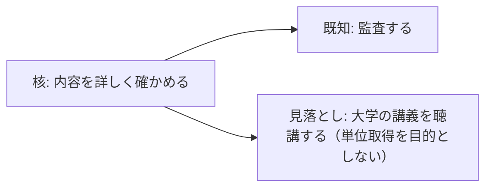

**重要語法**：audit a course（単位を取らずに講義を聴講する）

<sub>index: 886 / candidate_id: `ev-00886-verb-01`</sub>

---

## 642. delivery

**品詞**：noun　 **発音の目安**：デリヴァリー

<small>よく知られている意味：配達</small>

### 見落としやすい意味

**出産、分娩**

**例文**：The doctors were relieved after the safe delivery of the baby.

**和訳**：赤ちゃんが無事に生まれ、医師たちは安心した。

**コアイメージ**：deliveryは何かを届けることを表す。荷物の配達だけでなく、赤ちゃんが生まれる出産にも使われる。

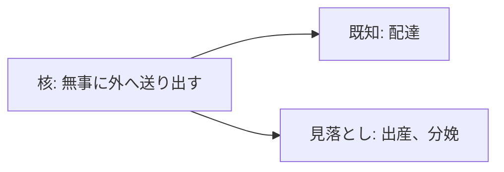

**重要語法**：a safe delivery（無事な出産）

<sub>index: 887 / candidate_id: `ev-00887-noun-01`</sub>

---

## 643. officer

**品詞**：noun　 **発音の目安**：オフィサー

<small>よく知られている意味：警察官</small>

### 見落としやすい意味

**企業や団体の役員・幹部**

**例文**：She was appointed chief financial officer of the company.

**和訳**：彼女はその会社の最高財務責任者に任命された。

**コアイメージ**：officerは、組織の中で特定の職務や権限を持つ人を指す。警察官だけでなく、会社の役員や幹部にも使える。

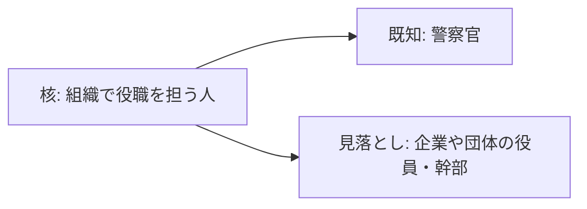

**重要語法**：chief executive officer / CEO（最高経営責任者）

<sub>index: 888 / candidate_id: `ev-00888-noun-01`</sub>

---

## 644. due

**品詞**：adjective　 **発音の目安**：デュー

<small>よく知られている意味：当然の・期限の</small>

### 見落としやすい意味

**（ある時点に）到着・実施する予定である**

**例文**：The train is due to arrive at six.

**和訳**：その列車は6時に到着する予定だ。

**コアイメージ**：dueは、ある出来事が所定の時点に起こることを表せる。ここでは義務よりも、時刻表や計画上の予定が中心になる。

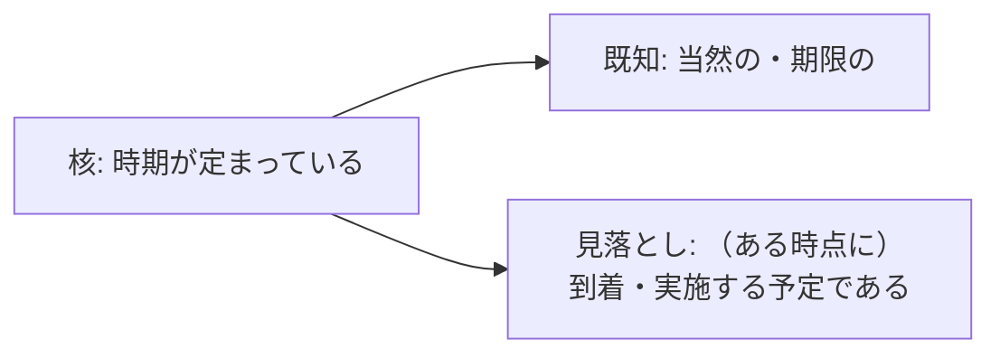

**重要語法**：be due to do（〜する予定である）

<sub>index: 889 / candidate_id: `ev-00889-adjective-01`</sub>

---

## 645. due

**品詞**：adjective　 **発音の目安**：デュー

<small>よく知られている意味：予定の・当然の</small>

### 見落としやすい意味

**支払期限が来ている、受け取る権利がある**

**例文**：The payment is due at the end of the month.

**和訳**：支払いの期限は月末だ。

**コアイメージ**：dueには、ある時点で当然に支払われたり与えられたりするという感覚がある。支払期限が来ている場合にも、受け取る権利がある場合にも使われる。

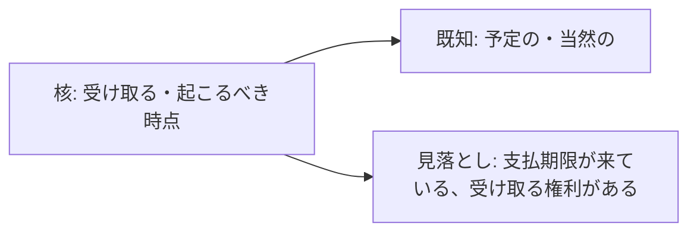

**重要語法**：be due（支払期限が来ている） / money due to someone（人に支払われるべき金銭）

<sub>index: 889 / candidate_id: `ev-00889-adjective-02`</sub>

---

## 646. express

**品詞**：adjective　 **発音の目安**：イクスプレス

<small>よく知られている意味：表現する</small>

### 見落としやすい意味

**明示的な、はっきり述べられた**

**例文**：The instructions were issued at the director's express request.

**和訳**：その指示は部長の明確な要請によって出された。

**コアイメージ**：expressの基本には、考えや意図を外にはっきり示す用法がある。形容詞では、あいまいでなく明示されたことを表す。

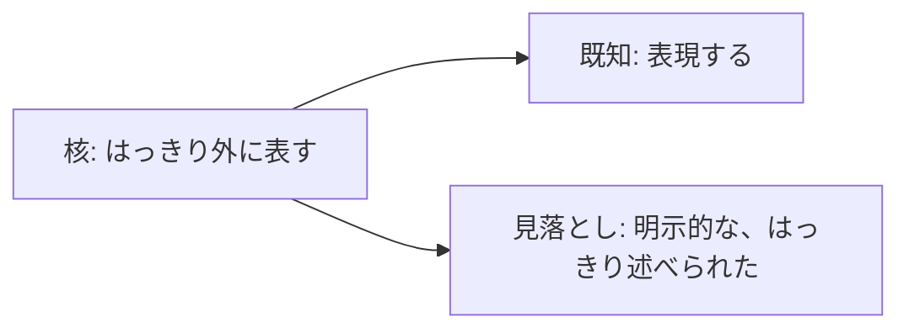

**重要語法**：at someone's express request（人の明確な要請によって）

<sub>index: 891 / candidate_id: `ev-00891-adjective-01`</sub>

---

## 647. express

**品詞**：noun　 **発音の目安**：イクスプレス

<small>よく知られている意味：表現する</small>

### 見落としやすい意味

**急行列車、速達便**

**例文**：We took the express to the airport.

**和訳**：私たちは空港まで急行列車に乗った。

**コアイメージ**：expressには、言葉を表す用法とは別に、速達・急行の用法がある。名詞になると、急行列車や速達便そのものを指す。

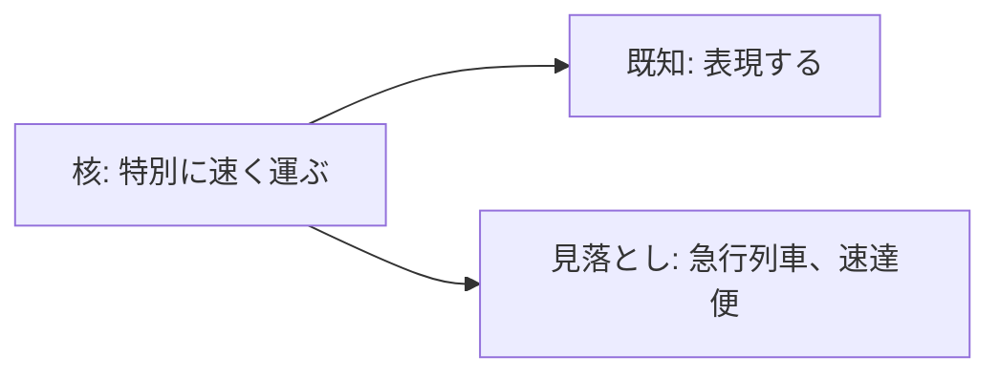

**重要語法**：take the express（急行列車に乗る）

<sub>index: 891 / candidate_id: `ev-00891-noun-01`</sub>

---

## 648. fill

**品詞**：phrasal verb　 **発音の目安**：フィル

<small>よく知られている意味：満たす</small>

### 見落としやすい意味

**人の代わりを務める**

**例文**：Ken will fill in for the absent teacher tomorrow.

**和訳**：明日は健が欠席した先生の代わりを務める。

**コアイメージ**：fillは空間や不足を埋めるイメージを持つ。fill in for someoneでは、その人がいないために空いた役割を代わりに埋める。

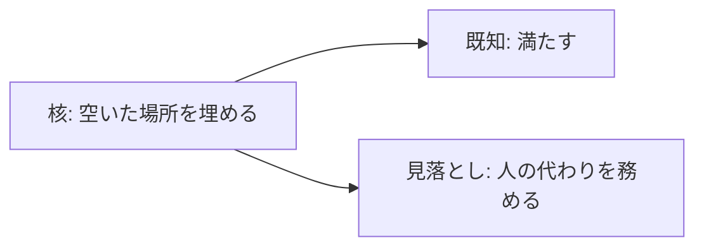

**重要語法**：fill in for someone（人の代役を務める）

<sub>index: 895 / candidate_id: `ev-00895-phrasal-verb-01`</sub>

---

## 649. mark

**品詞**：verb　 **発音の目安**：マーク

<small>よく知られている意味：印をつける</small>

### 見落としやすい意味

**～を特徴づける、顕著に示す**

**例文**：The decade was marked by rapid social change.

**和訳**：その10年間は急速な社会変化を特徴としていた。

**コアイメージ**：markは、何かをほかと区別できるように示すことを表す。出来事や性質がある時代を特徴づける場合にも使う。

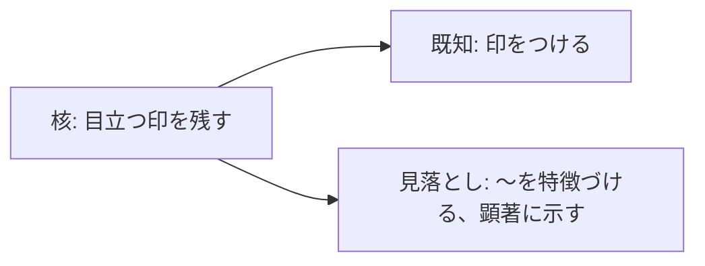

**重要語法**：be marked by A（Aを特徴とする）

<sub>index: 896 / candidate_id: `ev-00896-verb-01`</sub>

---

## 650. favor

**品詞**：noun phrase　 **発音の目安**：フェイヴァー

<small>よく知られている意味：好意・親切</small>

### 見落としやすい意味

**in favor of：〜に賛成して、〜を支持して**

**例文**：Most students were in favor of the new rule.

**和訳**：ほとんどの生徒は新しい規則に賛成していた。

**コアイメージ**：favorは相手や考えに好意を向けることと関係する。in favor ofは、その考えを支持する立場にいることを表す。

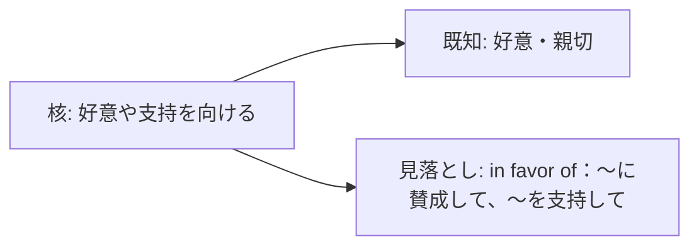

**重要語法**：in favor of A（Aに賛成して）

<sub>index: 899 / candidate_id: `ev-00899-noun-phrase-01`</sub>

---

## 651. favor

**品詞**：verb　 **発音の目安**：フェイヴァー

<small>よく知られている意味：好意・親切</small>

### 見落としやすい意味

**～より…を優遇する、好む**

**例文**：The coach favored experience over speed.

**和訳**：監督は速さより経験を重視した。

**コアイメージ**：favorを動詞で使うと、何かをほかより好ましく評価することになる。favor A over Bで、BよりAを優先・優遇する。

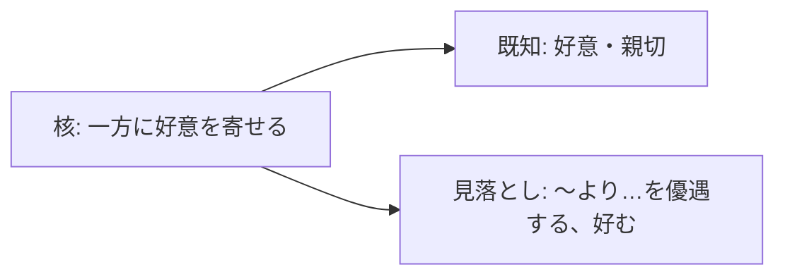

**重要語法**：favor A over B（BよりAを優遇する）

<sub>index: 899 / candidate_id: `ev-00899-verb-01`</sub>

---

## 652. justice

**品詞**：noun　 **発音の目安**：ジャスティス

<small>よく知られている意味：正義・公正</small>

### 見落としやすい意味

**司法、裁判制度**

**例文**：Many people called for reform of the justice system.

**和訳**：多くの人が司法制度の改革を求めた。

**コアイメージ**：justiceは正義という理念を表すだけではない。法律によって公正を実現する司法制度や裁判の働きも指す。

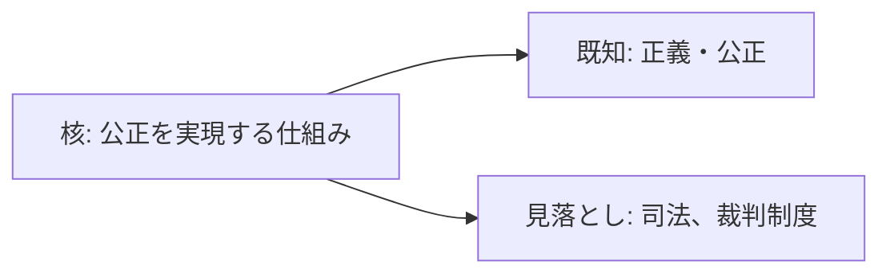

**重要語法**：the justice system（司法制度）

<sub>index: 900 / candidate_id: `ev-00900-noun-01`</sub>

---

## 653. directly

**品詞**：adverb　 **発音の目安**：ダイレクトリー

<small>よく知られている意味：直接に</small>

### 見落としやすい意味

**すぐに、直後に**

**例文**：She called me directly after the meeting.

**和訳**：彼女は会議の直後に私に電話した。

**コアイメージ**：directlyは途中に別のものがないことを表す。人を介さないなら「直接」、時間を挟まないなら「すぐに」という意味になる。

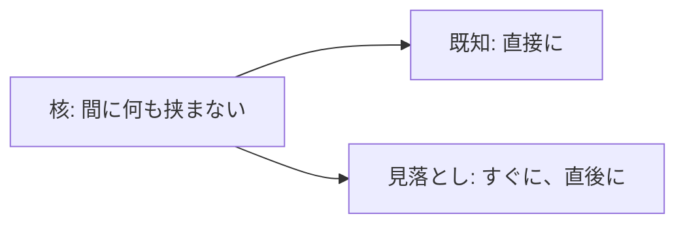

**重要語法**：directly after A（Aの直後に）

<sub>index: 902 / candidate_id: `ev-00902-adverb-01`</sub>

---

## 654. encourage

**品詞**：verb　 **発音の目安**：インカリッジ

<small>よく知られている意味：励ます</small>

### 見落としやすい意味

**物事を促進する・奨励する**

**例文**：Lower costs may encourage investment in new technology.

**和訳**：費用の低下は新技術への投資を促すかもしれない。

**コアイメージ**：encourageは、人に勇気を与えることだけを指さない。活動や変化が起こりやすくなるよう後押しする場合にも使われる。

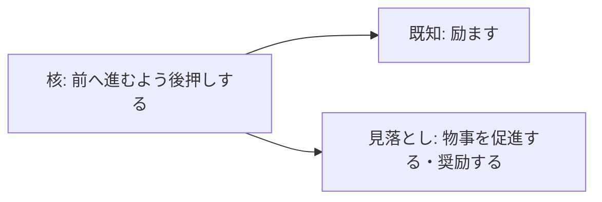

**重要語法**：encourage investment（投資を促す）

<sub>index: 903 / candidate_id: `ev-00903-verb-01`</sub>

---

## 655. communication

**品詞**：noun　 **発音の目安**：コミュニケーション

<small>よく知られている意味：意思疎通・伝達</small>

### 見落としやすい意味

**通信手段・通信設備（複数形も多い）**

**例文**：The storm damaged communications across the island.

**和訳**：嵐によって島全体の通信設備が損傷した。

**コアイメージ**：communicationは情報を伝えることを表す。複数形のcommunicationsでは、その伝達を支える通信手段や設備を指すことがある。

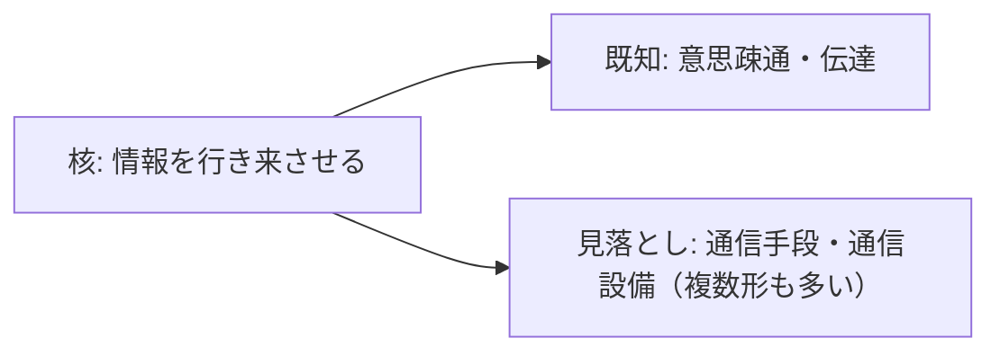

**重要語法**：communications（通信手段・設備の意味では複数形も多い）

<sub>index: 906 / candidate_id: `ev-00906-noun-01`</sub>

---

## 656. commercial

**品詞**：noun　 **発音の目安**：コマーシャル

<small>よく知られている意味：商業の</small>

### 見落としやすい意味

**テレビ・ラジオの広告、CM**

**例文**：A funny commercial came on during the program.

**和訳**：番組の途中で面白いテレビCMが流れた。

**コアイメージ**：commercialは商業に関係することを表す。名詞では商品やサービスを宣伝するためのテレビ・ラジオ広告を指す。

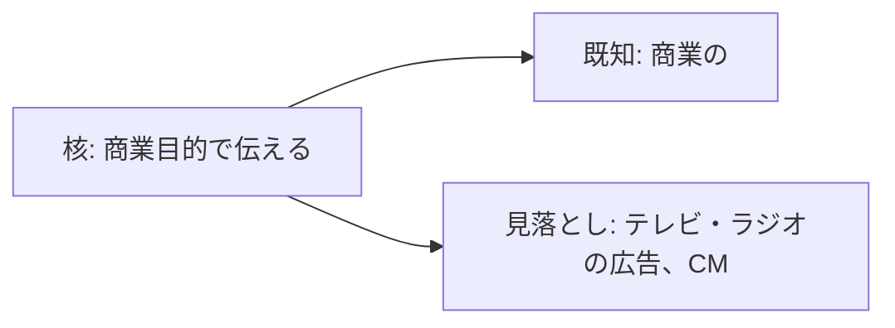

**重要語法**：a television commercial（テレビCM）

<sub>index: 908 / candidate_id: `ev-00908-noun-01`</sub>

---

## 657. independent

**品詞**：adjective phrase　 **発音の目安**：インディペンデント

<small>よく知られている意味：独立した</small>

### 見落としやすい意味

**～と無関係で、～に左右されず**

**例文**：The result is independent of the weather.

**和訳**：結果は天候に左右されない。

**コアイメージ**：independentは、他者の支配や助けに頼らない状態を表す。independent of Aでは、Aの影響を受けないという意味に広がる。

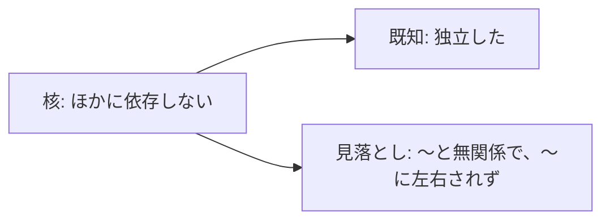

**重要語法**：be independent of A（Aに左右されない）

<sub>index: 909 / candidate_id: `ev-00909-adjective-phrase-01`</sub>

---

## 658. stage

**品詞**：verb　 **発音の目安**：ステイジ

<small>よく知られている意味：舞台・段階</small>

### 見落としやすい意味

**イベントなどを企画・実施する**

**例文**：The museum will stage a special exhibition in spring.

**和訳**：その博物館は春に特別展を開催する。

**コアイメージ**：stageは人に見せる舞台や場を表す。動詞では、催しを企画し、実際に行うことを指す。

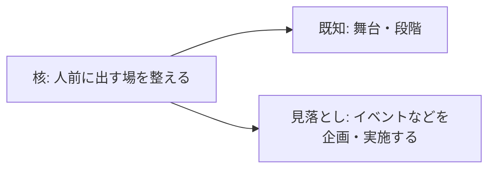

**重要語法**：stage an exhibition（展覧会を開催する）

<sub>index: 911 / candidate_id: `ev-00911-verb-01`</sub>

---

## 659. better

**品詞**：verb　 **発音の目安**：ベター

<small>よく知られている意味：よりよい</small>

### 見落としやすい意味

**～を改善する、上回る**

**例文**：She moved to the city to better her chances of finding work.

**和訳**：彼女は仕事を見つける可能性を高めるため、その都市に移った。

**コアイメージ**：betterは比較級として「よりよい」を表す。動詞になると、現状を改善して一段よい状態にすることを意味する。

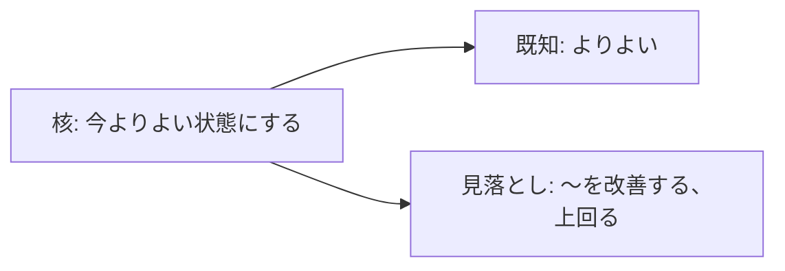

**重要語法**：better one's chances（可能性を高める）

<sub>index: 912 / candidate_id: `ev-00912-verb-01`</sub>

---

## 660. domestic

**品詞**：adjective　 **発音の目安**：ドメスティック

<small>よく知られている意味：家庭の</small>

### 見落としやすい意味

**国内の（家庭内の、という意味と区別）**

**例文**：Domestic flights are often cheaper than international ones.

**和訳**：国内線は国際線より安いことが多い。

**コアイメージ**：domesticは、あるまとまりの内部に関係することを表す。家庭という内側なら「家庭の」、国という内側なら「国内の」となる。

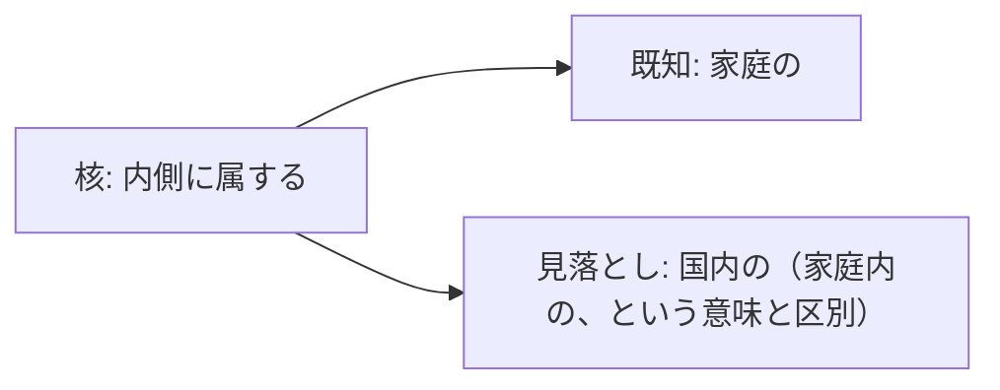

**重要語法**：domestic flights（国内線）

<sub>index: 914 / candidate_id: `ev-00914-adjective-01`</sub>

---

## 661. contract

**品詞**：verb　 **発音の目安**：コントラクト

<small>よく知られている意味：契約する・契約</small>

### 見落としやすい意味

**縮小する、収縮する**

**例文**：Metal contracts as it cools.

**和訳**：金属は冷えると収縮する。

**コアイメージ**：動詞contractには、物が小さく縮む意味がある。契約の意味だけを想定せず、何が主語かを見て「収縮する」と判断する。

```mermaid
flowchart LR
    A["核: 内側へ縮まる"]
    B["既知: 契約する・契約"]
    C["見落とし: 縮小する、収縮する"]
    A --> B
    A --> C
```

**重要語法**：contract（動詞の収縮義は後ろの音節に強勢）

<sub>index: 915 / candidate_id: `ev-00915-verb-01`</sub>

---

## 662. contract

**品詞**：verb　 **発音の目安**：コントラクト

<small>よく知られている意味：契約する・契約</small>

### 見落としやすい意味

**病気にかかる**

**例文**：He contracted malaria while traveling abroad.

**和訳**：彼は海外旅行中にマラリアにかかった。

**コアイメージ**：contractは病気を患うという意味でも使われる。契約するという既知の意味に無理につなげず、病名を目的語に取る動詞用法として押さえる。

```mermaid
flowchart LR
    A["核: 病気を身に受ける"]
    B["既知: 契約する・契約"]
    C["見落とし: 病気にかかる"]
    A --> B
    A --> C
```

**重要語法**：contract a disease（病気にかかる）

<sub>index: 915 / candidate_id: `ev-00915-verb-02`</sub>

---

## 663. trip

**品詞**：noun　 **発音の目安**：トリップ

<small>よく知られている意味：旅行</small>

### 見落としやすい意味

**つまずくこと、足を取られること**

**例文**：A loose cable caused a trip near the door.

**和訳**：緩んだケーブルのせいで、ドアのそばでつまずくことが起きた。

**コアイメージ**：tripには旅行という名詞義のほか、足を取られることを指す名詞義もある。短い移動を表すtripと、つまずくtripを文脈で区別する。

```mermaid
flowchart LR
    A["核: 足元が引っかかる"]
    B["既知: 旅行"]
    C["見落とし: つまずくこと、足を取られること"]
    A --> B
    A --> C
```

**重要語法**：a trip（つまずき。文脈に注意）

<sub>index: 916 / candidate_id: `ev-00916-noun-01`</sub>

---

## 664. trip

**品詞**：verb　 **発音の目安**：トリップ

<small>よく知られている意味：旅行</small>

### 見落としやすい意味

**つまずく、足を取られる**

**例文**：I tripped over a stone on the path.

**和訳**：私は小道の石につまずいた。

**コアイメージ**：動詞tripは、足元の物などに引っかかる動きを表す。trip over Aで「Aにつまずく」となる。

```mermaid
flowchart LR
    A["核: 足が引っかかってバランスを崩す"]
    B["既知: 旅行"]
    C["見落とし: つまずく、足を取られる"]
    A --> B
    A --> C
```

**重要語法**：trip over A（Aにつまずく）

<sub>index: 916 / candidate_id: `ev-00916-verb-01`</sub>

---

## 665. square

**品詞**：noun　 **発音の目安**：スクウェア

<small>よく知られている意味：正方形</small>

### 見落としやすい意味

**市街地の広場**

**例文**：Families gathered in the town square for the festival.

**和訳**：祭りのために家族連れが町の広場に集まった。

**コアイメージ**：squareは四角い形を表すだけではない。建物や道路に囲まれた町の広場を指す名詞にもなる。

```mermaid
flowchart LR
    A["核: 四角く開いた場所"]
    B["既知: 正方形"]
    C["見落とし: 市街地の広場"]
    A --> B
    A --> C
```

**重要語法**：town square（町の広場）

<sub>index: 918 / candidate_id: `ev-00918-noun-01`</sub>

---

## 666. square

**品詞**：phrasal verb　 **発音の目安**：スクウェア

<small>よく知られている意味：正方形</small>

### 見落としやすい意味

**話や数字が一致する、整合する**

**例文**：His explanation doesn't square with the facts.

**和訳**：彼の説明は事実と一致しない。

**コアイメージ**：squareには、形や数字をきちんと合わせるという感覚がある。square with Aは、説明などがAと矛盾せず整合することを表す。

```mermaid
flowchart LR
    A["核: きちんと形を合わせる"]
    B["既知: 正方形"]
    C["見落とし: 話や数字が一致する、整合する"]
    A --> B
    A --> C
```

**重要語法**：square with A（Aと一致する）

<sub>index: 918 / candidate_id: `ev-00918-phrasal-verb-01`</sub>

---

## 667. screen

**品詞**：verb　 **発音の目安**：スクリーン

<small>よく知られている意味：画面・スクリーン</small>

### 見落としやすい意味

**適性・問題の有無を審査する**

**例文**：The clinic screens patients for early signs of illness.

**和訳**：その診療所は患者に病気の初期兆候がないか検査する。

**コアイメージ**：screenはもともと仕切りや遮るものを表す。動詞では、条件に合うか、問題があるかを調べて選別する意味になる。

```mermaid
flowchart LR
    A["核: 仕切りを通して選り分ける"]
    B["既知: 画面・スクリーン"]
    C["見落とし: 適性・問題の有無を審査する"]
    A --> B
    A --> C
```

**重要語法**：screen A for B（AにBがないか調べる）

<sub>index: 919 / candidate_id: `ev-00919-verb-01`</sub>

---

## 668. screen

**品詞**：verb　 **発音の目安**：スクリーン

<small>よく知られている意味：画面・スクリーン</small>

### 見落としやすい意味

**覆い隠す、遮る**

**例文**：Tall trees screen the house from the road.

**和訳**：高い木々が道路からその家を見えなくしている。

**コアイメージ**：screenの中心には、間に入って遮るものというイメージがある。動詞になると、景色や対象を見えないように覆い隠す。

```mermaid
flowchart LR
    A["核: 視線を遮る仕切り"]
    B["既知: 画面・スクリーン"]
    C["見落とし: 覆い隠す、遮る"]
    A --> B
    A --> C
```

**重要語法**：screen A from B（BからAを遮る）

<sub>index: 919 / candidate_id: `ev-00919-verb-02`</sub>

---

## 669. screen

**品詞**：verb　 **発音の目安**：スクリーン

<small>よく知られている意味：画面・スクリーン</small>

### 見落としやすい意味

**映画・番組などを上映する**

**例文**：The cinema will screen the documentary next week.

**和訳**：その映画館は来週そのドキュメンタリーを上映する。

**コアイメージ**：screenは映像を映す面のことを表す。その面に映画や番組を映して観客に見せる動詞としても使える。

```mermaid
flowchart LR
    A["核: スクリーンに映し出す"]
    B["既知: 画面・スクリーン"]
    C["見落とし: 映画・番組などを上映する"]
    A --> B
    A --> C
```

**重要語法**：screen a film（映画を上映する）

<sub>index: 919 / candidate_id: `ev-00919-verb-03`</sub>

---

## 670. boat

**品詞**：idiom　 **発音の目安**：ボウト

<small>よく知られている意味：船</small>

### 見落としやすい意味

**同じ境遇・問題に置かれている**

**例文**：We're all in the same boat when exams get close.

**和訳**：試験が近づくと、私たちは皆同じ立場に置かれる。

**コアイメージ**：船に同乗すれば、乗客は同じ天候や行き先の影響を受ける。in the same boatは、その比喩で「同じ境遇にある」という意味になる。

```mermaid
flowchart LR
    A["核: 同じ船に一緒に乗る"]
    B["既知: 船"]
    C["見落とし: 同じ境遇・問題に置かれている"]
    A --> B
    A --> C
```

**重要語法**：be in the same boat（同じ境遇にある）

<sub>index: 920 / candidate_id: `ev-00920-idiom-01`</sub>

---

## 671. exchange

**品詞**：noun　 **発音の目安**：イクスチェインジ

<small>よく知られている意味：交換</small>

### 見落としやすい意味

**言葉の応酬、口論**

**例文**：The discussion ended in a heated exchange.

**和訳**：話し合いは激しい言い争いで終わった。

**コアイメージ**：exchangeの中心は、双方の間で何かを交わすことにある。物の交換だけでなく、言葉を激しく交わす応酬も表す。

```mermaid
flowchart LR
    A["核: 互いにやり取りする"]
    B["既知: 交換"]
    C["見落とし: 言葉の応酬、口論"]
    A --> B
    A --> C
```

**重要語法**：a heated exchange（激しい言葉の応酬）

<sub>index: 921 / candidate_id: `ev-00921-noun-01`</sub>

---

## 672. apparently

**品詞**：adverb　 **発音の目安**：アペアレントリー

<small>よく知られている意味：どうやら</small>

### 見落としやすい意味

**見かけ上は、一見すると**

**例文**：The road was apparently empty, but someone was around the corner.

**和訳**：道路は一見誰もいないように見えたが、角の向こうに人がいた。

**コアイメージ**：apparentlyは外から見える情報に基づく判断を表す。実際は違う可能性を含めて「一見すると」という意味でも使われる。

```mermaid
flowchart LR
    A["核: 外から見える様子"]
    B["既知: どうやら"]
    C["見落とし: 見かけ上は、一見すると"]
    A --> B
    A --> C
```

**重要語法**：apparently unchanged（一見変わっていない）

<sub>index: 922 / candidate_id: `ev-00922-adverb-01`</sub>

---

## 673. star

**品詞**：verb　 **発音の目安**：スター

<small>よく知られている意味：星</small>

### 見落としやすい意味

**映画・劇などで主演する**

**例文**：The young actor will star in a new drama.

**和訳**：その若い俳優は新しいドラマで主演する。

**コアイメージ**：starは空に輝く星であり、注目を集める人物も指す。動詞になると、作品の中心人物として出演する意味になる。

```mermaid
flowchart LR
    A["核: 注目が集まる中心"]
    B["既知: 星"]
    C["見落とし: 映画・劇などで主演する"]
    A --> B
    A --> C
```

**重要語法**：star in a film / drama（映画・ドラマに主演する）

<sub>index: 923 / candidate_id: `ev-00923-verb-01`</sub>

---

## 674. longer

**品詞**：adverb phrase　 **発音の目安**：ロンガー

<small>よく知られている意味：より長く</small>

### 見落としやすい意味

**もはや～ではない**

**例文**：This ticket is no longer valid.

**和訳**：この切符はもう有効ではない。

**コアイメージ**：longerは時間や長さの比較を表す。no longerでは、その状態がそれ以上続かないことから「もはや〜ない」を意味する。

```mermaid
flowchart LR
    A["核: 続いていた時間が終わる"]
    B["既知: より長く"]
    C["見落とし: もはや～ではない"]
    A --> B
    A --> C
```

**重要語法**：no longer（もはや〜ない）

<sub>index: 924 / candidate_id: `ev-00924-adverb-phrase-01`</sub>

---

## 675. knowledge

**品詞**：idiom　 **発音の目安**：ナリッジ

<small>よく知られている意味：知識</small>

### 見落としやすい意味

**私が知る限りでは**

**例文**：To my knowledge, the shop has never closed early.

**和訳**：私の知る限り、その店が早く閉まったことはない。

**コアイメージ**：knowledgeは知っている内容を指す。to my knowledgeでは、断定の範囲を自分が知る情報に限定する。

```mermaid
flowchart LR
    A["核: 自分の知識が及ぶ範囲"]
    B["既知: 知識"]
    C["見落とし: 私が知る限りでは"]
    A --> B
    A --> C
```

**重要語法**：to my knowledge（私の知る限り）

<sub>index: 928 / candidate_id: `ev-00928-idiom-01`</sub>

---

## 676. notice

**品詞**：noun　 **発音の目安**：ノウティス

<small>よく知られている意味：通知・気づくこと</small>

### 見落としやすい意味

**退職・解雇の予告、予告期間**

**例文**：She gave a month's notice before leaving her job.

**和訳**：彼女は退職の1か月前にその旨を伝えた。

**コアイメージ**：noticeは知らせることや通知を表す。雇用の文脈では、退職や解雇を事前に告げること、またその予告期間を指す。

```mermaid
flowchart LR
    A["核: あらかじめ知らせる"]
    B["既知: 通知・気づくこと"]
    C["見落とし: 退職・解雇の予告、予告期間"]
    A --> B
    A --> C
```

**重要語法**：give notice（退職などを予告する）

<sub>index: 929 / candidate_id: `ev-00929-noun-01`</sub>

---

## 677. chance

**品詞**：idiom　 **発音の目安**：チャンス

<small>よく知られている意味：機会・可能性</small>

### 見落としやすい意味

**偶然に、たまたま**

**例文**：I met my old teacher by chance at the station.

**和訳**：私は駅で偶然昔の先生に会った。

**コアイメージ**：chanceは結果があらかじめ決まっていないことと関係する。by chanceは、狙って起こしたのではなく偶然に起こったことを表す。

```mermaid
flowchart LR
    A["核: 計画に左右されない出来事"]
    B["既知: 機会・可能性"]
    C["見落とし: 偶然に、たまたま"]
    A --> B
    A --> C
```

**重要語法**：by chance（偶然に）

<sub>index: 930 / candidate_id: `ev-00930-idiom-01`</sub>

---

## 678. politic

**品詞**：adjective　 **発音の目安**：ポリティック

<small>よく知られている意味：政治的な（古い用法）</small>

### 見落としやすい意味

**思慮深い、得策な、状況をわきまえた**

**例文**：It would be politic to wait until everyone has spoken.

**和訳**：全員が発言し終えるまで待つのが賢明だろう。

**コアイメージ**：politicは現実の状況に合わせて賢明に振る舞うことを表す。現在ふつう「政治の」はpoliticalを使うため、politicの「得策な」という意味を区別したい。

```mermaid
flowchart LR
    A["核: 状況を読んだ賢明な判断"]
    B["既知: 政治的な（古い用法）"]
    C["見落とし: 思慮深い、得策な、状況をわきまえた"]
    A --> B
    A --> C
```

**重要語法**：It would be politic to do（〜するのが賢明だろう）

<sub>index: 932 / candidate_id: `ev-00932-adjective-01`</sub>

---

## 679. welfare

**品詞**：noun　 **発音の目安**：ウェルフェア

<small>よく知られている意味：福祉</small>

### 見落としやすい意味

**人々の幸福・健康・暮らし向き**

**例文**：The school must protect the welfare of its students.

**和訳**：学校は生徒たちの健康と幸福を守らなければならない。

**コアイメージ**：welfareは人が健やかに、幸せに暮らせる状態を表す。社会制度としての福祉だけでなく、個人や集団の生活全体のよさにも使う。

```mermaid
flowchart LR
    A["核: よい状態で暮らすこと"]
    B["既知: 福祉"]
    C["見落とし: 人々の幸福・健康・暮らし向き"]
    A --> B
    A --> C
```

**重要語法**：the welfare of children（子どもの幸福・健康）

<sub>index: 933 / candidate_id: `ev-00933-noun-01`</sub>

---

## 680. scene

**品詞**：idiom　 **発音の目安**：シーン

<small>よく知られている意味：場面・光景</small>

### 見落としやすい意味

**人前で騒ぎ立てる、感情的な言い争いを起こす**

**例文**：He made a scene when the staff asked him to leave.

**和訳**：職員に退去を求められると、彼は人前で騒ぎを起こした。

**コアイメージ**：sceneは人に見える場面を表す。make a sceneは、周囲が注目するような感情的な騒ぎを起こすことを指す。

```mermaid
flowchart LR
    A["核: 周囲の目を引く場面"]
    B["既知: 場面・光景"]
    C["見落とし: 人前で騒ぎ立てる、感情的な言い争いを起こす"]
    A --> B
    A --> C
```

**重要語法**：make a scene（人前で騒ぐ）

<sub>index: 934 / candidate_id: `ev-00934-idiom-01`</sub>

---

## 681. scene

**品詞**：idiom　 **発音の目安**：シーン

<small>よく知られている意味：場面・光景</small>

### 見落としやすい意味

**人から見えない舞台裏で**

**例文**：A small team worked behind the scenes to organize the event.

**和訳**：少人数のチームが舞台裏で催しの準備を進めた。

**コアイメージ**：sceneは観客に見える場面を指す。behind the scenesは、その裏側で人目につかず行われる活動を表す。

```mermaid
flowchart LR
    A["核: 見えている場面の裏側"]
    B["既知: 場面・光景"]
    C["見落とし: 人から見えない舞台裏で"]
    A --> B
    A --> C
```

**重要語法**：behind the scenes（舞台裏で）

<sub>index: 934 / candidate_id: `ev-00934-idiom-02`</sub>

---

## 682. scene

**品詞**：noun　 **発音の目安**：シーン

<small>よく知られている意味：場面・光景</small>

### 見落としやすい意味

**特定の分野の活動・関係者を取り巻く世界**

**例文**：She quickly became known in the local music scene.

**和訳**：彼女は地元の音楽界ですぐに知られるようになった。

**コアイメージ**：sceneは一つの場面だけでなく、人々が集まって活動する世界を表せる。music sceneなら音楽に関わる人や動きの全体を指す。

```mermaid
flowchart LR
    A["核: 活動が展開する場"]
    B["既知: 場面・光景"]
    C["見落とし: 特定の分野の活動・関係者を取り巻く世界"]
    A --> B
    A --> C
```

**重要語法**：the music scene（音楽界）

<sub>index: 934 / candidate_id: `ev-00934-noun-01`</sub>

---

## 683. color

**品詞**：verb　 **発音の目安**：カラー

<small>よく知られている意味：色・色を塗る</small>

### 見落としやすい意味

**経験・感情などが認識に影響する**

**例文**：His past failures colored his judgment.

**和訳**：過去の失敗が彼の判断に影響を与えた。

**コアイメージ**：colorは物に色をつけることを表す。考えや判断について使うと、経験や感情が物の見方に影響を与えることになる。

```mermaid
flowchart LR
    A["核: 見え方に色をつける"]
    B["既知: 色・色を塗る"]
    C["見落とし: 経験・感情などが認識に影響する"]
    A --> B
    A --> C
```

**重要語法**：be colored by A（Aによって見方が左右される）

<sub>index: 939 / candidate_id: `ev-00939-verb-01`</sub>

---

## 684. treatment

**品詞**：noun　 **発音の目安**：トリートメント

<small>よく知られている意味：治療</small>

### 見落としやすい意味

**人の扱い、待遇**

**例文**：The workers demanded fair treatment.

**和訳**：労働者たちは公正な待遇を求めた。

**コアイメージ**：treatmentは、人や物に対してどのように接するかを表す。病気への処置なら治療、人への接し方なら待遇という意味になる。

```mermaid
flowchart LR
    A["核: 相手をどう扱うか"]
    B["既知: 治療"]
    C["見落とし: 人の扱い、待遇"]
    A --> B
    A --> C
```

**重要語法**：fair treatment（公正な待遇）

<sub>index: 940 / candidate_id: `ev-00940-noun-01`</sub>

---

## 685. deliver

**品詞**：phrasal verb　 **発音の目安**：デリヴァー

<small>よく知られている意味：配達する</small>

### 見落としやすい意味

**約束・期待された結果を実現する**

**例文**：The team finally delivered on its promise to improve the service.

**和訳**：そのチームはついにサービス改善の約束を果たした。

**コアイメージ**：deliverは相手に何かを届けることを表す。deliver on a promiseでは、約束されていた結果を実際に実現することを意味する。

```mermaid
flowchart LR
    A["核: 約束したものを届ける"]
    B["既知: 配達する"]
    C["見落とし: 約束・期待された結果を実現する"]
    A --> B
    A --> C
```

**重要語法**：deliver on a promise（約束を果たす）

<sub>index: 944 / candidate_id: `ev-00944-phrasal-verb-01`</sub>

---

## 686. deliver

**品詞**：verb　 **発音の目安**：デリヴァー

<small>よく知られている意味：配達する</small>

### 見落としやすい意味

**演説・講義などを行う**

**例文**：The principal delivered a short speech at the ceremony.

**和訳**：校長は式典で短い演説をした。

**コアイメージ**：deliverは物を届けるだけでなく、内容を聴衆に伝えることにも使う。演説や講演を行う場合の定番の動詞である。

```mermaid
flowchart LR
    A["核: 言葉を相手に届ける"]
    B["既知: 配達する"]
    C["見落とし: 演説・講義などを行う"]
    A --> B
    A --> C
```

**重要語法**：deliver a speech（演説を行う）

<sub>index: 944 / candidate_id: `ev-00944-verb-01`</sub>

---

## 687. version

**品詞**：noun　 **発音の目安**：ヴァージョン

<small>よく知られている意味：版・バージョン</small>

### 見落としやすい意味

**出来事についての説明・見解**

**例文**：Her version of the accident differs from his.

**和訳**：その事故についての彼女の説明は彼の説明と異なる。

**コアイメージ**：versionは同じ内容を別の形で示したものを指す。出来事について使えば、ある人の説明や見方を表す。

```mermaid
flowchart LR
    A["核: 同じものの別の表し方"]
    B["既知: 版・バージョン"]
    C["見落とし: 出来事についての説明・見解"]
    A --> B
    A --> C
```

**重要語法**：someone's version of events（人による出来事の説明）

<sub>index: 945 / candidate_id: `ev-00945-noun-01`</sub>

---

## 688. suit

**品詞**：noun　 **発音の目安**：スート

<small>よく知られている意味：スーツ・背広</small>

### 見落としやすい意味

**訴訟（とくに民事訴訟）**

**例文**：The customer filed a suit against the company.

**和訳**：その顧客は会社を相手取って訴訟を起こした。

**コアイメージ**：suitには衣服を表す名詞義とは別に、法律上の訴訟という名詞義がある。二つを無理につなげず、file a suitのような法律の文脈で見分ける。

```mermaid
flowchart LR
    A["核: 同じ語形の別の語義"]
    B["既知: スーツ・背広"]
    C["見落とし: 訴訟（とくに民事訴訟）"]
    A --> B
    A --> C
```

**重要語法**：file a suit（訴訟を起こす）

<sub>index: 947 / candidate_id: `ev-00947-noun-01`</sub>

---

## 689. suit

**品詞**：verb　 **発音の目安**：スート

<small>よく知られている意味：スーツ・背広</small>

### 見落としやすい意味

**人にとって都合がよい、適している**

**例文**：Friday suits me better than Monday.

**和訳**：私には月曜日より金曜日のほうが都合がいい。

**コアイメージ**：動詞suitは、条件や好みに合っていることを表す。服が似合う場合だけでなく、予定が人にとって都合よい場合にも使える。

```mermaid
flowchart LR
    A["核: 人や状況に合う"]
    B["既知: スーツ・背広"]
    C["見落とし: 人にとって都合がよい、適している"]
    A --> B
    A --> C
```

**重要語法**：suit someone（人に都合がよい）

<sub>index: 947 / candidate_id: `ev-00947-verb-01`</sub>

---

## 690. neither

**品詞**：usage　 **発音の目安**：ニーザー／ナイザー

<small>よく知られている意味：どちらも〜ない</small>

### 見落としやすい意味

**Neither do Iなどで否定内容への同意を示す倒置**

**例文**：I don't like crowded places, and neither does my sister.

**和訳**：私は混雑した場所が好きではなく、姉も同じだ。

**コアイメージ**：neitherは二つとも否定する働きを持つ。Neither do Iの型では、前の人の否定内容が自分にも当てはまると示し、助動詞と主語が倒置する。

```mermaid
flowchart LR
    A["核: 否定をもう一人にも重ねる"]
    B["既知: どちらも〜ない"]
    C["見落とし: Neither do Iなどで否定内容への同意を示す倒置"]
    A --> B
    A --> C
```

**重要語法**：Neither do I.（私もそうではない）

<sub>index: 948 / candidate_id: `ev-00948-usage-01`</sub>

---

## 691. catch

**品詞**：phrasal verb　 **発音の目安**：キャッチ

<small>よく知られている意味：捕まえる</small>

### 見落としやすい意味

**流行する、人気が出る**

**例文**：The new game quickly caught on among students.

**和訳**：その新しいゲームは生徒の間ですぐに流行した。

**コアイメージ**：catchは何かをとらえることを表す。catch onには、考えや流行が人々に受け入れられて広まる意味がある。

```mermaid
flowchart LR
    A["核: 人々の間で受け止められる"]
    B["既知: 捕まえる"]
    C["見落とし: 流行する、人気が出る"]
    A --> B
    A --> C
```

**重要語法**：catch on（流行する・人気が出る）

<sub>index: 951 / candidate_id: `ev-00951-phrasal-verb-01`</sub>

---

## 692. catch

**品詞**：usage　 **発音の目安**：キャッチ

<small>よく知られている意味：捕まえる</small>

### 見落としやすい意味

**catch A doingでAが～しているところを見つける**

**例文**：The teacher caught a student copying an answer.

**和訳**：先生は生徒が解答を書き写しているところを見つけた。

**コアイメージ**：catchは人や物をとらえることを表す。catch A doingでは、Aが何かをしている最中の場面を見つける。

```mermaid
flowchart LR
    A["核: 行動の瞬間をとらえる"]
    B["既知: 捕まえる"]
    C["見落とし: catch A doingでAが～しているところを見つける"]
    A --> B
    A --> C
```

**重要語法**：catch A doing（Aが〜しているところを見つける）

<sub>index: 951 / candidate_id: `ev-00951-usage-01`</sub>

---

## 693. catch

**品詞**：verb　 **発音の目安**：キャッチ

<small>よく知られている意味：捕まえる</small>

### 見落としやすい意味

**言葉などを聞き取る、理解する**

**例文**：Sorry, I didn't catch your last sentence.

**和訳**：ごめんなさい、最後の一文が聞き取れませんでした。

**コアイメージ**：catchの「つかまえる」という感覚は、音や言葉にも使える。相手の発言をうまく受け取れないときは、聞き取れなかったという意味になる。

```mermaid
flowchart LR
    A["核: 耳に入る言葉をとらえる"]
    B["既知: 捕まえる"]
    C["見落とし: 言葉などを聞き取る、理解する"]
    A --> B
    A --> C
```

**重要語法**：didn't catch what A said（Aの言葉が聞き取れなかった）

<sub>index: 951 / candidate_id: `ev-00951-verb-01`</sub>

---

## 694. expand

**品詞**：phrasal verb　 **発音の目安**：イクスパンド

<small>よく知られている意味：広げる・拡大する</small>

### 見落としやすい意味

**議論や説明をさらに詳しく述べる**

**例文**：Could you expand on your final point?

**和訳**：最後の点についてもう少し詳しく説明していただけますか。

**コアイメージ**：expandは物の大きさや範囲を広げることを意味する。考えについて使うと、説明を付け加えて詳しくすることになる。

```mermaid
flowchart LR
    A["核: 説明の範囲を広げる"]
    B["既知: 広げる・拡大する"]
    C["見落とし: 議論や説明をさらに詳しく述べる"]
    A --> B
    A --> C
```

**重要語法**：expand on A（Aについて詳しく述べる）

<sub>index: 952 / candidate_id: `ev-00952-phrasal-verb-01`</sub>

---

## 695. deny

**品詞**：verb　 **発音の目安**：ディナイ

<small>よく知られている意味：否定する</small>

### 見落としやすい意味

**人に物・権利・機会を与えない、拒む**

**例文**：The rules denied visitors access to the garden.

**和訳**：その規則により、来訪者は庭に入ることを認められなかった。

**コアイメージ**：denyはある主張を否定するだけでなく、何かを与えることを拒む意味がある。deny A BならAにBを与えないという構造になる。

```mermaid
flowchart LR
    A["核: 相手が求めるものを拒む"]
    B["既知: 否定する"]
    C["見落とし: 人に物・権利・機会を与えない、拒む"]
    A --> B
    A --> C
```

**重要語法**：deny A B / deny B to A（AにBを与えない）

<sub>index: 954 / candidate_id: `ev-00954-verb-01`</sub>

---

## 696. deny

**品詞**：verb phrase　 **発音の目安**：ディナイ

<small>よく知られている意味：否定する</small>

### 見落としやすい意味

**自分に楽しみ・必要なものを許さず我慢する**

**例文**：She denied herself the pleasure of a holiday to save money.

**和訳**：彼女はお金を貯めるため、休暇を楽しむことを我慢した。

**コアイメージ**：denyは他者の要求を拒む動詞である。deny oneself Aでは、楽しみなどを自分自身に許さず我慢する。

```mermaid
flowchart LR
    A["核: 自分に与えることを拒む"]
    B["既知: 否定する"]
    C["見落とし: 自分に楽しみ・必要なものを許さず我慢する"]
    A --> B
    A --> C
```

**重要語法**：deny oneself A（Aを自分に許さず我慢する）

<sub>index: 954 / candidate_id: `ev-00954-verb-phrase-01`</sub>

---

## 697. file

**品詞**：verb　 **発音の目安**：ファイル

<small>よく知られている意味：ファイル・書類</small>

### 見落としやすい意味

**正式に書類・訴状などを提出する**

**例文**：They filed a formal complaint with the city.

**和訳**：彼らは市に正式な苦情を申し立てた。

**コアイメージ**：fileには書類を整理して保管する意味がある。公的な手続きでは、書類を正式な記録として提出することを表す。

```mermaid
flowchart LR
    A["核: 正式な記録として提出する"]
    B["既知: ファイル・書類"]
    C["見落とし: 正式に書類・訴状などを提出する"]
    A --> B
    A --> C
```

**重要語法**：file a complaint / lawsuit（苦情を申し立てる・訴訟を起こす）

<sub>index: 955 / candidate_id: `ev-00955-verb-01`</sub>

---

## 698. file

**品詞**：verb　 **発音の目安**：ファイル

<small>よく知られている意味：ファイル・書類</small>

### 見落としやすい意味

**人が一列に並んで進む**

**例文**：The students filed quietly into the hall.

**和訳**：生徒たちは一列になって静かにホールへ入った。

**コアイメージ**：動詞fileには、書類を整理する意味とは別に、人が列になって進む意味がある。file into Aは、人々が順にAへ入る様子を表す。

```mermaid
flowchart LR
    A["核: 列をなして進む"]
    B["既知: ファイル・書類"]
    C["見落とし: 人が一列に並んで進む"]
    A --> B
    A --> C
```

**重要語法**：file into A（列になってAに入る）

<sub>index: 955 / candidate_id: `ev-00955-verb-02`</sub>

---

## 699. hit

**品詞**：phrasal verb　 **発音の目安**：ヒット

<small>よく知られている意味：打つ・当たる</small>

### 見落としやすい意味

**考え・解決策などを思いつく**

**例文**：We finally hit on a simple solution.

**和訳**：私たちはついに簡単な解決策を思いついた。

**コアイメージ**：hitは何かに当たる動作を表す。hit on Aは、探しているうちに考えや解決策に行き当たることを意味する。

```mermaid
flowchart LR
    A["核: 考えに行き当たる"]
    B["既知: 打つ・当たる"]
    C["見落とし: 考え・解決策などを思いつく"]
    A --> B
    A --> C
```

**重要語法**：hit on a solution（解決策を思いつく）

<sub>index: 956 / candidate_id: `ev-00956-phrasal-verb-01`</sub>

---

## 700. living

**品詞**：noun　 **発音の目安**：リヴィング

<small>よく知られている意味：生きている</small>

### 見落としやすい意味

**生計、生活費を得る手段**

**例文**：He makes a living by repairing bicycles.

**和訳**：彼は自転車の修理で生計を立てている。

**コアイメージ**：livingは生きることや生活を表す。名詞では、生きていくための収入や仕事を指すことがある。

```mermaid
flowchart LR
    A["核: 暮らしを支えるもの"]
    B["既知: 生きている"]
    C["見落とし: 生計、生活費を得る手段"]
    A --> B
    A --> C
```

**重要語法**：make / earn a living（生計を立てる）

<sub>index: 957 / candidate_id: `ev-00957-noun-01`</sub>

---

## 701. defense

**品詞**：noun　 **発音の目安**：ディフェンス

<small>よく知られている意味：防御・守備</small>

### 見落としやすい意味

**訴訟での被告側・弁護側**

**例文**：The defense argued that the evidence was unreliable.

**和訳**：弁護側は、その証拠は信用できないと主張した。

**コアイメージ**：defenseは攻撃から守ることを意味する。裁判では、訴えに対して被告を守る側やその弁護活動を指す。

```mermaid
flowchart LR
    A["核: 相手の主張から守る立場"]
    B["既知: 防御・守備"]
    C["見落とし: 訴訟での被告側・弁護側"]
    A --> B
    A --> C
```

**重要語法**：the defense（裁判の弁護側）

<sub>index: 959 / candidate_id: `ev-00959-noun-01`</sub>

---

## 702. pick

**品詞**：phrasal verb　 **発音の目安**：ピック

<small>よく知られている意味：選ぶ・拾う</small>

### 見落としやすい意味

**経験を通して自然に身につける**

**例文**：She picked up some Italian while living in Rome.

**和訳**：彼女はローマで暮らす間にイタリア語を少し自然に覚えた。

**コアイメージ**：pick upは何かを拾い上げる動作を表す。言葉や習慣について使えば、経験の中で自然に身につける意味になる。

```mermaid
flowchart LR
    A["核: 触れたものを拾い上げる"]
    B["既知: 選ぶ・拾う"]
    C["見落とし: 経験を通して自然に身につける"]
    A --> B
    A --> C
```

**重要語法**：pick up a language（言語を自然に身につける）

<sub>index: 961 / candidate_id: `ev-00961-phrasal-verb-01`</sub>

---

## 703. pick

**品詞**：phrasal verb　 **発音の目安**：ピック

<small>よく知られている意味：選ぶ・拾う</small>

### 見落としやすい意味

**人につらく当たる、狙い撃ちにする**

**例文**：Why do they always pick on the quietest student?

**和訳**：なぜ彼らはいつも一番おとなしい生徒につらく当たるのだろう。

**コアイメージ**：pickは対象を選ぶことを表す。pick on Aは、特定の人を狙って繰り返しからかったり、つらく当たったりする意味になる。

```mermaid
flowchart LR
    A["核: 特定の相手を選んで向ける"]
    B["既知: 選ぶ・拾う"]
    C["見落とし: 人につらく当たる、狙い撃ちにする"]
    A --> B
    A --> C
```

**重要語法**：pick on someone（人をいじめる・つらく当たる）

<sub>index: 961 / candidate_id: `ev-00961-phrasal-verb-02`</sub>

---

## 704. responsible

**品詞**：adjective　 **発音の目安**：リスポンサブル

<small>よく知られている意味：責任がある</small>

### 見落としやすい意味

**出来事・結果の原因となっている**

**例文**：A power failure was responsible for the delay.

**和訳**：停電が遅れの原因だった。

**コアイメージ**：responsibleは、ある結果について説明責任がある状態を表す。物事を主語にすると、その結果を引き起こした原因であるという意味になる。

```mermaid
flowchart LR
    A["核: 結果と結びつく"]
    B["既知: 責任がある"]
    C["見落とし: 出来事・結果の原因となっている"]
    A --> B
    A --> C
```

**重要語法**：be responsible for A（Aの原因となる）

<sub>index: 962 / candidate_id: `ev-00962-adjective-01`</sub>

---

## 705. element

**品詞**：idiom　 **発音の目安**：エレメント

<small>よく知られている意味：要素・成分</small>

### 見落としやすい意味

**得意な分野で本領を発揮できる状態**

**例文**：She is in her element when she teaches children.

**和訳**：彼女は子どもたちを教えているときに本領を発揮する。

**コアイメージ**：elementには人や生き物にとって自然な環境という意味がある。in one's elementは、自分にぴったりの場で生き生きと活動できることを表す。

```mermaid
flowchart LR
    A["核: 自分に自然な環境"]
    B["既知: 要素・成分"]
    C["見落とし: 得意な分野で本領を発揮できる状態"]
    A --> B
    A --> C
```

**重要語法**：be in one's element（得意な環境で本領を発揮する）

<sub>index: 963 / candidate_id: `ev-00963-idiom-01`</sub>

---

## 706. loss

**品詞**：idiom　 **発音の目安**：ロス

<small>よく知られている意味：損失・失うこと</small>

### 見落としやすい意味

**途方に暮れる、どうしてよいか分からない**

**例文**：I was at a loss for words when I heard the news.

**和訳**：その知らせを聞いて、私は何と言えばよいか分からなかった。

**コアイメージ**：lossは何かを失った状態を表す。at a lossは、考えや言葉の手がかりを失い、どうすればよいか分からないことを意味する。

```mermaid
flowchart LR
    A["核: 手がかりを失う"]
    B["既知: 損失・失うこと"]
    C["見落とし: 途方に暮れる、どうしてよいか分からない"]
    A --> B
    A --> C
```

**重要語法**：be at a loss for words（言葉が出ない）

<sub>index: 971 / candidate_id: `ev-00971-idiom-01`</sub>

---

## 707. admit

**品詞**：verb　 **発音の目安**：アドミット

<small>よく知られている意味：認める</small>

### 見落としやすい意味

**入場・入会・入院を認める**

**例文**：The hospital admitted three new patients this morning.

**和訳**：その病院は今朝、新たに3人の患者を受け入れた。

**コアイメージ**：admitは事実を認める意味だけではない。人が施設や集団の中に入ることを許し、受け入れる意味もある。

```mermaid
flowchart LR
    A["核: 中に入ることを認める"]
    B["既知: 認める"]
    C["見落とし: 入場・入会・入院を認める"]
    A --> B
    A --> C
```

**重要語法**：admit someone to A（人をAへの入場・入会などで受け入れる）

<sub>index: 972 / candidate_id: `ev-00972-verb-01`</sub>

---

## 708. except

**品詞**：conjunction　 **発音の目安**：イクセプト

<small>よく知られている意味：〜を除いて</small>

### 見落としやすい意味

**ただし～という点を除いて**

**例文**：I would join you, except that I have another appointment.

**和訳**：別の予定がなければご一緒するのですが。

**コアイメージ**：exceptはある範囲から一部を除くことを表す。except thatでは文全体に例外・障害となる事情を付け加える。

```mermaid
flowchart LR
    A["核: 例外となる事情を付け加える"]
    B["既知: 〜を除いて"]
    C["見落とし: ただし～という点を除いて"]
    A --> B
    A --> C
```

**重要語法**：except that S V（ただし〜という事情がある）

<sub>index: 974 / candidate_id: `ev-00974-conjunction-01`</sub>

---

## 709. miss

**品詞**：verb　 **発音の目安**：ミス

<small>よく知られている意味：逃す・乗り遅れる</small>

### 見落としやすい意味

**〜することを避ける、経験し損ねる**

**例文**：We left early and missed getting caught in the traffic jam.

**和訳**：私たちは早く出発したので、渋滞に巻き込まれずに済んだ。

**コアイメージ**：missは予定されたものを逃す意味がある。miss doingでは、ある出来事を経験せずに済むことも表す。

```mermaid
flowchart LR
    A["核: 起こり得た経験を逃れる"]
    B["既知: 逃す・乗り遅れる"]
    C["見落とし: 〜することを避ける、経験し損ねる"]
    A --> B
    A --> C
```

**重要語法**：miss doing（〜することを免れる・経験し損ねる）

<sub>index: 976 / candidate_id: `ev-00976-verb-01`</sub>

---

## 710. miss

**品詞**：verb　 **発音の目安**：ミス

<small>よく知られている意味：逃す・乗り遅れる</small>

### 見落としやすい意味

**会えない人・いない人を恋しく思う**

**例文**：I miss my grandparents whenever I am away.

**和訳**：離れているときはいつも祖父母が恋しくなる。

**コアイメージ**：missは本来あったはずの人やものがいない状態を感じることを表す。そのため、会えない人を寂しく思う意味にもなる。

```mermaid
flowchart LR
    A["核: いないことを感じる"]
    B["既知: 逃す・乗り遅れる"]
    C["見落とし: 会えない人・いない人を恋しく思う"]
    A --> B
    A --> C
```

**重要語法**：miss one's family（家族を恋しく思う）

<sub>index: 976 / candidate_id: `ev-00976-verb-02`</sub>

---

## 711. rock

**品詞**：verb　 **発音の目安**：ロック

<small>よく知られている意味：岩・ロック音楽</small>

### 見落としやすい意味

**前後・左右に揺れる、揺らす**

**例文**：The small boat rocked gently on the water.

**和訳**：小舟は水面でゆっくりと揺れた。

**コアイメージ**：動詞rockは、物が繰り返し揺れたり、揺らされたりすることを表す。岩という名詞義とは文脈で区別し、動きに注目する。

```mermaid
flowchart LR
    A["核: 左右・前後に揺れる"]
    B["既知: 岩・ロック音楽"]
    C["見落とし: 前後・左右に揺れる、揺らす"]
    A --> B
    A --> C
```

**重要語法**：rock back and forth（前後に揺れる）

<sub>index: 979 / candidate_id: `ev-00979-verb-01`</sub>

---

## 712. rock

**品詞**：verb　 **発音の目安**：ロック

<small>よく知られている意味：岩・ロック音楽</small>

### 見落としやすい意味

**重大な出来事が集団・社会を動揺させる**

**例文**：The sudden announcement rocked the whole school.

**和訳**：突然の発表は学校全体に衝撃を与えた。

**コアイメージ**：動詞rockは物を大きく揺らすことを表す。集団や社会が主語の出来事によって不安定になる場合、「動揺させる」という意味になる。

```mermaid
flowchart LR
    A["核: 安定したものを揺さぶる"]
    B["既知: 岩・ロック音楽"]
    C["見落とし: 重大な出来事が集団・社会を動揺させる"]
    A --> B
    A --> C
```

**重要語法**：be rocked by A（Aで大きく動揺する）

<sub>index: 979 / candidate_id: `ev-00979-verb-02`</sub>

---

## 713. advance

**品詞**：adjective　 **発音の目安**：アドヴァンス

<small>よく知られている意味：前進・進歩</small>

### 見落としやすい意味

**前もって行う、事前の**

**例文**：Please give us advance notice of any changes.

**和訳**：変更がある場合は事前に知らせてください。

**コアイメージ**：advanceは前へ進むことを表す。名詞の前では、ある出来事より前に行われる・用意されることを示す。

```mermaid
flowchart LR
    A["核: 時間的に先へ出る"]
    B["既知: 前進・進歩"]
    C["見落とし: 前もって行う、事前の"]
    A --> B
    A --> C
```

**重要語法**：advance notice（事前の通知）

<sub>index: 980 / candidate_id: `ev-00980-adjective-01`</sub>

---

## 714. collect

**品詞**：verb phrase　 **発音の目安**：コレクト

<small>よく知られている意味：集める</small>

### 見落としやすい意味

**気持ちを落ち着け、立て直す**

**例文**：He took a deep breath to collect himself before speaking.

**和訳**：彼は話し始める前に深呼吸して気持ちを落ち着けた。

**コアイメージ**：collectはばらばらのものを集めることを表す。collect oneselfでは、乱れた気持ちや注意をまとめて落ち着きを取り戻す。

```mermaid
flowchart LR
    A["核: 散らばったものをまとめる"]
    B["既知: 集める"]
    C["見落とし: 気持ちを落ち着け、立て直す"]
    A --> B
    A --> C
```

**重要語法**：collect oneself（気持ちを落ち着ける）

<sub>index: 981 / candidate_id: `ev-00981-verb-phrase-01`</sub>

---

## 715. doubt

**品詞**：verb phrase　 **発音の目安**：ダウト

<small>よく知られている意味：疑う</small>

### 見落としやすい意味

**～かどうか疑問に思う**

**例文**：I doubt whether the plan will work as expected.

**和訳**：その計画が予想どおりに機能するかどうか疑問だ。

**コアイメージ**：doubtはあることを確実とは思えない状態を表す。whether節を伴うと、実現するかどうかが疑わしいという意味になる。

```mermaid
flowchart LR
    A["核: 確かさを疑って考える"]
    B["既知: 疑う"]
    C["見落とし: ～かどうか疑問に思う"]
    A --> B
    A --> C
```

**重要語法**：doubt whether S V（〜かどうか疑問に思う）

<sub>index: 982 / candidate_id: `ev-00982-verb-phrase-01`</sub>

---

## 716. mission

**品詞**：noun　 **発音の目安**：ミッション

<small>よく知られている意味：任務・使命</small>

### 見落としやすい意味

**外交・宗教などの使節団**

**例文**：A diplomatic mission arrived in the capital yesterday.

**和訳**：外交使節団が昨日、首都に到着した。

**コアイメージ**：missionは達成すべき任務を表す。その任務のために派遣された人々の一団を指すこともある。

```mermaid
flowchart LR
    A["核: 任務を託されて派遣される"]
    B["既知: 任務・使命"]
    C["見落とし: 外交・宗教などの使節団"]
    A --> B
    A --> C
```

**重要語法**：a diplomatic mission（外交使節団）

<sub>index: 983 / candidate_id: `ev-00983-noun-01`</sub>

---

## 717. objective

**品詞**：adjective　 **発音の目安**：オブジェクティヴ

<small>よく知られている意味：目標・目的</small>

### 見落としやすい意味

**主観に左右されない、客観的な**

**例文**：We need an objective assessment of the results.

**和訳**：私たちには結果に対する客観的な評価が必要だ。

**コアイメージ**：objectiveには目標を表す名詞義のほか、事実を公平に判断する形容詞義がある。自分の好みや感情から距離を置き、対象そのものを見ることに注目する。

```mermaid
flowchart LR
    A["核: 対象を主観から離して見る"]
    B["既知: 目標・目的"]
    C["見落とし: 主観に左右されない、客観的な"]
    A --> B
    A --> C
```

**重要語法**：an objective assessment（客観的な評価）

<sub>index: 984 / candidate_id: `ev-00984-adjective-01`</sub>

---

## 718. arm

**品詞**：noun　 **発音の目安**：アーム

<small>よく知られている意味：腕</small>

### 見落としやすい意味

**武器・兵器（複数形）**

**例文**：The two sides agreed to lay down arms.

**和訳**：双方は武装を解除することで合意した。

**コアイメージ**：armには身体の腕を表す意味と、複数形armsで武器・兵器を指す意味がある。両者を無理につなげず、紛争や法律の文脈では後者を読み取る。

```mermaid
flowchart LR
    A["核: 同じ綴りの複数の語義"]
    B["既知: 腕"]
    C["見落とし: 武器・兵器（複数形）"]
    A --> B
    A --> C
```

**重要語法**：lay down arms（武装を解除する）

<sub>index: 985 / candidate_id: `ev-00985-noun-01`</sub>

---

## 719. citizen

**品詞**：noun phrase　 **発音の目安**：シティズン

<small>よく知られている意味：市民・国民</small>

### 見落としやすい意味

**高齢者（丁寧な言い方）**

**例文**：The city offers free bus rides to senior citizens.

**和訳**：その市は高齢者にバスの無料乗車サービスを提供している。

**コアイメージ**：citizenはある社会や国の一員を表す。senior citizenという決まった語の組み合わせでは、高齢者を指す。

```mermaid
flowchart LR
    A["核: 社会の一員としての人"]
    B["既知: 市民・国民"]
    C["見落とし: 高齢者（丁寧な言い方）"]
    A --> B
    A --> C
```

**重要語法**：senior citizen（高齢者）

<sub>index: 990 / candidate_id: `ev-00990-noun-phrase-01`</sub>

---

## 720. title

**品詞**：noun　 **発音の目安**：タイトル

<small>よく知られている意味：題名・タイトル</small>

### 見落としやすい意味

**肩書、称号、地位**

**例文**：Her job title is project manager.

**和訳**：彼女の肩書はプロジェクトマネージャーだ。

**コアイメージ**：titleは作品につけた題名のように、何かを示す名前を表す。人について使うと、役職や地位を示す肩書・称号になる。

```mermaid
flowchart LR
    A["核: 付けられた名称"]
    B["既知: 題名・タイトル"]
    C["見落とし: 肩書、称号、地位"]
    A --> B
    A --> C
```

**重要語法**：job title（職名・肩書）

<sub>index: 992 / candidate_id: `ev-00992-noun-01`</sub>
