# EasyVoca 完成教材｜Batch 010

担当範囲：global_order 721–800（このファイルは担当分全件を順番に収録）

## 721. title

品詞：noun　｜　発音（米音目安）：/ˈtaɪtəl/

<small>よく知られている意味：題名・肩書</small>

**見落としやすい意味：所有権、権原（法律）**

**例文**：The family finally obtained clear title to the land.

**和訳**：その家族はついにその土地の明確な所有権を得た。

**コアイメージ**：title は何かに付けられた正式な名前や資格を示す語。法律の文脈では、土地などを正当に所有する資格・権利そのものを指す。

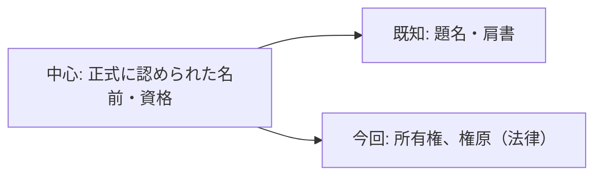

**重要語法**：title to land は土地に対する所有権を表す。

<small>index: 992 / candidate_id: `ev-00992-noun-02`</small>

---

## 722. capture

品詞：verb　｜　発音（米音目安）：/ˈkæptʃər/

<small>よく知られている意味：捕まえる</small>

**見落としやすい意味：興味や心を強くとらえる**

**例文**：The strange story captured everyone's imagination.

**和訳**：その不思議な話は皆の想像力を強くかき立てた。

**コアイメージ**：capture の中心には、対象をしっかりつかんで離さない感覚がある。物だけでなく注意や想像力も強く引き付けることを表す。

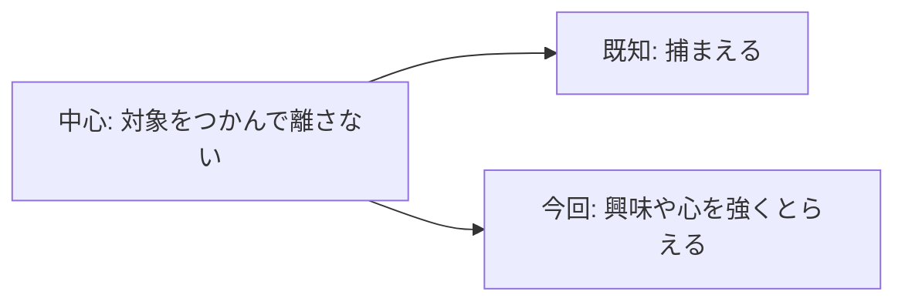

**重要語法**：capture someone's imagination は想像力をかき立てる。

<small>index: 993 / candidate_id: `ev-00993-verb-01`</small>

---

## 723. capture

品詞：verb　｜　発音（米音目安）：/ˈkæptʃər/

<small>よく知られている意味：捕まえる</small>

**見落としやすい意味：データ・画像を取り込んで記録する**

**例文**：This camera can capture clear images at night.

**和訳**：このカメラは夜でも鮮明な画像を記録できる。

**コアイメージ**：目の前にあるものを逃さずとらえる感覚が、情報や画像の記録にも広がる。データを取り込んで保存する場面では「捕獲」ではなく「記録」と読む。

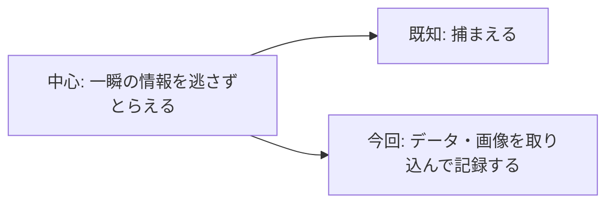

**重要語法**：capture an image / capture data の形で使う。

<small>index: 993 / candidate_id: `ev-00993-verb-02`</small>

---

## 724. adopt

品詞：verb　｜　発音（米音目安）：/əˈdɑːpt/

<small>よく知られている意味：養子にする</small>

**見落としやすい意味：方式・考え方・方針を新たに採用する**

**例文**：The school adopted a new attendance policy.

**和訳**：その学校は新しい出席方針を採用した。

**コアイメージ**：adopt は、外から来たものを自分たちのものとして受け入れる動きを表す。人を家族に迎えるだけでなく、考え方や方法を正式に取り入れる場合にも使う。

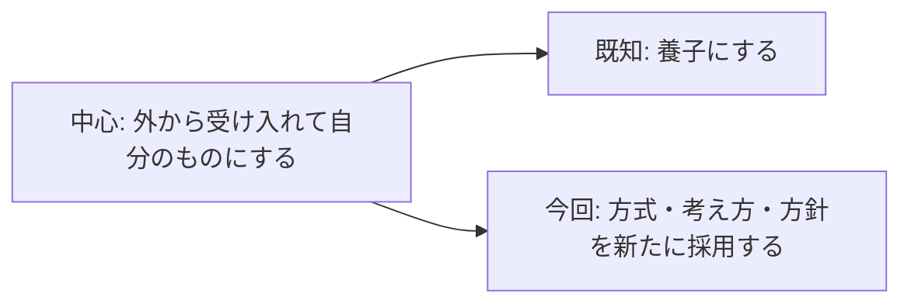

**重要語法**：adopt a policy / adopt a method。

<small>index: 994 / candidate_id: `ev-00994-verb-01`</small>

---

## 725. respect

品詞：noun　｜　発音（米音目安）：/rɪˈspekt/

<small>よく知られている意味：尊敬</small>

**見落としやすい意味：点・側面・観点**

**例文**：In this respect, the two plans are almost identical.

**和訳**：この点では、二つの計画はほとんど同じだ。

**コアイメージ**：respect には、対象のどの部分に目を向けるかという「観点」の意味がある。in this respect では、人への敬意ではなく、比較する際の特定の側面を指す。

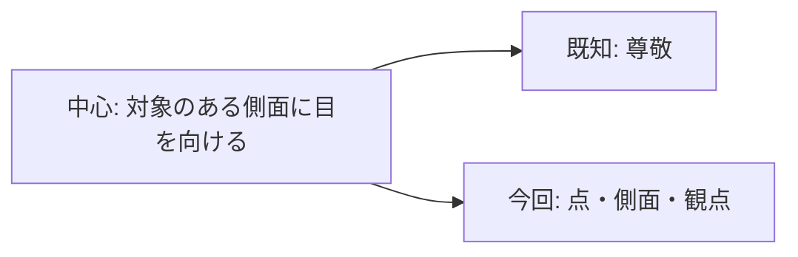

**重要語法**：in this respect「この点では」／in several respects「いくつかの点で」。

<small>index: 997 / candidate_id: `ev-00997-noun-01`</small>

---

## 726. station

品詞：noun　｜　発音（米音目安）：/ˈsteɪʃən/

<small>よく知られている意味：駅</small>

**見落としやすい意味：社会的地位・身分**

**例文**：He rose from a humble station in life.

**和訳**：彼は低い社会的身分から身を起こした。

**コアイメージ**：station の根底には、ある場所や位置に据えられている感覚がある。社会の中でその人が占める位置を表すと、身分や地位という意味になる。

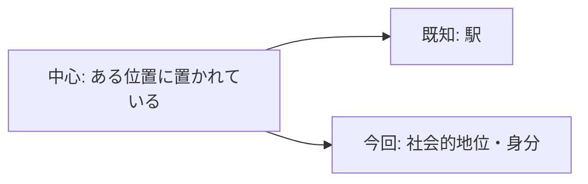

**重要語法**：station in life は社会的身分・境遇。

<small>index: 999 / candidate_id: `ev-00999-noun-01`</small>

---

## 727. station

品詞：noun　｜　発音（米音目安）：/ˈsteɪʃən/

<small>よく知られている意味：駅</small>

**見落としやすい意味：放送局、警察署などの施設**

**例文**：The local radio station broadcasts news every morning.

**和訳**：地元のラジオ局は毎朝ニュースを放送する。

**コアイメージ**：station は、特定の働きをするための拠点を表す。列車の拠点が駅であるのと同様に、放送や警察活動の拠点も station と呼ぶ。

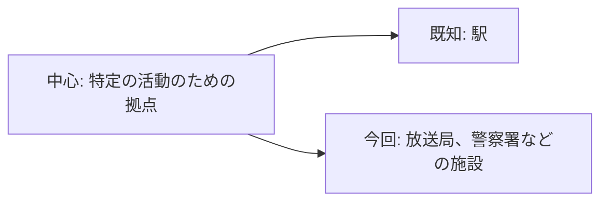

**重要語法**：radio station「放送局」／police station「警察署」。

<small>index: 999 / candidate_id: `ev-00999-noun-02`</small>

---

## 728. station

品詞：verb　｜　発音（米音目安）：/ˈsteɪʃən/

<small>よく知られている意味：駅</small>

**見落としやすい意味：人を職務のため特定の場所に配置する**

**例文**：Two guards were stationed at the entrance.

**和訳**：二人の警備員が入口に配置されていた。

**コアイメージ**：station を動詞にすると、人を特定の持ち場に置く意味になる。ただ居合わせたのではなく、任務のために配置されている点が重要。

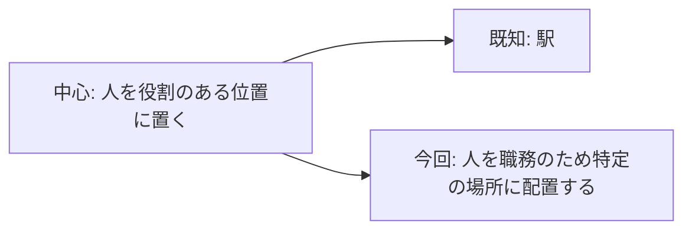

**重要語法**：be stationed at/in ... は「〜に配置されている」。

<small>index: 999 / candidate_id: `ev-00999-verb-01`</small>

---

## 729. column

品詞：noun　｜　発音（米音目安）：/ˈkɑːləm/

<small>よく知られている意味：柱・縦列</small>

**見落としやすい意味：新聞・雑誌のコラム、定期寄稿欄**

**例文**：She writes a weekly column about science.

**和訳**：彼女は科学についての週刊コラムを書いている。

**コアイメージ**：column は縦にまとまった一つの区画を表す。新聞の紙面で縦に組まれた記事欄を指すようになり、そこで連載される文章も表す。

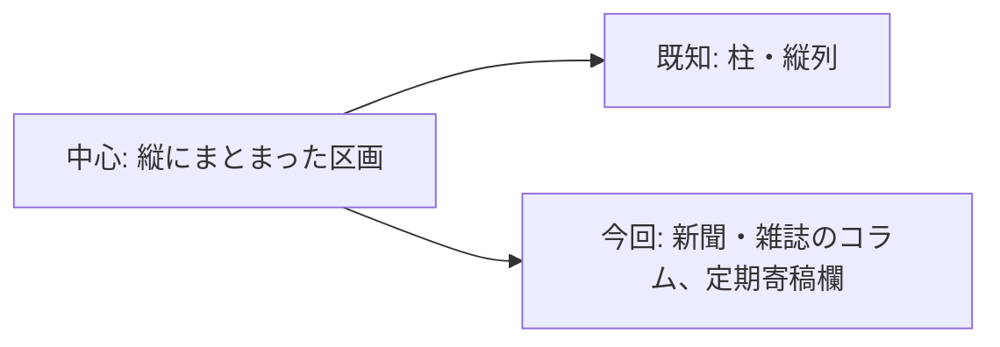

**重要語法**：a newspaper column / write a column。

<small>index: 1000 / candidate_id: `ev-01000-noun-01`</small>

---

## 730. treat

品詞：noun　｜　発音（米音目安）：/triːt/

<small>よく知られている意味：扱う・治療する（動詞）</small>

**見落としやすい意味：おごり・人に提供するごちそう**

**例文**：Dinner is my treat tonight.

**和訳**：今夜の夕食は私のおごりだ。

**コアイメージ**：treat には人に特別な対応をするという感覚がある。名詞では、相手を喜ばせるために提供するごちそうや、お金を出してもてなすことを指す。

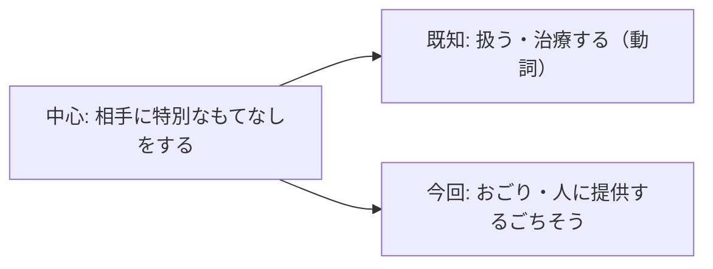

**重要語法**：It's my treat. は「私がおごるよ」。

<small>index: 1001 / candidate_id: `ev-01001-noun-01`</small>

---

## 731. moral

品詞：noun　｜　発音（米音目安）：/ˈmɔːrəl/

<small>よく知られている意味：道徳的な（形容詞）</small>

**見落としやすい意味：物語や出来事から得られる教訓**

**例文**：The moral of the story is to keep your promises.

**和訳**：その物語の教訓は、約束を守ることだ。

**コアイメージ**：moral は人の行いの善し悪しに関係する語。物語の後に残る「どう行動すべきか」という学びを、名詞の moral で表す。

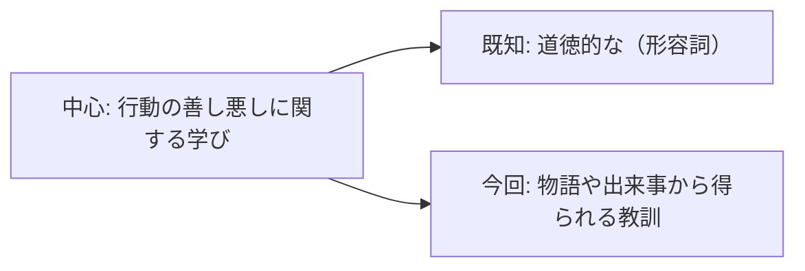

**重要語法**：the moral of the story「その話の教訓」。

<small>index: 1002 / candidate_id: `ev-01002-noun-01`</small>

---

## 732. fashion

品詞：verb　｜　発音（米音目安）：/ˈfæʃən/

<small>よく知られている意味：流行・服装（名詞）</small>

**見落としやすい意味：材料や考えをもとに何かを作り上げる**

**例文**：She fashioned a small boat from pieces of wood.

**和訳**：彼女は木片から小さな舟を作り上げた。

**コアイメージ**：fashion を動詞で使うと、材料に手を加えて望む形に仕上げることを表す。流行という名詞義に引きずられず、作り上げる動作に注目する。

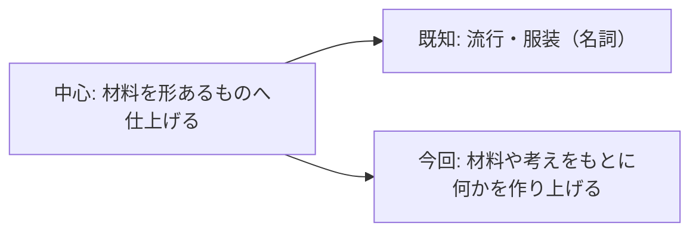

**重要語法**：fashion A from B「BからAを作り上げる」。

<small>index: 1003 / candidate_id: `ev-01003-verb-01`</small>

---

## 733. fish

品詞：verb　｜　発音（米音目安）：/fɪʃ/

<small>よく知られている意味：魚を釣る</small>

**見落としやすい意味：遠回しに情報や称賛を引き出そうとする**

**例文**：He was fishing for compliments about his speech.

**和訳**：彼は自分のスピーチを褒めてもらおうと遠回しに誘っていた。

**コアイメージ**：釣り針を垂らして何かが掛かるのを待つイメージが出発点。fish for では、情報や褒め言葉を相手からうまく引き出そうとすることを表す。

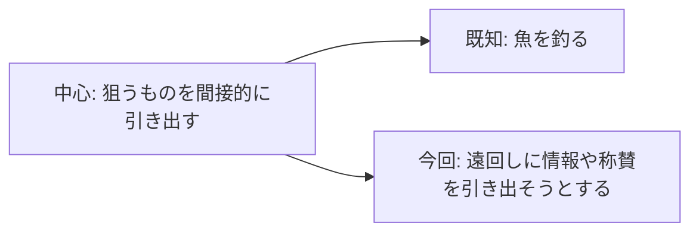

**重要語法**：fish for compliments / fish for information。

<small>index: 1016 / candidate_id: `ev-01016-verb-01`</small>

---

## 734. post

品詞：noun　｜　発音（米音目安）：/poʊst/

<small>よく知られている意味：郵便物・柱</small>

**見落としやすい意味：職位、役職**

**例文**：She applied for a teaching post at the college.

**和訳**：彼女はその大学の教職に応募した。

**コアイメージ**：post には人が受け持つ持ち場という意味がある。仕事の場面では、組織の中で与えられる職位や役目を指す。

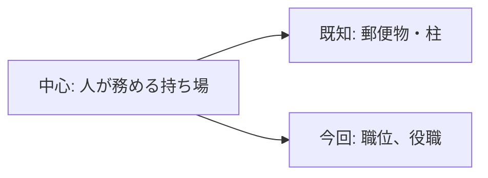

**重要語法**：hold a post「役職に就いている」／vacant post「空席の職」。

<small>index: 1017 / candidate_id: `ev-01017-noun-01`</small>

---

## 735. box

品詞：phrasal verb　｜　発音（米音目安）：/bɑːks/

<small>よく知られている意味：箱</small>

**見落としやすい意味：逃げ道や選択肢をふさいで追い詰める**

**例文**：The strict rules boxed us in and left few choices.

**和訳**：厳しい規則に縛られ、私たちにはほとんど選択肢が残らなかった。

**コアイメージ**：箱の四方を壁で囲む感覚が、人の行動範囲にも及ぶ。box someone in は、相手の逃げ道や選択肢を狭めて身動きを取りにくくすること。

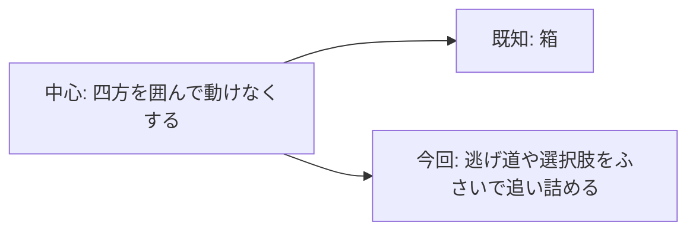

**重要語法**：box someone in「人を追い詰める・身動きを取れなくする」。

<small>index: 1018 / candidate_id: `ev-01018-phrasal-verb-01`</small>

---

## 736. initial

品詞：verb　｜　発音（米音目安）：/ɪˈnɪʃəl/

<small>よく知られている意味：最初の（形容詞）</small>

**見落としやすい意味：文書に氏名の頭文字を書き入れて確認する**

**例文**：Please initial each page of the agreement.

**和訳**：契約書の各ページに氏名の頭文字を記入してください。

**コアイメージ**：initial は名前の最初の文字を表す名詞にもなる。動詞では、その頭文字を書いて内容を確認・承認したことを示す。

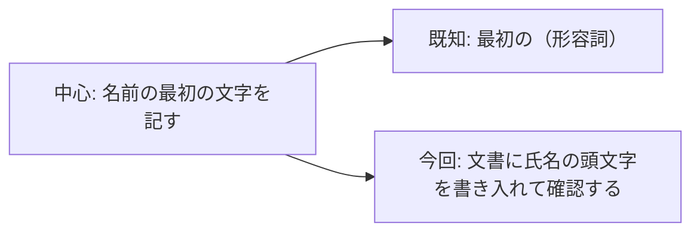

**重要語法**：initial a document / initial each page。

<small>index: 1019 / candidate_id: `ev-01019-verb-01`</small>

---

## 737. purchase

品詞：noun　｜　発音（米音目安）：/ˈpɝːtʃəs/

<small>よく知られている意味：購入</small>

**見落としやすい意味：体を支える足掛かり・しっかりした手掛かり**

**例文**：His boots could not get a purchase on the icy slope.

**和訳**：彼のブーツは凍った斜面で踏ん張りが利かなかった。

**コアイメージ**：この purchase は、体を支えるために表面をしっかりとらえる足掛かりを指す。「購入」とは別の用法なので、足元や滑りやすさの文脈から判断する。

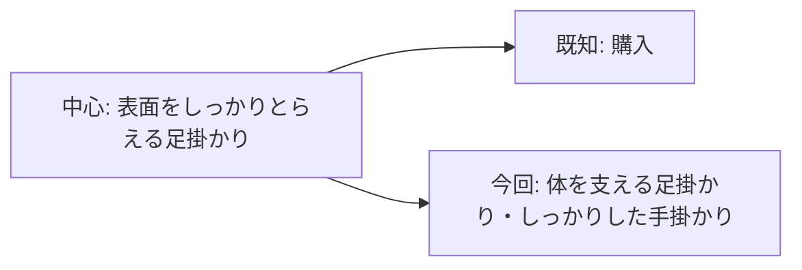

**重要語法**：get a purchase on ...「〜に足掛かりを得る」。

<small>index: 1021 / candidate_id: `ev-01021-noun-01`</small>

---

## 738. appeal

品詞：noun　｜　発音（米音目安）：/əˈpiːl/

<small>よく知られている意味：訴え・懇願</small>

**見落としやすい意味：人を引き付ける魅力**

**例文**：The old town has a special appeal for artists.

**和訳**：その古い町には芸術家を引き付ける特別な魅力がある。

**コアイメージ**：appeal には相手の心へ働きかける感覚がある。何かを要求する働きかけだけでなく、人を自然に引き付ける力も表す。

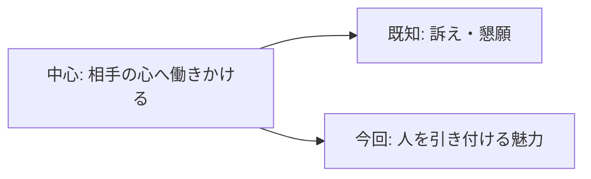

**重要語法**：have appeal / lose appeal。

<small>index: 1024 / candidate_id: `ev-01024-noun-02`</small>

---

## 739. appeal

品詞：verb　｜　発音（米音目安）：/əˈpiːl/

<small>よく知られている意味：訴える・懇願する</small>

**見落としやすい意味：（人の興味を）引き付ける、魅力を感じさせる**

**例文**：This game appeals to children of all ages.

**和訳**：このゲームはあらゆる年齢の子どもたちを引き付ける。

**コアイメージ**：appeal は人の心に届くよう働きかけることを表す。関心や好みに届く文脈では、訴えかけるより「魅力を感じさせる」と訳すと自然。

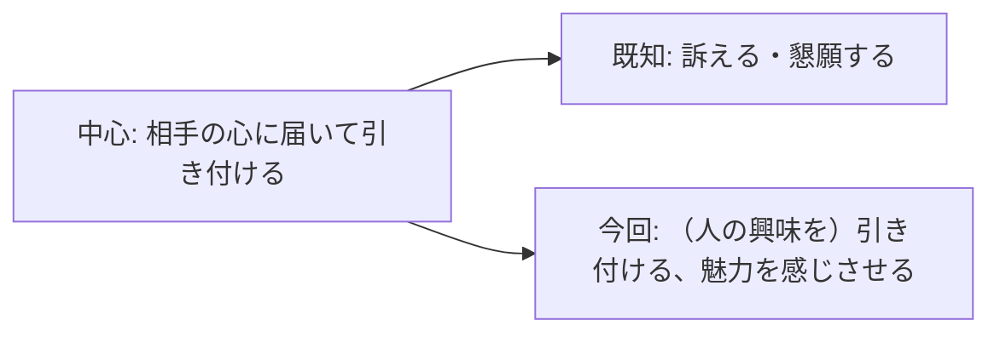

**重要語法**：appeal to + 人「〜の気に入る・心を引く」。

<small>index: 1024 / candidate_id: `ev-01024-verb-01`</small>

---

## 740. otherwise

品詞：adverb　｜　発音（米音目安）：/ˈʌðərwaɪz/

<small>よく知られている意味：さもなければ</small>

**見落としやすい意味：その点以外では、ほかの点では**

**例文**：The hotel was old but otherwise comfortable.

**和訳**：そのホテルは古かったが、それ以外の点では快適だった。

**コアイメージ**：otherwise は文字どおり「別のあり方・点では」と考えられる。条件を変える「さもなければ」だけでなく、ある例外を除いた全体評価にも使う。

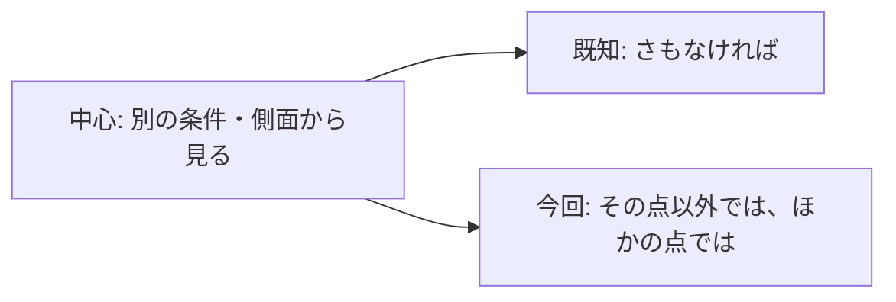

**重要語法**：otherwise good / but otherwise ...。

<small>index: 1032 / candidate_id: `ev-01032-adverb-01`</small>

---

## 741. relate

品詞：verb　｜　発音（米音目安）：/rɪˈleɪt/

<small>よく知られている意味：関係する</small>

**見落としやすい意味：相手の体験や気持ちに共感する**

**例文**：I can relate to her fear of speaking in public.

**和訳**：人前で話すことを怖がる彼女の気持ちはよく分かる。

**コアイメージ**：relate は二つのものを結び付けること。相手の経験を自分の経験と結び付けられるとき、「共感できる」という意味になる。

```mermaid
flowchart LR
    A["中心: 自分と相手の経験を結び付ける"]
    B["既知: 関係する"]
    C["今回: 相手の体験や気持ちに共感する"]
    A --> B
    A --> C
```

**重要語法**：relate to someone / relate to a feeling。

<small>index: 1035 / candidate_id: `ev-01035-verb-01`</small>

---

## 742. dead

品詞：adverb　｜　発音（米音目安）：/ded/

<small>よく知られている意味：死んだ</small>

**見落としやすい意味：まったく、完全に（dead tired など）**

**例文**：I was dead tired after the long hike.

**和訳**：長いハイキングの後、私はくたくただった。

**コアイメージ**：dead は生気がないほど完全な状態を連想させる。形容詞の前に置く副詞用法では、疲労などの程度を強く表す。

```mermaid
flowchart LR
    A["中心: 極端な状態まで達している"]
    B["既知: 死んだ"]
    C["今回: まったく、完全に（dead tired など）"]
    A --> B
    A --> C
```

**重要語法**：dead tired「くたくたの」／dead wrong「完全に間違った」。

<small>index: 1037 / candidate_id: `ev-01037-adverb-01`</small>

---

## 743. brief

品詞：verb　｜　発音（米音目安）：/briːf/

<small>よく知られている意味：短い</small>

**見落としやすい意味：必要な事情や指示を手短に伝える**

**例文**：The manager briefed us on the new safety rules.

**和訳**：責任者は新しい安全規則について私たちに要点を説明した。

**コアイメージ**：brief の「短い」という性質が、伝える情報を要点に絞る動詞用法につながる。必要な事実や指示を簡潔に知らせる場面で使う。

```mermaid
flowchart LR
    A["中心: 情報を要点に絞る"]
    B["既知: 短い"]
    C["今回: 必要な事情や指示を手短に伝える"]
    A --> B
    A --> C
```

**重要語法**：brief someone on/about something。

<small>index: 1038 / candidate_id: `ev-01038-verb-01`</small>

---

## 744. wish

品詞：construction　｜　発音（米音目安）：/wɪʃ/

<small>よく知られている意味：願う</small>

**見落としやすい意味：現実とは違うことを願う・過去を悔やむ**

**例文**：I wish I had listened to your advice.

**和訳**：あなたの助言を聞いておけばよかった。

**コアイメージ**：wish の後ろで時制を過去側にずらすと、現実との距離を表せる。過去形は現在の事実と異なる願望、過去完了形は過去への後悔を表すことが多い。

```mermaid
flowchart LR
    A["中心: 現実と違う状況を思い描く"]
    B["既知: 願う"]
    C["今回: 現実とは違うことを願う・過去を悔やむ"]
    A --> B
    A --> C
```

**重要語法**：wish (that) + 過去形／過去完了形。

<small>index: 1040 / candidate_id: `ev-01040-construction-01`</small>

---

## 745. coverage

品詞：noun　｜　発音（米音目安）：/ˈkʌvərɪdʒ/

<small>よく知られている意味：覆う範囲</small>

**見落としやすい意味：ニュースや出来事についての報道・取材**

**例文**：The storm received extensive news coverage.

**和訳**：その嵐はニュースで広く報道された。

**コアイメージ**：coverage は何かをどの範囲まで取り上げるかを表す。報道では、出来事を取材しニュースとして伝える範囲や量を指す。

```mermaid
flowchart LR
    A["中心: 対象をどこまで取り上げるか"]
    B["既知: 覆う範囲"]
    C["今回: ニュースや出来事についての報道・取材"]
    A --> B
    A --> C
```

**重要語法**：news coverage / media coverage。

<small>index: 1042 / candidate_id: `ev-01042-noun-01`</small>

---

## 746. liberal

品詞：adjective　｜　発音（米音目安）：/ˈlɪbərəl/

<small>よく知られている意味：自由主義的な</small>

**見落としやすい意味：気前よく与える、惜しみない**

**例文**：The teacher was liberal with praise.

**和訳**：その先生は惜しみなく生徒を褒めた。

**コアイメージ**：liberal には制限が厳しくなく、十分に与える感覚がある。政治的立場だけでなく、褒め言葉や援助を気前よく与える様子も表す。

```mermaid
flowchart LR
    A["中心: 制限せず十分に与える"]
    B["既知: 自由主義的な"]
    C["今回: 気前よく与える、惜しみない"]
    A --> B
    A --> C
```

**重要語法**：be liberal with praise / money。

<small>index: 1044 / candidate_id: `ev-01044-adjective-01`</small>

---

## 747. liberal

品詞：adjective　｜　発音（米音目安）：/ˈlɪbərəl/

<small>よく知られている意味：自由主義的な</small>

**見落としやすい意味：規則や解釈が厳格でない、寛大な**

**例文**：They gave the rule a liberal interpretation.

**和訳**：彼らはその規則を柔軟に解釈した。

**コアイメージ**：liberal には厳格な制約に縛られないという側面がある。規則の解釈では、細部を厳密に限定せず幅広く受け止める意味になる。

```mermaid
flowchart LR
    A["中心: 制限を緩めて幅広くとらえる"]
    B["既知: 自由主義的な"]
    C["今回: 規則や解釈が厳格でない、寛大な"]
    A --> B
    A --> C
```

**重要語法**：a liberal interpretation of a rule。

<small>index: 1044 / candidate_id: `ev-01044-adjective-02`</small>

---

## 748. dance

品詞：phrasal verb　｜　発音（米音目安）：/dæns/

<small>よく知られている意味：踊る</small>

**見落としやすい意味：話題や問題の核心を避けて曖昧に答える**

**例文**：The spokesperson danced around the difficult question.

**和訳**：広報担当者はその難しい質問への明確な回答を避けた。

**コアイメージ**：踊るようにあちこち動き、中心に踏み込まないイメージ。dance around は問題の核心を避け、曖昧に話すことを表す。

```mermaid
flowchart LR
    A["中心: 中心を避けて周囲を回る"]
    B["既知: 踊る"]
    C["今回: 話題や問題の核心を避けて曖昧に答える"]
    A --> B
    A --> C
```

**重要語法**：dance around a question / an issue。

<small>index: 1045 / candidate_id: `ev-01045-phrasal-verb-01`</small>

---

## 749. net

品詞：adjective　｜　発音（米音目安）：/net/

<small>よく知られている意味：網（名詞）</small>

**見落としやすい意味：経費・控除分を差し引いた正味の**

**例文**：The company's net profit rose this year.

**和訳**：その会社の純利益は今年増加した。

**コアイメージ**：net には「網」とは別に、差し引き計算の後に残る金額を表す用法がある。売上や給与など金額の前では、経費や税金などを除いた「正味」を意味する。

```mermaid
flowchart LR
    A["中心: 差し引いた後に残る額"]
    B["既知: 網（名詞）"]
    C["今回: 経費・控除分を差し引いた正味の"]
    A --> B
    A --> C
```

**重要語法**：net profit「純利益」／net income「純所得」。

<small>index: 1047 / candidate_id: `ev-01047-adjective-01`</small>

---

## 750. affect

品詞：noun　｜　発音（米音目安）：/ˈæfekt/

<small>よく知られている意味：影響する（動詞）</small>

**見落としやすい意味：感情・情動の表れ（心理学用語）**

**例文**：The patient showed little affect during the interview.

**和訳**：面談中、その患者は感情の表れが乏しかった。

**コアイメージ**：名詞の affect は心理学などで、外に現れる感情の表出を指す専門用語。動詞「影響する」とは意味もアクセントも異なるので、品詞と文脈で判別する。

```mermaid
flowchart LR
    A["中心: 感情が外へ現れた様子"]
    B["既知: 影響する（動詞）"]
    C["今回: 感情・情動の表れ（心理学用語）"]
    A --> B
    A --> C
```

**重要語法**：専門名詞 affect は第1音節に強勢。動詞 affect /əˈfekt/ と区別。

<small>index: 1048 / candidate_id: `ev-01048-noun-01`</small>

---

## 751. pressure

品詞：verb　｜　発音（米音目安）：/ˈpreʃər/

<small>よく知られている意味：圧力（名詞）</small>

**見落としやすい意味：相手に圧力をかけて行動を迫る**

**例文**：The group pressured the council into changing its decision.

**和訳**：その団体は議会に圧力をかけ、決定を変更させた。

**コアイメージ**：pressure は押し付ける力を表す語。動詞では、相手に心理的・社会的圧力を加えて望む行動を取らせることを意味する。

```mermaid
flowchart LR
    A["中心: 相手を押して行動を変えさせる"]
    B["既知: 圧力（名詞）"]
    C["今回: 相手に圧力をかけて行動を迫る"]
    A --> B
    A --> C
```

**重要語法**：pressure someone into doing「人に圧力をかけて〜させる」。

<small>index: 1051 / candidate_id: `ev-01051-verb-01`</small>

---

## 752. abuse

品詞：noun　｜　発音（米音目安）：/əˈbjuːs/

<small>よく知られている意味：虐待・乱用</small>

**見落としやすい意味：言葉による侮辱・罵倒**

**例文**：The workers faced verbal abuse from angry customers.

**和訳**：従業員たちは怒った客から暴言を浴びた。

**コアイメージ**：abuse は人や物を不当に扱うことを表す。言葉に向けられると、相手を傷つける侮辱や罵倒という意味になる。

```mermaid
flowchart LR
    A["中心: 相手を不当に傷つける扱い"]
    B["既知: 虐待・乱用"]
    C["今回: 言葉による侮辱・罵倒"]
    A --> B
    A --> C
```

**重要語法**：verbal abuse「暴言・言葉による侮辱」。

<small>index: 1052 / candidate_id: `ev-01052-noun-01`</small>

---

## 753. wonder

品詞：construction　｜　発音（米音目安）：/ˈwʌndər/

<small>よく知られている意味：不思議に思う</small>

**見落としやすい意味：〜なのも不思議ではない、当然だ**

**例文**：No wonder you're tired after such a long journey.

**和訳**：そんな長旅の後なら、疲れているのも当然だ。

**コアイメージ**：wonder は「不思議だと思うこと」。no wonder は「不思議なことではない」から、理由を聞けば納得できるという意味になる。

```mermaid
flowchart LR
    A["中心: 驚く理由がないほど当然"]
    B["既知: 不思議に思う"]
    C["今回: 〜なのも不思議ではない、当然だ"]
    A --> B
    A --> C
```

**重要語法**：(It's) no wonder (that) ...「〜なのも無理はない」。

<small>index: 1053 / candidate_id: `ev-01053-construction-01`</small>

---

## 754. operate

品詞：verb　｜　発音（米音目安）：/ˈɑːpəreɪt/

<small>よく知られている意味：操作する・運営する</small>

**見落としやすい意味：医師が患者に手術をする**

**例文**：The surgeon operated on the patient yesterday.

**和訳**：その外科医は昨日、その患者を手術した。

**コアイメージ**：operate は仕組みを動かし、働かせる意味を持つ。医療の文脈では外科的な処置を行うことを表し、患者には on を伴う。

```mermaid
flowchart LR
    A["中心: 専門的な操作・処置を行う"]
    B["既知: 操作する・運営する"]
    C["今回: 医師が患者に手術をする"]
    A --> B
    A --> C
```

**重要語法**：operate on a patient「患者を手術する」。

<small>index: 1058 / candidate_id: `ev-01058-verb-01`</small>

---

## 755. primary

品詞：noun　｜　発音（米音目安）：/ˈpraɪmeri/

<small>よく知られている意味：主要な・第一の（形容詞）</small>

**見落としやすい意味：政党の候補者を選ぶ予備選挙**

**例文**：She won the party's primary last month.

**和訳**：彼女は先月、その政党の予備選挙で勝利した。

**コアイメージ**：primary は「最初の段階・主要なもの」を表す。選挙の文脈では、本選挙より先に候補者を決めるための予備選挙を指す名詞になる。

```mermaid
flowchart LR
    A["中心: 本番に先立つ最初の選考"]
    B["既知: 主要な・第一の（形容詞）"]
    C["今回: 政党の候補者を選ぶ予備選挙"]
    A --> B
    A --> C
```

**重要語法**：a party primary / win a primary。

<small>index: 1063 / candidate_id: `ev-01063-noun-01`</small>

---

## 756. ship

品詞：verb　｜　発音（米音目安）：/ʃɪp/

<small>よく知られている意味：船（名詞）</small>

**見落としやすい意味：商品などを出荷・発送する**

**例文**：The store ships orders within two days.

**和訳**：その店は注文された商品を2日以内に発送する。

**コアイメージ**：ship はもともと船による輸送を連想させる語。現代では船に限らず、商品を送り出すこと全般に使う動詞になっている。

```mermaid
flowchart LR
    A["中心: 荷物を送り出す"]
    B["既知: 船（名詞）"]
    C["今回: 商品などを出荷・発送する"]
    A --> B
    A --> C
```

**重要語法**：ship goods / ship an order。

<small>index: 1064 / candidate_id: `ev-01064-verb-01`</small>

---

## 757. code

品詞：noun　｜　発音（米音目安）：/koʊd/

<small>よく知られている意味：暗号・プログラム</small>

**見落としやすい意味：規範・法律などをまとめた法典や規則体系**

**例文**：All members must follow the club's code of conduct.

**和訳**：全会員はクラブの行動規範に従わなければならない。

**コアイメージ**：code には一定の規則を体系的にまとめたものという考え方がある。コンピューターの命令だけでなく、人の行動を定める規則集や法典も指す。

```mermaid
flowchart LR
    A["中心: 規則を体系立ててまとめたもの"]
    B["既知: 暗号・プログラム"]
    C["今回: 規範・法律などをまとめた法典や規則体系"]
    A --> B
    A --> C
```

**重要語法**：code of conduct「行動規範」／legal code「法典」。

<small>index: 1068 / candidate_id: `ev-01068-noun-01`</small>

---

## 758. dress

品詞：verb　｜　発音（米音目安）：/dres/

<small>よく知られている意味：服を着せる</small>

**見落としやすい意味：傷口などに包帯を当てて手当てする**

**例文**：The nurse carefully dressed the wound.

**和訳**：看護師はその傷口を丁寧に手当てした。

**コアイメージ**：dress には何かを覆い、必要な状態に整える感覚がある。傷口を対象にすると、包帯などで保護して処置する意味になる。

```mermaid
flowchart LR
    A["中心: 覆って整え保護する"]
    B["既知: 服を着せる"]
    C["今回: 傷口などに包帯を当てて手当てする"]
    A --> B
    A --> C
```

**重要語法**：dress a wound「傷口を手当てする」。

<small>index: 1071 / candidate_id: `ev-01071-verb-01`</small>

---

## 759. entry

品詞：noun　｜　発音（米音目安）：/ˈentri/

<small>よく知られている意味：入口・記入</small>

**見落としやすい意味：コンテストなどへの応募作品・出品物**

**例文**：Her painting was the winning entry in the contest.

**和訳**：彼女の絵がそのコンテストの優勝作品だった。

**コアイメージ**：entry は、ある活動に参加するために差し出すものを表す。競技やコンテストでは、応募行為だけでなく提出した作品自体も指す。

```mermaid
flowchart LR
    A["中心: 参加のために差し出すもの"]
    B["既知: 入口・記入"]
    C["今回: コンテストなどへの応募作品・出品物"]
    A --> B
    A --> C
```

**重要語法**：an entry in a competition / a winning entry。

<small>index: 1073 / candidate_id: `ev-01073-noun-01`</small>

---

## 760. define

品詞：verb　｜　発音（米音目安）：/dɪˈfaɪn/

<small>よく知られている意味：定義する</small>

**見落としやすい意味：人や物事の決定的な特徴となる**

**例文**：Her courage defined her leadership.

**和訳**：勇気こそが、彼女のリーダーシップを特徴づけていた。

**コアイメージ**：define には境界をはっきりさせて、何であるかを明確にする感覚がある。人物や物事を他と区別する決定的な性質を表す場合、「特徴づける」と読む。

```mermaid
flowchart LR
    A["中心: 何であるかを決定づける"]
    B["既知: 定義する"]
    C["今回: 人や物事の決定的な特徴となる"]
    A --> B
    A --> C
```

**重要語法**：be defined by ...「〜によって特徴づけられる」。

<small>index: 1075 / candidate_id: `ev-01075-verb-01`</small>

---

## 761. fly

品詞：noun　｜　発音（米音目安）：/flaɪ/

<small>よく知られている意味：飛ぶ・ハエ</small>

**見落としやすい意味：ズボンの前部の開閉部分（ファスナー部分）**

**例文**：The fly on my jeans is broken.

**和訳**：私のジーンズの前開きが壊れている。

**コアイメージ**：衣服の fly はズボンの前開きに当たる部分を指す名詞。「飛ぶ」や「ハエ」と同じ綴りだが、衣類の話では別の意味に切り替えて読む。

```mermaid
flowchart LR
    A["中心: 衣類の前を開閉する部分"]
    B["既知: 飛ぶ・ハエ"]
    C["今回: ズボンの前部の開閉部分（ファスナー部分）"]
    A --> B
    A --> C
```

**重要語法**：zip fly「ファスナー式の前開き」／button fly「ボタン式の前開き」。

<small>index: 1076 / candidate_id: `ev-01076-noun-01`</small>

---

## 762. novel

品詞：adjective　｜　発音（米音目安）：/ˈnɑːvəl/

<small>よく知られている意味：小説（名詞）</small>

**見落としやすい意味：新奇な、従来にない独創的な**

**例文**：The researchers proposed a novel solution to the problem.

**和訳**：研究者たちはその問題に対して斬新な解決策を提案した。

**コアイメージ**：novel には「新しい、今までにない」という意味がある。小説という名詞以外に、従来の方法と異なる発想や技術を修飾する形容詞になる。

```mermaid
flowchart LR
    A["中心: これまでになかった新しさ"]
    B["既知: 小説（名詞）"]
    C["今回: 新奇な、従来にない独創的な"]
    A --> B
    A --> C
```

**重要語法**：a novel approach / a novel solution。

<small>index: 1077 / candidate_id: `ev-01077-adjective-01`</small>

---

## 763. permit

品詞：noun　｜　発音（米音目安）：/ˈpɝːmɪt/

<small>よく知られている意味：許可する（動詞）</small>

**見落としやすい意味：公的な許可証、許可を示す書類**

**例文**：You need a permit to camp in this area.

**和訳**：この区域でキャンプするには許可証が必要だ。

**コアイメージ**：permit は許可を与えることに関わる語。名詞になると、許可があることを公的に証明する書類そのものを表す。

```mermaid
flowchart LR
    A["中心: 許可があることを示すもの"]
    B["既知: 許可する（動詞）"]
    C["今回: 公的な許可証、許可を示す書類"]
    A --> B
    A --> C
```

**重要語法**：名詞は第1音節、動詞 /pərˈmɪt/ は第2音節に強勢。

<small>index: 1079 / candidate_id: `ev-01079-noun-01`</small>

---

## 764. narrow

品詞：phrasal verb　｜　発音（米音目安）：/ˈneroʊ/

<small>よく知られている意味：狭い</small>

**見落としやすい意味：候補や範囲を絞り込む**

**例文**：We narrowed down the list to three names.

**和訳**：私たちは候補者リストを3人に絞り込んだ。

**コアイメージ**：narrow の「幅が狭い」を、候補の数や可能性の範囲に当てはめる。narrow down は不要な選択肢を除いて少数に限定する動きを表す。

```mermaid
flowchart LR
    A["中心: 選択肢の幅を狭くする"]
    B["既知: 狭い"]
    C["今回: 候補や範囲を絞り込む"]
    A --> B
    A --> C
```

**重要語法**：narrow down A to B「AをBまで絞る」。

<small>index: 1082 / candidate_id: `ev-01082-phrasal-verb-01`</small>

---

## 765. advantage

品詞：construction　｜　発音（米音目安）：/ədˈvæntɪdʒ/

<small>よく知られている意味：利点・有利さ</small>

**見落としやすい意味：利用する・弱みにつけこむ**

**例文**：He took advantage of her kindness.

**和訳**：彼は彼女の親切心につけこんだ。

**コアイメージ**：advantage は自分にとって有利なもの。take advantage of は、その有利さを自分のために利用することで、好機の活用にも他人の弱みにつけこむ場合にも使う。

```mermaid
flowchart LR
    A["中心: 自分に有利な状況を利用する"]
    B["既知: 利点・有利さ"]
    C["今回: 利用する・弱みにつけこむ"]
    A --> B
    A --> C
```

**重要語法**：take advantage of an opportunity「機会を生かす」／take advantage of someone「人につけこむ」。

<small>index: 1085 / candidate_id: `ev-01085-construction-01`</small>

---

## 766. phrase

品詞：verb　｜　発音（米音目安）：/freɪz/

<small>よく知られている意味：句・言い回し（名詞）</small>

**見落としやすい意味：言葉を選んで表現する・言い回す**

**例文**：She phrased the question carefully to avoid confusion.

**和訳**：彼女は誤解を避けるため、質問の言い方を慎重に選んだ。

**コアイメージ**：phrase は言葉がひとまとまりになった表現を指す。動詞では、その言葉の組み立て方を考えて内容を表現することを意味する。

```mermaid
flowchart LR
    A["中心: 言葉を組み立てて伝える"]
    B["既知: 句・言い回し（名詞）"]
    C["今回: 言葉を選んで表現する・言い回す"]
    A --> B
    A --> C
```

**重要語法**：phrase a question / be carefully phrased。

<small>index: 1086 / candidate_id: `ev-01086-verb-01`</small>

---

## 767. sentence

品詞：verb　｜　発音（米音目安）：/ˈsentəns/

<small>よく知られている意味：文・文章（名詞）</small>

**見落としやすい意味：裁判で刑を宣告する**

**例文**：The judge sentenced him to two years in prison.

**和訳**：裁判官は彼に懲役2年を言い渡した。

**コアイメージ**：sentence には裁判所が正式に言い渡す「判決・刑」という名詞の意味もある。動詞では、裁判官が刑罰を宣告する動きを表す。

```mermaid
flowchart LR
    A["中心: 正式な判断を言い渡す"]
    B["既知: 文・文章（名詞）"]
    C["今回: 裁判で刑を宣告する"]
    A --> B
    A --> C
```

**重要語法**：sentence someone to ...「人に〜の刑を宣告する」。

<small>index: 1087 / candidate_id: `ev-01087-verb-01`</small>

---

## 768. cell

品詞：noun　｜　発音（米音目安）：/sel/

<small>よく知られている意味：細胞</small>

**見落としやすい意味：独房、監房、修道院の小部屋**

**例文**：The prisoner spent the night in a small cell.

**和訳**：その囚人は小さな監房で一夜を過ごした。

**コアイメージ**：cell は区切られた小さな空間を表す。生物の細胞だけでなく、建物の中で一人を収容する小部屋にも使われる。

```mermaid
flowchart LR
    A["中心: 周囲から区切られた小区画"]
    B["既知: 細胞"]
    C["今回: 独房、監房、修道院の小部屋"]
    A --> B
    A --> C
```

**重要語法**：prison cell「監房」／monk's cell「修道士の小部屋」。

<small>index: 1088 / candidate_id: `ev-01088-noun-01`</small>

---

## 769. cell

品詞：noun　｜　発音（米音目安）：/sel/

<small>よく知られている意味：細胞</small>

**見落としやすい意味：表計算や表の一つ一つのマス**

**例文**：Enter the total in the last cell of the table.

**和訳**：表の最後のマスに合計を入力してください。

**コアイメージ**：cell の中心は区切られた小さな単位。表計算では、行と列で囲まれた一つ一つの入力欄を表す。

```mermaid
flowchart LR
    A["中心: 境界で区切られた一単位"]
    B["既知: 細胞"]
    C["今回: 表計算や表の一つ一つのマス"]
    A --> B
    A --> C
```

**重要語法**：spreadsheet cell「表計算のセル」。

<small>index: 1088 / candidate_id: `ev-01088-noun-02`</small>

---

## 770. port

品詞：noun　｜　発音（米音目安）：/pɔːrt/

<small>よく知られている意味：港</small>

**見落としやすい意味：機器やコンピューターの接続口・通信の接点**

**例文**：Plug the cable into the USB port on the laptop.

**和訳**：ノートパソコンのUSB接続口にケーブルを差し込んでください。

**コアイメージ**：port は外部から入って来るものや出て行くものの接点を表す。港が船の出入り口であるのと同様に、機器の接続口や通信の窓口にも使う。

```mermaid
flowchart LR
    A["中心: 内外をつなぐ出入り口"]
    B["既知: 港"]
    C["今回: 機器やコンピューターの接続口・通信の接点"]
    A --> B
    A --> C
```

**重要語法**：USB port / network port。

<small>index: 1091 / candidate_id: `ev-01091-noun-01`</small>

---

## 771. audience

品詞：noun　｜　発音（米音目安）：/ˈɔːdiəns/

<small>よく知られている意味：聴衆・観客</small>

**見落としやすい意味：重要人物との公式な面会・謁見**

**例文**：The ambassador was granted an audience with the king.

**和訳**：その大使は国王との謁見を許された。

**コアイメージ**：audience には話を聞くことと関係する意味がある。重要人物が面会者の話を聞く公式な機会を表すと、「謁見・面会」になる。

```mermaid
flowchart LR
    A["中心: 重要人物に話を聞いてもらう機会"]
    B["既知: 聴衆・観客"]
    C["今回: 重要人物との公式な面会・謁見"]
    A --> B
    A --> C
```

**重要語法**：an audience with + 人／grant someone an audience。

<small>index: 1093 / candidate_id: `ev-01093-noun-01`</small>

---

## 772. conclude

品詞：verb　｜　発音（米音目安）：/kənˈkluːd/

<small>よく知られている意味：結論づける・終える</small>

**見落としやすい意味：契約・協定を正式に締結する**

**例文**：The two companies concluded an agreement on data sharing.

**和訳**：その2社はデータ共有に関する協定を締結した。

**コアイメージ**：conclude は物事を終結させ、決着をつける動きが中心。交渉や協議の文脈では、正式な合意を成立させることを意味する。

```mermaid
flowchart LR
    A["中心: 話し合いに正式な決着をつける"]
    B["既知: 結論づける・終える"]
    C["今回: 契約・協定を正式に締結する"]
    A --> B
    A --> C
```

**重要語法**：conclude an agreement / conclude a treaty。

<small>index: 1094 / candidate_id: `ev-01094-verb-01`</small>

---

## 773. affair

品詞：noun　｜　発音（米音目安）：/əˈfer/

<small>よく知られている意味：事柄・用件</small>

**見落としやすい意味：恋愛上の秘密の関係・不倫関係**

**例文**：The newspaper reported that he had an affair with a colleague.

**和訳**：新聞は、彼が同僚と秘密の恋愛関係にあったと報じた。

**コアイメージ**：affair は人に関わる出来事や問題を指す。私生活を扱う文脈では、表に出していない恋愛関係、とりわけ不倫関係を表すことがある。

```mermaid
flowchart LR
    A["中心: 人に関わる私的な出来事"]
    B["既知: 事柄・用件"]
    C["今回: 恋愛上の秘密の関係・不倫関係"]
    A --> B
    A --> C
```

**重要語法**：have an affair with + 人。

<small>index: 1096 / candidate_id: `ev-01096-noun-01`</small>

---

## 774. property

品詞：noun　｜　発音（米音目安）：/ˈprɑːpərti/

<small>よく知られている意味：財産・所有物</small>

**見落としやすい意味：物質・対象が備える性質、特性**

**例文**：Water has several unusual physical properties.

**和訳**：水にはいくつかの珍しい物理的性質がある。

**コアイメージ**：property はあるものに属しているものを表す語。所有する物だけでなく、その物が備えている性質や特徴も指す。

```mermaid
flowchart LR
    A["中心: 対象が固有に持っているもの"]
    B["既知: 財産・所有物"]
    C["今回: 物質・対象が備える性質、特性"]
    A --> B
    A --> C
```

**重要語法**：physical properties / chemical properties。

<small>index: 1097 / candidate_id: `ev-01097-noun-01`</small>

---

## 775. seat

品詞：noun　｜　発音（米音目安）：/siːt/

<small>よく知られている意味：座席</small>

**見落としやすい意味：議会などの議席・議員の地位**

**例文**：She won a seat in parliament.

**和訳**：彼女は議会の議席を獲得した。

**コアイメージ**：seat は人が座るために割り当てられた場所。議会の文脈では、議員に与えられる席から議員の地位そのものを表す。

```mermaid
flowchart LR
    A["中心: 人に割り当てられた席・立場"]
    B["既知: 座席"]
    C["今回: 議会などの議席・議員の地位"]
    A --> B
    A --> C
```

**重要語法**：win a seat / hold a seat in parliament。

<small>index: 1098 / candidate_id: `ev-01098-noun-01`</small>

---

## 776. shape

品詞：verb　｜　発音（米音目安）：/ʃeɪp/

<small>よく知られている意味：形（名詞）</small>

**見落としやすい意味：将来や考え方などを形成し方向づける**

**例文**：Childhood experiences often shape our values.

**和訳**：幼い頃の経験は、しばしば私たちの価値観を形づくる。

**コアイメージ**：shape は物に形を与えること。目に見えない価値観や将来にも用い、影響を重ねて方向性を作ることを表す。

```mermaid
flowchart LR
    A["中心: 物事に形と方向を与える"]
    B["既知: 形（名詞）"]
    C["今回: 将来や考え方などを形成し方向づける"]
    A --> B
    A --> C
```

**重要語法**：shape opinions / shape the future。

<small>index: 1099 / candidate_id: `ev-01099-verb-01`</small>

---

## 777. connection

品詞：noun　｜　発音（米音目安）：/kəˈnekʃən/

<small>よく知られている意味：接続・関係</small>

**見落としやすい意味：有力者とのつながり・コネ**

**例文**：She has useful connections in the publishing industry.

**和訳**：彼女には出版業界に役立つ人脈がある。

**コアイメージ**：connection は人や物の間にある結び付き。仕事や社会の文脈では、助けを得られる知人や有力者とのつながりを指すことがある。

```mermaid
flowchart LR
    A["中心: 人と人を結ぶネットワーク"]
    B["既知: 接続・関係"]
    C["今回: 有力者とのつながり・コネ"]
    A --> B
    A --> C
```

**重要語法**：have connections in ...「〜業界に人脈がある」。

<small>index: 1101 / candidate_id: `ev-01101-noun-01`</small>

---

## 778. commit

品詞：construction　｜　発音（米音目安）：/kəˈmɪt/

<small>よく知られている意味：（罪などを）犯す・確約する</small>

**見落としやすい意味：自分の身をある目的・行動に投じる**

**例文**：He committed himself to learning Japanese.

**和訳**：彼は日本語の学習に本気で打ち込むと決めた。

**コアイメージ**：commit は自分を何かに深く関わらせ、引き受ける動き。commit oneself to では、ある目的に自分の時間や力を投じることを表す。

```mermaid
flowchart LR
    A["中心: 自分の力をある目的に差し向ける"]
    B["既知: （罪などを）犯す・確約する"]
    C["今回: 自分の身をある目的・行動に投じる"]
    A --> B
    A --> C
```

**重要語法**：commit oneself to + 名詞／動名詞。to は前置詞。

<small>index: 1102 / candidate_id: `ev-01102-construction-01`</small>

---

## 779. commit

品詞：verb　｜　発音（米音目安）：/kəˈmɪt/

<small>よく知られている意味：約束する・専念する</small>

**見落としやすい意味：犯罪・誤りなどを犯す**

**例文**：Someone committed a serious crime in the town.

**和訳**：町で何者かが重大な犯罪を犯した。

**コアイメージ**：commit はある行為を実際に行うことも表す。目的語が crime や error などなら、望ましくない行為を「犯す」という意味になる。

```mermaid
flowchart LR
    A["中心: ある行為を実行する"]
    B["既知: 約束する・専念する"]
    C["今回: 犯罪・誤りなどを犯す"]
    A --> B
    A --> C
```

**重要語法**：commit a crime / commit an error。

<small>index: 1102 / candidate_id: `ev-01102-verb-01`</small>

---

## 780. realize

品詞：verb　｜　発音（米音目安）：/ˈriːəlaɪz/

<small>よく知られている意味：気づく・理解する</small>

**見落としやすい意味：夢・計画を現実のものにする**

**例文**：She finally realized her dream of becoming a doctor.

**和訳**：彼女はついに医師になる夢を実現した。

**コアイメージ**：realize は頭の中で理解するだけでなく、考えていたことを現実のものにする意味も持つ。夢や目標が目的語なら、「実現する」が自然。

```mermaid
flowchart LR
    A["中心: 考えを現実のものにする"]
    B["既知: 気づく・理解する"]
    C["今回: 夢・計画を現実のものにする"]
    A --> B
    A --> C
```

**重要語法**：realize a dream / realize a goal。

<small>index: 1106 / candidate_id: `ev-01106-verb-01`</small>

---

## 781. eat

品詞：phrasal verb　｜　発音（米音目安）：/iːt/

<small>よく知られている意味：食べる</small>

**見落としやすい意味：徐々にむしばむ・侵食する**

**例文**：Worry slowly ate away at his confidence.

**和訳**：心配事が少しずつ彼の自信をむしばんだ。

**コアイメージ**：eat away at は、何かを少しずつ食べて削る動きを表す。目に見えない自信や安心感などにも使い、徐々に損なうことを意味する。

```mermaid
flowchart LR
    A["中心: 少しずつ削り取る"]
    B["既知: 食べる"]
    C["今回: 徐々にむしばむ・侵食する"]
    A --> B
    A --> C
```

**重要語法**：eat away at someone's confidence「人の自信をむしばむ」。

<small>index: 1112 / candidate_id: `ev-01112-phrasal-verb-01`</small>

---

## 782. track

品詞：construction　｜　発音（米音目安）：/træk/

<small>よく知られている意味：線路・足跡</small>

**見落としやすい意味：予定どおりに進んでいる**

**例文**：The project is on track to finish by Friday.

**和訳**：その計画は金曜日までに完了する予定どおりの進み具合だ。

**コアイメージ**：track は進むべき道筋を表す。on track はその道筋から外れていない状態で、計画が予定に沿って進んでいることを示す。

```mermaid
flowchart LR
    A["中心: 決めた進路の上にいる"]
    B["既知: 線路・足跡"]
    C["今回: 予定どおりに進んでいる"]
    A --> B
    A --> C
```

**重要語法**：on track to do「予定どおり〜する見込みで」。

<small>index: 1113 / candidate_id: `ev-01113-construction-01`</small>

---

## 783. suppose

品詞：construction　｜　発音（米音目安）：/səˈpoʊz/

<small>よく知られている意味：思う・仮定する</small>

**見落としやすい意味：〜することになっている、〜するはずである**

**例文**：All visitors are supposed to sign in at reception.

**和訳**：来訪者は全員、受付で記名することになっている。

**コアイメージ**：be supposed to は周囲の規則や予定から期待される行動を表す。話し手の単なる推測ではなく、「そうする決まり・はず」という意味になる。

```mermaid
flowchart LR
    A["中心: 外から期待されている行動"]
    B["既知: 思う・仮定する"]
    C["今回: 〜することになっている、〜するはずである"]
    A --> B
    A --> C
```

**重要語法**：be supposed to + 動詞原形。否定形は be not supposed to do。

<small>index: 1115 / candidate_id: `ev-01115-construction-01`</small>

---

## 784. intellectual

品詞：noun　｜　発音（米音目安）：/ˌɪntəˈlektʃuəl/

<small>よく知られている意味：知的な（形容詞）</small>

**見落としやすい意味：知識人・思想家**

**例文**：Several intellectuals publicly criticized the proposal.

**和訳**：何人かの知識人がその提案を公に批判した。

**コアイメージ**：intellectual は知識や思考に関わる性質を表す。名詞では、学問や思想について深く考え発言する人を指す。

```mermaid
flowchart LR
    A["中心: 知識と思考を中心に活動する"]
    B["既知: 知的な（形容詞）"]
    C["今回: 知識人・思想家"]
    A --> B
    A --> C
```

**重要語法**：an intellectual「知識人」。

<small>index: 1116 / candidate_id: `ev-01116-noun-01`</small>

---

## 785. observe

品詞：verb　｜　発音（米音目安）：/əbˈzɝːv/

<small>よく知られている意味：観察する</small>

**見落としやすい意味：規則・慣習などを守る、順守する**

**例文**：All drivers must observe the speed limit.

**和訳**：すべての運転者は制限速度を守らなければならない。

**コアイメージ**：observe の中心は物事に十分注意を向けること。規則に注意を向け、行動に反映する場合は「守る・順守する」という意味になる。

```mermaid
flowchart LR
    A["中心: 決まりを意識して従う"]
    B["既知: 観察する"]
    C["今回: 規則・慣習などを守る、順守する"]
    A --> B
    A --> C
```

**重要語法**：observe a law / observe a custom。

<small>index: 1117 / candidate_id: `ev-01117-verb-01`</small>

---

## 786. observe

品詞：verb　｜　発音（米音目安）：/əbˈzɝːv/

<small>よく知られている意味：観察する</small>

**見落としやすい意味：〜と述べる、言及する**

**例文**：The professor observed that the results were surprising.

**和訳**：教授はその結果が意外だと述べた。

**コアイメージ**：observe はよく見て気づくことを表す。その観察から得た判断を言葉にする場面では、「述べる・指摘する」と訳す。

```mermaid
flowchart LR
    A["中心: 気づいたことを言葉にする"]
    B["既知: 観察する"]
    C["今回: 〜と述べる、言及する"]
    A --> B
    A --> C
```

**重要語法**：observe that ...「〜と述べる」。

<small>index: 1117 / candidate_id: `ev-01117-verb-02`</small>

---

## 787. bear

品詞：verb　｜　発音（米音目安）：/ber/

<small>よく知られている意味：クマ（名詞）</small>

**見落としやすい意味：（不快なことや責任を）耐える、受け入れる**

**例文**：She could no longer bear the constant noise.

**和訳**：彼女は絶え間ない騒音にもう耐えられなかった。

**コアイメージ**：動詞 bear は重さや負担を引き受けて支える感覚を持つ。つらい状況や責任を対象にすると、耐える・担うという意味になる。

```mermaid
flowchart LR
    A["中心: 負担を引き受けて支える"]
    B["既知: クマ（名詞）"]
    C["今回: （不快なことや責任を）耐える、受け入れる"]
    A --> B
    A --> C
```

**重要語法**：bear responsibility / can't bear doing。

<small>index: 1119 / candidate_id: `ev-01119-verb-01`</small>

---

## 788. count

品詞：verb　｜　発音（米音目安）：/kaʊnt/

<small>よく知られている意味：数える</small>

**見落としやすい意味：重要である、意味を持つ**

**例文**：Even small acts of kindness count.

**和訳**：小さな親切でも大切な意味がある。

**コアイメージ**：count は数に入れることを表す。何かが重要な要素として数に入るとき、「意味がある・重要である」という意味になる。

```mermaid
flowchart LR
    A["中心: 重要な一つとして数に入る"]
    B["既知: 数える"]
    C["今回: 重要である、意味を持つ"]
    A --> B
    A --> C
```

**重要語法**：what counts「大切なこと」／every ... counts。

<small>index: 1120 / candidate_id: `ev-01120-verb-01`</small>

---

## 789. impose

品詞：phrasal verb　｜　発音（米音目安）：/ɪmˈpoʊz/

<small>よく知られている意味：課す・押し付ける</small>

**見落としやすい意味：人に迷惑や負担をかける・厚意につけこむ**

**例文**：I hope I'm not imposing on you by asking for help.

**和訳**：助けをお願いしても、あなたの負担になっていなければよいのですが。

**コアイメージ**：impose は何かを相手に押し付けること。impose on someone は、その人の時間や親切に頼りすぎて負担をかける意味になる。

```mermaid
flowchart LR
    A["中心: 相手に負担を押し付ける"]
    B["既知: 課す・押し付ける"]
    C["今回: 人に迷惑や負担をかける・厚意につけこむ"]
    A --> B
    A --> C
```

**重要語法**：impose on someone「人の厚意に甘えて迷惑をかける」。

<small>index: 1121 / candidate_id: `ev-01121-phrasal-verb-01`</small>

---

## 790. whatever

品詞：conjunction　｜　発音（米音目安）：/wətˈevər/

<small>よく知られている意味：何でも・どんなものでも</small>

**見落としやすい意味：たとえ何が起きようとも**

**例文**：Whatever happens, we will keep working together.

**和訳**：何が起ころうとも、私たちは協力し続ける。

**コアイメージ**：whatever は起こり得るどの事柄も含める言葉。節の先頭に置くと、その中身がどうであっても主節の内容は変わらないという譲歩を表す。

```mermaid
flowchart LR
    A["中心: どんな場合も含めて考える"]
    B["既知: 何でも・どんなものでも"]
    C["今回: たとえ何が起きようとも"]
    A --> B
    A --> C
```

**重要語法**：whatever happens「何が起ころうとも」。

<small>index: 1125 / candidate_id: `ev-01125-conjunction-01`</small>

---

## 791. border

品詞：phrasal verb　｜　発音（米音目安）：/ˈbɔːrdər/

<small>よく知られている意味：国境・境界</small>

**見落としやすい意味：ほとんど〜に近い・〜と言ってよいほどだ**

**例文**：His explanation bordered on the absurd.

**和訳**：彼の説明はばかげていると言ってよいほどだった。

**コアイメージ**：border は境界に接していることを表す。border on はある性質の境目に極めて近い状態を指し、「ほとんど〜だ」と読む。

```mermaid
flowchart LR
    A["中心: ある状態の境界ぎりぎりにある"]
    B["既知: 国境・境界"]
    C["今回: ほとんど〜に近い・〜と言ってよいほどだ"]
    A --> B
    A --> C
```

**重要語法**：border on the absurd / border on obsession。

<small>index: 1131 / candidate_id: `ev-01131-phrasal-verb-01`</small>

---

## 792. push

品詞：phrasal verb　｜　発音（米音目安）：/pʊʃ/

<small>よく知られている意味：押す</small>

**見落としやすい意味：実現や導入を強く求める**

**例文**：Residents are pushing for safer roads.

**和訳**：住民たちは道路の安全性向上を強く求めている。

**コアイメージ**：push は力を加えて物を前へ動かすこと。push for では、実現したい政策や変化を前に進めるため強く要求することを表す。

```mermaid
flowchart LR
    A["中心: 実現へ向けて強く押し進める"]
    B["既知: 押す"]
    C["今回: 実現や導入を強く求める"]
    A --> B
    A --> C
```

**重要語法**：push for reform / push for change。

<small>index: 1136 / candidate_id: `ev-01136-phrasal-verb-01`</small>

---

## 793. lay

品詞：adjective　｜　発音（米音目安）：/leɪ/

<small>よく知られている意味：置く（動詞）</small>

**見落としやすい意味：（ある分野の）専門知識を持たない、一般人の**

**例文**：The report was written for a lay audience.

**和訳**：その報告書は専門家ではない一般読者向けに書かれた。

**コアイメージ**：形容詞 lay は特定分野の専門家ではない人を表す。「置く」という動詞と綴りは同じでも意味が異なるため、名詞を修飾しているかが判断の鍵になる。

```mermaid
flowchart LR
    A["中心: 専門家ではない一般の立場"]
    B["既知: 置く（動詞）"]
    C["今回: （ある分野の）専門知識を持たない、一般人の"]
    A --> B
    A --> C
```

**重要語法**：lay audience / lay person / lay reader。

<small>index: 1141 / candidate_id: `ev-01141-adjective-01`</small>

---

## 794. finance

品詞：verb　｜　発音（米音目安）：/ˈfaɪnæns/

<small>よく知られている意味：金融・財政（名詞）</small>

**見落としやすい意味：資金を提供する・費用を負担する**

**例文**：The bank agreed to finance the project.

**和訳**：銀行はその事業に資金を提供することに同意した。

**コアイメージ**：finance はお金の管理や資金に関わる語。動詞では、事業や購入を実現するために必要な費用を出すことを指す。

```mermaid
flowchart LR
    A["中心: 実行に必要なお金を用意する"]
    B["既知: 金融・財政（名詞）"]
    C["今回: 資金を提供する・費用を負担する"]
    A --> B
    A --> C
```

**重要語法**：finance a project / finance a purchase。

<small>index: 1142 / candidate_id: `ev-01142-verb-01`</small>

---

## 795. imagine

品詞：construction　｜　発音（米音目安）：/ɪˈmædʒɪn/

<small>よく知られている意味：想像する</small>

**見落としやすい意味：〜するのを想像する・思い浮かべる**

**例文**：Can you imagine living on another planet?

**和訳**：別の惑星で暮らすことを想像できますか。

**コアイメージ**：imagine は頭の中に場面を思い描く動詞。後ろに動名詞を置けば、その行動をしている場面を思い浮かべる意味になる。

```mermaid
flowchart LR
    A["中心: 行動している場面を頭に描く"]
    B["既知: 想像する"]
    C["今回: 〜するのを想像する・思い浮かべる"]
    A --> B
    A --> C
```

**重要語法**：imagine doing。通常 imagine to do としない。

<small>index: 1144 / candidate_id: `ev-01144-construction-01`</small>

---

## 796. cross

品詞：adjective　｜　発音（米音目安）：/krɔːs/

<small>よく知られている意味：交差する・横切る</small>

**見落としやすい意味：不機嫌な、いら立った（主に英式）**

**例文**：She was cross with me for being late.

**和訳**：私が遅刻したので、彼女は私に腹を立てていた。

**コアイメージ**：cross は英国英語で不機嫌な気持ちを表す形容詞にもなる。交差する動作とは切り離して、人物の感情を表す用法として覚える。

```mermaid
flowchart LR
    A["中心: 感情がいら立っている状態"]
    B["既知: 交差する・横切る"]
    C["今回: 不機嫌な、いら立った（主に英式）"]
    A --> B
    A --> C
```

**重要語法**：be cross with someone / be cross at something（主に英国英語）。

<small>index: 1147 / candidate_id: `ev-01147-adjective-01`</small>

---

## 797. conflict

品詞：verb　｜　発音（米音目安）：/kənˈflɪkt/

<small>よく知られている意味：対立・争い（名詞）</small>

**見落としやすい意味：互いに矛盾する・食い違う**

**例文**：His account conflicts with the evidence.

**和訳**：彼の説明は証拠と食い違っている。

**コアイメージ**：conflict は二つのものがぶつかって両立しない状態を表す。動詞では意見だけでなく、記述や予定が一致しない場合にも使う。

```mermaid
flowchart LR
    A["中心: 二つの内容が両立しない"]
    B["既知: 対立・争い（名詞）"]
    C["今回: 互いに矛盾する・食い違う"]
    A --> B
    A --> C
```

**重要語法**：conflict with ...「〜と矛盾する」。動詞は後ろの音節に強勢。

<small>index: 1149 / candidate_id: `ev-01149-verb-01`</small>

---

## 798. implement

品詞：noun　｜　発音（米音目安）：/ˈɪmpləmənt/

<small>よく知られている意味：実施する（動詞）</small>

**見落としやすい意味：道具・器具**

**例文**：This simple farming implement saves time.

**和訳**：この簡単な農具は作業時間を節約してくれる。

**コアイメージ**：名詞 implement は何かの作業を実行するために使う道具を指す。動詞「実施する」と同じ綴りでも、物が主語・目的語になる文では名詞の可能性を考える。

```mermaid
flowchart LR
    A["中心: 作業を実行するための手段"]
    B["既知: 実施する（動詞）"]
    C["今回: 道具・器具"]
    A --> B
    A --> C
```

**重要語法**：farming implement「農具」／writing implement「筆記具」。

<small>index: 1151 / candidate_id: `ev-01151-noun-01`</small>

---

## 799. shall

品詞：modal verb　｜　発音（米音目安）：/ʃæl/

<small>よく知られている意味：〜でしょう・〜しよう（助動詞）</small>

**見落としやすい意味：契約・規則で義務を定める「〜するものとする」**

**例文**：The tenant shall pay the rent by the first day of each month.

**和訳**：借主は毎月1日までに家賃を支払うものとする。

**コアイメージ**：shall は将来のことを表すだけでなく、規則や契約では守るべき義務を定める。法的文脈の shall は単純な未来ではなく、規範としての指示を示す。

```mermaid
flowchart LR
    A["中心: 規則として義務を定める"]
    B["既知: 〜でしょう・〜しよう（助動詞）"]
    C["今回: 契約・規則で義務を定める「〜するものとする」"]
    A --> B
    A --> C
```

**重要語法**：契約・規則の shall + 動詞原形 は「〜するものとする」。

<small>index: 1155 / candidate_id: `ev-01155-modal-verb-01`</small>

---

## 800. balance

品詞：noun　｜　発音（米音目安）：/ˈbæləns/

<small>よく知られている意味：均衡・釣り合い</small>

**見落としやすい意味：口座残高・残りの額**

**例文**：Check your account balance before making a payment.

**和訳**：支払いをする前に口座残高を確認してください。

**コアイメージ**：balance は二つの側の釣り合いを表す語。お金の出入りを差し引いて帳尻を合わせた結果、残っている額を指すこともある。

```mermaid
flowchart LR
    A["中心: 差し引き後に残る釣り合いの額"]
    B["既知: 均衡・釣り合い"]
    C["今回: 口座残高・残りの額"]
    A --> B
    A --> C
```

**重要語法**：account balance「口座残高」／outstanding balance「未払い残高」。

<small>index: 1157 / candidate_id: `ev-01157-noun-01`</small>
