# EasyVoca 完成教材｜Batch 010

担当範囲：global_order 721–800（このファイルは担当分全件を順番に収録）

## 721. title

品詞：noun　｜　発音（米音目安）：/ˈtaɪtəl/

<small>よく知られている意味：題名・肩書</small>

**見落としやすい意味：所有権、権原（法律）**

**例文**：The family finally obtained clear title to the land.

**和訳**：その家族はついにその土地の明確な所有権を得た。

**コアイメージ**：title は何かに付けられた正式な名前や資格を示す語。法律の文脈では、土地などを正当に所有する資格・権利そのものを指す。

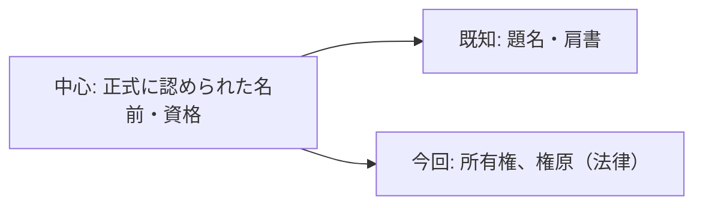

**重要語法**：title to land は土地に対する所有権を表す。

<small>index: 992 / candidate_id: `ev-00992-noun-02`</small>

---

## 722. capture

品詞：verb　｜　発音（米音目安）：/ˈkæptʃər/

<small>よく知られている意味：捕まえる</small>

**見落としやすい意味：興味や心を強くとらえる**

**例文**：The strange story captured everyone's imagination.

**和訳**：その不思議な話は皆の想像力を強くかき立てた。

**コアイメージ**：capture の中心には、対象をしっかりつかんで離さない感覚がある。物だけでなく注意や想像力も強く引き付けることを表す。

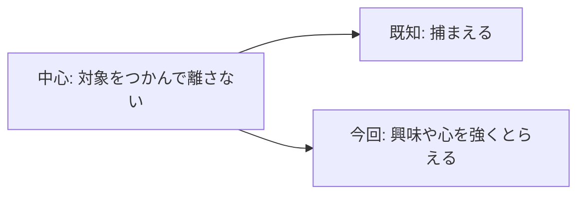

**重要語法**：capture someone's imagination は想像力をかき立てる。

<small>index: 993 / candidate_id: `ev-00993-verb-01`</small>

---

## 723. capture

品詞：verb　｜　発音（米音目安）：/ˈkæptʃər/

<small>よく知られている意味：捕まえる</small>

**見落としやすい意味：データ・画像を取り込んで記録する**

**例文**：This camera can capture clear images at night.

**和訳**：このカメラは夜でも鮮明な画像を記録できる。

**コアイメージ**：目の前にあるものを逃さずとらえる感覚が、情報や画像の記録にも広がる。データを取り込んで保存する場面では「捕獲」ではなく「記録」と読む。

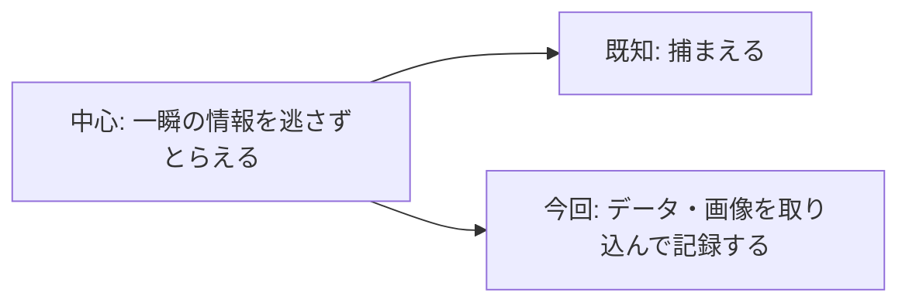

**重要語法**：capture an image / capture data の形で使う。

<small>index: 993 / candidate_id: `ev-00993-verb-02`</small>

---

## 724. adopt

品詞：verb　｜　発音（米音目安）：/əˈdɑːpt/

<small>よく知られている意味：養子にする</small>

**見落としやすい意味：方式・考え方・方針を新たに採用する**

**例文**：The school adopted a new attendance policy.

**和訳**：その学校は新しい出席方針を採用した。

**コアイメージ**：adopt は、外から来たものを自分たちのものとして受け入れる動きを表す。人を家族に迎えるだけでなく、考え方や方法を正式に取り入れる場合にも使う。

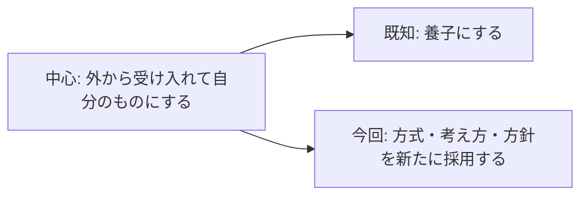

**重要語法**：adopt a policy / adopt a method。

<small>index: 994 / candidate_id: `ev-00994-verb-01`</small>

---

## 725. respect

品詞：noun　｜　発音（米音目安）：/rɪˈspekt/

<small>よく知られている意味：尊敬</small>

**見落としやすい意味：点・側面・観点**

**例文**：In this respect, the two plans are almost identical.

**和訳**：この点では、二つの計画はほとんど同じだ。

**コアイメージ**：respect には、対象のどの部分に目を向けるかという「観点」の意味がある。in this respect では、人への敬意ではなく、比較する際の特定の側面を指す。

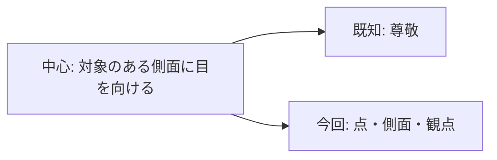

**重要語法**：in this respect「この点では」／in several respects「いくつかの点で」。

<small>index: 997 / candidate_id: `ev-00997-noun-01`</small>

---

## 726. station

品詞：noun　｜　発音（米音目安）：/ˈsteɪʃən/

<small>よく知られている意味：駅</small>

**見落としやすい意味：社会的地位・身分**

**例文**：He rose from a humble station in life.

**和訳**：彼は低い社会的身分から身を起こした。

**コアイメージ**：station の根底には、ある場所や位置に据えられている感覚がある。社会の中でその人が占める位置を表すと、身分や地位という意味になる。

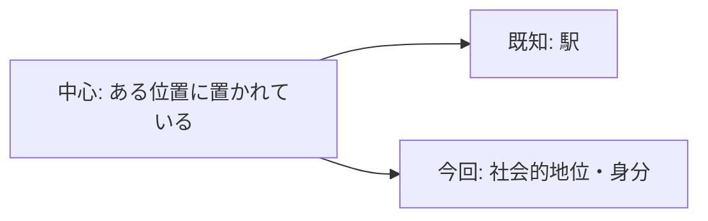

**重要語法**：station in life は社会的身分・境遇。

<small>index: 999 / candidate_id: `ev-00999-noun-01`</small>

---

## 727. station

品詞：noun　｜　発音（米音目安）：/ˈsteɪʃən/

<small>よく知られている意味：駅</small>

**見落としやすい意味：放送局、警察署などの施設**

**例文**：The local radio station broadcasts news every morning.

**和訳**：地元のラジオ局は毎朝ニュースを放送する。

**コアイメージ**：station は、特定の働きをするための拠点を表す。列車の拠点が駅であるのと同様に、放送や警察活動の拠点も station と呼ぶ。

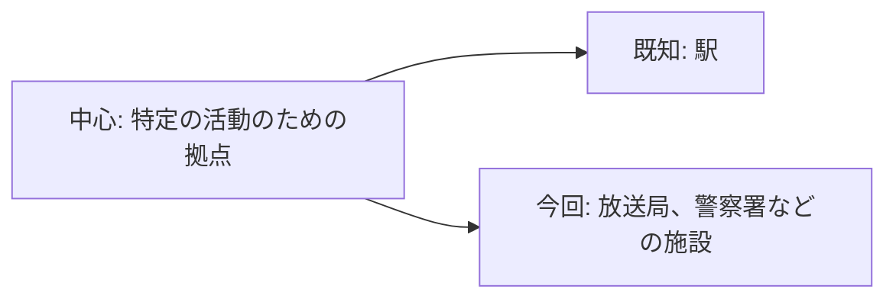

**重要語法**：radio station「放送局」／police station「警察署」。

<small>index: 999 / candidate_id: `ev-00999-noun-02`</small>

---

## 728. station

品詞：verb　｜　発音（米音目安）：/ˈsteɪʃən/

<small>よく知られている意味：駅</small>

**見落としやすい意味：人を職務のため特定の場所に配置する**

**例文**：Two guards were stationed at the entrance.

**和訳**：二人の警備員が入口に配置されていた。

**コアイメージ**：station を動詞にすると、人を特定の持ち場に置く意味になる。ただ居合わせたのではなく、任務のために配置されている点が重要。

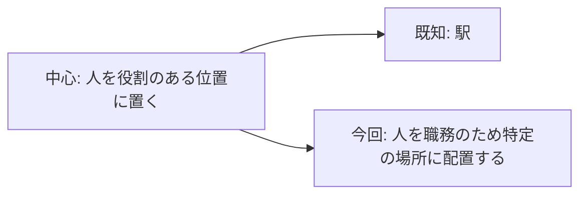

**重要語法**：be stationed at/in ... は「〜に配置されている」。

<small>index: 999 / candidate_id: `ev-00999-verb-01`</small>

---

## 729. column

品詞：noun　｜　発音（米音目安）：/ˈkɑːləm/

<small>よく知られている意味：柱・縦列</small>

**見落としやすい意味：新聞・雑誌のコラム、定期寄稿欄**

**例文**：She writes a weekly column about science.

**和訳**：彼女は科学についての週刊コラムを書いている。

**コアイメージ**：column は縦にまとまった一つの区画を表す。新聞の紙面で縦に組まれた記事欄を指すようになり、そこで連載される文章も表す。

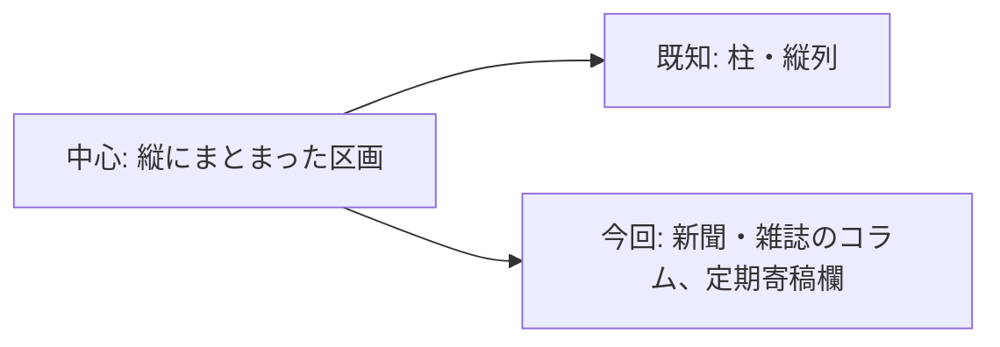

**重要語法**：a newspaper column / write a column。

<small>index: 1000 / candidate_id: `ev-01000-noun-01`</small>

---

## 730. treat

品詞：noun　｜　発音（米音目安）：/triːt/

<small>よく知られている意味：扱う・治療する（動詞）</small>

**見落としやすい意味：おごり・人に提供するごちそう**

**例文**：Dinner is my treat tonight.

**和訳**：今夜の夕食は私のおごりだ。

**コアイメージ**：treat には人に特別な対応をするという感覚がある。名詞では、相手を喜ばせるために提供するごちそうや、お金を出してもてなすことを指す。

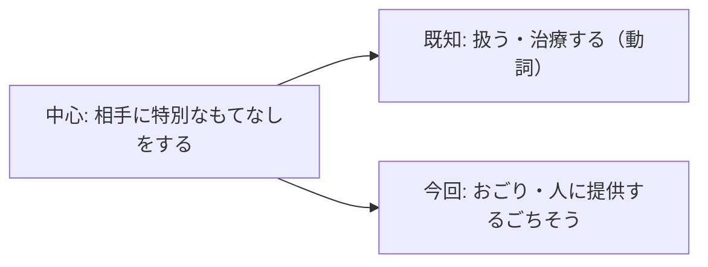

**重要語法**：It's my treat. は「私がおごるよ」。

<small>index: 1001 / candidate_id: `ev-01001-noun-01`</small>

---

## 731. moral

品詞：noun　｜　発音（米音目安）：/ˈmɔːrəl/

<small>よく知られている意味：道徳的な（形容詞）</small>

**見落としやすい意味：物語や出来事から得られる教訓**

**例文**：The moral of the story is to keep your promises.

**和訳**：その物語の教訓は、約束を守ることだ。

**コアイメージ**：moral は人の行いの善し悪しに関係する語。物語の後に残る「どう行動すべきか」という学びを、名詞の moral で表す。

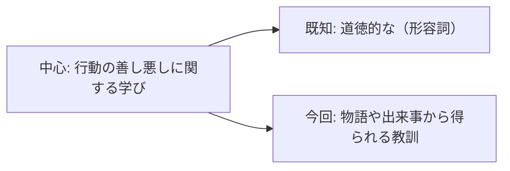

**重要語法**：the moral of the story「その話の教訓」。

<small>index: 1002 / candidate_id: `ev-01002-noun-01`</small>

---

## 732. fashion

品詞：verb　｜　発音（米音目安）：/ˈfæʃən/

<small>よく知られている意味：流行・服装（名詞）</small>

**見落としやすい意味：材料や考えをもとに何かを作り上げる**

**例文**：She fashioned a small boat from pieces of wood.

**和訳**：彼女は木片から小さな舟を作り上げた。

**コアイメージ**：fashion を動詞で使うと、材料に手を加えて望む形に仕上げることを表す。流行という名詞義に引きずられず、作り上げる動作に注目する。

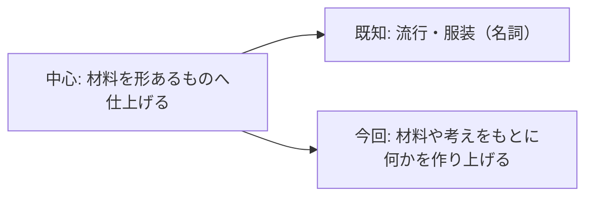

**重要語法**：fashion A from B「BからAを作り上げる」。

<small>index: 1003 / candidate_id: `ev-01003-verb-01`</small>

---

## 733. fish

品詞：verb　｜　発音（米音目安）：/fɪʃ/

<small>よく知られている意味：魚を釣る</small>

**見落としやすい意味：遠回しに情報や称賛を引き出そうとする**

**例文**：He was fishing for compliments about his speech.

**和訳**：彼は自分のスピーチを褒めてもらおうと遠回しに誘っていた。

**コアイメージ**：釣り針を垂らして何かが掛かるのを待つイメージが出発点。fish for では、情報や褒め言葉を相手からうまく引き出そうとすることを表す。

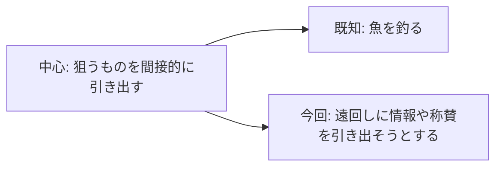

**重要語法**：fish for compliments / fish for information。

<small>index: 1016 / candidate_id: `ev-01016-verb-01`</small>

---

## 734. post

品詞：noun　｜　発音（米音目安）：/poʊst/

<small>よく知られている意味：郵便物・柱</small>

**見落としやすい意味：職位、役職**

**例文**：She applied for a teaching post at the college.

**和訳**：彼女はその大学の教職に応募した。

**コアイメージ**：post には人が受け持つ持ち場という意味がある。仕事の場面では、組織の中で与えられる職位や役目を指す。

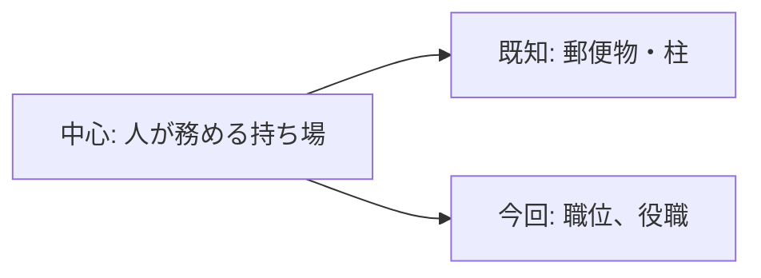

**重要語法**：hold a post「役職に就いている」／vacant post「空席の職」。

<small>index: 1017 / candidate_id: `ev-01017-noun-01`</small>

---

## 735. box

品詞：phrasal verb　｜　発音（米音目安）：/bɑːks/

<small>よく知られている意味：箱</small>

**見落としやすい意味：逃げ道や選択肢をふさいで追い詰める**

**例文**：The strict rules boxed us in and left few choices.

**和訳**：厳しい規則に縛られ、私たちにはほとんど選択肢が残らなかった。

**コアイメージ**：箱の四方を壁で囲む感覚が、人の行動範囲にも及ぶ。box someone in は、相手の逃げ道や選択肢を狭めて身動きを取りにくくすること。

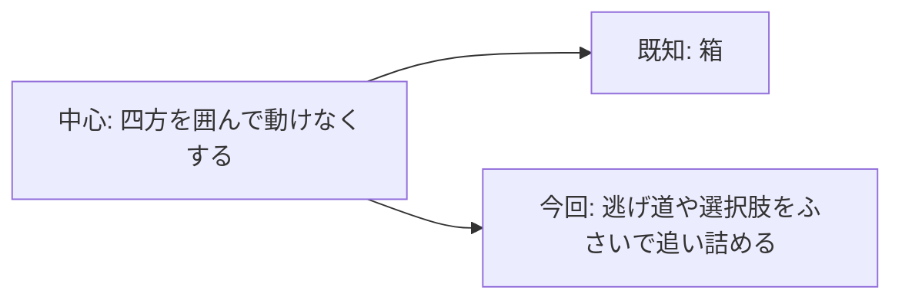

**重要語法**：box someone in「人を追い詰める・身動きを取れなくする」。

<small>index: 1018 / candidate_id: `ev-01018-phrasal-verb-01`</small>

---

## 736. initial

品詞：verb　｜　発音（米音目安）：/ɪˈnɪʃəl/

<small>よく知られている意味：最初の（形容詞）</small>

**見落としやすい意味：文書に氏名の頭文字を書き入れて確認する**

**例文**：Please initial each page of the agreement.

**和訳**：契約書の各ページに氏名の頭文字を記入してください。

**コアイメージ**：initial は名前の最初の文字を表す名詞にもなる。動詞では、その頭文字を書いて内容を確認・承認したことを示す。

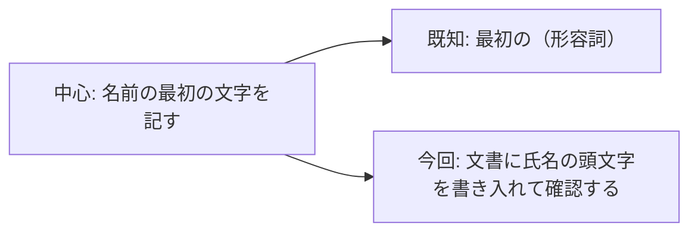

**重要語法**：initial a document / initial each page。

<small>index: 1019 / candidate_id: `ev-01019-verb-01`</small>

---

## 737. purchase

品詞：noun　｜　発音（米音目安）：/ˈpɝːtʃəs/

<small>よく知られている意味：購入</small>

**見落としやすい意味：体を支える足掛かり・しっかりした手掛かり**

**例文**：His boots could not get a purchase on the icy slope.

**和訳**：彼のブーツは凍った斜面で踏ん張りが利かなかった。

**コアイメージ**：この purchase は、体を支えるために表面をしっかりとらえる足掛かりを指す。「購入」とは別の用法なので、足元や滑りやすさの文脈から判断する。

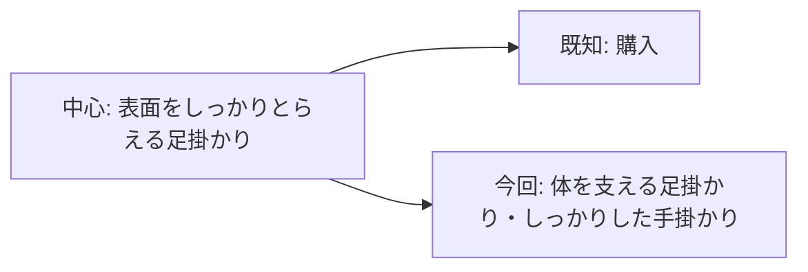

**重要語法**：get a purchase on ...「〜に足掛かりを得る」。

<small>index: 1021 / candidate_id: `ev-01021-noun-01`</small>

---

## 738. appeal

品詞：noun　｜　発音（米音目安）：/əˈpiːl/

<small>よく知られている意味：訴え・懇願</small>

**見落としやすい意味：人を引き付ける魅力**

**例文**：The old town has a special appeal for artists.

**和訳**：その古い町には芸術家を引き付ける特別な魅力がある。

**コアイメージ**：appeal には相手の心へ働きかける感覚がある。何かを要求する働きかけだけでなく、人を自然に引き付ける力も表す。

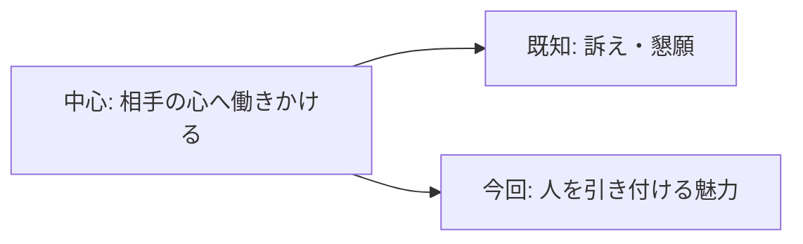

**重要語法**：have appeal / lose appeal。

<small>index: 1024 / candidate_id: `ev-01024-noun-02`</small>

---

## 739. appeal

品詞：verb　｜　発音（米音目安）：/əˈpiːl/

<small>よく知られている意味：訴える・懇願する</small>

**見落としやすい意味：（人の興味を）引き付ける、魅力を感じさせる**

**例文**：This game appeals to children of all ages.

**和訳**：このゲームはあらゆる年齢の子どもたちを引き付ける。

**コアイメージ**：appeal は人の心に届くよう働きかけることを表す。関心や好みに届く文脈では、訴えかけるより「魅力を感じさせる」と訳すと自然。

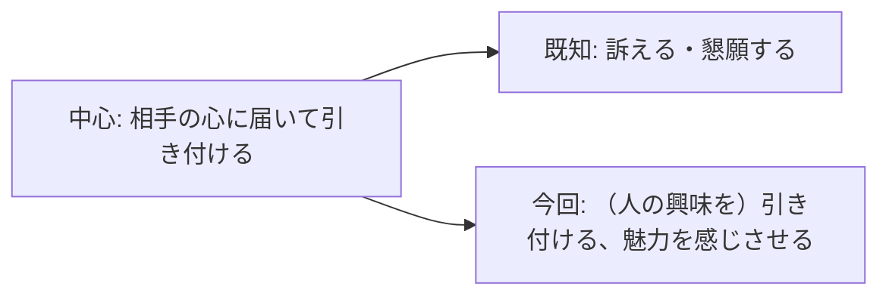

**重要語法**：appeal to + 人「〜の気に入る・心を引く」。

<small>index: 1024 / candidate_id: `ev-01024-verb-01`</small>

---

## 740. otherwise

品詞：adverb　｜　発音（米音目安）：/ˈʌðərwaɪz/

<small>よく知られている意味：さもなければ</small>

**見落としやすい意味：その点以外では、ほかの点では**

**例文**：The hotel was old but otherwise comfortable.

**和訳**：そのホテルは古かったが、それ以外の点では快適だった。

**コアイメージ**：otherwise は文字どおり「別のあり方・点では」と考えられる。条件を変える「さもなければ」だけでなく、ある例外を除いた全体評価にも使う。

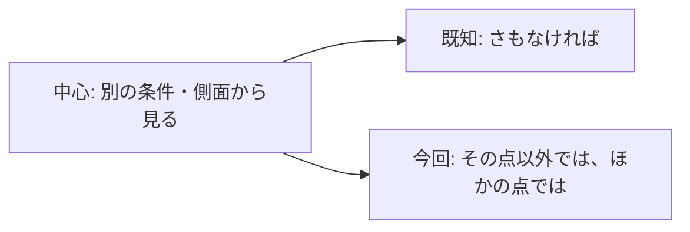

**重要語法**：otherwise good / but otherwise ...。

<small>index: 1032 / candidate_id: `ev-01032-adverb-01`</small>

---

## 741. relate

品詞：verb　｜　発音（米音目安）：/rɪˈleɪt/

<small>よく知られている意味：関係する</small>

**見落としやすい意味：相手の体験や気持ちに共感する**

**例文**：I can relate to her fear of speaking in public.

**和訳**：人前で話すことを怖がる彼女の気持ちはよく分かる。

**コアイメージ**：relate は二つのものを結び付けること。相手の経験を自分の経験と結び付けられるとき、「共感できる」という意味になる。

```mermaid
flowchart LR
    A["中心: 自分と相手の経験を結び付ける"]
    B["既知: 関係する"]
    C["今回: 相手の体験や気持ちに共感する"]
    A --> B
    A --> C
```

**重要語法**：relate to someone / relate to a feeling。

<small>index: 1035 / candidate_id: `ev-01035-verb-01`</small>

---

## 742. dead

品詞：adverb　｜　発音（米音目安）：/ded/

<small>よく知られている意味：死んだ</small>

**見落としやすい意味：まったく、完全に（dead tired など）**

**例文**：I was dead tired after the long hike.

**和訳**：長いハイキングの後、私はくたくただった。

**コアイメージ**：dead は生気がないほど完全な状態を連想させる。形容詞の前に置く副詞用法では、疲労などの程度を強く表す。

```mermaid
flowchart LR
    A["中心: 極端な状態まで達している"]
    B["既知: 死んだ"]
    C["今回: まったく、完全に（dead tired など）"]
    A --> B
    A --> C
```

**重要語法**：dead tired「くたくたの」／dead wrong「完全に間違った」。

<small>index: 1037 / candidate_id: `ev-01037-adverb-01`</small>

---

## 743. brief

品詞：verb　｜　発音（米音目安）：/briːf/

<small>よく知られている意味：短い</small>

**見落としやすい意味：必要な事情や指示を手短に伝える**

**例文**：The manager briefed us on the new safety rules.

**和訳**：責任者は新しい安全規則について私たちに要点を説明した。

**コアイメージ**：brief の「短い」という性質が、伝える情報を要点に絞る動詞用法につながる。必要な事実や指示を簡潔に知らせる場面で使う。

```mermaid
flowchart LR
    A["中心: 情報を要点に絞る"]
    B["既知: 短い"]
    C["今回: 必要な事情や指示を手短に伝える"]
    A --> B
    A --> C
```

**重要語法**：brief someone on/about something。

<small>index: 1038 / candidate_id: `ev-01038-verb-01`</small>

---

## 744. wish

品詞：construction　｜　発音（米音目安）：/wɪʃ/

<small>よく知られている意味：願う</small>

**見落としやすい意味：現実とは違うことを願う・過去を悔やむ**

**例文**：I wish I had listened to your advice.

**和訳**：あなたの助言を聞いておけばよかった。

**コアイメージ**：wish の後ろで時制を過去側にずらすと、現実との距離を表せる。過去形は現在の事実と異なる願望、過去完了形は過去への後悔を表すことが多い。

```mermaid
flowchart LR
    A["中心: 現実と違う状況を思い描く"]
    B["既知: 願う"]
    C["今回: 現実とは違うことを願う・過去を悔やむ"]
    A --> B
    A --> C
```

**重要語法**：wish (that) + 過去形／過去完了形。

<small>index: 1040 / candidate_id: `ev-01040-construction-01`</small>

---

## 745. coverage

品詞：noun　｜　発音（米音目安）：/ˈkʌvərɪdʒ/

<small>よく知られている意味：覆う範囲</small>

**見落としやすい意味：ニュースや出来事についての報道・取材**

**例文**：The storm received extensive news coverage.

**和訳**：その嵐はニュースで広く報道された。

**コアイメージ**：coverage は何かをどの範囲まで取り上げるかを表す。報道では、出来事を取材しニュースとして伝える範囲や量を指す。

```mermaid
flowchart LR
    A["中心: 対象をどこまで取り上げるか"]
    B["既知: 覆う範囲"]
    C["今回: ニュースや出来事についての報道・取材"]
    A --> B
    A --> C
```

**重要語法**：news coverage / media coverage。

<small>index: 1042 / candidate_id: `ev-01042-noun-01`</small>

---

## 746. liberal

品詞：adjective　｜　発音（米音目安）：/ˈlɪbərəl/

<small>よく知られている意味：自由主義的な</small>

**見落としやすい意味：気前よく与える、惜しみない**

**例文**：The teacher was liberal with praise.

**和訳**：その先生は惜しみなく生徒を褒めた。

**コアイメージ**：liberal には制限が厳しくなく、十分に与える感覚がある。政治的立場だけでなく、褒め言葉や援助を気前よく与える様子も表す。

```mermaid
flowchart LR
    A["中心: 制限せず十分に与える"]
    B["既知: 自由主義的な"]
    C["今回: 気前よく与える、惜しみない"]
    A --> B
    A --> C
```

**重要語法**：be liberal with praise / money。

<small>index: 1044 / candidate_id: `ev-01044-adjective-01`</small>

---

## 747. liberal

品詞：adjective　｜　発音（米音目安）：/ˈlɪbərəl/

<small>よく知られている意味：自由主義的な</small>

**見落としやすい意味：規則や解釈が厳格でない、寛大な**

**例文**：They gave the rule a liberal interpretation.

**和訳**：彼らはその規則を柔軟に解釈した。

**コアイメージ**：liberal には厳格な制約に縛られないという側面がある。規則の解釈では、細部を厳密に限定せず幅広く受け止める意味になる。

```mermaid
flowchart LR
    A["中心: 制限を緩めて幅広くとらえる"]
    B["既知: 自由主義的な"]
    C["今回: 規則や解釈が厳格でない、寛大な"]
    A --> B
    A --> C
```

**重要語法**：a liberal interpretation of a rule。

<small>index: 1044 / candidate_id: `ev-01044-adjective-02`</small>

---

## 748. dance

品詞：phrasal verb　｜　発音（米音目安）：/dæns/

<small>よく知られている意味：踊る</small>

**見落としやすい意味：話題や問題の核心を避けて曖昧に答える**

**例文**：The spokesperson danced around the difficult question.

**和訳**：広報担当者はその難しい質問への明確な回答を避けた。

**コアイメージ**：踊るようにあちこち動き、中心に踏み込まないイメージ。dance around は問題の核心を避け、曖昧に話すことを表す。

```mermaid
flowchart LR
    A["中心: 中心を避けて周囲を回る"]
    B["既知: 踊る"]
    C["今回: 話題や問題の核心を避けて曖昧に答える"]
    A --> B
    A --> C
```

**重要語法**：dance around a question / an issue。

<small>index: 1045 / candidate_id: `ev-01045-phrasal-verb-01`</small>

---

## 749. net

品詞：adjective　｜　発音（米音目安）：/net/

<small>よく知られている意味：網（名詞）</small>

**見落としやすい意味：経費・控除分を差し引いた正味の**

**例文**：The company's net profit rose this year.

**和訳**：その会社の純利益は今年増加した。

**コアイメージ**：net には「網」とは別に、差し引き計算の後に残る金額を表す用法がある。売上や給与など金額の前では、経費や税金などを除いた「正味」を意味する。

```mermaid
flowchart LR
    A["中心: 差し引いた後に残る額"]
    B["既知: 網（名詞）"]
    C["今回: 経費・控除分を差し引いた正味の"]
    A --> B
    A --> C
```

**重要語法**：net profit「純利益」／net income「純所得」。

<small>index: 1047 / candidate_id: `ev-01047-adjective-01`</small>

---

## 750. affect

品詞：noun　｜　発音（米音目安）：/ˈæfekt/

<small>よく知られている意味：影響する（動詞）</small>

**見落としやすい意味：感情・情動の表れ（心理学用語）**

**例文**：The patient showed little affect during the interview.

**和訳**：面談中、その患者は感情の表れが乏しかった。

**コアイメージ**：名詞の affect は心理学などで、外に現れる感情の表出を指す専門用語。動詞「影響する」とは意味もアクセントも異なるので、品詞と文脈で判別する。

```mermaid
flowchart LR
    A["中心: 感情が外へ現れた様子"]
    B["既知: 影響する（動詞）"]
    C["今回: 感情・情動の表れ（心理学用語）"]
    A --> B
    A --> C
```

**重要語法**：専門名詞 affect は第1音節に強勢。動詞 affect /əˈfekt/ と区別。

<small>index: 1048 / candidate_id: `ev-01048-noun-01`</small>

---

## 751. pressure

品詞：verb　｜　発音（米音目安）：/ˈpreʃər/

<small>よく知られている意味：圧力（名詞）</small>

**見落としやすい意味：相手に圧力をかけて行動を迫る**

**例文**：The group pressured the council into changing its decision.

**和訳**：その団体は議会に圧力をかけ、決定を変更させた。

**コアイメージ**：pressure は押し付ける力を表す語。動詞では、相手に心理的・社会的圧力を加えて望む行動を取らせることを意味する。

```mermaid
flowchart LR
    A["中心: 相手を押して行動を変えさせる"]
    B["既知: 圧力（名詞）"]
    C["今回: 相手に圧力をかけて行動を迫る"]
    A --> B
    A --> C
```

**重要語法**：pressure someone into doing「人に圧力をかけて〜させる」。

<small>index: 1051 / candidate_id: `ev-01051-verb-01`</small>

---

## 752. abuse

品詞：noun　｜　発音（米音目安）：/əˈbjuːs/

<small>よく知られている意味：虐待・乱用</small>

**見落としやすい意味：言葉による侮辱・罵倒**

**例文**：The workers faced verbal abuse from angry customers.

**和訳**：従業員たちは怒った客から暴言を浴びた。

**コアイメージ**：abuse は人や物を不当に扱うことを表す。言葉に向けられると、相手を傷つける侮辱や罵倒という意味になる。

```mermaid
flowchart LR
    A["中心: 相手を不当に傷つける扱い"]
    B["既知: 虐待・乱用"]
    C["今回: 言葉による侮辱・罵倒"]
    A --> B
    A --> C
```

**重要語法**：verbal abuse「暴言・言葉による侮辱」。

<small>index: 1052 / candidate_id: `ev-01052-noun-01`</small>

---

## 753. wonder

品詞：construction　｜　発音（米音目安）：/ˈwʌndər/

<small>よく知られている意味：不思議に思う</small>

**見落としやすい意味：〜なのも不思議ではない、当然だ**

**例文**：No wonder you're tired after such a long journey.

**和訳**：そんな長旅の後なら、疲れているのも当然だ。

**コアイメージ**：wonder は「不思議だと思うこと」。no wonder は「不思議なことではない」から、理由を聞けば納得できるという意味になる。

```mermaid
flowchart LR
    A["中心: 驚く理由がないほど当然"]
    B["既知: 不思議に思う"]
    C["今回: 〜なのも不思議ではない、当然だ"]
    A --> B
    A --> C
```

**重要語法**：(It's) no wonder (that) ...「〜なのも無理はない」。

<small>index: 1053 / candidate_id: `ev-01053-construction-01`</small>

---

## 754. operate

品詞：verb　｜　発音（米音目安）：/ˈɑːpəreɪt/

<small>よく知られている意味：操作する・運営する</small>

**見落としやすい意味：医師が患者に手術をする**

**例文**：The surgeon operated on the patient yesterday.

**和訳**：その外科医は昨日、その患者を手術した。

**コアイメージ**：operate は仕組みを動かし、働かせる意味を持つ。医療の文脈では外科的な処置を行うことを表し、患者には on を伴う。

```mermaid
flowchart LR
    A["中心: 専門的な操作・処置を行う"]
    B["既知: 操作する・運営する"]
    C["今回: 医師が患者に手術をする"]
    A --> B
    A --> C
```

**重要語法**：operate on a patient「患者を手術する」。

<small>index: 1058 / candidate_id: `ev-01058-verb-01`</small>

---

## 755. primary

品詞：noun　｜　発音（米音目安）：/ˈpraɪmeri/

<small>よく知られている意味：主要な・第一の（形容詞）</small>

**見落としやすい意味：政党の候補者を選ぶ予備選挙**

**例文**：She won the party's primary last month.

**和訳**：彼女は先月、その政党の予備選挙で勝利した。

**コアイメージ**：primary は「最初の段階・主要なもの」を表す。選挙の文脈では、本選挙より先に候補者を決めるための予備選挙を指す名詞になる。

```mermaid
flowchart LR
    A["中心: 本番に先立つ最初の選考"]
    B["既知: 主要な・第一の（形容詞）"]
    C["今回: 政党の候補者を選ぶ予備選挙"]
    A --> B
    A --> C
```

**重要語法**：a party primary / win a primary。

<small>index: 1063 / candidate_id: `ev-01063-noun-01`</small>

---

## 756. ship

品詞：verb　｜　発音（米音目安）：/ʃɪp/

<small>よく知られている意味：船（名詞）</small>

**見落としやすい意味：商品などを出荷・発送する**

**例文**：The store ships orders within two days.

**和訳**：その店は注文された商品を2日以内に発送する。

**コアイメージ**：ship はもともと船による輸送を連想させる語。現代では船に限らず、商品を送り出すこと全般に使う動詞になっている。

```mermaid
flowchart LR
    A["中心: 荷物を送り出す"]
    B["既知: 船（名詞）"]
    C["今回: 商品などを出荷・発送する"]
    A --> B
    A --> C
```

**重要語法**：ship goods / ship an order。

<small>index: 1064 / candidate_id: `ev-01064-verb-01`</small>

---

## 757. code

品詞：noun　｜　発音（米音目安）：/koʊd/

<small>よく知られている意味：暗号・プログラム</small>

**見落としやすい意味：規範・法律などをまとめた法典や規則体系**

**例文**：All members must follow the club's code of conduct.

**和訳**：全会員はクラブの行動規範に従わなければならない。

**コアイメージ**：code には一定の規則を体系的にまとめたものという考え方がある。コンピューターの命令だけでなく、人の行動を定める規則集や法典も指す。

```mermaid
flowchart LR
    A["中心: 規則を体系立ててまとめたもの"]
    B["既知: 暗号・プログラム"]
    C["今回: 規範・法律などをまとめた法典や規則体系"]
    A --> B
    A --> C
```

**重要語法**：code of conduct「行動規範」／legal code「法典」。

<small>index: 1068 / candidate_id: `ev-01068-noun-01`</small>

---

## 758. dress

品詞：verb　｜　発音（米音目安）：/dres/

<small>よく知られている意味：服を着せる</small>

**見落としやすい意味：傷口などに包帯を当てて手当てする**

**例文**：The nurse carefully dressed the wound.

**和訳**：看護師はその傷口を丁寧に手当てした。

**コアイメージ**：dress には何かを覆い、必要な状態に整える感覚がある。傷口を対象にすると、包帯などで保護して処置する意味になる。

```mermaid
flowchart LR
    A["中心: 覆って整え保護する"]
    B["既知: 服を着せる"]
    C["今回: 傷口などに包帯を当てて手当てする"]
    A --> B
    A --> C
```

**重要語法**：dress a wound「傷口を手当てする」。

<small>index: 1071 / candidate_id: `ev-01071-verb-01`</small>

---

## 759. entry

品詞：noun　｜　発音（米音目安）：/ˈentri/

<small>よく知られている意味：入口・記入</small>

**見落としやすい意味：コンテストなどへの応募作品・出品物**

**例文**：Her painting was the winning entry in the contest.

**和訳**：彼女の絵がそのコンテストの優勝作品だった。

**コアイメージ**：entry は、ある活動に参加するために差し出すものを表す。競技やコンテストでは、応募行為だけでなく提出した作品自体も指す。

```mermaid
flowchart LR
    A["中心: 参加のために差し出すもの"]
    B["既知: 入口・記入"]
    C["今回: コンテストなどへの応募作品・出品物"]
    A --> B
    A --> C
```

**重要語法**：an entry in a competition / a winning entry。

<small>index: 1073 / candidate_id: `ev-01073-noun-01`</small>

---

## 760. define

品詞：verb　｜　発音（米音目安）：/dɪˈfaɪn/

<small>よく知られている意味：定義する</small>

**見落としやすい意味：人や物事の決定的な特徴となる**

**例文**：Her courage defined her leadership.

**和訳**：勇気こそが、彼女のリーダーシップを特徴づけていた。

**コアイメージ**：define には境界をはっきりさせて、何であるかを明確にする感覚がある。人物や物事を他と区別する決定的な性質を表す場合、「特徴づける」と読む。

```mermaid
flowchart LR
    A["中心: 何であるかを決定づける"]
    B["既知: 定義する"]
    C["今回: 人や物事の決定的な特徴となる"]
    A --> B
    A --> C
```

**重要語法**：be defined by ...「〜によって特徴づけられる」。

<small>index: 1075 / candidate_id: `ev-01075-verb-01`</small>
