# EasyVoca 完成教材｜Batch 010

担当範囲：global_order 721–800（このファイルは担当分全件を順番に収録）

## 721. title

品詞：noun　｜　発音（米音目安）：/ˈtaɪtəl/

<small>よく知られている意味：題名・肩書</small>

**見落としやすい意味：所有権、権原（法律）**

**例文**：The family finally obtained clear title to the land.

**和訳**：その家族はついにその土地の明確な所有権を得た。

**コアイメージ**：title は何かに付けられた正式な名前や資格を示す語。法律の文脈では、土地などを正当に所有する資格・権利そのものを指す。

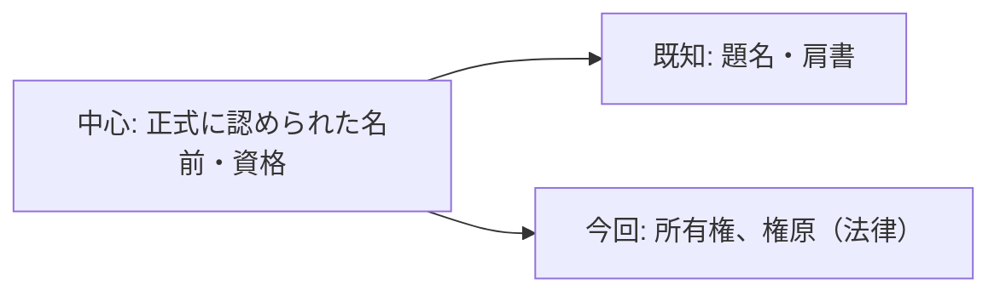

**重要語法**：title to land は土地に対する所有権を表す。

<small>index: 992 / candidate_id: `ev-00992-noun-02`</small>

---

## 722. capture

品詞：verb　｜　発音（米音目安）：/ˈkæptʃər/

<small>よく知られている意味：捕まえる</small>

**見落としやすい意味：興味や心を強くとらえる**

**例文**：The strange story captured everyone's imagination.

**和訳**：その不思議な話は皆の想像力を強くかき立てた。

**コアイメージ**：capture の中心には、対象をしっかりつかんで離さない感覚がある。物だけでなく注意や想像力も強く引き付けることを表す。

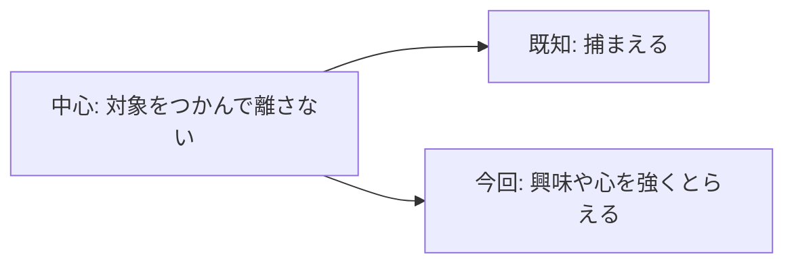

**重要語法**：capture someone's imagination は想像力をかき立てる。

<small>index: 993 / candidate_id: `ev-00993-verb-01`</small>

---

## 723. capture

品詞：verb　｜　発音（米音目安）：/ˈkæptʃər/

<small>よく知られている意味：捕まえる</small>

**見落としやすい意味：データ・画像を取り込んで記録する**

**例文**：This camera can capture clear images at night.

**和訳**：このカメラは夜でも鮮明な画像を記録できる。

**コアイメージ**：目の前にあるものを逃さずとらえる感覚が、情報や画像の記録にも広がる。データを取り込んで保存する場面では「捕獲」ではなく「記録」と読む。

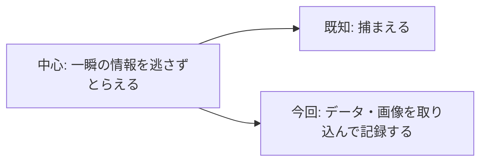

**重要語法**：capture an image / capture data の形で使う。

<small>index: 993 / candidate_id: `ev-00993-verb-02`</small>

---

## 724. adopt

品詞：verb　｜　発音（米音目安）：/əˈdɑːpt/

<small>よく知られている意味：養子にする</small>

**見落としやすい意味：方式・考え方・方針を新たに採用する**

**例文**：The school adopted a new attendance policy.

**和訳**：その学校は新しい出席方針を採用した。

**コアイメージ**：adopt は、外から来たものを自分たちのものとして受け入れる動きを表す。人を家族に迎えるだけでなく、考え方や方法を正式に取り入れる場合にも使う。

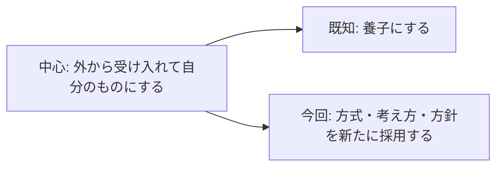

**重要語法**：adopt a policy / adopt a method。

<small>index: 994 / candidate_id: `ev-00994-verb-01`</small>

---

## 725. respect

品詞：noun　｜　発音（米音目安）：/rɪˈspekt/

<small>よく知られている意味：尊敬</small>

**見落としやすい意味：点・側面・観点**

**例文**：In this respect, the two plans are almost identical.

**和訳**：この点では、二つの計画はほとんど同じだ。

**コアイメージ**：respect には、対象のどの部分に目を向けるかという「観点」の意味がある。in this respect では、人への敬意ではなく、比較する際の特定の側面を指す。

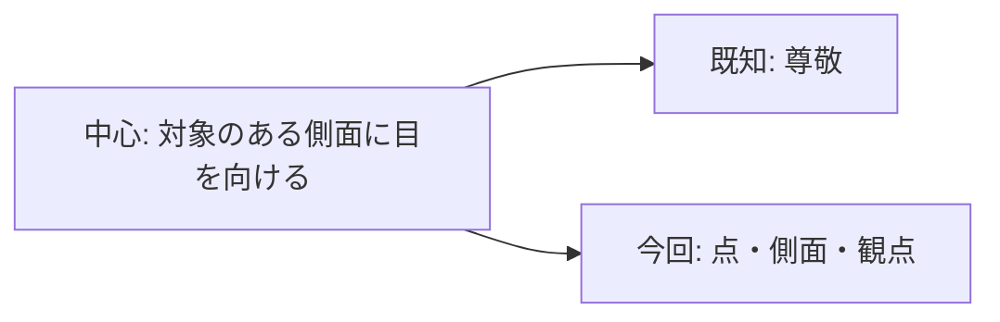

**重要語法**：in this respect「この点では」／in several respects「いくつかの点で」。

<small>index: 997 / candidate_id: `ev-00997-noun-01`</small>

---

## 726. station

品詞：noun　｜　発音（米音目安）：/ˈsteɪʃən/

<small>よく知られている意味：駅</small>

**見落としやすい意味：社会的地位・身分**

**例文**：He rose from a humble station in life.

**和訳**：彼は低い社会的身分から身を起こした。

**コアイメージ**：station の根底には、ある場所や位置に据えられている感覚がある。社会の中でその人が占める位置を表すと、身分や地位という意味になる。

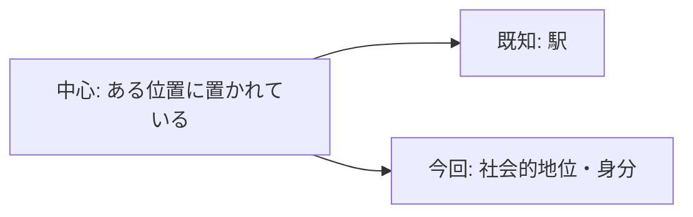

**重要語法**：station in life は社会的身分・境遇。

<small>index: 999 / candidate_id: `ev-00999-noun-01`</small>

---

## 727. station

品詞：noun　｜　発音（米音目安）：/ˈsteɪʃən/

<small>よく知られている意味：駅</small>

**見落としやすい意味：放送局、警察署などの施設**

**例文**：The local radio station broadcasts news every morning.

**和訳**：地元のラジオ局は毎朝ニュースを放送する。

**コアイメージ**：station は、特定の働きをするための拠点を表す。列車の拠点が駅であるのと同様に、放送や警察活動の拠点も station と呼ぶ。

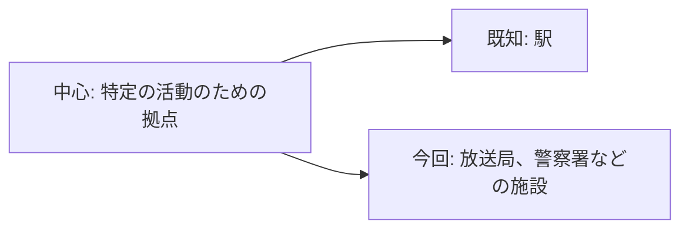

**重要語法**：radio station「放送局」／police station「警察署」。

<small>index: 999 / candidate_id: `ev-00999-noun-02`</small>

---

## 728. station

品詞：verb　｜　発音（米音目安）：/ˈsteɪʃən/

<small>よく知られている意味：駅</small>

**見落としやすい意味：人を職務のため特定の場所に配置する**

**例文**：Two guards were stationed at the entrance.

**和訳**：二人の警備員が入口に配置されていた。

**コアイメージ**：station を動詞にすると、人を特定の持ち場に置く意味になる。ただ居合わせたのではなく、任務のために配置されている点が重要。

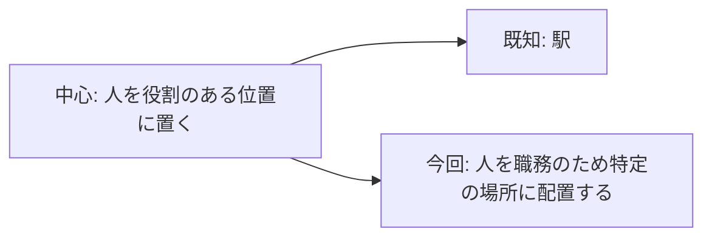

**重要語法**：be stationed at/in ... は「〜に配置されている」。

<small>index: 999 / candidate_id: `ev-00999-verb-01`</small>

---

## 729. column

品詞：noun　｜　発音（米音目安）：/ˈkɑːləm/

<small>よく知られている意味：柱・縦列</small>

**見落としやすい意味：新聞・雑誌のコラム、定期寄稿欄**

**例文**：She writes a weekly column about science.

**和訳**：彼女は科学についての週刊コラムを書いている。

**コアイメージ**：column は縦にまとまった一つの区画を表す。新聞の紙面で縦に組まれた記事欄を指すようになり、そこで連載される文章も表す。

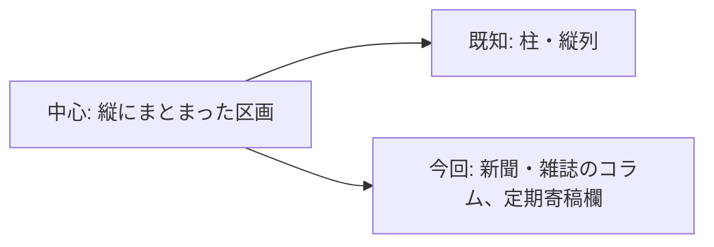

**重要語法**：a newspaper column / write a column。

<small>index: 1000 / candidate_id: `ev-01000-noun-01`</small>

---

## 730. treat

品詞：noun　｜　発音（米音目安）：/triːt/

<small>よく知られている意味：扱う・治療する（動詞）</small>

**見落としやすい意味：おごり・人に提供するごちそう**

**例文**：Dinner is my treat tonight.

**和訳**：今夜の夕食は私のおごりだ。

**コアイメージ**：treat には人に特別な対応をするという感覚がある。名詞では、相手を喜ばせるために提供するごちそうや、お金を出してもてなすことを指す。

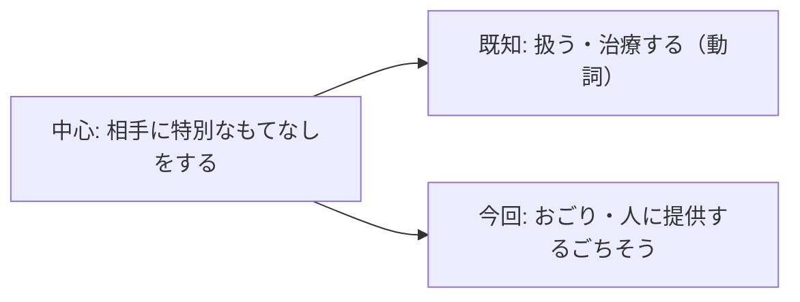

**重要語法**：It's my treat. は「私がおごるよ」。

<small>index: 1001 / candidate_id: `ev-01001-noun-01`</small>

---

## 731. moral

品詞：noun　｜　発音（米音目安）：/ˈmɔːrəl/

<small>よく知られている意味：道徳的な（形容詞）</small>

**見落としやすい意味：物語や出来事から得られる教訓**

**例文**：The moral of the story is to keep your promises.

**和訳**：その物語の教訓は、約束を守ることだ。

**コアイメージ**：moral は人の行いの善し悪しに関係する語。物語の後に残る「どう行動すべきか」という学びを、名詞の moral で表す。

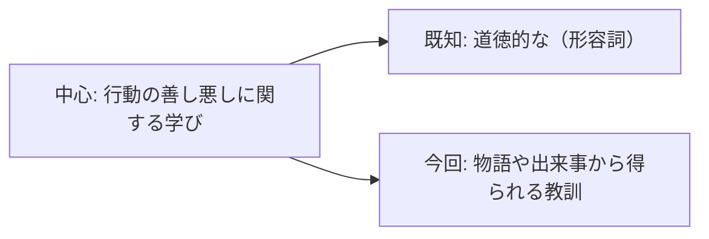

**重要語法**：the moral of the story「その話の教訓」。

<small>index: 1002 / candidate_id: `ev-01002-noun-01`</small>

---

## 732. fashion

品詞：verb　｜　発音（米音目安）：/ˈfæʃən/

<small>よく知られている意味：流行・服装（名詞）</small>

**見落としやすい意味：材料や考えをもとに何かを作り上げる**

**例文**：She fashioned a small boat from pieces of wood.

**和訳**：彼女は木片から小さな舟を作り上げた。

**コアイメージ**：fashion を動詞で使うと、材料に手を加えて望む形に仕上げることを表す。流行という名詞義に引きずられず、作り上げる動作に注目する。

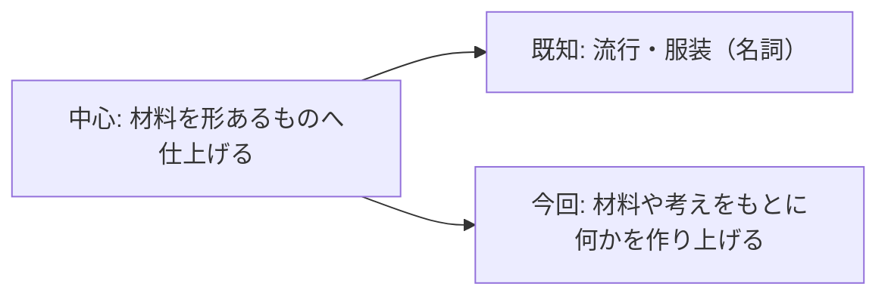

**重要語法**：fashion A from B「BからAを作り上げる」。

<small>index: 1003 / candidate_id: `ev-01003-verb-01`</small>

---

## 733. fish

品詞：verb　｜　発音（米音目安）：/fɪʃ/

<small>よく知られている意味：魚を釣る</small>

**見落としやすい意味：遠回しに情報や称賛を引き出そうとする**

**例文**：He was fishing for compliments about his speech.

**和訳**：彼は自分のスピーチを褒めてもらおうと遠回しに誘っていた。

**コアイメージ**：釣り針を垂らして何かが掛かるのを待つイメージが出発点。fish for では、情報や褒め言葉を相手からうまく引き出そうとすることを表す。

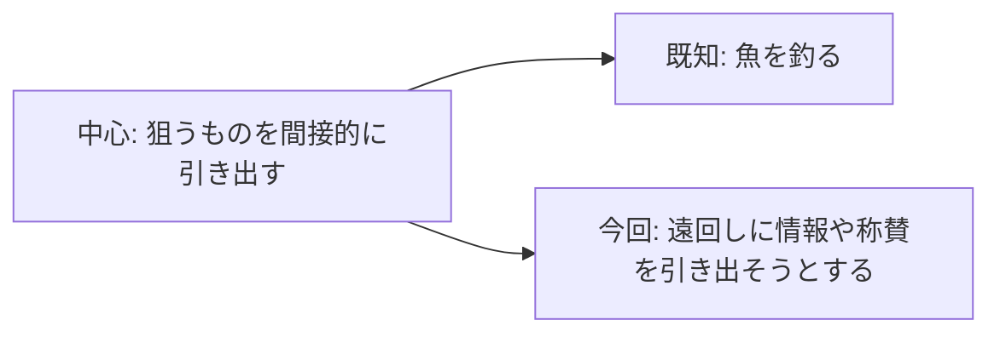

**重要語法**：fish for compliments / fish for information。

<small>index: 1016 / candidate_id: `ev-01016-verb-01`</small>

---

## 734. post

品詞：noun　｜　発音（米音目安）：/poʊst/

<small>よく知られている意味：郵便物・柱</small>

**見落としやすい意味：職位、役職**

**例文**：She applied for a teaching post at the college.

**和訳**：彼女はその大学の教職に応募した。

**コアイメージ**：post には人が受け持つ持ち場という意味がある。仕事の場面では、組織の中で与えられる職位や役目を指す。

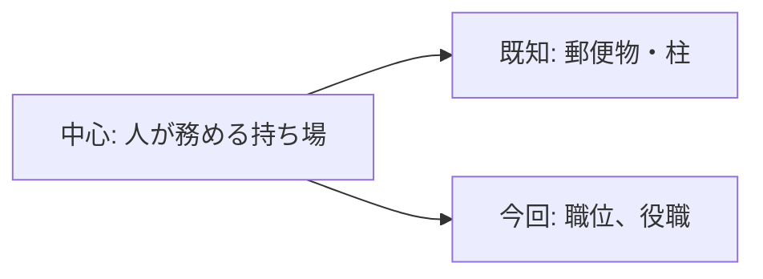

**重要語法**：hold a post「役職に就いている」／vacant post「空席の職」。

<small>index: 1017 / candidate_id: `ev-01017-noun-01`</small>

---

## 735. box

品詞：phrasal verb　｜　発音（米音目安）：/bɑːks/

<small>よく知られている意味：箱</small>

**見落としやすい意味：逃げ道や選択肢をふさいで追い詰める**

**例文**：The strict rules boxed us in and left few choices.

**和訳**：厳しい規則に縛られ、私たちにはほとんど選択肢が残らなかった。

**コアイメージ**：箱の四方を壁で囲む感覚が、人の行動範囲にも及ぶ。box someone in は、相手の逃げ道や選択肢を狭めて身動きを取りにくくすること。

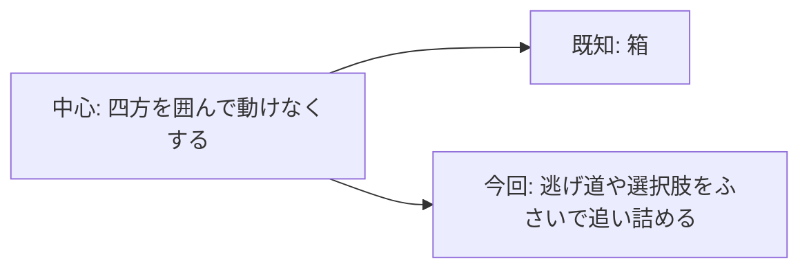

**重要語法**：box someone in「人を追い詰める・身動きを取れなくする」。

<small>index: 1018 / candidate_id: `ev-01018-phrasal-verb-01`</small>

---

## 736. initial

品詞：verb　｜　発音（米音目安）：/ɪˈnɪʃəl/

<small>よく知られている意味：最初の（形容詞）</small>

**見落としやすい意味：文書に氏名の頭文字を書き入れて確認する**

**例文**：Please initial each page of the agreement.

**和訳**：契約書の各ページに氏名の頭文字を記入してください。

**コアイメージ**：initial は名前の最初の文字を表す名詞にもなる。動詞では、その頭文字を書いて内容を確認・承認したことを示す。

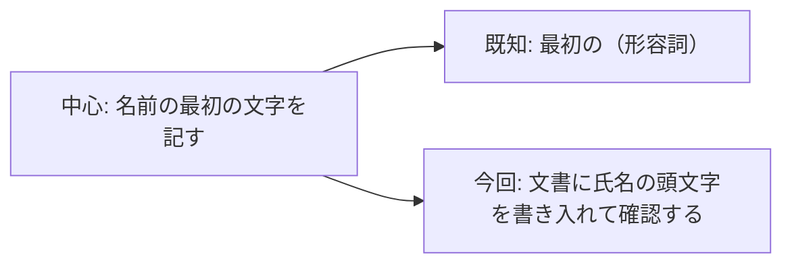

**重要語法**：initial a document / initial each page。

<small>index: 1019 / candidate_id: `ev-01019-verb-01`</small>

---

## 737. purchase

品詞：noun　｜　発音（米音目安）：/ˈpɝːtʃəs/

<small>よく知られている意味：購入</small>

**見落としやすい意味：体を支える足掛かり・しっかりした手掛かり**

**例文**：His boots could not get a purchase on the icy slope.

**和訳**：彼のブーツは凍った斜面で踏ん張りが利かなかった。

**コアイメージ**：この purchase は、体を支えるために表面をしっかりとらえる足掛かりを指す。「購入」とは別の用法なので、足元や滑りやすさの文脈から判断する。

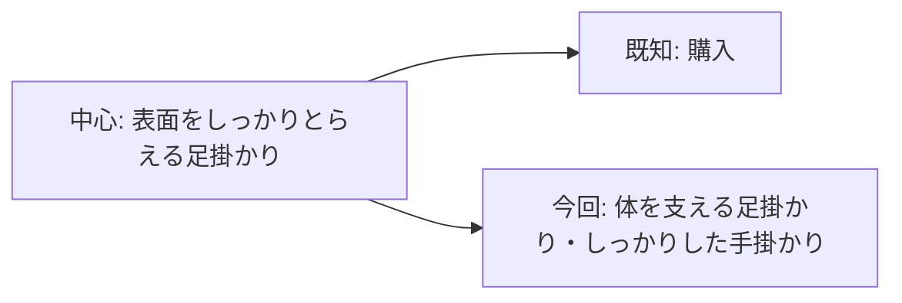

**重要語法**：get a purchase on ...「〜に足掛かりを得る」。

<small>index: 1021 / candidate_id: `ev-01021-noun-01`</small>

---

## 738. appeal

品詞：noun　｜　発音（米音目安）：/əˈpiːl/

<small>よく知られている意味：訴え・懇願</small>

**見落としやすい意味：人を引き付ける魅力**

**例文**：The old town has a special appeal for artists.

**和訳**：その古い町には芸術家を引き付ける特別な魅力がある。

**コアイメージ**：appeal には相手の心へ働きかける感覚がある。何かを要求する働きかけだけでなく、人を自然に引き付ける力も表す。

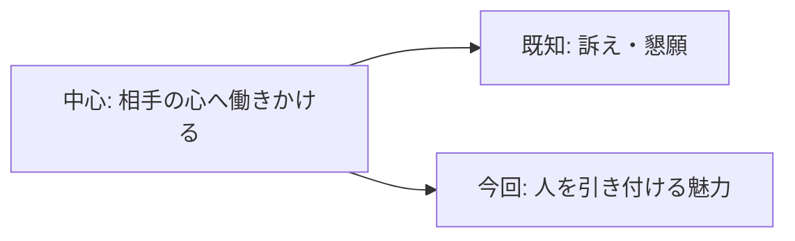

**重要語法**：have appeal / lose appeal。

<small>index: 1024 / candidate_id: `ev-01024-noun-02`</small>

---

## 739. appeal

品詞：verb　｜　発音（米音目安）：/əˈpiːl/

<small>よく知られている意味：訴える・懇願する</small>

**見落としやすい意味：（人の興味を）引き付ける、魅力を感じさせる**

**例文**：This game appeals to children of all ages.

**和訳**：このゲームはあらゆる年齢の子どもたちを引き付ける。

**コアイメージ**：appeal は人の心に届くよう働きかけることを表す。関心や好みに届く文脈では、訴えかけるより「魅力を感じさせる」と訳すと自然。

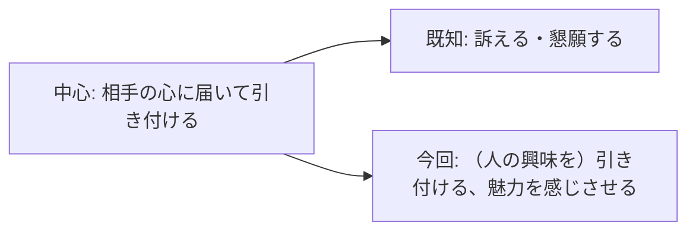

**重要語法**：appeal to + 人「〜の気に入る・心を引く」。

<small>index: 1024 / candidate_id: `ev-01024-verb-01`</small>

---

## 740. otherwise

品詞：adverb　｜　発音（米音目安）：/ˈʌðərwaɪz/

<small>よく知られている意味：さもなければ</small>

**見落としやすい意味：その点以外では、ほかの点では**

**例文**：The hotel was old but otherwise comfortable.

**和訳**：そのホテルは古かったが、それ以外の点では快適だった。

**コアイメージ**：otherwise は文字どおり「別のあり方・点では」と考えられる。条件を変える「さもなければ」だけでなく、ある例外を除いた全体評価にも使う。

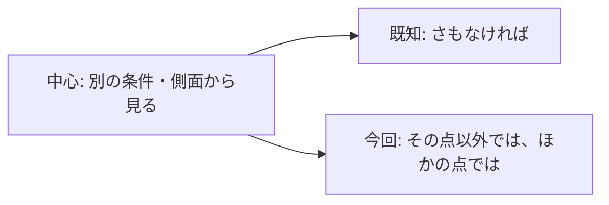

**重要語法**：otherwise good / but otherwise ...。

<small>index: 1032 / candidate_id: `ev-01032-adverb-01`</small>
