# EasyVoca 完成教材｜Batch 011

採用済み語義の学習カード（global_order **801〜880**、全80件）。`main` の `data/candidates/` における `decision == "accepted"` のみを対象とし、`index` → `candidate_id` の順で作成。

## 801. intend

**品詞・分類：** 構文・定型表現（`construction`）  
**発音：** /ɪnˈtend/

<small>よく知られている意味：意図する</small>

### 見落としやすい意味：〜するために作られた・意図された

**例文：** This path is intended for cyclists.  
**和訳：** この道は自転車利用者向けに設けられている。

**コアイメージ：** intend は何かに目的を持たせること。be intended for では、作り手が想定した用途を表す。

**図：**

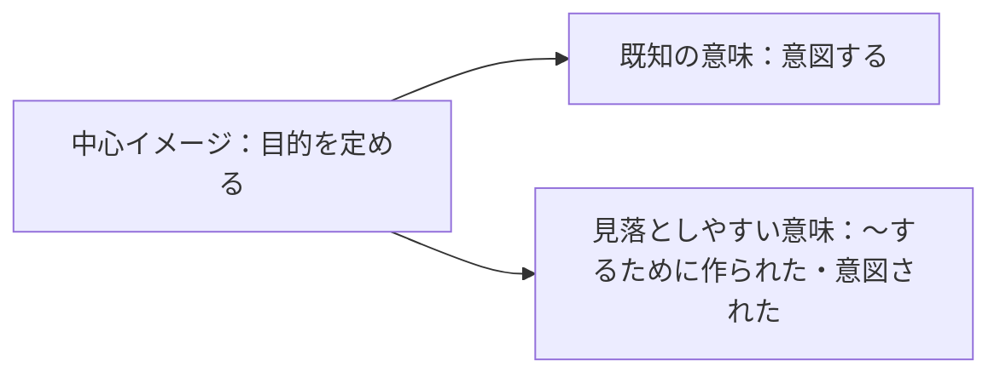

**重要語法：** be intended for + 人・用途／be intended to do

<small>出典候補ID：`ev-01160-construction-01` ／ 元データ index：1160</small>

---

## 802. wide

**品詞・分類：** 構文・定型表現（`construction`）  
**発音：** /waɪd/

<small>よく知られている意味：幅が広い</small>

### 見落としやすい意味：完全に目が覚めている

**例文：** The strange noise left me wide awake.  
**和訳：** 奇妙な物音で私はすっかり目が覚めてしまった。

**コアイメージ：** wide は幅だけでなく程度の大きさも表す。wide awake は覚醒の度合いが最大限に近いこと。

**図：**

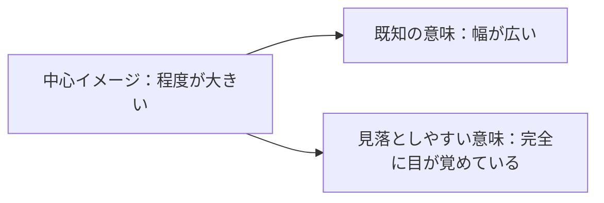

**重要語法：** wide awake

<small>出典候補ID：`ev-01162-construction-01` ／ 元データ index：1162</small>

---

## 803. suspect

**品詞・分類：** 形容詞（`adjective`）  
**発音：** /ˈsʌspekt/

<small>よく知られている意味：疑う</small>

### 見落としやすい意味：疑わしい、信用できない

**例文：** The figures in the report look suspect.  
**和訳：** 報告書の数値は疑わしく見える。

**コアイメージ：** suspect は「疑いを向ける」ことから、疑いの対象となる性質にも使う。形容詞では信頼性に疑問があるという意味。

**図：**

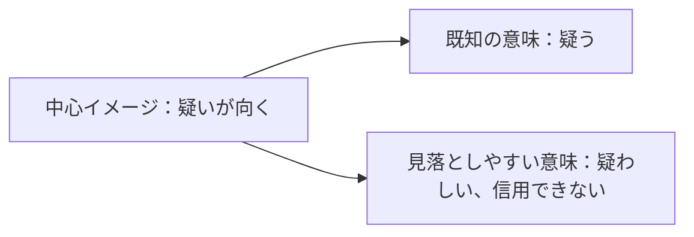

**重要語法：** suspect evidence / suspect figures

<small>出典候補ID：`ev-01164-adjective-01` ／ 元データ index：1164</small>

---

## 804. hire

**品詞・分類：** 名詞（`noun`）  
**発音：** /haɪr/

<small>よく知られている意味：雇う</small>

### 見落としやすい意味：レンタル・雇用の対象であること

**例文：** The boats by the lake are available for hire.  
**和訳：** 湖畔のボートは有料で借りられる。

**コアイメージ：** hire の中心は対価を払って人や物を一定期間利用すること。for hire は、その利用に応じる状態を示す。

**図：**

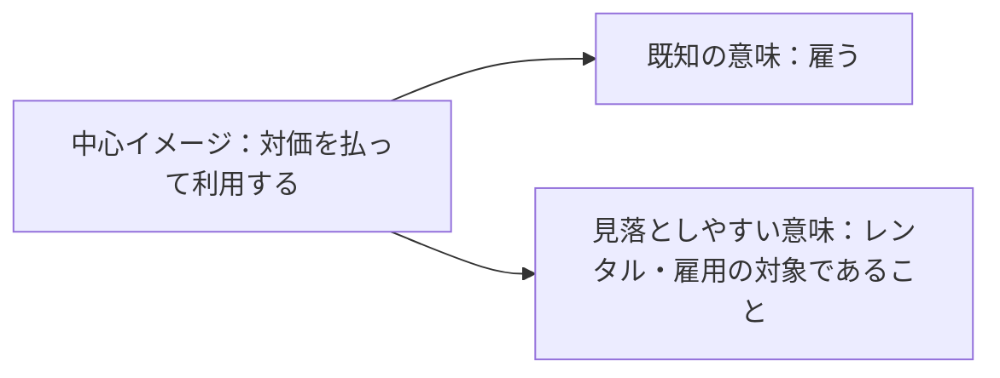

**重要語法：** for hire

<small>出典候補ID：`ev-01165-noun-01` ／ 元データ index：1165</small>

---

## 805. survey

**品詞・分類：** 動詞（`verb`）  
**発音：** /sərˈveɪ/

<small>よく知られている意味：調査する</small>

### 見落としやすい意味：一帯や状況を見渡して概観する

**例文：** The guard surveyed the empty hall.  
**和訳：** 警備員は誰もいないホールを見渡した。

**コアイメージ：** survey は対象の全体に目を行き渡らせること。詳しい調査にも、場所をざっと見渡す動作にも使える。

**図：**

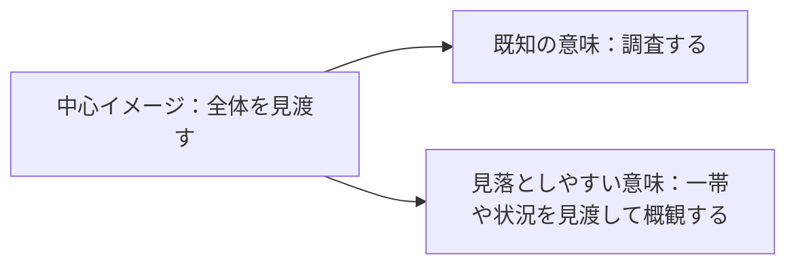

**重要語法：** survey the scene

<small>出典候補ID：`ev-01167-verb-01` ／ 元データ index：1167</small>

---

## 806. shift

**品詞・分類：** 名詞（`noun`）  
**発音：** /ʃɪft/

<small>よく知られている意味：移動する・変わる</small>

### 見落としやすい意味：交代勤務の一区切り、勤務時間帯

**例文：** My sister works the night shift.  
**和訳：** 姉は夜勤で働いている。

**コアイメージ：** shift の核は一つの状態から次へ切り替わること。仕事では交代する勤務時間の一区切りを指す。

**図：**

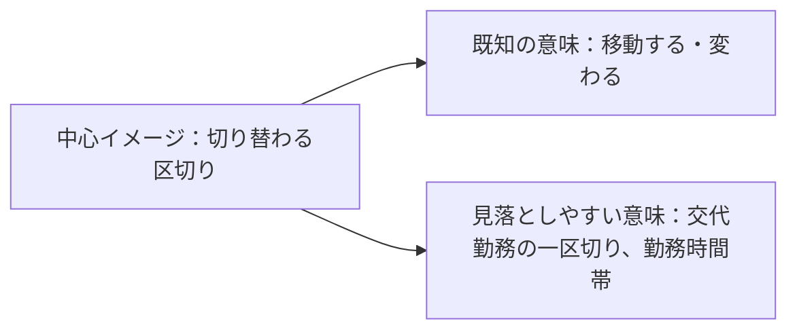

**重要語法：** day shift / night shift

<small>出典候補ID：`ev-01168-noun-01` ／ 元データ index：1168</small>

---

## 807. finding

**品詞・分類：** 名詞（`noun`）  
**発音：** /ˈfaɪndɪŋ/

<small>よく知られている意味：発見</small>

### 見落としやすい意味：公式調査・裁判などの結論、認定結果

**例文：** The court's finding surprised both sides.  
**和訳：** 裁判所の認定結果は双方を驚かせた。

**コアイメージ：** find は調べて何かにたどり着くこと。finding は、調査や審理の末に導かれた公式な結論も指す。

**図：**

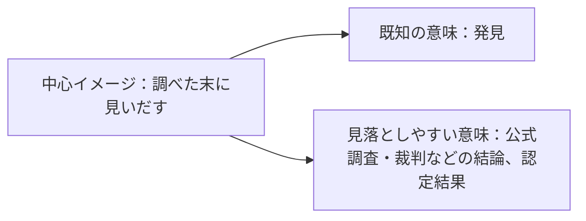

**重要語法：** a finding of fact / the findings of an inquiry

<small>出典候補ID：`ev-01171-noun-01` ／ 元データ index：1171</small>

---

## 808. wait

**品詞・分類：** 句動詞（`phrasal verb`）  
**発音：** /weɪt/

<small>よく知られている意味：待つ</small>

### 見落としやすい意味：人に給仕する・接客する

**例文：** She waited on guests at the restaurant.  
**和訳：** 彼女はレストランで客に給仕した。

**コアイメージ：** wait on は相手のそばで必要に応じて世話をする発想。接客・給仕の場面では「待つ」ではなく「対応する」。

**図：**

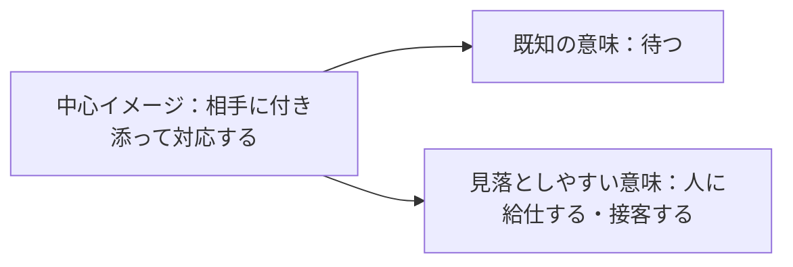

**重要語法：** wait on customers / wait on tables

<small>出典候補ID：`ev-01173-phrasal-verb-01` ／ 元データ index：1173</small>

---

## 809. tower

**品詞・分類：** 句動詞（`phrasal verb`）  
**発音：** /ˈtaʊər/

<small>よく知られている意味：塔</small>

### 見落としやすい意味：〜の上に高くそびえ立つ・圧倒する

**例文：** The cliffs tower over the small village.  
**和訳：** 崖が小さな村の上に高くそびえている。

**コアイメージ：** tower は高くそびえる塔の姿から、高さや存在感で周囲を圧することを表す。tower over で比較対象との落差が明確になる。

**図：**


**重要語法：** tower over + 場所・人

<small>出典候補ID：`ev-01179-phrasal-verb-01` ／ 元データ index：1179</small>

---

## 810. survive

**品詞・分類：** 動詞（`verb`）  
**発音：** /sərˈvaɪv/

<small>よく知られている意味：生き延びる</small>

### 見落としやすい意味：ある人より長生きする

**例文：** She survived her husband by twelve years.  
**和訳：** 彼女は夫より12年長生きした。

**コアイメージ：** survive はある出来事や人の後まで生きていること。相手が人なら、相手より長く生きたという意味にもなる。

**図：**

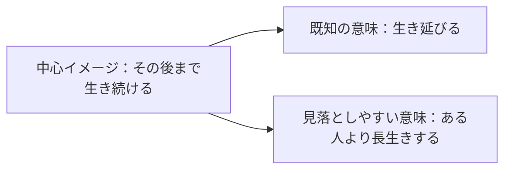

**重要語法：** survive someone by + 期間

<small>出典候補ID：`ev-01182-verb-01` ／ 元データ index：1182</small>

---

## 811. attract

**品詞・分類：** 動詞（`verb`）  
**発音：** /əˈtrækt/

<small>よく知られている意味：人を引きつける</small>

### 見落としやすい意味：批判や関心などを招く

**例文：** The decision attracted widespread criticism.  
**和訳：** その決定は広範な批判を招いた。

**コアイメージ：** attract は人や物の注意・反応を自分の方へ引き寄せること。よい関心だけでなく批判も引き寄せる。

**図：**

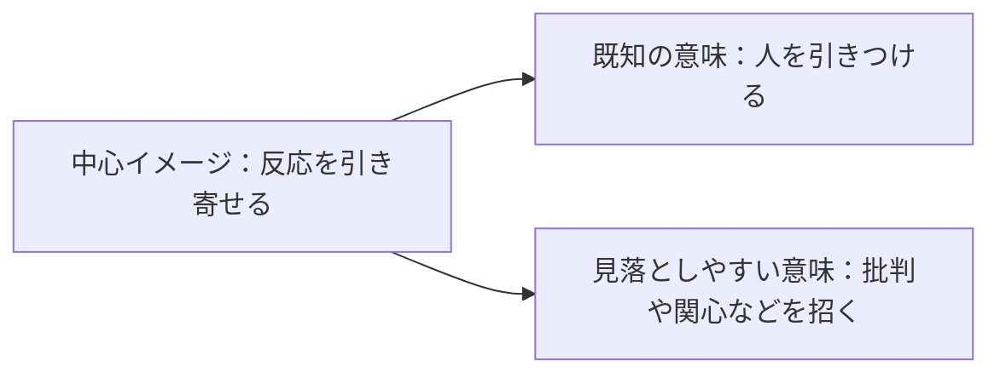

**重要語法：** attract attention / criticism

<small>出典候補ID：`ev-01184-verb-01` ／ 元データ index：1184</small>

---

## 812. red

**品詞・分類：** 構文・定型表現（`construction`）  
**発音：** /red/

<small>よく知られている意味：赤い</small>

### 見落としやすい意味：赤字である・負債を抱えている

**例文：** The company has been in the red for months.  
**和訳：** その会社は何か月も赤字が続いている。

**コアイメージ：** 会計で損失を赤い数字で示すことから、in the red は支出が収入を上回る状態を指す。色そのものの話ではない。

**図：**


**重要語法：** be in the red / get out of the red

<small>出典候補ID：`ev-01185-construction-01` ／ 元データ index：1185</small>

---

## 813. paint

**品詞・分類：** 構文・定型表現（`construction`）  
**発音：** /peɪnt/

<small>よく知られている意味：絵の具で塗る</small>

### 見落としやすい意味：人や物を特定の姿として描写する

**例文：** The article painted him as a hero.  
**和訳：** その記事は彼を英雄として描いた。

**コアイメージ：** paint は対象の姿を描いて人に見せること。paint A as B は言葉でAの印象をBとして作り上げる。

**図：**

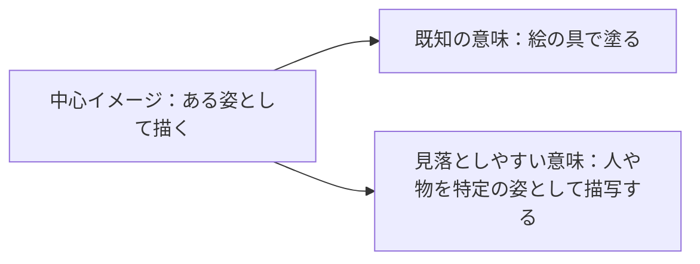

**重要語法：** paint A as B

<small>出典候補ID：`ev-01186-construction-01` ／ 元データ index：1186</small>

---

## 814. household

**品詞・分類：** 構文・定型表現（`construction`）  
**発音：** /ˈhaʊshoʊld/

<small>よく知られている意味：家庭の</small>

### 見落としやすい意味：広く知られた有名人・有名な名前

**例文：** The young singer soon became a household name.  
**和訳：** その若い歌手はすぐに誰もが知る有名人になった。

**コアイメージ：** household は家庭で共有される範囲を表す。名前が多くの家庭に浸透すれば「誰もが知る名前」になる。

**図：**

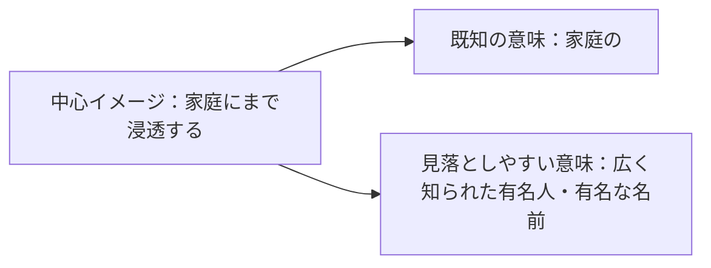

**重要語法：** a household name

<small>出典候補ID：`ev-01188-construction-01` ／ 元データ index：1188</small>

---

## 815. landscape

**品詞・分類：** 名詞（`noun`）  
**発音：** /ˈlændskeɪp/

<small>よく知られている意味：景色・風景</small>

### 見落としやすい意味：ある分野の状況・勢力図

**例文：** The election changed the political landscape.  
**和訳：** その選挙は政治の勢力図を変えた。

**コアイメージ：** landscape は一帯を見渡した景色。比喩的に、政治や産業などの全体的な状況・配置を表す。

**図：**

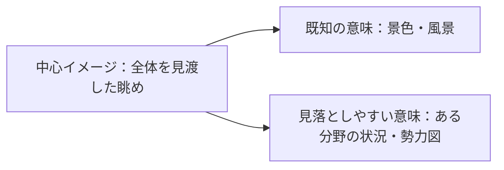

**重要語法：** political / business landscape

<small>出典候補ID：`ev-01190-noun-01` ／ 元データ index：1190</small>

---

## 816. channel

**品詞・分類：** 動詞（`verb`）  
**発音：** /ˈtʃænəl/

<small>よく知られている意味：水路・チャンネル</small>

### 見落としやすい意味：資金や努力を特定の目的に振り向ける

**例文：** The town channeled funds into public libraries.  
**和訳：** 町は資金を公共図書館に振り向けた。

**コアイメージ：** channel は流れを特定の経路へ導くこと。資金や努力も目的へ向けて流すように配分できる。

**図：**

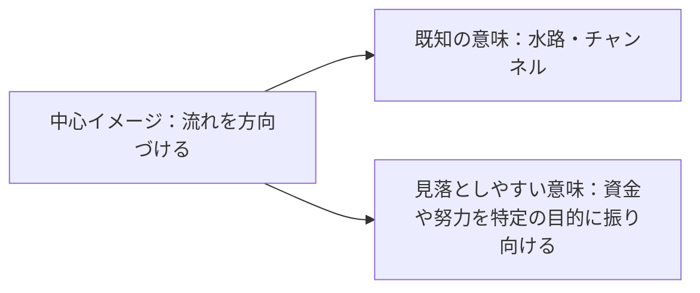

**重要語法：** channel A into B

<small>出典候補ID：`ev-01196-verb-01` ／ 元データ index：1196</small>

---

## 817. radio

**品詞・分類：** 動詞（`verb`）  
**発音：** /ˈreɪdioʊ/

<small>よく知られている意味：ラジオ</small>

### 見落としやすい意味：無線通信で連絡・報告する

**例文：** The pilot radioed for help.  
**和訳：** 操縦士は無線で救援を要請した。

**コアイメージ：** radio は無線で音声を送る手段。動詞ではその手段を使って連絡・報告する行為になる。

**図：**

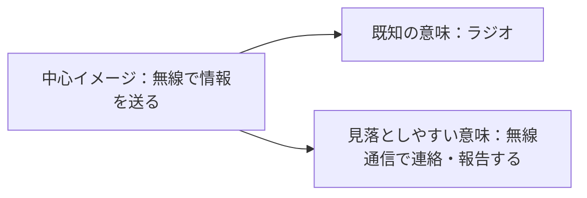

**重要語法：** radio for help / radio a message

<small>出典候補ID：`ev-01199-verb-01` ／ 元データ index：1199</small>

---

## 818. pull

**品詞・分類：** 名詞（`noun`）  
**発音：** /pʊl/

<small>よく知られている意味：引く</small>

### 見落としやすい意味：人や組織を動かす影響力・コネ

**例文：** Her experience gives her a lot of pull in the firm.  
**和訳：** 彼女は経験を背景に、その会社で大きな影響力を持つ。

**コアイメージ：** pull は何かを自分の方へ動かす力。人や組織の判断を動かす力にも比喩的に使う。

**図：**

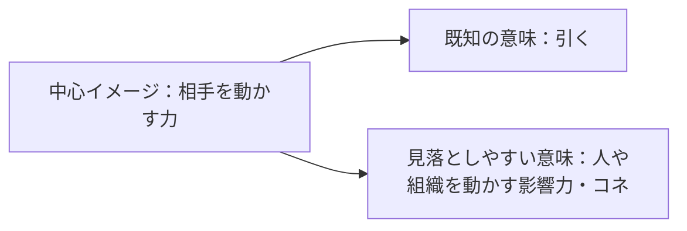

**重要語法：** have pull with someone

<small>出典候補ID：`ev-01200-noun-01` ／ 元データ index：1200</small>

---

## 819. pull

**品詞・分類：** 句動詞（`phrasal verb`）  
**発音：** /pʊl/

<small>よく知られている意味：引っ張る</small>

### 見落としやすい意味：難しいことをうまくやり遂げる

**例文：** The team pulled off an unexpected victory.  
**和訳：** そのチームは予想外の勝利をやってのけた。

**コアイメージ：** pull off は難しいものを何とか引き離して手にするような感覚。困難な計画や勝利を実現させる意味で使う。

**図：**

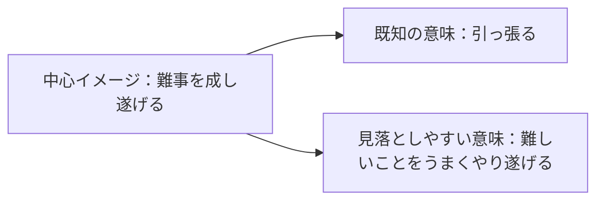

**重要語法：** pull off a victory / an upset

<small>出典候補ID：`ev-01200-phrasal-verb-01` ／ 元データ index：1200</small>

---

## 820. secret

**品詞・分類：** 名詞（`noun`）  
**発音：** /ˈsiːkrət/

<small>よく知られている意味：秘密</small>

### 見落としやすい意味：成功や解決につながる秘訣・鍵

**例文：** Careful planning was the secret to their success.  
**和訳：** 綿密な計画こそが彼らの成功の秘訣だった。

**コアイメージ：** secret は外からは見えにくい大切なもの。成功につながる、表面からは分かりにくい鍵も指す。

**図：**

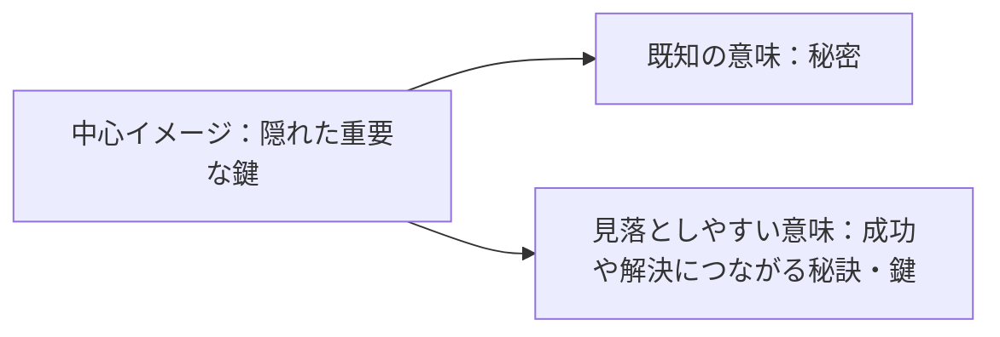

**重要語法：** the secret to success

<small>出典候補ID：`ev-01201-noun-01` ／ 元データ index：1201</small>

---

## 821. solution

**品詞・分類：** 名詞（`noun`）  
**発音：** /səˈluːʃən/

<small>よく知られている意味：解決策</small>

### 見落としやすい意味：物質を溶かした溶液

**例文：** The lab prepared a salt solution for the test.  
**和訳：** 研究室は実験用に食塩水を用意した。

**コアイメージ：** solution には「解決」だけでなく、物質が液体に溶けた状態を指す専門的用法がある。文脈が化学なら「溶液」と読む。

**図：**

```mermaid
flowchart LR
    A["中心イメージ：溶けて一体になった状態"]
    B["既知の意味：解決策"]
    C["見落としやすい意味：物質を溶かした溶液"]
    A --> B
    A --> C
```

**重要語法：** a salt solution / an aqueous solution

<small>出典候補ID：`ev-01202-noun-01` ／ 元データ index：1202</small>

---

## 822. headline

**品詞・分類：** 動詞（`verb`）  
**発音：** /ˈhedlaɪn/

<small>よく知られている意味：見出し</small>

### 見落としやすい意味：公演やイベントで主役を務める

**例文：** A local band will headline the festival.  
**和訳：** 地元のバンドがその祭典でメインを務める。

**コアイメージ：** headline は記事の最も目立つ見出し。イベントでは最も注目される出演者が中心となることを表す。

**図：**

```mermaid
flowchart LR
    A["中心イメージ：最も目立つ位置を占める"]
    B["既知の意味：見出し"]
    C["見落としやすい意味：公演やイベントで主役を務める"]
    A --> B
    A --> C
```

**重要語法：** headline a concert / festival

<small>出典候補ID：`ev-01203-verb-01` ／ 元データ index：1203</small>

---

## 823. degree

**品詞・分類：** 構文・定型表現（`construction`）  
**発音：** /dɪˈɡriː/

<small>よく知られている意味：程度・学位</small>

### 見落としやすい意味：少しずつ・徐々に

**例文：** The weather improved by degrees.  
**和訳：** 天気は徐々によくなった。

**コアイメージ：** degree は程度や段階の単位。by degrees は小さな段階を一つずつ進むような変化を表す。

**図：**

```mermaid
flowchart LR
    A["中心イメージ：段階を一つずつ進む"]
    B["既知の意味：程度・学位"]
    C["見落としやすい意味：少しずつ・徐々に"]
    A --> B
    A --> C
```

**重要語法：** by degrees

<small>出典候補ID：`ev-01207-construction-01` ／ 元データ index：1207</small>

---

## 824. representative

**品詞・分類：** 形容詞（`adjective`）  
**発音：** /ˌreprɪˈzentətɪv/

<small>よく知られている意味：代表者</small>

### 見落としやすい意味：集団や種類の典型として特徴をよく示す

**例文：** The survey used a representative sample.  
**和訳：** その調査では全体の特徴をよく表す標本を使った。

**コアイメージ：** representative は大きな集団の代わりにその特徴を示すこと。人だけでなく、標本や事例の典型性にも使う。

**図：**

```mermaid
flowchart LR
    A["中心イメージ：全体の特徴を代表する"]
    B["既知の意味：代表者"]
    C["見落としやすい意味：集団や種類の典型として特徴をよく示す"]
    A --> B
    A --> C
```

**重要語法：** representative of + 集団

<small>出典候補ID：`ev-01208-adjective-01` ／ 元データ index：1208</small>

---

## 825. window

**品詞・分類：** 名詞（`noun`）  
**発音：** /ˈwɪndoʊ/

<small>よく知られている意味：窓</small>

### 見落としやすい意味：行動できる限られた時間・好機

**例文：** We have a narrow window to submit our application.  
**和訳：** 私たちが申請できる時間はわずかしかない。

**コアイメージ：** window は内と外をつなぐ限られた開口部。比喩的に、何かを行える短い機会や時間帯を表す。

**図：**

```mermaid
flowchart LR
    A["中心イメージ：限られた開口・機会"]
    B["既知の意味：窓"]
    C["見落としやすい意味：行動できる限られた時間・好機"]
    A --> B
    A --> C
```

**重要語法：** a window of opportunity

<small>出典候補ID：`ev-01209-noun-01` ／ 元データ index：1209</small>

---

## 826. teach

**品詞・分類：** 構文・定型表現（`construction`）  
**発音：** /tiːtʃ/

<small>よく知られている意味：教える</small>

### 見落としやすい意味：人に痛い教訓を与える・思い知らせる

**例文：** That mistake taught him a valuable lesson.  
**和訳：** その失敗は彼に大切な教訓を思い知らせた。

**コアイメージ：** teach は知識や教訓を相手に身につけさせること。teach someone a lesson は経験を通して強く教訓を与える。

**図：**

```mermaid
flowchart LR
    A["中心イメージ：経験で教訓を刻む"]
    B["既知の意味：教える"]
    C["見落としやすい意味：人に痛い教訓を与える・思い知らせる"]
    A --> B
    A --> C
```

**重要語法：** teach someone a lesson

<small>出典候補ID：`ev-01214-construction-01` ／ 元データ index：1214</small>

---

## 827. failure

**品詞・分類：** 名詞（`noun`）  
**発音：** /ˈfeɪljər/

<small>よく知られている意味：失敗</small>

### 見落としやすい意味：失敗した人・失敗作

**例文：** The expensive new product was a failure.  
**和訳：** その高価な新製品は失敗作だった。

**コアイメージ：** failure は目標に達しなかったという結果。人や製品そのものを指して「失敗した存在・失敗作」と言うこともある。

**図：**

```mermaid
flowchart LR
    A["中心イメージ：期待された成果に届かない"]
    B["既知の意味：失敗"]
    C["見落としやすい意味：失敗した人・失敗作"]
    A --> B
    A --> C
```

**重要語法：** be a failure

<small>出典候補ID：`ev-01219-noun-01` ／ 元データ index：1219</small>

---

## 828. refuse

**品詞・分類：** 名詞（`noun`）  
**発音：** /ˈrefjuːs/

<small>よく知られている意味：断る</small>

### 見落としやすい意味：ごみ、廃棄物

**例文：** Household refuse is collected every Friday.  
**和訳：** 家庭ごみは毎週金曜日に回収される。

**コアイメージ：** 名詞 refuse（ごみ）と動詞 refuse（断る）は綴りが同じでも別の語として区別する。意味を無理に結びつけず、発音と品詞で見分ける。

**図：**

```mermaid
flowchart LR
    A["中心イメージ：同綴りで異なる語"]
    B["既知の意味：断る"]
    C["見落としやすい意味：ごみ、廃棄物"]
    A --> B
    A --> C
```

**重要語法：** 名詞 /ˈrefjuːs/・動詞 /rɪˈfjuːz/

<small>出典候補ID：`ev-01223-noun-01` ／ 元データ index：1223</small>

---

## 829. meanwhile

**品詞・分類：** 副詞（`adverb`）  
**発音：** /ˈmiːnwaɪl/

<small>よく知られている意味：その間に</small>

### 見落としやすい意味：その一方では・対照的に

**例文：** Some people welcomed the plan; meanwhile, others opposed it.  
**和訳：** その計画を歓迎する人がいる一方で、反対する人もいた。

**コアイメージ：** meanwhile は同じ時間帯に別の事柄が進むこと。話の対照を示すときは「一方で」と訳す。

**図：**

```mermaid
flowchart LR
    A["中心イメージ：同時に進む別の側面"]
    B["既知の意味：その間に"]
    C["見落としやすい意味：その一方では・対照的に"]
    A --> B
    A --> C
```

**重要語法：** 文頭・文中で対照を示す

<small>出典候補ID：`ev-01225-adverb-01` ／ 元データ index：1225</small>

---

## 830. leadership

**品詞・分類：** 名詞（`noun`）  
**発音：** /ˈliːdərʃɪp/

<small>よく知られている意味：指導力</small>

### 見落としやすい意味：組織の指導者層・幹部たち

**例文：** The party leadership met on Monday.  
**和訳：** その党の幹部たちは月曜日に会合を開いた。

**コアイメージ：** leadership は率いる働きや権限を表す。それを担う人々をまとめて「指導者層」とも呼ぶ。

**図：**

```mermaid
flowchart LR
    A["中心イメージ：組織を率いる立場"]
    B["既知の意味：指導力"]
    C["見落としやすい意味：組織の指導者層・幹部たち"]
    A --> B
    A --> C
```

**重要語法：** the party leadership

<small>出典候補ID：`ev-01226-noun-01` ／ 元データ index：1226</small>

---

## 831. extend

**品詞・分類：** 動詞（`verb`）  
**発音：** /ɪkˈstend/

<small>よく知られている意味：延長する</small>

### 見落としやすい意味：招待や援助などを差し出す・申し出る

**例文：** We extended an invitation to our new neighbors.  
**和訳：** 私たちは新しい隣人に招待を申し出た。

**コアイメージ：** extend は何かを相手の方へ伸ばすこと。招待や援助を差し出すことにも使える。

**図：**

```mermaid
flowchart LR
    A["中心イメージ：相手へ差し伸べる"]
    B["既知の意味：延長する"]
    C["見落としやすい意味：招待や援助などを差し出す・申し出る"]
    A --> B
    A --> C
```

**重要語法：** extend an invitation / assistance

<small>出典候補ID：`ev-01229-verb-01` ／ 元データ index：1229</small>

---

## 832. match

**品詞・分類：** 構文・定型表現（`construction`）  
**発音：** /mætʃ/

<small>よく知られている意味：試合・一致する</small>

### 見落としやすい意味：〜にはかなわない・到底匹敵しない

**例文：** The beginners were no match for the champions.  
**和訳：** 初心者たちは優勝者には到底かなわなかった。

**コアイメージ：** match は競い合える相手や釣り合うこと。no match for は競争相手として力量が足りないことを表す。

**図：**

```mermaid
flowchart LR
    A["中心イメージ：力量が釣り合う"]
    B["既知の意味：試合・一致する"]
    C["見落としやすい意味：〜にはかなわない・到底匹敵しない"]
    A --> B
    A --> C
```

**重要語法：** be no match for + 人・物

<small>出典候補ID：`ev-01230-construction-01` ／ 元データ index：1230</small>

---

## 833. ride

**品詞・分類：** 構文・定型表現（`construction`）  
**発音：** /raɪd/

<small>よく知られている意味：乗る</small>

### 見落としやすい意味：人をだます・いいように利用する

**例文：** The dishonest seller took the buyers for a ride.  
**和訳：** 不誠実な売り手は買い手たちをだました。

**コアイメージ：** take someone for a ride は、相手を自分の思うままに連れ回すイメージの慣用句。実際に乗り物に乗るとは限らない。

**図：**

```mermaid
flowchart LR
    A["中心イメージ：相手を思いどおりに振り回す"]
    B["既知の意味：乗る"]
    C["見落としやすい意味：人をだます・いいように利用する"]
    A --> B
    A --> C
```

**重要語法：** take someone for a ride

<small>出典候補ID：`ev-01231-construction-01` ／ 元データ index：1231</small>

---

## 834. initiative

**品詞・分類：** 名詞（`noun`）  
**発音：** /ɪˈnɪʃətɪv/

<small>よく知られている意味：新しい取り組み</small>

### 見落としやすい意味：物事を主導する力・先手・主導権

**例文：** The students took the initiative in planning the event.  
**和訳：** 生徒たちは率先してその行事を計画した。

**コアイメージ：** initiative は人より先に行動を起こす力。take the initiative で主導権を握り、自ら動き始める。

**図：**

```mermaid
flowchart LR
    A["中心イメージ：自分から先に動く"]
    B["既知の意味：新しい取り組み"]
    C["見落としやすい意味：物事を主導する力・先手・主導権"]
    A --> B
    A --> C
```

**重要語法：** take the initiative

<small>出典候補ID：`ev-01234-noun-01` ／ 元データ index：1234</small>

---

## 835. native

**品詞・分類：** 形容詞（`adjective`）  
**発音：** /ˈneɪtɪv/

<small>よく知られている意味：生まれた土地の</small>

### 見落としやすい意味：特定の土地に元来生息する・固有である

**例文：** This species of bird is native to Japan.  
**和訳：** この鳥の種は日本に元来生息している。

**コアイメージ：** native は特定の場所に本来属していること。人の出身地だけでなく、生物の原産地・自然分布にも使う。

**図：**

```mermaid
flowchart LR
    A["中心イメージ：その土地に元から属する"]
    B["既知の意味：生まれた土地の"]
    C["見落としやすい意味：特定の土地に元来生息する・固有である"]
    A --> B
    A --> C
```

**重要語法：** be native to + 地域

<small>出典候補ID：`ev-01241-adjective-01` ／ 元データ index：1241</small>

---

## 836. green

**品詞・分類：** 形容詞（`adjective`）  
**発音：** /ɡriːn/

<small>よく知られている意味：緑色の</small>

### 見落としやすい意味：経験が足りない・未熟な

**例文：** I was still green when I started the job.  
**和訳：** その仕事を始めた頃、私はまだ未熟だった。

**コアイメージ：** 若い植物の緑から、経験を積む前の新しさを連想する用法。green は人の経験不足にも使う。

**図：**

```mermaid
flowchart LR
    A["中心イメージ：若葉のように未熟"]
    B["既知の意味：緑色の"]
    C["見落としやすい意味：経験が足りない・未熟な"]
    A --> B
    A --> C
```

**重要語法：** be green / a green recruit

<small>出典候補ID：`ev-01243-adjective-01` ／ 元データ index：1243</small>

---

## 837. green

**品詞・分類：** 形容詞（`adjective`）  
**発音：** /ɡriːn/

<small>よく知られている意味：緑色の</small>

### 見落としやすい意味：環境への負荷が小さい・環境配慮型の

**例文：** The school plans to use greener energy.  
**和訳：** その学校はより環境負荷の少ないエネルギーを使う予定だ。

**コアイメージ：** 緑は自然や植物を思わせる色。そこから環境に配慮し負荷を減らすという意味で使われる。

**図：**

```mermaid
flowchart LR
    A["中心イメージ：自然環境に配慮する"]
    B["既知の意味：緑色の"]
    C["見落としやすい意味：環境への負荷が小さい・環境配慮型の"]
    A --> B
    A --> C
```

**重要語法：** green energy / green technology

<small>出典候補ID：`ev-01243-adjective-02` ／ 元データ index：1243</small>

---

## 838. camp

**品詞・分類：** 名詞（`noun`）  
**発音：** /kæmp/

<small>よく知られている意味：野営する・キャンプ場</small>

### 見落としやすい意味：意見や立場を同じくする陣営・派閥

**例文：** Both camps rejected the proposal.  
**和訳：** 両陣営はその提案を拒否した。

**コアイメージ：** camp は同じ場所に集まった集団。意見や利害が共通する人々の一団にも使う。

**図：**

```mermaid
flowchart LR
    A["中心イメージ：同じ側に集まる集団"]
    B["既知の意味：野営する・キャンプ場"]
    C["見落としやすい意味：意見や立場を同じくする陣営・派閥"]
    A --> B
    A --> C
```

**重要語法：** the opposing camp / both camps

<small>出典候補ID：`ev-01244-noun-01` ／ 元データ index：1244</small>

---

## 839. entrance

**品詞・分類：** 動詞（`verb`）  
**発音：** /ɪnˈtræns/

<small>よく知られている意味：入り口</small>

### 見落としやすい意味：うっとりさせる・魅了する

**例文：** The beautiful music entranced the audience.  
**和訳：** 美しい音楽は聴衆をうっとりさせた。

**コアイメージ：** 動詞 entrance は trance（夢中・恍惚の状態）と結びつけて覚える。名詞 entrance（入り口）とは発音も意味の成り立ちも異なる。

**図：**

```mermaid
flowchart LR
    A["中心イメージ：夢中の状態に引き込む"]
    B["既知の意味：入り口"]
    C["見落としやすい意味：うっとりさせる・魅了する"]
    A --> B
    A --> C
```

**重要語法：** 動詞 /ɪnˈtræns/・名詞 /ˈentrəns/

<small>出典候補ID：`ev-01245-verb-01` ／ 元データ index：1245</small>

---

## 840. examine

**品詞・分類：** 動詞（`verb`）  
**発音：** /ɪɡˈzæmɪn/

<small>よく知られている意味：調べる</small>

### 見落としやすい意味：医師が患者を診察する

**例文：** The doctor examined the patient's knee.  
**和訳：** 医師は患者の膝を診察した。

**コアイメージ：** examine は対象を細かく確かめること。対象が人の身体なら「検査する・診察する」となる。

**図：**

```mermaid
flowchart LR
    A["中心イメージ：詳しく調べる"]
    B["既知の意味：調べる"]
    C["見落としやすい意味：医師が患者を診察する"]
    A --> B
    A --> C
```

**重要語法：** examine a patient

<small>出典候補ID：`ev-01246-verb-01` ／ 元データ index：1246</small>

---

## 841. left

**品詞・分類：** 形容詞（`adjective`）  
**発音：** /left/

<small>よく知られている意味：去る（leave）</small>

### 見落としやすい意味：使われず・去らずに残された

**例文：** We have only two tickets left.  
**和訳：** チケットはあと2枚しか残っていない。

**コアイメージ：** leave には「去る」だけでなく「残す」の働きもある。left はその結果として残っているものを示す。

**図：**

```mermaid
flowchart LR
    A["中心イメージ：使われずに残る"]
    B["既知の意味：去る（leave）"]
    C["見落としやすい意味：使われず・去らずに残された"]
    A --> B
    A --> C
```

**重要語法：** have something left / left over

<small>出典候補ID：`ev-01248-adjective-01` ／ 元データ index：1248</small>

---

## 842. following

**品詞・分類：** 前置詞（`preposition`）  
**発音：** /ˈfɑːloʊɪŋ/

<small>よく知られている意味：次の・以下の</small>

### 見落としやすい意味：〜の後で・〜に続いて

**例文：** Following the meeting, we sent a summary.  
**和訳：** 会議の後、私たちは要約を送った。

**コアイメージ：** follow は後について進むこと。前置詞 following はある出来事の後に続く時間を表す。

**図：**

```mermaid
flowchart LR
    A["中心イメージ：後に続く"]
    B["既知の意味：次の・以下の"]
    C["見落としやすい意味：〜の後で・〜に続いて"]
    A --> B
    A --> C
```

**重要語法：** following + 名詞

<small>出典候補ID：`ev-01249-preposition-01` ／ 元データ index：1249</small>

---

## 843. theater

**品詞・分類：** 名詞（`noun`）  
**発音：** /ˈθɪətə/

<small>よく知られている意味：劇場</small>

### 見落としやすい意味：手術を行う部屋（英国英語）

**例文：** The patient was taken to the operating theatre.  
**和訳：** 患者は手術室へ運ばれた。

**コアイメージ：** theatre は何かが行われる専用の場所を指す。英国英語では医療の文脈で手術室にも使う。

**図：**

```mermaid
flowchart LR
    A["中心イメージ：特定の活動が行われる場所"]
    B["既知の意味：劇場"]
    C["見落としやすい意味：手術を行う部屋（英国英語）"]
    A --> B
    A --> C
```

**重要語法：** operating theatre（英国英語）

<small>出典候補ID：`ev-01254-noun-01` ／ 元データ index：1254</small>

---

## 844. touch

**品詞・分類：** 句動詞（`phrasal verb`）  
**発音：** /tʌtʃ/

<small>よく知られている意味：触る</small>

### 見落としやすい意味：話題に少し言及する・軽く触れる

**例文：** The speaker touched on the topic only briefly.  
**和訳：** 講演者はその話題にほんの少し触れただけだった。

**コアイメージ：** touch は軽く接触すること。話題に対しては深く立ち入らず少し言及する意味になる。

**図：**

```mermaid
flowchart LR
    A["中心イメージ：軽く触れる"]
    B["既知の意味：触る"]
    C["見落としやすい意味：話題に少し言及する・軽く触れる"]
    A --> B
    A --> C
```

**重要語法：** touch on + 話題

<small>出典候補ID：`ev-01258-phrasal-verb-01` ／ 元データ index：1258</small>

---

## 845. touch

**品詞・分類：** 動詞（`verb`）  
**発音：** /tʌtʃ/

<small>よく知られている意味：触る</small>

### 見落としやすい意味：心を打つ・感動させる

**例文：** Her kind words touched everyone.  
**和訳：** 彼女の親切な言葉は皆の心を打った。

**コアイメージ：** touch は手で触れるだけでなく心に影響を与えることにも使う。感情に触れることで感動を生む。

**図：**

```mermaid
flowchart LR
    A["中心イメージ：心に触れて動かす"]
    B["既知の意味：触る"]
    C["見落としやすい意味：心を打つ・感動させる"]
    A --> B
    A --> C
```

**重要語法：** be deeply touched by

<small>出典候補ID：`ev-01258-verb-01` ／ 元データ index：1258</small>

---

## 846. settle

**品詞・分類：** 動詞（`verb`）  
**発音：** /ˈsetəl/

<small>よく知られている意味：落ち着く・定住する</small>

### 見落としやすい意味：請求書・借金などの金額を支払って清算する

**例文：** Please settle the bill before you leave.  
**和訳：** 帰る前に勘定を済ませてください。

**コアイメージ：** settle は未解決のことを片づけ、落ち着いた状態にすること。金銭上の未払いをなくすと「清算する」。

**図：**

```mermaid
flowchart LR
    A["中心イメージ：未解決を片づける"]
    B["既知の意味：落ち着く・定住する"]
    C["見落としやすい意味：請求書・借金などの金額を支払って清算する"]
    A --> B
    A --> C
```

**重要語法：** settle a bill / debt

<small>出典候補ID：`ev-01260-verb-01` ／ 元データ index：1260</small>

---

## 847. settle

**品詞・分類：** 動詞（`verb`）  
**発音：** /ˈsetəl/

<small>よく知られている意味：落ち着く・定住する</small>

### 見落としやすい意味：粉じんなどが沈み、表面に積もる

**例文：** Fine dust settled on the windowsill.  
**和訳：** 細かなほこりが窓枠に積もった。

**コアイメージ：** settle は動いているものが静まること。空気中の粒子なら下へ落ちて表面にたまる。

**図：**

```mermaid
flowchart LR
    A["中心イメージ：動きが静まり下に落ちる"]
    B["既知の意味：落ち着く・定住する"]
    C["見落としやすい意味：粉じんなどが沈み、表面に積もる"]
    A --> B
    A --> C
```

**重要語法：** dust settles on + 表面

<small>出典候補ID：`ev-01260-verb-02` ／ 元データ index：1260</small>

---

## 848. architecture

**品詞・分類：** 名詞（`noun`）  
**発音：** /ˈɑːrkɪtektʃər/

<small>よく知られている意味：建築</small>

### 見落としやすい意味：システム全体の設計構造・構成方式

**例文：** The software has a simple architecture.  
**和訳：** そのソフトウェアは構造が単純だ。

**コアイメージ：** architecture は各部分をどう配置し組み立てるかという設計。建物以外にもソフトウェアや制度の構造に使う。

**図：**

```mermaid
flowchart LR
    A["中心イメージ：全体を組み立てる設計"]
    B["既知の意味：建築"]
    C["見落としやすい意味：システム全体の設計構造・構成方式"]
    A --> B
    A --> C
```

**重要語法：** software / system architecture

<small>出典候補ID：`ev-01265-noun-01` ／ 元データ index：1265</small>

---

## 849. recall

**品詞・分類：** 動詞（`verb`）  
**発音：** /rɪˈkɔːl/

<small>よく知られている意味：思い出す</small>

### 見落としやすい意味：不具合のある商品を回収する

**例文：** The company recalled the defective batteries.  
**和訳：** その会社は欠陥のある電池を回収した。

**コアイメージ：** recall は再び呼び戻すこと。記憶を呼び戻すだけでなく、出荷済みの商品を引き戻す意味もある。

**図：**

```mermaid
flowchart LR
    A["中心イメージ：再び呼び戻す"]
    B["既知の意味：思い出す"]
    C["見落としやすい意味：不具合のある商品を回収する"]
    A --> B
    A --> C
```

**重要語法：** recall a product

<small>出典候補ID：`ev-01266-verb-01` ／ 元データ index：1266</small>

---

## 850. select

**品詞・分類：** 形容詞（`adjective`）  
**発音：** /səˈlekt/

<small>よく知られている意味：選ぶ</small>

### 見落としやすい意味：特別に選ばれた・一部に限定された

**例文：** Only a select few knew the details.  
**和訳：** 限られた選ばれた人だけが詳細を知っていた。

**コアイメージ：** select は選び抜くこと。形容詞では広い集団から特別に選ばれた少数を表す。

**図：**

```mermaid
flowchart LR
    A["中心イメージ：特別に選び抜く"]
    B["既知の意味：選ぶ"]
    C["見落としやすい意味：特別に選ばれた・一部に限定された"]
    A --> B
    A --> C
```

**重要語法：** a select few

<small>出典候補ID：`ev-01267-adjective-01` ／ 元データ index：1267</small>

---

## 851. dog

**品詞・分類：** 動詞（`verb`）  
**発音：** /dɔːɡ/

<small>よく知られている意味：犬</small>

### 見落としやすい意味：悩みや問題が長く付きまとう

**例文：** Unexpected problems dogged the project.  
**和訳：** 予期しない問題がその計画に付きまとった。

**コアイメージ：** dog は犬が後を追う姿から、困難がしつこく付きまとうことを表す動詞にもなる。

**図：**

```mermaid
flowchart LR
    A["中心イメージ：しつこく後を追う"]
    B["既知の意味：犬"]
    C["見落としやすい意味：悩みや問題が長く付きまとう"]
    A --> B
    A --> C
```

**重要語法：** problems dog + 人・事業

<small>出典候補ID：`ev-01269-verb-01` ／ 元データ index：1269</small>

---

## 852. introduce

**品詞・分類：** 動詞（`verb`）  
**発音：** /ˌɪntrəˈduːs/

<small>よく知られている意味：紹介する</small>

### 見落としやすい意味：法案を議会に提出する

**例文：** The senator introduced a new bill.  
**和訳：** その上院議員は新しい法案を提出した。

**コアイメージ：** introduce は新しいものをある場に持ち込むこと。議会では審議するために法案を提出する。

**図：**

```mermaid
flowchart LR
    A["中心イメージ：新しいものを場に持ち込む"]
    B["既知の意味：紹介する"]
    C["見落としやすい意味：法案を議会に提出する"]
    A --> B
    A --> C
```

**重要語法：** introduce a bill

<small>出典候補ID：`ev-01270-verb-01` ／ 元データ index：1270</small>

---

## 853. invite

**品詞・分類：** 動詞（`verb`）  
**発音：** /ɪnˈvaɪt/

<small>よく知られている意味：招待する</small>

### 見落としやすい意味：批判・問題などを招く

**例文：** The careless remark invited criticism.  
**和訳：** その軽率な発言は批判を招いた。

**コアイメージ：** invite は相手が来るように招くこと。批判や問題など望ましくない反応を引き寄せる場合にも使う。

**図：**

```mermaid
flowchart LR
    A["中心イメージ：反応が来るきっかけを作る"]
    B["既知の意味：招待する"]
    C["見落としやすい意味：批判・問題などを招く"]
    A --> B
    A --> C
```

**重要語法：** invite criticism / trouble

<small>出典候補ID：`ev-01271-verb-01` ／ 元データ index：1271</small>

---

## 854. provision

**品詞・分類：** 名詞（`noun`）  
**発音：** /prəˈvɪʒən/

<small>よく知られている意味：供給・備え</small>

### 見落としやすい意味：契約・法律に定められた条項

**例文：** The contract contains a provision on privacy.  
**和訳：** その契約には個人情報保護に関する条項がある。

**コアイメージ：** provision は必要なことをあらかじめ用意する発想。契約や法律では事前に定めておく規定を指す。

**図：**

```mermaid
flowchart LR
    A["中心イメージ：前もって定めて備える"]
    B["既知の意味：供給・備え"]
    C["見落としやすい意味：契約・法律に定められた条項"]
    A --> B
    A --> C
```

**重要語法：** a provision in a contract

<small>出典候補ID：`ev-01273-noun-01` ／ 元データ index：1273</small>

---

## 855. provision

**品詞・分類：** 名詞（`noun`）  
**発音：** /prəˈvɪʒən/

<small>よく知られている意味：供給</small>

### 見落としやすい意味：将来の事態に備えた手配・備え

**例文：** We made provision for unexpected expenses.  
**和訳：** 私たちは予想外の出費に備えた。

**コアイメージ：** provision は将来必要になるものを用意すること。make provision for は起こりうる事態に先回りして備える。

**図：**

```mermaid
flowchart LR
    A["中心イメージ：将来に備えて用意する"]
    B["既知の意味：供給"]
    C["見落としやすい意味：将来の事態に備えた手配・備え"]
    A --> B
    A --> C
```

**重要語法：** make provision for + 事態

<small>出典候補ID：`ev-01273-noun-02` ／ 元データ index：1273</small>

---

## 856. born

**品詞・分類：** 構文・定型表現（`construction`）  
**発音：** /bɔːrn/

<small>よく知られている意味：生まれた</small>

### 見落としやすい意味：〜から生じた・〜を原因として生まれた

**例文：** The new policy was born of necessity.  
**和訳：** その新しい方針は必要に迫られて生まれた。

**コアイメージ：** born は存在が生じること。born of はその誕生の原因・背景を示す。

**図：**

```mermaid
flowchart LR
    A["中心イメージ：原因から生まれる"]
    B["既知の意味：生まれた"]
    C["見落としやすい意味：〜から生じた・〜を原因として生まれた"]
    A --> B
    A --> C
```

**重要語法：** be born of + 原因

<small>出典候補ID：`ev-01275-construction-01` ／ 元データ index：1275</small>

---

## 857. folk

**品詞・分類：** 名詞（`noun`）  
**発音：** /foʊk/

<small>よく知られている意味：人々・民衆</small>

### 見落としやすい意味：家族・両親（くだけた表現）

**例文：** My folks are visiting us this weekend.  
**和訳：** 今週末は両親が私たちを訪ねてくる。

**コアイメージ：** folk は人々を親しみを込めて表す語。my folks の形では自分の家族、特に親を指す。

**図：**

```mermaid
flowchart LR
    A["中心イメージ：身近な人々"]
    B["既知の意味：人々・民衆"]
    C["見落としやすい意味：家族・両親（くだけた表現）"]
    A --> B
    A --> C
```

**重要語法：** my folks（くだけた表現）

<small>出典候補ID：`ev-01276-noun-01` ／ 元データ index：1276</small>

---

## 858. print

**品詞・分類：** 構文・定型表現（`construction`）  
**発音：** /prɪnt/

<small>よく知られている意味：印刷する</small>

### 見落としやすい意味：刊行中で入手できる・印刷出版されている

**例文：** This book is no longer in print.  
**和訳：** この本はもう絶版だ。

**コアイメージ：** in print は本が印刷・刊行されて入手できる状態。no longer in print なら刊行されていないことを表す。

**図：**

```mermaid
flowchart LR
    A["中心イメージ：本が印刷・刊行されている"]
    B["既知の意味：印刷する"]
    C["見落としやすい意味：刊行中で入手できる・印刷出版されている"]
    A --> B
    A --> C
```

**重要語法：** in print / out of print

<small>出典候補ID：`ev-01278-construction-01` ／ 元データ index：1278</small>

---

## 859. reality

**品詞・分類：** 名詞（`noun`）  
**発音：** /riˈæləti/

<small>よく知られている意味：現実</small>

### 見落としやすい意味：実際に直面する事情・厳しい現実

**例文：** The plan ignored the realities of everyday life.  
**和訳：** その計画は日常生活の実情を無視していた。

**コアイメージ：** reality は単なる抽象的な「現実」だけでなく、実際に向き合う個別の事情を指す。複数形 realities が使われやすい。

**図：**

```mermaid
flowchart LR
    A["中心イメージ：実際に直面する事情"]
    B["既知の意味：現実"]
    C["見落としやすい意味：実際に直面する事情・厳しい現実"]
    A --> B
    A --> C
```

**重要語法：** the realities of life

<small>出典候補ID：`ev-01280-noun-01` ／ 元データ index：1280</small>

---

## 860. witness

**品詞・分類：** 動詞（`verb`）  
**発音：** /ˈwɪtnəs/

<small>よく知られている意味：目撃する</small>

### 見落としやすい意味：（時代・場所が）ある事件や変化を経験する、その舞台となる

**例文：** The town witnessed rapid growth last year.  
**和訳：** その町は昨年急速な発展を遂げた。

**コアイメージ：** witness は出来事が起こる場にいること。人ではなく時代や場所を主語にして、そこで変化が起きたことを表す。

**図：**

```mermaid
flowchart LR
    A["中心イメージ：出来事の舞台となる"]
    B["既知の意味：目撃する"]
    C["見落としやすい意味：（時代・場所が）ある事件や変化を経験する、その舞台となる"]
    A --> B
    A --> C
```

**重要語法：** a city / period witnesses change

<small>出典候補ID：`ev-01282-verb-01` ／ 元データ index：1282</small>

---

## 861. wage

**品詞・分類：** 動詞（`verb`）  
**発音：** /weɪdʒ/

<small>よく知られている意味：賃金</small>

### 見落としやすい意味：運動・闘争などを展開し続ける

**例文：** The group waged a campaign to save the river.  
**和訳：** その団体は川を守る運動を展開した。

**コアイメージ：** 動詞 wage は運動や戦いを積極的に続けることを表す。名詞 wage（賃金）と同じ綴りでも、ここでは活動を展開する動詞として読む。

**図：**

```mermaid
flowchart LR
    A["中心イメージ：活動を継続して展開する"]
    B["既知の意味：賃金"]
    C["見落としやすい意味：運動・闘争などを展開し続ける"]
    A --> B
    A --> C
```

**重要語法：** wage a war / campaign

<small>出典候補ID：`ev-01283-verb-01` ／ 元データ index：1283</small>

---

## 862. devote

**品詞・分類：** 構文・定型表現（`construction`）  
**発音：** /dɪˈvoʊt/

<small>よく知られている意味：時間などをささげる</small>

### 見落としやすい意味：〜に身を捧げる・専念する

**例文：** He devoted himself to learning Japanese.  
**和訳：** 彼は日本語の学習に専念した。

**コアイメージ：** devote は時間や力をある対象へ集中して向けること。devote oneself to では自分自身を捧げるほど専念する。

**図：**

```mermaid
flowchart LR
    A["中心イメージ：力を一つに注ぐ"]
    B["既知の意味：時間などをささげる"]
    C["見落としやすい意味：〜に身を捧げる・専念する"]
    A --> B
    A --> C
```

**重要語法：** devote oneself to + 名詞・動名詞

<small>出典候補ID：`ev-01284-construction-01` ／ 元データ index：1284</small>

---

## 863. throw

**品詞・分類：** 動詞（`verb`）  
**発音：** /θroʊ/

<small>よく知られている意味：投げる</small>

### 見落としやすい意味：パーティーや催しを開催する

**例文：** They threw a party for their teacher.  
**和訳：** 彼らは先生のためにパーティーを開いた。

**コアイメージ：** throw は物を勢いよく動かすイメージを持つ。throw a party は催しを企画して開く慣用表現。

**図：**

```mermaid
flowchart LR
    A["中心イメージ：催しを勢いよく立ち上げる"]
    B["既知の意味：投げる"]
    C["見落としやすい意味：パーティーや催しを開催する"]
    A --> B
    A --> C
```

**重要語法：** throw a party

<small>出典候補ID：`ev-01290-verb-01` ／ 元データ index：1290</small>

---

## 864. attend

**品詞・分類：** 句動詞（`phrasal verb`）  
**発音：** /əˈtend/

<small>よく知られている意味：出席する</small>

### 見落としやすい意味：仕事・問題に対処する・世話をする

**例文：** Please attend to the problem immediately.  
**和訳：** その問題にすぐ対応してください。

**コアイメージ：** attend はある対象に注意や意識を向けること。attend to はその対象の世話や処理をすることを表す。

**図：**

```mermaid
flowchart LR
    A["中心イメージ：注意を向けて対応する"]
    B["既知の意味：出席する"]
    C["見落としやすい意味：仕事・問題に対処する・世話をする"]
    A --> B
    A --> C
```

**重要語法：** attend to + 問題・仕事

<small>出典候補ID：`ev-01291-phrasal-verb-01` ／ 元データ index：1291</small>

---

## 865. selection

**品詞・分類：** 名詞（`noun`）  
**発音：** /səˈlekʃən/

<small>よく知られている意味：選択</small>

### 見落としやすい意味：店にある商品の品ぞろえ・選べる品目

**例文：** The shop offers a wide selection of teas.  
**和訳：** その店は多種多様なお茶を取りそろえている。

**コアイメージ：** selection は選ぶ行為だけでなく、選べるように並んだ品物の集まりも指す。

**図：**

```mermaid
flowchart LR
    A["中心イメージ：選べる品々の集まり"]
    B["既知の意味：選択"]
    C["見落としやすい意味：店にある商品の品ぞろえ・選べる品目"]
    A --> B
    A --> C
```

**重要語法：** a wide selection of

<small>出典候補ID：`ev-01292-noun-01` ／ 元データ index：1292</small>

---

## 866. transfer

**品詞・分類：** 名詞（`noun`）  
**発音：** /ˈtrænsfɝː/

<small>よく知られている意味：移動・乗り換え</small>

### 見落としやすい意味：乗り換えを認める切符・乗車券（米国）

**例文：** Ask the bus driver for a transfer.  
**和訳：** 乗り換え券はバスの運転手に頼んでください。

**コアイメージ：** transfer は別の便や路線へ移ること。米国の交通文脈では、その乗り換えを認める券を指す場合がある。

**図：**

```mermaid
flowchart LR
    A["中心イメージ：別の便へ移るための権利"]
    B["既知の意味：移動・乗り換え"]
    C["見落としやすい意味：乗り換えを認める切符・乗車券（米国）"]
    A --> B
    A --> C
```

**重要語法：** a transfer（米国の交通用語）

<small>出典候補ID：`ev-01293-noun-01` ／ 元データ index：1293</small>

---

## 867. transfer

**品詞・分類：** 動詞（`verb`）  
**発音：** /trænsˈfɝː/

<small>よく知られている意味：移す</small>

### 見落としやすい意味：財産・権利などの所有権を別の人へ移す

**例文：** The owner transferred the house to his daughter.  
**和訳：** 所有者はその家の所有権を娘に移した。

**コアイメージ：** transfer はあるところから別のところへ移すこと。移る対象が財産なら所有権の移転を表す。

**図：**

```mermaid
flowchart LR
    A["中心イメージ：持ち主を移す"]
    B["既知の意味：移す"]
    C["見落としやすい意味：財産・権利などの所有権を別の人へ移す"]
    A --> B
    A --> C
```

**重要語法：** transfer property / ownership to someone

<small>出典候補ID：`ev-01293-verb-02` ／ 元データ index：1293</small>

---

## 868. progress

**品詞・分類：** 動詞（`verb`）  
**発音：** /prəˈɡres/

<small>よく知られている意味：進歩</small>

### 見落としやすい意味：事態が進展するにつれて、徐々に変化する

**例文：** As the talks progressed, both sides grew hopeful.  
**和訳：** 話し合いが進むにつれて、双方は希望を持つようになった。

**コアイメージ：** progress は時間や過程に沿って先へ進むこと。議論や出来事の進展に伴う変化にも使う。

**図：**

```mermaid
flowchart LR
    A["中心イメージ：過程が先へ進む"]
    B["既知の意味：進歩"]
    C["見落としやすい意味：事態が進展するにつれて、徐々に変化する"]
    A --> B
    A --> C
```

**重要語法：** as events progressed

<small>出典候補ID：`ev-01294-verb-01` ／ 元データ index：1294</small>

---

## 869. approve

**品詞・分類：** 句動詞（`phrasal verb`）  
**発音：** /əˈpruːv/

<small>よく知られている意味：承認する</small>

### 見落としやすい意味：（考えや行動などに）賛成する・よいと思う

**例文：** I approve of the new safety rules.  
**和訳：** 私は新しい安全規則に賛成だ。

**コアイメージ：** approve には正式に許可する意味のほか、考えや行動をよいものと評価する意味がある。approve of では賛意や好意を示す。

**図：**

```mermaid
flowchart LR
    A["中心イメージ：よいと認める"]
    B["既知の意味：承認する"]
    C["見落としやすい意味：（考えや行動などに）賛成する・よいと思う"]
    A --> B
    A --> C
```

**重要語法：** approve of + 名詞・動名詞

<small>出典候補ID：`ev-01296-phrasal-verb-01` ／ 元データ index：1296</small>

---

## 870. soldier

**品詞・分類：** 句動詞（`phrasal verb`）  
**発音：** /ˈsoʊldʒər/

<small>よく知られている意味：兵士</small>

### 見落としやすい意味：困難があっても粘り強く続ける

**例文：** Despite the rain, the workers soldiered on.  
**和訳：** 雨にもかかわらず作業員たちは粘り強く作業を続けた。

**コアイメージ：** soldier on は兵士のように困難に耐えながら前進するイメージ。つらい状況でも作業を続けること。

**図：**

```mermaid
flowchart LR
    A["中心イメージ：困難でも前進を続ける"]
    B["既知の意味：兵士"]
    C["見落としやすい意味：困難があっても粘り強く続ける"]
    A --> B
    A --> C
```

**重要語法：** soldier on

<small>出典候補ID：`ev-01298-phrasal-verb-01` ／ 元データ index：1298</small>

---

## 871. accuse

**品詞・分類：** 構文・定型表現（`construction`）  
**発音：** /əˈkjuːz/

<small>よく知られている意味：非難する</small>

### 見落としやすい意味：人を〜のことで非難・告発する

**例文：** The report accused the firm of hiding data.  
**和訳：** その報告書はその会社がデータを隠したと非難した。

**コアイメージ：** accuse は相手に問題の責任があると主張すること。of 以下で何について責めているかを示す。

**図：**

```mermaid
flowchart LR
    A["中心イメージ：責任を相手に向ける"]
    B["既知の意味：非難する"]
    C["見落としやすい意味：人を〜のことで非難・告発する"]
    A --> B
    A --> C
```

**重要語法：** accuse A of B（Bは名詞・動名詞）

<small>出典候補ID：`ev-01301-construction-01` ／ 元データ index：1301</small>

---

## 872. institution

**品詞・分類：** 名詞（`noun`）  
**発音：** /ˌɪnstəˈtuːʃən/

<small>よく知られている意味：機関・施設</small>

### 見落としやすい意味：社会で確立した制度や慣行

**例文：** Public education is an important social institution.  
**和訳：** 公教育は重要な社会制度だ。

**コアイメージ：** institution は社会の中で長く定着した仕組み。具体的な施設だけでなく制度や慣行も表す。

**図：**

```mermaid
flowchart LR
    A["中心イメージ：社会に根づいた仕組み"]
    B["既知の意味：機関・施設"]
    C["見落としやすい意味：社会で確立した制度や慣行"]
    A --> B
    A --> C
```

**重要語法：** a social institution

<small>出典候補ID：`ev-01304-noun-01` ／ 元データ index：1304</small>

---

## 873. loan

**品詞・分類：** 動詞（`verb`）  
**発音：** /loʊn/

<small>よく知られている意味：貸付金</small>

### 見落としやすい意味：金銭や物を貸し付ける

**例文：** The museum loaned several paintings to a school.  
**和訳：** 美術館は数点の絵画を学校に貸し出した。

**コアイメージ：** loan は一時的に相手へ渡し、あとで返してもらうこと。名詞だけでなく動詞としても使う。

**図：**

```mermaid
flowchart LR
    A["中心イメージ：返却を前提に貸す"]
    B["既知の意味：貸付金"]
    C["見落としやすい意味：金銭や物を貸し付ける"]
    A --> B
    A --> C
```

**重要語法：** loan A to B

<small>出典候補ID：`ev-01305-verb-01` ／ 元データ index：1305</small>

---

## 874. perfect

**品詞・分類：** 動詞（`verb`）  
**発音：** /pərˈfekt/

<small>よく知られている意味：完璧な</small>

### 見落としやすい意味：技術・計画などを完成の域まで磨き上げる

**例文：** She practiced daily to perfect her technique.  
**和訳：** 彼女は技術を磨き上げるため毎日練習した。

**コアイメージ：** perfect は完全な状態を目指すこと。動詞なら細部まで改善して完成度を上げる意味になる。

**図：**

```mermaid
flowchart LR
    A["中心イメージ：完成度を高める"]
    B["既知の意味：完璧な"]
    C["見落としやすい意味：技術・計画などを完成の域まで磨き上げる"]
    A --> B
    A --> C
```

**重要語法：** perfect a technique（動詞は後半に強勢）

<small>出典候補ID：`ev-01306-verb-01` ／ 元データ index：1306</small>

---

## 875. capacity

**品詞・分類：** 構文・定型表現（`construction`）  
**発音：** /kəˈpæsəti/

<small>よく知られている意味：能力・収容力</small>

### 見落としやすい意味：特定の資格・役割・立場において

**例文：** She spoke in her capacity as team leader.  
**和訳：** 彼女はチームリーダーの立場で発言した。

**コアイメージ：** capacity は何かをする能力や役割を担う立場。in one's capacity as で、その資格・役割において行動することを示す。

**図：**

```mermaid
flowchart LR
    A["中心イメージ：役割を担う立場"]
    B["既知の意味：能力・収容力"]
    C["見落としやすい意味：特定の資格・役割・立場において"]
    A --> B
    A --> C
```

**重要語法：** in one's capacity as + 役職

<small>出典候補ID：`ev-01309-construction-01` ／ 元データ index：1309</small>

---

## 876. favorite

**品詞・分類：** 名詞（`noun`）  
**発音：** /ˈfeɪvərɪt/

<small>よく知られている意味：お気に入り</small>

### 見落としやすい意味：優勝・当選などの最有力候補

**例文：** The home team is the favorite to win.  
**和訳：** 地元チームが優勝の最有力候補だ。

**コアイメージ：** favorite は多くの人が好む対象。競争では勝つと最も期待される候補を指す。

**図：**

```mermaid
flowchart LR
    A["中心イメージ：最も支持・期待される"]
    B["既知の意味：お気に入り"]
    C["見落としやすい意味：優勝・当選などの最有力候補"]
    A --> B
    A --> C
```

**重要語法：** the favorite to win

<small>出典候補ID：`ev-01310-noun-01` ／ 元データ index：1310</small>

---

## 877. assumption

**品詞・分類：** 名詞（`noun`）  
**発音：** /əˈsʌmpʃən/

<small>よく知られている意味：仮定</small>

### 見落としやすい意味：責任・役割などを引き受けること

**例文：** Her assumption of responsibility reassured the team.  
**和訳：** 彼女が責任を引き受けたことでチームは安心した。

**コアイメージ：** assume は仮定するだけでなく、役割や責任を自分のものとして引き受けること。assumption はその引き受けを指す。

**図：**

```mermaid
flowchart LR
    A["中心イメージ：自分のものとして引き受ける"]
    B["既知の意味：仮定"]
    C["見落としやすい意味：責任・役割などを引き受けること"]
    A --> B
    A --> C
```

**重要語法：** assumption of responsibility

<small>出典候補ID：`ev-01311-noun-01` ／ 元データ index：1311</small>

---

## 878. emerge

**品詞・分類：** 動詞（`verb`）  
**発音：** /ɪˈmɝːdʒ/

<small>よく知られている意味：姿を現す</small>

### 見落としやすい意味：情報や事実が徐々に明らかになる

**例文：** It emerged that the figures were incorrect.  
**和訳：** その数値が誤っていたことが明らかになった。

**コアイメージ：** emerge は隠れたところから表に出ること。事実や情報が徐々に判明する意味にも使う。

**図：**

```mermaid
flowchart LR
    A["中心イメージ：隠れた事実が表に出る"]
    B["既知の意味：姿を現す"]
    C["見落としやすい意味：情報や事実が徐々に明らかになる"]
    A --> B
    A --> C
```

**重要語法：** it emerges / emerged that ...

<small>出典候補ID：`ev-01312-verb-01` ／ 元データ index：1312</small>

---

## 879. taste

**品詞・分類：** 名詞（`noun`）  
**発音：** /teɪst/

<small>よく知られている意味：味</small>

### 見落としやすい意味：審美眼、好みを判断する感覚

**例文：** She has excellent taste in music.  
**和訳：** 彼女は音楽の趣味がとてもよい。

**コアイメージ：** taste は舌で感じる好みから、芸術や物事のよしあしを見分ける感覚へ広がる。

**図：**

```mermaid
flowchart LR
    A["中心イメージ：好みを判断する感覚"]
    B["既知の意味：味"]
    C["見落としやすい意味：審美眼、好みを判断する感覚"]
    A --> B
    A --> C
```

**重要語法：** taste in music / art

<small>出典候補ID：`ev-01315-noun-01` ／ 元データ index：1315</small>

---

## 880. divide

**品詞・分類：** 名詞（`noun`）  
**発音：** /dɪˈvaɪd/

<small>よく知られている意味：分ける</small>

### 見落としやすい意味：集団間にある大きな格差・分断

**例文：** The policy widened the divide between rich and poor.  
**和訳：** その政策は貧富の格差を拡大させた。

**コアイメージ：** divide は二つを分けること。名詞では分けられた集団の間に残る隔たりや格差を示す。

**図：**

```mermaid
flowchart LR
    A["中心イメージ：分けられた間の隔たり"]
    B["既知の意味：分ける"]
    C["見落としやすい意味：集団間にある大きな格差・分断"]
    A --> B
    A --> C
```

**重要語法：** the digital divide / a divide between A and B

<small>出典候補ID：`ev-01317-noun-01` ／ 元データ index：1317</small>

---

