# EasyVoca 完成教材｜Batch 012

対象：採用候補 global_order **881〜960**（80件）。採用済みデータの語義・IDを維持し、オリジナル例文を追加した学習カードです。

## 881. prior

**品詞：** 前置詞　**発音：** `/ˈpraɪər/`

<small>よく知られている意味：以前の</small>

### 見落としやすい意味：〜より前に・〜に先立って

**例文**：Prior to the meeting, she reviewed the figures.

**和訳**：会議に先立って、彼女は数値を確認した。

**コアイメージの説明**：priorは時間や順序が前にあることを表す。prior toの形では、後ろに続く出来事より前の時点を示す。

**図**

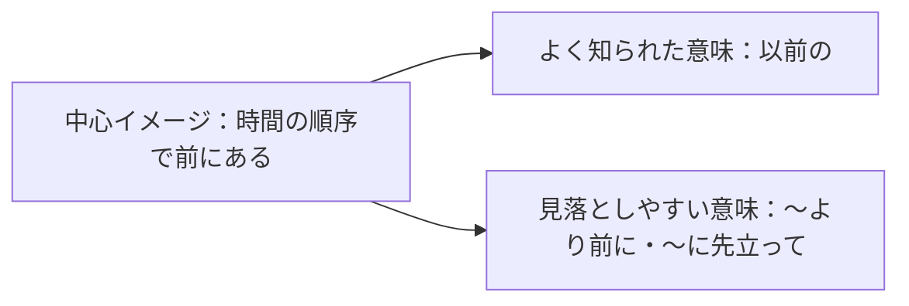

**重要語法**：`prior to + 名詞・動名詞`

---

## 882. corner

**品詞：** 動詞　**発音：** `/ˈkɔːrnər/`

<small>よく知られている意味：角・隅</small>

### 見落としやすい意味：人を追い詰めて逃げられなくする

**例文**：The reporter cornered the mayor with a difficult question.

**和訳**：記者は難しい質問で市長を追い詰めた。

**コアイメージの説明**：cornerはもともと隅や角を指す。そこへ相手を追い込んで動けなくするイメージから、質問などで人を追い詰めることにも使う。

**図**

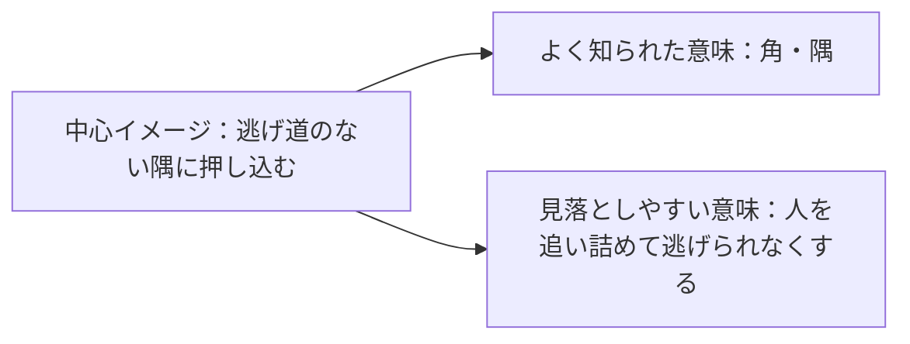

**重要語法**：`corner someone with a question`

---

## 883. host

**品詞：** 名詞　**発音：** `/hoʊst/`

<small>よく知られている意味：主催者・もてなす人</small>

### 見落としやすい意味：多数のもの、大勢

**例文**：A host of small problems delayed the launch.

**和訳**：数多くの小さな問題が公開を遅らせた。

**コアイメージの説明**：hostには「もてなす人」とは別に「多数」という名詞の意味がある。a host ofの形で大勢・多数を表し、主催者と訳さない。

**図**

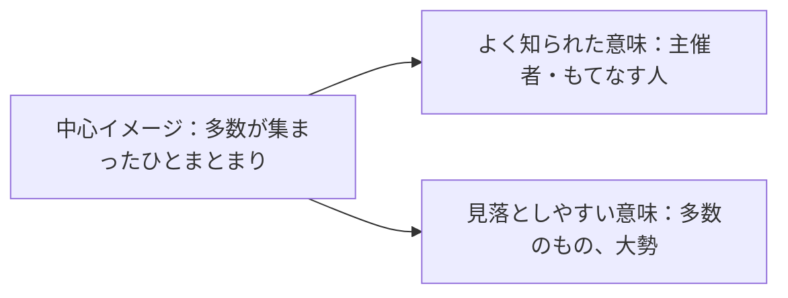

**重要語法**：`a host of + 複数名詞`

---

## 884. partner

**品詞：** 動詞　**発音：** `/ˈpɑːrtnər/`

<small>よく知られている意味：相棒・共同経営者</small>

### 見落としやすい意味：別の人や組織と協力関係を結ぶ

**例文**：Our school partnered with a local museum to organize a workshop.

**和訳**：私たちの学校は地元の博物館と協力して講座を開いた。

**コアイメージの説明**：partnerは一緒に組む相手を指す名詞として知られる。動詞になると、そのような協力関係を新しく結ぶ動きを表す。

**図**

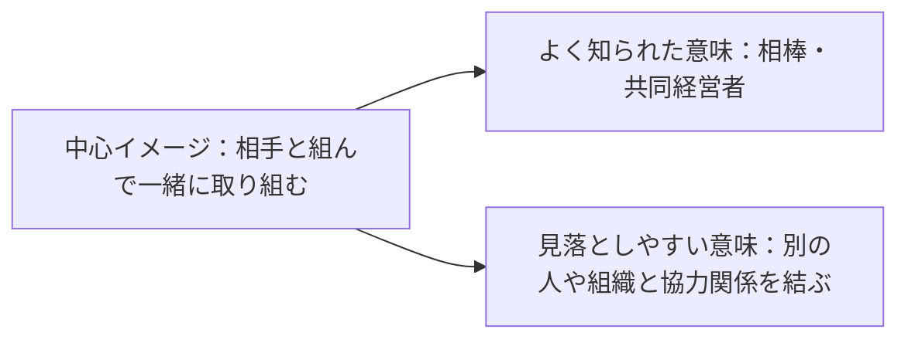

**重要語法**：`partner with + 人・組織`

---

## 885. urge

**品詞：** 名詞　**発音：** `/ɜːrdʒ/`

<small>よく知られている意味：強く促す</small>

### 見落としやすい意味：抑えがたい衝動・強い欲求

**例文**：I felt a sudden urge to laugh.

**和訳**：私は突然、笑いたい衝動に駆られた。

**コアイメージの説明**：urgeは人を強く促す動詞として使う。その力が自分の内側に生じると、抑えにくい衝動という名詞の意味になる。

**図**

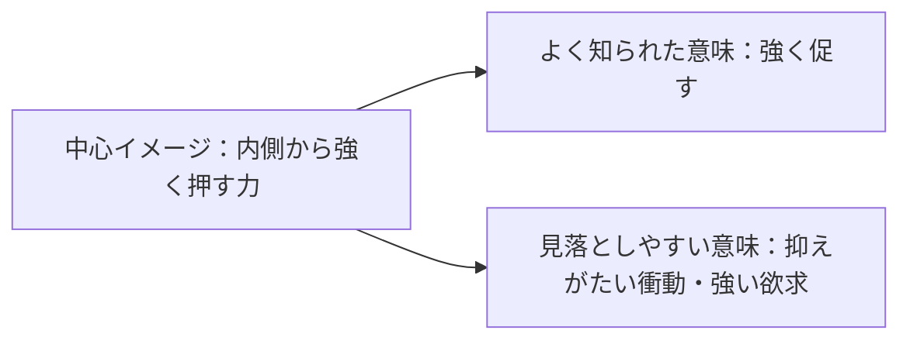

**重要語法**：`an urge to do`

---

## 886. spring

**品詞：** 名詞　**発音：** `/sprɪŋ/`

<small>よく知られている意味：春・跳ねる</small>

### 見落としやすい意味：地下から水が湧き出る場所、泉

**例文**：The village gets its water from a natural spring.

**和訳**：その村は天然の泉から水を得ている。

**コアイメージの説明**：springには勢いよく現れる・跳ね出す感覚がある。地中から水が湧き出す場所を指すと、泉という意味になる。

**図**

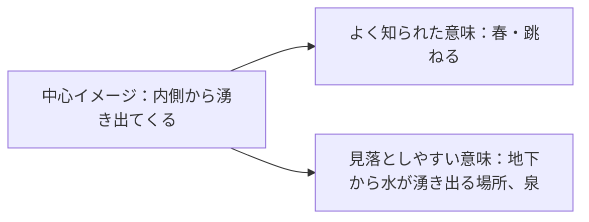

**重要語法**：`a natural spring`

---

## 887. handle

**品詞：** 名詞　**発音：** `/ˈhændəl/`

<small>よく知られている意味：取っ手・扱う</small>

### 見落としやすい意味：インターネット上の利用者名・ハンドルネーム

**例文**：Her social media handle is easy to remember.

**和訳**：彼女のSNSのユーザー名は覚えやすい。

**コアイメージの説明**：handleは物をつかむ取っ手を表す。ネット上では相手を呼び分けたり見つけたりするための名前を、比喩的にhandleという。

**図**

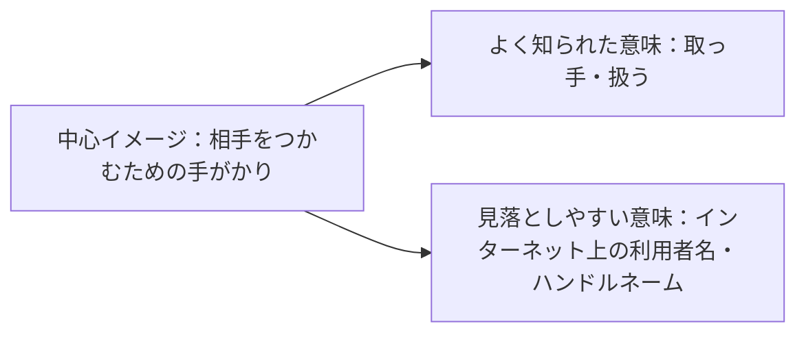

**重要語法**：`social media handle`

---

## 888. familiar

**品詞：** 構文・語法　**発音：** `/fəˈmɪliər/`

<small>よく知られている意味：なじみのある・親しい</small>

### 見落としやすい意味：知識を持っている／人に知られているの区別

**例文**：I am familiar with the author, but her name is not familiar to my classmates.

**和訳**：私はその作家をよく知っているが、彼女の名前はクラスメートにはなじみがない。

**コアイメージの説明**：familiarの中心には、よく知っていて身近に感じる関係がある。人が知識を持っているならfamiliar with、物や名前が人によく知られているならfamiliar toを使う。

**図**

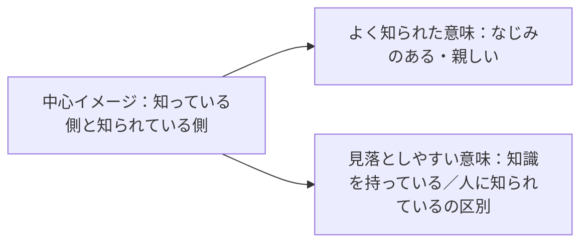

**重要語法**：`be familiar with + 対象；be familiar to + 人`

---

## 889. commitment

**品詞：** 名詞　**発音：** `/kəˈmɪtmənt/`

<small>よく知られている意味：決意・献身</small>

### 見落としやすい意味：責任を伴う約束・引き受けた義務

**例文**：Her volunteer commitments keep her busy on weekends.

**和訳**：引き受けているボランティア活動のため、彼女は週末忙しい。

**コアイメージの説明**：commitmentは単なる気持ちの強さだけではない。責任を持って引き受けた約束や活動そのものを指すこともある。

**図**

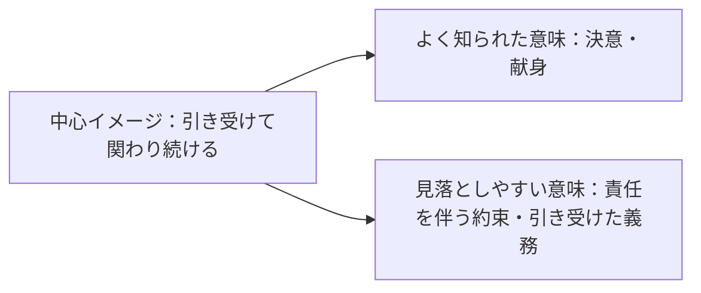

**重要語法**：`work commitments`

---

## 890. found

**品詞：** 動詞　**発音：** `/faʊnd/`

<small>よく知られている意味：findの過去形「見つけた」</small>

### 見落としやすい意味：組織・制度などを設立する

**例文**：They founded a small library in the town.

**和訳**：彼らはその町に小さな図書館を設立した。

**コアイメージの説明**：foundにはfindの過去形とは別に、組織や制度の土台を作る動詞がある。同じ綴りでも意味と活用が異なるため、文中で見分ける必要がある。

**図**

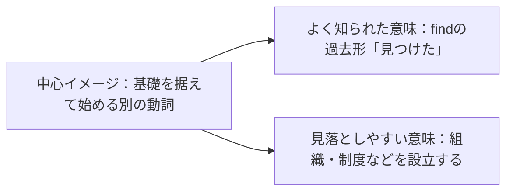

**重要語法**：`設立のfoundはfound–founded–founded`

---

## 891. found

**品詞：** 動詞　**発音：** `/faʊnd/`

<small>よく知られている意味：組織を設立する</small>

### 見落としやすい意味：考え・制度を〜に基づかせる

**例文**：The policy is founded on clear evidence.

**和訳**：その方針は明確な証拠に基づいている。

**コアイメージの説明**：組織をfoundするのは土台を据えて作ること。同じ発想で、考えや制度を証拠・原理の上に据えると「〜に基づかせる」になる。

**図**

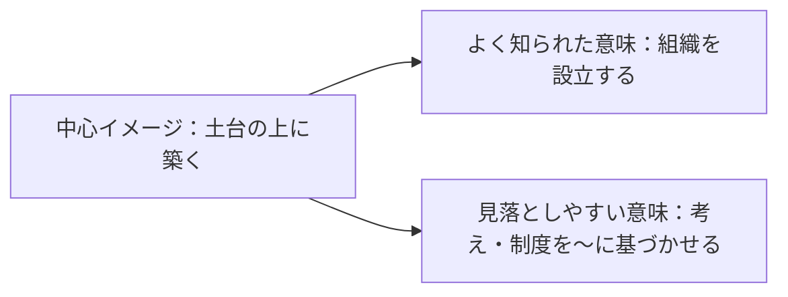

**重要語法**：`be founded on + 根拠`

---

## 892. opposite

**品詞：** 前置詞　**発音：** `/ˈɑːpəzɪt/`

<small>よく知られている意味：反対の・正反対の</small>

### 見落としやすい意味：〜の向かいに・〜と反対側に

**例文**：The cafe is opposite the library.

**和訳**：そのカフェは図書館の向かいにある。

**コアイメージの説明**：oppositeは性質が反対である場合にも、位置が向かい合う場合にも使う。前置詞として後ろに場所の名詞を置けば「〜の向かいに」と読める。

**図**

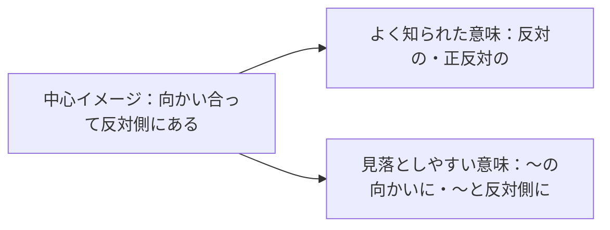

**重要語法**：`opposite + 場所の名詞`

---

## 893. threaten

**品詞：** 動詞　**発音：** `/ˈθretən/`

<small>よく知られている意味：脅す・脅迫する</small>

### 見落としやすい意味：悪いことが今にも起こりそうである

**例文**：The storm threatened to disrupt flights.

**和訳**：嵐によって航空便の運航が乱れるおそれがあった。

**コアイメージの説明**：threatenは誰かが脅迫するときだけの語ではない。嵐などの状況を主語にして、悪い結果が起こりそうなことを示す。

**図**

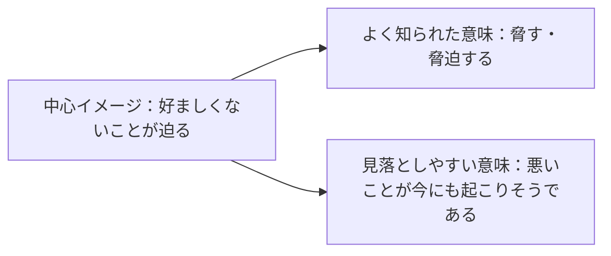

**重要語法**：`threaten to do`

---

## 894. fun

**品詞：** 形容詞　**発音：** `/fʌn/`

<small>よく知られている意味：楽しみ・娯楽</small>

### 見落としやすい意味：楽しい・愉快な

**例文**：That was a fun way to learn history.

**和訳**：それは歴史を学ぶ楽しい方法だった。

**コアイメージの説明**：funは名詞で「楽しみ」を表すのが基本。形容詞として人や活動を修飾すると、楽しさを感じさせる性質を表す。

**図**

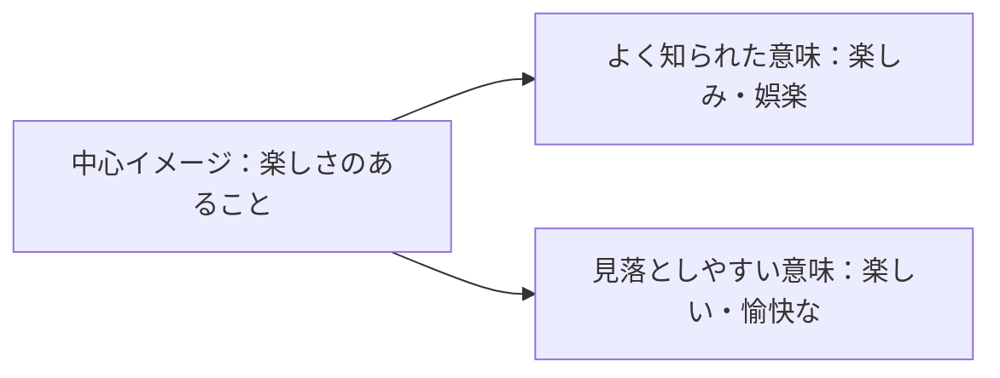

**重要語法**：`a fun activity`

---

## 895. engage

**品詞：** 句動詞　**発音：** `/ɪnˈɡeɪdʒ/`

<small>よく知られている意味：関心を引く・従事させる</small>

### 見落としやすい意味：活動や議論に積極的に関与する

**例文**：Many students engage in volunteer work.

**和訳**：多くの生徒がボランティア活動に積極的に参加している。

**コアイメージの説明**：engageには何かとしっかり関係を持つ感覚がある。engage inの形になると、活動に自ら関わって取り組むことを表す。

**図**

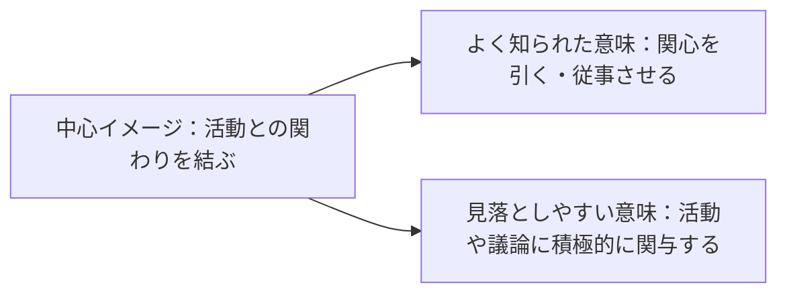

**重要語法**：`engage in + 名詞・動名詞`

---

## 896. plot

**品詞：** 名詞　**発音：** `/plɑːt/`

<small>よく知られている意味：物語の筋書き</small>

### 見落としやすい意味：区画された小さな土地、敷地

**例文**：They grow vegetables on a small plot behind the house.

**和訳**：彼らは家の裏の小さな区画で野菜を育てている。

**コアイメージの説明**：plotは物語の出来事の配置を指すほか、土地の一区画も指す。土地の文脈では、筋書きではなく境界で区切られた場所を思い浮かべる。

**図**

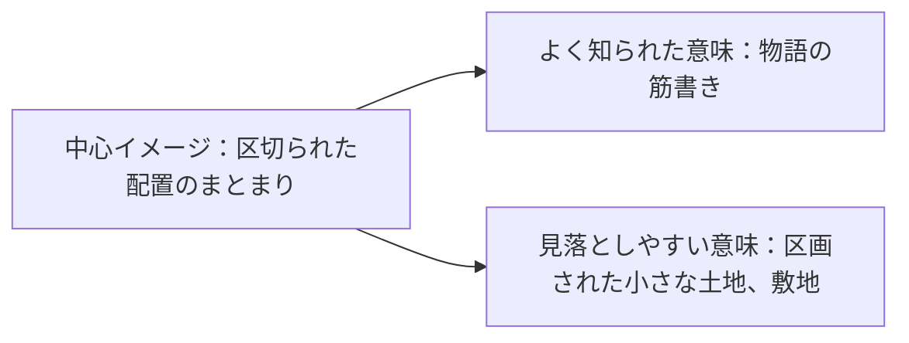

**重要語法**：`a plot of land`

---

## 897. plot

**品詞：** 動詞　**発音：** `/plɑːt/`

<small>よく知られている意味：筋書き・構想</small>

### 見落としやすい意味：秘密裏に計画する、たくらむ

**例文**：They plotted to replace the team leader.

**和訳**：彼らはチームのリーダーを交代させようとひそかに画策した。

**コアイメージの説明**：plotには出来事の流れを組み立てる意味がある。それを他人に知らせず進める行動に使うと「たくらむ・密かに計画する」になる。

**図**

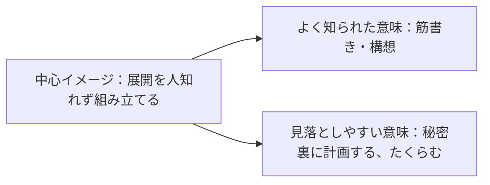

**重要語法**：`plot to do`

---

## 898. plot

**品詞：** 動詞　**発音：** `/plɑːt/`

<small>よく知られている意味：筋書き・構想</small>

### 見落としやすい意味：図表・地図上に数値や位置を書き入れる

**例文**：The students plotted the data on a graph.

**和訳**：生徒たちはグラフ上にデータを記入した。

**コアイメージの説明**：plotは要素の位置や関係を決めて示す働きがある。グラフでは数値を対応する位置に点として置くことを表す。

**図**

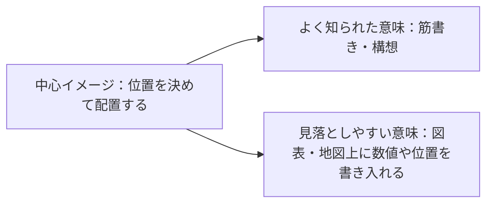

**重要語法**：`plot data on a graph`

---

## 899. settlement

**品詞：** 名詞　**発音：** `/ˈsetəlmənt/`

<small>よく知られている意味：居住地・入植地</small>

### 見落としやすい意味：対立・紛争を終わらせる和解・合意

**例文**：After months of talks, the two sides reached a settlement.

**和訳**：数か月の話し合いの末、双方は和解に達した。

**コアイメージの説明**：settleには揺れ動く状態を落ち着かせる感覚がある。争いの行方が定まって落ち着くと、settlementは和解や合意を表す。

**図**

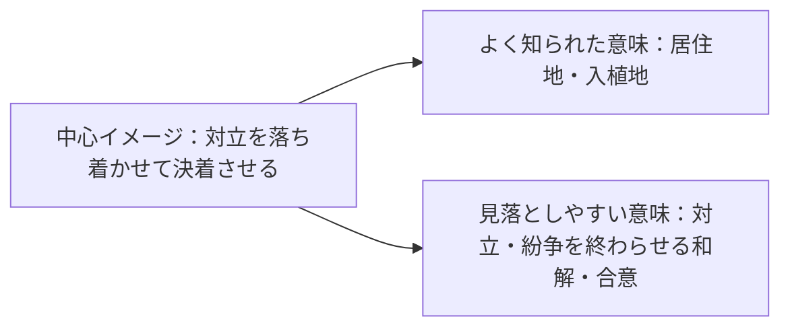

**重要語法**：`reach a settlement`

---

## 900. settlement

**品詞：** 名詞　**発音：** `/ˈsetəlmənt/`

<small>よく知られている意味：和解・解決</small>

### 見落としやすい意味：人が新たに住み着いて形成した入植地

**例文**：The settlement grew into a busy town.

**和訳**：その入植地はにぎやかな町へと発展した。

**コアイメージの説明**：settleは人がある場所に落ち着いて住み始めることも表す。その結果できた集落や入植地がsettlementである。

**図**

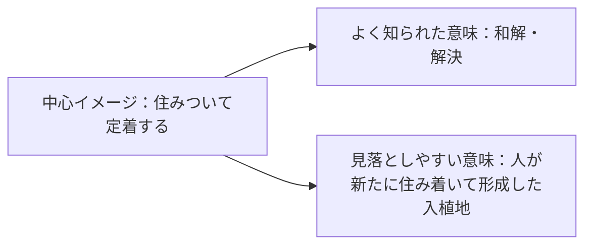

**重要語法**：`a new settlement`

---

## 901. bridge

**品詞：** 動詞　**発音：** `/brɪdʒ/`

<small>よく知られている意味：橋</small>

### 見落としやすい意味：対立や格差の隔たりを縮める

**例文**：The exchange program helped bridge the gap between the two communities.

**和訳**：その交流企画は二つの地域社会の隔たりを縮めるのに役立った。

**コアイメージの説明**：橋は離れた場所を結んで行き来を可能にする。そのイメージから、意見や立場の差を縮めることにもbridgeを使う。

**図**

```mermaid
flowchart LR
    A["中心イメージ：隔たりをつないで越える"]
    B["よく知られた意味：橋"]
    C["見落としやすい意味：対立や格差の隔たりを縮める"]
    A --> B
    A --> C
```

**重要語法**：`bridge the gap`

---

## 902. exhibit

**品詞：** 名詞　**発音：** `/ɪɡˈzɪbɪt/`

<small>よく知られている意味：展示する</small>

### 見落としやすい意味：博物館などで展示されている物・展示品

**例文**：The museum's newest exhibit is a model of an ancient ship.

**和訳**：その博物館の新しい展示品は古代船の模型だ。

**コアイメージの説明**：動詞のexhibitは物を見せること。名詞では実際に見せられている展示品を指すので、展示会全体と混同しない。

**図**

```mermaid
flowchart LR
    A["中心イメージ：人に見えるように示す"]
    B["よく知られた意味：展示する"]
    C["見落としやすい意味：博物館などで展示されている物・展示品"]
    A --> B
    A --> C
```

**重要語法**：`an exhibit at a museum`

---

## 903. voice

**品詞：** 動詞　**発音：** `/vɔɪs/`

<small>よく知られている意味：声・発声</small>

### 見落としやすい意味：意見や懸念を言葉にして表明する

**例文**：Several students voiced concerns about the schedule.

**和訳**：数人の生徒が日程について懸念を表明した。

**コアイメージの説明**：voiceは名詞では声そのものを指す。動詞では意見や心配を言葉にして他人に伝える行為を表す。

**図**

```mermaid
flowchart LR
    A["中心イメージ：考えを声として外に出す"]
    B["よく知られた意味：声・発声"]
    C["見落としやすい意味：意見や懸念を言葉にして表明する"]
    A --> B
    A --> C
```

**重要語法**：`voice concerns`

---

## 904. poll

**品詞：** 動詞　**発音：** `/poʊl/`

<small>よく知られている意味：世論調査（名詞）</small>

### 見落としやすい意味：世論調査を実施する・意見を集計する

**例文**：The newspaper polled 500 readers about the proposal.

**和訳**：新聞社はその提案について読者500人に意見を尋ねた。

**コアイメージの説明**：pollは集められた意見やその調査を指す名詞になる。動詞なら人々に質問し、その回答を集めることを表す。

**図**

```mermaid
flowchart LR
    A["中心イメージ：人々の意見を一人ずつ集める"]
    B["よく知られた意味：世論調査（名詞）"]
    C["見落としやすい意味：世論調査を実施する・意見を集計する"]
    A --> B
    A --> C
```

**重要語法**：`poll voters about an issue`

---

## 905. interested

**品詞：** 形容詞　**発音：** `/ˈɪntrəstɪd/`

<small>よく知られている意味：興味を持っている</small>

### 見落としやすい意味：利害関係を持つ・当事者である

**例文**：An interested party must disclose any financial ties.

**和訳**：利害関係のある当事者は金銭上のつながりを開示しなければならない。

**コアイメージの説明**：interestは好奇心だけでなく、利益や利害も表す。interested partyは単なる興味のある人ではなく、結果に利害関係を持つ当事者を指す。

**図**

```mermaid
flowchart LR
    A["中心イメージ：自分の利益や立場に関係する"]
    B["よく知られた意味：興味を持っている"]
    C["見落としやすい意味：利害関係を持つ・当事者である"]
    A --> B
    A --> C
```

**重要語法**：`an interested party`

---

## 906. sight

**品詞：** 名詞　**発音：** `/saɪt/`

<small>よく知られている意味：視力・視界</small>

### 見落としやすい意味：観光名所・見どころ

**例文**：We visited the main sights in Kyoto.

**和訳**：私たちは京都の主な観光名所を訪れた。

**コアイメージの説明**：sightは見る能力だけでなく、目に入るものにも使う。旅先で人々が見に行く対象なら、観光名所や見どころを意味する。

**図**

```mermaid
flowchart LR
    A["中心イメージ：目で見る対象"]
    B["よく知られた意味：視力・視界"]
    C["見落としやすい意味：観光名所・見どころ"]
    A --> B
    A --> C
```

**重要語法**：`see the sights`

---

## 907. please

**品詞：** 動詞　**発音：** `/pliːz/`

<small>よく知られている意味：どうぞ・お願いします</small>

### 見落としやすい意味：相手を喜ばせる、満足させる

**例文**：The simple design pleased the customers.

**和訳**：そのシンプルなデザインは顧客を喜ばせた。

**コアイメージの説明**：pleaseは依頼の丁寧な言葉としてよく見る。動詞として人を目的語に取ると、その人の望みにかなって満足させることを表す。

**図**

```mermaid
flowchart LR
    A["中心イメージ：望みを満たして喜ばせる"]
    B["よく知られた意味：どうぞ・お願いします"]
    C["見落としやすい意味：相手を喜ばせる、満足させる"]
    A --> B
    A --> C
```

**重要語法**：`please someone`

---

## 908. please

**品詞：** 動詞　**発音：** `/pliːz/`

<small>よく知られている意味：どうぞ・お願いします</small>

### 見落としやすい意味：自分の望むようにする

**例文**：You may arrange the chairs as you please.

**和訳**：椅子は好きなように並べてよい。

**コアイメージの説明**：pleaseは相手を満足させるだけでなく、本人が望むことにもつながる。as you pleaseでは「あなたの気に入るように」と自由な選択を表す。

**図**

```mermaid
flowchart LR
    A["中心イメージ：自分の望みにかなう"]
    B["よく知られた意味：どうぞ・お願いします"]
    C["見落としやすい意味：自分の望むようにする"]
    A --> B
    A --> C
```

**重要語法**：`as you please`

---

## 909. demonstrate

**品詞：** 動詞　**発音：** `/ˈdemənstreɪt/`

<small>よく知られている意味：実演する・見せる</small>

### 見落としやすい意味：データや実験により事実を立証する

**例文**：The results demonstrate that the method is effective.

**和訳**：その結果は、その方法が有効であることを示している。

**コアイメージの説明**：demonstrateは実演して見せるだけではない。データや証拠が事実をはっきり示す場合には「立証する」と訳す。

**図**

```mermaid
flowchart LR
    A["中心イメージ：確かめられる形で明らかにする"]
    B["よく知られた意味：実演する・見せる"]
    C["見落としやすい意味：データや実験により事実を立証する"]
    A --> B
    A --> C
```

**重要語法**：`demonstrate that + 文`

---

## 910. gas

**品詞：** 名詞　**発音：** `/ɡæs/`

<small>よく知られている意味：気体・ガス</small>

### 見落としやすい意味：ガソリン（特に米国英語）

**例文**：We need to stop for gas before the trip.

**和訳**：出発前にガソリンを入れるために立ち寄る必要がある。

**コアイメージの説明**：gasは気体一般を指す語だが、米国英語ではgasolineの略にもなる。車の給油について話しているなら、気体ではなくガソリンと読む。

**図**

```mermaid
flowchart LR
    A["中心イメージ：車用燃料を指す文脈"]
    B["よく知られた意味：気体・ガス"]
    C["見落としやすい意味：ガソリン（特に米国英語）"]
    A --> B
    A --> C
```

**重要語法**：`stop for gas（主に米国英語）`

---

## 911. score

**品詞：** 名詞　**発音：** `/skɔːr/`

<small>よく知られている意味：得点・点数</small>

### 見落としやすい意味：楽曲の総譜・映画などの音楽

**例文**：The composer showed us the score for the film.

**和訳**：作曲家はその映画の楽譜を見せてくれた。

**コアイメージの説明**：scoreは得点などの数値の記録として知られる。音楽では音符によって曲を記録した総譜を指し、映画の音楽そのものにも使われる。

**図**

```mermaid
flowchart LR
    A["中心イメージ：音や出来事を記号で記録する"]
    B["よく知られた意味：得点・点数"]
    C["見落としやすい意味：楽曲の総譜・映画などの音楽"]
    A --> B
    A --> C
```

**重要語法**：`musical score；film score`

---

## 912. encounter

**品詞：** 動詞　**発音：** `/ɪnˈkaʊntər/`

<small>よく知られている意味：偶然出会う</small>

### 見落としやすい意味：抵抗や困難に直面する

**例文**：We encountered several problems during the experiment.

**和訳**：実験中、私たちはいくつかの問題に直面した。

**コアイメージの説明**：encounterは人との出会いに限られない。進んでいる途中で予期しない困難や抵抗にぶつかる場面にも使う。

**図**

```mermaid
flowchart LR
    A["中心イメージ：進む先で何かにぶつかる"]
    B["よく知られた意味：偶然出会う"]
    C["見落としやすい意味：抵抗や困難に直面する"]
    A --> B
    A --> C
```

**重要語法**：`encounter difficulties`

---

## 913. scale

**品詞：** 動詞　**発音：** `/skeɪl/`

<small>よく知られている意味：規模・目盛り</small>

### 見落としやすい意味：険しい壁・崖などをよじ登る

**例文**：The climbers scaled the steep cliff.

**和訳**：登山者たちは険しい崖をよじ登った。

**コアイメージの説明**：scaleには規模や目盛りのほか、壁や崖をよじ登る動詞がある。綴りが同じでも尺度の意味から無理に訳さず、登る動作として捉える。

**図**

```mermaid
flowchart LR
    A["中心イメージ：高い場所へ一段ずつ上る"]
    B["よく知られた意味：規模・目盛り"]
    C["見落としやすい意味：険しい壁・崖などをよじ登る"]
    A --> B
    A --> C
```

**重要語法**：`scale a wall／a cliff`

---

## 914. phase

**品詞：** 句動詞　**発音：** `/feɪz/`

<small>よく知られている意味：段階・局面</small>

### 見落としやすい意味：少しずつ廃止・削減して最終的になくす

**例文**：The factory plans to phase out the old machines.

**和訳**：工場は古い機械を段階的に廃止する予定だ。

**コアイメージの説明**：phaseは一つひとつの段階を表す。phase outは段階を踏んで使用を減らし、最後になくすことを意味する。

**図**

```mermaid
flowchart LR
    A["中心イメージ：段階を追って移行させる"]
    B["よく知られた意味：段階・局面"]
    C["見落としやすい意味：少しずつ廃止・削減して最終的になくす"]
    A --> B
    A --> C
```

**重要語法**：`phase out + 物`

---

## 915. writing

**品詞：** 名詞　**発音：** `/ˈraɪtɪŋ/`

<small>よく知られている意味：書くこと・文章を書く行為</small>

### 見落としやすい意味：ある作家の著作・作品群

**例文**：Her early writings were published after her death.

**和訳**：彼女の初期の著作は死後に刊行された。

**コアイメージの説明**：writingは書く行為そのものを表す。書かれた成果に目を向けると作品や著作を意味し、とくに複数形writingsで使われる。

**図**

```mermaid
flowchart LR
    A["中心イメージ：書かれて残った成果"]
    B["よく知られた意味：書くこと・文章を書く行為"]
    C["見落としやすい意味：ある作家の著作・作品群"]
    A --> B
    A --> C
```

**重要語法**：`a writer's writings`

---

## 916. pool

**品詞：** 動詞　**発音：** `/puːl/`

<small>よく知られている意味：水たまり・プール</small>

### 見落としやすい意味：資金・知識・人員などを共同で出し合う

**例文**：The schools pooled their resources to buy new equipment.

**和訳**：複数の学校は資源を出し合って新しい設備を購入した。

**コアイメージの説明**：poolは水が一か所にたまった状態を表す。動詞では資金や知識などを集め、皆で使えるようにすることを意味する。

**図**

```mermaid
flowchart LR
    A["中心イメージ：別々のものを一か所に集める"]
    B["よく知られた意味：水たまり・プール"]
    C["見落としやすい意味：資金・知識・人員などを共同で出し合う"]
    A --> B
    A --> C
```

**重要語法**：`pool resources`

---

## 917. distribution

**品詞：** 名詞　**発音：** `/ˌdɪstrɪˈbjuːʃən/`

<small>よく知られている意味：配布・流通</small>

### 見落としやすい意味：統計量やデータの分布

**例文**：The graph shows the distribution of exam scores.

**和訳**：そのグラフは試験の得点分布を示している。

**コアイメージの説明**：distributionは物を配ることだけではない。数値がどこにどれほど集まるかという広がり方を、統計では分布という。

**図**

```mermaid
flowchart LR
    A["中心イメージ：全体にどう行き渡っているか"]
    B["よく知られた意味：配布・流通"]
    C["見落としやすい意味：統計量やデータの分布"]
    A --> B
    A --> C
```

**重要語法**：`score distribution`

---

## 918. ticket

**品詞：** 名詞　**発音：** `/ˈtɪkɪt/`

<small>よく知られている意味：乗車券・入場券</small>

### 見落としやすい意味：交通違反などの反則切符

**例文**：She got a ticket for parking in the wrong place.

**和訳**：彼女は駐車違反で反則切符を切られた。

**コアイメージの説明**：ticketは乗車券のように何かを示す券を指す。交通違反の場面では、違反を記録し通知する反則切符になる。

**図**

```mermaid
flowchart LR
    A["中心イメージ：公的に発行される記録や紙"]
    B["よく知られた意味：乗車券・入場券"]
    C["見落としやすい意味：交通違反などの反則切符"]
    A --> B
    A --> C
```

**重要語法**：`get a parking ticket`

---

## 919. round

**品詞：** 形容詞　**発音：** `/raʊnd/`

<small>よく知られている意味：丸い・円形の</small>

### 見落としやすい意味：（数字が）端数のない概数の

**例文**：The total came to a round number: 200.

**和訳**：合計は200という端数のない数字になった。

**コアイメージの説明**：roundは形が丸く角のないことを表す。数字では細かな端数がなく、100や200のようにきりのよい数を表す。

**図**

```mermaid
flowchart LR
    A["中心イメージ：端が整ってきりがよい"]
    B["よく知られた意味：丸い・円形の"]
    C["見落としやすい意味：（数字が）端数のない概数の"]
    A --> B
    A --> C
```

**重要語法**：`a round number`

---

## 920. mistake

**品詞：** 構文・語法　**発音：** `/mɪˈsteɪk/`

<small>よく知られている意味：間違い・失敗</small>

### 見落としやすい意味：AをBだと取り違える

**例文**：I mistook the visitor for the teacher.

**和訳**：私はその訪問者を先生だと取り違えた。

**コアイメージの説明**：mistakeは名詞の間違いだけでなく、何かを別のものだと誤認する動詞にもなる。A for Bの形で、AをBと取り違える関係がはっきりする。

**図**

```mermaid
flowchart LR
    A["中心イメージ：正体を誤って判断する"]
    B["よく知られた意味：間違い・失敗"]
    C["見落としやすい意味：AをBだと取り違える"]
    A --> B
    A --> C
```

**重要語法**：`mistake A for B`

---

## 921. stretch

**品詞：** 構文・語法　**発音：** `/stretʃ/`

<small>よく知られている意味：伸ばす・広がる</small>

### 見落としやすい意味：事実を誇張する・大げさに言う

**例文**：He stretched the truth to make the story sound exciting.

**和訳**：彼は話を面白くするために事実を誇張した。

**コアイメージの説明**：stretchは物理的に長く伸ばすことが基本。事実や説明を実際以上に広げると、誇張するという比喩になる。

**図**

```mermaid
flowchart LR
    A["中心イメージ：実際の範囲より引き伸ばす"]
    B["よく知られた意味：伸ばす・広がる"]
    C["見落としやすい意味：事実を誇張する・大げさに言う"]
    A --> B
    A --> C
```

**重要語法**：`stretch the truth`

---

## 922. stretch

**品詞：** 名詞　**発音：** `/stretʃ/`

<small>よく知られている意味：伸ばす・広がる</small>

### 見落としやすい意味：ひと続きの時間・道のり・区間

**例文**：We walked along a quiet stretch of beach.

**和訳**：私たちは静かな浜辺の一続きの区間を歩いた。

**コアイメージの説明**：stretchは長く伸びる状態を表す。名詞では道や時間などの一続きの部分を示し、長さのある一区間として捉える。

**図**

```mermaid
flowchart LR
    A["中心イメージ：途切れずに延びる部分"]
    B["よく知られた意味：伸ばす・広がる"]
    C["見落としやすい意味：ひと続きの時間・道のり・区間"]
    A --> B
    A --> C
```

**重要語法**：`a stretch of road／time`

---

## 923. retain

**品詞：** 動詞　**発音：** `/rɪˈteɪn/`

<small>よく知られている意味：保持する・維持する</small>

### 見落としやすい意味：弁護士などの専門家を報酬を払って雇う

**例文**：The company retained a lawyer to review the agreement.

**和訳**：その会社は契約書を確認してもらうため弁護士を雇った。

**コアイメージの説明**：retainには手元にとどめておく感覚がある。弁護士などの専門家について使うと、報酬を払って継続的に依頼する意味になる。

**図**

```mermaid
flowchart LR
    A["中心イメージ：専門家を手元に確保する"]
    B["よく知られた意味：保持する・維持する"]
    C["見落としやすい意味：弁護士などの専門家を報酬を払って雇う"]
    A --> B
    A --> C
```

**重要語法**：`retain a lawyer`

---

## 924. content

**品詞：** 形容詞　**発音：** `/kənˈtent/`

<small>よく知られている意味：内容・中身（名詞）</small>

### 見落としやすい意味：現状に満足している、これ以上を望まない

**例文**：She was content with a quiet evening at home.

**和訳**：彼女は家で静かに過ごす夜に満足していた。

**コアイメージの説明**：名詞のcontentは中身だが、形容詞は満たされて満足している状態を表す。形容詞では後半に強勢が来る点にも注意する。

**図**

```mermaid
flowchart LR
    A["中心イメージ：今あるもので十分に満たされる"]
    B["よく知られた意味：内容・中身（名詞）"]
    C["見落としやすい意味：現状に満足している、これ以上を望まない"]
    A --> B
    A --> C
```

**重要語法**：`be content with + 名詞；名詞contentは/ˈkɑːntent/`

---

## 925. double

**品詞：** 名詞　**発音：** `/ˈdʌbəl/`

<small>よく知られている意味：2倍の・2倍にする</small>

### 見落としやすい意味：そっくりな人物・代役

**例文**：The actor's double appeared in the action scene.

**和訳**：その俳優の代役がアクション場面に登場した。

**コアイメージの説明**：doubleは二つになることや二倍を表す。人について名詞で使うと、本人によく似て代わりを務める人物を指す。

**図**

```mermaid
flowchart LR
    A["中心イメージ：もう一人の似た存在"]
    B["よく知られた意味：2倍の・2倍にする"]
    C["見落としやすい意味：そっくりな人物・代役"]
    A --> B
    A --> C
```

**重要語法**：`a stunt double`

---

## 926. fit

**品詞：** 名詞　**発音：** `/fɪt/`

<small>よく知られている意味：合う・適した</small>

### 見落としやすい意味：感情・笑いなどが急激に起こる短い一時期

**例文**：The joke sent us into a fit of laughter.

**和訳**：その冗談を聞いて、私たちはひとしきり笑い出した。

**コアイメージの説明**：fitには「合う」とは別に、感情や笑いが急に起こる一時期を指す名詞がある。a fit of laughterでは、笑いの発作のようなひとしきりの状態を表す。

**図**

```mermaid
flowchart LR
    A["中心イメージ：短く激しく起こる状態"]
    B["よく知られた意味：合う・適した"]
    C["見落としやすい意味：感情・笑いなどが急激に起こる短い一時期"]
    A --> B
    A --> C
```

**重要語法**：`a fit of laughter`

---

## 927. safe

**品詞：** 名詞　**発音：** `/seɪf/`

<small>よく知られている意味：安全な</small>

### 見落としやすい意味：貴重品を保管する金庫

**例文**：She kept the documents in a safe.

**和訳**：彼女はその書類を金庫に保管した。

**コアイメージの説明**：safeは危険がない状態を表す形容詞。名詞になると、貴重品を安全に保管する金庫を指す。

**図**

```mermaid
flowchart LR
    A["中心イメージ：大切なものを安全に守る場所"]
    B["よく知られた意味：安全な"]
    C["見落としやすい意味：貴重品を保管する金庫"]
    A --> B
    A --> C
```

**重要語法**：`keep valuables in a safe`

---

## 928. debt

**品詞：** 構文・語法　**発音：** `/det/`

<small>よく知られている意味：借金・負債</small>

### 見落としやすい意味：相手に恩義がある・感謝の借りがある

**例文**：I owe her a debt of gratitude.

**和訳**：私は彼女に深い恩義を感じている。

**コアイメージの説明**：debtは金銭上の借りを表す。感謝や恩義について使うと、相手に返しきれないほど助けてもらった気持ちを表す。

**図**

```mermaid
flowchart LR
    A["中心イメージ：返すべきものを負っている"]
    B["よく知られた意味：借金・負債"]
    C["見落としやすい意味：相手に恩義がある・感謝の借りがある"]
    A --> B
    A --> C
```

**重要語法**：`owe someone a debt of gratitude`

---

## 929. academic

**品詞：** 形容詞　**発音：** `/ˌækəˈdemɪk/`

<small>よく知られている意味：学問の・学術的な</small>

### 見落としやすい意味：現実的な意味を持たない・机上の問題にすぎない

**例文**：The question is academic now that the decision has been made.

**和訳**：もう決定が下されたので、その問題は今となっては机上の話にすぎない。

**コアイメージの説明**：academicは学問に関することを表す。実用上の結論に影響しない議論については、単なる理論上の問題という意味になる。

**図**

```mermaid
flowchart LR
    A["中心イメージ：現実の実行から離れた理論上の話"]
    B["よく知られた意味：学問の・学術的な"]
    C["見落としやすい意味：現実的な意味を持たない・机上の問題にすぎない"]
    A --> B
    A --> C
```

**重要語法**：`a purely academic question`

---

## 930. fast

**品詞：** 副詞・形容詞　**発音：** `/fæst/`

<small>よく知られている意味：速い・速く</small>

### 見落としやすい意味：しっかり固定されて、固く

**例文**：Hold fast to the rope.

**和訳**：ロープをしっかりつかんでいなさい。

**コアイメージの説明**：fastには速さとは別に、固く固定されているという古くからの意味がある。hold fastでは「速く持つ」ではなく「しっかり離さず持つ」と読む。

**図**

```mermaid
flowchart LR
    A["中心イメージ：動かないほどしっかり固定する"]
    B["よく知られた意味：速い・速く"]
    C["見落としやすい意味：しっかり固定されて、固く"]
    A --> B
    A --> C
```

**重要語法**：`hold fast to + 名詞`

---

## 931. fast

**品詞：** 名詞　**発音：** `/fæst/`

<small>よく知られている意味：速い・速く</small>

### 見落としやすい意味：断食する期間、断食という行為

**例文**：She observed a fast during the festival.

**和訳**：彼女は祭りの期間に断食を行った。

**コアイメージの説明**：名詞のfastは速さではなく、一定期間食事を控えることを表す。速いという形容詞とは別の語義として、食事の文脈から判断する。

**図**

```mermaid
flowchart LR
    A["中心イメージ：食事を控える期間や行為"]
    B["よく知られた意味：速い・速く"]
    C["見落としやすい意味：断食する期間、断食という行為"]
    A --> B
    A --> C
```

**重要語法**：`observe a fast`

---

## 932. fast

**品詞：** 動詞　**発音：** `/fæst/`

<small>よく知られている意味：速い・速く</small>

### 見落としやすい意味：一定期間食べ物を取らない

**例文**：Some people fast for religious reasons.

**和訳**：宗教上の理由で断食する人もいる。

**コアイメージの説明**：fastは動詞として食事を控えることを表す。速く動く意味ではないので、目的語がなくても文脈から「断食する」と捉える。

**図**

```mermaid
flowchart LR
    A["中心イメージ：一定期間食べ物を取らない"]
    B["よく知られた意味：速い・速く"]
    C["見落としやすい意味：一定期間食べ物を取らない"]
    A --> B
    A --> C
```

**重要語法**：`fast for a period`

---

## 933. crash

**品詞：** 構文・語法　**発音：** `/kræʃ/`

<small>よく知られている意味：衝突・墜落</small>

### 見落としやすい意味：短期集中の講習・入門講座

**例文**：I took a crash course in basic coding.

**和訳**：私はプログラミング基礎の短期集中講座を受けた。

**コアイメージの説明**：crashには勢いの強い出来事という感覚がある。crash courseでは短い時間に学習内容を一気に詰め込む集中講座を指す。

**図**

```mermaid
flowchart LR
    A["中心イメージ：短時間に集中的に詰め込む"]
    B["よく知られた意味：衝突・墜落"]
    C["見落としやすい意味：短期集中の講習・入門講座"]
    A --> B
    A --> C
```

**重要語法**：`a crash course in + 分野`

---

## 934. crash

**品詞：** 動詞　**発音：** `/kræʃ/`

<small>よく知られている意味：衝突する</small>

### 見落としやすい意味：コンピューターやプログラムが突然停止する

**例文**：My laptop crashed before I saved the file.

**和訳**：保存する前にノートパソコンが突然動かなくなった。

**コアイメージの説明**：crashは物がぶつかるだけでなく、正常に動いていた仕組みが急に停止することにも使う。コンピューターでは故障やプログラムの異常終了を表す。

**図**

```mermaid
flowchart LR
    A["中心イメージ：動きが突然止まる"]
    B["よく知られた意味：衝突する"]
    C["見落としやすい意味：コンピューターやプログラムが突然停止する"]
    A --> B
    A --> C
```

**重要語法**：`the system crashed`

---

## 935. contribute

**品詞：** 句動詞　**発音：** `/kənˈtrɪbjuːt/`

<small>よく知られている意味：寄付する・貢献する</small>

### 見落としやすい意味：結果や問題の一因となる

**例文**：Lack of sleep can contribute to poor concentration.

**和訳**：睡眠不足は集中力の低下の一因になり得る。

**コアイメージの説明**：contributeは何かを差し出して全体に加えることを表す。その一つが結果を生む要因なら、問題などの一因となる意味になる。

**図**

```mermaid
flowchart LR
    A["中心イメージ：結果に一つの要因を加える"]
    B["よく知られた意味：寄付する・貢献する"]
    C["見落としやすい意味：結果や問題の一因となる"]
    A --> B
    A --> C
```

**重要語法**：`contribute to + 名詞・動名詞`

---

## 936. shoot

**品詞：** 動詞　**発音：** `/ʃuːt/`

<small>よく知られている意味：撃つ・発射する</small>

### 見落としやすい意味：映画・写真などを撮影する

**例文**：They shot the documentary in the mountains.

**和訳**：彼らは山中でそのドキュメンタリーを撮影した。

**コアイメージの説明**：shootは発射することだけでなく、カメラで映像や写真を撮ることにも使う。映画制作の文脈では「撮影する」と捉える。

**図**

```mermaid
flowchart LR
    A["中心イメージ：カメラで対象を捉える"]
    B["よく知られた意味：撃つ・発射する"]
    C["見落としやすい意味：映画・写真などを撮影する"]
    A --> B
    A --> C
```

**重要語法**：`shoot a film`

---

## 937. promote

**品詞：** 動詞　**発音：** `/prəˈmoʊt/`

<small>よく知られている意味：促進する・宣伝する</small>

### 見落としやすい意味：社員を昇進させる

**例文**：The company promoted her to manager.

**和訳**：会社は彼女をマネージャーに昇進させた。

**コアイメージの説明**：promoteは進みを促すだけでなく、人を高い地位へ引き上げることにも使う。職位の変化が示されると昇進させる意味になる。

**図**

```mermaid
flowchart LR
    A["中心イメージ：より上の段階に押し上げる"]
    B["よく知られた意味：促進する・宣伝する"]
    C["見落としやすい意味：社員を昇進させる"]
    A --> B
    A --> C
```

**重要語法**：`promote A to B`

---

## 938. celebrate

**品詞：** 動詞　**発音：** `/ˈseləbreɪt/`

<small>よく知られている意味：祝う</small>

### 見落としやすい意味：作品や人物の価値を称賛してたたえる

**例文**：The exhibition celebrates the work of local artists.

**和訳**：その展覧会は地元の芸術家たちの作品をたたえている。

**コアイメージの説明**：celebrateは特別な日を祝うだけではない。人物や作品のすばらしさを広く認め、称賛することにも使う。

**図**

```mermaid
flowchart LR
    A["中心イメージ：価値を認めて称える"]
    B["よく知られた意味：祝う"]
    C["見落としやすい意味：作品や人物の価値を称賛してたたえる"]
    A --> B
    A --> C
```

**重要語法**：`celebrate someone's achievements`

---

## 939. plane

**品詞：** 名詞　**発音：** `/pleɪn/`

<small>よく知られている意味：飛行機</small>

### 見落としやすい意味：数学・幾何学での平面

**例文**：The points all lie on the same plane.

**和訳**：その点はすべて同じ平面上にある。

**コアイメージの説明**：planeは飛行機の略称として目にすることが多い。幾何学では厚みのない平らな広がりを表し、平面と訳す。

**図**

```mermaid
flowchart LR
    A["中心イメージ：平らに広がる面"]
    B["よく知られた意味：飛行機"]
    C["見落としやすい意味：数学・幾何学での平面"]
    A --> B
    A --> C
```

**重要語法**：`a plane in geometry`

---

## 940. forward

**品詞：** 動詞　**発音：** `/ˈfɔːrwərd/`

<small>よく知られている意味：前方へ・前の方の</small>

### 見落としやすい意味：受け取った手紙・メールを別の人へ転送する

**例文**：Please forward the message to the whole team.

**和訳**：そのメッセージをチーム全員に転送してください。

**コアイメージの説明**：forwardには前へ進める感覚がある。情報を対象にした動詞では、受け取った内容を別の宛先へ送ることを表す。

**図**

```mermaid
flowchart LR
    A["中心イメージ：受け取ったものを先へ送る"]
    B["よく知られた意味：前方へ・前の方の"]
    C["見落としやすい意味：受け取った手紙・メールを別の人へ転送する"]
    A --> B
    A --> C
```

**重要語法**：`forward an email to someone`

---

## 941. shot

**品詞：** 名詞　**発音：** `/ʃɑːt/`

<small>よく知られている意味：発砲・写真の一枚</small>

### 見落としやすい意味：一度の試み・成功のチャンス

**例文**：Give the puzzle another shot.

**和訳**：そのパズルにもう一度挑戦してみて。

**コアイメージの説明**：shotは何かを一度行うまとまりを表すことがある。give it a shotの形では成功を狙って一度試す、という意味になる。

**図**

```mermaid
flowchart LR
    A["中心イメージ：一回狙って試す"]
    B["よく知られた意味：発砲・写真の一枚"]
    C["見落としやすい意味：一度の試み・成功のチャンス"]
    A --> B
    A --> C
```

**重要語法**：`give it a shot`

---

## 942. hardly

**品詞：** 構文・語法　**発音：** `/ˈhɑːrdli/`

<small>よく知られている意味：ほとんど〜ない</small>

### 見落としやすい意味：〜するや否やすぐに

**例文**：Hardly had I sat down when the phone rang.

**和訳**：私が腰を下ろすや否や電話が鳴った。

**コアイメージの説明**：hardlyは程度がほとんどないことを表す。その感覚を時間に移すと、最初の動作の直後に次の出来事が起こるという構文になる。

**図**

```mermaid
flowchart LR
    A["中心イメージ：一つの動作が終わるか終わらないか"]
    B["よく知られた意味：ほとんど〜ない"]
    C["見落としやすい意味：〜するや否やすぐに"]
    A --> B
    A --> C
```

**重要語法**：`Hardly had S 過去分詞 when S V（文頭倒置）`

---

## 943. tie

**品詞：** 動詞　**発音：** `/taɪ/`

<small>よく知られている意味：結ぶ・ネクタイ</small>

### 見落としやすい意味：競技などで同点になる

**例文**：The two teams tied 2–2.

**和訳**：両チームは2対2で引き分けた。

**コアイメージの説明**：tieは二つのものを結びつけることを表す。競技では得点などが同じになって優劣がつかない状態を表す。

**図**

```mermaid
flowchart LR
    A["中心イメージ：結果が同じ位置で並ぶ"]
    B["よく知られた意味：結ぶ・ネクタイ"]
    C["見落としやすい意味：競技などで同点になる"]
    A --> B
    A --> C
```

**重要語法**：`tie with another team`

---

## 944. song

**品詞：** 構文・語法　**発音：** `/sɔːŋ/`

<small>よく知られている意味：歌</small>

### 見落としやすい意味：ごく安い値段で

**例文**：I bought the used desk for a song.

**和訳**：私は中古の机を破格の安さで買った。

**コアイメージの説明**：songはふつう歌を意味するが、for a songという慣用句では非常に安い値段を表す。実際に歌で支払うわけではないので、句全体で覚える。

**図**

```mermaid
flowchart LR
    A["中心イメージ：歌一曲ほどの小さな対価"]
    B["よく知られた意味：歌"]
    C["見落としやすい意味：ごく安い値段で"]
    A --> B
    A --> C
```

**重要語法**：`for a song`

---

## 945. abandon

**品詞：** 名詞　**発音：** `/əˈbændən/`

<small>よく知られている意味：捨てる・放棄する</small>

### 見落としやすい意味：我を忘れた奔放さ・遠慮のなさ

**例文**：The children danced with joyful abandon.

**和訳**：子どもたちは我を忘れて楽しそうに踊った。

**コアイメージの説明**：abandonは何かを手放す動詞として知られる。名詞では遠慮や自制を手放した自由奔放な状態を表す。

**図**

```mermaid
flowchart LR
    A["中心イメージ：自分を抑える気持ちを手放す"]
    B["よく知られた意味：捨てる・放棄する"]
    C["見落としやすい意味：我を忘れた奔放さ・遠慮のなさ"]
    A --> B
    A --> C
```

**重要語法**：`with joyful abandon`

---

## 946. allowance

**品詞：** 構文・語法　**発音：** `/əˈlaʊəns/`

<small>よく知られている意味：小遣い・手当</small>

### 見落としやすい意味：相手の事情・条件を考慮して判断する

**例文**：We should make allowances for his lack of experience.

**和訳**：私たちは彼の経験不足を考慮して判断すべきだ。

**コアイメージの説明**：allowanceには何かを認めて一定の余裕を与える感覚がある。make allowances forは相手の事情を考慮に入れて評価することを表す。

**図**

```mermaid
flowchart LR
    A["中心イメージ：事情を受け入れる余地を設ける"]
    B["よく知られた意味：小遣い・手当"]
    C["見落としやすい意味：相手の事情・条件を考慮して判断する"]
    A --> B
    A --> C
```

**重要語法**：`make allowances for + 事情`

---

## 947. asset

**品詞：** 名詞　**発音：** `/ˈæset/`

<small>よく知られている意味：資産・財産</small>

### 見落としやすい意味：人や組織の長所・貴重な強み

**例文**：Her patience is a real asset to the team.

**和訳**：彼女の忍耐強さはチームにとって大きな強みだ。

**コアイメージの説明**：assetはお金で評価できる財産だけではない。人の能力や性格も、組織に価値をもたらすならassetと呼べる。

**図**

```mermaid
flowchart LR
    A["中心イメージ：価値や利益をもたらすもの"]
    B["よく知られた意味：資産・財産"]
    C["見落としやすい意味：人や組織の長所・貴重な強み"]
    A --> B
    A --> C
```

**重要語法**：`an asset to + 人・組織`

---

## 948. wealth

**品詞：** 構文・語法　**発音：** `/welθ/`

<small>よく知られている意味：富・財産</small>

### 見落としやすい意味：非常に豊富な量の〜

**例文**：The library offers a wealth of information.

**和訳**：その図書館には豊富な情報がある。

**コアイメージの説明**：wealthはお金の豊かさを表す。a wealth ofでは対象をお金に限らず、情報や経験などが非常に多いことを表す。

**図**

```mermaid
flowchart LR
    A["中心イメージ：豊かに蓄積された量"]
    B["よく知られた意味：富・財産"]
    C["見落としやすい意味：非常に豊富な量の〜"]
    A --> B
    A --> C
```

**重要語法**：`a wealth of + 名詞`

---

## 949. interior

**品詞：** 名詞　**発音：** `/ɪnˈtɪriər/`

<small>よく知られている意味：内部・内側</small>

### 見落としやすい意味：国・地域の内陸部

**例文**：The expedition traveled deep into the island's interior.

**和訳**：探検隊は島の奥深い内陸部まで進んだ。

**コアイメージの説明**：interiorは物の内側を表す。国や島のように広い地域について使うと、海岸や国境から離れた内陸部を指す。

**図**

```mermaid
flowchart LR
    A["中心イメージ：外縁から離れた内側"]
    B["よく知られた意味：内部・内側"]
    C["見落としやすい意味：国・地域の内陸部"]
    A --> B
    A --> C
```

**重要語法**：`the interior of a country`

---

## 950. exercise

**品詞：** 動詞　**発音：** `/ˈeksərsaɪz/`

<small>よく知られている意味：運動・練習</small>

### 見落としやすい意味：権利・権限などを行使する

**例文**：The committee exercised its authority to approve the plan.

**和訳**：委員会は計画を承認する権限を行使した。

**コアイメージの説明**：exerciseは体を動かすことだけに限られない。権利や権限など、備わっている力を実際に使う場合にも用いる。

**図**

```mermaid
flowchart LR
    A["中心イメージ：持っている力を実際に使う"]
    B["よく知られた意味：運動・練習"]
    C["見落としやすい意味：権利・権限などを行使する"]
    A --> B
    A --> C
```

**重要語法**：`exercise one's rights／authority`

---

## 951. largely

**品詞：** 副詞　**発音：** `/ˈlɑːrdʒli/`

<small>よく知られている意味：大きく</small>

### 見落としやすい意味：主として・大部分は

**例文**：The plan was largely successful.

**和訳**：その計画はおおむね成功した。

**コアイメージの説明**：largelyは単に物理的な大きさを表すわけではない。ある判断が全体の大部分に当てはまるとき「主として・おおむね」となる。

**図**

```mermaid
flowchart LR
    A["中心イメージ：全体の大きな部分を占める"]
    B["よく知られた意味：大きく"]
    C["見落としやすい意味：主として・大部分は"]
    A --> B
    A --> C
```

**重要語法**：`largely due to`

---

## 952. husband

**品詞：** 動詞　**発音：** `/ˈhʌzbənd/`

<small>よく知られている意味：夫</small>

### 見落としやすい意味：資源や金銭などを慎重に節約して使う

**例文**：We must husband our limited water supply.

**和訳**：私たちは限られた水を大切に使わなければならない。

**コアイメージの説明**：husbandには夫という名詞のほか、資源を慎重に管理する動詞がある。動詞ではむだ遣いを避け、残りを大切に使う意味になる。

**図**

```mermaid
flowchart LR
    A["中心イメージ：資源を管理して守る"]
    B["よく知られた意味：夫"]
    C["見落としやすい意味：資源や金銭などを慎重に節約して使う"]
    A --> B
    A --> C
```

**重要語法**：`husband resources（やや硬い表現）`

---

## 953. plus

**品詞：** 名詞　**発音：** `/plʌs/`

<small>よく知られている意味：足す・プラスの</small>

### 見落としやすい意味：追加の利点・好ましい点

**例文**：The extra storage space is a big plus.

**和訳**：収納スペースが増えることは大きな利点だ。

**コアイメージの説明**：plusは何かを加えることを表す。名詞では、全体に加わって評価を高める好ましい点を指す。

**図**

```mermaid
flowchart LR
    A["中心イメージ：加わることでよくなる点"]
    B["よく知られた意味：足す・プラスの"]
    C["見落としやすい意味：追加の利点・好ましい点"]
    A --> B
    A --> C
```

**重要語法**：`a big plus`

---

## 954. bomb

**品詞：** 動詞　**発音：** `/bɑːm/`

<small>よく知られている意味：爆弾</small>

### 見落としやすい意味：映画・催しなどが大失敗する（口語）

**例文**：The show bombed despite the publicity.

**和訳**：宣伝にもかかわらず、その公演は大失敗した。

**コアイメージの説明**：bombは爆弾という名詞として知られる。特に米国英語の口語で公演や作品に使うと、評判や売り上げが大失敗することを表す。

**図**

```mermaid
flowchart LR
    A["中心イメージ：期待が一気に崩れる"]
    B["よく知られた意味：爆弾"]
    C["見落としやすい意味：映画・催しなどが大失敗する（口語）"]
    A --> B
    A --> C
```

**重要語法**：`bomb（口語・主に米国英語）`

---

## 955. harbor

**品詞：** 動詞　**発音：** `/ˈhɑːrbər/`

<small>よく知られている意味：港</small>

### 見落としやすい意味：疑念・敵意・希望などを心中に抱く

**例文**：She harbored doubts about the plan.

**和訳**：彼女はその計画に疑念を抱いていた。

**コアイメージの説明**：港は船を内側に受け入れて留める場所。動詞のharborは心の中に考えや疑念を抱き続けることにも使う。

**図**

```mermaid
flowchart LR
    A["中心イメージ：内側に受け入れてとどめる"]
    B["よく知られた意味：港"]
    C["見落としやすい意味：疑念・敵意・希望などを心中に抱く"]
    A --> B
    A --> C
```

**重要語法**：`harbor doubts／resentment`

---

## 956. extent

**品詞：** 構文・語法　**発音：** `/ɪkˈstent/`

<small>よく知られている意味：程度・広がり</small>

### 見落としやすい意味：〜する範囲で・〜という限度において

**例文**：To the extent that I can help, I will.

**和訳**：私にできる範囲では協力するつもりだ。

**コアイメージの説明**：extentは物事がどこまで広がるかという範囲を表す。to the extent thatは、ある条件が成り立つ限度に話を限定する構文になる。

**図**

```mermaid
flowchart LR
    A["中心イメージ：及ぶ範囲や限界を定める"]
    B["よく知られた意味：程度・広がり"]
    C["見落としやすい意味：〜する範囲で・〜という限度において"]
    A --> B
    A --> C
```

**重要語法**：`to the extent that + 文`

---

## 957. memory

**品詞：** 構文・語法　**発音：** `/ˈmeməri/`

<small>よく知られている意味：記憶・思い出</small>

### 見落としやすい意味：亡くなった人を追悼して

**例文**：The garden was created in memory of her grandfather.

**和訳**：その庭は彼女の祖父を追悼して造られた。

**コアイメージの説明**：memoryは過去の出来事を心に残すことを表す。in memory ofは、亡くなった人を忘れずに思い起こすための行為を示す。

**図**

```mermaid
flowchart LR
    A["中心イメージ：亡くなった人を心にとどめる"]
    B["よく知られた意味：記憶・思い出"]
    C["見落としやすい意味：亡くなった人を追悼して"]
    A --> B
    A --> C
```

**重要語法**：`in memory of + 故人`

---

## 958. wind

**品詞：** 動詞　**発音：** `/waɪnd/`

<small>よく知られている意味：風（名詞、/wɪnd/）</small>

### 見落としやすい意味：巻く、巻き付ける、曲がりくねる

**例文**：The road winds through the hills.

**和訳**：その道は丘の間を縫うように曲がりくねっている。

**コアイメージの説明**：windは風を意味するときと、巻いたり蛇行したりする動詞とで読みが異なる。同じ綴りでも、動詞では曲線を描きながら続く動きを思い浮かべる。

**図**

```mermaid
flowchart LR
    A["中心イメージ：巻くように曲線を描く"]
    B["よく知られた意味：風（名詞、/wɪnd/）"]
    C["見落としやすい意味：巻く、巻き付ける、曲がりくねる"]
    A --> B
    A --> C
```

**重要語法**：`動詞は/waɪnd/；名詞「風」は/wɪnd/`

---

## 959. cash

**品詞：** 動詞　**発音：** `/kæʃ/`

<small>よく知られている意味：現金</small>

### 見落としやすい意味：小切手などを現金に換える

**例文**：Can I cash this check here?

**和訳**：ここでこの小切手を現金に換えられますか。

**コアイメージの説明**：cashはお金そのものを指す名詞として知られる。動詞では小切手などを現金に換えて受け取ることを表す。

**図**

```mermaid
flowchart LR
    A["中心イメージ：現金として受け取れる形にする"]
    B["よく知られた意味：現金"]
    C["見落としやすい意味：小切手などを現金に換える"]
    A --> B
    A --> C
```

**重要語法**：`cash a check（英式綴りはcheque）`

---

## 960. warn

**品詞：** 構文・語法　**発音：** `/wɔːrn/`

<small>よく知られている意味：警告する・注意する</small>

### 見落としやすい意味：〜をしないよう注意・警告する

**例文**：The guide warned us against walking on the thin ice.

**和訳**：ガイドは薄い氷の上を歩かないよう私たちに警告した。

**コアイメージの説明**：warnは危険を前もって知らせることを表す。warn someone against doingでは、危険を避けるため特定の行動をしないよう注意する。

**図**

```mermaid
flowchart LR
    A["中心イメージ：危険を知らせて行動を止める"]
    B["よく知られた意味：警告する・注意する"]
    C["見落としやすい意味：〜をしないよう注意・警告する"]
    A --> B
    A --> C
```

**重要語法**：`warn someone against doing`

---
