# EasyVoca｜完成教材・バッチ013

> 対象：採用済み語義の global_order 961〜1040（80件）。本教材は採用済み候補のみを対象とし、新たな語義の追加・採否変更はしていません。

## 961. neighborhood

**品詞：** 構文・定型表現　｜　**発音：** /ˈneɪbərhʊd/

<small>よく知られている意味：近所、地域</small>

### 見落としやすい意味

**（数値が）およそ〜の**

**例文**

> The project will cost in the neighborhood of $500.

**和訳**

その計画にはおよそ500ドルかかるだろう。

**コアイメージ**

neighborhood は、ある場所に近い一帯を指す。数値に使うと、その値の近くにある範囲、つまり「およそ」を表す。

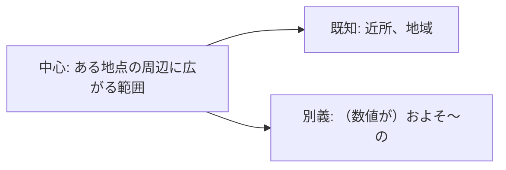

**重要語法**

- `in the neighborhood of + 数値`

---

## 962. relative

**品詞：** 形容詞　｜　**発音：** /ˈrelətɪv/

<small>よく知られている意味：相対的な</small>

### 見落としやすい意味

**〜と比較して、〜を基準とした**

**例文**

> The results look impressive relative to last year's figures.

**和訳**

昨年の数値と比較すると、その結果は印象的だ。

**コアイメージ**

relative は単独で決まるのではなく、何かを基準として位置づける感覚を持つ。relative to を使うと、何と比べているかがはっきりする。

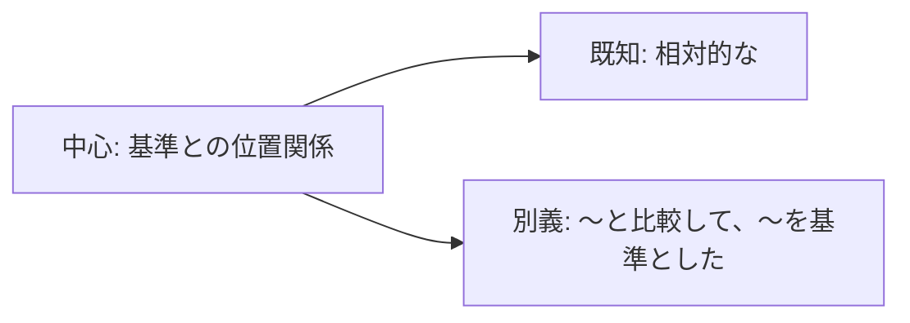

**重要語法**

- `relative to ...`

---

## 963. hearing

**品詞：** 名詞　｜　**発音：** /ˈhɪrɪŋ/

<small>よく知られている意味：聴力、聞こえること</small>

### 見落としやすい意味

**意見聴取のための公聴会・裁判の審理**

**例文**

> The city held a public hearing on the new airport.

**和訳**

市は新しい空港について公聴会を開いた。

**コアイメージ**

hearing の中心は「聞くこと」。公的な場で関係者の説明や意見を聞く手続きにも広がり、公聴会や審理を表す。

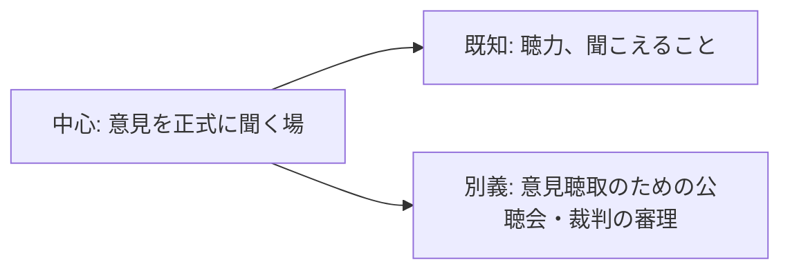

**重要語法**

- `a public hearing`

---

## 964. expense

**品詞：** 構文・定型表現　｜　**発音：** /ɪkˈspens/

<small>よく知られている意味：費用、出費</small>

### 見落としやすい意味

**〜を犠牲にして・〜と引き換えに**

**例文**

> He worked long hours at the expense of his health.

**和訳**

彼は健康を犠牲にして長時間働いた。

**コアイメージ**

expense は金銭の支出だけでなく、何かのために失うものにも使える。at the expense of は、ある利益の裏で別のものが犠牲になる関係を表す。

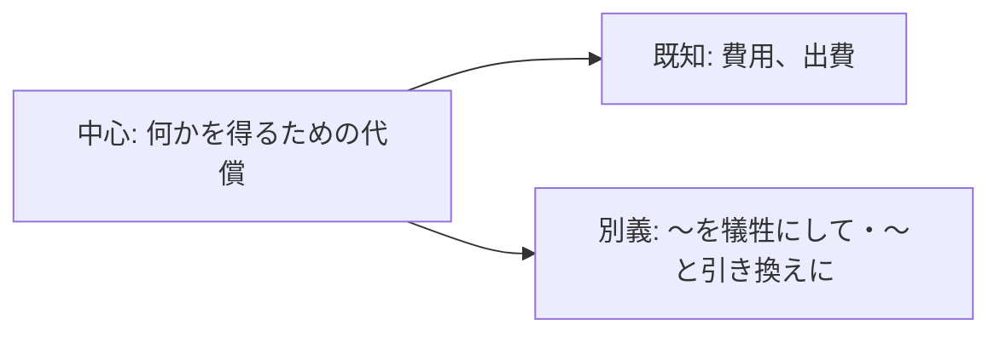

**重要語法**

- `at the expense of ...`

---

## 965. quarter

**品詞：** 名詞　｜　**発音：** /ˈkwɔːrtər/

<small>よく知られている意味：4分の1、四半期</small>

### 見落としやすい意味

**人々・方面・出所（特定の集団を指す）**

**例文**

> The proposal drew criticism from several quarters.

**和訳**

その提案にはさまざまな方面から批判が寄せられた。

**コアイメージ**

quarter は全体を区切った一区画という発想を持つ。そこから、社会のある一角にいる人々や、意見の出所を指す使い方が生まれる。

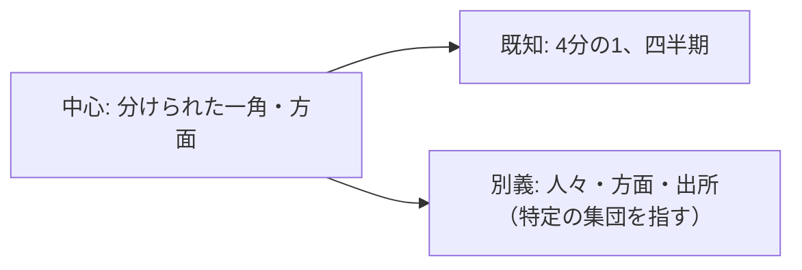

**重要語法**

- `from several quarters`

---

## 966. command

**品詞：** 名詞　｜　**発音：** /kəˈmænd/

<small>よく知られている意味：命令、指揮</small>

### 見落としやすい意味

**言語や技術を自在に使いこなす能力**

**例文**

> She has an excellent command of Spanish.

**和訳**

彼女はスペイン語を非常によく使いこなせる。

**コアイメージ**

command は相手や物事を統制することが中心。言語や技能について使えば、思いどおりに使いこなす能力になる。

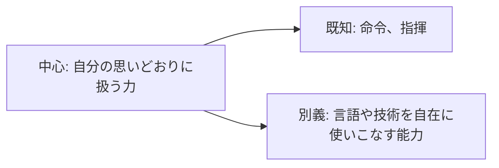

**重要語法**

- `have a good command of ...`

---

## 967. wave

**品詞：** 名詞　｜　**発音：** /weɪv/

<small>よく知られている意味：波</small>

### 見落としやすい意味

**出来事が一時期に集中して起こること、相次ぐ一連の出来事**

**例文**

> A wave of protests spread across the country.

**和訳**

一連の抗議活動が全国に広がった。

**コアイメージ**

波は一度で終わらず、まとまった動きとして押し寄せる。出来事にも同じ姿を重ねることで、短期間に続いて起こる事態を表す。

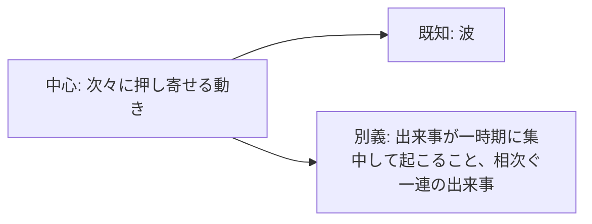

**重要語法**

- `a wave of ...`

---

## 968. traffic

**品詞：** 名詞　｜　**発音：** /ˈtræfɪk/

<small>よく知られている意味：交通、交通量</small>

### 見落としやすい意味

**ウェブサイトなどへの訪問・閲覧量**

**例文**

> The website gets most of its traffic from mobile users.

**和訳**

そのウェブサイトへのアクセスの大半はモバイル利用者によるものだ。

**コアイメージ**

traffic は道路を行き交う車などの流れを表す。インターネットでも、サイトへ人が訪れる流れや量を指す。

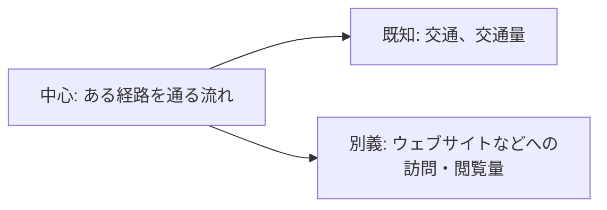

**重要語法**

- `website traffic`

---

## 969. rare

**品詞：** 形容詞　｜　**発音：** /rer/

<small>よく知られている意味：珍しい、まれな</small>

### 見落としやすい意味

**肉の焼き加減が浅い・レアの**

**例文**

> I'd like my steak rare, please.

**和訳**

ステーキはレアでお願いします。

**コアイメージ**

rare には「普通ほど多くない」という感覚がある。肉の焼き加減では、火が通る程度が少ない状態を指す。

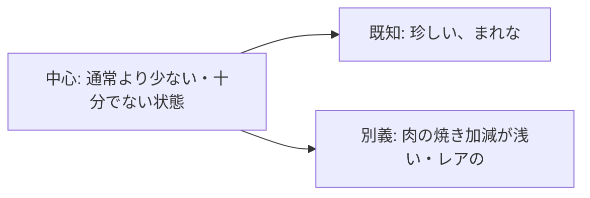

**重要語法**

- `rare / medium / well-done`

---

## 970. concentration

**品詞：** 名詞　｜　**発音：** /ˌkɑːnsənˈtreɪʃən/

<small>よく知られている意味：集中、集中力</small>

### 見落としやすい意味

**物質が溶液などに含まれる濃度**

**例文**

> The lake has a high concentration of salt.

**和訳**

その湖は塩分濃度が高い。

**コアイメージ**

concentration は対象が一か所に集まることを表す。物質については、一定の量の中にどれだけ含まれているか、つまり濃度になる。

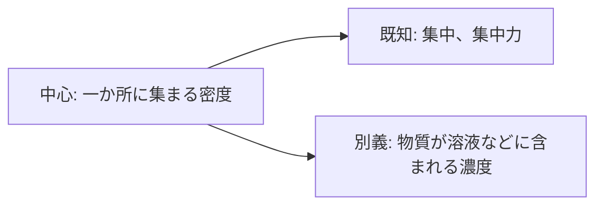

**重要語法**

- `a high concentration of ...`

---

## 971. climb

**品詞：** 動詞　｜　**発音：** /klaɪm/

<small>よく知られている意味：登る</small>

### 見落としやすい意味

**数値・価格などが上昇する**

**例文**

> Food prices continued to climb throughout the summer.

**和訳**

夏の間、食品価格は上がり続けた。

**コアイメージ**

climb は山や階段を上に進む動き。数値を高さに見立てれば、価格や割合が上昇することにも使える。

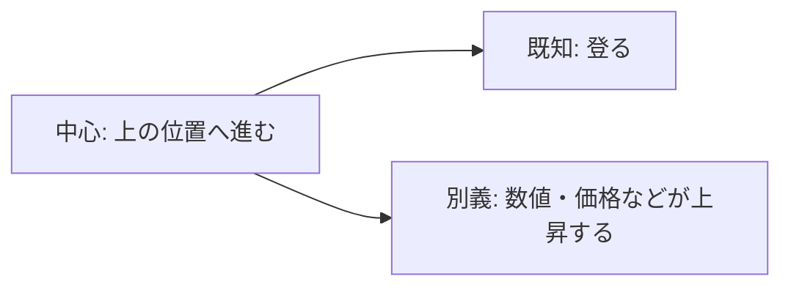

**重要語法**

- `prices climb`

---

## 972. pilot

**品詞：** 動詞　｜　**発音：** /ˈpaɪlət/

<small>よく知られている意味：操縦士、パイロット</small>

### 見落としやすい意味

**新しい制度・製品を試験的に実施する**

**例文**

> The school will pilot a new timetable next term.

**和訳**

その学校は来学期、新しい時間割を試験導入する。

**コアイメージ**

pilot は進路を導く人という意味から、物事を試しに動かす動詞にもなる。制度や計画を小規模で実施して確かめる場面で使う。

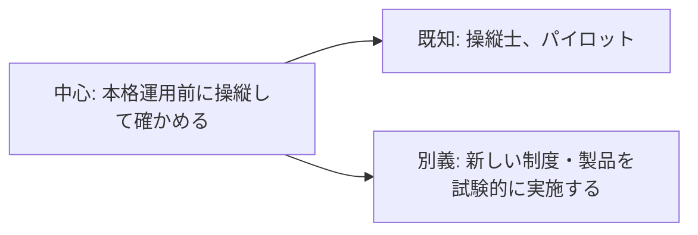

**重要語法**

- `pilot a program`

---

## 973. speaker

**品詞：** 名詞　｜　**発音：** /ˈspiːkər/

<small>よく知られている意味：話し手、演説者</small>

### 見落としやすい意味

**議会などの議長**

**例文**

> The Speaker called the members to order.

**和訳**

議長は議員たちに静粛を求めた。

**コアイメージ**

speaker は文字どおり話す人を表す。議会では発言や進行を管理する役職名として、議長を意味する。

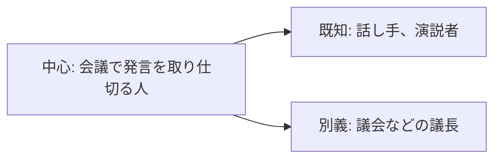

**重要語法**

- `the Speaker of the House`

---

## 974. manner

**品詞：** 名詞　｜　**発音：** /ˈmænər/

<small>よく知られている意味：方法、やり方</small>

### 見落としやすい意味

**礼儀・作法・行儀（複数形）**

**例文**

> Children learn good manners by watching adults.

**和訳**

子どもは大人を見て礼儀作法を学ぶ。

**コアイメージ**

manner は物事をする方法だけでなく、人がどう振る舞うかにも使う。複数形 manners は、社会的に望ましい振る舞い方、つまり礼儀作法を表す。

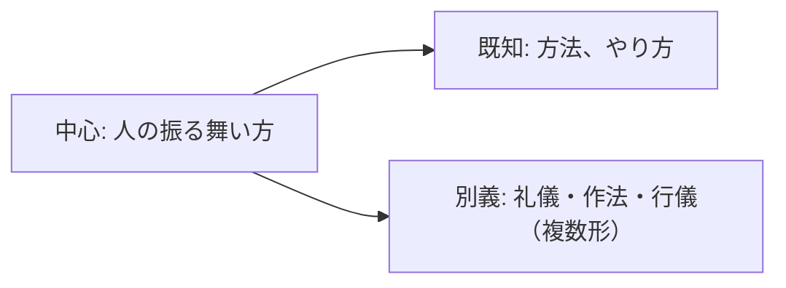

**重要語法**

- `good manners`

---

## 975. feeling

**品詞：** 名詞　｜　**発音：** /ˈfiːlɪŋ/

<small>よく知られている意味：感情、気持ち</small>

### 見落としやすい意味

**証拠はないがそう思う直感・予感**

**例文**

> I have a feeling that we're missing something.

**和訳**

何かを見落としているような気がする。

**コアイメージ**

feeling は心の中で感じることが中心。理由をはっきり説明できなくても、何となくそう思う直感や予感を指せる。

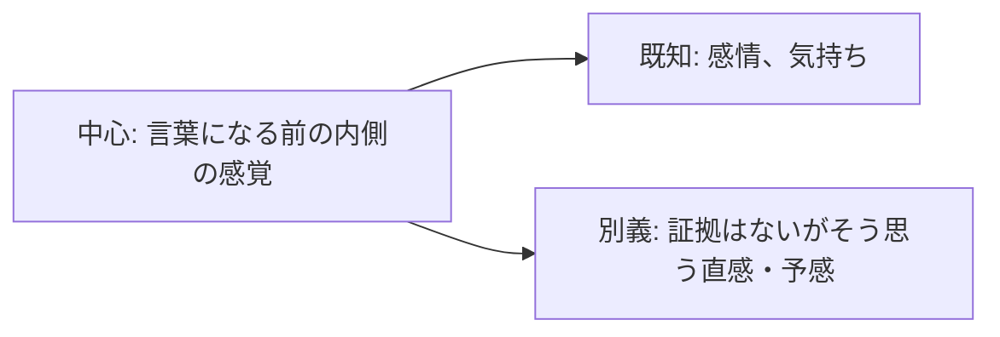

**重要語法**

- `have a feeling that ...`

---

## 976. hall

**品詞：** 名詞　｜　**発音：** /hɔːl/

<small>よく知られている意味：ホール、大広間</small>

### 見落としやすい意味

**建物内の廊下・通路（特に米国英語）**

**例文**

> The library is just down the hall.

**和訳**

図書館はこの廊下を少し進んだところにある。

**コアイメージ**

hall は建物内部の共有空間を表す。特に米国英語では、部屋をつなぐ細長い通路、つまり廊下にも使う。

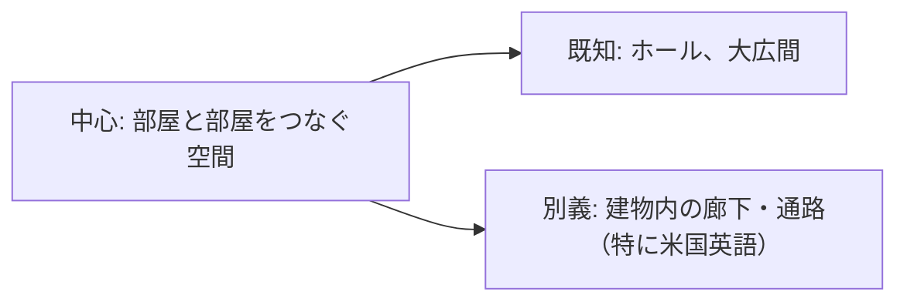

**重要語法**

- `down the hall（主に米国英語）`

---

## 977. welcome

**品詞：** 形容詞　｜　**発音：** /ˈwelkəm/

<small>よく知られている意味：歓迎する</small>

### 見落としやすい意味

**好ましい・ありがたい**

**例文**

> The rain brought a welcome change in the weather.

**和訳**

雨のおかげで天候がありがたい方向に変わった。

**コアイメージ**

welcome は何かを喜んで迎えることを表す。形容詞になると、受け入れたいと思うほど好ましい・ありがたいという意味になる。

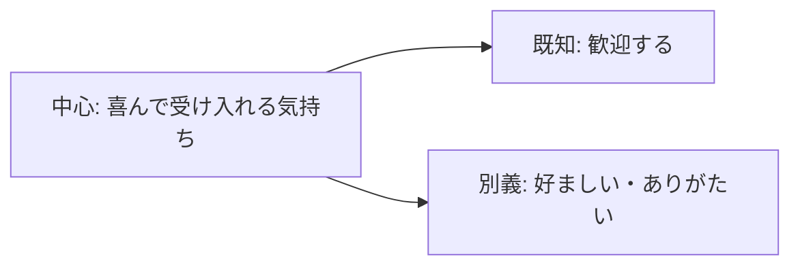

**重要語法**

- `a welcome change`

---

## 978. blue

**品詞：** 形容詞　｜　**発音：** /bluː/

<small>よく知られている意味：青い</small>

### 見落としやすい意味

**憂鬱な、悲しい気持ちの**

**例文**

> He felt blue after saying goodbye to his friends.

**和訳**

友人たちと別れたあと、彼は気分が沈んだ。

**コアイメージ**

blue は色の名前だが、気持ちが沈んだ状態を表す慣用的な意味もある。色から感情への意味の広がりとして覚えるとよい。

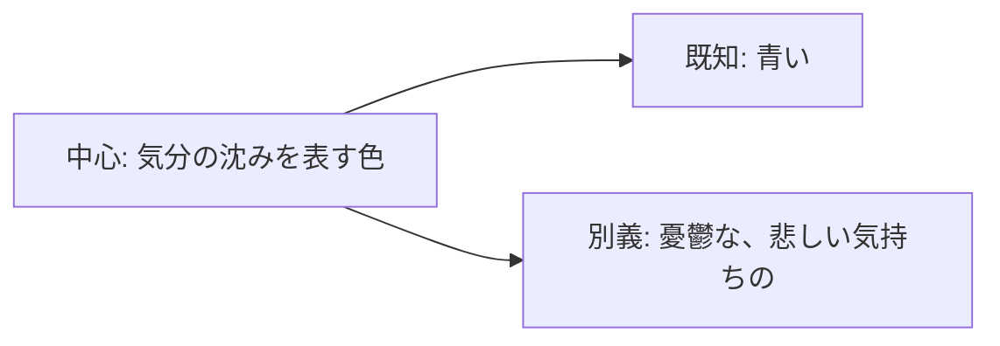

**重要語法**

- `feel blue`

---

## 979. ready

**品詞：** 構文・定型表現　｜　**発音：** /ˈredi/

<small>よく知られている意味：準備ができている</small>

### 見落としやすい意味

**今にも〜しそうな状態である**

**例文**

> The old fence looks ready to fall over.

**和訳**

その古い柵は今にも倒れそうに見える。

**コアイメージ**

ready は行動のための条件が整っていることを表す。望ましくない出来事でも、今にも起こりそうな状態を指すことがある。

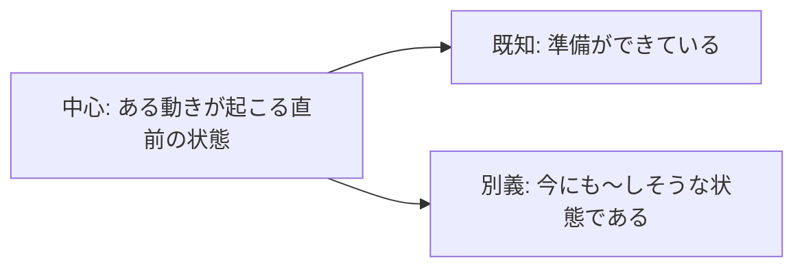

**重要語法**

- `be ready to do`

---

## 980. pursue

**品詞：** 動詞　｜　**発音：** /pərˈsuː/

<small>よく知られている意味：追いかける、追求する</small>

### 見落としやすい意味

**ある問題・案の検討をさらに進める**

**例文**

> We should pursue this question further before deciding.

**和訳**

決定する前にこの問題をさらに検討すべきだ。

**コアイメージ**

pursue は対象を追い続ける動きが中心。問題や考えを追っていけば、調査や検討をさらに進めるという意味になる。

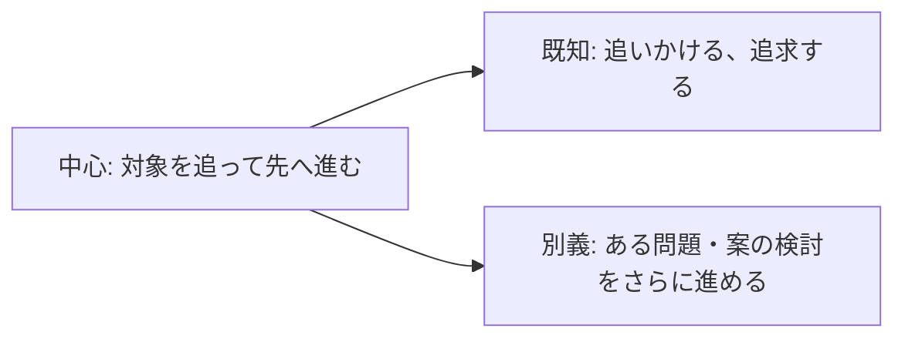

**重要語法**

- `pursue an issue further`

---

## 981. honor

**品詞：** 動詞　｜　**発音：** /ˈɑːnər/

<small>よく知られている意味：名誉、敬意</small>

### 見落としやすい意味

**約束・契約・支払義務などを守る**

**例文**

> The company promised to honor all existing contracts.

**和訳**

その会社は既存の契約をすべて守ると約束した。

**コアイメージ**

honor は人や物事の価値を尊重することが中心。約束や契約については、それを軽んじず実際に履行するという意味になる。

```mermaid
flowchart LR
    A["中心: 言葉や約束に価値を認める"]
    B["既知: 名誉、敬意"]
    C["別義: 約束・契約・支払義務などを守る"]
    A --> B
    A --> C
```

**重要語法**

- `honor a contract`

---

## 982. spirit

**品詞：** 名詞　｜　**発音：** /ˈspɪrɪt/

<small>よく知られている意味：精神、気持ち</small>

### 見落としやすい意味

**法律・規則の字面ではなく、その根本的な趣旨**

**例文**

> The rule follows the letter but not the spirit of the law.

**和訳**

その規則は法律の文言には沿っているが、その趣旨には沿っていない。

**コアイメージ**

spirit は人の内面を表す語だが、規則にも中心となる考えがある。法律の言葉そのものではなく、何を実現しようとするかという趣旨を指す。

```mermaid
flowchart LR
    A["中心: 表面の奥にある本質"]
    B["既知: 精神、気持ち"]
    C["別義: 法律・規則の字面ではなく、その根本的な趣旨"]
    A --> B
    A --> C
```

**重要語法**

- `the spirit of the law`

---

## 983. beat

**品詞：** 形容詞　｜　**発音：** /biːt/

<small>よく知られている意味：打つ、打ち負かす</small>

### 見落としやすい意味

**へとへとに疲れた（口語）**

**例文**

> I'm completely beat after the long hike.

**和訳**

長いハイキングのあとで、私はへとへとだ。

**コアイメージ**

beat は打たれる・打ち負かされることにも関係する。口語の形容詞では、力を使い切って負けたような疲労感を表す。

```mermaid
flowchart LR
    A["中心: 力を使い果たした状態"]
    B["既知: 打つ、打ち負かす"]
    C["別義: へとへとに疲れた（口語）"]
    A --> B
    A --> C
```

**重要語法**

- `be beat（口語）`

---

## 984. flower

**品詞：** 動詞　｜　**発音：** /ˈflaʊər/

<small>よく知られている意味：花</small>

### 見落としやすい意味

**花を咲かせる、開花する**

**例文**

> These trees flower early in spring.

**和訳**

これらの木は春先に花を咲かせる。

**コアイメージ**

flower は名詞では花そのものを指す。動詞になると、植物が花を開くという出来事を表す。

```mermaid
flowchart LR
    A["中心: 花が開く"]
    B["既知: 花"]
    C["別義: 花を咲かせる、開花する"]
    A --> B
    A --> C
```

**重要語法**

- `flower in spring`

---

## 985. flower

**品詞：** 動詞　｜　**発音：** /ˈflaʊər/

<small>よく知られている意味：花</small>

### 見落としやすい意味

**才能などが開花し、十分に発達する**

**例文**

> Her talent began to flower at university.

**和訳**

彼女の才能は大学時代に開花し始めた。

**コアイメージ**

植物が花を咲かせるように、内側で育ったものが表に現れる感覚。才能や文化が十分に伸びることにも flower を使える。

```mermaid
flowchart LR
    A["中心: 内にある力が花開く"]
    B["既知: 花"]
    C["別義: 才能などが開花し、十分に発達する"]
    A --> B
    A --> C
```

**重要語法**

- `talent flowers`

---

## 986. burden

**品詞：** 動詞　｜　**発音：** /ˈbɜːrdən/

<small>よく知られている意味：重荷、負担</small>

### 見落としやすい意味

**人に負担や責任を背負わせる**

**例文**

> The new rules burden small firms with extra paperwork.

**和訳**

新しい規則は小企業に追加の書類仕事を負わせる。

**コアイメージ**

burden は重荷を意味する名詞。動詞ではその重荷を誰かに載せることになり、仕事や責任などの負担を負わせる意味になる。

```mermaid
flowchart LR
    A["中心: 重いものを背負わせる"]
    B["既知: 重荷、負担"]
    C["別義: 人に負担や責任を背負わせる"]
    A --> B
    A --> C
```

**重要語法**

- `burden A with B`

---

## 987. advise

**品詞：** 動詞　｜　**発音：** /ədˈvaɪz/

<small>よく知られている意味：助言する</small>

### 見落としやすい意味

**人に情報・決定などを正式に通知する**

**例文**

> Please advise us of any changes to your address.

**和訳**

住所に変更があればお知らせください。

**コアイメージ**

advise は人に何かを伝えて判断を助けることが中心。改まった文脈では、助言でなく情報や決定を正式に通知することを表す。

```mermaid
flowchart LR
    A["中心: 必要な情報を伝える"]
    B["既知: 助言する"]
    C["別義: 人に情報・決定などを正式に通知する"]
    A --> B
    A --> C
```

**重要語法**

- `advise A of B`

---

## 988. text

**品詞：** 動詞　｜　**発音：** /tekst/

<small>よく知られている意味：文章、文字</small>

### 見落としやすい意味

**文字メッセージを送信する**

**例文**

> Text me when you get home.

**和訳**

家に着いたらメッセージを送ってね。

**コアイメージ**

text はもともと文字で書かれたものを指す。動詞になると、文字を使ったメッセージを送信する行為を意味する。

```mermaid
flowchart LR
    A["中心: 文字でやり取りする"]
    B["既知: 文章、文字"]
    C["別義: 文字メッセージを送信する"]
    A --> B
    A --> C
```

**重要語法**

- `text someone`

---

## 989. distance

**品詞：** 動詞　｜　**発音：** /ˈdɪstəns/

<small>よく知られている意味：距離</small>

### 見落としやすい意味

**人や団体から意図的に距離を置き関係を断つ**

**例文**

> The group distanced itself from the candidate's remarks.

**和訳**

その団体は候補者の発言から距離を置いた。

**コアイメージ**

distance は物理的な隔たりを表す。動詞として人や主張との関係に使えば、支持や関係を断って距離を置くことを指す。

```mermaid
flowchart LR
    A["中心: 関係に間隔を作る"]
    B["既知: 距離"]
    C["別義: 人や団体から意図的に距離を置き関係を断つ"]
    A --> B
    A --> C
```

**重要語法**

- `distance oneself from ...`

---

## 990. positive

**品詞：** 形容詞　｜　**発音：** /ˈpɑːzətɪv/

<small>よく知られている意味：前向きな、肯定的な</small>

### 見落としやすい意味

**検査で陽性である・反応が認められる**

**例文**

> She tested positive for the virus.

**和訳**

彼女はそのウイルスの検査で陽性だった。

**コアイメージ**

positive は何かを肯定・確認する感覚を持つ。検査の文脈では、調べた対象の反応が確認される陽性を意味する。

```mermaid
flowchart LR
    A["中心: 反応や存在が確認される"]
    B["既知: 前向きな、肯定的な"]
    C["別義: 検査で陽性である・反応が認められる"]
    A --> B
    A --> C
```

**重要語法**

- `test positive for ...`

---

## 991. positive

**品詞：** 形容詞　｜　**発音：** /ˈpɑːzətɪv/

<small>よく知られている意味：前向きな、肯定的な</small>

### 見落としやすい意味

**数値や電荷などが正である**

**例文**

> The instrument measured a positive electric charge.

**和訳**

その計器は正の電荷を測定した。

**コアイメージ**

positive は肯定の意味から、数直線や電荷の正の側を指す数学・科学の用語にもなる。気分の良さと直接結びつけず、符号の意味として捉える。

```mermaid
flowchart LR
    A["中心: ゼロより正の方向"]
    B["既知: 前向きな、肯定的な"]
    C["別義: 数値や電荷などが正である"]
    A --> B
    A --> C
```

**重要語法**

- `a positive number; positive charge`

---

## 992. literature

**品詞：** 名詞　｜　**発音：** /ˈlɪtərətʃər/

<small>よく知られている意味：文学</small>

### 見落としやすい意味

**ある専門分野の研究論文・学術文献**

**例文**

> The scientific literature offers several explanations.

**和訳**

科学文献にはいくつかの説明が示されている。

**コアイメージ**

literature は文学作品だけを指すとは限らない。専門分野で蓄積された文章や研究成果の集まりにも使われる。

```mermaid
flowchart LR
    A["中心: ある分野で書かれた著作の集まり"]
    B["既知: 文学"]
    C["別義: ある専門分野の研究論文・学術文献"]
    A --> B
    A --> C
```

**重要語法**

- `the scientific literature`

---

## 993. horse

**品詞：** 句動詞　｜　**発音：** /hɔːrs/

<small>よく知られている意味：馬</small>

### 見落としやすい意味

**ふざけて騒ぐ、はしゃぎ回る**

**例文**

> Stop horsing around and finish your homework.

**和訳**

ふざけていないで宿題を終わらせなさい。

**コアイメージ**

horse around は馬そのものを指すのではなく、騒いだりふざけたりする慣用的な句動詞。個々の語を直訳せず、まとまりで覚える。

```mermaid
flowchart LR
    A["中心: 勢いよくはしゃぐ動き"]
    B["既知: 馬"]
    C["別義: ふざけて騒ぐ、はしゃぎ回る"]
    A --> B
    A --> C
```

**重要語法**

- `horse around`

---

## 994. collapse

**品詞：** 動詞　｜　**発音：** /kəˈlæps/

<small>よく知られている意味：崩壊する、崩れる</small>

### 見落としやすい意味

**（人が）突然倒れる、意識を失って倒れる**

**例文**

> A runner collapsed near the finish line.

**和訳**

走者の一人がゴール近くで突然倒れた。

**コアイメージ**

collapse は建物などが支えを失って崩れる動き。人が体を支えられず急に倒れることにも使う。

```mermaid
flowchart LR
    A["中心: 支えを失って崩れ落ちる"]
    B["既知: 崩壊する、崩れる"]
    C["別義: （人が）突然倒れる、意識を失って倒れる"]
    A --> B
    A --> C
```

**重要語法**

- `collapse from exhaustion`

---

## 995. fan

**品詞：** 動詞　｜　**発音：** /fæn/

<small>よく知られている意味：扇風機、ファン</small>

### 見落としやすい意味

**不安や争いをあおる（fan the flames など）**

**例文**

> The false rumor only fanned the flames of anger.

**和訳**

その誤ったうわさは怒りをさらにあおっただけだった。

**コアイメージ**

fan には風を送る動詞の意味がある。火に風を送ると燃え広がるように、怒りや争いを強めることにも使える。

```mermaid
flowchart LR
    A["中心: 風を送って勢いを増す"]
    B["既知: 扇風機、ファン"]
    C["別義: 不安や争いをあおる（fan the flames など）"]
    A --> B
    A --> C
```

**重要語法**

- `fan the flames`

---

## 996. video

**品詞：** 動詞　｜　**発音：** /ˈvɪdioʊ/

<small>よく知られている意味：映像、動画</small>

### 見落としやすい意味

**映像に撮る、ビデオ録画する**

**例文**

> The witness videoed the entire incident.

**和訳**

目撃者はその出来事をすべて動画で撮影した。

**コアイメージ**

video は映像という名詞に加え、それを記録する動作も表せる。名詞から動詞への品詞の広がりとして捉える。

```mermaid
flowchart LR
    A["中心: 映像として記録する"]
    B["既知: 映像、動画"]
    C["別義: 映像に撮る、ビデオ録画する"]
    A --> B
    A --> C
```

**重要語法**

- `video an event`

---

## 997. succeed

**品詞：** 動詞　｜　**発音：** /səkˈsiːd/

<small>よく知られている意味：成功する</small>

### 見落としやすい意味

**（地位・役職などを）継承する（succeed to）**

**例文**

> The eldest daughter succeeded to the throne.

**和訳**

長女が王位を継承した。

**コアイメージ**

succeed には順番として後に続くという意味がある。人や地位の後を継ぐことから、継承するという意味が生じる。

```mermaid
flowchart LR
    A["中心: 後に続いて地位を占める"]
    B["既知: 成功する"]
    C["別義: （地位・役職などを）継承する（succeed to）"]
    A --> B
    A --> C
```

**重要語法**

- `succeed to the throne`

---

## 998. union

**品詞：** 名詞　｜　**発音：** /ˈjuːnjən/

<small>よく知られている意味：結合、連合</small>

### 見落としやすい意味

**労働組合**

**例文**

> The workers voted to form a union.

**和訳**

労働者たちは労働組合の結成に賛成票を投じた。

**コアイメージ**

union は別々のものが結びつくことを表す。働く人が権利や条件の改善を目指してまとまった組織が労働組合である。

```mermaid
flowchart LR
    A["中心: 共通の目的でまとまる"]
    B["既知: 結合、連合"]
    C["別義: 労働組合"]
    A --> B
    A --> C
```

**重要語法**

- `a labor union`

---

## 999. employ

**品詞：** 動詞　｜　**発音：** /ɪmˈplɔɪ/

<small>よく知られている意味：雇う</small>

### 見落としやすい意味

**（道具・方法などを）用いる**

**例文**

> The researchers employed a simple method.

**和訳**

研究者たちは簡単な方法を用いた。

**コアイメージ**

employ は人の労働力を使うことを表す。人以外にも方法や道具を目的のために役立てる、つまり用いることができる。

```mermaid
flowchart LR
    A["中心: 目的のために働かせる"]
    B["既知: 雇う"]
    C["別義: （道具・方法などを）用いる"]
    A --> B
    A --> C
```

**重要語法**

- `employ a method`

---

## 1000. alien

**品詞：** 形容詞　｜　**発音：** /ˈeɪliən/

<small>よく知られている意味：宇宙人、異星人</small>

### 見落としやすい意味

**異質な、なじみのない（alien to）**

**例文**

> Such behavior is alien to our traditions.

**和訳**

そのような行動は私たちの伝統になじまない。

**コアイメージ**

alien は自分たちの世界や集団の外側にあることを示す。考え方や習慣については、なじみがなく異質であるという意味になる。

```mermaid
flowchart LR
    A["中心: 自分の世界の外にあるもの"]
    B["既知: 宇宙人、異星人"]
    C["別義: 異質な、なじみのない（alien to）"]
    A --> B
    A --> C
```

**重要語法**

- `be alien to ...`

---

## 1001. alien

**品詞：** 名詞　｜　**発音：** /ˈeɪliən/

<small>よく知られている意味：宇宙人、異星人</small>

### 見落としやすい意味

**外国人（主に法律・行政上の用語）**

**例文**

> The law distinguishes citizens from resident aliens.

**和訳**

その法律は市民と外国籍の居住者を区別している。

**コアイメージ**

alien は自分の属する集団の外にあるものを表す。法律や行政では、国籍を持たない外国人を指す場合がある。一般の日常会話では使い方に注意が必要。

```mermaid
flowchart LR
    A["中心: 共同体の外から来た人"]
    B["既知: 宇宙人、異星人"]
    C["別義: 外国人（主に法律・行政上の用語）"]
    A --> B
    A --> C
```

**重要語法**

- `resident alien（法律・行政上の用語）`

---

## 1002. actor

**品詞：** 名詞　｜　**発音：** /ˈæktər/

<small>よく知られている意味：俳優</small>

### 見落としやすい意味

**行為主体、当事者（政治や経済の actor）**

**例文**

> Several international actors joined the negotiations.

**和訳**

複数の国際的な当事者が交渉に加わった。

**コアイメージ**

actor は舞台で演じる人を指すが、広くは行動する主体を表せる。政治・経済では、実際に影響力を持って行動する人や組織を指す。

```mermaid
flowchart LR
    A["中心: 場面の中で行動する主体"]
    B["既知: 俳優"]
    C["別義: 行為主体、当事者（政治や経済の actor）"]
    A --> B
    A --> C
```

**重要語法**

- `state actors; non-state actors`

---

## 1003. discount

**品詞：** 動詞　｜　**発音：** /ˈdɪskaʊnt/

<small>よく知られている意味：割引、値引き</small>

### 見落としやすい意味

**発言・可能性などを重要視せず退ける**

**例文**

> We cannot discount the possibility of further delays.

**和訳**

さらなる遅れの可能性を軽視することはできない。

**コアイメージ**

discount は価格から一定の分を差し引くこと。発言や可能性について使うと、その重要性や信頼性を低く見積もる意味になる。

```mermaid
flowchart LR
    A["中心: 価値や重みを差し引く"]
    B["既知: 割引、値引き"]
    C["別義: 発言・可能性などを重要視せず退ける"]
    A --> B
    A --> C
```

**重要語法**

- `discount the possibility of ...`

---

## 1004. consist

**品詞：** 動詞　｜　**発音：** /kənˈsɪst/

<small>よく知られている意味：〜から成る</small>

### 見落としやすい意味

**本質が〜にある（consist in）**

**例文**

> Real courage consists in acting despite fear.

**和訳**

真の勇気は、恐れていても行動することにある。

**コアイメージ**

consist は物事を成り立たせる要素や本質に目を向ける。consist of は構成要素を、consist in は本質がどこにあるかを示す。

```mermaid
flowchart LR
    A["中心: 何によって成り立つか"]
    B["既知: 〜から成る"]
    C["別義: 本質が〜にある（consist in）"]
    A --> B
    A --> C
```

**重要語法**

- `consist in ... と consist of ... の違い`

---

## 1005. multiple

**品詞：** 名詞　｜　**発音：** /ˈmʌltəpəl/

<small>よく知られている意味：複数の</small>

### 見落としやすい意味

**倍数（a multiple of）**

**例文**

> Twelve is a multiple of three.

**和訳**

12は3の倍数だ。

**コアイメージ**

multiple は何倍にもなるという数量の発想を持つ。名詞では、ある数を整数倍した数、つまり倍数を表す。

```mermaid
flowchart LR
    A["中心: 同じ数を繰り返した量"]
    B["既知: 複数の"]
    C["別義: 倍数（a multiple of）"]
    A --> B
    A --> C
```

**重要語法**

- `a multiple of ...`

---

## 1006. appearance

**品詞：** 名詞　｜　**発音：** /əˈpɪrəns/

<small>よく知られている意味：外見、見た目</small>

### 見落としやすい意味

**出演、登場、出廷（make an appearance）**

**例文**

> The singer made a brief appearance at the festival.

**和訳**

その歌手は祭りに短時間登場した。

**コアイメージ**

appearance は外から見える姿だけでなく、姿を現す出来事を表す。人前や舞台に出ることを「登場・出演」と捉える。

```mermaid
flowchart LR
    A["中心: 人前に姿を現すこと"]
    B["既知: 外見、見た目"]
    C["別義: 出演、登場、出廷（make an appearance）"]
    A --> B
    A --> C
```

**重要語法**

- `make an appearance`

---

## 1007. acquisition

**品詞：** 名詞　｜　**発音：** /ˌækwɪˈzɪʃən/

<small>よく知られている意味：習得、取得</small>

### 見落としやすい意味

**企業の買収（acquisition）**

**例文**

> The company announced the acquisition of its main rival.

**和訳**

その会社は最大の競合企業を買収すると発表した。

**コアイメージ**

acquisition の中心は何かを取得すること。企業の経営権や株式を取得する場合は、買収というビジネス上の意味になる。

```mermaid
flowchart LR
    A["中心: 自分のものとして手に入れる"]
    B["既知: 習得、取得"]
    C["別義: 企業の買収（acquisition）"]
    A --> B
    A --> C
```

**重要語法**

- `the acquisition of a company`

---

## 1008. surplus

**品詞：** 名詞　｜　**発音：** /ˈsɜːrpləs/

<small>よく知られている意味：余剰、余り</small>

### 見落としやすい意味

**（貿易・財政などの）黒字**

**例文**

> The country recorded a trade surplus last year.

**和訳**

その国は昨年、貿易黒字を記録した。

**コアイメージ**

surplus は必要量より多い余りを表す。貿易や財政では、収入・輸出などが支出・輸入を上回る状態を黒字という。

```mermaid
flowchart LR
    A["中心: 入る量が出る量を上回る"]
    B["既知: 余剰、余り"]
    C["別義: （貿易・財政などの）黒字"]
    A --> B
    A --> C
```

**重要語法**

- `a trade surplus; a budget surplus`

---

## 1009. rent

**品詞：** 動詞　｜　**発音：** /rent/

<small>よく知られている意味：借りる</small>

### 見落としやすい意味

**（住宅・物品などを人に）貸し出す（rent out）**

**例文**

> They rent out their spare room to visitors.

**和訳**

彼らは空き部屋を旅行者に貸し出している。

**コアイメージ**

rent は賃料を伴う貸し借り全体に使う。主語や相手との関係によって、借りる側にも貸す側にもなれる。

```mermaid
flowchart LR
    A["中心: 賃料を払って利用権を移す"]
    B["既知: 借りる"]
    C["別義: （住宅・物品などを人に）貸し出す（rent out）"]
    A --> B
    A --> C
```

**重要語法**

- `rent out a room`

---

## 1010. crowd

**品詞：** 動詞　｜　**発音：** /kraʊd/

<small>よく知られている意味：群衆</small>

### 見落としやすい意味

**押しのける、余地を奪う（crowd out）**

**例文**

> The new mall may crowd out smaller shops.

**和訳**

新しい商業施設のせいで小さな店が押しのけられるかもしれない。

**コアイメージ**

crowd は人や物が密集する状態を表す。crowd out は何かが場所や機会を占め、別のものの余地を奪うことを意味する。

```mermaid
flowchart LR
    A["中心: ぎっしり集まり空間を占める"]
    B["既知: 群衆"]
    C["別義: 押しのける、余地を奪う（crowd out）"]
    A --> B
    A --> C
```

**重要語法**

- `crowd out ...`

---

## 1011. edge

**品詞：** 動詞　｜　**発音：** /edʒ/

<small>よく知られている意味：端、ふち</small>

### 見落としやすい意味

**ゆっくり少しずつ動く・動かす**

**例文**

> The train edged slowly toward the platform.

**和訳**

列車はホームに向かってゆっくり進んだ。

**コアイメージ**

edge は端や境目という名詞として知られる。動詞では、慎重に少しずつ位置を変える動きを表す。

```mermaid
flowchart LR
    A["中心: 端を少しずつ移動する"]
    B["既知: 端、ふち"]
    C["別義: ゆっくり少しずつ動く・動かす"]
    A --> B
    A --> C
```

**重要語法**

- `edge forward; edge toward ...`

---

## 1012. cave

**品詞：** 動詞　｜　**発音：** /keɪv/

<small>よく知られている意味：洞窟</small>

### 見落としやすい意味

**（cave in to）圧力・要求に屈する**

**例文**

> The committee finally caved in to public pressure.

**和訳**

委員会はついに世論の圧力に屈した。

**コアイメージ**

cave in は物が内側へ崩れる動きを表す。比喩的には圧力を受けて抵抗を保てなくなり、要求を受け入れることをいう。

```mermaid
flowchart LR
    A["中心: 内側へ崩れ落ちる"]
    B["既知: 洞窟"]
    C["別義: （cave in to）圧力・要求に屈する"]
    A --> B
    A --> C
```

**重要語法**

- `cave in to pressure`

---

## 1013. root

**品詞：** 動詞　｜　**発音：** /ruːt/

<small>よく知られている意味：根</small>

### 見落としやすい意味

**（root for）〜を応援する**

**例文**

> We're all rooting for you in tomorrow's match.

**和訳**

明日の試合ではみんなあなたを応援している。

**コアイメージ**

root for は北米英語で、特定の人やチームを応援する慣用表現。植物の根の意味から無理に推測せず、句動詞として覚える。

```mermaid
flowchart LR
    A["中心: 支持する側に立つ"]
    B["既知: 根"]
    C["別義: （root for）〜を応援する"]
    A --> B
    A --> C
```

**重要語法**

- `root for ...（主に北米英語）`

---

## 1014. bottom

**品詞：** 動詞　｜　**発音：** /ˈbɑːtəm/

<small>よく知られている意味：底、最下部</small>

### 見落としやすい意味

**底を打つ、下げ止まる（bottom out）**

**例文**

> After months of decline, sales finally bottomed out.

**和訳**

数か月の減少を経て、売上はようやく底を打った。

**コアイメージ**

bottom は一番下の位置を表す。数値の変化について bottom out といえば、下落して最も低いところに達することを意味する。

```mermaid
flowchart LR
    A["中心: 下がり切った最低地点"]
    B["既知: 底、最下部"]
    C["別義: 底を打つ、下げ止まる（bottom out）"]
    A --> B
    A --> C
```

**重要語法**

- `bottom out`

---

## 1015. advocate

**品詞：** 動詞　｜　**発音：** /ˈædvəkeɪt/

<small>よく知られている意味：支持者、擁護者</small>

### 見落としやすい意味

**〜を公然と支持し、提唱する**

**例文**

> The report advocates stronger protection for children.

**和訳**

その報告書は子どもの保護強化を提唱している。

**コアイメージ**

advocate はある考えの支持者を表す名詞。動詞になると、考えや政策を積極的に支持し、実現を訴えることを意味する。

```mermaid
flowchart LR
    A["中心: 立場を表明して支持する"]
    B["既知: 支持者、擁護者"]
    C["別義: 〜を公然と支持し、提唱する"]
    A --> B
    A --> C
```

**重要語法**

- `advocate reform`

---

## 1016. ideal

**品詞：** 名詞　｜　**発音：** /aɪˈdiːəl/

<small>よく知られている意味：理想的な</small>

### 見落としやすい意味

**理想、理想とするもの**

**例文**

> Equal opportunity remains an important ideal.

**和訳**

機会の平等は今も重要な理想である。

**コアイメージ**

ideal は形容詞では理想にかなうという意味。名詞になると、その目標となる考えや状態自体を指す。

```mermaid
flowchart LR
    A["中心: 目標とする最良の姿"]
    B["既知: 理想的な"]
    C["別義: 理想、理想とするもの"]
    A --> B
    A --> C
```

**重要語法**

- `an ideal of equality`

---

## 1017. occasion

**品詞：** 動詞　｜　**発音：** /əˈkeɪʒən/

<small>よく知られている意味：機会、行事</small>

### 見落としやすい意味

**（出来事・状況を）引き起こす**

**例文**

> His remarks occasioned a lively debate.

**和訳**

彼の発言は活発な議論を引き起こした。

**コアイメージ**

occasion は何かが起こる機会や状況を指す。動詞では、ある出来事が別の出来事を生むきっかけになる意味になる。

```mermaid
flowchart LR
    A["中心: 出来事のきっかけとなる"]
    B["既知: 機会、行事"]
    C["別義: （出来事・状況を）引き起こす"]
    A --> B
    A --> C
```

**重要語法**

- `occasion concern; occasion debate`

---

## 1018. protest

**品詞：** 動詞　｜　**発音：** /prəˈtest/

<small>よく知られている意味：抗議する</small>

### 見落としやすい意味

**〜であると強く主張する（protest that）**

**例文**

> He protested that he had never seen the document.

**和訳**

彼はその書類を一度も見たことがないと強く主張した。

**コアイメージ**

protest は反対の意思を強く表すことだけではない。自分の言うことが本当だと強調して訴える場合にも使われる。

```mermaid
flowchart LR
    A["中心: 強く声を上げて訴える"]
    B["既知: 抗議する"]
    C["別義: 〜であると強く主張する（protest that）"]
    A --> B
    A --> C
```

**重要語法**

- `protest that ...`

---

## 1019. fellow

**品詞：** 形容詞　｜　**発音：** /ˈfeloʊ/

<small>よく知られている意味：仲間、同僚</small>

### 見落としやすい意味

**同じ集団・立場の（fellow students など）**

**例文**

> She shared the news with her fellow students.

**和訳**

彼女はその知らせを同じ学校の学生仲間に伝えた。

**コアイメージ**

fellow は同じ立場の仲間を意味する。名詞の前に置くと、同じ集団や身分に属することを表す形容詞になる。

```mermaid
flowchart LR
    A["中心: 同じ集団に属する"]
    B["既知: 仲間、同僚"]
    C["別義: 同じ集団・立場の（fellow students など）"]
    A --> B
    A --> C
```

**重要語法**

- `fellow students; fellow citizens`

---

## 1020. fair

**品詞：** 名詞　｜　**発音：** /fer/

<small>よく知られている意味：公平な</small>

### 見落としやすい意味

**市・見本市・催し物（trade fair など）**

**例文**

> We bought handmade gifts at the craft fair.

**和訳**

私たちは工芸品の市で手作りの贈り物を買った。

**コアイメージ**

公平なという fair と、市・見本市の fair は意味のつながりで覚えようとしなくてよい。後者は人や商品が集まる催しを表す別の意味として区別する。

```mermaid
flowchart LR
    A["中心: 同じ綴りの異なる語義系列"]
    B["既知: 公平な"]
    C["別義: 市・見本市・催し物（trade fair など）"]
    A --> B
    A --> C
```

**重要語法**

- `a trade fair; a book fair`

---

## 1021. beauty

**品詞：** 名詞　｜　**発音：** /ˈbjuːti/

<small>よく知られている意味：美しさ</small>

### 見落としやすい意味

**利点、魅力的なところ（the beauty of）**

**例文**

> The beauty of this plan is its simplicity.

**和訳**

この計画の良いところは、その単純さだ。

**コアイメージ**

beauty は見た目の美しさだけを指さない。考えや方法については、人が魅力的だと感じる長所や利点を表せる。

```mermaid
flowchart LR
    A["中心: 魅力を感じる優れた点"]
    B["既知: 美しさ"]
    C["別義: 利点、魅力的なところ（the beauty of）"]
    A --> B
    A --> C
```

**重要語法**

- `the beauty of ...`

---

## 1022. regular

**品詞：** 名詞　｜　**発音：** /ˈreɡjələr/

<small>よく知られている意味：規則的な、定期的な</small>

### 見落としやすい意味

**常連客、いつも来る人（a regular）**

**例文**

> The café gives discounts to its regulars.

**和訳**

そのカフェは常連客に割引をしている。

**コアイメージ**

regular は決まった間隔で繰り返されることを表す。名詞では、同じ店や場所に繰り返し来る人、つまり常連客になる。

```mermaid
flowchart LR
    A["中心: 繰り返し同じ場所に来る"]
    B["既知: 規則的な、定期的な"]
    C["別義: 常連客、いつも来る人（a regular）"]
    A --> B
    A --> C
```

**重要語法**

- `a regular; regulars`

---

## 1023. frame

**品詞：** 動詞　｜　**発音：** /freɪm/

<small>よく知られている意味：枠、額縁</small>

### 見落としやすい意味

**（frame someone）無実の人に罪を着せる**

**例文**

> The suspect claimed that the police had framed him.

**和訳**

容疑者は警察に無実の罪を着せられたと主張した。

**コアイメージ**

frame には枠を作るという意味がある。人を陥れる文脈では、証拠や筋書きを仕立てて、無実の人を犯人に見せかけることを指す。

```mermaid
flowchart LR
    A["中心: 事実らしく見える枠組みを作る"]
    B["既知: 枠、額縁"]
    C["別義: （frame someone）無実の人に罪を着せる"]
    A --> B
    A --> C
```

**重要語法**

- `frame someone for a crime`

---

## 1024. surface

**品詞：** 動詞　｜　**発音：** /ˈsɜːrfɪs/

<small>よく知られている意味：表面</small>

### 見落としやすい意味

**（隠れていた問題・情報などが）表面化する**

**例文**

> Several problems surfaced during the trial.

**和訳**

試験運用中にいくつかの問題が表面化した。

**コアイメージ**

surface は物の外側を意味する。動詞では水面に浮かび上がるように、隠れていた情報や問題が明らかになることを表す。

```mermaid
flowchart LR
    A["中心: 隠れたものが表面に出る"]
    B["既知: 表面"]
    C["別義: （隠れていた問題・情報などが）表面化する"]
    A --> B
    A --> C
```

**重要語法**

- `problems surface`

---

## 1025. contemporary

**品詞：** 名詞　｜　**発音：** /kənˈtempəreri/

<small>よく知られている意味：現代の、同時代の</small>

### 見落としやすい意味

**同時代の人、同年代の人**

**例文**

> She was a contemporary of the famous poet.

**和訳**

彼女はその有名な詩人と同時代の人だった。

**コアイメージ**

contemporary は同じ時代に属することを表す。名詞では、その時期をともに生きた人物を指す。

```mermaid
flowchart LR
    A["中心: 同じ時間を生きる"]
    B["既知: 現代の、同時代の"]
    C["別義: 同時代の人、同年代の人"]
    A --> B
    A --> C
```

**重要語法**

- `a contemporary of ...`

---

## 1026. escape

**品詞：** 動詞　｜　**発音：** /ɪˈskeɪp/

<small>よく知られている意味：逃げる、脱出する</small>

### 見落としやすい意味

**（名前・詳細などが）どうしても思い出せない（escape someone）**

**例文**

> His name escapes me at the moment.

**和訳**

今は彼の名前がどうしても思い出せない。

**コアイメージ**

escape は何かから抜け出して捕まらないこと。記憶については、名前や細部が頭の中でつかまらず、思い出せないという意味になる。

```mermaid
flowchart LR
    A["中心: 意識の手からすり抜ける"]
    B["既知: 逃げる、脱出する"]
    C["別義: （名前・詳細などが）どうしても思い出せない（escape someone）"]
    A --> B
    A --> C
```

**重要語法**

- `The name escapes me.`

---

## 1027. pose

**品詞：** 動詞　｜　**発音：** /poʊz/

<small>よく知られている意味：ポーズを取る</small>

### 見落としやすい意味

**（pose as）〜になりすます**

**例文**

> A man posed as a police officer to enter the building.

**和訳**

男は建物に入るため警察官になりすました。

**コアイメージ**

pose は特定の姿を作って見せることを表す。pose as を使うと、本人ではない役割や身分であるかのように振る舞う意味になる。

```mermaid
flowchart LR
    A["中心: 外からそう見える姿勢を取る"]
    B["既知: ポーズを取る"]
    C["別義: （pose as）〜になりすます"]
    A --> B
    A --> C
```

**重要語法**

- `pose as ...`

---

## 1028. gate

**品詞：** 名詞　｜　**発音：** /ɡeɪt/

<small>よく知られている意味：門、入口</small>

### 見落としやすい意味

**（空港の）搭乗口**

**例文**

> Our flight departs from gate twelve.

**和訳**

私たちの便は12番ゲートから出発する。

**コアイメージ**

gate は出入りするための門や通路を表す。空港では飛行機に乗る乗客が通過する搭乗口を指す。

```mermaid
flowchart LR
    A["中心: 通過を管理する入口"]
    B["既知: 門、入口"]
    C["別義: （空港の）搭乗口"]
    A --> B
    A --> C
```

**重要語法**

- `boarding gate; departure gate`

---

## 1029. gather

**品詞：** 動詞　｜　**発音：** /ˈɡæðər/

<small>よく知られている意味：集める、集まる</small>

### 見落としやすい意味

**状況や発言から〜だと推測する（gather that ...）**

**例文**

> I gather that the meeting has been postponed.

**和訳**

会議は延期になったようですね。

**コアイメージ**

gather は散らばったものを集めることが中心。情報や状況を頭の中で集めると、そこから事情を推測することになる。

```mermaid
flowchart LR
    A["中心: 手掛かりを集めて判断する"]
    B["既知: 集める、集まる"]
    C["別義: 状況や発言から〜だと推測する（gather that ...）"]
    A --> B
    A --> C
```

**重要語法**

- `I gather that ...`

---

## 1030. faith

**品詞：** 名詞　｜　**発音：** /feɪθ/

<small>よく知られている意味：信頼、信念</small>

### 見落としやすい意味

**誠実に、善意で（in good faith）**

**例文**

> Both sides negotiated in good faith.

**和訳**

双方は誠意をもって交渉した。

**コアイメージ**

faith は信じる心を表す。in good faith は、欺くつもりなく善意や誠意をもって行動するという決まった表現になる。

```mermaid
flowchart LR
    A["中心: 相手を信じて誠実に向き合う"]
    B["既知: 信頼、信念"]
    C["別義: 誠実に、善意で（in good faith）"]
    A --> B
    A --> C
```

**重要語法**

- `in good faith`

---

## 1031. cast

**品詞：** 動詞　｜　**発音：** /kæst/

<small>よく知られている意味：投げる、配役する</small>

### 見落としやすい意味

**（cast a vote）票を投じる**

**例文**

> Thousands of citizens cast their votes early.

**和訳**

何千人もの市民が期日前に投票した。

**コアイメージ**

cast は何かを投げる動きが基本。票を投じるという言い方では、投票という行為を正式に行うことを指す。

```mermaid
flowchart LR
    A["中心: 何かを正式に投じる"]
    B["既知: 投げる、配役する"]
    C["別義: （cast a vote）票を投じる"]
    A --> B
    A --> C
```

**重要語法**

- `cast a vote; cast one's ballot`

---

## 1032. cast

**品詞：** 動詞　｜　**発音：** /kæst/

<small>よく知られている意味：投げる、配役する</small>

### 見落としやすい意味

**（cast doubt on）〜への疑いを生じさせる**

**例文**

> The new evidence cast doubt on his story.

**和訳**

新しい証拠は彼の話に疑いを生じさせた。

**コアイメージ**

cast は物や影を投げかける感覚を持つ。cast doubt on では、ある説明の上に疑念がかかるように、その信頼性を揺るがす。

```mermaid
flowchart LR
    A["中心: 疑いを投げかける"]
    B["既知: 投げる、配役する"]
    C["別義: （cast doubt on）〜への疑いを生じさせる"]
    A --> B
    A --> C
```

**重要語法**

- `cast doubt on ...`

---

## 1033. onto

**品詞：** 前置詞　｜　**発音：** /ˈɑːntuː/

<small>よく知られている意味：〜の上へ</small>

### 見落としやすい意味

**手掛かりをつかんでいる（be onto something）**

**例文**

> The detective thinks she's onto something important.

**和訳**

その刑事は重要な手掛かりをつかんだと思っている。

**コアイメージ**

onto は接触や到達の方向を表す。be onto something は、何か重要なことに気づき始めたり、手掛かりをつかんだりしている慣用表現。

```mermaid
flowchart LR
    A["中心: 手掛かりに到達している状態"]
    B["既知: 〜の上へ"]
    C["別義: 手掛かりをつかんでいる（be onto something）"]
    A --> B
    A --> C
```

**重要語法**

- `be onto something`

---

## 1034. draft

**品詞：** 名詞　｜　**発音：** /dræft/

<small>よく知られている意味：下書き、草案</small>

### 見落としやすい意味

**（米語で）室内に入り込む冷たい空気の流れ、隙間風**

**例文**

> A cold draft was coming through the door.

**和訳**

ドアから冷たい隙間風が入ってきた。

**コアイメージ**

draft には下書きとは別に、空気の流れという意味がある。とくに窓やドアの隙間から流れ込む冷たい風を指す。

```mermaid
flowchart LR
    A["中心: 空気が引き込まれて流れる"]
    B["既知: 下書き、草案"]
    C["別義: （米語で）室内に入り込む冷たい空気の流れ、隙間風"]
    A --> B
    A --> C
```

**重要語法**

- `a cold draft`

---

## 1035. draft

**品詞：** 名詞　｜　**発音：** /dræft/

<small>よく知られている意味：下書き、草案</small>

### 見落としやすい意味

**銀行為替手形・銀行振出の支払指図（bank draft）**

**例文**

> The customer paid by bank draft.

**和訳**

その顧客は銀行為替手形で支払った。

**コアイメージ**

draft は文書や案を指すだけでなく、支払いを指示する金融文書にも使われる。bank draft は銀行が発行する支払手段としてまとまりで覚える。

```mermaid
flowchart LR
    A["中心: 銀行が作成する支払指図"]
    B["既知: 下書き、草案"]
    C["別義: 銀行為替手形・銀行振出の支払指図（bank draft）"]
    A --> B
    A --> C
```

**重要語法**

- `bank draft`

---

## 1036. draft

**品詞：** 動詞　｜　**発音：** /dræft/

<small>よく知られている意味：下書き、草案</small>

### 見落としやすい意味

**人を軍隊やプロスポーツのチームに選抜・徴集する**

**例文**

> He was drafted into the army at eighteen.

**和訳**

彼は18歳で軍隊に徴集された。

**コアイメージ**

draft は候補の中から人を選び出す動詞としても使われる。軍隊への徴集や、プロスポーツで選手を指名する場面に広がる。

```mermaid
flowchart LR
    A["中心: 人を選んで組織に入れる"]
    B["既知: 下書き、草案"]
    C["別義: 人を軍隊やプロスポーツのチームに選抜・徴集する"]
    A --> B
    A --> C
```

**重要語法**

- `be drafted into the army; the NBA draft`

---

## 1037. gallery

**品詞：** 名詞　｜　**発音：** /ˈɡæləri/

<small>よく知られている意味：美術館、画廊</small>

### 見落としやすい意味

**（議会・劇場などの）傍聴席・観覧席**

**例文**

> Visitors watched the debate from the public gallery.

**和訳**

来訪者は傍聴席から討論を見守った。

**コアイメージ**

gallery は作品を展示する場所だけではない。議場や劇場で、観客が座って見聞きするための区画も指す。

```mermaid
flowchart LR
    A["中心: 観客が集まる区画"]
    B["既知: 美術館、画廊"]
    C["別義: （議会・劇場などの）傍聴席・観覧席"]
    A --> B
    A --> C
```

**重要語法**

- `the public gallery`

---

## 1038. neighbor

**品詞：** 動詞　｜　**発音：** /ˈneɪbər/

<small>よく知られている意味：隣人、近所の人</small>

### 見落としやすい意味

**〜に隣接する、近接している**

**例文**

> The village neighbors a protected forest.

**和訳**

その村は保護林に隣接している。

**コアイメージ**

neighbor は近くに住む人を表す名詞。動詞になると、ある土地や地域のすぐ隣に位置することを意味する。

```mermaid
flowchart LR
    A["中心: 近い場所に位置する"]
    B["既知: 隣人、近所の人"]
    C["別義: 〜に隣接する、近接している"]
    A --> B
    A --> C
```

**重要語法**

- `neighbor a region`

---

## 1039. stuff

**品詞：** 動詞　｜　**発音：** /stʌf/

<small>よく知られている意味：物、ものごと</small>

### 見落としやすい意味

**（物を）ぎゅうぎゅうに詰め込む**

**例文**

> She stuffed her backpack with clothes.

**和訳**

彼女はリュックに服をぎゅうぎゅうに詰め込んだ。

**コアイメージ**

stuff は漠然とした物や中身を表す。動詞では、限られた空間へ物を押し込んで詰める動作を指す。

```mermaid
flowchart LR
    A["中心: 物を中に押し込む"]
    B["既知: 物、ものごと"]
    C["別義: （物を）ぎゅうぎゅうに詰め込む"]
    A --> B
    A --> C
```

**重要語法**

- `stuff A with B`

---

## 1040. complain

**品詞：** 動詞　｜　**発音：** /kəmˈpleɪn/

<small>よく知られている意味：不満を言う、文句を言う</small>

### 見落としやすい意味

**（痛み・症状などを）訴える（complain of）**

**例文**

> Several patients complained of headaches.

**和訳**

数人の患者が頭痛を訴えた。

**コアイメージ**

complain は不満を口に出すことが中心。医療などの文脈では、不快な症状や痛みがあると申し出る意味になる。

```mermaid
flowchart LR
    A["中心: 困っていることを言葉で伝える"]
    B["既知: 不満を言う、文句を言う"]
    C["別義: （痛み・症状などを）訴える（complain of）"]
    A --> B
    A --> C
```

**重要語法**

- `complain of a symptom`

---

