# EasyVoca 完成教材｜Batch 014

対象：採用済み語義 global_order **1041〜1120**（80件）

出典データ：`data/candidates/batch_01501_02000.jsonl` に含まれる採用候補を、全採用候補の `index` → `candidate_id` 昇順で配置。学習用の例文・説明・図は新規作成。

> 既知の意味は補助的に小さく表示し、見落としやすい意味を中心に学習します。発音は主に米語の参考表記です。

---

## 1041. presence

**品詞：** noun　**発音：** /ˈprezəns/

<small>よく知られている意味：存在、出席</small>

### 見落としやすい意味

**（軍隊・施設などの）駐留、配置**

**例文**

> The country increased its military presence along the border.

**和訳**

その国は国境沿いの軍の配置を増強した。

**コアイメージの説明**

presence は、ある場所に存在している状態を表す。軍や組織については、人員や拠点をそこに置いて活動していることを指す。

**図（意味のつながり）**

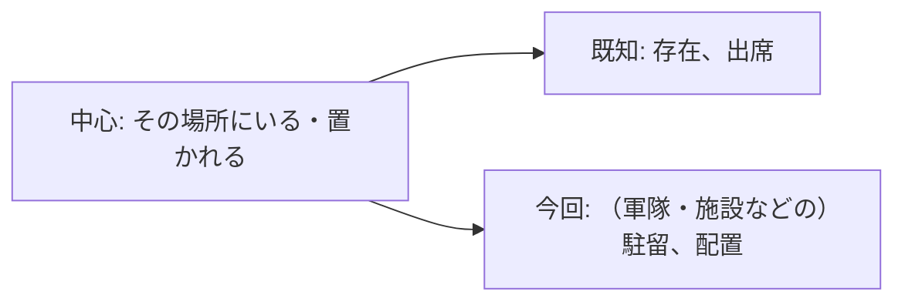

**重要語法：** `military presence / police presence`

<small>出典対応：index 1607 / candidate_id `ev-01607-noun-01`</small>

---

## 1042. odd

**品詞：** adverb/suffix　**発音：** /ɑːd/

<small>よく知られている意味：奇妙な、変わった</small>

### 見落としやすい意味

**（40-odd など）〜と少し、〜余り**

**例文**

> There were forty-odd people at the meeting.

**和訳**

会議には40人余りが出席していた。

**コアイメージの説明**

odd には、きりのよい数から少しはみ出す端数という感覚がある。数の後につくと、その数を少し上回るおおよその数量を表す。

**図（意味のつながり）**

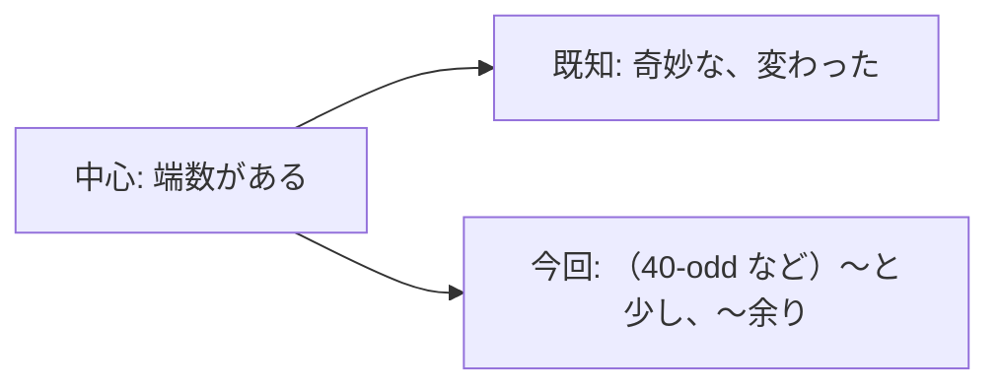

**重要語法：** `forty-odd / a hundred-odd`

<small>出典対応：index 1609 / candidate_id `ev-01609-adverbsuffix-01`</small>

---

## 1043. fresh

**品詞：** adjective　**発音：** /freʃ/

<small>よく知られている意味：新鮮な、新しい</small>

### 見落としやすい意味

**〜を出たばかりの（fresh from/out of）**

**例文**

> Fresh from college, she joined a small research team.

**和訳**

大学を出たばかりの彼女は、小さな研究チームに加わった。

**コアイメージの説明**

fresh は、何かが起きてから時間がたっていないことも表す。fresh from は、ある場所や経験を離れた直後であることを示す。

**図（意味のつながり）**

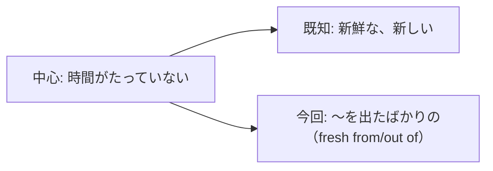

**重要語法：** `fresh from school / fresh out of college`

<small>出典対応：index 1612 / candidate_id `ev-01612-adjective-01`</small>

---

## 1044. graduate

**品詞：** verb　**発音：** /ˈɡrædʒueɪt/

<small>よく知られている意味：卒業する</small>

### 見落としやすい意味

**（graduate to）より高度・重要な段階に進む**

**例文**

> After two years, she graduated to managing larger projects.

**和訳**

2年後、彼女はより大きな企画を管理する段階へ進んだ。

**コアイメージの説明**

graduate の核には、ある段階を終えて次の段階へ進むという動きがある。学校を卒業するだけでなく、活動の難度や責任が上がる場合にも使う。

**図（意味のつながり）**

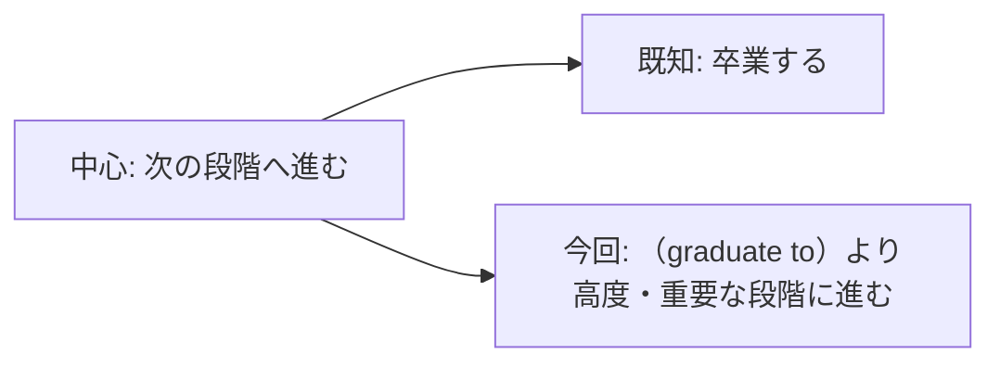

**重要語法：** `graduate to doing / graduate to a higher level`

<small>出典対応：index 1614 / candidate_id `ev-01614-verb-01`</small>

---

## 1045. vehicle

**品詞：** noun　**発音：** /ˈviːəkəl/

<small>よく知られている意味：乗り物、車両</small>

### 見落としやすい意味

**（意図・思想を伝える）手段、媒体**

**例文**

> Poetry can be a vehicle for political ideas.

**和訳**

詩は政治的な思想を伝える手段になりうる。

**コアイメージの説明**

vehicle は何かを運ぶものを意味する。物理的に人を運ぶ乗り物から、考えや感情を人に届ける媒体へと意味が広がる。

**図（意味のつながり）**

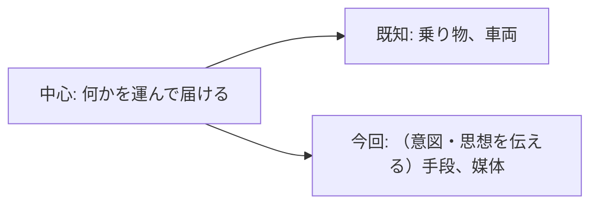

**重要語法：** `a vehicle for expression / change`

<small>出典対応：index 1616 / candidate_id `ev-01616-noun-01`</small>

---

## 1046. blame

**品詞：** verb　**発音：** /bleɪm/

<small>よく知られている意味：非難する、責める</small>

### 見落としやすい意味

**Aの原因をBに帰する（blame A on B）**

**例文**

> She blamed the delay on heavy traffic.

**和訳**

彼女は遅延の原因をひどい渋滞に求めた。

**コアイメージの説明**

blame は望ましくない結果の責任を誰か・何かに負わせること。blame A on B では、問題AがBのせいで起きたと考える。

**図（意味のつながり）**

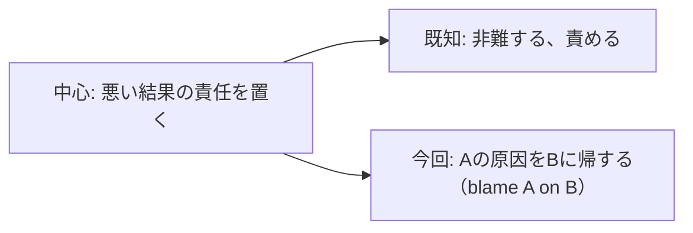

**重要語法：** `blame A on B / blame B for A`

<small>出典対応：index 1618 / candidate_id `ev-01618-verb-01`</small>

---

## 1047. marry

**品詞：** verb　**発音：** /ˈmæri/

<small>よく知られている意味：結婚する</small>

### 見落としやすい意味

**（考え・技術などを）結びつける（marry A to B）**

**例文**

> The course marries theory to practical experience.

**和訳**

その講座は理論と実践経験を結びつける。

**コアイメージの説明**

marry は二つのものを結びつけ、一体として働かせるイメージを持つ。人同士の結婚だけでなく、考えや技術の効果的な融合にも使う。

**図（意味のつながり）**

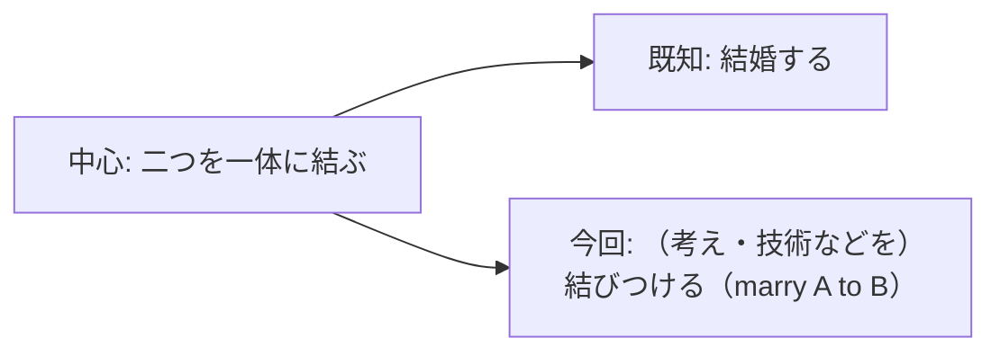

**重要語法：** `marry A to B / marry A with B`

<small>出典対応：index 1619 / candidate_id `ev-01619-verb-01`</small>

---

## 1048. holiday

**品詞：** noun　**発音：** /ˈhɑːlədeɪ/

<small>よく知られている意味：祝日、休日</small>

### 見落としやすい意味

**休暇（主に英国英語）**

**例文**

> We are going on holiday next month.

**和訳**

私たちは来月、休暇に出かける。

**コアイメージの説明**

holiday は仕事や日常の活動から離れる期間を指す。特に英国英語では、旅行を伴うことも多い『休暇』の意味で普通に用いられる。

**図（意味のつながり）**

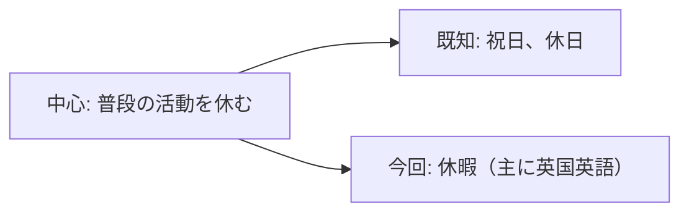

**重要語法：** `go on holiday / be on holiday（主に英）`

<small>出典対応：index 1621 / candidate_id `ev-01621-noun-01`</small>

---

## 1049. accompany

**品詞：** verb　**発音：** /əˈkʌmpəni/

<small>よく知られている意味：付き添う、同行する</small>

### 見落としやすい意味

**（物事が）〜に伴って生じる（be accompanied by）**

**例文**

> The announcement was accompanied by loud applause.

**和訳**

発表に伴って大きな拍手が起こった。

**コアイメージの説明**

accompany は何かと一緒に存在したり起きたりすること。人の同行だけでなく、出来事に別の反応や現象が伴う場合にも使う。

**図（意味のつながり）**

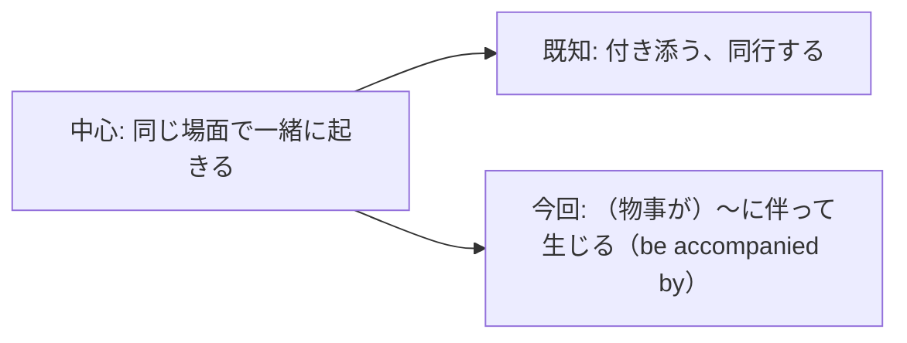

**重要語法：** `be accompanied by`

<small>出典対応：index 1624 / candidate_id `ev-01624-verb-01`</small>

---

## 1050. arrest

**品詞：** verb　**発音：** /əˈrest/

<small>よく知られている意味：逮捕する</small>

### 見落としやすい意味

**（悪化や進行を）食い止める**

**例文**

> The new measures helped arrest the decline in sales.

**和訳**

新たな対策は売上減少に歯止めをかけるのに役立った。

**コアイメージの説明**

arrest の中心には動きを止めるという意味がある。人を拘束するだけでなく、悪化や進行を途中で食い止めることにも用いる。

**図（意味のつながり）**

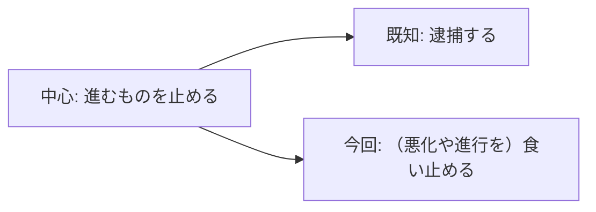

**重要語法：** `arrest a decline / arrest the spread of ...`

<small>出典対応：index 1630 / candidate_id `ev-01630-verb-01`</small>

---

## 1051. vision

**品詞：** noun　**発音：** /ˈvɪʒən/

<small>よく知られている意味：視覚、視力</small>

### 見落としやすい意味

**将来像、構想、先見性**

**例文**

> The mayor presented a long-term vision for the city.

**和訳**

市長はその都市の長期的な将来構想を示した。

**コアイメージの説明**

vision は目で見る力から、頭の中で未来を見通す力にも広がる。まだ存在しない望ましい姿を具体的に思い描くときの語である。

**図（意味のつながり）**

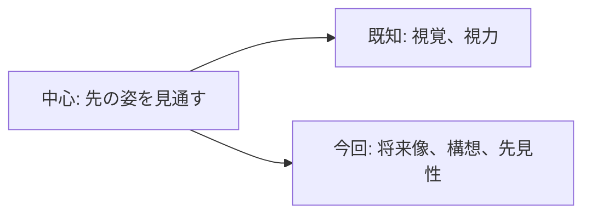

**重要語法：** `a vision for the future / long-term vision`

<small>出典対応：index 1632 / candidate_id `ev-01632-noun-01`</small>

---

## 1052. stick

**品詞：** verb　**発音：** /stɪk/

<small>よく知られている意味：棒、くっつく</small>

### 見落としやすい意味

**（stick to）方針・約束などを守り続ける**

**例文**

> We decided to stick to the original plan.

**和訳**

私たちは当初の計画を守り続けることにした。

**コアイメージの説明**

stick は何かにくっついて離れないことを表す。stick to は物理的な接着ではなく、計画や原則からそれないという意味になる。

**図（意味のつながり）**

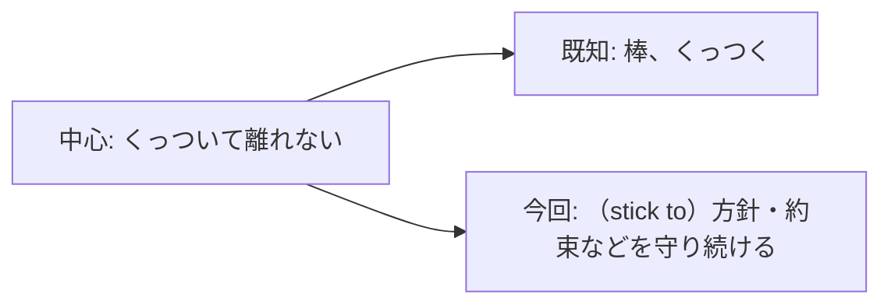

**重要語法：** `stick to a plan / stick to one's word`

<small>出典対応：index 1633 / candidate_id `ev-01633-verb-01`</small>

---

## 1053. foundation

**品詞：** noun　**発音：** /faʊnˈdeɪʃən/

<small>よく知られている意味：基礎、土台</small>

### 見落としやすい意味

**財団、基金を運営する団体**

**例文**

> A local foundation funded the library project.

**和訳**

地元の財団が図書館の事業に資金を提供した。

**コアイメージの説明**

foundation は、何かを支える基盤を表す。活動を資金面などで支える組織という意味では、慈善・研究・教育を支援する財団を指す。

**図（意味のつながり）**

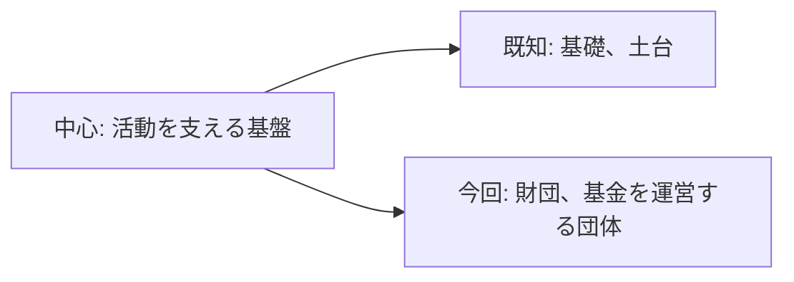

**重要語法：** `a charitable foundation / research foundation`

<small>出典対応：index 1637 / candidate_id `ev-01637-noun-01`</small>

---

## 1054. effectively

**品詞：** adverb　**発音：** /ɪˈfektɪvli/

<small>よく知られている意味：効果的に</small>

### 見落としやすい意味

**事実上、実質的に**

**例文**

> The road closure effectively cut off the village.

**和訳**

道路の封鎖によって、その村は事実上孤立した。

**コアイメージの説明**

effectively は結果としてどう働いているかに焦点を当てる。形式上はそうでなくても、実際の効果が同じなら『事実上』という意味になる。

**図（意味のつながり）**

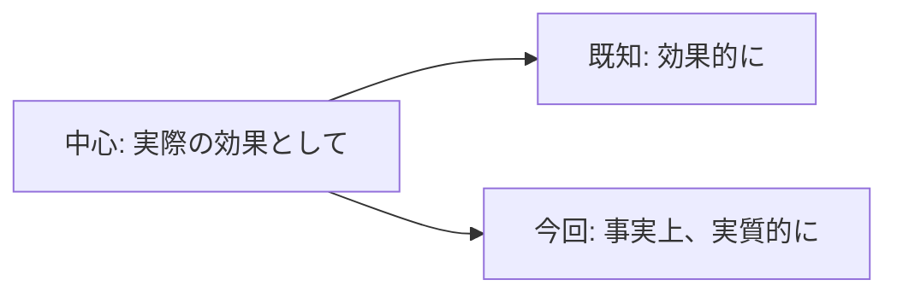

**重要語法：** `effectively impossible / effectively the same`

<small>出典対応：index 1639 / candidate_id `ev-01639-adverb-01`</small>

---

## 1055. nice

**品詞：** adjective　**発音：** /naɪs/

<small>よく知られている意味：よい、感じのよい</small>

### 見落としやすい意味

**微妙で細かな（nice distinction）**

**例文**

> There is a nice distinction between the two terms.

**和訳**

その二つの用語には微妙で細かな違いがある。

**コアイメージの説明**

nice は『心地よい』だけでなく、細部まで行き届いた精密さを表すことがある。nice distinction では、注意深く見ないと分からない微妙な区別を指す。

**図（意味のつながり）**

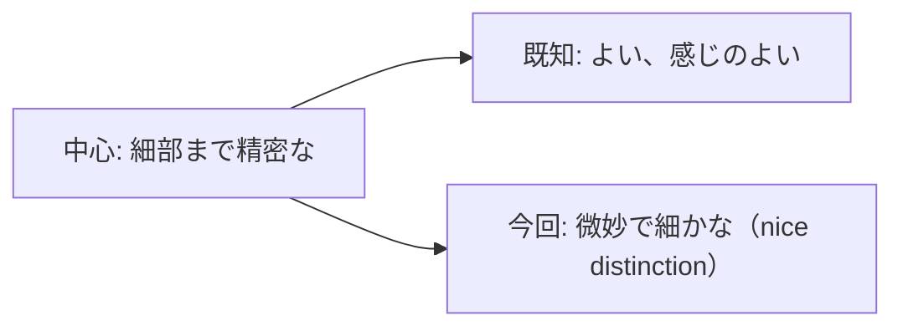

**重要語法：** `a nice distinction / a nice point`

<small>出典対応：index 1640 / candidate_id `ev-01640-adjective-01`</small>

---

## 1056. submit

**品詞：** verb　**発音：** /səbˈmɪt/

<small>よく知られている意味：提出する</small>

### 見落としやすい意味

**（submit to）不本意ながら権力・処置などを受け入れる**

**例文**

> The protesters refused to submit to the new restrictions.

**和訳**

抗議者たちは新しい制限に従うことを拒んだ。

**コアイメージの説明**

submit は自分を他者の判断や支配のもとに置くことを表す。submit to では、望まない命令や処置にも身を従わせるという意味になる。

**図（意味のつながり）**

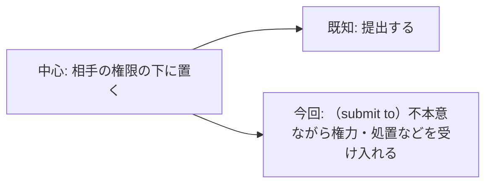

**重要語法：** `submit to authority / submit to treatment`

<small>出典対応：index 1644 / candidate_id `ev-01644-verb-01`</small>

---

## 1057. submit

**品詞：** verb　**発音：** /səbˈmɪt/

<small>よく知られている意味：提出する</small>

### 見落としやすい意味

**（I submit that ...）正式な場で〜だと主張する**

**例文**

> I submit that the evidence is insufficient.

**和訳**

私は、その証拠は不十分だと申し上げます。

**コアイメージの説明**

submit には、判断を求めて主張を相手に差し出す意味もある。I submit that ... は特に議論や正式な場で、考えを丁寧かつ明確に述べる表現である。

**図（意味のつながり）**

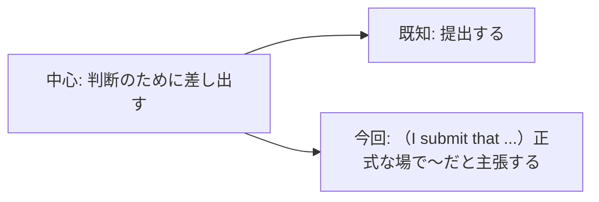

**重要語法：** `I submit that S + V（形式的）`

<small>出典対応：index 1644 / candidate_id `ev-01644-verb-02`</small>

---

## 1058. farm

**品詞：** verb　**発音：** /fɑːrm/

<small>よく知られている意味：農場、農業を営む</small>

### 見落としやすい意味

**（farm out）仕事を外部の人・企業に委託する**

**例文**

> The company farms out some design work to specialists.

**和訳**

その会社は設計業務の一部を専門家に外部委託している。

**コアイメージの説明**

farm out は仕事を自分の内部から外へ出し、別の人に任せること。農業の意味から直接訳そうとせず、まとまった業務の委託と捉える。

**図（意味のつながり）**

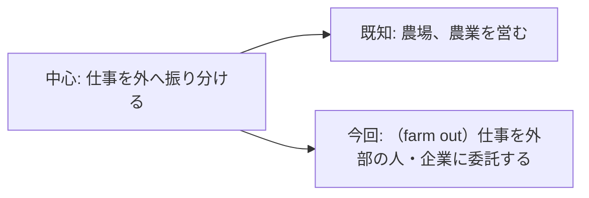

**重要語法：** `farm out work to contractors`

<small>出典対応：index 1645 / candidate_id `ev-01645-verb-01`</small>

---

## 1059. cool

**品詞：** verb　**発音：** /kuːl/

<small>よく知られている意味：冷たい、冷やす</small>

### 見落としやすい意味

**（関係・熱意などが）冷え込む（cool off）**

**例文**

> Relations between the two countries have cooled off.

**和訳**

両国の関係は冷え込んできた。

**コアイメージの説明**

cool は温度が下がることを表す。感情や関係に使えば、熱意や親しさの強さが弱まっていくことになる。

**図（意味のつながり）**

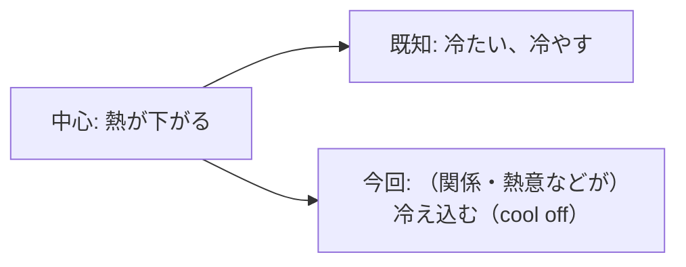

**重要語法：** `relations cool / enthusiasm cools off`

<small>出典対応：index 1646 / candidate_id `ev-01646-verb-01`</small>

---

## 1060. principal

**品詞：** noun　**発音：** /ˈprɪnsəpəl/

<small>よく知られている意味：主要な、校長</small>

### 見落としやすい意味

**借入金・投資額の元本（利息を除く）**

**例文**

> The monthly payment includes both principal and interest.

**和訳**

毎月の支払いには元本と利息の両方が含まれる。

**コアイメージの説明**

principal は中心となる大もとの部分を表す。金融では、そこから生じる利息を除いた最初の借入額・投資額を指す。

**図（意味のつながり）**

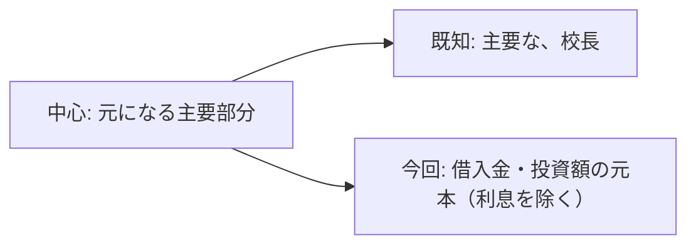

**重要語法：** `principal and interest / repay the principal`

<small>出典対応：index 1651 / candidate_id `ev-01651-noun-01`</small>

---

## 1061. proper

**品詞：** adjective　**発音：** /ˈprɑːpər/

<small>よく知られている意味：適切な、正しい</small>

### 見落としやすい意味

**厳密な意味での、本来の（proper）**

**例文**

> The museum stands outside the city proper.

**和訳**

その博物館は市の本来の区域の外にある。

**コアイメージの説明**

proper は、そのものに固有の範囲や本来のあり方を示す。名詞の後では、周辺部や関連地域を含めず、厳密にそのものだけを指すことがある。

**図（意味のつながり）**

```mermaid
flowchart LR
    A["中心: 本来の範囲に限る"]
    B["既知: 適切な、正しい"]
    C["今回: 厳密な意味での、本来の（proper）"]
    A --> B
    A --> C
```

**重要語法：** `the city proper / the town proper`

<small>出典対応：index 1652 / candidate_id `ev-01652-adjective-01`</small>

---

## 1062. constitute

**品詞：** verb　**発音：** /ˈkɑːnstətuːt/

<small>よく知られている意味：構成する</small>

### 見落としやすい意味

**〜に相当する、〜を構成する（constitute an offence など）**

**例文**

> Failure to report the incident may constitute an offence.

**和訳**

その出来事を報告しないことは違反行為に当たる場合がある。

**コアイメージの説明**

constitute は要素が集まって何かを成り立たせること。法的・論理的な文脈では、ある行為が特定の分類に『相当する』と述べるのに使う。

**図（意味のつながり）**

```mermaid
flowchart LR
    A["中心: あるものとして成り立つ"]
    B["既知: 構成する"]
    C["今回: 〜に相当する、〜を構成する（constitute an offence など）"]
    A --> B
    A --> C
```

**重要語法：** `constitute an offence / constitute a breach`

<small>出典対応：index 1654 / candidate_id `ev-01654-verb-01`</small>

---

## 1063. master

**品詞：** noun　**発音：** /ˈmæstər/

<small>よく知られている意味：主人、達人</small>

### 見落としやすい意味

**複製を作るために使う原版・原本（master）**

**例文**

> Keep the master file separate from the copies.

**和訳**

原本ファイルは複製とは別に保管してください。

**コアイメージの説明**

master は他のものの基準になる元のものを指す。複製物を作るための元データや原版に使われ、派生したコピーと区別される。

**図（意味のつながり）**

```mermaid
flowchart LR
    A["中心: コピーの元になる基準"]
    B["既知: 主人、達人"]
    C["今回: 複製を作るために使う原版・原本（master）"]
    A --> B
    A --> C
```

**重要語法：** `master copy / master recording`

<small>出典対応：index 1655 / candidate_id `ev-01655-noun-01`</small>

---

## 1064. substantial

**品詞：** adjective　**発音：** /səbˈstænʃəl/

<small>よく知られている意味：かなりの、多額の</small>

### 見落としやすい意味

**実質的な、重要な（substantial）**

**例文**

> The two proposals differ in substantial ways.

**和訳**

二つの提案は重要な点で異なっている。

**コアイメージの説明**

substantial は量が大きいだけでなく、内容がしっかりあり、意味のある違いや価値を持つことを示す。表面的・わずかなものとの対比で『実質的な』となる。

**図（意味のつながり）**

```mermaid
flowchart LR
    A["中心: 中身や重みが十分ある"]
    B["既知: かなりの、多額の"]
    C["今回: 実質的な、重要な（substantial）"]
    A --> B
    A --> C
```

**重要語法：** `substantial difference / substantial evidence`

<small>出典対応：index 1661 / candidate_id `ev-01661-adjective-01`</small>

---

## 1065. consistent

**品詞：** adjective　**発音：** /kənˈsɪstənt/

<small>よく知られている意味：一貫した</small>

### 見落としやすい意味

**〜と一致する、矛盾しない（consistent with）**

**例文**

> His explanation is consistent with the facts.

**和訳**

彼の説明は事実と矛盾していない。

**コアイメージの説明**

consistent は互いの内容がぶつからず、筋が通っている状態を表す。単独の一貫性だけでなく、二つの説明や事実の一致にも使える。

**図（意味のつながり）**

```mermaid
flowchart LR
    A["中心: 互いに矛盾しない"]
    B["既知: 一貫した"]
    C["今回: 〜と一致する、矛盾しない（consistent with）"]
    A --> B
    A --> C
```

**重要語法：** `be consistent with the evidence`

<small>出典対応：index 1662 / candidate_id `ev-01662-adjective-01`</small>

---

## 1066. circumstance

**品詞：** noun　**発音：** /ˈsɜːrkəmstæns/

<small>よく知られている意味：状況、事情</small>

### 見落としやすい意味

**いかなる場合も〜ない（under no circumstances）**

**例文**

> Under no circumstances should you share your password.

**和訳**

いかなる場合でもパスワードを他人に教えてはいけない。

**コアイメージの説明**

circumstances は行動が起きる条件や状況のこと。under no circumstances は『どんな条件の下でもない』と強く否定し、文頭では倒置が起こる。

**図（意味のつながり）**

```mermaid
flowchart LR
    A["中心: 行動を左右する条件"]
    B["既知: 状況、事情"]
    C["今回: いかなる場合も〜ない（under no circumstances）"]
    A --> B
    A --> C
```

**重要語法：** `Under no circumstances + 助動詞 + 主語 + 動詞`

<small>出典対応：index 1663 / candidate_id `ev-01663-noun-01`</small>

---

## 1067. best

**品詞：** verb　**発音：** /best/

<small>よく知られている意味：最もよい</small>

### 見落としやすい意味

**人を打ち負かす（bested）**

**例文**

> She bested the defending champion in the final.

**和訳**

彼女は決勝で前回王者を打ち負かした。

**コアイメージの説明**

best を動詞として使うと、相手より上回る結果を出すことを意味する。形容詞の『最良』ではなく、勝負で相手に勝つ行為を表す。

**図（意味のつながり）**

```mermaid
flowchart LR
    A["中心: 相手より優位に立つ"]
    B["既知: 最もよい"]
    C["今回: 人を打ち負かす（bested）"]
    A --> B
    A --> C
```

**重要語法：** `best an opponent / bested`

<small>出典対応：index 1665 / candidate_id `ev-01665-verb-01`</small>

---

## 1068. negative

**品詞：** adjective　**発音：** /ˈneɡətɪv/

<small>よく知られている意味：否定的な、悪い</small>

### 見落としやすい意味

**（検査結果が）陰性の**

**例文**

> The test result came back negative.

**和訳**

検査結果は陰性だった。

**コアイメージの説明**

negative は特定の反応や兆候が『ない』ことを示す場合がある。検査では対象の物質や反応が検出されなかった状態を表す。

**図（意味のつながり）**

```mermaid
flowchart LR
    A["中心: ある反応が認められない"]
    B["既知: 否定的な、悪い"]
    C["今回: （検査結果が）陰性の"]
    A --> B
    A --> C
```

**重要語法：** `test negative for ...`

<small>出典対応：index 1667 / candidate_id `ev-01667-adjective-01`</small>

---

## 1069. dedicate

**品詞：** verb　**発音：** /ˈdedɪkeɪt/

<small>よく知られている意味：ささげる、献身する</small>

### 見落としやすい意味

**（施設・資源などを）特定用途に専用する**

**例文**

> This room is dedicated to scientific research.

**和訳**

この部屋は科学研究専用になっている。

**コアイメージの説明**

dedicate は資源や時間を一つの目的に向けて割り当てることを表す。施設に使うと、その用途のために特別に確保する意味になる。

**図（意味のつながり）**

```mermaid
flowchart LR
    A["中心: 特定の目的に振り向ける"]
    B["既知: ささげる、献身する"]
    C["今回: （施設・資源などを）特定用途に専用する"]
    A --> B
    A --> C
```

**重要語法：** `be dedicated to research / dedicated space`

<small>出典対応：index 1670 / candidate_id `ev-01670-verb-01`</small>

---

## 1070. classic

**品詞：** noun　**発音：** /ˈklæsɪk/

<small>よく知られている意味：古典的な、典型的な</small>

### 見落としやすい意味

**名作、定番（a classic）**

**例文**

> That film has become a classic.

**和訳**

その映画は名作として定着した。

**コアイメージの説明**

classic は時代を越えて価値や人気を保つものを指す。形容詞だけでなく名詞として、広く評価された作品や定番品を表す。

**図（意味のつながり）**

```mermaid
flowchart LR
    A["中心: 長く価値が認められる"]
    B["既知: 古典的な、典型的な"]
    C["今回: 名作、定番（a classic）"]
    A --> B
    A --> C
```

**重要語法：** `become a classic / an instant classic`

<small>出典対応：index 1676 / candidate_id `ev-01676-noun-01`</small>

---

## 1071. exception

**品詞：** noun　**発音：** /ɪkˈsepʃən/

<small>よく知られている意味：例外</small>

### 見落としやすい意味

**〜に反発する、異議を唱える（take exception to）**

**例文**

> I take exception to the way you described my work.

**和訳**

私はあなたの私の仕事についての言い方に異議があります。

**コアイメージの説明**

exception は一般的な扱いから外れることを表す。take exception to は、発言や扱いを受け入れず、不快感や異議を表明する慣用句である。

**図（意味のつながり）**

```mermaid
flowchart LR
    A["中心: 普通の扱いとして受け入れない"]
    B["既知: 例外"]
    C["今回: 〜に反発する、異議を唱える（take exception to）"]
    A --> B
    A --> C
```

**重要語法：** `take exception to a remark`

<small>出典対応：index 1677 / candidate_id `ev-01677-noun-01`</small>

---

## 1072. constant

**品詞：** noun　**発音：** /ˈkɑːnstənt/

<small>よく知られている意味：絶え間ない、一定の</small>

### 見落としやすい意味

**定数、不変量**

**例文**

> In this equation, k is a constant.

**和訳**

この式では k は定数である。

**コアイメージの説明**

constant は変化せず同じ値を保つものを表す。数学・科学では、値が固定される量を名詞として constant と呼ぶ。

**図（意味のつながり）**

```mermaid
flowchart LR
    A["中心: 値が変わらない"]
    B["既知: 絶え間ない、一定の"]
    C["今回: 定数、不変量"]
    A --> B
    A --> C
```

**重要語法：** `a physical constant / a mathematical constant`

<small>出典対応：index 1678 / candidate_id `ev-01678-noun-01`</small>

---

## 1073. exhibition

**品詞：** noun　**発音：** /ˌeksəˈbɪʃən/

<small>よく知られている意味：展示会、展覧会</small>

### 見落としやすい意味

**（能力・感情などを）示すこと、発揮**

**例文**

> Her calm response was an exhibition of remarkable patience.

**和訳**

彼女の落ち着いた対応は、並外れた忍耐力の表れだった。

**コアイメージの説明**

exhibition は人に見える形で何かを示すこと。美術作品の展示だけでなく、能力や感情が行動として表れる場合にも使う。

**図（意味のつながり）**

```mermaid
flowchart LR
    A["中心: 外から分かる形で示す"]
    B["既知: 展示会、展覧会"]
    C["今回: （能力・感情などを）示すこと、発揮"]
    A --> B
    A --> C
```

**重要語法：** `an exhibition of skill / patience`

<small>出典対応：index 1681 / candidate_id `ev-01681-noun-01`</small>

---

## 1074. acknowledge

**品詞：** verb　**発音：** /əkˈnɑːlɪdʒ/

<small>よく知られている意味：認める、感謝を示す</small>

### 見落としやすい意味

**受領を知らせる、受け取ったことを認める（acknowledge receipt）**

**例文**

> Please acknowledge receipt of this message.

**和訳**

このメッセージを受け取ったことをお知らせください。

**コアイメージの説明**

acknowledge は、ある事実を認めて相手に伝えること。通信では、届いたという事実を確認し、受領を通知する意味になる。

**図（意味のつながり）**

```mermaid
flowchart LR
    A["中心: 事実を認めて伝える"]
    B["既知: 認める、感謝を示す"]
    C["今回: 受領を知らせる、受け取ったことを認める（acknowledge receipt）"]
    A --> B
    A --> C
```

**重要語法：** `acknowledge receipt of ...`

<small>出典対応：index 1685 / candidate_id `ev-01685-verb-01`</small>

---

## 1075. weather

**品詞：** verb　**発音：** /ˈweðər/

<small>よく知られている意味：天気、気象</small>

### 見落としやすい意味

**（困難・危機などを）乗り切る**

**例文**

> The small business weathered the economic crisis.

**和訳**

その小企業は経済危機を乗り切った。

**コアイメージの説明**

weather を動詞として使うと、風雨にさらされても持ちこたえるという意味になる。そこから、危機や困難に耐えて乗り切ることを表す。

**図（意味のつながり）**

```mermaid
flowchart LR
    A["中心: 荒れた状況に耐える"]
    B["既知: 天気、気象"]
    C["今回: （困難・危機などを）乗り切る"]
    A --> B
    A --> C
```

**重要語法：** `weather a storm / weather a crisis`

<small>出典対応：index 1687 / candidate_id `ev-01687-verb-01`</small>

---

## 1076. extra

**品詞：** noun　**発音：** /ˈekstrə/

<small>よく知られている意味：余分な、追加の</small>

### 見落としやすい意味

**（映画などの）エキストラ、端役**

**例文**

> She worked as an extra in a television drama.

**和訳**

彼女はテレビドラマにエキストラとして出演した。

**コアイメージの説明**

extra は中心となる出演者に追加される人という見方でも使う。映画やテレビでは、背景の場面を構成する端役・群衆役を指す。

**図（意味のつながり）**

```mermaid
flowchart LR
    A["中心: 本筋に加わる追加の人"]
    B["既知: 余分な、追加の"]
    C["今回: （映画などの）エキストラ、端役"]
    A --> B
    A --> C
```

**重要語法：** `work as an extra / film extras`

<small>出典対応：index 1689 / candidate_id `ev-01689-noun-01`</small>

---

## 1077. branch

**品詞：** verb　**発音：** /bræntʃ/

<small>よく知られている意味：枝、支店</small>

### 見落としやすい意味

**（branch out）活動・事業を別分野へ広げる**

**例文**

> The bakery has branched out into online sales.

**和訳**

そのパン屋はオンライン販売へ事業を広げた。

**コアイメージの説明**

branch は幹から枝が分かれて伸びること。branch out は既存の活動を起点に、新しい分野や地域へ展開する意味になる。

**図（意味のつながり）**

```mermaid
flowchart LR
    A["中心: 枝分かれして広がる"]
    B["既知: 枝、支店"]
    C["今回: （branch out）活動・事業を別分野へ広げる"]
    A --> B
    A --> C
```

**重要語法：** `branch out into a new field`

<small>出典対応：index 1692 / candidate_id `ev-01692-verb-01`</small>

---

## 1078. virtually

**品詞：** adverb　**発音：** /ˈvɜːrtʃuəli/

<small>よく知られている意味：仮想的に、オンラインで</small>

### 見落としやすい意味

**ほとんど、実質的に（virtually）**

**例文**

> The new rule made entry virtually impossible.

**和訳**

新しい規則により、入場はほとんど不可能になった。

**コアイメージの説明**

virtually は実際上ほぼ同じ状態であることを示す。完全にそうだとまでは言わず、現実には差がほとんどないという意味で使う。

**図（意味のつながり）**

```mermaid
flowchart LR
    A["中心: 実質上ほぼ同じ"]
    B["既知: 仮想的に、オンラインで"]
    C["今回: ほとんど、実質的に（virtually）"]
    A --> B
    A --> C
```

**重要語法：** `virtually all / virtually impossible`

<small>出典対応：index 1696 / candidate_id `ev-01696-adverb-01`</small>

---

## 1079. cap

**品詞：** verb　**発音：** /kæp/

<small>よく知られている意味：帽子、ふた</small>

### 見落としやすい意味

**価格・支出などに上限を設ける**

**例文**

> The government plans to cap electricity prices.

**和訳**

政府は電気料金に上限を設ける計画だ。

**コアイメージの説明**

cap は上から覆うもの、または上限というイメージを持つ。動詞では、価格や数量が一定の水準を超えないよう制限することを表す。

**図（意味のつながり）**

```mermaid
flowchart LR
    A["中心: 上から限界を設ける"]
    B["既知: 帽子、ふた"]
    C["今回: 価格・支出などに上限を設ける"]
    A --> B
    A --> C
```

**重要語法：** `cap prices / cap spending at ...`

<small>出典対応：index 1697 / candidate_id `ev-01697-verb-01`</small>

---

## 1080. jury

**品詞：** noun　**発音：** /ˈdʒʊri/

<small>よく知られている意味：陪審員団</small>

### 見落としやすい意味

**結論はまだ出ていない（the jury is still out）**

**例文**

> The jury is still out on the new teaching method.

**和訳**

その新しい教授法については、まだ評価が定まっていない。

**コアイメージの説明**

陪審員団がまだ評決を出していない場面から生まれた比喩。the jury is still out は、証拠や評価が十分でなく結論が出ていないことを表す。

**図（意味のつながり）**

```mermaid
flowchart LR
    A["中心: 評決がまだ出ていない"]
    B["既知: 陪審員団"]
    C["今回: 結論はまだ出ていない（the jury is still out）"]
    A --> B
    A --> C
```

**重要語法：** `the jury is still out on ...`

<small>出典対応：index 1699 / candidate_id `ev-01699-noun-01`</small>

---

## 1081. recommend

**品詞：** verb　**発音：** /ˌrekəˈmend/

<small>よく知られている意味：勧める、推薦する</small>

### 見落としやすい意味

**（正式に）〜するよう勧告する（recommend that S (should) V）**

**例文**

> The panel recommended that the school adopt the new policy.

**和訳**

審査委員会は学校に新しい方針を採用するよう勧告した。

**コアイメージの説明**

recommend は適切だと考える行動を相手に示すこと。公的な文脈では単なるおすすめではなく、検討・採用を求める正式な勧告になる。

**図（意味のつながり）**

```mermaid
flowchart LR
    A["中心: 適切な案を示す"]
    B["既知: 勧める、推薦する"]
    C["今回: （正式に）〜するよう勧告する（recommend that S (should) V）"]
    A --> B
    A --> C
```

**重要語法：** `recommend that S (should) V / recommend doing`

<small>出典対応：index 1700 / candidate_id `ev-01700-verb-01`</small>

---

## 1082. forget

**品詞：** verb　**発音：** /fərˈɡet/

<small>よく知られている意味：忘れる</small>

### 見落としやすい意味

**〜したことを忘れる（forget doing）**

**例文**

> I'll never forget meeting her for the first time.

**和訳**

私は彼女に初めて会ったときのことを決して忘れない。

**コアイメージの説明**

forget は記憶から消えることを表す。forget doing は、すでに起きた経験について、その記憶を失うことを指す。

**図（意味のつながり）**

```mermaid
flowchart LR
    A["中心: 過去の経験の記憶"]
    B["既知: 忘れる"]
    C["今回: 〜したことを忘れる（forget doing）"]
    A --> B
    A --> C
```

**重要語法：** `forget doing（経験）と forget to do（行動し忘れる）を区別`

<small>出典対応：index 1701 / candidate_id `ev-01701-verb-01`</small>

---

## 1083. roll

**品詞：** noun　**発音：** /roʊl/

<small>よく知られている意味：転がる、巻いたもの</small>

### 見落としやすい意味

**（on a roll）好調が続いている状態**

**例文**

> Our team is on a roll after four straight wins.

**和訳**

私たちのチームは4連勝して絶好調だ。

**コアイメージの説明**

on a roll は成功や好調の流れが続いている様子を表す慣用句。単に何かが転がるのではなく、勢いよく順調に進んでいることを示す。

**図（意味のつながり）**

```mermaid
flowchart LR
    A["中心: 勢いが続いて進む"]
    B["既知: 転がる、巻いたもの"]
    C["今回: （on a roll）好調が続いている状態"]
    A --> B
    A --> C
```

**重要語法：** `be on a roll`

<small>出典対応：index 1702 / candidate_id `ev-01702-noun-01`</small>

---

## 1084. duty

**品詞：** noun　**発音：** /ˈduːti/

<small>よく知られている意味：義務、職務</small>

### 見落としやすい意味

**関税、税金（輸入品の duty）**

**例文**

> The importer must pay duty on these goods.

**和訳**

輸入業者はこれらの商品に関税を支払わなければならない。

**コアイメージの説明**

duty は負わなければならないものを意味する。法や制度に従って支払い義務が生じる金銭については、特に関税を指す。

**図（意味のつながり）**

```mermaid
flowchart LR
    A["中心: 負うべき義務"]
    B["既知: 義務、職務"]
    C["今回: 関税、税金（輸入品の duty）"]
    A --> B
    A --> C
```

**重要語法：** `pay duty on goods / customs duty`

<small>出典対応：index 1704 / candidate_id `ev-01704-noun-01`</small>

---

## 1085. criticism

**品詞：** noun　**発音：** /ˈkrɪtɪsɪzəm/

<small>よく知られている意味：批判</small>

### 見落としやすい意味

**文学・芸術などの評論、批評研究**

**例文**

> She teaches literary criticism at the university.

**和訳**

彼女は大学で文学批評を教えている。

**コアイメージの説明**

criticism は作品を評価し、意味や価値を検討する営みも表す。欠点を非難することに限らず、文学・芸術の分析や研究にも使う。

**図（意味のつながり）**

```mermaid
flowchart LR
    A["中心: 対象を検討し評価する"]
    B["既知: 批判"]
    C["今回: 文学・芸術などの評論、批評研究"]
    A --> B
    A --> C
```

**重要語法：** `literary criticism / art criticism`

<small>出典対応：index 1706 / candidate_id `ev-01706-noun-01`</small>

---

## 1086. identity

**品詞：** noun　**発音：** /aɪˈdentəti/

<small>よく知られている意味：身元、個性</small>

### 見落としやすい意味

**同一性、同じものであること**

**例文**

> The identity of the two samples was confirmed by DNA analysis.

**和訳**

DNA分析により、その二つの試料が同一であることが確認された。

**コアイメージの説明**

identity は『何であるか』という特定から、二つのものが同じであるという関係にも使う。異なる名前や見かけでも、実体が一致することを表せる。

**図（意味のつながり）**

```mermaid
flowchart LR
    A["中心: まさに同じものである"]
    B["既知: 身元、個性"]
    C["今回: 同一性、同じものであること"]
    A --> B
    A --> C
```

**重要語法：** `the identity of A and B（AとBの同一性）`

<small>出典対応：index 1710 / candidate_id `ev-01710-noun-01`</small>

---

## 1087. resolve

**品詞：** verb　**発音：** /rɪˈzɑːlv/

<small>よく知られている意味：解決する</small>

### 見落としやすい意味

**（resolve to do）〜することを固く決意する**

**例文**

> He resolved to speak up at the next meeting.

**和訳**

彼は次の会議では意見を言おうと固く決意した。

**コアイメージの説明**

resolve には迷いや不確かさに決着をつける意味がある。問題を解く場合だけでなく、自分の行動方針を固く決める場合にも使う。

**図（意味のつながり）**

```mermaid
flowchart LR
    A["中心: 迷いに決着をつける"]
    B["既知: 解決する"]
    C["今回: （resolve to do）〜することを固く決意する"]
    A --> B
    A --> C
```

**重要語法：** `resolve to do`

<small>出典対応：index 1711 / candidate_id `ev-01711-verb-01`</small>

---

## 1088. imply

**品詞：** verb　**発音：** /ɪmˈplaɪ/

<small>よく知られている意味：ほのめかす</small>

### 見落としやすい意味

**（論理的に）必然的に意味する、含意する**

**例文**

> The first statement does not necessarily imply the second.

**和訳**

最初の命題が必ずしも二番目の命題を意味するわけではない。

**コアイメージの説明**

imply は、明言しなくても内容として何かが導かれること。論理の文脈では、前提が成立すれば結論が導かれるという含意を表す。

**図（意味のつながり）**

```mermaid
flowchart LR
    A["中心: 内容の中に結論を含む"]
    B["既知: ほのめかす"]
    C["今回: （論理的に）必然的に意味する、含意する"]
    A --> B
    A --> C
```

**重要語法：** `A implies B / does not necessarily imply`

<small>出典対応：index 1713 / candidate_id `ev-01713-verb-01`</small>

---

## 1089. tape

**品詞：** verb　**発音：** /teɪp/

<small>よく知られている意味：テープ、粘着テープ</small>

### 見落としやすい意味

**録音する、録画する（tape）**

**例文**

> They taped the interview for later broadcast.

**和訳**

彼らは後日放送するためにインタビューを録画した。

**コアイメージの説明**

tape は情報を記録媒体に残す行為にも使われる。実際にテープを使わない録音や録画でも、動詞として用いられることがある。

**図（意味のつながり）**

```mermaid
flowchart LR
    A["中心: 記録として残す"]
    B["既知: テープ、粘着テープ"]
    C["今回: 録音する、録画する（tape）"]
    A --> B
    A --> C
```

**重要語法：** `tape an interview / tape a show`

<small>出典対応：index 1715 / candidate_id `ev-01715-verb-01`</small>

---

## 1090. aside

**品詞：** adverb　**発音：** /əˈsaɪd/

<small>よく知られている意味：脇へ、横に</small>

### 見落としやすい意味

**〜を除いて／〜のほかに（aside from）**

**例文**

> Aside from the price, the two phones are very similar.

**和訳**

価格を除けば、その二つのスマートフォンはよく似ている。

**コアイメージの説明**

aside は中心から脇へ離した位置を表す。aside from はある要素を話の中心から外して比較したり、それ以外の要素を加えたりする言い方である。

**図（意味のつながり）**

```mermaid
flowchart LR
    A["中心: 一つを脇に置く"]
    B["既知: 脇へ、横に"]
    C["今回: 〜を除いて／〜のほかに（aside from）"]
    A --> B
    A --> C
```

**重要語法：** `aside from = except for / besides（文脈で区別）`

<small>出典対応：index 1716 / candidate_id `ev-01716-adverb-01`</small>

---

## 1091. sensitive

**品詞：** adjective　**発音：** /ˈsensətɪv/

<small>よく知られている意味：傷つきやすい、繊細な</small>

### 見落としやすい意味

**微小な変化を感知する、変化に敏感に反応する**

**例文**

> The sensor is sensitive to tiny changes in temperature.

**和訳**

そのセンサーは温度のごく小さな変化にも反応する。

**コアイメージの説明**

sensitive は外からの刺激に反応しやすいこと。感情が傷つきやすいだけでなく、測定器が小さな変化を検出できることも表す。

**図（意味のつながり）**

```mermaid
flowchart LR
    A["中心: 小さな刺激を感じ取る"]
    B["既知: 傷つきやすい、繊細な"]
    C["今回: 微小な変化を感知する、変化に敏感に反応する"]
    A --> B
    A --> C
```

**重要語法：** `be sensitive to changes / highly sensitive sensor`

<small>出典対応：index 1717 / candidate_id `ev-01717-adjective-01`</small>

---

## 1092. craft

**品詞：** verb　**発音：** /kræft/

<small>よく知られている意味：工芸品、職人技</small>

### 見落としやすい意味

**（政策・文章などを）入念に作り上げる**

**例文**

> The committee carefully crafted a new proposal.

**和訳**

委員会は新たな提案を慎重に練り上げた。

**コアイメージの説明**

craft は細かな工程を重ねて丁寧に作ることを表す。手で物を作る場合から、文章や政策を工夫して仕上げる場合へと広がる。

**図（意味のつながり）**

```mermaid
flowchart LR
    A["中心: 細部まで練って作る"]
    B["既知: 工芸品、職人技"]
    C["今回: （政策・文章などを）入念に作り上げる"]
    A --> B
    A --> C
```

**重要語法：** `craft a policy / carefully crafted statement`

<small>出典対応：index 1718 / candidate_id `ev-01718-verb-01`</small>

---

## 1093. association

**品詞：** noun　**発音：** /əˌsoʊsiˈeɪʃən/

<small>よく知られている意味：協会、団体</small>

### 見落としやすい意味

**（物事の間の）関連、連想**

**例文**

> There is a strong association between sleep and memory.

**和訳**

睡眠と記憶には強い関連がある。

**コアイメージの説明**

association は物事同士が結びついている関係を表す。団体という意味だけでなく、二つの要因に関連が見られることを指し、因果関係とは限らない。

**図（意味のつながり）**

```mermaid
flowchart LR
    A["中心: 物事同士の結びつき"]
    B["既知: 協会、団体"]
    C["今回: （物事の間の）関連、連想"]
    A --> B
    A --> C
```

**重要語法：** `an association between A and B`

<small>出典対応：index 1723 / candidate_id `ev-01723-noun-01`</small>

---

## 1094. plain

**品詞：** adverb　**発音：** /pleɪn/

<small>よく知られている意味：平易な、明白な</small>

### 見落としやすい意味

**まったく、明白に（plain wrong など）**

**例文**

> His claim was plain wrong.

**和訳**

彼の主張はまったくの間違いだった。

**コアイメージの説明**

plain は飾り気や曖昧さがなく、はっきりしているという意味を持つ。副詞として使うと、『まったく』『明らかに』と判断を強めることがある。

**図（意味のつながり）**

```mermaid
flowchart LR
    A["中心: はっきりしている"]
    B["既知: 平易な、明白な"]
    C["今回: まったく、明白に（plain wrong など）"]
    A --> B
    A --> C
```

**重要語法：** `plain wrong / plain stupid（口語的）`

<small>出典対応：index 1724 / candidate_id `ev-01724-adverb-01`</small>

---

## 1095. construct

**品詞：** noun　**発音：** /ˈkɑːnstrʌkt/

<small>よく知られている意味：建設する、組み立てる</small>

### 見落としやすい意味

**（理論上の）構成概念、仮定された概念**

**例文**

> Trust is a difficult construct to measure.

**和訳**

信頼は測定するのが難しい構成概念だ。

**コアイメージの説明**

construct は考えの中で組み立てられたものも表す。研究では、直接目で見えないが理論上定義して扱う概念を指す。

**図（意味のつながり）**

```mermaid
flowchart LR
    A["中心: 要素から組み立てたもの"]
    B["既知: 建設する、組み立てる"]
    C["今回: （理論上の）構成概念、仮定された概念"]
    A --> B
    A --> C
```

**重要語法：** `a theoretical construct / social construct`

<small>出典対応：index 1727 / candidate_id `ev-01727-noun-01`</small>

---

## 1096. wild

**品詞：** adjective　**発音：** /waɪld/

<small>よく知られている意味：野生の、荒々しい</small>

### 見落としやすい意味

**根拠の薄い、突飛な（wild guess）**

**例文**

> That is a wild guess, not a reliable estimate.

**和訳**

それは根拠の薄い当て推量であって、信頼できる推定ではない。

**コアイメージの説明**

wild には人の制御や根拠から外れている感じがある。wild guess では、十分な情報に基づかず大胆に推測することを表す。

**図（意味のつながり）**

```mermaid
flowchart LR
    A["中心: 根拠や制御から外れる"]
    B["既知: 野生の、荒々しい"]
    C["今回: 根拠の薄い、突飛な（wild guess）"]
    A --> B
    A --> C
```

**重要語法：** `a wild guess / wild speculation`

<small>出典対応：index 1728 / candidate_id `ev-01728-adjective-01`</small>

---

## 1097. operator

**品詞：** noun　**発音：** /ˈɑːpəreɪtər/

<small>よく知られている意味：操作者、機械を動かす人</small>

### 見落としやすい意味

**事業運営者、運営業者（tour operator など）**

**例文**

> The tour operator changed our itinerary.

**和訳**

ツアー運営業者が私たちの旅程を変更した。

**コアイメージの説明**

operator は何かを実際に動かし運営する人や組織を表す。機械の操作担当者だけでなく、サービスや事業を提供する会社も指す。

**図（意味のつながり）**

```mermaid
flowchart LR
    A["中心: 仕組みを運営する主体"]
    B["既知: 操作者、機械を動かす人"]
    C["今回: 事業運営者、運営業者（tour operator など）"]
    A --> B
    A --> C
```

**重要語法：** `tour operator / network operator`

<small>出典対応：index 1730 / candidate_id `ev-01730-noun-01`</small>

---

## 1098. defeat

**品詞：** verb　**発音：** /dɪˈfiːt/

<small>よく知られている意味：打ち負かす、敗北させる</small>

### 見落としやすい意味

**（目的・趣旨を）台無しにする（defeat the purpose）**

**例文**

> That shortcut would defeat the purpose of the exercise.

**和訳**

その近道を使ったら、練習の目的が台無しになる。

**コアイメージの説明**

defeat は相手の計画や狙いが実現するのを妨げることにも使う。人を負かすだけでなく、行動が本来の目的を無効にする場合にも使う。

**図（意味のつながり）**

```mermaid
flowchart LR
    A["中心: 目的の達成を阻む"]
    B["既知: 打ち負かす、敗北させる"]
    C["今回: （目的・趣旨を）台無しにする（defeat the purpose）"]
    A --> B
    A --> C
```

**重要語法：** `defeat the purpose / defeat the object`

<small>出典対応：index 1732 / candidate_id `ev-01732-verb-01`</small>

---

## 1099. cruise

**品詞：** verb　**発音：** /kruːz/

<small>よく知られている意味：船旅、クルーズ</small>

### 見落としやすい意味

**（一定速度で）巡航する、順調に進む**

**例文**

> The plane cruised at an altitude of 10,000 meters.

**和訳**

その飛行機は高度1万メートルで巡航した。

**コアイメージの説明**

cruise は大きな変化をせず滑らかに移動を続けること。観光船だけでなく、飛行機や車が一定速度で進むことにも使う。

**図（意味のつながり）**

```mermaid
flowchart LR
    A["中心: 安定して進み続ける"]
    B["既知: 船旅、クルーズ"]
    C["今回: （一定速度で）巡航する、順調に進む"]
    A --> B
    A --> C
```

**重要語法：** `cruise at 10,000 meters / cruising speed`

<small>出典対応：index 1735 / candidate_id `ev-01735-verb-01`</small>

---

## 1100. joint

**品詞：** adjective　**発音：** /dʒɔɪnt/

<small>よく知られている意味：関節、継ぎ目</small>

### 見落としやすい意味

**共同の、共有の（joint project）**

**例文**

> The scientists published a joint report.

**和訳**

研究者たちは共同の報告書を発表した。

**コアイメージの説明**

joint は別々の人や組織がつながって一つの行動をすることを表す。物の接合部から、複数の主体が関わる共同作業という意味にもつながる。

**図（意味のつながり）**

```mermaid
flowchart LR
    A["中心: 複数が一つにつながる"]
    B["既知: 関節、継ぎ目"]
    C["今回: 共同の、共有の（joint project）"]
    A --> B
    A --> C
```

**重要語法：** `joint project / joint statement`

<small>出典対応：index 1736 / candidate_id `ev-01736-adjective-01`</small>

---

## 1101. lobby

**品詞：** verb　**発音：** /ˈlɑːbi/

<small>よく知られている意味：ロビー、玄関ホール</small>

### 見落としやすい意味

**（lobby for/against）政治家・政府に働きかける**

**例文**

> Residents lobbied for safer crossings near the school.

**和訳**

住民たちは学校近くの横断歩道の安全性向上を求めて働きかけた。

**コアイメージの説明**

lobby は政策や決定に影響を与えるため、関係者に働きかけること。建物のロビーとは別に、政治や行政への要望活動を表す動詞として重要である。

**図（意味のつながり）**

```mermaid
flowchart LR
    A["中心: 決定権者へ働きかける"]
    B["既知: ロビー、玄関ホール"]
    C["今回: （lobby for/against）政治家・政府に働きかける"]
    A --> B
    A --> C
```

**重要語法：** `lobby for / lobby against / lobby lawmakers`

<small>出典対応：index 1737 / candidate_id `ev-01737-verb-01`</small>

---

## 1102. convert

**品詞：** verb　**発音：** /kənˈvɜːrt/

<small>よく知られている意味：変換する、換算する</small>

### 見落としやすい意味

**（宗教・信念などを）改宗・転向させる**

**例文**

> The book converted him to a more optimistic view of life.

**和訳**

その本を読んで、彼は人生をより楽観的に見るようになった。

**コアイメージの説明**

convert はある状態や考え方から別のものへ変えること。数値や形式だけでなく、宗教や信念に対する立場を変える場合にも使う。

**図（意味のつながり）**

```mermaid
flowchart LR
    A["中心: 別の立場へ変わる"]
    B["既知: 変換する、換算する"]
    C["今回: （宗教・信念などを）改宗・転向させる"]
    A --> B
    A --> C
```

**重要語法：** `convert someone to a belief / convert to a religion`

<small>出典対応：index 1739 / candidate_id `ev-01739-verb-01`</small>

---

## 1103. yield

**品詞：** verb　**発音：** /jiːld/

<small>よく知られている意味：生み出す、産出する</small>

### 見落としやすい意味

**要求や圧力に屈する、譲歩する（yield to）**

**例文**

> The committee refused to yield to public pressure.

**和訳**

委員会は世論の圧力に屈することを拒んだ。

**コアイメージの説明**

yield は押されたときに抵抗をやめて相手に道を譲ることを表す。yield to は圧力や要求を受け入れて譲歩する意味になる。

**図（意味のつながり）**

```mermaid
flowchart LR
    A["中心: 抵抗をやめて譲る"]
    B["既知: 生み出す、産出する"]
    C["今回: 要求や圧力に屈する、譲歩する（yield to）"]
    A --> B
    A --> C
```

**重要語法：** `yield to pressure / yield to demands`

<small>出典対応：index 1741 / candidate_id `ev-01741-verb-01`</small>

---

## 1104. perspective

**品詞：** noun　**発音：** /pərˈspektɪv/

<small>よく知られている意味：見方、視点</small>

### 見落としやすい意味

**（絵画・写真の）遠近法**

**例文**

> The artist used perspective to make the road look longer.

**和訳**

画家は道をより長く見せるために遠近法を使った。

**コアイメージの説明**

perspective はどの位置から物を見るかという見え方に関わる。絵画では距離による大きさや配置の変化を使い、奥行きを表す方法を意味する。

**図（意味のつながり）**

```mermaid
flowchart LR
    A["中心: 見る位置と奥行き"]
    B["既知: 見方、視点"]
    C["今回: （絵画・写真の）遠近法"]
    A --> B
    A --> C
```

**重要語法：** `linear perspective / use perspective`

<small>出典対応：index 1742 / candidate_id `ev-01742-noun-01`</small>

---

## 1105. ally

**品詞：** verb　**発音：** /əˈlaɪ/

<small>よく知られている意味：味方、同盟者</small>

### 見落としやすい意味

**〜と同盟・協力関係を結ぶ（ally with）**

**例文**

> The group allied with local farmers to protect the river.

**和訳**

その団体は川を守るため、地元の農家と協力関係を結んだ。

**コアイメージの説明**

ally は共通の目的のために味方になること。名詞としての協力者だけでなく、動詞として連携・同盟を結ぶ動きを表す。

**図（意味のつながり）**

```mermaid
flowchart LR
    A["中心: 共通の目的で結びつく"]
    B["既知: 味方、同盟者"]
    C["今回: 〜と同盟・協力関係を結ぶ（ally with）"]
    A --> B
    A --> C
```

**重要語法：** `ally with a group / ally oneself with`

<small>出典対応：index 1750 / candidate_id `ev-01750-verb-01`</small>

---

## 1106. understanding

**品詞：** adjective　**発音：** /ˌʌndərˈstændɪŋ/

<small>よく知られている意味：理解、理解すること</small>

### 見落としやすい意味

**理解のある、思いやりのある**

**例文**

> The teacher was understanding when I explained my mistake.

**和訳**

私が失敗について説明すると、先生は理解を示してくれた。

**コアイメージの説明**

understanding は相手の事情や気持ちを分かろうとする姿勢も表す。形容詞では、責めずに事情をくみ取る思いやりのある態度を指す。

**図（意味のつながり）**

```mermaid
flowchart LR
    A["中心: 相手の事情をくみ取る"]
    B["既知: 理解、理解すること"]
    C["今回: 理解のある、思いやりのある"]
    A --> B
    A --> C
```

**重要語法：** `be understanding about ... / an understanding teacher`

<small>出典対応：index 1751 / candidate_id `ev-01751-adjective-01`</small>

---

## 1107. pop

**品詞：** verb　**発音：** /pɑːp/

<small>よく知られている意味：ポンと鳴る、はじける</small>

### 見落としやすい意味

**突然現れる（pop up）**

**例文**

> New problems keep popping up.

**和訳**

次々に新しい問題が突然出てくる。

**コアイメージの説明**

pop は短く突然動いたり現れたりする感覚がある。pop up は、予想していなかった問題や物が急に姿を現すことを表す。

**図（意味のつながり）**

```mermaid
flowchart LR
    A["中心: 急に飛び出す"]
    B["既知: ポンと鳴る、はじける"]
    C["今回: 突然現れる（pop up）"]
    A --> B
    A --> C
```

**重要語法：** `pop up unexpectedly / a problem pops up`

<small>出典対応：index 1752 / candidate_id `ev-01752-verb-01`</small>

---

## 1108. map

**品詞：** verb　**発音：** /mæp/

<small>よく知られている意味：地図</small>

### 見落としやすい意味

**（map out）計画・手順を詳細に立てる**

**例文**

> We mapped out the steps for launching the project.

**和訳**

私たちは企画の立ち上げ手順を詳しく計画した。

**コアイメージの説明**

map は位置関係を見える形に整理すること。map out は、地図を描くように計画の各段階を順序立てて明確にする意味になる。

**図（意味のつながり）**

```mermaid
flowchart LR
    A["中心: 全体の道筋を描く"]
    B["既知: 地図"]
    C["今回: （map out）計画・手順を詳細に立てる"]
    A --> B
    A --> C
```

**重要語法：** `map out a plan / map out the steps`

<small>出典対応：index 1753 / candidate_id `ev-01753-verb-01`</small>

---

## 1109. blow

**品詞：** verb　**発音：** /bloʊ/

<small>よく知られている意味：吹く、風が吹く</small>

### 見落としやすい意味

**（好機・お金などを）無駄にする（blow one's chance）**

**例文**

> She blew her chance to get the job by missing the interview.

**和訳**

彼女は面接に行かなかったことで、その仕事に就く機会を台無しにした。

**コアイメージの説明**

blow は勢いよく外へ失わせる感覚にもつながる。口語的に、せっかくの好機や金銭を不用意に失うことを指す。

**図（意味のつながり）**

```mermaid
flowchart LR
    A["中心: 勢いで失ってしまう"]
    B["既知: 吹く、風が吹く"]
    C["今回: （好機・お金などを）無駄にする（blow one's chance）"]
    A --> B
    A --> C
```

**重要語法：** `blow one's chance / blow money on ...`

<small>出典対応：index 1756 / candidate_id `ev-01756-verb-01`</small>

---

## 1110. flat

**品詞：** adjective　**発音：** /flæt/

<small>よく知られている意味：平らな、平坦な</small>

### 見落としやすい意味

**（flat rate）一律の料金・固定した率の**

**例文**

> The service charges a flat rate for delivery.

**和訳**

そのサービスは配達に一律料金を設定している。

**コアイメージの説明**

flat は高低差や変動がない状態を表す。料金については条件ごとに上下せず、一定の額や率に固定されていることを意味する。

**図（意味のつながり）**

```mermaid
flowchart LR
    A["中心: 高低差・変動がない"]
    B["既知: 平らな、平坦な"]
    C["今回: （flat rate）一律の料金・固定した率の"]
    A --> B
    A --> C
```

**重要語法：** `flat rate / flat fee`

<small>出典対応：index 1757 / candidate_id `ev-01757-adjective-01`</small>

---

## 1111. flat

**品詞：** adverb　**発音：** /flæt/

<small>よく知られている意味：平らに</small>

### 見落としやすい意味

**完全に、まったく（flat broke など）**

**例文**

> After the trip, I was flat broke.

**和訳**

旅行のあと、私はまったくの一文無しだった。

**コアイメージの説明**

flat は強調の副詞として、余地がないほど完全な状態を表すことがある。flat broke では、お金が全くないことを強く表現する。

**図（意味のつながり）**

```mermaid
flowchart LR
    A["中心: 余地なく完全に"]
    B["既知: 平らに"]
    C["今回: 完全に、まったく（flat broke など）"]
    A --> B
    A --> C
```

**重要語法：** `flat broke / flat out（用法は文脈に注意）`

<small>出典対応：index 1757 / candidate_id `ev-01757-adverb-01`</small>

---

## 1112. wood

**品詞：** noun　**発音：** /wʊd/

<small>よく知られている意味：木材、木</small>

### 見落としやすい意味

**森、林（the woods）**

**例文**

> We went for a walk in the woods.

**和訳**

私たちは林の中を散歩した。

**コアイメージの説明**

wood は木の材質だけでなく、木が集まった場所も表す。特に複数形 the woods で森林や林を指し、木材と取り違えないことが大切。

**図（意味のつながり）**

```mermaid
flowchart LR
    A["中心: 木が集まる場所"]
    B["既知: 木材、木"]
    C["今回: 森、林（the woods）"]
    A --> B
    A --> C
```

**重要語法：** `in the woods / walk through the woods`

<small>出典対応：index 1762 / candidate_id `ev-01762-noun-01`</small>

---

## 1113. difficulty

**品詞：** noun　**発音：** /ˈdɪfɪkəlti/

<small>よく知られている意味：難しさ、困難</small>

### 見落としやすい意味

**〜するのに苦労する（have difficulty (in) doing）**

**例文**

> He had difficulty understanding the instructions.

**和訳**

彼は指示を理解するのに苦労した。

**コアイメージの説明**

difficulty は何かをする際の障害や難しさを表す。have difficulty doing では、その行為をうまく実行できず苦労することを示す。

**図（意味のつながり）**

```mermaid
flowchart LR
    A["中心: 行動の途中に障害がある"]
    B["既知: 難しさ、困難"]
    C["今回: 〜するのに苦労する（have difficulty (in) doing）"]
    A --> B
    A --> C
```

**重要語法：** `have difficulty (in) doing / have trouble doing`

<small>出典対応：index 1763 / candidate_id `ev-01763-noun-01`</small>

---

## 1114. bond

**品詞：** noun　**発音：** /bɑːnd/

<small>よく知られている意味：絆、結びつき</small>

### 見落としやすい意味

**債券（発行者が元利金の支払いを約束するもの）**

**例文**

> The city issued bonds to finance the bridge.

**和訳**

その市は橋の建設資金を調達するために債券を発行した。

**コアイメージの説明**

bond は何かを結び付ける約束や義務にも関わる。金融では発行者が元金や利息の支払いを約束する証券を指す。

**図（意味のつながり）**

```mermaid
flowchart LR
    A["中心: 支払いの約束で結ぶ"]
    B["既知: 絆、結びつき"]
    C["今回: 債券（発行者が元利金の支払いを約束するもの）"]
    A --> B
    A --> C
```

**重要語法：** `issue bonds / government bonds`

<small>出典対応：index 1764 / candidate_id `ev-01764-noun-01`</small>

---

## 1115. dispute

**品詞：** verb　**発音：** /dɪˈspjuːt/

<small>よく知られている意味：争い、論争</small>

### 見落としやすい意味

**（主張・正当性などに）異議を唱える**

**例文**

> Several experts dispute the claim that the method is safe.

**和訳**

複数の専門家が、その方法は安全だという主張に異議を唱えている。

**コアイメージの説明**

dispute は意見が一致せず、ある主張を受け入れないことを表す。名詞の『論争』だけでなく、動詞として主張の真偽や正当性を争える。

**図（意味のつながり）**

```mermaid
flowchart LR
    A["中心: 主張を受け入れず争う"]
    B["既知: 争い、論争"]
    C["今回: （主張・正当性などに）異議を唱える"]
    A --> B
    A --> C
```

**重要語法：** `dispute a claim / dispute the validity of ...`

<small>出典対応：index 1765 / candidate_id `ev-01765-verb-01`</small>

---

## 1116. engagement

**品詞：** noun　**発音：** /ɪnˈɡeɪdʒmənt/

<small>よく知られている意味：婚約、約束</small>

### 見落としやすい意味

**積極的な参加、関与（engagement with）**

**例文**

> Student engagement with the material improved.

**和訳**

学生たちの教材への積極的な関与が高まった。

**コアイメージの説明**

engagement は何かと積極的につながり、関わっている状態を示す。人との婚約から離れ、学習や活動に参加して力を注ぐことにも使う。

**図（意味のつながり）**

```mermaid
flowchart LR
    A["中心: 積極的に関わる"]
    B["既知: 婚約、約束"]
    C["今回: 積極的な参加、関与（engagement with）"]
    A --> B
    A --> C
```

**重要語法：** `student engagement / engagement with a topic`

<small>出典対応：index 1766 / candidate_id `ev-01766-noun-01`</small>

---

## 1117. engagement

**品詞：** noun　**発音：** /ɪnˈɡeɪdʒmənt/

<small>よく知られている意味：婚約、関与</small>

### 見落としやすい意味

**約束・仕事の予定（a prior engagement）**

**例文**

> I can't attend the dinner because of a prior engagement.

**和訳**

先約があるので、その夕食会には参加できない。

**コアイメージの説明**

engagement はすでに引き受けた予定や約束を表すこともある。婚約に限らず、仕事や会合などで時間が埋まっていることを意味する。

**図（意味のつながり）**

```mermaid
flowchart LR
    A["中心: 先に引き受けた約束"]
    B["既知: 婚約、関与"]
    C["今回: 約束・仕事の予定（a prior engagement）"]
    A --> B
    A --> C
```

**重要語法：** `a prior engagement / a business engagement`

<small>出典対応：index 1766 / candidate_id `ev-01766-noun-02`</small>

---

## 1118. minister

**品詞：** verb　**発音：** /ˈmɪnɪstər/

<small>よく知られている意味：大臣、牧師</small>

### 見落としやすい意味

**（minister to）必要に応じて世話をし、援助する**

**例文**

> The volunteers ministered to people displaced by the flood.

**和訳**

ボランティアたちは洪水で避難した人々の世話をした。

**コアイメージの説明**

minister を動詞として使うと、必要としている人に助けや世話を提供することを表す。人の苦しさや必要に応じて奉仕するという意味になる。

**図（意味のつながり）**

```mermaid
flowchart LR
    A["中心: 必要な人に仕える"]
    B["既知: 大臣、牧師"]
    C["今回: （minister to）必要に応じて世話をし、援助する"]
    A --> B
    A --> C
```

**重要語法：** `minister to the sick / minister to people's needs`

<small>出典対応：index 1767 / candidate_id `ev-01767-verb-01`</small>

---

## 1119. fix

**品詞：** verb　**発音：** /fɪks/

<small>よく知られている意味：修理する、固定する</small>

### 見落としやすい意味

**（日時・価格などを）決める（fix a date/price）**

**例文**

> We need to fix a date for the final meeting.

**和訳**

最終会議の日程を決める必要がある。

**コアイメージの説明**

fix は動かないようにしっかり定めることを表す。物を固定するだけでなく、日時や価格を決定して変動しないようにする場合にも使う。

**図（意味のつながり）**

```mermaid
flowchart LR
    A["中心: 動かないように定める"]
    B["既知: 修理する、固定する"]
    C["今回: （日時・価格などを）決める（fix a date/price）"]
    A --> B
    A --> C
```

**重要語法：** `fix a date / fix a price`

<small>出典対応：index 1769 / candidate_id `ev-01769-verb-01`</small>

---

## 1120. device

**品詞：** noun　**発音：** /dɪˈvaɪs/

<small>よく知られている意味：装置、機器</small>

### 見落としやすい意味

**（目的を果たすための）工夫、表現技法（literary device）**

**例文**

> The novel uses dreams as a literary device.

**和訳**

その小説では夢が文学的な表現技法として用いられている。

**コアイメージの説明**

device は目的を果たすために考え出した仕組みを意味する。機械的な装置だけでなく、文章で効果を生むための技法や工夫も指す。

**図（意味のつながり）**

```mermaid
flowchart LR
    A["中心: 目的のための仕組み"]
    B["既知: 装置、機器"]
    C["今回: （目的を果たすための）工夫、表現技法（literary device）"]
    A --> B
    A --> C
```

**重要語法：** `literary device / rhetorical device`

<small>出典対応：index 1771 / candidate_id `ev-01771-noun-01`</small>

