# EasyVoca 完成教材 — バッチ015

> 対象：採用済み語義 global_order 1121〜1200（全80件）。`main` の採用済み候補から index → candidate_id 昇順で抽出。例文・説明・図はこの教材用に作成。

## 01. chair

**品詞：** 動詞　**発音（目安）：** チェア

<small>よく知られている意味：椅子</small>

### 見落としやすい意味

**会議・組織などの議長を務める**

**例文：** The professor will chair tomorrow's meeting.

**和訳：** その教授が明日の会議の議長を務める。

**コアイメージ：** chair は会議の中心となる議長席にも使われる。そこから、会議を取り仕切る役割そのものを表す動詞になる。

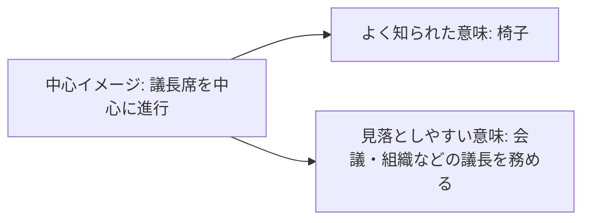

**重要語法：** `chair a meeting`

<small>出典候補：index 1773／candidate_id `ev-01773-verb-01`／global_order 1121</small>

---

## 02. proceed

**品詞：** 動詞　**発音（目安）：** プロシード

<small>よく知られている意味：先へ進む</small>

### 見落としやすい意味

**続いて〜する（proceed to do）**

**例文：** After reading the rules, she proceeded to sign the form.

**和訳：** 規則を読んだあと、彼女は続いて書類に署名した。

**コアイメージ：** proceed の中心は、ある段階から次の段階へ進むこと。場所の移動だけでなく、一つの行動を終えて次の行動に移るときにも使う。

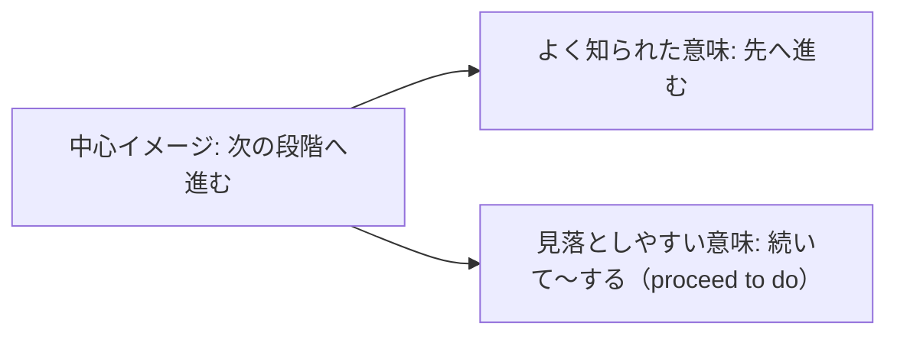

**重要語法：** `proceed to do`

<small>出典候補：index 1774／candidate_id `ev-01774-verb-01`／global_order 1122</small>

---

## 03. secure

**品詞：** 動詞　**発音（目安）：** セキュア

<small>よく知られている意味：安全な</small>

### 見落としやすい意味

**（地位・資金などを）獲得し、確保する**

**例文：** The team secured funding for the project.

**和訳：** チームはその計画の資金を確保した。

**コアイメージ：** secure の中心は、失わないようしっかりした状態にすること。安全である状態から、資金や地位を確実に手に入れる動作へ意味が広がる。

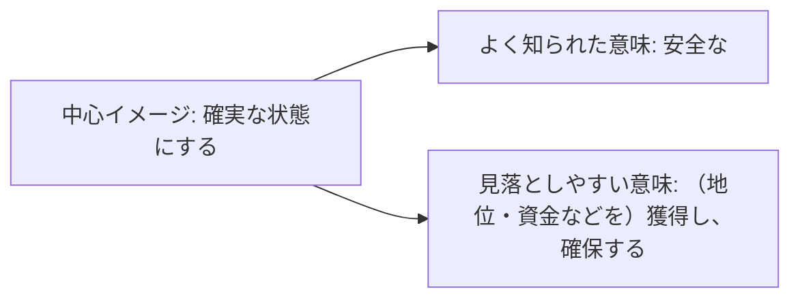

**重要語法：** `secure funding`

<small>出典候補：index 1775／candidate_id `ev-01775-verb-01`／global_order 1123</small>

---

## 04. carrier

**品詞：** 名詞　**発音（目安）：** キャリア

<small>よく知られている意味：運搬業者</small>

### 見落としやすい意味

**（病原体の）保有者、媒介者**

**例文：** He was a carrier of the virus but had no symptoms.

**和訳：** 彼はウイルスの保有者だったが、症状はなかった。

**コアイメージ：** carrier は何かを運ぶ人やものを指す。荷物だけでなく、病原体を体内に持ち、ほかへ運び得る人にも用いる。

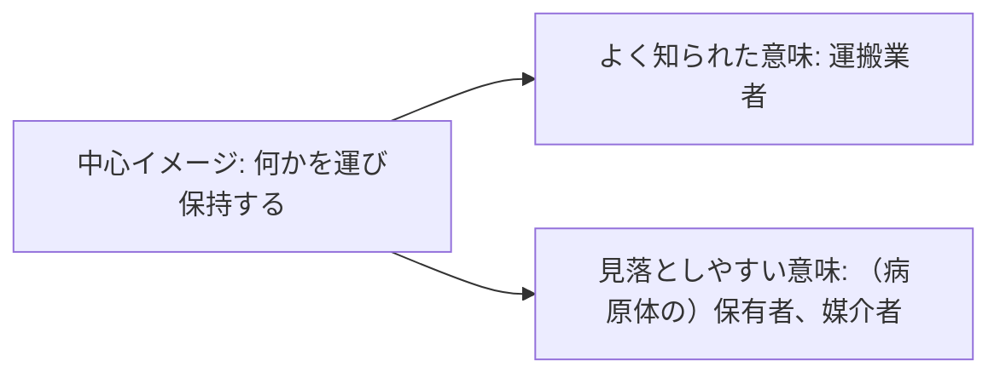

**重要語法：** `a carrier of a virus`

<small>出典候補：index 1776／candidate_id `ev-01776-noun-01`／global_order 1124</small>

---

## 05. hence

**品詞：** 副詞　**発音（目安）：** ヘンス

<small>よく知られている意味：したがって</small>

### 見落としやすい意味

**今から〜後に（two years hence）**

**例文：** The bridge will reopen three months hence.

**和訳：** その橋は今から3か月後に再開される。

**コアイメージ：** hence は、ある地点を起点にそこから先を示す語。論理的な結果を示すだけでなく、現在から先の時点を示すことがある。

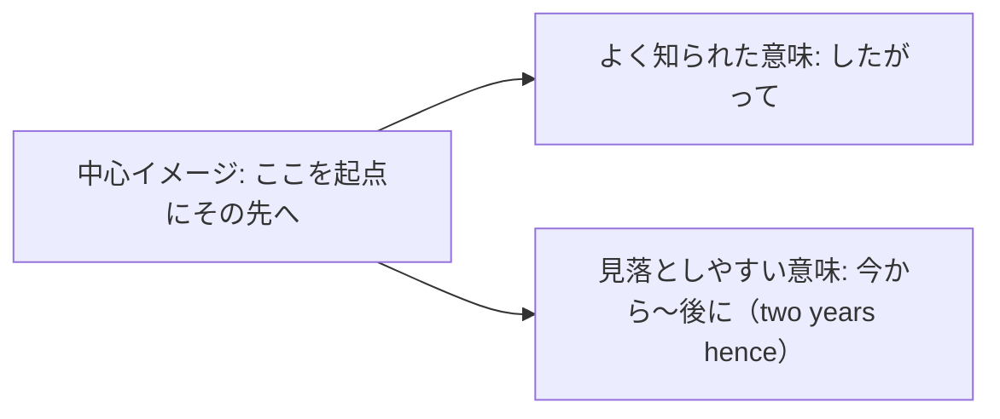

**重要語法：** `three months hence`

<small>出典候補：index 1777／candidate_id `ev-01777-adverb-01`／global_order 1125</small>

---

## 06. appreciate

**品詞：** 動詞　**発音（目安）：** アプリシエイト

<small>よく知られている意味：感謝する・理解する</small>

### 見落としやすい意味

**（価格・通貨・資産などの価値が）上昇する**

**例文：** House prices have appreciated rapidly in this area.

**和訳：** この地域では住宅価格が急速に上昇した。

**コアイメージ：** appreciate は価値を認めることと関係する。価値を評価する意味のほか、資産そのものの価値が高まる意味でも使う。

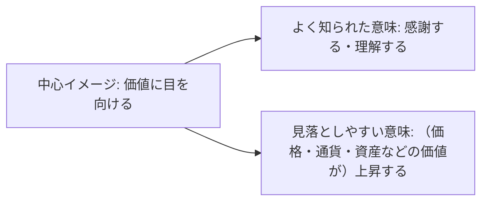

**重要語法：** `資産が主語なら自動詞`

<small>出典候補：index 1781／candidate_id `ev-01781-verb-01`／global_order 1126</small>

---

## 07. profile

**品詞：** 動詞　**発音（目安）：** プロフィール

<small>よく知られている意味：人物紹介・横顔</small>

### 見落としやすい意味

**（人物・組織の特徴を）紹介・分析する**

**例文：** The magazine profiled several young scientists.

**和訳：** その雑誌は若手科学者数人を特集した。

**コアイメージ：** profile は人物の輪郭や特徴を捉えること。名詞の人物紹介から、特徴を調べて紹介する動詞にもなる。

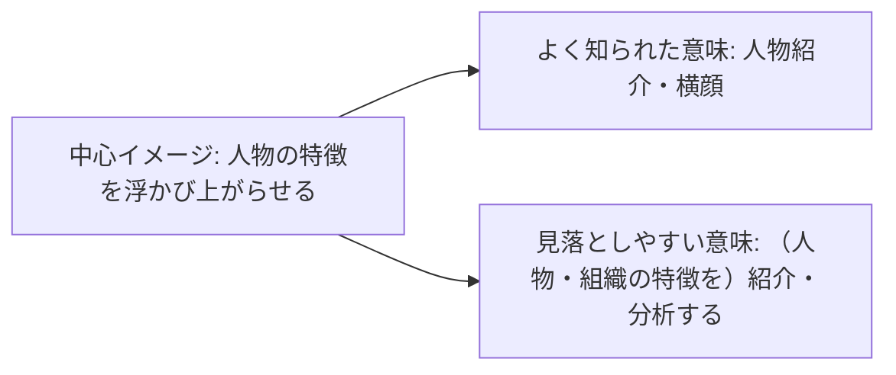

**重要語法：** `profile a person`

<small>出典候補：index 1783／candidate_id `ev-01783-verb-01`／global_order 1127</small>

---

## 08. commission

**品詞：** 動詞　**発音（目安）：** コミッション

<small>よく知られている意味：委員会・手数料</small>

### 見落としやすい意味

**仕事・作品・調査などを正式に委嘱する**

**例文：** The city commissioned a study of traffic patterns.

**和訳：** 市は交通の動向に関する調査を委託した。

**コアイメージ：** commission は正式な権限や依頼を伴う語。組織や委員会という名詞だけでなく、仕事を正式に頼む動詞としても使われる。

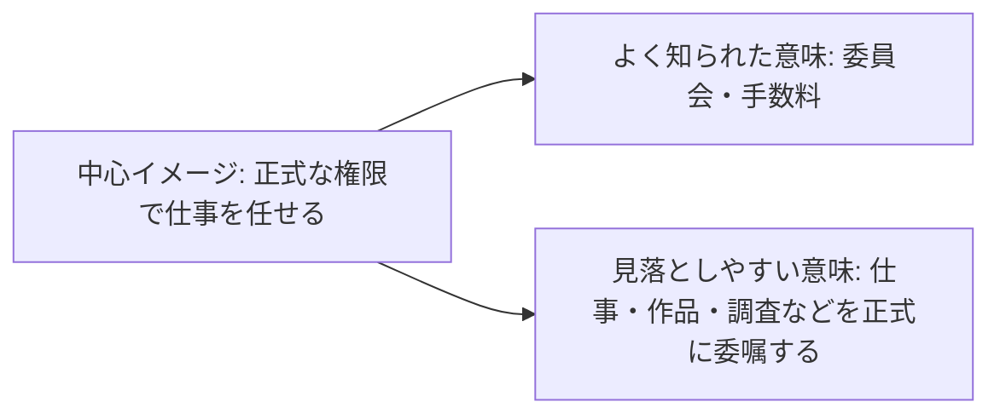

**重要語法：** `commission a study`

<small>出典候補：index 1784／candidate_id `ev-01784-verb-01`／global_order 1128</small>

---

## 09. bed

**品詞：** 名詞　**発音（目安）：** ベッド

<small>よく知られている意味：寝床</small>

### 見落としやすい意味

**（川・湖・海などの）底（riverbed など）**

**例文：** The divers examined the bed of the river.

**和訳：** 潜水士たちは川底を調べた。

**コアイメージ：** bed の中心は、何かが横たわる土台や下の面。人が寝る寝床だけでなく、水が流れる下の地面も指す。

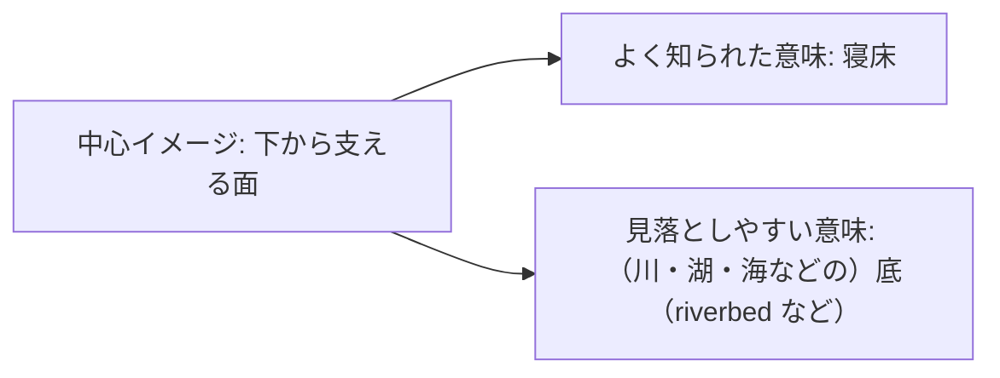

**重要語法：** `the bed of a river`

<small>出典候補：index 1785／candidate_id `ev-01785-noun-01`／global_order 1129</small>

---

## 10. expose

**品詞：** 動詞　**発音（目安）：** イクスポーズ

<small>よく知られている意味：秘密を暴露する</small>

### 見落としやすい意味

**（人・物を危険や影響に）さらす（expose A to B）**

**例文：** Leaving food outside exposes it to insects.

**和訳：** 食べ物を屋外に放置すると、それは虫にさらされる。

**コアイメージ：** expose は覆いを取り去り、外からの作用を受ける状態にすること。秘密を表に出すだけでなく、人や物を危険・影響にさらすことも表す。

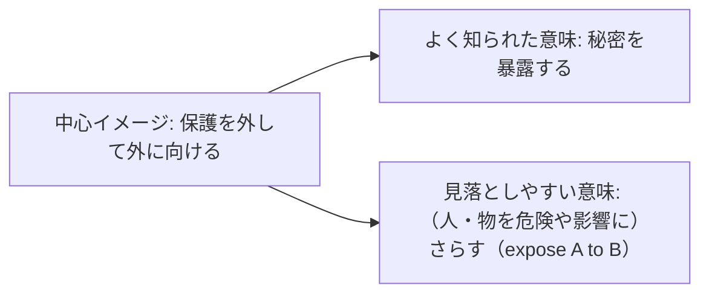

**重要語法：** `expose A to B`

<small>出典候補：index 1786／candidate_id `ev-01786-verb-01`／global_order 1130</small>

---

## 11. distinguish

**品詞：** 動詞　**発音（目安）：** ディスティングウィシュ

<small>よく知られている意味：区別する</small>

### 見落としやすい意味

**優れた実績で名を上げる（distinguish oneself）**

**例文：** She distinguished herself in the national competition.

**和訳：** 彼女は全国大会で優れた成績を収め、名を上げた。

**コアイメージ：** distinguish は周囲との違いをはっきりさせること。自分自身が際立つような成果を出すと、名を上げる意味になる。

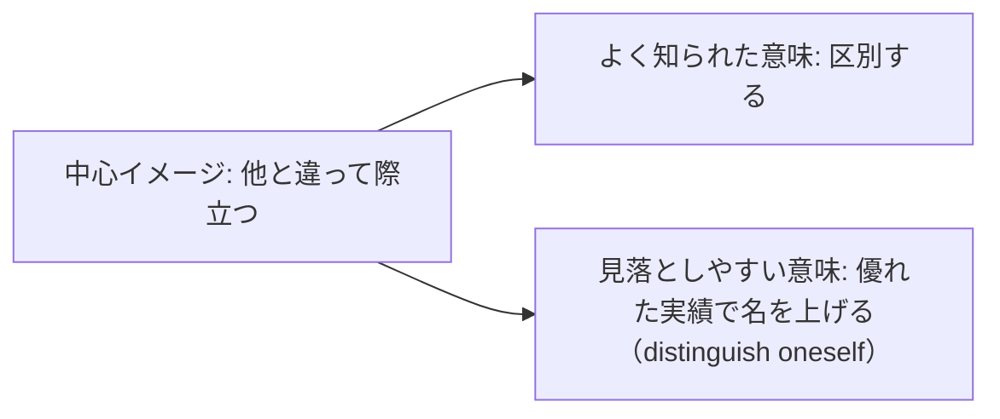

**重要語法：** `distinguish oneself`

<small>出典候補：index 1787／candidate_id `ev-01787-verb-01`／global_order 1131</small>

---

## 12. strip

**品詞：** 動詞　**発音（目安）：** ストリップ

<small>よく知られている意味：はぎ取る</small>

### 見落としやすい意味

**（strip A of B）Aから権利・資格などを奪う**

**例文：** The committee stripped him of his title.

**和訳：** 委員会は彼から称号を剥奪した。

**コアイメージ：** strip は付いているものを取り去る動作。衣服や表面の物だけでなく、権利や地位を人から奪う場合にも使う。

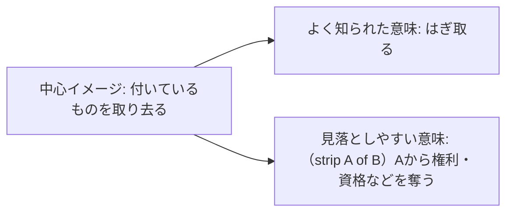

**重要語法：** `strip A of B`

<small>出典候補：index 1790／candidate_id `ev-01790-verb-01`／global_order 1132</small>

---

## 13. creation

**品詞：** 名詞　**発音（目安）：** クリエイション

<small>よく知られている意味：創造すること</small>

### 見落としやすい意味

**創作物、作られたもの**

**例文：** This sculpture is her latest creation.

**和訳：** この彫刻は彼女の最新の作品だ。

**コアイメージ：** creation は何かを作り出すことを表す。その行為から、作り出された完成品そのものを表す名詞にもなる。

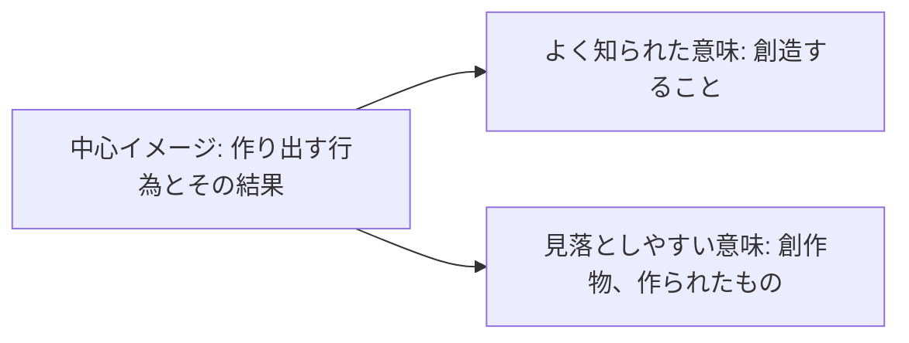

**重要語法：** `a work of creation とは限らない`

<small>出典候補：index 1791／candidate_id `ev-01791-noun-01`／global_order 1133</small>

---

## 14. essential

**品詞：** 名詞　**発音（目安）：** エッセンシャル

<small>よく知られている意味：不可欠な</small>

### 見落としやすい意味

**必需品、不可欠なもの（essentials）**

**例文：** Water and food are basic essentials.

**和訳：** 水と食料は基本的な必需品だ。

**コアイメージ：** essential はなくてはならない性質を表す。名詞では、その性質を持つ必要不可欠なものを指し、複数形もよく使う。

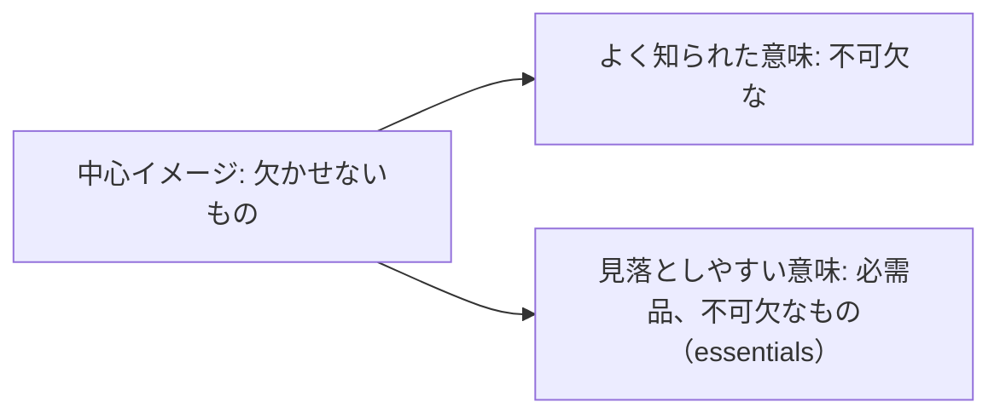

**重要語法：** `the essentials`

<small>出典候補：index 1792／candidate_id `ev-01792-noun-01`／global_order 1134</small>

---

## 15. package

**品詞：** 名詞　**発音（目安）：** パッケージ

<small>よく知られている意味：小包・包み</small>

### 見落としやすい意味

**（政策・取引の）一括案、一式の措置**

**例文：** The government announced a package of reforms.

**和訳：** 政府は一連の改革策を発表した。

**コアイメージ：** package の中心は複数のものをひとまとめにすること。物品の包みだけでなく、関連する政策や条件を一組にしたものも指す。

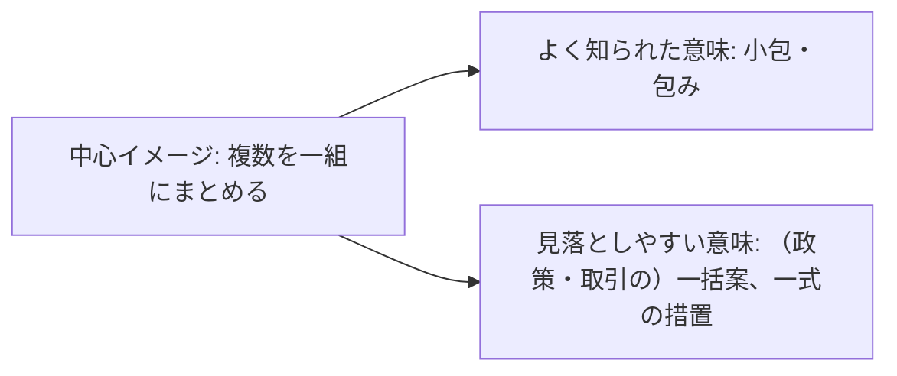

**重要語法：** `a package of measures`

<small>出典候補：index 1793／candidate_id `ev-01793-noun-01`／global_order 1135</small>

---

## 16. cold

**品詞：** 名詞　**発音（目安）：** コールド

<small>よく知られている意味：寒い・冷たい</small>

### 見落としやすい意味

**風邪（a cold）**

**例文：** I caught a cold before the trip.

**和訳：** 旅行前に風邪をひいた。

**コアイメージ：** cold は冷たさを表す基本語だが、名詞では病気の風邪も表す。a cold という形が出たら、気温の低さではなく体調の話として判断する。

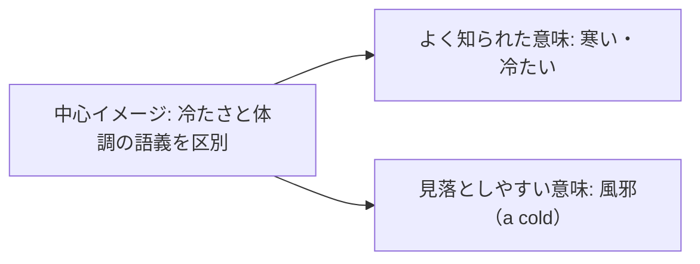

**重要語法：** `catch a cold`

<small>出典候補：index 1797／candidate_id `ev-01797-noun-01`／global_order 1136</small>

---

## 17. accident

**品詞：** 名詞　**発音（目安）：** アクシデント

<small>よく知られている意味：事故</small>

### 見落としやすい意味

**偶然（by accident）**

**例文：** We met by accident at the station.

**和訳：** 私たちは駅で偶然会った。

**コアイメージ：** accident は意図して起こしたわけではない出来事を指す。重大な事故だけでなく、偶然起きたこと全般を表す場面もある。

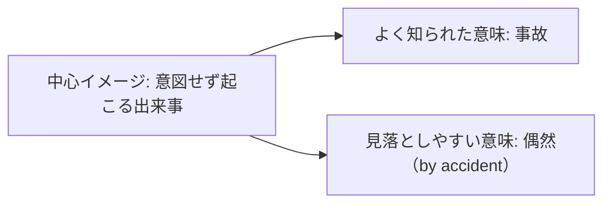

**重要語法：** `by accident`

<small>出典候補：index 1798／candidate_id `ev-01798-noun-01`／global_order 1137</small>

---

## 18. atmosphere

**品詞：** 名詞　**発音（目安）：** アトモスフィア

<small>よく知られている意味：大気</small>

### 見落としやすい意味

**雰囲気、場の空気**

**例文：** The café has a relaxed atmosphere.

**和訳：** そのカフェには落ち着いた雰囲気がある。

**コアイメージ：** atmosphere はある場所を包み込む空気を表す。目に見える大気だけでなく、その場全体から感じられる雰囲気を指す。

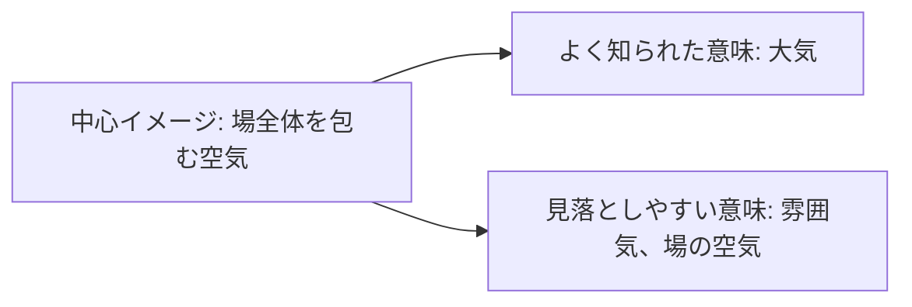

**重要語法：** `a friendly atmosphere`

<small>出典候補：index 1800／candidate_id `ev-01800-noun-01`／global_order 1138</small>

---

## 19. reserve

**品詞：** 動詞　**発音（目安）：** リザーブ

<small>よく知られている意味：予約する</small>

### 見落としやすい意味

**（reserve the right to）〜する権利を留保する**

**例文：** We reserve the right to change the schedule.

**和訳：** 私たちは日程を変更する権利を留保する。

**コアイメージ：** reserve は将来のために取っておくこと。席を取っておくのと同じように、権利を手放さず保持することにも用いる。

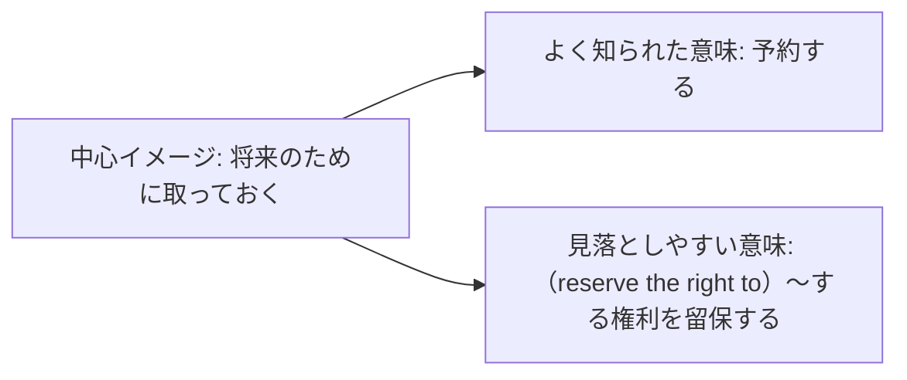

**重要語法：** `reserve the right to do`

<small>出典候補：index 1803／candidate_id `ev-01803-verb-01`／global_order 1139</small>

---

## 20. expectation

**品詞：** 名詞　**発音（目安）：** エクスペクテイション

<small>よく知られている意味：期待</small>

### 見落としやすい意味

**予想、見通し（market expectations）**

**例文：** Sales exceeded market expectations.

**和訳：** 売上高は市場の予想を上回った。

**コアイメージ：** expectation の中心は、今後こうなるだろうと考えること。望む気持ちだけでなく、将来の数値や結果に関する予測を表す。

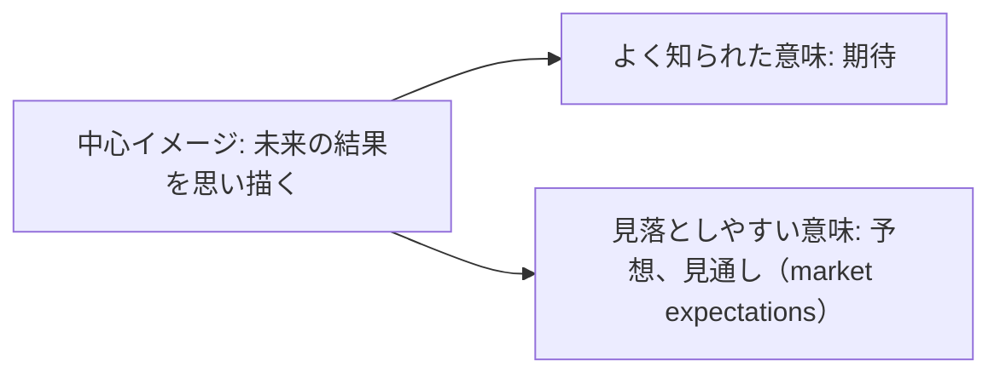

**重要語法：** `market expectations`

<small>出典候補：index 1807／candidate_id `ev-01807-noun-01`／global_order 1140</small>

---

## 21. passage

**品詞：** 名詞　**発音（目安）：** パッセージ

<small>よく知られている意味：通路・文章の一節</small>

### 見落としやすい意味

**（法案などの）正式な可決・成立**

**例文：** The passage of the bill took several months.

**和訳：** その法案の可決には数か月かかった。

**コアイメージ：** passage はあるところを通り抜けることと関係する。法案が審議の段階を通過し、正式に成立することも表す。

```mermaid
flowchart LR
    A["中心イメージ: 段階を通り抜ける"]
    B["よく知られた意味: 通路・文章の一節"]
    C["見落としやすい意味: （法案などの）正式な可決・成立"]
    A --> B
    A --> C
```

**重要語法：** `passage of a bill`

<small>出典候補：index 1810／candidate_id `ev-01810-noun-01`／global_order 1141</small>

---

## 22. charm

**品詞：** 名詞　**発音（目安）：** チャーム

<small>よく知られている意味：魅力</small>

### 見落としやすい意味

**お守り、まじないに使うもの**

**例文：** She wore a small charm around her neck.

**和訳：** 彼女は小さなお守りを首に下げていた。

**コアイメージ：** charm は人の心を引きつける不思議な力とも関係する。その力を宿すと考えられた小物を、お守りという意味で呼ぶことがある。

```mermaid
flowchart LR
    A["中心イメージ: 不思議な力を感じさせる"]
    B["よく知られた意味: 魅力"]
    C["見落としやすい意味: お守り、まじないに使うもの"]
    A --> B
    A --> C
```

**重要語法：** `lucky charm`

<small>出典候補：index 1811／candidate_id `ev-01811-noun-01`／global_order 1142</small>

---

## 23. distinction

**品詞：** 名詞　**発音（目安）：** ディスティンクション

<small>よく知られている意味：区別・相違</small>

### 見落としやすい意味

**優秀さ、名誉（with distinction）**

**例文：** He graduated with distinction.

**和訳：** 彼は優秀な成績で卒業した。

**コアイメージ：** distinction の中心は、ほかと違って際立つこと。単なる違いにとどまらず、優秀さによって目立つことや名誉も表す。

```mermaid
flowchart LR
    A["中心イメージ: ほかとの差が際立つ"]
    B["よく知られた意味: 区別・相違"]
    C["見落としやすい意味: 優秀さ、名誉（with distinction）"]
    A --> B
    A --> C
```

**重要語法：** `with distinction`

<small>出典候補：index 1812／candidate_id `ev-01812-noun-01`／global_order 1143</small>

---

## 24. fraud

**品詞：** 名詞　**発音（目安）：** フロード

<small>よく知られている意味：詐欺・不正</small>

### 見落としやすい意味

**詐欺師、見せかけだけの人（a fraud）**

**例文：** The man claimed to be a doctor, but he was a fraud.

**和訳：** その男は医師だと名乗っていたが、偽物だった。

**コアイメージ：** fraud は実際とは違うものを本物らしく見せる欺き。行為そのものだけでなく、そうした見せかけをする人も指す。

```mermaid
flowchart LR
    A["中心イメージ: 本物に見せかける欺き"]
    B["よく知られた意味: 詐欺・不正"]
    C["見落としやすい意味: 詐欺師、見せかけだけの人（a fraud）"]
    A --> B
    A --> C
```

**重要語法：** `a fraud`

<small>出典候補：index 1813／candidate_id `ev-01813-noun-01`／global_order 1144</small>

---

## 25. straight

**品詞：** 形容詞　**発音（目安）：** ストレート

<small>よく知られている意味：まっすぐな</small>

### 見落としやすい意味

**連続した（three straight days）**

**例文：** It rained for four straight days.

**和訳：** 4日間連続で雨が降った。

**コアイメージ：** straight は途中で曲がらずに続くこと。線や道だけでなく、時間が途切れず連続することにも使う。

```mermaid
flowchart LR
    A["中心イメージ: 途中で曲がらず続く"]
    B["よく知られた意味: まっすぐな"]
    C["見落としやすい意味: 連続した（three straight days）"]
    A --> B
    A --> C
```

**重要語法：** `three straight days`

<small>出典候補：index 1816／candidate_id `ev-01816-adjective-01`／global_order 1145</small>

---

## 26. weight

**品詞：** 動詞　**発音（目安）：** ウェイト

<small>よく知られている意味：重さ</small>

### 見落としやすい意味

**数値・評価項目に重要度に応じた重みを付ける**

**例文：** The survey weights answers by age group.

**和訳：** その調査では年齢層に応じて回答に重みを付ける。

**コアイメージ：** weight は重さという概念を表す。評価や集計では、項目ごとの重要度を違えて扱うという動詞になる。

```mermaid
flowchart LR
    A["中心イメージ: 重要さに重みを持たせる"]
    B["よく知られた意味: 重さ"]
    C["見落としやすい意味: 数値・評価項目に重要度に応じた重みを付ける"]
    A --> B
    A --> C
```

**重要語法：** `weight results by age`

<small>出典候補：index 1817／candidate_id `ev-01817-verb-01`／global_order 1146</small>

---

## 27. inform

**品詞：** 動詞　**発音（目安）：** インフォーム

<small>よく知られている意味：知らせる</small>

### 見落としやすい意味

**（人について）密告する（inform on）**

**例文：** Someone informed on the suspect.

**和訳：** 誰かがその容疑者について密告した。

**コアイメージ：** inform は情報を伝えることが中心。inform on は、その情報を当局などに伝えて相手を不利にする意味になりやすい。

```mermaid
flowchart LR
    A["中心イメージ: 情報を他者に伝える"]
    B["よく知られた意味: 知らせる"]
    C["見落としやすい意味: （人について）密告する（inform on）"]
    A --> B
    A --> C
```

**重要語法：** `inform on someone`

<small>出典候補：index 1818／candidate_id `ev-01818-verb-01`／global_order 1147</small>

---

## 28. elegant

**品詞：** 形容詞　**発音（目安）：** エレガント

<small>よく知られている意味：優雅な</small>

### 見落としやすい意味

**（理論・解法が）簡潔で巧妙な**

**例文：** She found an elegant solution to the problem.

**和訳：** 彼女はその問題に簡潔で巧みな解決策を見つけた。

**コアイメージ：** elegant は無駄がなく洗練されていること。服装だけでなく、少ない手順でうまく説明できる解法にも使う。

```mermaid
flowchart LR
    A["中心イメージ: 無駄のない洗練"]
    B["よく知られた意味: 優雅な"]
    C["見落としやすい意味: （理論・解法が）簡潔で巧妙な"]
    A --> B
    A --> C
```

**重要語法：** `an elegant solution`

<small>出典候補：index 1820／candidate_id `ev-01820-adjective-01`／global_order 1148</small>

---

## 29. personnel

**品詞：** 名詞　**発音（目安）：** パーソネル

<small>よく知られている意味：職員・従業員</small>

### 見落としやすい意味

**人事部門、人事担当の組織（personnel）**

**例文：** Please send the application to personnel.

**和訳：** その申請書を人事部に送ってください。

**コアイメージ：** personnel は組織で働く人々を指す。会社内でその人々の採用や管理を担当する部門も、この語で表すことがある。

```mermaid
flowchart LR
    A["中心イメージ: 組織の人を扱うこと"]
    B["よく知られた意味: 職員・従業員"]
    C["見落としやすい意味: 人事部門、人事担当の組織（personnel）"]
    A --> B
    A --> C
```

**重要語法：** `personnel department`

<small>出典候補：index 1823／candidate_id `ev-01823-noun-01`／global_order 1149</small>

---

## 30. ball

**品詞：** 名詞　**発音（目安）：** ボール

<small>よく知られている意味：球・ボール</small>

### 見落としやすい意味

**舞踏会、ダンスパーティー（a ball）**

**例文：** They attended a grand ball at the palace.

**和訳：** 彼らは宮殿で開かれた盛大な舞踏会に出席した。

**コアイメージ：** ball には球と舞踏会という別の語義がある。どちらかは運動や行事などの文脈で判断し、無理に一つのイメージへ結び付ける必要はない。

```mermaid
flowchart LR
    A["中心イメージ: 同じ形の異なる語義"]
    B["よく知られた意味: 球・ボール"]
    C["見落としやすい意味: 舞踏会、ダンスパーティー（a ball）"]
    A --> B
    A --> C
```

**重要語法：** `a masked ball`

<small>出典候補：index 1831／candidate_id `ev-01831-noun-01`／global_order 1150</small>

---

## 31. hero

**品詞：** 名詞　**発音（目安）：** ヒーロー

<small>よく知られている意味：英雄</small>

### 見落としやすい意味

**物語の主人公、中心人物**

**例文：** The hero of the novel is a young farmer.

**和訳：** その小説の主人公は若い農夫だ。

**コアイメージ：** hero は人々の注目を集める中心人物を表す。勇敢な人だけでなく、物語の中心にいる人物も指す。

```mermaid
flowchart LR
    A["中心イメージ: 注目を集める中心人物"]
    B["よく知られた意味: 英雄"]
    C["見落としやすい意味: 物語の主人公、中心人物"]
    A --> B
    A --> C
```

**重要語法：** `hero of a novel`

<small>出典候補：index 1832／candidate_id `ev-01832-noun-01`／global_order 1151</small>

---

## 32. burn

**品詞：** 動詞　**発音（目安）：** バーン

<small>よく知られている意味：燃やす</small>

### 見落としやすい意味

**（企業などが資金を）急速に消費する（burn through cash）**

**例文：** The startup burned through its cash in six months.

**和訳：** その新興企業は半年で資金を使い果たした。

**コアイメージ：** burn は燃料が燃えてなくなっていくこと。そこから、資金などの限られた資源を急速に使うことにも広がる。

```mermaid
flowchart LR
    A["中心イメージ: 資源を勢いよく消費する"]
    B["よく知られた意味: 燃やす"]
    C["見落としやすい意味: （企業などが資金を）急速に消費する（burn through cash）"]
    A --> B
    A --> C
```

**重要語法：** `burn through cash`

<small>出典候補：index 1833／candidate_id `ev-01833-verb-01`／global_order 1152</small>

---

## 33. bright

**品詞：** 形容詞　**発音（目安）：** ブライト

<small>よく知られている意味：明るい</small>

### 見落としやすい意味

**頭のよい、理解の早い**

**例文：** Our new classmate is very bright.

**和訳：** 新しい同級生はとても頭の回転が速い。

**コアイメージ：** bright は光が強く明るいことを表す。人に使うと、理解や発想が冴えていることを評価する形容詞になる。

```mermaid
flowchart LR
    A["中心イメージ: 明るく冴えている"]
    B["よく知られた意味: 明るい"]
    C["見落としやすい意味: 頭のよい、理解の早い"]
    A --> B
    A --> C
```

**重要語法：** `a bright student`

<small>出典候補：index 1835／candidate_id `ev-01835-adjective-01`／global_order 1153</small>

---

## 34. experiment

**品詞：** 動詞　**発音（目安）：** イクスペリメント

<small>よく知られている意味：科学実験</small>

### 見落としやすい意味

**（新しい方法・考えなどを）試してみる（experiment with）**

**例文：** We experimented with a different teaching method.

**和訳：** 私たちは別の教え方を試してみた。

**コアイメージ：** experiment の中心は、実際に試して結果を確かめること。研究室での実験に限らず、新しい方法を試すときにも使う。

```mermaid
flowchart LR
    A["中心イメージ: 試して結果を確かめる"]
    B["よく知られた意味: 科学実験"]
    C["見落としやすい意味: （新しい方法・考えなどを）試してみる（experiment with）"]
    A --> B
    A --> C
```

**重要語法：** `experiment with A`

<small>出典候補：index 1837／candidate_id `ev-01837-verb-01`／global_order 1154</small>

---

## 35. arrange

**品詞：** 動詞　**発音（目安）：** アレンジ

<small>よく知られている意味：並べる・整える</small>

### 見落としやすい意味

**（人が）〜するよう手配する（arrange for A to do）**

**例文：** We arranged for a driver to pick us up.

**和訳：** 運転手に迎えに来てもらうよう手配した。

**コアイメージ：** arrange は要素を都合よく整えること。物を並べるだけでなく、人や予定を調整して物事が実現するようにする。

```mermaid
flowchart LR
    A["中心イメージ: 物事が整うよう配置する"]
    B["よく知られた意味: 並べる・整える"]
    C["見落としやすい意味: （人が）〜するよう手配する（arrange for A to do）"]
    A --> B
    A --> C
```

**重要語法：** `arrange for A to do`

<small>出典候補：index 1838／candidate_id `ev-01838-verb-01`／global_order 1155</small>

---

## 36. volunteer

**品詞：** 動詞　**発音（目安）：** ボランティア

<small>よく知られている意味：無償の奉仕者</small>

### 見落としやすい意味

**自ら進んで〜すると申し出る（volunteer to do）**

**例文：** She volunteered to lead the discussion.

**和訳：** 彼女は自分から議論の進行役を引き受けると申し出た。

**コアイメージ：** volunteer は自分の意思で進んで関わること。名詞の奉仕者だけでなく、自発的に何かをすると申し出る動詞にもなる。

```mermaid
flowchart LR
    A["中心イメージ: 自発的に引き受ける"]
    B["よく知られた意味: 無償の奉仕者"]
    C["見落としやすい意味: 自ら進んで〜すると申し出る（volunteer to do）"]
    A --> B
    A --> C
```

**重要語法：** `volunteer to do`

<small>出典候補：index 1842／candidate_id `ev-01842-verb-01`／global_order 1156</small>

---

## 37. observation

**品詞：** 名詞　**発音（目安）：** オブザーベイション

<small>よく知られている意味：観察</small>

### 見落としやすい意味

**見解、指摘、所見（make an observation）**

**例文：** The teacher made an interesting observation about the story.

**和訳：** 先生はその物語について興味深い指摘をした。

**コアイメージ：** observation はよく見て気づくこと。観察そのものだけでなく、そこから得た考えを言葉にした所見や指摘を指す。

```mermaid
flowchart LR
    A["中心イメージ: 観察から気づきを得る"]
    B["よく知られた意味: 観察"]
    C["見落としやすい意味: 見解、指摘、所見（make an observation）"]
    A --> B
    A --> C
```

**重要語法：** `make an observation`

<small>出典候補：index 1848／candidate_id `ev-01848-noun-01`／global_order 1157</small>

---

## 38. dismiss

**品詞：** 動詞　**発音（目安）：** ディスミス

<small>よく知られている意味：解雇する</small>

### 見落としやすい意味

**提案・懸念などを取るに足りないとして退ける**

**例文：** The judge dismissed their concerns as irrelevant.

**和訳：** 裁判官は彼らの懸念を無関係だとして退けた。

**コアイメージ：** dismiss は人や物事をその場から退けること。人を職から去らせるだけでなく、提案や懸念を検討の対象から外す意味にもなる。

```mermaid
flowchart LR
    A["中心イメージ: 考慮の場から外す"]
    B["よく知られた意味: 解雇する"]
    C["見落としやすい意味: 提案・懸念などを取るに足りないとして退ける"]
    A --> B
    A --> C
```

**重要語法：** `dismiss A as B`

<small>出典候補：index 1850／candidate_id `ev-01850-verb-01`／global_order 1158</small>

---

## 39. concert

**品詞：** 名詞　**発音（目安）：** コンサート

<small>よく知られている意味：音楽会</small>

### 見落としやすい意味

**〜と協力して（in concert with）**

**例文：** The schools worked in concert to organize the event.

**和訳：** 各学校は協力してその行事を企画した。

**コアイメージ：** concert には複数の主体が足並みをそろえる意味がある。音楽会という名詞だけでなく、in concert with で協調した行動を表す。

```mermaid
flowchart LR
    A["中心イメージ: 足並みをそろえる"]
    B["よく知られた意味: 音楽会"]
    C["見落としやすい意味: 〜と協力して（in concert with）"]
    A --> B
    A --> C
```

**重要語法：** `in concert with A`

<small>出典候補：index 1854／candidate_id `ev-01854-noun-01`／global_order 1159</small>

---

## 40. heat

**品詞：** 名詞　**発音（目安）：** ヒート

<small>よく知られている意味：熱・暑さ</small>

### 見落としやすい意味

**（競技の）予選、組別レース（a heat）**

**例文：** She won her heat and reached the final.

**和訳：** 彼女は自分の予選組で勝ち、決勝に進んだ。

**コアイメージ：** heat は競技では組ごとに行う一回のレースを指す専門用法がある。熱という日常語義とは区別し、競技の進行を述べる文脈で読む。

```mermaid
flowchart LR
    A["中心イメージ: 一組ずつ行う競技"]
    B["よく知られた意味: 熱・暑さ"]
    C["見落としやすい意味: （競技の）予選、組別レース（a heat）"]
    A --> B
    A --> C
```

**重要語法：** `qualifying heat`

<small>出典候補：index 1856／candidate_id `ev-01856-noun-01`／global_order 1160</small>

---

## 41. trace

**品詞：** 動詞　**発音（目安）：** トレース

<small>よく知られている意味：線をなぞる</small>

### 見落としやすい意味

**出来事や系統の由来・歴史をたどる**

**例文：** Researchers traced the tradition back to the 1700s.

**和訳：** 研究者たちはその伝統の起源を1700年代までさかのぼってたどった。

**コアイメージ：** trace は残された跡を順に追うこと。目に見える線だけでなく、出来事の歴史や起源をたどる意味でも使う。

```mermaid
flowchart LR
    A["中心イメージ: 残された跡をたどる"]
    B["よく知られた意味: 線をなぞる"]
    C["見落としやすい意味: 出来事や系統の由来・歴史をたどる"]
    A --> B
    A --> C
```

**重要語法：** `trace A back to B`

<small>出典候補：index 1858／candidate_id `ev-01858-verb-01`／global_order 1161</small>

---

## 42. label

**品詞：** 動詞　**発音（目安）：** レーベル

<small>よく知られている意味：ラベルを貼る</small>

### 見落としやすい意味

**（人・集団に）レッテルを貼る**

**例文：** The media labeled him a genius.

**和訳：** メディアは彼を天才だと決めつけるように呼んだ。

**コアイメージ：** label は対象に名前を付けて分類すること。実物のラベルだけでなく、人に特定の評価を固定して付けることも表す。

```mermaid
flowchart LR
    A["中心イメージ: 名前を付けて分類する"]
    B["よく知られた意味: ラベルを貼る"]
    C["見落としやすい意味: （人・集団に）レッテルを貼る"]
    A --> B
    A --> C
```

**重要語法：** `label A B`

<small>出典候補：index 1860／candidate_id `ev-01860-verb-01`／global_order 1162</small>

---

## 43. wooden

**品詞：** 形容詞　**発音（目安）：** ウッデン

<small>よく知られている意味：木製の</small>

### 見落としやすい意味

**ぎこちない、感情の乏しい（wooden performance）**

**例文：** His speech sounded wooden and unnatural.

**和訳：** 彼の演説はぎこちなく、不自然に聞こえた。

**コアイメージ：** wooden は木のような固さを連想させる。話し方や演技では、動きや感情表現が硬く自然さに欠ける状態を表す。

```mermaid
flowchart LR
    A["中心イメージ: 木のように硬い"]
    B["よく知られた意味: 木製の"]
    C["見落としやすい意味: ぎこちない、感情の乏しい（wooden performance）"]
    A --> B
    A --> C
```

**重要語法：** `a wooden performance`

<small>出典候補：index 1862／candidate_id `ev-01862-adjective-01`／global_order 1163</small>

---

## 44. upper

**品詞：** 形容詞　**発音（目安）：** アッパー

<small>よく知られている意味：上の・上部の</small>

### 見落としやすい意味

**優位に立っている（have the upper hand）**

**例文：** Our team gained the upper hand in the second half.

**和訳：** 私たちのチームは後半に優勢になった。

**コアイメージ：** upper は位置が上であること。have the upper hand では相手より有利な立場にいるという比喩になる。

```mermaid
flowchart LR
    A["中心イメージ: 上側に立つ優位性"]
    B["よく知られた意味: 上の・上部の"]
    C["見落としやすい意味: 優位に立っている（have the upper hand）"]
    A --> B
    A --> C
```

**重要語法：** `have the upper hand`

<small>出典候補：index 1863／candidate_id `ev-01863-adjective-01`／global_order 1164</small>

---

## 45. fairly

**品詞：** 副詞　**発音（目安）：** フェアリー

<small>よく知られている意味：公平に</small>

### 見落としやすい意味

**かなり、比較的（fairly difficult など）**

**例文：** The test was fairly difficult.

**和訳：** その試験はかなり難しかった。

**コアイメージ：** fairly には公正にという意味と、程度を表す意味がある。形容詞の前では比較的・かなりという程度を表す場合が多い。

```mermaid
flowchart LR
    A["中心イメージ: 程度を一定の水準で示す"]
    B["よく知られた意味: 公平に"]
    C["見落としやすい意味: かなり、比較的（fairly difficult など）"]
    A --> B
    A --> C
```

**重要語法：** `fairly + 形容詞`

<small>出典候補：index 1865／candidate_id `ev-01865-adverb-01`／global_order 1165</small>

---

## 46. architect

**品詞：** 名詞　**発音（目安）：** アーキテクト

<small>よく知られている意味：建築家</small>

### 見落としやすい意味

**（計画・制度などの）設計者、立案者**

**例文：** She was the architect of the new policy.

**和訳：** 彼女はその新しい政策の立案者だった。

**コアイメージ：** architect は建物の設計をする人。比喩的に、制度や計画の全体構造を考えて作り上げる人も指す。

```mermaid
flowchart LR
    A["中心イメージ: 全体を設計する人"]
    B["よく知られた意味: 建築家"]
    C["見落としやすい意味: （計画・制度などの）設計者、立案者"]
    A --> B
    A --> C
```

**重要語法：** `architect of a plan`

<small>出典候補：index 1866／candidate_id `ev-01866-noun-01`／global_order 1166</small>

---

## 47. invest

**品詞：** 動詞　**発音（目安）：** インベスト

<small>よく知られている意味：投資する</small>

### 見落としやすい意味

**AにBの権限・性質を与える（invest A with B）**

**例文：** The law invests the agency with new powers.

**和訳：** その法律はその機関に新たな権限を与える。

**コアイメージ：** invest には何かを人や組織に与えて備えさせる語法がある。資金を投入する意味だけでなく、権限を授ける意味でも使われる。

```mermaid
flowchart LR
    A["中心イメージ: 必要なものを与え備えさせる"]
    B["よく知られた意味: 投資する"]
    C["見落としやすい意味: AにBの権限・性質を与える（invest A with B）"]
    A --> B
    A --> C
```

**重要語法：** `invest A with B`

<small>出典候補：index 1868／candidate_id `ev-01868-verb-01`／global_order 1167</small>

---

## 48. bay

**品詞：** 名詞　**発音（目安）：** ベイ

<small>よく知られている意味：湾・入り江</small>

### 見落としやすい意味

**〜を寄せ付けない（keep/hold at bay）**

**例文：** Regular checks helped keep the problem at bay.

**和訳：** 定期的な点検は問題の拡大を防ぐのに役立った。

**コアイメージ：** at bay は危険などが近づかないよう抑えておく慣用表現。入り江という名詞とは無理につなげず、keep A at bay を一つの表現として覚える。

```mermaid
flowchart LR
    A["中心イメージ: 近づかせず距離を保つ"]
    B["よく知られた意味: 湾・入り江"]
    C["見落としやすい意味: 〜を寄せ付けない（keep/hold at bay）"]
    A --> B
    A --> C
```

**重要語法：** `keep A at bay`

<small>出典候補：index 1870／candidate_id `ev-01870-noun-01`／global_order 1168</small>

---

## 49. characteristic

**品詞：** 名詞　**発音（目安）：** キャラクタリスティック

<small>よく知られている意味：特徴的な</small>

### 見落としやすい意味

**特徴、特性（a characteristic）**

**例文：** Patience is an important characteristic of a good teacher.

**和訳：** 忍耐強さはよい教師の大切な特性だ。

**コアイメージ：** characteristic は他と区別できる特徴に関わる語。形容詞だけでなく、その特徴そのものを指す名詞にもなる。

```mermaid
flowchart LR
    A["中心イメージ: そのものを特徴づける性質"]
    B["よく知られた意味: 特徴的な"]
    C["見落としやすい意味: 特徴、特性（a characteristic）"]
    A --> B
    A --> C
```

**重要語法：** `a characteristic of A`

<small>出典候補：index 1874／candidate_id `ev-01874-noun-01`／global_order 1169</small>

---

## 50. divorce

**品詞：** 動詞　**発音（目安）：** ディボース

<small>よく知られている意味：離婚する</small>

### 見落としやすい意味

**（制度・考えを）〜から切り離す（divorce A from B）**

**例文：** The report divorced the figures from their context.

**和訳：** その報告書は数値をその文脈から切り離していた。

**コアイメージ：** divorce は関係を断ち切って分離すること。夫婦関係だけでなく、考えや情報を本来のつながりから切り離す場合にも使う。

```mermaid
flowchart LR
    A["中心イメージ: 結び付きから切り離す"]
    B["よく知られた意味: 離婚する"]
    C["見落としやすい意味: （制度・考えを）〜から切り離す（divorce A from B）"]
    A --> B
    A --> C
```

**重要語法：** `divorce A from B`

<small>出典候補：index 1877／candidate_id `ev-01877-verb-01`／global_order 1170</small>

---

## 51. sophisticated

**品詞：** 形容詞　**発音（目安）：** ソフィスティケイテッド

<small>よく知られている意味：洗練された</small>

### 見落としやすい意味

**高度で複雑な（sophisticated technology）**

**例文：** The lab uses sophisticated equipment.

**和訳：** その研究室では高度な装置を使っている。

**コアイメージ：** sophisticated は多くの工夫が加わっている状態を表す。人の振る舞いが洗練されているだけでなく、技術が高度で複雑なことも表す。

```mermaid
flowchart LR
    A["中心イメージ: 工夫を重ねて高度になる"]
    B["よく知られた意味: 洗練された"]
    C["見落としやすい意味: 高度で複雑な（sophisticated technology）"]
    A --> B
    A --> C
```

**重要語法：** `sophisticated technology`

<small>出典候補：index 1878／candidate_id `ev-01878-adjective-01`／global_order 1171</small>

---

## 52. dry

**品詞：** 動詞　**発音（目安）：** ドライ

<small>よく知られている意味：乾かす・乾いた</small>

### 見落としやすい意味

**（dry up）仕事・資金などの供給が途絶える**

**例文：** Funding for the project dried up.

**和訳：** その計画への資金提供が途絶えた。

**コアイメージ：** dry up は水分がなくなって乾き切ること。そこから資金や仕事など、以前はあった供給が途絶える意味になる。

```mermaid
flowchart LR
    A["中心イメージ: 供給源が干上がる"]
    B["よく知られた意味: 乾かす・乾いた"]
    C["見落としやすい意味: （dry up）仕事・資金などの供給が途絶える"]
    A --> B
    A --> C
```

**重要語法：** `dry up`

<small>出典候補：index 1880／candidate_id `ev-01880-verb-01`／global_order 1172</small>

---

## 53. length

**品詞：** 名詞　**発音（目安）：** レングス

<small>よく知られている意味：長さ</small>

### 見落としやすい意味

**あらゆる手段を尽くす（go to great lengths）**

**例文：** They went to great lengths to protect the birds.

**和訳：** 彼らは鳥を守るためにあらゆる努力をした。

**コアイメージ：** length は延びている距離の長さを表す。go to great lengths は目的のために遠くまで進むように、多大な手間をかけることを表す。

```mermaid
flowchart LR
    A["中心イメージ: 遠くまで及ぶ努力"]
    B["よく知られた意味: 長さ"]
    C["見落としやすい意味: あらゆる手段を尽くす（go to great lengths）"]
    A --> B
    A --> C
```

**重要語法：** `go to great lengths to do`

<small>出典候補：index 1885／candidate_id `ev-01885-noun-01`／global_order 1173</small>

---

## 54. session

**品詞：** 名詞　**発音（目安）：** セッション

<small>よく知られている意味：一回の授業・会合</small>

### 見落としやすい意味

**（議会・会議などの）会期**

**例文：** Parliament will discuss the bill in its next session.

**和訳：** 議会は次の会期でその法案を審議する。

**コアイメージ：** session は一定の目的で集まり活動する期間。授業の一回分だけでなく、議会が開かれている期間全体も指す。

```mermaid
flowchart LR
    A["中心イメージ: 活動のために区切られた期間"]
    B["よく知られた意味: 一回の授業・会合"]
    C["見落としやすい意味: （議会・会議などの）会期"]
    A --> B
    A --> C
```

**重要語法：** `a parliamentary session`

<small>出典候補：index 1887／candidate_id `ev-01887-noun-01`／global_order 1174</small>

---

## 55. afford

**品詞：** 動詞　**発音（目安）：** アフォード

<small>よく知られている意味：買う余裕がある</small>

### 見落としやすい意味

**（人に機会・利益などを）与える（afford A B）**

**例文：** The trip afforded us a rare opportunity to learn.

**和訳：** その旅行は私たちに学ぶ貴重な機会を与えてくれた。

**コアイメージ：** afford は何かを可能にする余地を与えることに関わる。費用を負担できるという意味だけでなく、機会や利益を提供する意味でも使う。

```mermaid
flowchart LR
    A["中心イメージ: 可能性や余地を提供する"]
    B["よく知られた意味: 買う余裕がある"]
    C["見落としやすい意味: （人に機会・利益などを）与える（afford A B）"]
    A --> B
    A --> C
```

**重要語法：** `afford A B`

<small>出典候補：index 1888／candidate_id `ev-01888-verb-01`／global_order 1175</small>

---

## 56. inventory

**品詞：** 名詞　**発音（目安）：** インベントリー

<small>よく知られている意味：在庫</small>

### 見落としやすい意味

**備品・商品の目録、一覧表**

**例文：** We checked the inventory list before ordering supplies.

**和訳：** 私たちは備品を注文する前に在庫の一覧表を確認した。

**コアイメージ：** inventory は持っている物を把握することと関係する。在庫そのものだけでなく、品目を数えて記録した目録も指す。

```mermaid
flowchart LR
    A["中心イメージ: 保有物を数えて把握する"]
    B["よく知られた意味: 在庫"]
    C["見落としやすい意味: 備品・商品の目録、一覧表"]
    A --> B
    A --> C
```

**重要語法：** `an inventory of equipment`

<small>出典候補：index 1890／candidate_id `ev-01890-noun-01`／global_order 1176</small>

---

## 57. guard

**品詞：** 動詞　**発音（目安）：** ガード

<small>よく知られている意味：守る</small>

### 見落としやすい意味

**〜に警戒する、予防する（guard against）**

**例文：** Wash your hands to guard against infection.

**和訳：** 感染を防ぐために手を洗いなさい。

**コアイメージ：** guard は危険が近づかないように守ること。人や場所を見張る場合だけでなく、病気や失敗を予防する意味にもなる。

```mermaid
flowchart LR
    A["中心イメージ: 危険を近づけない"]
    B["よく知られた意味: 守る"]
    C["見落としやすい意味: 〜に警戒する、予防する（guard against）"]
    A --> B
    A --> C
```

**重要語法：** `guard against A`

<small>出典候補：index 1891／candidate_id `ev-01891-verb-01`／global_order 1177</small>

---

## 58. modest

**品詞：** 形容詞　**発音（目安）：** モデスト

<small>よく知られている意味：謙虚な・控えめな</small>

### 見落としやすい意味

**小規模な、わずかな（a modest increase）**

**例文：** The company reported a modest increase in profits.

**和訳：** その会社は利益がわずかに増えたと報告した。

**コアイメージ：** modest は過度に大きく見せないこと。性格の控えめさだけでなく、数字や規模が小さいことにも使われる。

```mermaid
flowchart LR
    A["中心イメージ: 大きさを控えめに示す"]
    B["よく知られた意味: 謙虚な・控えめな"]
    C["見落としやすい意味: 小規模な、わずかな（a modest increase）"]
    A --> B
    A --> C
```

**重要語法：** `a modest increase`

<small>出典候補：index 1893／candidate_id `ev-01893-adjective-01`／global_order 1178</small>

---

## 59. decorate

**品詞：** 動詞　**発音（目安）：** デコレイト

<small>よく知られている意味：飾る</small>

### 見落としやすい意味

**（功績に対して）勲章を授ける（be decorated for）**

**例文：** The soldier was decorated for bravery.

**和訳：** その兵士は勇敢な行為をたたえられ、勲章を授けられた。

**コアイメージ：** decorate は飾りを付けること。人に勲章という目に見える栄誉を授ける意味にもつながる。

```mermaid
flowchart LR
    A["中心イメージ: 栄誉の印を付ける"]
    B["よく知られた意味: 飾る"]
    C["見落としやすい意味: （功績に対して）勲章を授ける（be decorated for）"]
    A --> B
    A --> C
```

**重要語法：** `be decorated for bravery`

<small>出典候補：index 1894／candidate_id `ev-01894-verb-01`／global_order 1179</small>

---

## 60. carve

**品詞：** 動詞　**発音（目安）：** カーブ

<small>よく知られている意味：彫る・切り出す</small>

### 見落としやすい意味

**（地位・事業などを）努力して切り開く（carve out）**

**例文：** She carved out a career in design.

**和訳：** 彼女はデザインの分野で自分の道を切り開いた。

**コアイメージ：** carve は材料を削って形を作ること。比喩的には、努力して自分の居場所や仕事を作り出すことを表す。

```mermaid
flowchart LR
    A["中心イメージ: 削って形・場所を作る"]
    B["よく知られた意味: 彫る・切り出す"]
    C["見落としやすい意味: （地位・事業などを）努力して切り開く（carve out）"]
    A --> B
    A --> C
```

**重要語法：** `carve out a career`

<small>出典候補：index 1895／candidate_id `ev-01895-verb-01`／global_order 1180</small>

---

## 61. apart

**品詞：** 副詞　**発音（目安）：** アパート

<small>よく知られている意味：離れて</small>

### 見落としやすい意味

**〜を除いて／〜のほかに（apart from）**

**例文：** Apart from the cost, the plan looks good.

**和訳：** 費用を除けば、その計画はよさそうだ。

**コアイメージ：** apart は何かを離して別にする感覚を持つ。apart from はほかから切り離して考えるため、除外や追加の表現になる。

```mermaid
flowchart LR
    A["中心イメージ: ほかから分けて考える"]
    B["よく知られた意味: 離れて"]
    C["見落としやすい意味: 〜を除いて／〜のほかに（apart from）"]
    A --> B
    A --> C
```

**重要語法：** `apart from は「除いて」「ほかに」の両義`

<small>出典候補：index 1897／candidate_id `ev-01897-adverb-01`／global_order 1181</small>

---

## 62. strength

**品詞：** 名詞　**発音（目安）：** ストレングス

<small>よく知られている意味：力・強さ</small>

### 見落としやすい意味

**長所、強み（a strength）**

**例文：** Listening is one of her greatest strengths.

**和訳：** 人の話をよく聞くことは彼女の大きな長所の一つだ。

**コアイメージ：** strength は何かをうまく支える力を表す。筋力に限らず、人や組織が得意とする能力や長所も指す。

```mermaid
flowchart LR
    A["中心イメージ: 物事を支える力"]
    B["よく知られた意味: 力・強さ"]
    C["見落としやすい意味: 長所、強み（a strength）"]
    A --> B
    A --> C
```

**重要語法：** `one's strengths`

<small>出典候補：index 1898／candidate_id `ev-01898-noun-01`／global_order 1182</small>

---

## 63. currency

**品詞：** 名詞　**発音（目安）：** カレンシー

<small>よく知られている意味：通貨</small>

### 見落としやすい意味

**（考え・語などが）流通し受け入れられること（gain currency）**

**例文：** This phrase has gained currency among students.

**和訳：** この表現は学生の間で広く使われるようになった。

**コアイメージ：** currency は広く流通して受け入れられることと関係する。お金だけでなく、言葉や考えが世の中に広まることも表す。

```mermaid
flowchart LR
    A["中心イメージ: 広く流通する"]
    B["よく知られた意味: 通貨"]
    C["見落としやすい意味: （考え・語などが）流通し受け入れられること（gain currency）"]
    A --> B
    A --> C
```

**重要語法：** `gain currency`

<small>出典候補：index 1902／candidate_id `ev-01902-noun-01`／global_order 1183</small>

---

## 64. reverse

**品詞：** 動詞　**発音（目安）：** リバース

<small>よく知られている意味：逆にする</small>

### 見落としやすい意味

**（判決・決定などを）覆す、取り消す**

**例文：** The court reversed the earlier decision.

**和訳：** 裁判所は以前の判決を覆した。

**コアイメージ：** reverse は向きや順序を逆にすること。法律や判断の場面では、以前の決定の効力を逆転させる意味になる。

```mermaid
flowchart LR
    A["中心イメージ: 向きや結論を逆にする"]
    B["よく知られた意味: 逆にする"]
    C["見落としやすい意味: （判決・決定などを）覆す、取り消す"]
    A --> B
    A --> C
```

**重要語法：** `reverse a decision`

<small>出典候補：index 1904／candidate_id `ev-01904-verb-01`／global_order 1184</small>

---

## 65. precisely

**品詞：** 副詞　**発音（目安）：** プリサイスリー

<small>よく知られている意味：正確に</small>

### 見落としやすい意味

**まさに、そのとおり（Precisely.）**

**例文：** “So you want more time?” “Precisely.”

**和訳：** 「つまり、もっと時間が必要なのですね」「まさにそのとおりです」。

**コアイメージ：** precisely はずれがなくぴったり合うことを表す。相手の言ったことが自分の意図と完全に一致するとき、強い同意の返事になる。

```mermaid
flowchart LR
    A["中心イメージ: ぴったり一致する"]
    B["よく知られた意味: 正確に"]
    C["見落としやすい意味: まさに、そのとおり（Precisely.）"]
    A --> B
    A --> C
```

**重要語法：** `Precisely. は強い肯定`

<small>出典候補：index 1905／candidate_id `ev-01905-adverb-01`／global_order 1185</small>

---

## 66. circle

**品詞：** 名詞　**発音（目安）：** サークル

<small>よく知られている意味：円</small>

### 見落としやすい意味

**仲間内、交友関係、社会的な集まり（in political circles）**

**例文：** She is well known in academic circles.

**和訳：** 彼女は学界でよく知られている。

**コアイメージ：** circle は中心の周りに人が集まった輪も表す。そこから、共通の関心でつながる仲間や社会的な集団を指す。

```mermaid
flowchart LR
    A["中心イメージ: 人が集まる輪"]
    B["よく知られた意味: 円"]
    C["見落としやすい意味: 仲間内、交友関係、社会的な集まり（in political circles）"]
    A --> B
    A --> C
```

**重要語法：** `academic circles`

<small>出典候補：index 1907／candidate_id `ev-01907-noun-01`／global_order 1186</small>

---

## 67. shoe

**品詞：** 名詞　**発音（目安）：** シュー

<small>よく知られている意味：靴</small>

### 見落としやすい意味

**（他人の）立場・境遇（in someone's shoes）**

**例文：** Try putting yourself in her shoes.

**和訳：** 彼女の立場になって考えてみて。

**コアイメージ：** shoes は実際に誰かが履いている靴。比喩的には、その人の場所に立って同じ状況を経験することを表す。

```mermaid
flowchart LR
    A["中心イメージ: 他人の位置に立つ"]
    B["よく知られた意味: 靴"]
    C["見落としやすい意味: （他人の）立場・境遇（in someone's shoes）"]
    A --> B
    A --> C
```

**重要語法：** `in someone's shoes`

<small>出典候補：index 1908／candidate_id `ev-01908-noun-01`／global_order 1187</small>

---

## 68. tip

**品詞：** 動詞　**発音（目安）：** ティップ

<small>よく知られている意味：先端・チップ</small>

### 見落としやすい意味

**形勢・均衡を変える（tip the balance）**

**例文：** A single vote tipped the balance.

**和訳：** たった一票が形勢を変えた。

**コアイメージ：** tip は物を少し傾ける動きにも使う。勢力が釣り合っているところで小さな要素が加わり、結果を一方に傾けることを表す。

```mermaid
flowchart LR
    A["中心イメージ: 均衡が一方へ傾く"]
    B["よく知られた意味: 先端・チップ"]
    C["見落としやすい意味: 形勢・均衡を変える（tip the balance）"]
    A --> B
    A --> C
```

**重要語法：** `tip the balance`

<small>出典候補：index 1910／candidate_id `ev-01910-verb-01`／global_order 1188</small>

---

## 69. trail

**品詞：** 動詞　**発音（目安）：** トレイル

<small>よく知られている意味：小道・跡</small>

### 見落としやすい意味

**後れをとる（trail behind）**

**例文：** Our team is trailing behind by five points.

**和訳：** 私たちのチームは5点差で後れを取っている。

**コアイメージ：** trail は先行するものの後ろに続くこと。競争や比較の場面では、相手より後ろに位置している意味になる。

```mermaid
flowchart LR
    A["中心イメージ: 先行するものの後を行く"]
    B["よく知られた意味: 小道・跡"]
    C["見落としやすい意味: 後れをとる（trail behind）"]
    A --> B
    A --> C
```

**重要語法：** `trail behind`

<small>出典候補：index 1912／candidate_id `ev-01912-verb-01`／global_order 1189</small>

---

## 70. trail

**品詞：** 動詞　**発音（目安）：** トレイル

<small>よく知られている意味：小道・跡</small>

### 見落としやすい意味

**（人・動物の）あとをつける、追跡する**

**例文：** The dog trailed the scent through the forest.

**和訳：** その犬は森の中でにおいの跡を追った。

**コアイメージ：** trail は残された跡や通り道を思わせる語。動詞では、手がかりを追って人や動物の行方をたどることも表す。

```mermaid
flowchart LR
    A["中心イメージ: 残された跡を追う"]
    B["よく知られた意味: 小道・跡"]
    C["見落としやすい意味: （人・動物の）あとをつける、追跡する"]
    A --> B
    A --> C
```

**重要語法：** `trail a scent`

<small>出典候補：index 1912／candidate_id `ev-01912-verb-02`／global_order 1190</small>

---

## 71. mouth

**品詞：** 動詞　**発音（目安）：** マウス

<small>よく知られている意味：口</small>

### 見落としやすい意味

**声を出さず、唇だけで言葉を形作る**

**例文：** He mouthed the words without making a sound.

**和訳：** 彼は声を出さず、その言葉を唇の動きだけで示した。

**コアイメージ：** mouth は言葉を発するための口を指す。動詞になると、音を出さずに口の形で言葉を作る動作を表せる。

```mermaid
flowchart LR
    A["中心イメージ: 口の形で言葉を作る"]
    B["よく知られた意味: 口"]
    C["見落としやすい意味: 声を出さず、唇だけで言葉を形作る"]
    A --> B
    A --> C
```

**重要語法：** `mouth the words`

<small>出典候補：index 1914／candidate_id `ev-01914-verb-01`／global_order 1191</small>

---

## 72. nobody

**品詞：** 名詞　**発音（目安）：** ノーバディ

<small>よく知られている意味：誰も〜ない</small>

### 見落としやすい意味

**無名で取るに足りない人（a nobody）**

**例文：** He arrived as a nobody but left as a star.

**和訳：** 彼は無名の人間として来たが、スターとなって去った。

**コアイメージ：** nobody は文字どおり「誰でもない人」。名詞で a nobody とすると、世間に知られていない人や重要視されない人を指す。

```mermaid
flowchart LR
    A["中心イメージ: 世間で名のない人"]
    B["よく知られた意味: 誰も〜ない"]
    C["見落としやすい意味: 無名で取るに足りない人（a nobody）"]
    A --> B
    A --> C
```

**重要語法：** `a nobody`

<small>出典候補：index 1918／candidate_id `ev-01918-noun-01`／global_order 1192</small>

---

## 73. bag

**品詞：** 動詞　**発音（目安）：** バッグ

<small>よく知られている意味：かばん</small>

### 見落としやすい意味

**（賞・成功などを）手に入れる（bag an award）**

**例文：** The singer bagged three awards last night.

**和訳：** その歌手は昨夜、賞を3つ獲得した。

**コアイメージ：** bag は品物を袋に入れて手にすることを連想させる。口語では、賞や仕事などを獲得して自分のものにする動詞として使う。

```mermaid
flowchart LR
    A["中心イメージ: 手に入れて自分のものにする"]
    B["よく知られた意味: かばん"]
    C["見落としやすい意味: （賞・成功などを）手に入れる（bag an award）"]
    A --> B
    A --> C
```

**重要語法：** `bag an award は口語的`

<small>出典候補：index 1921／candidate_id `ev-01921-verb-01`／global_order 1193</small>

---

## 74. instrument

**品詞：** 名詞　**発音（目安）：** インストゥルメント

<small>よく知られている意味：楽器・器具</small>

### 見落としやすい意味

**（目的達成の）手段、道具（an instrument of）**

**例文：** Education can be an instrument of social change.

**和訳：** 教育は社会を変えるための手段になり得る。

**コアイメージ：** instrument はある目的のために使う道具。目に見える器具だけでなく、目的の達成を助ける制度や活動も指す。

```mermaid
flowchart LR
    A["中心イメージ: 目的に役立つ道具"]
    B["よく知られた意味: 楽器・器具"]
    C["見落としやすい意味: （目的達成の）手段、道具（an instrument of）"]
    A --> B
    A --> C
```

**重要語法：** `an instrument of change`

<small>出典候補：index 1923／candidate_id `ev-01923-noun-01`／global_order 1194</small>

---

## 75. vice

**品詞：** 名詞　**発音（目安）：** ヴァイス

<small>よく知られている意味：副〜（接頭辞 vice-）</small>

### 見落としやすい意味

**悪徳、悪習、道徳上の欠点**

**例文：** Greed was his greatest vice.

**和訳：** 強欲が彼の最大の悪徳だった。

**コアイメージ：** 名詞 vice は悪い習慣や道徳的な欠点を指す。副〜を表す vice- とは語源・意味の系統が異なるため、形の類似だけで結び付けず別に覚える。

```mermaid
flowchart LR
    A["中心イメージ: 別の語義系統を見分ける"]
    B["よく知られた意味: 副〜（接頭辞 vice-）"]
    C["見落としやすい意味: 悪徳、悪習、道徳上の欠点"]
    A --> B
    A --> C
```

**重要語法：** `vice は名詞、vice- は接頭辞`

<small>出典候補：index 1925／candidate_id `ev-01925-noun-01`／global_order 1195</small>

---

## 76. estate

**品詞：** 名詞　**発音（目安）：** エステイト

<small>よく知られている意味：土地・不動産</small>

### 見落としやすい意味

**相続財産、故人が残した財産（estate）**

**例文：** Her estate was divided among her children.

**和訳：** 彼女の遺産は子どもたちの間で分けられた。

**コアイメージ：** estate は所有している財産のまとまりを指す。土地などの不動産だけでなく、死亡時に残された財産全体を表す。

```mermaid
flowchart LR
    A["中心イメージ: 所有する財産のまとまり"]
    B["よく知られた意味: 土地・不動産"]
    C["見落としやすい意味: 相続財産、故人が残した財産（estate）"]
    A --> B
    A --> C
```

**重要語法：** `the estate of the deceased`

<small>出典候補：index 1926／candidate_id `ev-01926-noun-01`／global_order 1196</small>

---

## 77. assign

**品詞：** 動詞　**発音（目安）：** アサイン

<small>よく知られている意味：任務を割り当てる</small>

### 見落としやすい意味

**（理由・責任などを）〜に帰する（assign blame to）**

**例文：** The report assigned blame to the manager.

**和訳：** その報告書は責任が管理者にあるとした。

**コアイメージ：** assign は何かの行き先や担当を決めること。仕事を割り振るだけでなく、責任や原因を誰かに帰属させることも表す。

```mermaid
flowchart LR
    A["中心イメージ: 帰属先を定める"]
    B["よく知られた意味: 任務を割り当てる"]
    C["見落としやすい意味: （理由・責任などを）〜に帰する（assign blame to）"]
    A --> B
    A --> C
```

**重要語法：** `assign blame to A`

<small>出典候補：index 1927／candidate_id `ev-01927-verb-01`／global_order 1197</small>

---

## 78. alive

**品詞：** 形容詞　**発音（目安）：** アライブ

<small>よく知られている意味：生きている</small>

### 見落としやすい意味

**〜に気付いている、十分認識している（alive to）**

**例文：** She is alive to the risks of the plan.

**和訳：** 彼女はその計画の危険性をよく認識している。

**コアイメージ：** alive は生きて反応できる状態を表す。alive to は物事に対する感覚が働き、その存在や重要性によく気づいていることを表す。

```mermaid
flowchart LR
    A["中心イメージ: 感覚が生きて反応する"]
    B["よく知られた意味: 生きている"]
    C["見落としやすい意味: 〜に気付いている、十分認識している（alive to）"]
    A --> B
    A --> C
```

**重要語法：** `be alive to A`

<small>出典候補：index 1930／candidate_id `ev-01930-adjective-01`／global_order 1198</small>

---

## 79. instruction

**品詞：** 名詞　**発音（目安）：** インストラクション

<small>よく知られている意味：命令・指示</small>

### 見落としやすい意味

**教育、指導、授業**

**例文：** The course includes instruction in first aid.

**和訳：** その講座には応急手当の指導が含まれている。

**コアイメージ：** instruction は何をすべきか教えることに関わる語。個別の指示だけでなく、知識や技能を教える指導・教育を表すこともある。

```mermaid
flowchart LR
    A["中心イメージ: 教えて導くこと"]
    B["よく知られた意味: 命令・指示"]
    C["見落としやすい意味: 教育、指導、授業"]
    A --> B
    A --> C
```

**重要語法：** `instruction in A`

<small>出典候補：index 1931／candidate_id `ev-01931-noun-01`／global_order 1199</small>

---

## 80. mix

**品詞：** 動詞　**発音（目安）：** ミックス

<small>よく知られている意味：混ぜる</small>

### 見落としやすい意味

**〜と交際する、交流する（mix with）**

**例文：** He rarely mixes with his colleagues after work.

**和訳：** 彼は仕事のあと同僚と交流することがほとんどない。

**コアイメージ：** mix は別々のものが交わること。液体などを混ぜる場合だけでなく、人がほかの人々の輪に入り交流する場合にも使う。

```mermaid
flowchart LR
    A["中心イメージ: 異なるものが交わる"]
    B["よく知られた意味: 混ぜる"]
    C["見落としやすい意味: 〜と交際する、交流する（mix with）"]
    A --> B
    A --> C
```

**重要語法：** `mix with people`

<small>出典候補：index 1932／candidate_id `ev-01932-verb-01`／global_order 1200</small>
