# EasyVoca 完成教材｜Batch 016

対象：採用済み語義の global_order **1201〜1280**（全80件）。

## 1201. flag

**品詞**：`verb`　 **発音**：/flæɡ/

<small>よく知られている意味：旗</small>

### 見落としやすい意味

**問題・重要事項に注意を促す、指摘する（flag up も可）**

**例文**

> The report flags several risks in the plan.

**和訳**

> 報告書はその計画にあるいくつかのリスクを指摘している。

**コアイメージの説明**

flag は目立つ印を付けることから、見逃してはいけない点に注意を向けさせる意味になります。報告書や会議で問題を指摘するときに使います。

**図**

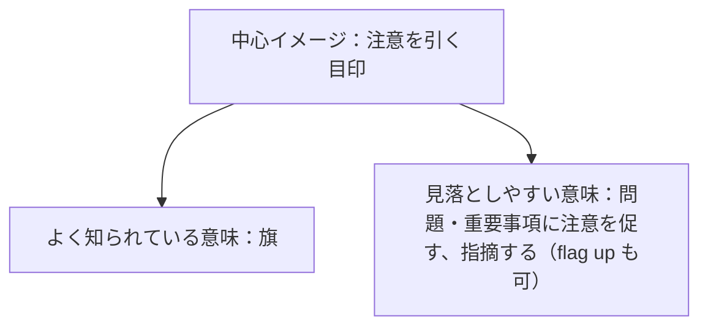

**重要語法**

- `flag a problem / flag up an issue`

<small>candidate_id: `ev-01935-verb-01` ／ index: 1935</small>

---

## 1202. apparent

**品詞**：`adjective`　 **発音**：/əˈpærənt/

<small>よく知られている意味：明らかな</small>

### 見落としやすい意味

**見かけ上の、実際は違うかもしれない**

**例文**

> Their apparent agreement hid serious doubts.

**和訳**

> 彼らは一見同意していたが、その裏には大きな疑念があった。

**コアイメージの説明**

apparent は外から見てそう思われる、という視点を表します。実際の状態と一致するとは限らないため「見かけ上の」という意味になります。

**図**

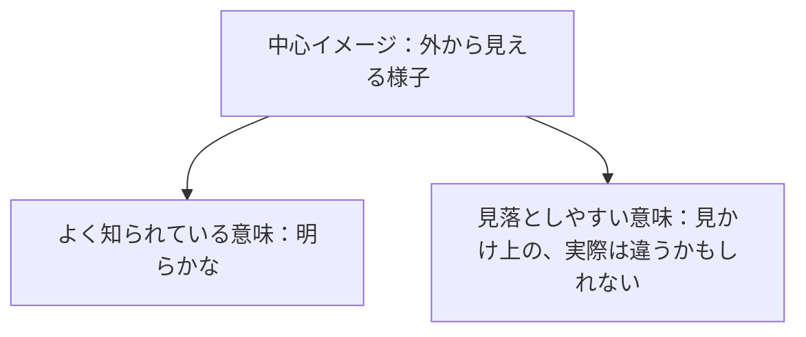

**重要語法**

- `apparent success`

<small>candidate_id: `ev-01939-adjective-01` ／ index: 1939</small>

---

## 1203. establishment

**品詞**：`noun`　 **発音**：/ɪˈstæblɪʃmənt/

<small>よく知られている意味：設立</small>

### 見落としやすい意味

**既成の支配層、体制側（the establishment）**

**例文**

> The proposal faced resistance from the political establishment.

**和訳**

> その提案は既成の政治支配層から抵抗を受けた。

**コアイメージの説明**

establishment は何かを設立して定着させることが出発点です。そこから、すでに権力や影響力を持つ人々をまとめて指します。

**図**

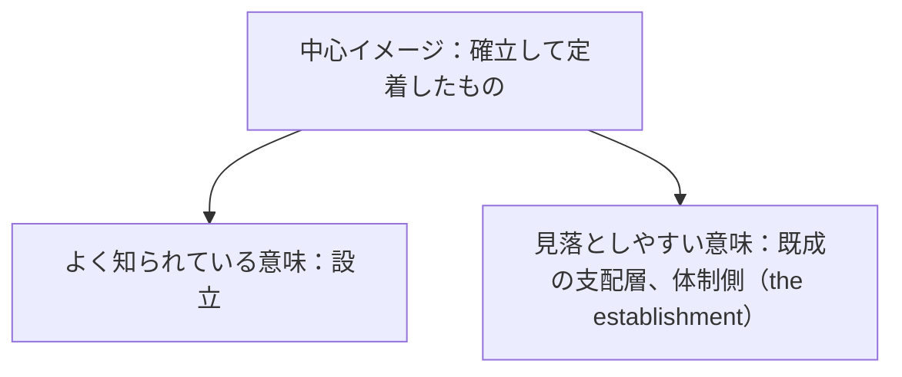

**重要語法**

- `the establishment`

<small>candidate_id: `ev-01941-noun-01` ／ index: 1941</small>

---

## 1204. signal

**品詞**：`verb`　 **発音**：/ˈsɪɡnəl/

<small>よく知られている意味：合図</small>

### 見落としやすい意味

**〜の兆しを示す、予告する**

**例文**

> The sudden drop in sales signals a deeper problem.

**和訳**

> 売上の急落は、より深刻な問題の兆しを示している。

**コアイメージの説明**

signal は相手に情報を伝える合図です。出来事が別の事態の始まりや存在を知らせる場合にも使います。

**図**

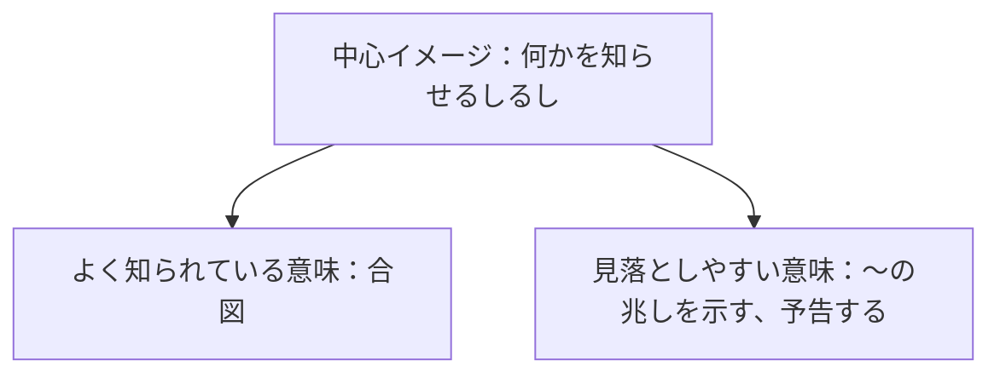

**重要語法**

- `signal a change`

<small>candidate_id: `ev-01943-verb-01` ／ index: 1943</small>

---

## 1205. rank

**品詞**：`adjective`　 **発音**：/ræŋk/

<small>よく知られている意味：順位</small>

### 見落としやすい意味

**ひどい、まったくの（rank hypocrisy など）**

**例文**

> It was rank dishonesty to hide the results.

**和訳**

> 結果を隠すのはまったく不誠実な行為だった。

**コアイメージの説明**

形容詞の rank は悪い性質の程度が極端であることを強調します。順位を表す名詞・動詞の rank と区別して覚えます。

**図**

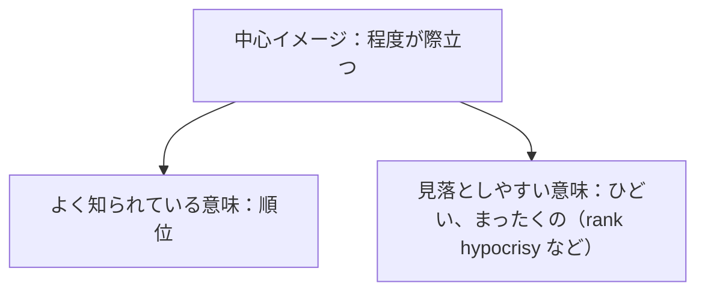

**重要語法**

- `rank hypocrisy / rank injustice`

<small>candidate_id: `ev-01948-adjective-01` ／ index: 1948</small>

---

## 1206. driver

**品詞**：`noun`　 **発音**：/ˈdraɪvər/

<small>よく知られている意味：運転手</small>

### 見落としやすい意味

**（変化を起こす）推進要因、原動力**

**例文**

> Trust is a key driver of customer loyalty.

**和訳**

> 信頼は顧客の継続利用を促す重要な要因だ。

**コアイメージの説明**

driver は車を動かす人だけでなく、変化を前へ進める原因にも広がります。経済や社会の説明では「推進要因」と訳します。

**図**

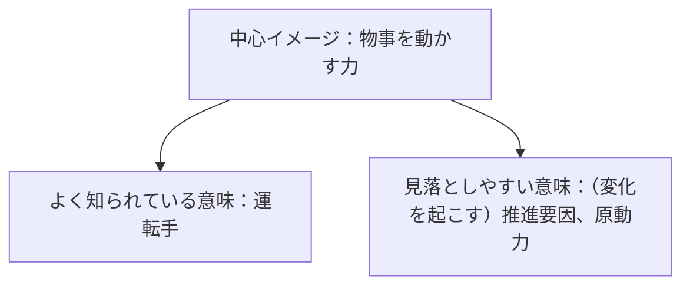

**重要語法**

- `a driver of growth`

<small>candidate_id: `ev-01950-noun-01` ／ index: 1950</small>

---

## 1207. strange

**品詞**：`adjective`　 **発音**：/streɪndʒ/

<small>よく知られている意味：奇妙な</small>

### 見落としやすい意味

**（人にとって）不慣れな、なじみのない（strange to）**

**例文**

> The customs were strange to her at first.

**和訳**

> その習慣は最初、彼女にはなじみがなかった。

**コアイメージの説明**

strange は普通と違って奇妙だという意味に加え、経験がなく親しみを感じない状態も表します。strange to 人 なら、その人にとって不慣れだということです。

**図**

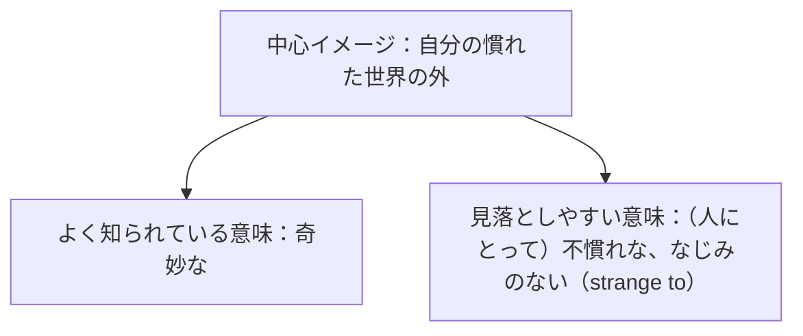

**重要語法**

- `strange to someone`

<small>candidate_id: `ev-01951-adjective-01` ／ index: 1951</small>

---

## 1208. minor

**品詞**：`verb`　 **発音**：/ˈmaɪnər/

<small>よく知られている意味：小さい・未成年の</small>

### 見落としやすい意味

**副専攻する（minor in）**

**例文**

> She plans to minor in economics.

**和訳**

> 彼女は経済学を副専攻する予定だ。

**コアイメージの説明**

minor は主要なものではなく副次的なものを指します。大学では主専攻とは別の副専攻を履修する動詞として使われます。

**図**

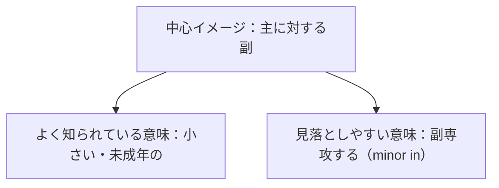

**重要語法**

- `minor in economics`

<small>candidate_id: `ev-01953-verb-01` ／ index: 1953</small>

---

## 1209. revolution

**品詞**：`noun`　 **発音**：/ˌrevəˈluːʃən/

<small>よく知られている意味：革命</small>

### 見落としやすい意味

**（車輪・天体などの）一回転**

**例文**

> The wheel completes one revolution every second.

**和訳**

> その車輪は1秒ごとに1回転する。

**コアイメージの説明**

revolution の中心には大きく巡って回る動きがあります。社会がひっくり返る革命だけでなく、車輪や天体が一周することも表します。

**図**

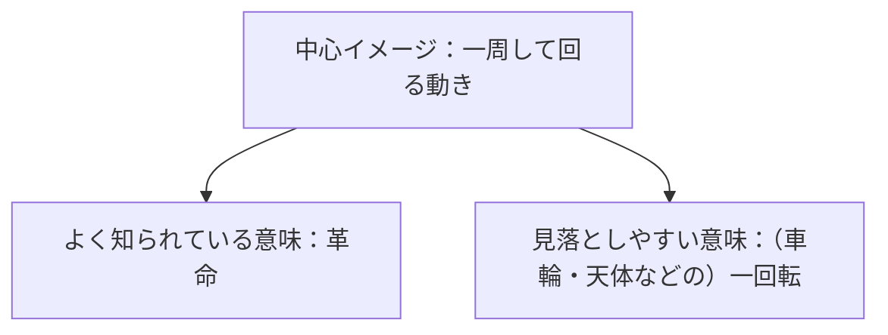

**重要語法**

- `one revolution / revolution around the Sun`

<small>candidate_id: `ev-01954-noun-01` ／ index: 1954</small>

---

## 1210. panel

**品詞**：`noun`　 **発音**：/ˈpænəl/

<small>よく知られている意味：板・区画</small>

### 見落としやすい意味

**審査・討論などに参加する専門家や関係者の集団**

**例文**

> A panel of scientists reviewed the findings.

**和訳**

> 科学者からなる審査委員会がその研究結果を検討した。

**コアイメージの説明**

panel は区切られた面や一区画を指します。そこから、特定の仕事のために集められた一組の専門家も表します。

**図**

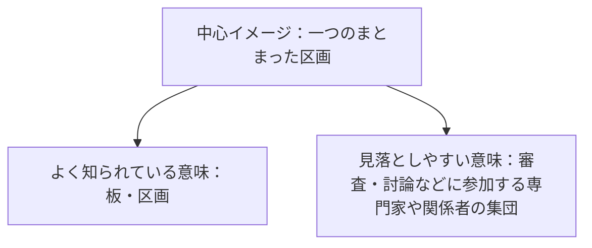

**重要語法**

- `a panel of experts`

<small>candidate_id: `ev-01955-noun-01` ／ index: 1955</small>

---

## 1211. representation

**品詞**：`noun`　 **発音**：/ˌreprɪzenˈteɪʃən/

<small>よく知られている意味：表現・描写</small>

### 見落としやすい意味

**代理、代表すること、代表権**

**例文**

> The workers demanded representation on the board.

**和訳**

> 労働者たちは取締役会での代表権を要求した。

**コアイメージの説明**

representation は何かを表すことです。人々の意思や利益を代わりに示す場合、代理や代表権という意味になります。

**図**

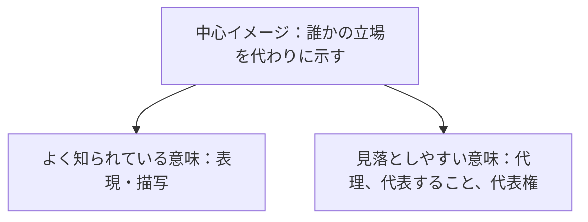

**重要語法**

- `representation on a committee`

<small>candidate_id: `ev-01958-noun-01` ／ index: 1958</small>

---

## 1212. marble

**品詞**：`noun`　 **発音**：/ˈmɑːrbəl/

<small>よく知られている意味：大理石</small>

### 見落としやすい意味

**ビー玉**

**例文**

> A blue marble rolled beneath the chair.

**和訳**

> 青いビー玉が椅子の下に転がった。

**コアイメージの説明**

marble は大理石という材質を指します。昔から小さな球状のおもちゃにも使われ、数えられる名詞ならビー玉になることがあります。

**図**

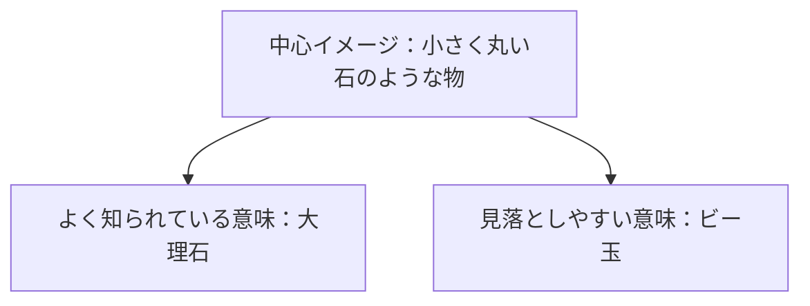

**重要語法**

- `play marbles`

<small>candidate_id: `ev-01961-noun-01` ／ index: 1961</small>

---

## 1213. necessarily

**品詞**：`adverb`　 **発音**：/ˌnesəˈserəli/

<small>よく知られている意味：必然的に</small>

### 見落としやすい意味

**必ずしも〜とは限らない（not necessarily）**

**例文**

> A high price does not necessarily mean better quality.

**和訳**

> 値段が高いからといって、必ずしも品質がよいとは限らない。

**コアイメージの説明**

necessarily は必然性を表します。not と組み合わせると、必ずそうなるとはいえないという部分否定になります。

**図**

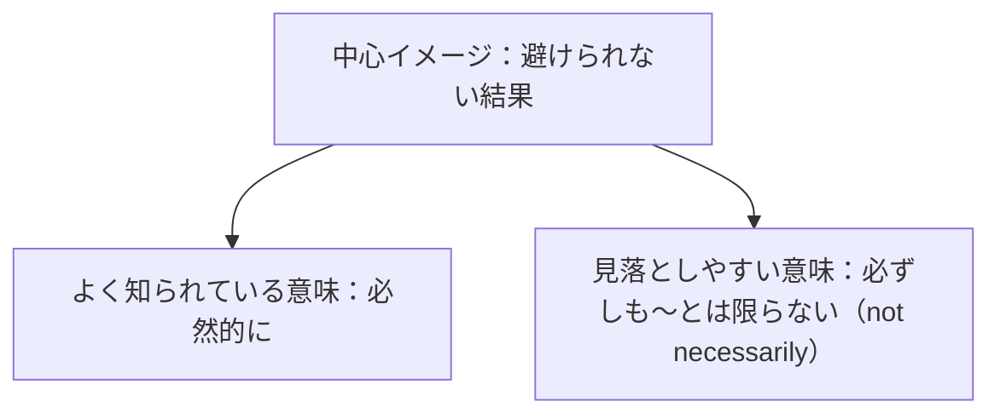

**重要語法**

- `not necessarily`

<small>candidate_id: `ev-01962-adverb-01` ／ index: 1962</small>

---

## 1214. refuge

**品詞**：`noun`　 **発音**：/ˈrefjuːdʒ/

<small>よく知られている意味：避難所</small>

### 見落としやすい意味

**〜に逃げ込む、〜をよりどころにする（take refuge in）**

**例文**

> She took refuge in music during difficult times.

**和訳**

> 彼女はつらい時期に音楽を心のよりどころにした。

**コアイメージの説明**

refuge は安全に逃げ込める場所を表します。take refuge in は場所への避難だけでなく、心の支えになるものに頼る場合にも使います。

**図**

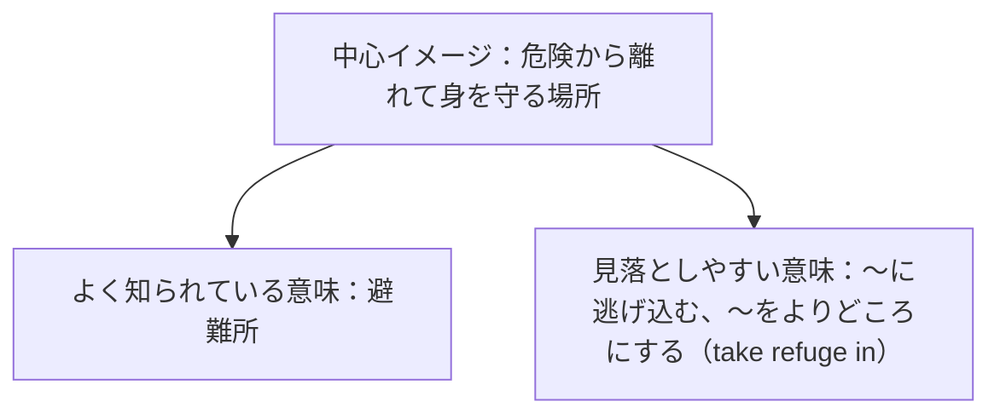

**重要語法**

- `take refuge in something`

<small>candidate_id: `ev-01964-noun-01` ／ index: 1964</small>

---

## 1215. hang

**品詞**：`verb`　 **発音**：/hæŋ/

<small>よく知られている意味：掛ける・つるす</small>

### 見落としやすい意味

**（hang on/upon）結果などが〜次第で決まる、〜にかかっている**

**例文**

> The success of the project hangs on public support.

**和訳**

> その計画の成否は人々の支持にかかっている。

**コアイメージの説明**

hang は何かにぶら下がって支えられる動きです。結果が一つの条件に依存しているとき、hang on で「〜にかかっている」と表します。

**図**

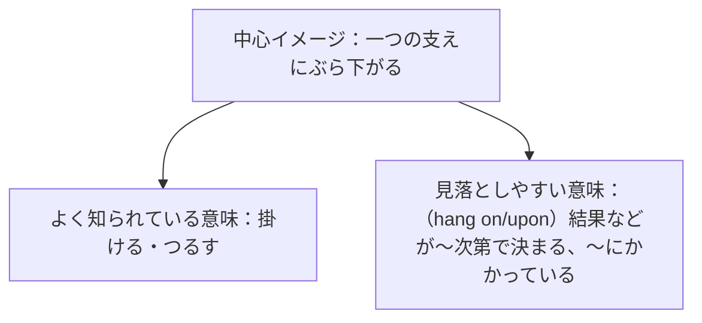

**重要語法**

- `hang on / hang upon`

<small>candidate_id: `ev-01965-verb-01` ／ index: 1965</small>

---

## 1216. smart

**品詞**：`verb`　 **発音**：/smɑːrt/

<small>よく知られている意味：賢い</small>

### 見落としやすい意味

**（体や心が）ひりひり痛む（smart from/under）**

**例文**

> His eyes smarted from the smoke.

**和訳**

> 煙のせいで彼の目はひりひり痛んだ。

**コアイメージの説明**

動詞の smart は鋭い痛みを感じることを表します。賢いという形容詞の意味から推測せず、身体や心への刺激として捉えます。

**図**

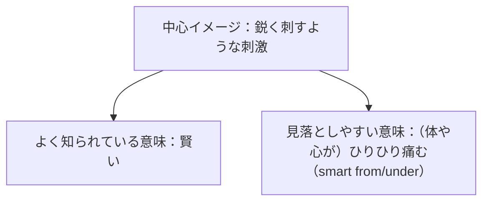

**重要語法**

- `smart from a sting`

<small>candidate_id: `ev-01966-verb-01` ／ index: 1966</small>

---

## 1217. forth

**品詞**：`adverb`　 **発音**：/fɔːrθ/

<small>よく知られている意味：前方へ</small>

### 見落としやすい意味

**などなど（and so forth）**

**例文**

> We discussed food, transport, and so forth.

**和訳**

> 私たちは食料や交通など、さまざまなことを話し合った。

**コアイメージの説明**

forth は前へ進む方向を示します。and so forth は列挙をその先へ続ける感覚から「などなど」の意味になります。

**図**

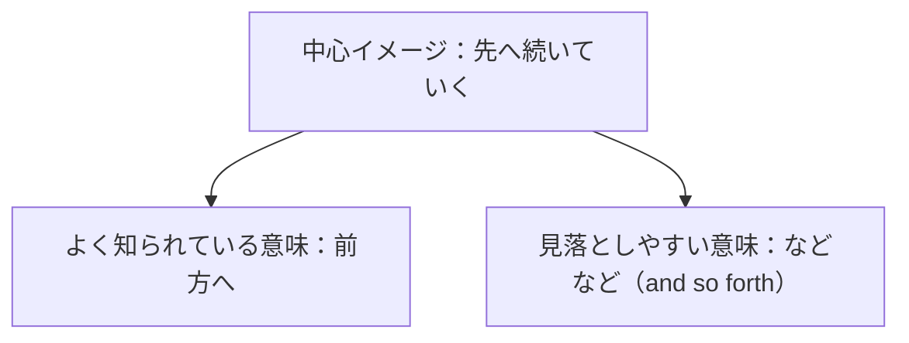

**重要語法**

- `and so forth`

<small>candidate_id: `ev-01967-adverb-01` ／ index: 1967</small>

---

## 1218. confidence

**品詞**：`noun`　 **発音**：/ˈkɑːnfɪdəns/

<small>よく知られている意味：自信</small>

### 見落としやすい意味

**内密に、秘密として（in confidence）**

**例文**

> She told me the news in confidence.

**和訳**

> 彼女はその知らせを秘密にしてほしいと言って私に話した。

**コアイメージの説明**

confidence は自信だけでなく、相手を信じて打ち明ける関係も表します。in confidence は秘密が守られるという前提で話すことです。

**図**

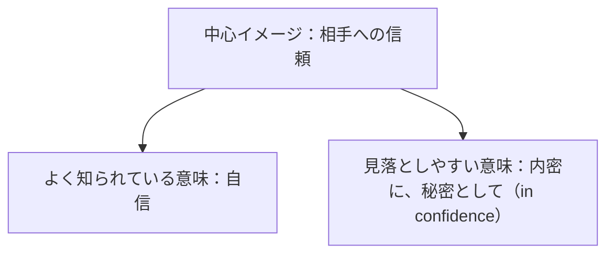

**重要語法**

- `in confidence`

<small>candidate_id: `ev-01968-noun-01` ／ index: 1968</small>

---

## 1219. occupy

**品詞**：`verb`　 **発音**：/ˈɑːkjupaɪ/

<small>よく知られている意味：占領する</small>

### 見落としやすい意味

**（役職・地位などに）就く、保有する**

**例文**

> He occupies a senior position at the university.

**和訳**

> 彼はその大学で上級職に就いている。

**コアイメージの説明**

occupy は空間を占めることが基本です。物理的な場所だけでなく、組織の地位を占めている場合にも使います。

**図**

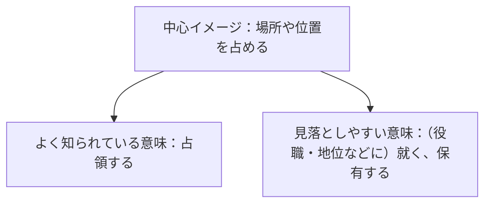

**重要語法**

- `occupy a position`

<small>candidate_id: `ev-01970-verb-01` ／ index: 1970</small>

---

## 1220. export

**品詞**：`verb`　 **発音**：/ɪkˈspɔːrt/

<small>よく知られている意味：輸出する</small>

### 見落としやすい意味

**考え方や文化を国外・別地域へ広める**

**例文**

> The country exported its educational model to neighboring states.

**和訳**

> その国は教育モデルを近隣諸国へ広めた。

**コアイメージの説明**

export は物を国外へ送り出すことです。物だけでなく、制度・考え方・文化がほかの地域へ広まるときにも使います。

**図**

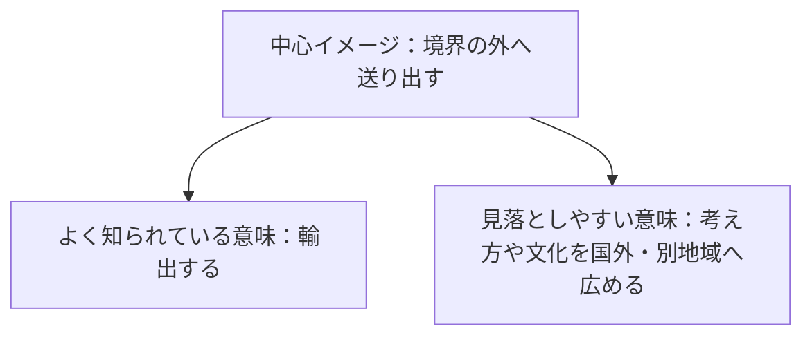

**重要語法**

- `export ideas`

<small>candidate_id: `ev-01972-verb-01` ／ index: 1972</small>

---

## 1221. custom

**品詞**：`adjective`　 **発音**：/ˈkʌstəm/

<small>よく知られている意味：習慣</small>

### 見落としやすい意味

**個別の要望に合わせて特注した**

**例文**

> They ordered custom furniture for the small room.

**和訳**

> 彼らは狭い部屋に合わせた特注家具を注文した。

**コアイメージの説明**

形容詞の custom は決まった既製品ではなく、個別の注文に合わせることを表します。習慣という名詞と区別し、custom-made と結び付けると覚えやすくなります。

**図**

```mermaid

flowchart TD
    A["中心イメージ：相手の要望に合わせる"]
    B["よく知られている意味：習慣"]
    C["見落としやすい意味：個別の要望に合わせて特注した"]
    A --> B
    A --> C

```

**重要語法**

- `custom furniture / custom-made`

<small>candidate_id: `ev-01977-adjective-01` ／ index: 1977</small>

---

## 1222. custom

**品詞**：`noun`　 **発音**：/ˈkʌstəm/

<small>よく知られている意味：習慣</small>

### 見落としやすい意味

**（英語で、店に対する）顧客からの注文・ひいき**

**例文**

> The shop relies on repeat custom from local families.

**和訳**

> その店は地元の家族客による繰り返しの利用に支えられている。

**コアイメージの説明**

custom は繰り返し行われる習慣の意味から、店を習慣的に利用することにも使われます。この意味では買い物客のひいきや取引を表します。

**図**

```mermaid

flowchart TD
    A["中心イメージ：繰り返される利用"]
    B["よく知られている意味：習慣"]
    C["見落としやすい意味：（英語で、店に対する）顧客からの注文・ひいき"]
    A --> B
    A --> C

```

**重要語法**

- `repeat custom / attract custom`

<small>candidate_id: `ev-01977-noun-01` ／ index: 1977</small>

---

## 1223. tale

**品詞**：`noun`　 **発音**：/teɪl/

<small>よく知られている意味：物語</small>

### 見落としやすい意味

**作り話、うそ（a tall tale）**

**例文**

> His excuse about the missing key sounded like a tall tale.

**和訳**

> 鍵がなくなったという彼の言い訳は作り話のように聞こえた。

**コアイメージの説明**

tale は語られる話全般を指します。本当の出来事とは限らず、とくに tall tale では大げさな作り話を表します。

**図**

```mermaid

flowchart TD
    A["中心イメージ：人が語る話"]
    B["よく知られている意味：物語"]
    C["見落としやすい意味：作り話、うそ（a tall tale）"]
    A --> B
    A --> C

```

**重要語法**

- `a tall tale`

<small>candidate_id: `ev-01978-noun-01` ／ index: 1978</small>

---

## 1224. substance

**品詞**：`noun`　 **発音**：/ˈsʌbstəns/

<small>よく知られている意味：物質</small>

### 見落としやすい意味

**本質、実質（in substance）**

**例文**

> In substance, the two plans are the same.

**和訳**

> 実質的には、その二つの計画は同じだ。

**コアイメージの説明**

substance は物体の中身をなす物質を指します。議論や計画については、表面的な違いを除いた実質や本質を表します。

**図**

```mermaid

flowchart TD
    A["中心イメージ：中身を成り立たせるもの"]
    B["よく知られている意味：物質"]
    C["見落としやすい意味：本質、実質（in substance）"]
    A --> B
    A --> C

```

**重要語法**

- `in substance`

<small>candidate_id: `ev-01980-noun-01` ／ index: 1980</small>

---

## 1225. desert

**品詞**：`verb`　 **発音**：/dɪˈzɜːrt/

<small>よく知られている意味：砂漠</small>

### 見落としやすい意味

**（人・責任などを）見捨てる、放棄する**

**例文**

> Several members deserted the team when problems arose.

**和訳**

> 問題が起きると、何人かのメンバーはチームを見捨てた。

**コアイメージの説明**

動詞の desert は人や責任を置き去りにすることです。砂漠という名詞とは発音の強勢も異なるため、文脈と品詞で見分けます。

**図**

```mermaid

flowchart TD
    A["中心イメージ：その場を離れて残す"]
    B["よく知られている意味：砂漠"]
    C["見落としやすい意味：（人・責任などを）見捨てる、放棄する"]
    A --> B
    A --> C

```

**重要語法**

- `desert one's family / desert a post`

<small>candidate_id: `ev-01981-verb-01` ／ index: 1981</small>

---

## 1226. reading

**品詞**：`noun`　 **発音**：/ˈriːdɪŋ/

<small>よく知られている意味：読書</small>

### 見落としやすい意味

**解釈、読み方（one reading of a text）**

**例文**

> That is one possible reading of the final paragraph.

**和訳**

> それは最後の段落の解釈の一つだ。

**コアイメージの説明**

reading は文字を読む行為に加え、読んだ結果として得られた解釈も指します。同じ文章にも複数の reading がありえます。

**図**

```mermaid

flowchart TD
    A["中心イメージ：文字から意味を読み取る"]
    B["よく知られている意味：読書"]
    C["見落としやすい意味：解釈、読み方（one reading of a text）"]
    A --> B
    A --> C

```

**重要語法**

- `one reading of a text`

<small>candidate_id: `ev-01983-noun-01` ／ index: 1983</small>

---

## 1227. reading

**品詞**：`noun`　 **発音**：/ˈriːdɪŋ/

<small>よく知られている意味：読書</small>

### 見落としやすい意味

**（計器などの）測定値（a meter reading）**

**例文**

> The temperature reading fell overnight.

**和訳**

> 気温の測定値は夜の間に下がった。

**コアイメージの説明**

reading は表示された数値を読み取る行為から、計器に現れた測定値そのものも指します。文章の解釈と違い、数値の文脈で使います。

**図**

```mermaid

flowchart TD
    A["中心イメージ：表示を読み取った結果"]
    B["よく知られている意味：読書"]
    C["見落としやすい意味：（計器などの）測定値（a meter reading）"]
    A --> B
    A --> C

```

**重要語法**

- `a meter reading`

<small>candidate_id: `ev-01983-noun-02` ／ index: 1983</small>

---

## 1228. admission

**品詞**：`noun`　 **発音**：/ədˈmɪʃən/

<small>よく知られている意味：入学・入場許可</small>

### 見落としやすい意味

**（事実・誤りなどを）認めること、告白**

**例文**

> Her admission of the error helped rebuild trust.

**和訳**

> 彼女が誤りを認めたことで、信頼の回復につながった。

**コアイメージの説明**

admission は人の入場を認めることだけではありません。事実を受け入れることにも広がり、誤りの承認や告白を表します。

**図**

```mermaid

flowchart TD
    A["中心イメージ：中へ入れる・受け入れる"]
    B["よく知られている意味：入学・入場許可"]
    C["見落としやすい意味：（事実・誤りなどを）認めること、告白"]
    A --> B
    A --> C

```

**重要語法**

- `admission of guilt`

<small>candidate_id: `ev-01986-noun-01` ／ index: 1986</small>

---

## 1229. govern

**品詞**：`verb`　 **発音**：/ˈɡʌvərn/

<small>よく知られている意味：統治する</small>

### 見落としやすい意味

**〜を左右する、決定づける（rules governing ...）**

**例文**

> Several factors govern how quickly plants grow.

**和訳**

> 植物が成長する速さはいくつかの要因によって決まる。

**コアイメージの説明**

govern は国を統治して方向を定めることを表します。条件や法則が結果を左右する場合にも同じ制御の感覚で使います。

**図**

```mermaid

flowchart TD
    A["中心イメージ：動きを制御する"]
    B["よく知られている意味：統治する"]
    C["見落としやすい意味：〜を左右する、決定づける（rules governing ...）"]
    A --> B
    A --> C

```

**重要語法**

- `factors governing growth`

<small>candidate_id: `ev-01987-verb-01` ／ index: 1987</small>

---

## 1230. jump

**品詞**：`verb`　 **発音**：/dʒʌmp/

<small>よく知られている意味：跳ぶ</small>

### 見落としやすい意味

**（jump to conclusions）十分な根拠なしに早合点する**

**例文**

> Don't jump to conclusions before reading the full report.

**和訳**

> 報告書全体を読む前に早合点してはいけない。

**コアイメージの説明**

jump はある地点へ一気に飛ぶ動きです。jump to conclusions は証拠を十分に検討する過程を飛ばして結論へ進むことを表します。

**図**

```mermaid

flowchart TD
    A["中心イメージ：途中を飛び越える"]
    B["よく知られている意味：跳ぶ"]
    C["見落としやすい意味：（jump to conclusions）十分な根拠なしに早合点する"]
    A --> B
    A --> C

```

**重要語法**

- `jump to conclusions`

<small>candidate_id: `ev-01988-verb-01` ／ index: 1988</small>

---

## 1231. prime

**品詞**：`verb`　 **発音**：/praɪm/

<small>よく知られている意味：主要な</small>

### 見落としやすい意味

**（人・装置などを）あらかじめ準備する**

**例文**

> The coach primed the players for a difficult match.

**和訳**

> コーチは難しい試合に向けて選手たちに準備をさせた。

**コアイメージの説明**

動詞の prime は何かがすぐ働けるように下準備することです。人の心構えや装置の準備についても使います。

**図**

```mermaid

flowchart TD
    A["中心イメージ：始動できる状態に整える"]
    B["よく知られている意味：主要な"]
    C["見落としやすい意味：（人・装置などを）あらかじめ準備する"]
    A --> B
    A --> C

```

**重要語法**

- `prime someone for something`

<small>candidate_id: `ev-01989-verb-01` ／ index: 1989</small>

---

## 1232. violate

**品詞**：`verb`　 **発音**：/ˈvaɪəleɪt/

<small>よく知られている意味：違反する</small>

### 見落としやすい意味

**（権利・尊厳などを）侵害する**

**例文**

> The new policy could violate workers' rights.

**和訳**

> その新方針は労働者の権利を侵害するおそれがある。

**コアイメージの説明**

violate は規則を破るだけでなく、他人が守られるべき権利や尊厳を踏みにじることも表します。対象が rights なら「侵害する」が自然です。

**図**

```mermaid

flowchart TD
    A["中心イメージ：守るべき境界を破る"]
    B["よく知られている意味：違反する"]
    C["見落としやすい意味：（権利・尊厳などを）侵害する"]
    A --> B
    A --> C

```

**重要語法**

- `violate someone's rights`

<small>candidate_id: `ev-01990-verb-01` ／ index: 1990</small>

---

## 1233. false

**品詞**：`adjective`　 **発音**：/fɔːls/

<small>よく知られている意味：誤った</small>

### 見落としやすい意味

**人工の、偽物の（false teeth など）**

**例文**

> She wears false eyelashes for stage performances.

**和訳**

> 彼女は舞台公演のときにつけまつげを使う。

**コアイメージの説明**

false は真実でないことから、本物ではない人工物にも広がります。false eyelashes は誤ったまつげではなく、人工のまつげです。

**図**

```mermaid

flowchart TD
    A["中心イメージ：本物と異なる見かけ"]
    B["よく知られている意味：誤った"]
    C["見落としやすい意味：人工の、偽物の（false teeth など）"]
    A --> B
    A --> C

```

**重要語法**

- `false teeth / false eyelashes`

<small>candidate_id: `ev-01992-adjective-01` ／ index: 1992</small>

---

## 1234. hike

**品詞**：`verb`　 **発音**：/haɪk/

<small>よく知られている意味：ハイキングする</small>

### 見落としやすい意味

**価格・料金などを大幅に引き上げる**

**例文**

> The company hiked its subscription fee last year.

**和訳**

> その会社は昨年、定期利用料金を大幅に引き上げた。

**コアイメージの説明**

hike は歩いて登る行動を思わせますが、価格を急に引き上げる動詞にもなります。料金や税の文脈では上昇幅に注目します。

**図**

```mermaid

flowchart TD
    A["中心イメージ：大きく上へ動く"]
    B["よく知られている意味：ハイキングする"]
    C["見落としやすい意味：価格・料金などを大幅に引き上げる"]
    A --> B
    A --> C

```

**重要語法**

- `hike prices / hike taxes`

<small>candidate_id: `ev-01995-verb-01` ／ index: 1995</small>

---

## 1235. practical

**品詞**：`adjective`　 **発音**：/ˈpræktɪkəl/

<small>よく知られている意味：実用的な</small>

### 見落としやすい意味

**事実上の、実際の目的から見た（for all practical purposes）**

**例文**

> For all practical purposes, the old rule is gone.

**和訳**

> 実際上、古い規則はもう存在しないも同然だ。

**コアイメージの説明**

practical は理論ではなく現実の働きや結果に目を向けます。for all practical purposes は厳密な形式より実態を重視して「事実上」と訳します。

**図**

```mermaid

flowchart TD
    A["中心イメージ：現実に照らして判断する"]
    B["よく知られている意味：実用的な"]
    C["見落としやすい意味：事実上の、実際の目的から見た（for all practical purposes）"]
    A --> B
    A --> C

```

**重要語法**

- `for all practical purposes`

<small>candidate_id: `ev-01999-adjective-01` ／ index: 1999</small>

---

## 1236. practical

**品詞**：`adjective`　 **発音**：/ˈpræktɪkəl/

<small>よく知られている意味：実用的な</small>

### 見落としやすい意味

**いたずらの（practical joke）**

**例文**

> The students played a harmless practical joke on their teacher.

**和訳**

> 生徒たちは先生に害のないいたずらを仕掛けた。

**コアイメージの説明**

practical joke は口だけの冗談ではなく、実際に仕掛けるいたずらです。practical を単独で「実用的」と訳さず、まとまりで覚えます。

**図**

```mermaid

flowchart TD
    A["中心イメージ：実際に仕掛ける行為"]
    B["よく知られている意味：実用的な"]
    C["見落としやすい意味：いたずらの（practical joke）"]
    A --> B
    A --> C

```

**重要語法**

- `practical joke`

<small>candidate_id: `ev-01999-adjective-02` ／ index: 1999</small>

---

## 1237. privilege

**品詞**：`verb`　 **発音**：/ˈprɪvəlɪdʒ/

<small>よく知られている意味：特権</small>

### 見落としやすい意味

**他の対象より優先して扱う**

**例文**

> The system privileges speed over accuracy.

**和訳**

> その制度は正確さより速さを優先する。

**コアイメージの説明**

privilege は特別な権利や優遇を意味します。動詞では特定のものをほかより優先的に扱うことになります。

**図**

```mermaid

flowchart TD
    A["中心イメージ：特別扱いする"]
    B["よく知られている意味：特権"]
    C["見落としやすい意味：他の対象より優先して扱う"]
    A --> B
    A --> C

```

**重要語法**

- `privilege A over B`

<small>candidate_id: `ev-02000-verb-01` ／ index: 2000</small>

---

## 1238. enterprise

**品詞**：`noun`　 **発音**：/ˈentərpraɪz/

<small>よく知られている意味：企業</small>

### 見落としやすい意味

**新しい事業に取り組む積極性・進取の気性**

**例文**

> The project succeeded because of her enterprise and determination.

**和訳**

> その企画が成功したのは彼女の進取の気性と決断力のおかげだ。

**コアイメージの説明**

enterprise は事業を始めることやその事業自体を指します。その出発に必要な積極性や行動力も表します。

**図**

```mermaid

flowchart TD
    A["中心イメージ：新しいことに乗り出す力"]
    B["よく知られている意味：企業"]
    C["見落としやすい意味：新しい事業に取り組む積極性・進取の気性"]
    A --> B
    A --> C

```

**重要語法**

- `show enterprise`

<small>candidate_id: `ev-02002-noun-01` ／ index: 2002</small>

---

## 1239. asian

**品詞**：`noun`　 **発音**：/ˈeɪʒən/

<small>よく知られている意味：アジア人</small>

### 見落としやすい意味

**英米で指す人々の地域的範囲が異なる**

**例文**

> In British English, Asian often refers to people with South Asian roots.

**和訳**

> イギリス英語では Asian は南アジアにルーツを持つ人々を指すことが多い。

**コアイメージの説明**

Asian はアジアに関係する人を指します。ただし日常会話で想定される地域の範囲は英米で異なり、アメリカ英語では東アジアや東南アジアとの結びつきが比較的強いことがあります。

**図**

```mermaid

flowchart TD
    A["中心イメージ：地域名と社会的な分類"]
    B["よく知られている意味：アジア人"]
    C["見落としやすい意味：英米で指す人々の地域的範囲が異なる"]
    A --> B
    A --> C

```

**重要語法**

- `英語の通常表記は Asian（頭文字大文字）。用法は話者と文脈によって変わる。`

<small>candidate_id: `ev-02003-noun-01` ／ index: 2003</small>

---

## 1240. housing

**品詞**：`noun`　 **発音**：/ˈhaʊzɪŋ/

<small>よく知られている意味：住宅</small>

### 見落としやすい意味

**機械や装置を包む外装・ケース**

**例文**

> The metal housing protects the motor from dust.

**和訳**

> 金属製の外装がモーターをほこりから守っている。

**コアイメージの説明**

housing は人を住まわせる住宅から、物を収める覆いの意味にも使われます。機械の文脈では装置の外装やケースを表します。

**図**

```mermaid

flowchart TD
    A["中心イメージ：中身を収めて保護するもの"]
    B["よく知られている意味：住宅"]
    C["見落としやすい意味：機械や装置を包む外装・ケース"]
    A --> B
    A --> C

```

**重要語法**

- `motor housing`

<small>candidate_id: `ev-02005-noun-01` ／ index: 2005</small>

---

## 1241. medieval

**品詞**：`adjective`　 **発音**：/ˌmediˈiːvəl/

<small>よく知られている意味：中世の</small>

### 見落としやすい意味

**中世を連想させるほど残酷で野蛮な**

**例文**

> The prison was criticized for its medieval conditions.

**和訳**

> その刑務所は時代遅れで非人道的な環境だと批判された。

**コアイメージの説明**

medieval は中世に関係するという意味が基本です。現代の状況について使うと、古い時代を連想させるほど過酷で野蛮だという否定的な評価になります。

**図**

```mermaid

flowchart TD
    A["中心イメージ：昔の時代を思わせる"]
    B["よく知られている意味：中世の"]
    C["見落としやすい意味：中世を連想させるほど残酷で野蛮な"]
    A --> B
    A --> C

```

**重要語法**

- `medieval conditions`

<small>candidate_id: `ev-02006-adjective-01` ／ index: 2006</small>

---

## 1242. bottle

**品詞**：`verb`　 **発音**：/ˈbɑːtəl/

<small>よく知られている意味：瓶</small>

### 見落としやすい意味

**感情を押し殺し表に出さない**

**例文**

> He bottled up his frustration and said nothing.

**和訳**

> 彼は不満を胸に押し込め、何も言わなかった。

**コアイメージの説明**

bottle は液体を瓶に入れることから、感情を外に出さず閉じ込める意味へ広がります。bottle up で「感情を押し殺す」となります。

**図**

```mermaid

flowchart TD
    A["中心イメージ：容器の中に閉じ込める"]
    B["よく知られている意味：瓶"]
    C["見落としやすい意味：感情を押し殺し表に出さない"]
    A --> B
    A --> C

```

**重要語法**

- `bottle up one's feelings`

<small>candidate_id: `ev-02008-verb-01` ／ index: 2008</small>

---

## 1243. borrow

**品詞**：`verb`　 **発音**：/ˈbɑːroʊ/

<small>よく知られている意味：借りる</small>

### 見落としやすい意味

**外国語の単語を借用する**

**例文**

> English has borrowed many words from French.

**和訳**

> 英語はフランス語から多くの単語を借用してきた。

**コアイメージの説明**

borrow は他人のものを借りて使う行為です。言語でも、ほかの言語の語を取り入れることを借用と呼びます。

**図**

```mermaid

flowchart TD
    A["中心イメージ：外から取り入れて使う"]
    B["よく知られている意味：借りる"]
    C["見落としやすい意味：外国語の単語を借用する"]
    A --> B
    A --> C

```

**重要語法**

- `borrow a word from a language`

<small>candidate_id: `ev-02009-verb-01` ／ index: 2009</small>

---

## 1244. rival

**品詞**：`verb`　 **発音**：/ˈraɪvəl/

<small>よく知られている意味：競争相手</small>

### 見落としやすい意味

**～に匹敵する・肩を並べる**

**例文**

> Few museums can rival this one in size.

**和訳**

> 規模の点でこの博物館に匹敵する施設はほとんどない。

**コアイメージの説明**

rival は競争相手を指す名詞から、相手と同じくらい優れているという動詞にもなります。単に対抗するだけでなく「匹敵する」と訳すことがあります。

**図**

```mermaid

flowchart TD
    A["中心イメージ：競争で肩を並べる"]
    B["よく知られている意味：競争相手"]
    C["見落としやすい意味：～に匹敵する・肩を並べる"]
    A --> B
    A --> C

```

**重要語法**

- `rival someone in size`

<small>candidate_id: `ev-02011-verb-01` ／ index: 2011</small>

---

## 1245. highlight

**品詞**：`verb`　 **発音**：/ˈhaɪlaɪt/

<small>よく知られている意味：目立つ部分・蛍光表示</small>

### 見落としやすい意味

**特に強調して目立たせる**

**例文**

> The survey highlights the need for better public transport.

**和訳**

> その調査は公共交通を改善する必要性を浮き彫りにしている。

**コアイメージの説明**

highlight は光を当てて目立つ部分を作る発想です。文章や調査結果については重要な点を特に強調することを表します。

**図**

```mermaid

flowchart TD
    A["中心イメージ：明るくして目立たせる"]
    B["よく知られている意味：目立つ部分・蛍光表示"]
    C["見落としやすい意味：特に強調して目立たせる"]
    A --> B
    A --> C

```

**重要語法**

- `highlight a problem`

<small>candidate_id: `ev-02014-verb-01` ／ index: 2014</small>

---

## 1246. colorful

**品詞**：`adjective`　 **発音**：/ˈkʌlərfəl/

<small>よく知られている意味：色鮮やかな</small>

### 見落としやすい意味

**型破りで多彩な・波乱に富んだ**

**例文**

> She led a colorful life full of unexpected adventures.

**和訳**

> 彼女は予想外の冒険に満ちた波乱に富む人生を送った。

**コアイメージの説明**

colorful はさまざまな色があることを表します。人生や人物については出来事や個性が豊かで、型破りな様子を表します。

**図**

```mermaid

flowchart TD
    A["中心イメージ：多彩な色を持つ"]
    B["よく知られている意味：色鮮やかな"]
    C["見落としやすい意味：型破りで多彩な・波乱に富んだ"]
    A --> B
    A --> C

```

**重要語法**

- `a colorful character`

<small>candidate_id: `ev-02015-adjective-01` ／ index: 2015</small>

---

## 1247. confront

**品詞**：`verb`　 **発音**：/kənˈfrʌnt/

<small>よく知られている意味：直面する</small>

### 見落としやすい意味

**人に事実・証拠などを突きつけて向き合わせる**

**例文**

> The lawyer confronted the witness with new evidence.

**和訳**

> 弁護士は証人に新たな証拠を突きつけた。

**コアイメージの説明**

confront は問題に正面から向き合う意味が基本です。人を証拠や事実と向き合わせ、逃げずに答えさせる場合にも使います。

**図**

```mermaid

flowchart TD
    A["中心イメージ：相手を正面に向かせる"]
    B["よく知られている意味：直面する"]
    C["見落としやすい意味：人に事実・証拠などを突きつけて向き合わせる"]
    A --> B
    A --> C

```

**重要語法**

- `confront someone with evidence`

<small>candidate_id: `ev-02017-verb-01` ／ index: 2017</small>

---

## 1248. portray

**品詞**：`verb`　 **発音**：/pɔːrˈtreɪ/

<small>よく知られている意味：描く・表現する</small>

### 見落としやすい意味

**演劇や映画で人物の役を演じる**

**例文**

> The actor portrayed a young scientist in the film.

**和訳**

> その俳優は映画で若い科学者を演じた。

**コアイメージの説明**

portray は人物の姿や性格を描写することです。映画や演劇では、役として人物像を表現することから「演じる」になります。

**図**

```mermaid

flowchart TD
    A["中心イメージ：人物像を表現する"]
    B["よく知られている意味：描く・表現する"]
    C["見落としやすい意味：演劇や映画で人物の役を演じる"]
    A --> B
    A --> C

```

**重要語法**

- `portray a character`

<small>candidate_id: `ev-02019-verb-01` ／ index: 2019</small>

---

## 1249. install

**品詞**：`verb`　 **発音**：/ɪnˈstɔːl/

<small>よく知られている意味：設置する</small>

### 見落としやすい意味

**人を役職に正式に就任させる**

**例文**

> The board installed a new president in April.

**和訳**

> 理事会は4月に新しい会長を正式に就任させた。

**コアイメージの説明**

install は装置を所定の位置に据えることを指します。人を役職という定められた地位に就ける場合にも使います。

**図**

```mermaid

flowchart TD
    A["中心イメージ：所定の位置に据える"]
    B["よく知られている意味：設置する"]
    C["見落としやすい意味：人を役職に正式に就任させる"]
    A --> B
    A --> C

```

**重要語法**

- `install someone as president`

<small>candidate_id: `ev-02020-verb-01` ／ index: 2020</small>

---

## 1250. sum

**品詞**：`noun`　 **発音**：/sʌm/

<small>よく知られている意味：合計する</small>

### 見落としやすい意味

**まとまった金額・合計額**

**例文**

> They donated a large sum to the local hospital.

**和訳**

> 彼らは地元の病院に多額のお金を寄付した。

**コアイメージの説明**

sum は数を足して得られる全体を表します。金銭の文脈では、まとまった額を指し、a large sum は多額のお金です。

**図**

```mermaid

flowchart TD
    A["中心イメージ：一つにまとめた全体"]
    B["よく知られている意味：合計する"]
    C["見落としやすい意味：まとまった金額・合計額"]
    A --> B
    A --> C

```

**重要語法**

- `a large sum of money`

<small>candidate_id: `ev-02022-noun-01` ／ index: 2022</small>

---

## 1251. sum

**品詞**：`verb`　 **発音**：/sʌm/

<small>よく知られている意味：合計・総額</small>

### 見落としやすい意味

**要点をまとめる・総括する**

**例文**

> The final sentence sums up the main argument.

**和訳**

> 最後の一文が主な議論を要約している。

**コアイメージの説明**

sum は数を足し合わせることから、議論の要点を一つにまとめる意味にも広がります。sum up は「要約する・総括する」です。

**図**

```mermaid

flowchart TD
    A["中心イメージ：ばらばらのものを一つにまとめる"]
    B["よく知られている意味：合計・総額"]
    C["見落としやすい意味：要点をまとめる・総括する"]
    A --> B
    A --> C

```

**重要語法**

- `sum up a discussion`

<small>candidate_id: `ev-02022-verb-01` ／ index: 2022</small>

---

## 1252. talent

**品詞**：`noun`　 **発音**：/ˈtælənt/

<small>よく知られている意味：才能</small>

### 見落としやすい意味

**芸能・メディア分野の出演者・人材**

**例文**

> The agency is searching for fresh talent for its next series.

**和訳**

> その事務所は次のシリーズに出演する新しい人材を探している。

**コアイメージの説明**

talent は個人の能力や才能を意味します。芸能界では、その能力を持つ出演者や人材をまとめて指すこともあります。

**図**

```mermaid

flowchart TD
    A["中心イメージ：能力を持つ人そのもの"]
    B["よく知られている意味：才能"]
    C["見落としやすい意味：芸能・メディア分野の出演者・人材"]
    A --> B
    A --> C

```

**重要語法**

- `new talent / hire talent`

<small>candidate_id: `ev-02023-noun-01` ／ index: 2023</small>

---

## 1253. behalf

**品詞**：`noun`　 **発音**：/bɪˈhæf/

<small>よく知られている意味：利益・側</small>

### 見落としやすい意味

**人に代わって代理・代表として行う**

**例文**

> She signed the contract on behalf of her manager.

**和訳**

> 彼女は上司の代理として契約書に署名した。

**コアイメージの説明**

behalf は誰かの立場や側を意味する語として、ほぼ決まった表現で使われます。on behalf of は、本人に代わって行動するときに「代理で」と訳します。

**図**

```mermaid

flowchart TD
    A["中心イメージ：別の人の立場に立つ"]
    B["よく知られている意味：利益・側"]
    C["見落としやすい意味：人に代わって代理・代表として行う"]
    A --> B
    A --> C

```

**重要語法**

- `on behalf of someone`

<small>candidate_id: `ev-02024-noun-01` ／ index: 2024</small>

---

## 1254. behalf

**品詞**：`noun`　 **発音**：/bɪˈhæf/

<small>よく知られている意味：利益・側</small>

### 見落としやすい意味

**誰かの利益のために行う**

**例文**

> The charity collected supplies on behalf of families in need.

**和訳**

> その慈善団体は生活に困っている家庭のために物資を集めた。

**コアイメージの説明**

behalf には誰かの利益を念頭に置く意味もあります。ここでは本人の代理である必要はなく、誰かのために行動していることを表します。

**図**

```mermaid

flowchart TD
    A["中心イメージ：相手のために行動する"]
    B["よく知られている意味：利益・側"]
    C["見落としやすい意味：誰かの利益のために行う"]
    A --> B
    A --> C

```

**重要語法**

- `on behalf of / in behalf of（後者は主に米国のやや古い・形式的な用法）`

<small>candidate_id: `ev-02024-noun-02` ／ index: 2024</small>

---

## 1255. boom

**品詞**：`verb`　 **発音**：/buːm/

<small>よく知られている意味：急成長する</small>

### 見落としやすい意味

**大声で響き渡るように言う**

**例文**

> His voice boomed across the crowded hall.

**和訳**

> 彼の声が人でいっぱいのホールに大きく響き渡った。

**コアイメージの説明**

boom は大きく響く音を表します。声について使うと、広い場所に響くほど大声で話すことを表します。

**図**

```mermaid

flowchart TD
    A["中心イメージ：低く力強く響く音"]
    B["よく知られている意味：急成長する"]
    C["見落としやすい意味：大声で響き渡るように言う"]
    A --> B
    A --> C

```

**重要語法**

- `boom out an answer`

<small>candidate_id: `ev-02025-verb-01` ／ index: 2025</small>

---

## 1256. pain

**品詞**：`verb`　 **発音**：/peɪn/

<small>よく知られている意味：痛み</small>

### 見落としやすい意味

**精神的につらい思いをさせる**

**例文**

> It pained her to see the old library close.

**和訳**

> 古い図書館が閉まるのを見るのは彼女にとってつらかった。

**コアイメージの説明**

pain は身体の痛みを表す名詞が基本です。動詞では悲しい出来事や残念な事実が心を痛ませることにも使います。

**図**

```mermaid

flowchart TD
    A["中心イメージ：心に痛みを与える"]
    B["よく知られている意味：痛み"]
    C["見落としやすい意味：精神的につらい思いをさせる"]
    A --> B
    A --> C

```

**重要語法**

- `It pains someone to do`

<small>candidate_id: `ev-02026-verb-01` ／ index: 2026</small>

---

## 1257. classical

**品詞**：`adjective`　 **発音**：/ˈklæsɪkəl/

<small>よく知られている意味：古典的な</small>

### 見落としやすい意味

**量子論・相対論ではなく古典物理学に基づく**

**例文**

> The model uses classical physics rather than quantum theory.

**和訳**

> そのモデルは量子論ではなく古典物理学を用いている。

**コアイメージの説明**

classical は古典や伝統に関係することを表します。物理学では量子論や相対論以前の理論体系を指す専門的な区別になります。

**図**

```mermaid

flowchart TD
    A["中心イメージ：伝統的な枠組み"]
    B["よく知られている意味：古典的な"]
    C["見落としやすい意味：量子論・相対論ではなく古典物理学に基づく"]
    A --> B
    A --> C

```

**重要語法**

- `classical mechanics`

<small>candidate_id: `ev-02028-adjective-01` ／ index: 2028</small>

---

## 1258. poverty

**品詞**：`noun`　 **発音**：/ˈpɑːvərti/

<small>よく知られている意味：貧困</small>

### 見落としやすい意味

**必要な資質や創造性の欠乏**

**例文**

> The essay showed a poverty of imagination.

**和訳**

> その小論文には想像力の乏しさが表れていた。

**コアイメージの説明**

poverty はお金や生活資源が不足することです。抽象的な能力や発想にも用い、必要なものの欠乏を表します。

**図**

```mermaid

flowchart TD
    A["中心イメージ：必要なものが足りない状態"]
    B["よく知られている意味：貧困"]
    C["見落としやすい意味：必要な資質や創造性の欠乏"]
    A --> B
    A --> C

```

**重要語法**

- `a poverty of ideas`

<small>candidate_id: `ev-02030-noun-01` ／ index: 2030</small>

---

## 1259. shore

**品詞**：`verb`　 **発音**：/ʃɔːr/

<small>よく知られている意味：海岸</small>

### 見落としやすい意味

**破綻しそうなものを支えて補強する**

**例文**

> The grant helped shore up the struggling library.

**和訳**

> その助成金は経営難の図書館を支える助けとなった。

**コアイメージの説明**

動詞の shore は支柱で支える意味を持ちます。shore up は建物だけでなく、弱っている組織や制度を補強することにも使います。

**図**

```mermaid

flowchart TD
    A["中心イメージ：倒れないように支える"]
    B["よく知られている意味：海岸"]
    C["見落としやすい意味：破綻しそうなものを支えて補強する"]
    A --> B
    A --> C

```

**重要語法**

- `shore up a business`

<small>candidate_id: `ev-02031-verb-01` ／ index: 2031</small>

---

## 1260. complaint

**品詞**：`noun`　 **発音**：/kəmˈpleɪnt/

<small>よく知られている意味：苦情</small>

### 見落としやすい意味

**体の不調・病気の症状**

**例文**

> He visited the clinic with a minor stomach complaint.

**和訳**

> 彼は軽い胃の不調で診療所を訪れた。

**コアイメージの説明**

complaint は不満を申し立てる意味がよく知られています。医療の文脈では、患者が訴える体の不調や症状を指します。

**図**

```mermaid

flowchart TD
    A["中心イメージ：不具合を訴えること"]
    B["よく知られている意味：苦情"]
    C["見落としやすい意味：体の不調・病気の症状"]
    A --> B
    A --> C

```

**重要語法**

- `a stomach complaint`

<small>candidate_id: `ev-02032-noun-01` ／ index: 2032</small>

---

## 1261. variation

**品詞**：`noun`　 **発音**：/ˌveriˈeɪʃən/

<small>よく知られている意味：変化</small>

### 見落としやすい意味

**音楽の主題を変形させた変奏**

**例文**

> The composer wrote five variations on the melody.

**和訳**

> 作曲家はその旋律をもとに五つの変奏曲を書いた。

**コアイメージの説明**

variation は元のものを少し変えた形を表します。音楽では主題となる旋律を変化させた作品や部分を指します。

**図**

```mermaid

flowchart TD
    A["中心イメージ：元の形を変えて展開する"]
    B["よく知られている意味：変化"]
    C["見落としやすい意味：音楽の主題を変形させた変奏"]
    A --> B
    A --> C

```

**重要語法**

- `variations on a theme`

<small>candidate_id: `ev-02035-noun-01` ／ index: 2035</small>

---

## 1262. stress

**品詞**：`noun`　 **発音**：/stres/

<small>よく知られている意味：ストレス</small>

### 見落としやすい意味

**単語や音節に置くアクセント・強勢**

**例文**

> The word record has different stress patterns as a noun and a verb.

**和訳**

> record という語は名詞と動詞で強勢の置き方が異なる。

**コアイメージの説明**

stress は力がかかることを表します。音声では単語の特定の音節をほかより強く発音することを意味します。

**図**

```mermaid

flowchart TD
    A["中心イメージ：一部に強く力をかける"]
    B["よく知られている意味：ストレス"]
    C["見落としやすい意味：単語や音節に置くアクセント・強勢"]
    A --> B
    A --> C

```

**重要語法**

- `word stress / primary stress`

<small>candidate_id: `ev-02036-noun-01` ／ index: 2036</small>

---

## 1263. stress

**品詞**：`verb`　 **発音**：/stres/

<small>よく知られている意味：ストレスを与える</small>

### 見落としやすい意味

**特定の点を特に強調する**

**例文**

> The teacher stressed the importance of checking sources.

**和訳**

> 先生は情報源を確認する重要性を強調した。

**コアイメージの説明**

stress は特定の点に強い力や注意を向けることです。発言で使えばその点を意識的に強調する意味になります。

**図**

```mermaid

flowchart TD
    A["中心イメージ：大事な部分に力を置く"]
    B["よく知られている意味：ストレスを与える"]
    C["見落としやすい意味：特定の点を特に強調する"]
    A --> B
    A --> C

```

**重要語法**

- `stress the importance of`

<small>candidate_id: `ev-02036-verb-02` ／ index: 2036</small>

---

## 1264. attribute

**品詞**：`noun`　 **発音**：/ˈætrɪbjuːt/

<small>よく知られている意味：〜のせいだと考える</small>

### 見落としやすい意味

**人物・物事が備える特徴・属性**

**例文**

> Patience is one of her strongest attributes.

**和訳**

> 忍耐強さは彼女の最も優れた資質の一つだ。

**コアイメージの説明**

attribute は何かと結び付けられる特徴を意味します。名詞では人物や物事が持つ性質・資質を表します。

**図**

```mermaid

flowchart TD
    A["中心イメージ：ものに備わる性質"]
    B["よく知られている意味：〜のせいだと考える"]
    C["見落としやすい意味：人物・物事が備える特徴・属性"]
    A --> B
    A --> C

```

**重要語法**

- `personal attributes`

<small>candidate_id: `ev-02037-noun-01` ／ index: 2037</small>

---

## 1265. attribute

**品詞**：`verb`　 **発音**：/əˈtrɪbjuːt/

<small>よく知られている意味：〜のせいだと考える</small>

### 見落としやすい意味

**ある結果の原因を～に求める**

**例文**

> Researchers attribute the decline to rising costs.

**和訳**

> 研究者たちはその減少の原因を費用の上昇に求めている。

**コアイメージの説明**

attribute はある事柄を別のものに帰属させることです。結果を特定の原因に結び付けると「〜のせいだと考える」という意味になります。

**図**

```mermaid

flowchart TD
    A["中心イメージ：結果を原因に結び付ける"]
    B["よく知られている意味：〜のせいだと考える"]
    C["見落としやすい意味：ある結果の原因を～に求める"]
    A --> B
    A --> C

```

**重要語法**

- `attribute A to B`

<small>candidate_id: `ev-02037-verb-01` ／ index: 2037</small>

---

## 1266. constitutional

**品詞**：`adjective`　 **発音**：/ˌkɑːnstɪˈtuːʃənəl/

<small>よく知られている意味：憲法の</small>

### 見落としやすい意味

**生まれつきの体質・心身の構造に関わる**

**例文**

> He has a constitutional dislike of noisy places.

**和訳**

> 彼は生来、騒がしい場所が苦手だ。

**コアイメージの説明**

constitution は国家の憲法だけでなく、人の身体や気質の成り立ちも指します。constitutional は生まれつきの体質や性向に関する意味にもなります。

**図**

```mermaid

flowchart TD
    A["中心イメージ：物事を根本で組み立てる性質"]
    B["よく知られている意味：憲法の"]
    C["見落としやすい意味：生まれつきの体質・心身の構造に関わる"]
    A --> B
    A --> C

```

**重要語法**

- `a constitutional tendency`

<small>candidate_id: `ev-02038-adjective-01` ／ index: 2038</small>

---

## 1267. inflation

**品詞**：`noun`　 **発音**：/ɪnˈfleɪʃən/

<small>よく知られている意味：物価上昇</small>

### 見落としやすい意味

**成績や評価が実質以上に水増しされること**

**例文**

> Grade inflation has made top marks more common.

**和訳**

> 成績の水増しによって、最高評価を得る人が増えた。

**コアイメージの説明**

inflation は膨張を表し、経済では物価が上がることを意味します。成績や評価が実態以上に高くなる現象にも同じ語を使います。

**図**

```mermaid

flowchart TD
    A["中心イメージ：中身以上に膨らむこと"]
    B["よく知られている意味：物価上昇"]
    C["見落としやすい意味：成績や評価が実質以上に水増しされること"]
    A --> B
    A --> C

```

**重要語法**

- `grade inflation`

<small>candidate_id: `ev-02040-noun-01` ／ index: 2040</small>

---

## 1268. egg

**品詞**：`verb`　 **発音**：/eɡ/

<small>よく知られている意味：卵</small>

### 見落としやすい意味

**人をけしかけて好ましくないことをさせようとする**

**例文**

> His friends egged him on to interrupt the speaker.

**和訳**

> 友人たちは彼をけしかけて話し手の発言を遮らせようとした。

**コアイメージの説明**

egg on は相手をあおって行動させようとする表現です。特に軽率な行為や好ましくない行動に向けて使われます。

**図**

```mermaid

flowchart TD
    A["中心イメージ：行動へ押し出す"]
    B["よく知られている意味：卵"]
    C["見落としやすい意味：人をけしかけて好ましくないことをさせようとする"]
    A --> B
    A --> C

```

**重要語法**

- `egg someone on`

<small>candidate_id: `ev-02042-verb-01` ／ index: 2042</small>

---

## 1269. opening

**品詞**：`noun`　 **発音**：/ˈoʊpənɪŋ/

<small>よく知られている意味：開くこと</small>

### 見落としやすい意味

**仕事の欠員・募集枠**

**例文**

> There is an opening for a lab assistant at the school.

**和訳**

> その学校では実験助手の募集枠が一つある。

**コアイメージの説明**

opening は何かが開いていることや空きを表します。仕事については埋まっていないポスト、つまり欠員・募集枠を指します。

**図**

```mermaid

flowchart TD
    A["中心イメージ：空いている場所"]
    B["よく知られている意味：開くこと"]
    C["見落としやすい意味：仕事の欠員・募集枠"]
    A --> B
    A --> C

```

**重要語法**

- `a job opening`

<small>candidate_id: `ev-02043-noun-01` ／ index: 2043</small>

---

## 1270. studio

**品詞**：`noun`　 **発音**：/ˈstuːdioʊ/

<small>よく知られている意味：撮影スタジオ</small>

### 見落としやすい意味

**台所などを備えたワンルーム住居**

**例文**

> She rents a small studio near the station.

**和訳**

> 彼女は駅の近くにある小さなワンルーム住宅を借りている。

**コアイメージの説明**

studio は創作や収録に使う一つの部屋を意味します。住居では居間と寝室が大きく分かれていない一室型の部屋を指します。

**図**

```mermaid

flowchart TD
    A["中心イメージ：一つの作業・生活空間"]
    B["よく知られている意味：撮影スタジオ"]
    C["見落としやすい意味：台所などを備えたワンルーム住居"]
    A --> B
    A --> C

```

**重要語法**

- `a studio apartment`

<small>candidate_id: `ev-02049-noun-01` ／ index: 2049</small>

---

## 1271. radical

**品詞**：`adjective`　 **発音**：/ˈrædɪkəl/

<small>よく知られている意味：急進的な</small>

### 見落としやすい意味

**物事の根本にまで及ぶ・徹底的な**

**例文**

> The committee proposed a radical change to the system.

**和訳**

> 委員会はその制度の根本的な変更を提案した。

**コアイメージの説明**

radical の語源的な中心には「根」があります。表面的な変更ではなく、根本にまで及ぶ徹底した変化を表します。

**図**

```mermaid

flowchart TD
    A["中心イメージ：根までさかのぼる"]
    B["よく知られている意味：急進的な"]
    C["見落としやすい意味：物事の根本にまで及ぶ・徹底的な"]
    A --> B
    A --> C

```

**重要語法**

- `radical reform`

<small>candidate_id: `ev-02050-adjective-02` ／ index: 2050</small>

---

## 1272. radical

**品詞**：`noun`　 **発音**：/ˈrædɪkəl/

<small>よく知られている意味：急進的な</small>

### 見落としやすい意味

**政治・社会の急激な変革を求める人**

**例文**

> Several radicals called for a complete reform of the system.

**和訳**

> 急進的な改革派の人々が制度の全面的な改革を求めた。

**コアイメージの説明**

radical は根本的な変化を望むことを表します。名詞では政治や社会の体制を大きく変えようとする人を指します。

**図**

```mermaid

flowchart TD
    A["中心イメージ：根本から変えようとする人"]
    B["よく知られている意味：急進的な"]
    C["見落としやすい意味：政治・社会の急激な変革を求める人"]
    A --> B
    A --> C

```

**重要語法**

- `political radicals`

<small>candidate_id: `ev-02050-noun-01` ／ index: 2050</small>

---

## 1273. organism

**品詞**：`noun`　 **発音**：/ˈɔːrɡənɪzəm/

<small>よく知られている意味：生物</small>

### 見落としやすい意味

**多数の部分が相互に依存する組織体**

**例文**

> The committee functioned as a single organism.

**和訳**

> その委員会は一つの有機的な組織体として機能した。

**コアイメージの説明**

organism は複数の器官が協力する生物を指します。比喩的には、多くの部分が関わり合いながら動く組織体にも使います。

**図**

```mermaid

flowchart TD
    A["中心イメージ：部分が連携して全体を作る"]
    B["よく知られている意味：生物"]
    C["見落としやすい意味：多数の部分が相互に依存する組織体"]
    A --> B
    A --> C

```

**重要語法**

- `a social organism`

<small>candidate_id: `ev-02051-noun-01` ／ index: 2051</small>

---

## 1274. ought

**品詞**：`modal_verb`　 **発音**：/ɔːt/

<small>よく知られている意味：〜すべきだ</small>

### 見落としやすい意味

**～のはずだ・～である可能性が高い**

**例文**

> With so much practice, she ought to pass the exam.

**和訳**

> あれほど練習しているのだから、彼女は試験に合格するはずだ。

**コアイメージの説明**

ought to は道徳的にすべきことを表すだけではありません。状況から考えて当然そうなるはずだという推量も示します。

**図**

```mermaid

flowchart TD
    A["中心イメージ：当然そうなるという期待"]
    B["よく知られている意味：〜すべきだ"]
    C["見落としやすい意味：～のはずだ・～である可能性が高い"]
    A --> B
    A --> C

```

**重要語法**

- `ought to do`

<small>candidate_id: `ev-02052-modal_verb-01` ／ index: 2052</small>

---

## 1275. ought

**品詞**：`modal_verb`　 **発音**：/ɔːt/

<small>よく知られている意味：〜すべきだ</small>

### 見落としやすい意味

**過去について「〜すべきだった／〜したはずだ」と述べる**

**例文**

> I ought to have apologized sooner.

**和訳**

> 私はもっと早く謝るべきだった。

**コアイメージの説明**

ought to have と過去分詞の組み合わせは、過去にすべきだった行動を振り返れます。また文脈によっては「もう〜したはずだ」という過去についての推量にもなります。

**図**

```mermaid

flowchart TD
    A["中心イメージ：当然だったはずの過去"]
    B["よく知られている意味：〜すべきだ"]
    C["見落としやすい意味：過去について「〜すべきだった／〜したはずだ」と述べる"]
    A --> B
    A --> C

```

**重要語法**

- `ought to have done`

<small>candidate_id: `ev-02052-modal_verb-02` ／ index: 2052</small>

---

## 1276. medicine

**品詞**：`noun`　 **発音**：/ˈmedɪsən/

<small>よく知られている意味：薬</small>

### 見落としやすい意味

**医学という学問や医療行為**

**例文**

> She wants to study medicine at university.

**和訳**

> 彼女は大学で医学を学びたいと思っている。

**コアイメージの説明**

medicine は薬という物だけを意味しません。病気を診断・治療する学問や医療の実践全体も指します。

**図**

```mermaid

flowchart TD
    A["中心イメージ：病気を理解し治療する分野"]
    B["よく知られている意味：薬"]
    C["見落としやすい意味：医学という学問や医療行為"]
    A --> B
    A --> C

```

**重要語法**

- `study medicine / practice medicine`

<small>candidate_id: `ev-02055-noun-01` ／ index: 2055</small>

---

## 1277. assert

**品詞**：`verb`　 **発音**：/əˈsɜːrt/

<small>よく知られている意味：断言する</small>

### 見落としやすい意味

**自分の権利を主張して行使する**

**例文**

> Employees should feel able to assert their rights.

**和訳**

> 従業員は自分の権利を堂々と主張できるべきだ。

**コアイメージの説明**

assert は考えをはっきり述べることです。権利について使うと、その権利を主張して行使しようとする意味になります。

**図**

```mermaid

flowchart TD
    A["中心イメージ：自分の立場をはっきり示す"]
    B["よく知られている意味：断言する"]
    C["見落としやすい意味：自分の権利を主張して行使する"]
    A --> B
    A --> C

```

**重要語法**

- `assert one's rights`

<small>candidate_id: `ev-02060-verb-01` ／ index: 2060</small>

---

## 1278. row

**品詞**：`noun`　 **発音**：/raʊ/

<small>よく知られている意味：列</small>

### 見落としやすい意味

**口論・言い争い**

**例文**

> The neighbors had a row about the noise.

**和訳**

> 近所の人たちは騒音のことで口論になった。

**コアイメージの説明**

名詞の row は列を意味する場合と口論を意味する場合で発音が異なります。口論の row は /raʊ/ と発音します。

**図**

```mermaid

flowchart TD
    A["中心イメージ：言葉がぶつかり合う争い"]
    B["よく知られている意味：列"]
    C["見落としやすい意味：口論・言い争い"]
    A --> B
    A --> C

```

**重要語法**

- `have a row with someone`

<small>candidate_id: `ev-02062-noun-01` ／ index: 2062</small>

---

## 1279. row

**品詞**：`verb`　 **発音**：/raʊ/

<small>よく知られている意味：列に並べる</small>

### 見落としやすい意味

**激しく言い争う**

**例文**

> The two colleagues rowed over the decision.

**和訳**

> その二人の同僚はその決定をめぐって激しく言い争った。

**コアイメージの説明**

動詞の row は /roʊ/ ならボートをこぐ意味ですが、/raʊ/ なら口論する意味です。目的語を直接取らず、row over などで争いの対象を示します。

**図**

```mermaid

flowchart TD
    A["中心イメージ：言葉で争う"]
    B["よく知られている意味：列に並べる"]
    C["見落としやすい意味：激しく言い争う"]
    A --> B
    A --> C

```

**重要語法**

- `row over something`

<small>candidate_id: `ev-02062-verb-02` ／ index: 2062</small>

---

## 1280. impression

**品詞**：`noun`　 **発音**：/ɪmˈpreʃən/

<small>よく知られている意味：印象</small>

### 見落としやすい意味

**人の話し方やしぐさの物まね**

**例文**

> She did an excellent impression of our science teacher.

**和訳**

> 彼女は私たちの理科の先生の見事な物まねをした。

**コアイメージの説明**

impression は心に残る印象を意味します。人の声やしぐさの特徴を写し取って再現する行為にも使います。

**図**

```mermaid

flowchart TD
    A["中心イメージ：相手の特徴を写し取る"]
    B["よく知られている意味：印象"]
    C["見落としやすい意味：人の話し方やしぐさの物まね"]
    A --> B
    A --> C

```

**重要語法**

- `do an impression of someone`

<small>candidate_id: `ev-02063-noun-01` ／ index: 2063</small>
