# EasyVoca｜完成教材 batch 017

採用済み語義のみ。global_order **1281–1360**（80件）。各カードは既知の意味を補足とし、見落としやすい意味を中心に構成しています。

## 01. injury

**品詞：** noun　**発音：** /ˈɪndʒəri/

<small>よく知られている意味：けが</small>

**見落としやすい意味：権利・評判・利益に対する侵害**

**例文：** The false accusation caused serious injury to her reputation.

**和訳：** その虚偽の告発は彼女の評判を大きく傷つけた。

**コアイメージ：** injury の中心には、守られるべきものが傷つくという発想がある。身体だけでなく、評判や権利への損害にも使う。

**図：**

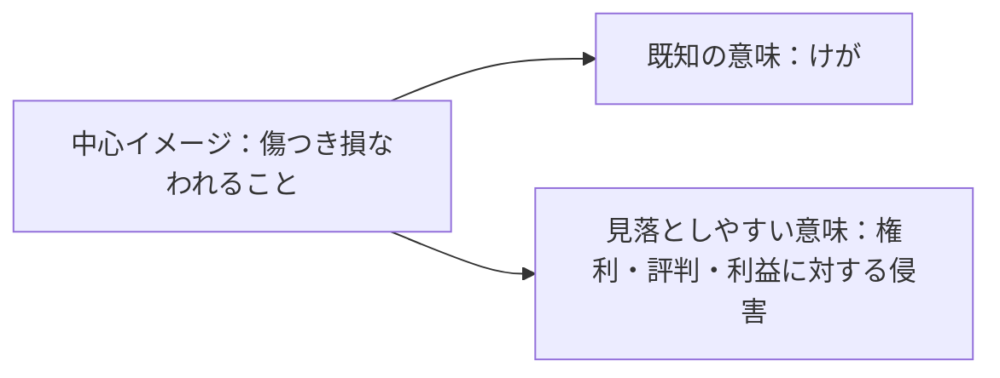

**重要語法：** `injury to one's reputation`

<small>global_order: 1281 / index: 2064 / candidate_id: ev-02064-noun-01</small>

---

## 02. enable

**品詞：** verb　**発音：** /ɪˈneɪbəl/

<small>よく知られている意味：可能にする</small>

**見落としやすい意味：問題行動を黙認するなどして結果的に助長する**

**例文：** By making excuses for him, his friends enabled his rude behavior.

**和訳：** 友人たちは彼の言い訳をしてやることで、失礼な行動を助長した。

**コアイメージ：** enable は行動ができる状態にすること。望ましくない行動でも、周囲の対応によって続けやすくすれば enable と表せる。

**図：**

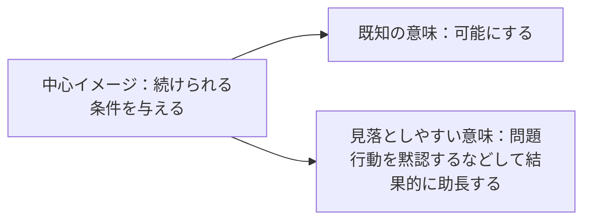

**重要語法：** `enable someone's bad behavior`

<small>global_order: 1282 / index: 2066 / candidate_id: ev-02066-verb-01</small>

---

## 03. engine

**品詞：** noun　**発音：** /ˈendʒɪn/

<small>よく知られている意味：エンジン</small>

**見落としやすい意味：発展や変化を動かす原動力**

**例文：** Tourism has become an engine of growth for the region.

**和訳：** 観光業はその地域の成長の原動力となった。

**コアイメージ：** engine は物を動かす装置を指す。社会や経済を動かす要因も、比喩的にエンジンと呼ぶ。

**図：**

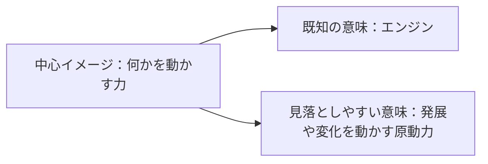

**重要語法：** `an engine of growth`

<small>global_order: 1283 / index: 2071 / candidate_id: ev-02071-noun-01</small>

---

## 04. scheme

**品詞：** noun　**発音：** /skiːm/

<small>よく知られている意味：計画</small>

**見落としやすい意味：体系的な制度・計画・事業**

**例文：** The city launched a scheme to help young artists.

**和訳：** 市は若い芸術家を支援する制度を始めた。

**コアイメージ：** scheme は複数の手段を組み合わせた計画や仕組み。特にイギリス英語では、公的な支援制度にも普通に使う。

**図：**

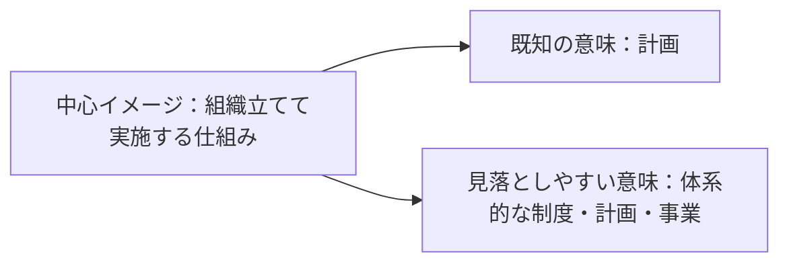

**重要語法：** `a pension scheme`

<small>global_order: 1284 / index: 2073 / candidate_id: ev-02073-noun-01</small>

---

## 05. scheme

**品詞：** noun　**発音：** /skiːm/

<small>よく知られている意味：計画</small>

**見落としやすい意味：人に隠して進めるたくらみ・陰謀**

**例文：** The story reveals a scheme to steal the company's secrets.

**和訳：** その物語では、会社の秘密を盗むたくらみが明らかになる。

**コアイメージ：** scheme は手順を組み立てた計画を表す。目的を隠して進める場合は、陰謀やたくらみという否定的な意味になる。

**図：**

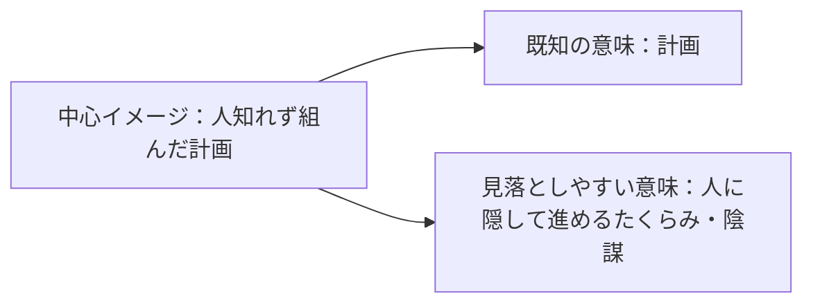

**重要語法：** `a scheme to do`

<small>global_order: 1285 / index: 2073 / candidate_id: ev-02073-noun-02</small>

---

## 06. scheme

**品詞：** verb　**発音：** /skiːm/

<small>よく知られている意味：計画する</small>

**見落としやすい意味：人をだますことなどを密かに企てる**

**例文：** The two rivals schemed to remove the chairman.

**和訳：** 二人の競争相手は議長を退任させようと密かに画策した。

**コアイメージ：** 動詞の scheme は計画を練る動作を表す。とくに人を出し抜こうとする秘密の企てに使われやすい。

**図：**

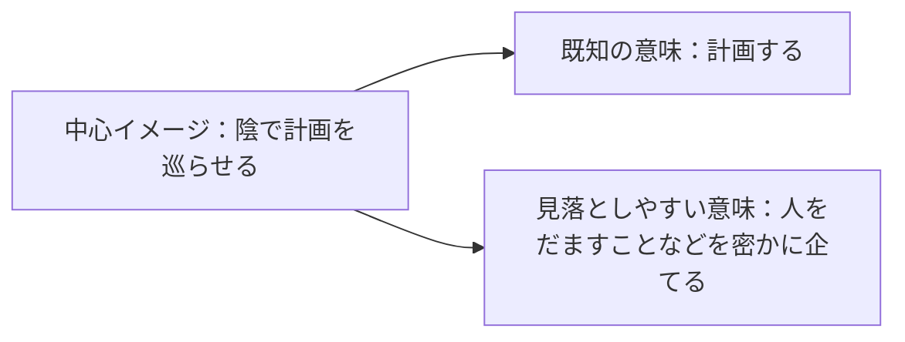

**重要語法：** `scheme to do`

<small>global_order: 1286 / index: 2073 / candidate_id: ev-02073-verb-01</small>

---

## 07. coordinate

**品詞：** noun　**発音：** /koʊˈɔːrdɪnət/

<small>よく知られている意味：調整する</small>

**見落としやすい意味：地点の位置を示す座標**

**例文：** The rescue team recorded the exact coordinates of the island.

**和訳：** 救助隊はその島の正確な座標を記録した。

**コアイメージ：** coordinate は複数の要素を対応づける発想に関係する。名詞の複数形 coordinates は位置を特定する数値の組を指す。

**図：**

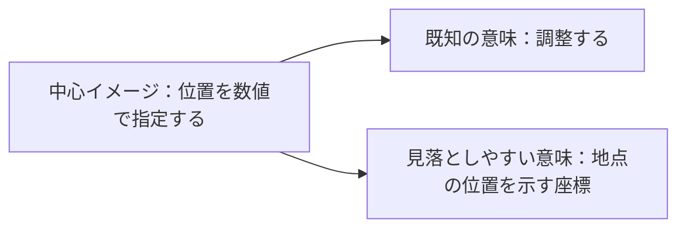

**重要語法：** `geographic coordinates`

<small>global_order: 1287 / index: 2074 / candidate_id: ev-02074-noun-01</small>

---

## 08. coordinate

**品詞：** verb　**発音：** /koʊˈɔːrdɪneɪt/

<small>よく知られている意味：座標</small>

**見落としやすい意味：複数の活動の時間や動きを調整する**

**例文：** We need to coordinate the buses and the volunteers.

**和訳：** 私たちはバスとボランティアの動きを調整する必要がある。

**コアイメージ：** coordinate は複数の物事を一つの目的に合わせること。位置だけでなく、人の活動や時間の調整にも使える。

**図：**

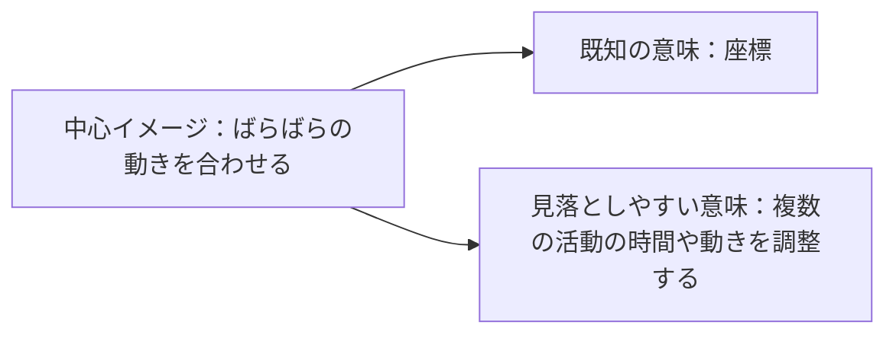

**重要語法：** `coordinate activities`

<small>global_order: 1288 / index: 2074 / candidate_id: ev-02074-verb-02</small>

---

## 09. counsel

**品詞：** noun　**発音：** /ˈkaʊnsəl/

<small>よく知られている意味：助言</small>

**見落としやすい意味：法律上の弁護人・法律顧問**

**例文：** The defendant asked to speak with legal counsel.

**和訳：** 被告人は弁護人と話したいと求めた。

**コアイメージ：** counsel は助言や相談を表す語。法律について助言し弁護する人物そのものを指すこともある。

**図：**

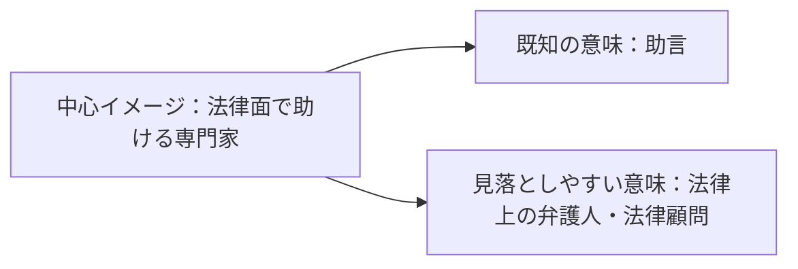

**重要語法：** `legal counsel`

<small>global_order: 1289 / index: 2075 / candidate_id: ev-02075-noun-01</small>

---

## 10. band

**品詞：** verb　**発音：** /bænd/

<small>よく知られている意味：帯・一団</small>

**見落としやすい意味：共通目的のために結束する**

**例文：** Several small groups banded together to protect the park.

**和訳：** いくつかの小さな団体が公園を守るために結束した。

**コアイメージ：** band には集まった一団というイメージがある。動詞では、人々がまとまって共同で行動することを表す。

**図：**

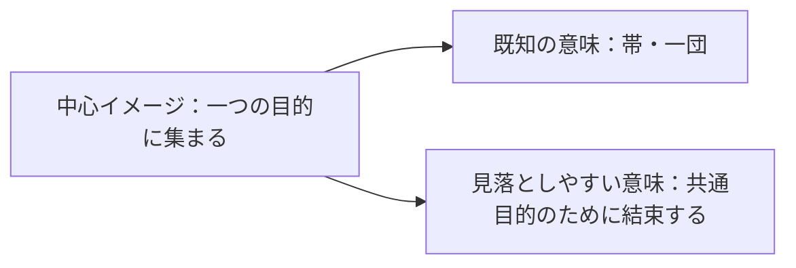

**重要語法：** `band together`

<small>global_order: 1290 / index: 2076 / candidate_id: ev-02076-verb-01</small>

---

## 11. lift

**品詞：** verb　**発音：** /lɪft/

<small>よく知られている意味：持ち上げる</small>

**見落としやすい意味：規制・禁止を解除する**

**例文：** The government lifted the ban on outdoor events.

**和訳：** 政府は屋外イベントの禁止を解除した。

**コアイメージ：** lift は何かを上に持ち上げ、そこから取り除く動き。制限や禁止を取り払うことにも比喩的に使う。

**図：**

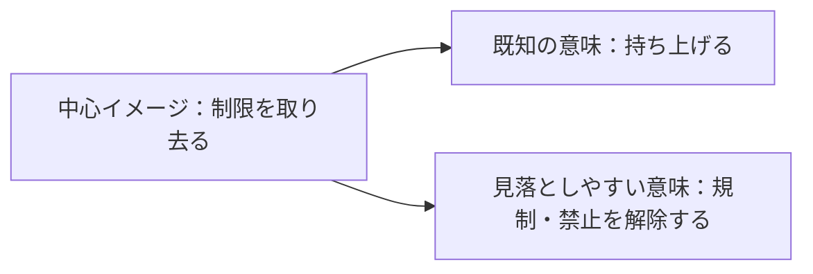

**重要語法：** `lift a ban`

<small>global_order: 1291 / index: 2077 / candidate_id: ev-02077-verb-01</small>

---

## 12. compromise

**品詞：** verb　**発音：** /ˈkɑːmprəmaɪz/

<small>よく知られている意味：妥協する</small>

**見落としやすい意味：信用や安全性を危険にさらす・損なう**

**例文：** Sharing that password could compromise your account's security.

**和訳：** そのパスワードを共有すると、アカウントの安全性が損なわれるおそれがある。

**コアイメージ：** compromise は当初の条件を譲ることから広がる語。安全や信用が譲歩させられ、弱くなる意味でも使う。

**図：**

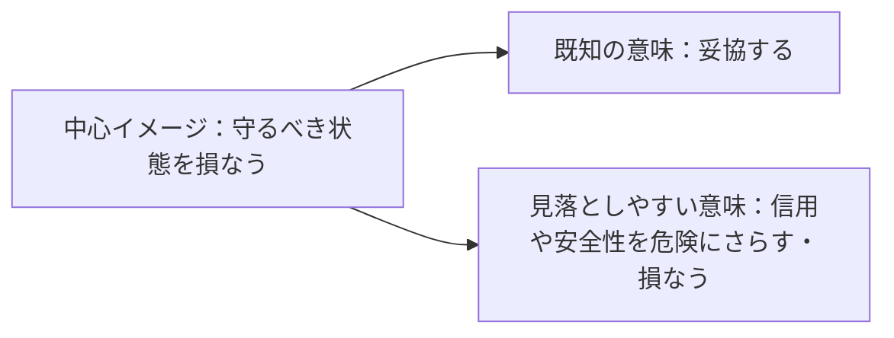

**重要語法：** `compromise security`

<small>global_order: 1292 / index: 2078 / candidate_id: ev-02078-verb-01</small>

---

## 13. opposition

**品詞：** noun　**発音：** /ˌɑːpəˈzɪʃən/

<small>よく知られている意味：反対</small>

**見落としやすい意味：政府に対抗する野党側**

**例文：** The opposition criticized the proposed tax increase.

**和訳：** 野党側は提案された増税を批判した。

**コアイメージ：** opposition は反対することだけでなく反対する集団も指す。政治では与党や政府に対抗する野党側という意味になる。

**図：**

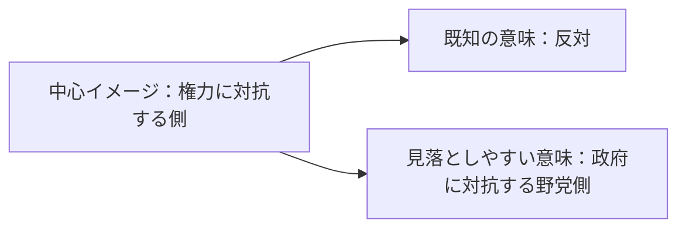

**重要語法：** `the opposition`

<small>global_order: 1293 / index: 2080 / candidate_id: ev-02080-noun-01</small>

---

## 14. meal

**品詞：** noun　**発音：** /miːl/

<small>よく知られている意味：食事</small>

**見落としやすい意味：穀物を粗くひいた粉**

**例文：** The bread is made with cornmeal and wheat flour.

**和訳：** そのパンはトウモロコシのひき粉と小麦粉で作られている。

**コアイメージ：** meal には食事のほかに穀物をひいた粉という別の意味がある。cornmeal などの複合語で特に目にする。

**図：**

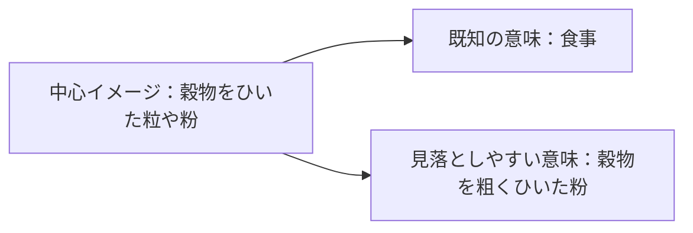

**重要語法：** `cornmeal`

<small>global_order: 1294 / index: 2081 / candidate_id: ev-02081-noun-01</small>

---

## 15. sister

**品詞：** adjective　**発音：** /ˈsɪstər/

<small>よく知られている意味：姉妹</small>

**見落としやすい意味：企業・都市などが同格・同系列である**

**例文：** Our town has a sister city in Canada.

**和訳：** 私たちの町にはカナダに姉妹都市がある。

**コアイメージ：** sister は同じ家族の近い関係を表す。会社や都市にも転用され、同格や提携関係を示す形容詞になる。

**図：**

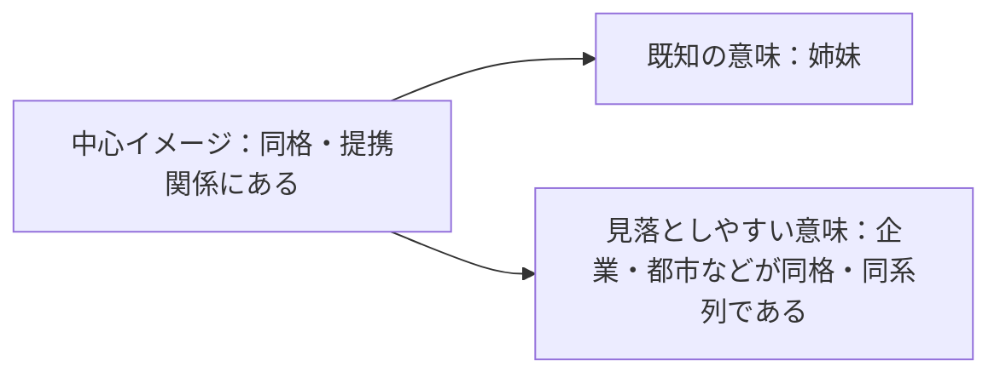

**重要語法：** `sister city`

<small>global_order: 1295 / index: 2083 / candidate_id: ev-02083-adjective-01</small>

---

## 16. roof

**品詞：** noun　**発音：** /ruːf/

<small>よく知られている意味：屋根</small>

**見落としやすい意味：口の中の天井にあたる口蓋**

**例文：** The hot soup burned the roof of my mouth.

**和訳：** 熱いスープで口の中の上あごをやけどした。

**コアイメージ：** roof は空間の上部を覆う面を指す。建物の屋根だけでなく、口の中の上側にも使える。

**図：**

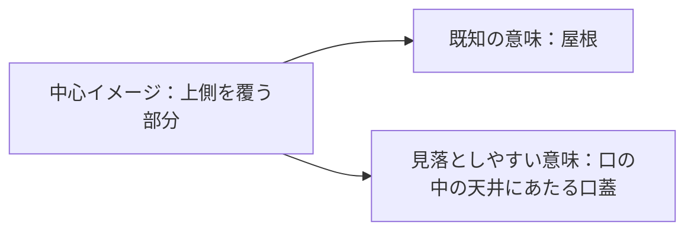

**重要語法：** `the roof of one's mouth`

<small>global_order: 1296 / index: 2084 / candidate_id: ev-02084-noun-01</small>

---

## 17. journey

**品詞：** verb　**発音：** /ˈdʒɜːrni/

<small>よく知られている意味：旅</small>

**見落としやすい意味：旅をする・旅を続ける**

**例文：** They journeyed across the desert for several days.

**和訳：** 彼らは数日かけて砂漠を旅した。

**コアイメージ：** journey は目的地までの道のりを表す名詞として有名。動詞になると、その道のりを旅して進むことを表す。

**図：**

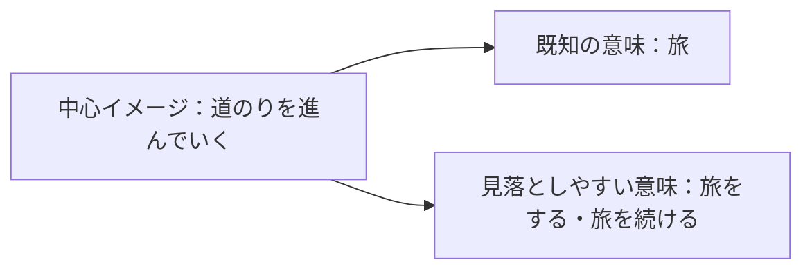

**重要語法：** `journey across`

<small>global_order: 1297 / index: 2085 / candidate_id: ev-02085-verb-01</small>

---

## 18. secretary

**品詞：** noun　**発音：** /ˈsekrəteri/

<small>よく知られている意味：秘書</small>

**見落としやすい意味：政府機関の長官・大臣**

**例文：** The health secretary announced a new policy.

**和訳：** 保健担当大臣が新しい政策を発表した。

**コアイメージ：** secretary は事務を担う人だけを意味しない。政府で特定の行政分野を統括する大臣や長官の名称にもなる。

**図：**

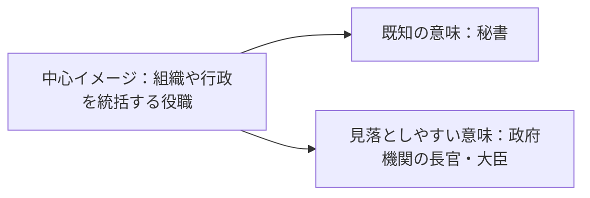

**重要語法：** `Secretary of State`

<small>global_order: 1298 / index: 2087 / candidate_id: ev-02087-noun-01</small>

---

## 19. ceremony

**品詞：** noun　**発音：** /ˈserəmoʊni/

<small>よく知られている意味：儀式</small>

**見落としやすい意味：形式ばった礼儀・作法**

**例文：** We don't stand on ceremony in this house.

**和訳：** この家では堅苦しい礼儀にこだわりません。

**コアイメージ：** ceremony は定められた手順で行う儀式。そこから日常の形式的な礼儀作法にも意味が広がる。

**図：**

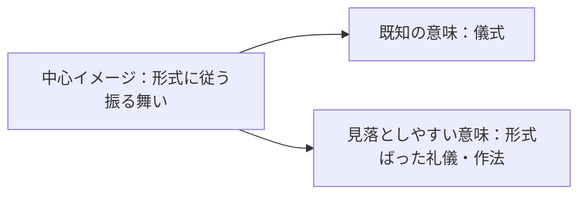

**重要語法：** `stand on ceremony`

<small>global_order: 1299 / index: 2088 / candidate_id: ev-02088-noun-01</small>

---

## 20. evolve

**品詞：** verb　**発音：** /ɪˈvɑːlv/

<small>よく知られている意味：進化する</small>

**見落としやすい意味：化学反応によって気体を発生させる**

**例文：** The chemical reaction evolved a small amount of gas.

**和訳：** その化学反応で少量の気体が発生した。

**コアイメージ：** evolve は内側から何かが現れ出る変化を表すことがある。化学では反応により気体が放出される意味で用いる。

**図：**

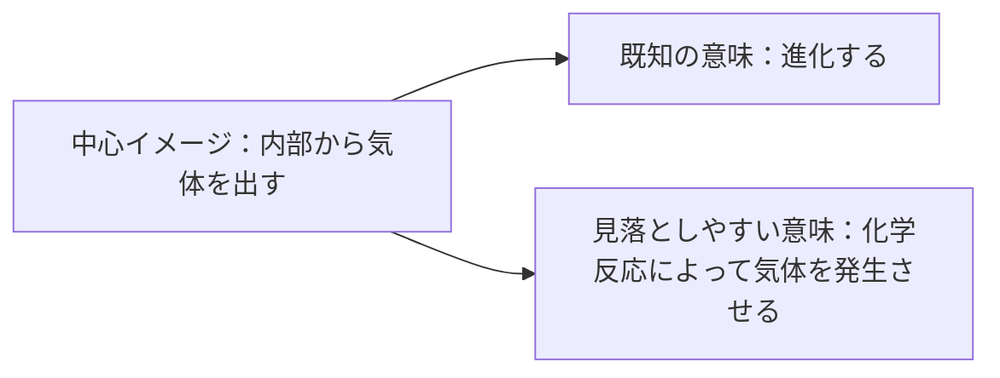

**重要語法：** `evolve gas`

<small>global_order: 1300 / index: 2091 / candidate_id: ev-02091-verb-01</small>

---

## 21. transport

**品詞：** verb　**発音：** /trænsˈpɔːrt/

<small>よく知られている意味：輸送する</small>

**見落としやすい意味：強い感情で人を我を忘れるほど感動させる**

**例文：** She was transported with joy when she heard the news.

**和訳：** その知らせを聞いて、彼女は我を忘れるほど喜んだ。

**コアイメージ：** transport は人や物を別の場所へ運ぶこと。比喩的には感情に強く引き込まれ、普段の心の状態から離れることを表す。

**図：**

```mermaid
flowchart LR
    A["中心イメージ：感情によって別世界へ運ぶ"]
    B["既知の意味：輸送する"]
    C["見落としやすい意味：強い感情で人を我を忘れるほど感動させる"]
    A --> B
    A --> C
```

**重要語法：** `be transported with joy`

<small>global_order: 1301 / index: 2093 / candidate_id: ev-02093-verb-01</small>

---

## 22. justify

**品詞：** verb　**発音：** /ˈdʒʌstɪfaɪ/

<small>よく知られている意味：正当化する</small>

**見落としやすい意味：文章を左右の端にそろえる**

**例文：** Please justify the text before printing the document.

**和訳：** 文書を印刷する前に、本文を両端揃えにしてください。

**コアイメージ：** justify は本来、筋の通った状態にするという考えに関わる。文章の配置では、左右両端の位置を揃える操作を指す。

**図：**

```mermaid
flowchart LR
    A["中心イメージ：行の両端をそろえる"]
    B["既知の意味：正当化する"]
    C["見落としやすい意味：文章を左右の端にそろえる"]
    A --> B
    A --> C
```

**重要語法：** `justify text`

<small>global_order: 1302 / index: 2095 / candidate_id: ev-02095-verb-01</small>

---

## 23. peer

**品詞：** verb　**発音：** /pɪr/

<small>よく知られている意味：同輩</small>

**見落としやすい意味：目を凝らしてじっと見る**

**例文：** He peered into the dark room but saw nothing.

**和訳：** 彼は暗い部屋を目を凝らしてのぞいたが、何も見えなかった。

**コアイメージ：** 名詞 peer は同等の立場の人。動詞 peer は別系統の意味で、見えにくいものを注意深く見ようとする動作を表す。

**図：**

```mermaid
flowchart LR
    A["中心イメージ：目を凝らして見る"]
    B["既知の意味：同輩"]
    C["見落としやすい意味：目を凝らしてじっと見る"]
    A --> B
    A --> C
```

**重要語法：** `peer into`

<small>global_order: 1303 / index: 2096 / candidate_id: ev-02096-verb-01</small>

---

## 24. fabric

**品詞：** noun　**発音：** /ˈfæbrɪk/

<small>よく知られている意味：布地</small>

**見落としやすい意味：建物や社会の基礎構造・骨組み**

**例文：** Trust is part of the fabric of a healthy community.

**和訳：** 信頼は健全な共同体の基盤を成す一部だ。

**コアイメージ：** fabric は糸が組み合わさってできた布。比喩的には社会や建物を支える構成要素の結びつきを表す。

**図：**

```mermaid
flowchart LR
    A["中心イメージ：全体を支える織り目や構造"]
    B["既知の意味：布地"]
    C["見落としやすい意味：建物や社会の基礎構造・骨組み"]
    A --> B
    A --> C
```

**重要語法：** `the social fabric`

<small>global_order: 1304 / index: 2097 / candidate_id: ev-02097-noun-01</small>

---

## 25. convict

**品詞：** noun　**発音：** /ˈkɑːnvɪkt/

<small>よく知られている意味：有罪にする</small>

**見落としやすい意味：有罪判決を受けた人・受刑者**

**例文：** The former convict found a job after leaving prison.

**和訳：** その元受刑者は刑務所を出たあと仕事を見つけた。

**コアイメージ：** 動詞 convict は有罪判決を下すこと。名詞になると、判決を受けた人物を指す。

**図：**

```mermaid
flowchart LR
    A["中心イメージ：有罪とされた人物"]
    B["既知の意味：有罪にする"]
    C["見落としやすい意味：有罪判決を受けた人・受刑者"]
    A --> B
    A --> C
```

**重要語法：** `a former convict`

<small>global_order: 1305 / index: 2099 / candidate_id: ev-02099-noun-01</small>

---

## 26. rain

**品詞：** verb　**発音：** /reɪn/

<small>よく知られている意味：雨が降る</small>

**見落としやすい意味：非難や質問などが大量に浴びせられる**

**例文：** Questions rained down on the speaker after the lecture.

**和訳：** 講演のあと、講演者に質問が次々と浴びせられた。

**コアイメージ：** rain は雨粒が多数降ることを表す。質問や批判が次々に押し寄せる様子にも使う。

**図：**

```mermaid
flowchart LR
    A["中心イメージ：大量に降り注ぐ"]
    B["既知の意味：雨が降る"]
    C["見落としやすい意味：非難や質問などが大量に浴びせられる"]
    A --> B
    A --> C
```

**重要語法：** `rain down on`

<small>global_order: 1306 / index: 2101 / candidate_id: ev-02101-verb-01</small>

---

## 27. contrary

**品詞：** noun　**発音：** /ˈkɑːntreri/

<small>よく知られている意味：反対の</small>

**見落としやすい意味：正反対のこと・反対の意見**

**例文：** Despite reports to the contrary, the museum is still open.

**和訳：** それとは反対の報道があるが、その博物館はまだ開いている。

**コアイメージ：** contrary は反対の状態を表す語。名詞として、先に述べた内容とは逆の事柄を示すことがある。

**図：**

```mermaid
flowchart LR
    A["中心イメージ：反対であることそのもの"]
    B["既知の意味：反対の"]
    C["見落としやすい意味：正反対のこと・反対の意見"]
    A --> B
    A --> C
```

**重要語法：** `to the contrary`

<small>global_order: 1307 / index: 2102 / candidate_id: ev-02102-noun-01</small>

---

## 28. mine

**品詞：** noun　**発音：** /maɪn/

<small>よく知られている意味：私のもの</small>

**見落としやすい意味：地中や水中に設けた爆発物・地雷**

**例文：** Warning signs showed that old mines remained in the field.

**和訳：** 警告標識は、その野原に古い地雷が残っていることを示していた。

**コアイメージ：** mine には自分のものという代名詞のほか、鉱山という名詞がある。さらに地中や水中に置かれた爆発物も意味する。

**図：**

```mermaid
flowchart LR
    A["中心イメージ：埋められた爆発物"]
    B["既知の意味：私のもの"]
    C["見落としやすい意味：地中や水中に設けた爆発物・地雷"]
    A --> B
    A --> C
```

**重要語法：** `land mine`

<small>global_order: 1308 / index: 2106 / candidate_id: ev-02106-noun-01</small>

---

## 29. import

**品詞：** noun　**発音：** /ˈɪmpɔːrt/

<small>よく知られている意味：輸入</small>

**見落としやすい意味：重大さ・重要性**

**例文：** The discovery was of great import to medical research.

**和訳：** その発見は医学研究にとって非常に重要だった。

**コアイメージ：** import には外から取り込むという意味がある。一方、名詞では物事が持つ重要性や意義を表す用法もある。

**図：**

```mermaid
flowchart LR
    A["中心イメージ：重み・重大性"]
    B["既知の意味：輸入"]
    C["見落としやすい意味：重大さ・重要性"]
    A --> B
    A --> C
```

**重要語法：** `of great import`

<small>global_order: 1309 / index: 2109 / candidate_id: ev-02109-noun-01</small>

---

## 30. suggestion

**品詞：** noun　**発音：** /səɡˈdʒestʃən/

<small>よく知られている意味：提案</small>

**見落としやすい意味：何かを示唆する兆候・ほのめかし**

**例文：** There was no suggestion of rain in the morning sky.

**和訳：** 朝の空には雨が降りそうな気配はなかった。

**コアイメージ：** suggestion は考えを示す提案だけではない。ある事実を間接的にうかがわせる小さな兆候も指す。

**図：**

```mermaid
flowchart LR
    A["中心イメージ：かすかな兆候や気配"]
    B["既知の意味：提案"]
    C["見落としやすい意味：何かを示唆する兆候・ほのめかし"]
    A --> B
    A --> C
```

**重要語法：** `no suggestion of`

<small>global_order: 1310 / index: 2110 / candidate_id: ev-02110-noun-01</small>

---

## 31. quick

**品詞：** noun　**発音：** /kwɪk/

<small>よく知られている意味：速い</small>

**見落としやすい意味：爪の下にある敏感な肉の部分**

**例文：** Take care not to cut the quick when trimming the dog's nails.

**和訳：** 犬の爪を切るときは、内側の敏感な部分を切らないように気をつけて。

**コアイメージ：** quick には素早いという形容詞のほか、生きていて感覚のある部分という古い意味がある。爪の内側の敏感な組織を指す名詞として残っている。

**図：**

```mermaid
flowchart LR
    A["中心イメージ：爪の内側の敏感な部分"]
    B["既知の意味：速い"]
    C["見落としやすい意味：爪の下にある敏感な肉の部分"]
    A --> B
    A --> C
```

**重要語法：** `the quick`

<small>global_order: 1311 / index: 2113 / candidate_id: ev-02113-noun-01</small>

---

## 32. invent

**品詞：** verb　**発音：** /ɪnˈvent/

<small>よく知られている意味：発明する</small>

**見落としやすい意味：実際にはない話や口実を作り上げる**

**例文：** He invented an excuse for missing the meeting.

**和訳：** 彼は会議を欠席したことについて口実をでっち上げた。

**コアイメージ：** invent は新しいものを作り出すこと。事実ではない話を頭の中で作り上げる場合にも使う。

**図：**

```mermaid
flowchart LR
    A["中心イメージ：実在しない話を作る"]
    B["既知の意味：発明する"]
    C["見落としやすい意味：実際にはない話や口実を作り上げる"]
    A --> B
    A --> C
```

**重要語法：** `invent an excuse`

<small>global_order: 1312 / index: 2114 / candidate_id: ev-02114-verb-01</small>

---

## 33. crop

**品詞：** noun　**発音：** /krɑːp/

<small>よく知られている意味：作物</small>

**見落としやすい意味：写真・画像から切り抜いた部分**

**例文：** The final crop leaves only the person's face in the photo.

**和訳：** 最終的な切り抜きでは、写真にその人の顔だけが残る。

**コアイメージ：** crop は収穫物を指すほか、刈り取る・切り詰める発想につながる。画像では周囲を切り落として残した範囲を意味する。

**図：**

```mermaid
flowchart LR
    A["中心イメージ：画像から残して切り出す部分"]
    B["既知の意味：作物"]
    C["見落としやすい意味：写真・画像から切り抜いた部分"]
    A --> B
    A --> C
```

**重要語法：** `a tight crop`

<small>global_order: 1313 / index: 2115 / candidate_id: ev-02115-noun-01</small>

---

## 34. crop

**品詞：** noun　**発音：** /krɑːp/

<small>よく知られている意味：作物</small>

**見落としやすい意味：同じ時期に現れた人・物の一群**

**例文：** A new crop of young writers is gaining attention.

**和訳：** 新たな世代の若い作家たちが注目を集めている。

**コアイメージ：** crop は一度に育って収穫される作物。そこから同じ時期に現れた人や物の一群も指す。

**図：**

```mermaid
flowchart LR
    A["中心イメージ：同時期に現れるまとまり"]
    B["既知の意味：作物"]
    C["見落としやすい意味：同じ時期に現れた人・物の一群"]
    A --> B
    A --> C
```

**重要語法：** `a new crop of`

<small>global_order: 1314 / index: 2115 / candidate_id: ev-02115-noun-02</small>

---

## 35. frequent

**品詞：** verb　**発音：** /frɪˈkwent/

<small>よく知られている意味：頻繁な</small>

**見落としやすい意味：ある場所に頻繁に通う・出入りする**

**例文：** She frequents a small café near the station.

**和訳：** 彼女は駅の近くの小さなカフェによく通う。

**コアイメージ：** 形容詞 frequent は頻度が高いこと。動詞では、その場所を頻繁に訪れることを表す。

**図：**

```mermaid
flowchart LR
    A["中心イメージ：何度もその場所へ足を運ぶ"]
    B["既知の意味：頻繁な"]
    C["見落としやすい意味：ある場所に頻繁に通う・出入りする"]
    A --> B
    A --> C
```

**重要語法：** `frequent a place`

<small>global_order: 1315 / index: 2118 / candidate_id: ev-02118-verb-01</small>

---

## 36. swim

**品詞：** verb　**発音：** /swɪm/

<small>よく知られている意味：泳ぐ</small>

**見落としやすい意味：頭がくらくらし目が回る**

**例文：** My head swam when I stood up too quickly.

**和訳：** 急に立ち上がったとき、頭がくらくらした。

**コアイメージ：** swim は水中で体が動くこと。視界や頭の中が揺れるように感じる状態にも比喩的に使われる。

**図：**

```mermaid
flowchart LR
    A["中心イメージ：目の前が揺れて感じられる"]
    B["既知の意味：泳ぐ"]
    C["見落としやすい意味：頭がくらくらし目が回る"]
    A --> B
    A --> C
```

**重要語法：** `one's head swims`

<small>global_order: 1316 / index: 2119 / candidate_id: ev-02119-verb-01</small>

---

## 37. rating

**品詞：** noun　**発音：** /ˈreɪtɪŋ/

<small>よく知られている意味：評価</small>

**見落としやすい意味：テレビ番組などの視聴率**

**例文：** The show received high ratings last season.

**和訳：** その番組は昨シーズン高い視聴率を記録した。

**コアイメージ：** rating は何かを評価した数値。テレビでは視聴状況を数字で表したもの、つまり視聴率を指す。

**図：**

```mermaid
flowchart LR
    A["中心イメージ：どれだけ見られたかの数字"]
    B["既知の意味：評価"]
    C["見落としやすい意味：テレビ番組などの視聴率"]
    A --> B
    A --> C
```

**重要語法：** `TV ratings`

<small>global_order: 1317 / index: 2121 / candidate_id: ev-02121-noun-01</small>

---

## 38. waste

**品詞：** noun　**発音：** /weɪst/

<small>よく知られている意味：無駄・廃棄物</small>

**見落としやすい意味：人が住まず利用されていない荒れ地**

**例文：** They traveled across a barren waste of rock and sand.

**和訳：** 彼らは岩と砂が広がる不毛な荒れ地を横断した。

**コアイメージ：** waste には役立てられず残されたものというイメージがある。人の利用や居住がほとんどない荒涼とした土地にも使う。

**図：**

```mermaid
flowchart LR
    A["中心イメージ：利用されていない広い土地"]
    B["既知の意味：無駄・廃棄物"]
    C["見落としやすい意味：人が住まず利用されていない荒れ地"]
    A --> B
    A --> C
```

**重要語法：** `a barren waste`

<small>global_order: 1318 / index: 2122 / candidate_id: ev-02122-noun-01</small>

---

## 39. negotiate

**品詞：** verb　**発音：** /nɪˈɡoʊʃieɪt/

<small>よく知られている意味：交渉する</small>

**見落としやすい意味：困難な道や障害物をうまく通り抜ける**

**例文：** The driver carefully negotiated the narrow mountain road.

**和訳：** 運転手は狭い山道を慎重に通り抜けた。

**コアイメージ：** negotiate は条件を調整して難しい状況を乗り切ること。相手との交渉だけでなく、通りにくい場所をうまく進む意味になる。

**図：**

```mermaid
flowchart LR
    A["中心イメージ：難所をうまく切り抜ける"]
    B["既知の意味：交渉する"]
    C["見落としやすい意味：困難な道や障害物をうまく通り抜ける"]
    A --> B
    A --> C
```

**重要語法：** `negotiate a bend`

<small>global_order: 1319 / index: 2123 / candidate_id: ev-02123-verb-01</small>

---

## 40. legend

**品詞：** noun　**発音：** /ˈledʒənd/

<small>よく知られている意味：伝説</small>

**見落としやすい意味：地図・図表の記号の意味を示す凡例**

**例文：** Check the legend to see what the blue lines mean.

**和訳：** 青い線の意味を知るには凡例を確認してください。

**コアイメージ：** legend は物語として伝えられる説明を指す。地図や図表では、記号や色の意味を説明する部分をいう。

**図：**

```mermaid
flowchart LR
    A["中心イメージ：記号を読み解くための説明"]
    B["既知の意味：伝説"]
    C["見落としやすい意味：地図・図表の記号の意味を示す凡例"]
    A --> B
    A --> C
```

**重要語法：** `map legend`

<small>global_order: 1320 / index: 2124 / candidate_id: ev-02124-noun-01</small>

---

## 41. funny

**品詞：** adjective　**発音：** /ˈfʌni/

<small>よく知られている意味：面白い</small>

**見落としやすい意味：奇妙な・何かおかしい・不審な**

**例文：** There's something funny about that message.

**和訳：** そのメッセージは何かおかしい。

**コアイメージ：** funny は笑わせる面白さだけではない。普段と違う違和感や不審さにも使われる。

**図：**

```mermaid
flowchart LR
    A["中心イメージ：普通と違って不審な"]
    B["既知の意味：面白い"]
    C["見落としやすい意味：奇妙な・何かおかしい・不審な"]
    A --> B
    A --> C
```

**重要語法：** `something funny about`

<small>global_order: 1321 / index: 2128 / candidate_id: ev-02128-adjective-01</small>

---

## 42. romantic

**品詞：** adjective　**発音：** /roʊˈmæntɪk/

<small>よく知られている意味：恋愛の</small>

**見落としやすい意味：非現実的で夢想的な**

**例文：** His romantic view of city life ignored its difficulties.

**和訳：** 都会暮らしに対する彼の夢想的な見方は、その難しさを無視していた。

**コアイメージ：** romantic は恋愛だけでなく、現実より理想や想像を重んじる姿勢にも使う。現実離れした期待を示すことがある。

**図：**

```mermaid
flowchart LR
    A["中心イメージ：理想を優先した夢想的な"]
    B["既知の意味：恋愛の"]
    C["見落としやすい意味：非現実的で夢想的な"]
    A --> B
    A --> C
```

**重要語法：** `a romantic view`

<small>global_order: 1322 / index: 2130 / candidate_id: ev-02130-adjective-01</small>

---

## 43. empty

**品詞：** adjective　**発音：** /ˈempti/

<small>よく知られている意味：空の</small>

**見落としやすい意味：内容や誠意がなく虚しい**

**例文：** The manager made empty promises that changed nothing.

**和訳：** その責任者は何も変えない空約束をした。

**コアイメージ：** empty は容器の中に何もないこと。言葉や約束の中に実質や誠意がない場合にも使う。

**図：**

```mermaid
flowchart LR
    A["中心イメージ：中身や実質がない"]
    B["既知の意味：空の"]
    C["見落としやすい意味：内容や誠意がなく虚しい"]
    A --> B
    A --> C
```

**重要語法：** `empty promises`

<small>global_order: 1323 / index: 2131 / candidate_id: ev-02131-adjective-01</small>

---

## 44. efficiency

**品詞：** noun　**発音：** /ɪˈfɪʃənsi/

<small>よく知られている意味：効率</small>

**見落としやすい意味：米国でのワンルーム式住居**

**例文：** She rented a small efficiency near the university.

**和訳：** 彼女は大学の近くで小さなワンルーム住居を借りた。

**コアイメージ：** efficiency は効率性を指すのが基本。米国の住宅用語では、生活機能を一部屋にまとめた小型の住居を意味する。

**図：**

```mermaid
flowchart LR
    A["中心イメージ：必要な機能を一室にまとめた住居"]
    B["既知の意味：効率"]
    C["見落としやすい意味：米国でのワンルーム式住居"]
    A --> B
    A --> C
```

**重要語法：** `an efficiency apartment`

<small>global_order: 1324 / index: 2136 / candidate_id: ev-02136-noun-01</small>

---

## 45. ruin

**品詞：** noun　**発音：** /ˈruːɪn/

<small>よく知られている意味：廃墟</small>

**見落としやすい意味：経済的な破綻・破産状態**

**例文：** The failed business left the family facing financial ruin.

**和訳：** 事業の失敗で、その家族は経済的破綻に直面した。

**コアイメージ：** ruin は建物が崩れた残骸だけでなく、生活や財産の基盤が崩れることも表す。物理的な崩壊から比喩へ広がった語義。

**図：**

```mermaid
flowchart LR
    A["中心イメージ：人生や経済が崩れること"]
    B["既知の意味：廃墟"]
    C["見落としやすい意味：経済的な破綻・破産状態"]
    A --> B
    A --> C
```

**重要語法：** `financial ruin`

<small>global_order: 1325 / index: 2137 / candidate_id: ev-02137-noun-01</small>

---

## 46. roughly

**品詞：** adverb　**発音：** /ˈrʌfli/

<small>よく知られている意味：おおよそ</small>

**見落としやすい意味：乱暴に・ぞんざいに**

**例文：** The box was handled roughly during delivery.

**和訳：** その箱は配送中に乱暴に扱われた。

**コアイメージ：** roughly は正確さが粗いという意味で概算に使える。動作の仕方が粗く乱暴である場合にも使う。

**図：**

```mermaid
flowchart LR
    A["中心イメージ：扱いが荒っぽい"]
    B["既知の意味：おおよそ"]
    C["見落としやすい意味：乱暴に・ぞんざいに"]
    A --> B
    A --> C
```

**重要語法：** `handle roughly`

<small>global_order: 1326 / index: 2140 / candidate_id: ev-02140-adverb-01</small>

---

## 47. scholarship

**品詞：** noun　**発音：** /ˈskɑːlərʃɪp/

<small>よく知られている意味：奨学金</small>

**見落としやすい意味：学識・学術研究の成果**

**例文：** Her scholarship has influenced many historians.

**和訳：** 彼女の学術研究は多くの歴史家に影響を与えてきた。

**コアイメージ：** scholarship は学問に取り組むことやその成果を指す。学問を支援する給付金だけを意味するわけではない。

**図：**

```mermaid
flowchart LR
    A["中心イメージ：研究で積み重ねた知識"]
    B["既知の意味：奨学金"]
    C["見落としやすい意味：学識・学術研究の成果"]
    A --> B
    A --> C
```

**重要語法：** `original scholarship`

<small>global_order: 1327 / index: 2141 / candidate_id: ev-02141-noun-01</small>

---

## 48. attach

**品詞：** verb　**発音：** /əˈtætʃ/

<small>よく知られている意味：取り付ける</small>

**見落としやすい意味：権利や責任が法律上発生・付随する**

**例文：** Legal responsibility attaches to the owner of the building.

**和訳：** 法律上の責任はその建物の所有者に付随する。

**コアイメージ：** attach は物を何かにつなぎ留めること。法律上の責任や権利が特定の人物・物に結びつく場合にも使う。

**図：**

```mermaid
flowchart LR
    A["中心イメージ：法律上の権利・責任が付随する"]
    B["既知の意味：取り付ける"]
    C["見落としやすい意味：権利や責任が法律上発生・付随する"]
    A --> B
    A --> C
```

**重要語法：** `liability attaches to`

<small>global_order: 1328 / index: 2142 / candidate_id: ev-02142-verb-01</small>

---

## 49. temperature

**品詞：** noun　**発音：** /ˈtemprətʃər/

<small>よく知られている意味：温度</small>

**見落としやすい意味：発熱した状態・熱があること**

**例文：** She was running a temperature and stayed home.

**和訳：** 彼女は熱があったので家にいた。

**コアイメージ：** temperature は温度全般を表す。日常的な表現で体温が上がっていること、つまり発熱を示す場合がある。

**図：**

```mermaid
flowchart LR
    A["中心イメージ：体温が高い状態"]
    B["既知の意味：温度"]
    C["見落としやすい意味：発熱した状態・熱があること"]
    A --> B
    A --> C
```

**重要語法：** `run a temperature`

<small>global_order: 1329 / index: 2148 / candidate_id: ev-02148-noun-01</small>

---

## 50. penalty

**品詞：** noun　**発音：** /ˈpenəlti/

<small>よく知られている意味：罰金・罰</small>

**見落としやすい意味：行動の結果として支払う代償・不利益**

**例文：** The penalty for rushing was a series of avoidable errors.

**和訳：** 急いだ代償は、避けられたはずのミスの連続だった。

**コアイメージ：** penalty は規則違反への処罰が基本。ある行動の結果として負わされる不利益にも広がる。

**図：**

```mermaid
flowchart LR
    A["中心イメージ：選択に伴う代償"]
    B["既知の意味：罰金・罰"]
    C["見落としやすい意味：行動の結果として支払う代償・不利益"]
    A --> B
    A --> C
```

**重要語法：** `pay the penalty for`

<small>global_order: 1330 / index: 2150 / candidate_id: ev-02150-noun-01</small>

---

## 51. lively

**品詞：** adjective　**発音：** /ˈlaɪvli/

<small>よく知られている意味：活発な</small>

**見落としやすい意味：色彩・音などが鮮やかで生き生きした**

**例文：** The artist used lively shades of orange and green.

**和訳：** その芸術家は鮮やかなオレンジと緑の色調を使った。

**コアイメージ：** lively は人や活動に生命感があること。色彩や音にも転用され、生き生きとした印象を表す。

**図：**

```mermaid
flowchart LR
    A["中心イメージ：色や音が鮮やかで躍動的な"]
    B["既知の意味：活発な"]
    C["見落としやすい意味：色彩・音などが鮮やかで生き生きした"]
    A --> B
    A --> C
```

**重要語法：** `lively colors`

<small>global_order: 1331 / index: 2153 / candidate_id: ev-02153-adjective-01</small>

---

## 52. brand

**品詞：** verb　**発音：** /brænd/

<small>よく知られている意味：商標・銘柄</small>

**見落としやすい意味：不名誉な特徴を決めつけて烙印を押す**

**例文：** The article unfairly branded him a liar.

**和訳：** その記事は彼を不当にうそつきだと決めつけた。

**コアイメージ：** brand は焼き印や銘柄のように識別する印をつけること。人に固定的な悪評を貼り付ける意味でも使う。

**図：**

```mermaid
flowchart LR
    A["中心イメージ：否定的な評価を押しつける"]
    B["既知の意味：商標・銘柄"]
    C["見落としやすい意味：不名誉な特徴を決めつけて烙印を押す"]
    A --> B
    A --> C
```

**重要語法：** `brand someone a liar`

<small>global_order: 1332 / index: 2154 / candidate_id: ev-02154-verb-01</small>

---

## 53. closely

**品詞：** adverb　**発音：** /ˈkloʊsli/

<small>よく知られている意味：近くに</small>

**見落としやすい意味：注意深く・入念に調べて**

**例文：** The scientists examined the results closely.

**和訳：** 科学者たちは結果を注意深く調べた。

**コアイメージ：** closely は距離が近いだけではない。対象に注意を寄せ、細部を見落とさない様子を表す。

**図：**

```mermaid
flowchart LR
    A["中心イメージ：細部まで注意を向ける"]
    B["既知の意味：近くに"]
    C["見落としやすい意味：注意深く・入念に調べて"]
    A --> B
    A --> C
```

**重要語法：** `examine closely`

<small>global_order: 1333 / index: 2155 / candidate_id: ev-02155-adverb-01</small>

---

## 54. utility

**品詞：** noun　**発音：** /juːˈtɪləti/

<small>よく知られている意味：役立つこと</small>

**見落としやすい意味：電気・水道などの公益事業やその事業者**

**例文：** The local utility plans to replace old water pipes.

**和訳：** 地元の公益事業者は古い水道管を交換する計画だ。

**コアイメージ：** utility は役に立つ性質を表す。生活に欠かせない電気・水道などのサービスや提供事業者も指す。

**図：**

```mermaid
flowchart LR
    A["中心イメージ：暮らしを支える公共サービス"]
    B["既知の意味：役立つこと"]
    C["見落としやすい意味：電気・水道などの公益事業やその事業者"]
    A --> B
    A --> C
```

**重要語法：** `public utilities`

<small>global_order: 1334 / index: 2156 / candidate_id: ev-02156-noun-01</small>

---

## 55. overlook

**品詞：** verb　**発音：** /ˌoʊvərˈlʊk/

<small>よく知られている意味：見落とす</small>

**見落としやすい意味：過失や欠点を見逃して大目に見る**

**例文：** The teacher chose to overlook the small mistake.

**和訳：** 先生はその小さなミスを大目に見ることにした。

**コアイメージ：** overlook は注意を向けずに見逃すこと。欠点を知りながら問題にしないという、意図的に大目に見る意味もある。

**図：**

```mermaid
flowchart LR
    A["中心イメージ：欠点を承知で許す"]
    B["既知の意味：見落とす"]
    C["見落としやすい意味：過失や欠点を見逃して大目に見る"]
    A --> B
    A --> C
```

**重要語法：** `overlook a mistake`

<small>global_order: 1335 / index: 2157 / candidate_id: ev-02157-verb-01</small>

---

## 56. overlook

**品詞：** verb　**発音：** /ˌoʊvərˈlʊk/

<small>よく知られている意味：見落とす</small>

**見落としやすい意味：（建物や部屋が）〜を見渡す位置にある**

**例文：** Our room overlooks the harbor.

**和訳：** 私たちの部屋からは港が見渡せる。

**コアイメージ：** overlook は上から一帯を眺める位置関係も表す。見落とすという意味と混同せず、建物や部屋が景色に面していると考える。

**図：**

```mermaid
flowchart LR
    A["中心イメージ：高い所から見渡せる"]
    B["既知の意味：見落とす"]
    C["見落としやすい意味：（建物や部屋が）〜を見渡す位置にある"]
    A --> B
    A --> C
```

**重要語法：** `a room overlooking the sea`

<small>global_order: 1336 / index: 2157 / candidate_id: ev-02157-verb-02</small>

---

## 57. embrace

**品詞：** verb　**発音：** /ɪmˈbreɪs/

<small>よく知られている意味：抱きしめる</small>

**見落としやすい意味：提案・変化などを積極的に受け入れる**

**例文：** The school embraced the idea of flexible study hours.

**和訳：** 学校は柔軟な学習時間という考えを積極的に取り入れた。

**コアイメージ：** embrace は腕で包み込むこと。考えや変化を拒まず受け入れ、自分のものにする意味にも使う。

**図：**

```mermaid
flowchart LR
    A["中心イメージ：新しいものを積極的に受け入れる"]
    B["既知の意味：抱きしめる"]
    C["見落としやすい意味：提案・変化などを積極的に受け入れる"]
    A --> B
    A --> C
```

**重要語法：** `embrace change`

<small>global_order: 1337 / index: 2159 / candidate_id: ev-02159-verb-01</small>

---

## 58. pound

**品詞：** noun　**発音：** /paʊnd/

<small>よく知られている意味：ポンド</small>

**見落としやすい意味：捕獲された動物などの収容所**

**例文：** The lost dog was taken to the local pound.

**和訳：** 迷い犬は地元の動物収容所に連れていかれた。

**コアイメージ：** pound は重さや通貨の単位として知られる。別の名詞用法では、捕獲された動物を一時的に収容する施設をいう。

**図：**

```mermaid
flowchart LR
    A["中心イメージ：保護のため動物を収容する場所"]
    B["既知の意味：ポンド"]
    C["見落としやすい意味：捕獲された動物などの収容所"]
    A --> B
    A --> C
```

**重要語法：** `animal pound`

<small>global_order: 1338 / index: 2161 / candidate_id: ev-02161-noun-01</small>

---

## 59. pound

**品詞：** verb　**発音：** /paʊnd/

<small>よく知られている意味：ポンド</small>

**見落としやすい意味：何度も強く打ち付ける**

**例文：** Rain pounded against the windows all night.

**和訳：** 雨が一晩中、窓を激しく打ちつけた。

**コアイメージ：** pound は強い衝撃が繰り返し加わる動きを表す。重さの単位とは別に、雨や足音などの描写にも使える。

**図：**

```mermaid
flowchart LR
    A["中心イメージ：繰り返し強くたたく"]
    B["既知の意味：ポンド"]
    C["見落としやすい意味：何度も強く打ち付ける"]
    A --> B
    A --> C
```

**重要語法：** `pound against`

<small>global_order: 1339 / index: 2161 / candidate_id: ev-02161-verb-02</small>

---

## 60. rapid

**品詞：** noun　**発音：** /ˈræpɪd/

<small>よく知られている意味：急速な</small>

**見落としやすい意味：流れが速く荒い川の急流**

**例文：** The river has dangerous rapids below the bridge.

**和訳：** その川には橋の下流に危険な急流がある。

**コアイメージ：** rapid は速いという形容詞。名詞では流れが急で水面が荒れる川の部分を指し、通常 rapids と複数形で使う。

**図：**

```mermaid
flowchart LR
    A["中心イメージ：水が勢いよく流れる場所"]
    B["既知の意味：急速な"]
    C["見落としやすい意味：流れが速く荒い川の急流"]
    A --> B
    A --> C
```

**重要語法：** `river rapids`

<small>global_order: 1340 / index: 2162 / candidate_id: ev-02162-noun-01</small>

---

## 61. sponsor

**品詞：** verb　**発音：** /ˈspɑːnsər/

<small>よく知られている意味：後援する</small>

**見落としやすい意味：法案などを議会に提出し推進する**

**例文：** Three lawmakers agreed to sponsor the bill.

**和訳：** 3人の議員がその法案の提出・推進に名を連ねることに同意した。

**コアイメージ：** sponsor は活動を支える人や組織を表す。議会では法案に名を連ね、成立を後押しすることをいう。

**図：**

```mermaid
flowchart LR
    A["中心イメージ：法案の提案者として推進する"]
    B["既知の意味：後援する"]
    C["見落としやすい意味：法案などを議会に提出し推進する"]
    A --> B
    A --> C
```

**重要語法：** `sponsor a bill`

<small>global_order: 1341 / index: 2163 / candidate_id: ev-02163-verb-01</small>

---

## 62. friendly

**品詞：** adjective　**発音：** /ˈfrendli/

<small>よく知られている意味：親しみやすい</small>

**見落としやすい意味：～に負担をかけない・～に優しい**

**例文：** These reusable bags are environmentally friendly.

**和訳：** この再利用できる袋は環境に優しい。

**コアイメージ：** friendly は人に友好的というだけではない。特定の相手や環境に悪影響を与えにくいことも表す。

**図：**

```mermaid
flowchart LR
    A["中心イメージ：対象への負担が少ない"]
    B["既知の意味：親しみやすい"]
    C["見落としやすい意味：～に負担をかけない・～に優しい"]
    A --> B
    A --> C
```

**重要語法：** `environmentally friendly`

<small>global_order: 1342 / index: 2164 / candidate_id: ev-02164-adjective-01</small>

---

## 63. sue

**品詞：** verb　**発音：** /suː/

<small>よく知られている意味：訴える</small>

**見落としやすい意味：講和・和解などを懇願する**

**例文：** After years of conflict, the two sides sued for peace.

**和訳：** 長年の対立の末、双方は和平を求めた。

**コアイメージ：** sue は通常、訴訟を起こすこと。古い用法が残る sue for peace では、平和を求めて懇願する意味になる。

**図：**

```mermaid
flowchart LR
    A["中心イメージ：平和や和解を求めて願い出る"]
    B["既知の意味：訴える"]
    C["見落としやすい意味：講和・和解などを懇願する"]
    A --> B
    A --> C
```

**重要語法：** `sue for peace`

<small>global_order: 1343 / index: 2165 / candidate_id: ev-02165-verb-01</small>

---

## 64. boast

**品詞：** verb　**発音：** /boʊst/

<small>よく知られている意味：自慢する</small>

**見落としやすい意味：誇れる特徴・設備などを備えている**

**例文：** The library boasts a collection of rare maps.

**和訳：** その図書館は貴重な地図のコレクションを所蔵している。

**コアイメージ：** boast は誇らしげに語ること。物や施設が魅力的な特徴を持つ場合、人の自慢を比喩的に表す。

**図：**

```mermaid
flowchart LR
    A["中心イメージ：目立つ特徴を備える"]
    B["既知の意味：自慢する"]
    C["見落としやすい意味：誇れる特徴・設備などを備えている"]
    A --> B
    A --> C
```

**重要語法：** `boast a large collection`

<small>global_order: 1344 / index: 2166 / candidate_id: ev-02166-verb-01</small>

---

## 65. competitive

**品詞：** adjective　**発音：** /kəmˈpetətɪv/

<small>よく知られている意味：競争力のある</small>

**見落としやすい意味：他と比べて安く魅力的な価格の**

**例文：** The store offers competitive prices on laptops.

**和訳：** その店はノートパソコンを競争力のある価格で販売している。

**コアイメージ：** competitive は競争で負けない状態を表す。価格については、他社と比べて魅力的であることを意味する。

**図：**

```mermaid
flowchart LR
    A["中心イメージ：他と比べて価格が魅力的な"]
    B["既知の意味：競争力のある"]
    C["見落としやすい意味：他と比べて安く魅力的な価格の"]
    A --> B
    A --> C
```

**重要語法：** `competitive prices`

<small>global_order: 1345 / index: 2167 / candidate_id: ev-02167-adjective-01</small>

---

## 66. incorporate

**品詞：** verb　**発音：** /ɪnˈkɔːrpəreɪt/

<small>よく知られている意味：組み入れる</small>

**見落としやすい意味：会社組織・法人を設立する**

**例文：** The founders decided to incorporate the business.

**和訳：** 創業者たちはその事業を法人化することに決めた。

**コアイメージ：** incorporate は一つのまとまりに組み込むこと。法律上、事業を独立した法人として組織する意味にも使う。

**図：**

```mermaid
flowchart LR
    A["中心イメージ：法人として会社を成立させる"]
    B["既知の意味：組み入れる"]
    C["見落としやすい意味：会社組織・法人を設立する"]
    A --> B
    A --> C
```

**重要語法：** `incorporate a company`

<small>global_order: 1346 / index: 2168 / candidate_id: ev-02168-verb-01</small>

---

## 67. retail

**品詞：** verb　**発音：** /ˌriːˈteɪl/

<small>よく知られている意味：小売りする</small>

**見落としやすい意味：噂や情報を広める・言いふらす**

**例文：** He retailed the rumor to anyone who would listen.

**和訳：** 彼は聞く人なら誰にでもそのうわさを言いふらした。

**コアイメージ：** retail は商品を一つずつ売ることが基本。情報を他の人に伝え回る意味にも転じる。

**図：**

```mermaid
flowchart LR
    A["中心イメージ：情報を次々と言い伝える"]
    B["既知の意味：小売りする"]
    C["見落としやすい意味：噂や情報を広める・言いふらす"]
    A --> B
    A --> C
```

**重要語法：** `retail gossip`

<small>global_order: 1347 / index: 2169 / candidate_id: ev-02169-verb-01</small>

---

## 68. pack

**品詞：** noun　**発音：** /pæk/

<small>よく知られている意味：荷物を詰める</small>

**見落としやすい意味：狼などの動物の群れ**

**例文：** A pack of wolves moved through the forest.

**和訳：** オオカミの群れが森の中を移動した。

**コアイメージ：** pack は物をまとめた一組を表す。オオカミなど、集団で行動する動物のまとまりにも使う。

**図：**

```mermaid
flowchart LR
    A["中心イメージ：一緒に行動する動物の群れ"]
    B["既知の意味：荷物を詰める"]
    C["見落としやすい意味：狼などの動物の群れ"]
    A --> B
    A --> C
```

**重要語法：** `a pack of wolves`

<small>global_order: 1348 / index: 2172 / candidate_id: ev-02172-noun-01</small>

---

## 69. satisfy

**品詞：** verb　**発音：** /ˈsætɪsfaɪ/

<small>よく知られている意味：満足させる</small>

**見落としやすい意味：債務・請求を弁済して義務を果たす**

**例文：** The company satisfied its debt ahead of schedule.

**和訳：** その会社は予定より早く債務を完済した。

**コアイメージ：** satisfy は求められる条件を満たすこと。法律や会計では、債務などの義務を履行し終える意味になる。

**図：**

```mermaid
flowchart LR
    A["中心イメージ：支払いを終えて義務を果たす"]
    B["既知の意味：満足させる"]
    C["見落としやすい意味：債務・請求を弁済して義務を果たす"]
    A --> B
    A --> C
```

**重要語法：** `satisfy a debt`

<small>global_order: 1349 / index: 2173 / candidate_id: ev-02173-verb-01</small>

---

## 70. musical

**品詞：** noun　**発音：** /ˈmjuːzɪkəl/

<small>よく知られている意味：音楽の</small>

**見落としやすい意味：歌と演技を組み合わせた舞台作品**

**例文：** We watched a musical at the theater last weekend.

**和訳：** 私たちは先週末、劇場でミュージカルを見た。

**コアイメージ：** musical は音楽に関するという形容詞。名詞では歌や演技を組み合わせた舞台作品を指す。

**図：**

```mermaid
flowchart LR
    A["中心イメージ：歌・演技・物語を組み合わせた作品"]
    B["既知の意味：音楽の"]
    C["見落としやすい意味：歌と演技を組み合わせた舞台作品"]
    A --> B
    A --> C
```

**重要語法：** `a stage musical`

<small>global_order: 1350 / index: 2174 / candidate_id: ev-02174-noun-01</small>

---

## 71. pure

**品詞：** adjective　**発音：** /pjʊr/

<small>よく知られている意味：純粋な</small>

**見落としやすい意味：単なる・それ以外の要素がない**

**例文：** We met by pure chance.

**和訳：** 私たちはまったくの偶然で出会った。

**コアイメージ：** pure は混じり物がないこと。偶然や好奇心などの前では、ほかの事情を伴わないという強調になる。

**図：**

```mermaid
flowchart LR
    A["中心イメージ：ほかの要因を含まない単なる"]
    B["既知の意味：純粋な"]
    C["見落としやすい意味：単なる・それ以外の要素がない"]
    A --> B
    A --> C
```

**重要語法：** `pure chance`

<small>global_order: 1351 / index: 2175 / candidate_id: ev-02175-adjective-01</small>

---

## 72. profession

**品詞：** noun　**発音：** /prəˈfeʃən/

<small>よく知られている意味：職業</small>

**見落としやすい意味：信条・信仰・意見を公に表明すること**

**例文：** His profession of loyalty surprised everyone.

**和訳：** 彼の忠誠の表明は皆を驚かせた。

**コアイメージ：** profession は職業として知られるが、元には公に言明するという意味がある。信条や忠誠を明言する行為を指すこともある。

**図：**

```mermaid
flowchart LR
    A["中心イメージ：信条などを公に述べること"]
    B["既知の意味：職業"]
    C["見落としやすい意味：信条・信仰・意見を公に表明すること"]
    A --> B
    A --> C
```

**重要語法：** `a profession of faith`

<small>global_order: 1352 / index: 2177 / candidate_id: ev-02177-noun-01</small>

---

## 73. scope

**品詞：** noun　**発音：** /skoʊp/

<small>よく知られている意味：範囲</small>

**見落としやすい意味：改善・発展などを行える余地・可能性**

**例文：** There is still plenty of scope for improvement.

**和訳：** まだ改善の余地は十分にある。

**コアイメージ：** scope は活動できる範囲を表す。その範囲に何かを行う可能性が残っているとき、余地という意味になる。

**図：**

```mermaid
flowchart LR
    A["中心イメージ：改善などを実現できる余地"]
    B["既知の意味：範囲"]
    C["見落としやすい意味：改善・発展などを行える余地・可能性"]
    A --> B
    A --> C
```

**重要語法：** `scope for improvement`

<small>global_order: 1353 / index: 2178 / candidate_id: ev-02178-noun-01</small>

---

## 74. recognition

**品詞：** noun　**発音：** /ˌrekəɡˈnɪʃən/

<small>よく知られている意味：認識</small>

**見落としやすい意味：国際社会などからの正式な承認**

**例文：** The new state sought international recognition.

**和訳：** その新しい国家は国際社会からの正式な承認を求めた。

**コアイメージ：** recognition は存在や価値を認めること。国家や政府の地位を公式に認める外交上の意味でも使う。

**図：**

```mermaid
flowchart LR
    A["中心イメージ：正式な地位を認める行為"]
    B["既知の意味：認識"]
    C["見落としやすい意味：国際社会などからの正式な承認"]
    A --> B
    A --> C
```

**重要語法：** `diplomatic recognition`

<small>global_order: 1354 / index: 2179 / candidate_id: ev-02179-noun-01</small>

---

## 75. prospect

**品詞：** verb　**発音：** /prəˈspekt/

<small>よく知られている意味：見込み</small>

**見落としやすい意味：鉱物や金の鉱床を探す**

**例文：** They prospected for gold in the mountains.

**和訳：** 彼らは山中で金鉱を探した。

**コアイメージ：** prospect は将来の見通しを表す名詞。一方、動詞では鉱物資源が見つかる可能性を調べて探すことをいう。

**図：**

```mermaid
flowchart LR
    A["中心イメージ：地中の資源を探し回る"]
    B["既知の意味：見込み"]
    C["見落としやすい意味：鉱物や金の鉱床を探す"]
    A --> B
    A --> C
```

**重要語法：** `prospect for gold`

<small>global_order: 1355 / index: 2180 / candidate_id: ev-02180-verb-01</small>

---

## 76. literally

**品詞：** adverb　**発音：** /ˈlɪtərəli/

<small>よく知られている意味：文字どおり</small>

**見落としやすい意味：強調のために文字どおりでない内容を強める**

**例文：** I literally have a million things to do today.

**和訳：** 今日は本当に、やることが山ほどある。

**コアイメージ：** literally は本来、比喩ではなく文字どおりの意味。口語では事実として厳密でなくても、感情の強さを示す強調表現として使われる。

**図：**

```mermaid
flowchart LR
    A["中心イメージ：強い気持ちを誇張して示す"]
    B["既知の意味：文字どおり"]
    C["見落としやすい意味：強調のために文字どおりでない内容を強める"]
    A --> B
    A --> C
```

**重要語法：** `informal emphatic literally`

<small>global_order: 1356 / index: 2181 / candidate_id: ev-02181-adverb-01</small>

---

## 77. accounting

**品詞：** noun　**発音：** /əˈkaʊntɪŋ/

<small>よく知られている意味：会計</small>

**見落としやすい意味：起きたことの説明・行為の釈明**

**例文：** Her accounting of the incident differed from his.

**和訳：** その出来事についての彼女の説明は、彼の説明と異なっていた。

**コアイメージ：** account は出来事の説明という意味も持つ。accounting は経過を説明した内容や釈明を指す場合がある。

**図：**

```mermaid
flowchart LR
    A["中心イメージ：出来事の経緯を説明すること"]
    B["既知の意味：会計"]
    C["見落としやすい意味：起きたことの説明・行為の釈明"]
    A --> B
    A --> C
```

**重要語法：** `an accounting of events`

<small>global_order: 1357 / index: 2182 / candidate_id: ev-02182-noun-01</small>

---

## 78. fundamental

**品詞：** noun　**発音：** /ˌfʌndəˈmentəl/

<small>よく知られている意味：根本的な</small>

**見落としやすい意味：制度・理論の基本原則**

**例文：** Students should learn the fundamentals before advanced methods.

**和訳：** 学生は高度な方法より先に基本原則を学ぶべきだ。

**コアイメージ：** fundamental は土台となる重要なこと。名詞、特に複数形 fundamentals では、その分野を支える基本原則を指す。

**図：**

```mermaid
flowchart LR
    A["中心イメージ：理論を支える基礎原則"]
    B["既知の意味：根本的な"]
    C["見落としやすい意味：制度・理論の基本原則"]
    A --> B
    A --> C
```

**重要語法：** `the fundamentals of`

<small>global_order: 1358 / index: 2183 / candidate_id: ev-02183-noun-01</small>

---

## 79. smile

**品詞：** verb　**発音：** /smaɪl/

<small>よく知られている意味：ほほえむ</small>

**見落としやすい意味：運命などが好意的に働く**

**例文：** Fortune smiled on the small team at the last moment.

**和訳：** 最後の瞬間、幸運がその小さなチームに味方した。

**コアイメージ：** smile は人が笑顔になる動作。fortune などが主語の比喩では、状況がよい方向に働くことを表す。

**図：**

```mermaid
flowchart LR
    A["中心イメージ：運命が好意的に働く"]
    B["既知の意味：ほほえむ"]
    C["見落としやすい意味：運命などが好意的に働く"]
    A --> B
    A --> C
```

**重要語法：** `fortune smiles on`

<small>global_order: 1359 / index: 2184 / candidate_id: ev-02184-verb-01</small>

---

## 80. cry

**品詞：** verb　**発音：** /kraɪ/

<small>よく知られている意味：泣く</small>

**見落としやすい意味：叫ぶ・声を張り上げる**

**例文：** “Look out!” she cried as the bicycle approached.

**和訳：** 自転車が近づいてくると、彼女は「危ない！」と叫んだ。

**コアイメージ：** cry は泣くときに声を出すことだけではない。強い感情や警告を大きな声で発する動作にも使う。

**図：**

```mermaid
flowchart LR
    A["中心イメージ：声を上げて叫ぶ"]
    B["既知の意味：泣く"]
    C["見落としやすい意味：叫ぶ・声を張り上げる"]
    A --> B
    A --> C
```

**重要語法：** `cry out`

<small>global_order: 1360 / index: 2185 / candidate_id: ev-02185-verb-01</small>
