# EasyVoca 完成教材｜第018バッチ

- 対象：採用済み語義の global_order **1361〜1440**（80件）
- 並び順：`decision == accepted`、`index` 昇順、同じ `index` 内は `candidate_id` 昇順
- 基準：2026-11-22 時点の `main` 上の採用語義データ。例文と図はオリジナル。
- 発音表記は原則として米語寄りの目安。地域・品詞によって変動する場合がある。

---

## 1361. brilliant

**品詞：** adjective　**発音：** /ˈbrɪljənt/

<small>よく知られている意味：非常に賢い</small>

### 見落としやすい意味

**色彩や光が強く鮮やかな**

**例文：** The sunset filled the sky with brilliant orange light.

**和訳：** 夕焼けが空を鮮やかなオレンジ色の光で満たした。

**コアイメージ：** 中心にあるのは、強く輝いてひときわ目立つという感覚。知性が目立てば「優秀な」、色や光が目立てば「鮮やかな」となる。

**図：**

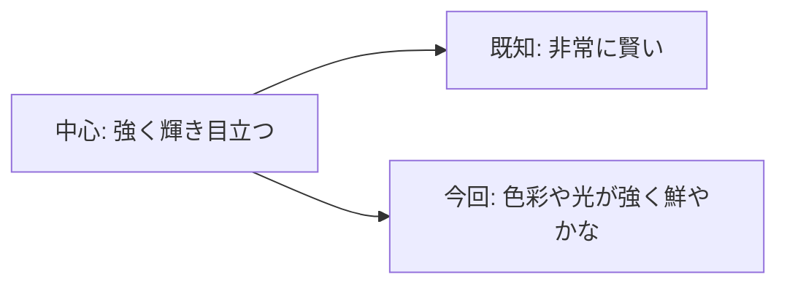

**重要語法：** `brilliant colors`

<small>index: `2187` / candidate_id: `ev-02187-adjective-01`</small>

---

## 1362. creature

**品詞：** noun　**発音：** /ˈkriːtʃər/

<small>よく知られている意味：生き物</small>

### 見落としやすい意味

**人の言いなりになる従属者・手先**

**例文：** The official was widely seen as a creature of the powerful leader.

**和訳：** その役人は有力な指導者の手先だと広く見なされていた。

**コアイメージ：** creature は本来、作られた存在や生き物を指す。人について用いると、他人の意向に従って動く人物という批判的な意味になることがある。

**図：**

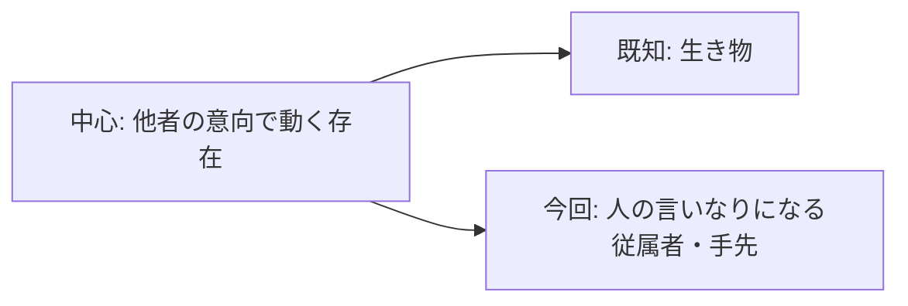

**重要語法：** `a creature of someone`

<small>index: `2188` / candidate_id: `ev-02188-noun-01`</small>

---

## 1363. soul

**品詞：** noun　**発音：** /soʊl/

<small>よく知られている意味：魂</small>

### 見落としやすい意味

**一人の人間・だれか**

**例文：** There wasn't a soul on the quiet street.

**和訳：** 静かな通りには人っ子一人いなかった。

**コアイメージ：** soul は人間の内面を表すだけでなく、一人の人間そのものを指すことがある。特に否定表現では、誰もいないことを強調する。

**図：**

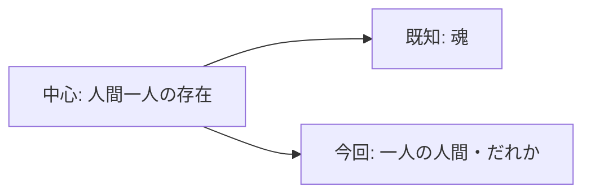

**重要語法：** `not a soul`

<small>index: `2190` / candidate_id: `ev-02190-noun-01`</small>

---

## 1364. arrangement

**品詞：** noun　**発音：** /əˈreɪndʒmənt/

<small>よく知られている意味：配置・準備</small>

### 見落としやすい意味

**当事者間の合意・取り決め**

**例文：** We made an arrangement to share the repair costs.

**和訳：** 私たちは修理費を分担する取り決めをした。

**コアイメージ：** 物事を整えて一定の形にすることが中心。物の配置だけでなく、人どうしで条件を整えると「取り決め」になる。

**図：**

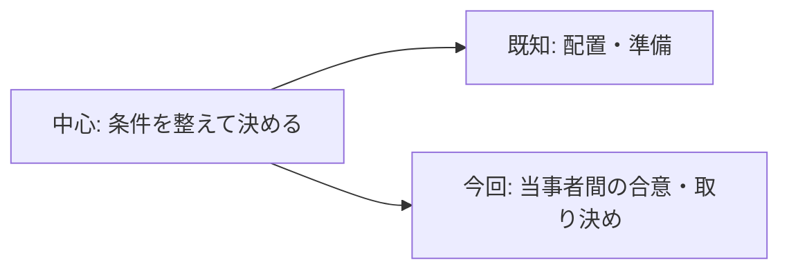

**重要語法：** `make an arrangement`

<small>index: `2191` / candidate_id: `ev-02191-noun-01`</small>

---

## 1365. immigration

**品詞：** noun　**発音：** /ˌɪmɪˈɡreɪʃən/

<small>よく知られている意味：移民・移住</small>

### 見落としやすい意味

**入国時に実施される入国審査**

**例文：** Please have your passport ready at immigration.

**和訳：** 入国審査ではパスポートを用意してください。

**コアイメージ：** 国境を越えて国に入ることに関わる語。人の移住だけでなく、その入国を確認する審査窓口・手続きも指す。

**図：**

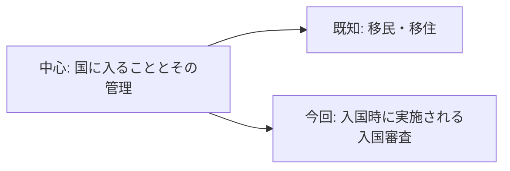

**重要語法：** `go through immigration`

<small>index: `2193` / candidate_id: `ev-02193-noun-01`</small>

---

## 1366. counter

**品詞：** adverb　**発音：** /ˈkaʊntər/

<small>よく知られている意味：売り場・カウンター</small>

### 見落としやすい意味

**～に逆らって・反対方向に**

**例文：** The proposal runs counter to our original agreement.

**和訳：** その提案は私たちの当初の合意に反している。

**コアイメージ：** counter の核は、向かい合う・逆向きになるという対立の感覚。副詞用法では、ある方針や期待とは反対の方向を表す。

**図：**

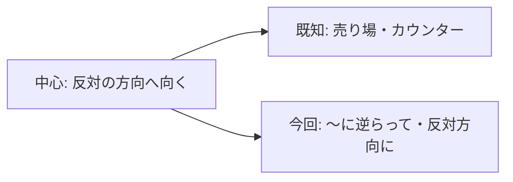

**重要語法：** `run counter to`

<small>index: `2195` / candidate_id: `ev-02195-adverb-02`</small>

---

## 1367. counter

**品詞：** verb　**発音：** /ˈkaʊntər/

<small>よく知られている意味：売り場・カウンター</small>

### 見落としやすい意味

**相手の主張や攻撃に反論・対抗する**

**例文：** The scientist countered the criticism with new evidence.

**和訳：** その科学者は新たな証拠を示して批判に反論した。

**コアイメージ：** 相手と向き合い、逆方向から働きかけるのが中心。売り場の名詞とは別に、発言や攻撃に「対抗する」という動詞になる。

**図：**

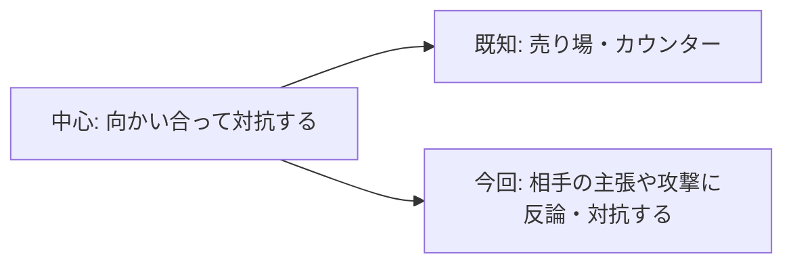

**重要語法：** `counter an argument`

<small>index: `2195` / candidate_id: `ev-02195-verb-01`</small>

---

## 1368. unknown

**品詞：** noun　**発音：** /ʌnˈnoʊn/

<small>よく知られている意味：未知の</small>

### 見落としやすい意味

**数学で値がまだ分からない未知数**

**例文：** In this equation, x is the unknown.

**和訳：** この方程式では、xが未知数である。

**コアイメージ：** unknown はまだ知られていないという状態を表す。数学では、値が定まっていない数そのものを名詞で指す。

**図：**

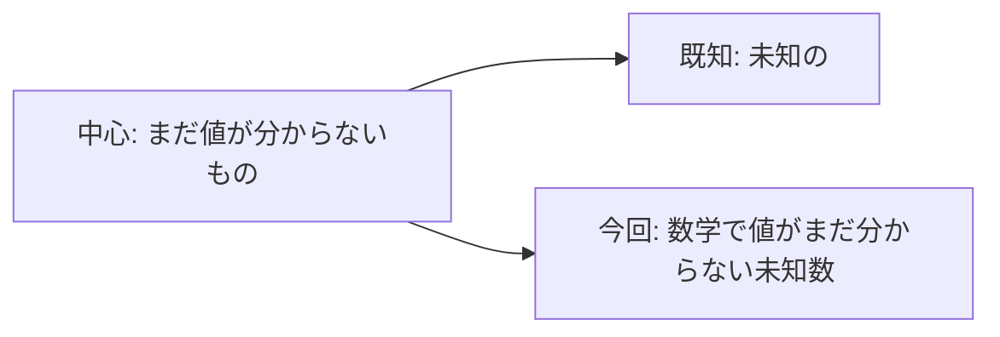

**重要語法：** `solve for the unknown`

<small>index: `2199` / candidate_id: `ev-02199-noun-01`</small>

---

## 1369. absence

**品詞：** noun　**発音：** /ˈæbsəns/

<small>よく知られている意味：不在</small>

### 見落としやすい意味

**必要なものが欠けている状態・欠如**

**例文：** The absence of clear rules caused confusion.

**和訳：** 明確な規則がないことが混乱を招いた。

**コアイメージ：** absence は、あるべき場所に何かが存在しない状態。人がいなければ「不在」、必要な性質や条件がなければ「欠如」になる。

**図：**

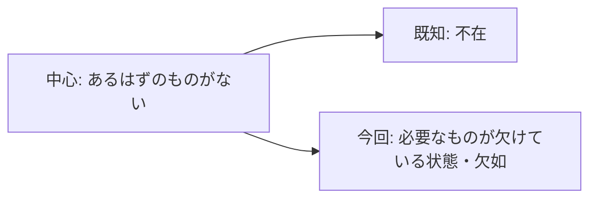

**重要語法：** `in the absence of`

<small>index: `2201` / candidate_id: `ev-02201-noun-01`</small>

---

## 1370. qualify

**品詞：** verb　**発音：** /ˈkwɑːləfaɪ/

<small>よく知られている意味：資格を得る</small>

### 見落としやすい意味

**発言の断定性を弱めるように条件・留保を付ける**

**例文：** She qualified her praise by mentioning several weaknesses.

**和訳：** 彼女はいくつかの弱点に触れ、称賛に留保を付けた。

**コアイメージ：** qualify は無条件のものに条件を付けて範囲を限定することも表す。発言に用いると、断言しすぎないよう内容を弱める意味になる。

**図：**

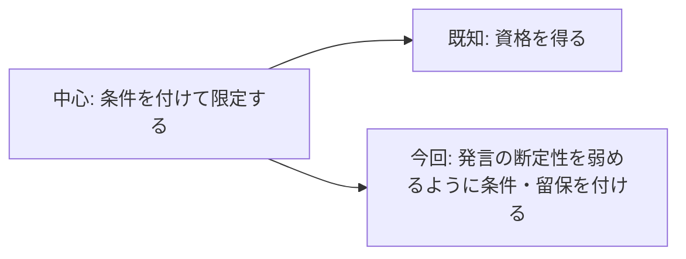

**重要語法：** `qualify a statement`

<small>index: `2202` / candidate_id: `ev-02202-verb-01`</small>

---

## 1371. lean

**品詞：** verb　**発音：** /liːn/

<small>よく知られている意味：寄りかかる</small>

### 見落としやすい意味

**ある意見・選択に気持ちが傾く**

**例文：** I lean toward the second option, but I am not certain.

**和訳：** 私は二番目の案に気持ちが傾いているが、まだ確信はない。

**コアイメージ：** 身体がどちらかへ傾く様子が基本。意見や選択に用いると、気持ちが一方へ傾くことを表す。

**図：**

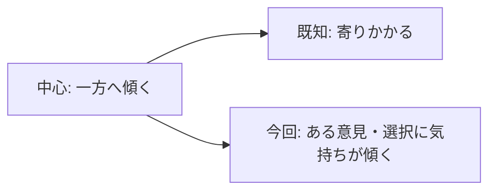

**重要語法：** `lean toward`

<small>index: `2203` / candidate_id: `ev-02203-verb-01`</small>

---

## 1372. elaborate

**品詞：** adjective　**発音：** /ɪˈlæbərət/

<small>よく知られている意味：詳しく説明する</small>

### 見落としやすい意味

**手の込んだ・精巧に作り込まれた**

**例文：** They built an elaborate model of the old city.

**和訳：** 彼らは古い都市の精巧な模型を作った。

**コアイメージ：** 細かな部分まで手をかけて仕上げることが中心。形容詞では、構造や装飾が複雑で手の込んだ状態を表す。

**図：**

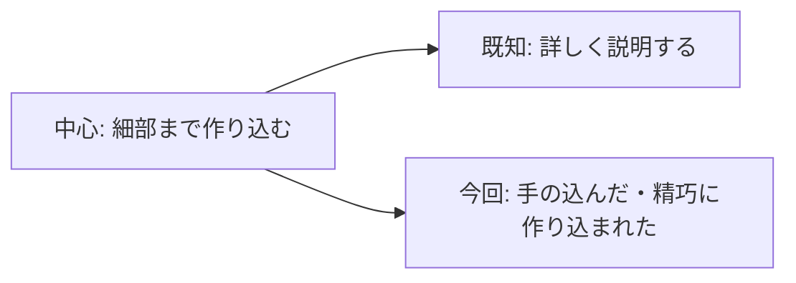

**重要語法：** `an elaborate design`

<small>index: `2205` / candidate_id: `ev-02205-adjective-01`</small>

---

## 1373. elaborate

**品詞：** verb　**発音：** /ɪˈlæbəreɪt/

<small>よく知られている意味：手の込んだ</small>

### 見落としやすい意味

**詳細に述べる・説明を補足する**

**例文：** Could you elaborate on how the system works?

**和訳：** その仕組みがどう働くか、もう少し詳しく説明してもらえますか。

**コアイメージ：** 細部を付け加えて内容を豊かにする感覚がある。動詞では、最初の説明をさらに詳しく展開することを表す。

**図：**

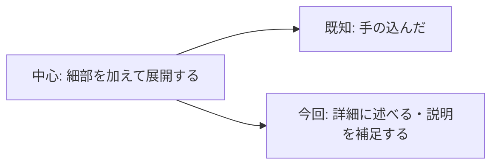

**重要語法：** `elaborate on`

<small>index: `2205` / candidate_id: `ev-02205-verb-01`</small>

---

## 1374. exploit

**品詞：** noun　**発音：** /ˈeksplɔɪt/

<small>よく知られている意味：利用する・搾取する</small>

### 見落としやすい意味

**功績・偉業・特筆すべき行為**

**例文：** The article recounts the climber's daring exploits.

**和訳：** その記事は登山家の大胆な偉業を伝えている。

**コアイメージ：** 行動によって何かを成し遂げることに注目した名詞用法。動詞の「利用・搾取」と異なり、目立った行為や功績を指す。

**図：**

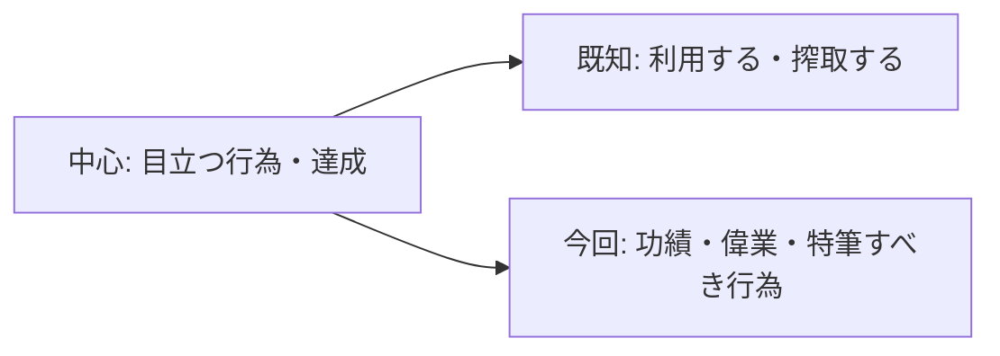

**重要語法：** `daring exploits`

<small>index: `2206` / candidate_id: `ev-02206-noun-01`</small>

---

## 1375. empire

**品詞：** noun　**発音：** /ˈempaɪər/

<small>よく知られている意味：帝国</small>

### 見落としやすい意味

**一人や一団体が支配する巨大な企業群**

**例文：** She built a successful media empire from one small magazine.

**和訳：** 彼女は一冊の小さな雑誌から巨大なメディア企業群を築いた。

**コアイメージ：** 広い範囲を一つの中心が支配することが基本。国家だけでなく、一人の経営者が束ねる大規模な事業にも使う。

**図：**

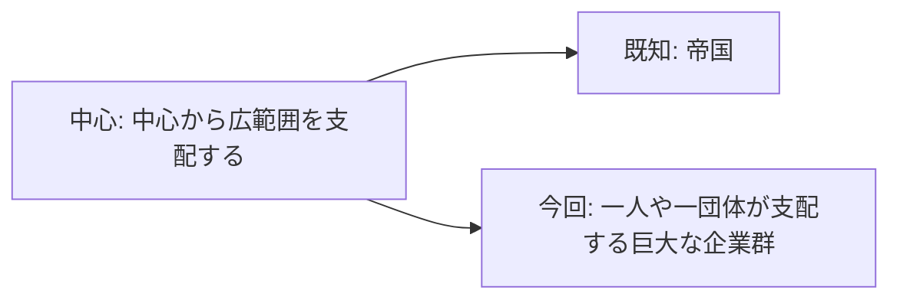

**重要語法：** `a business empire`

<small>index: `2207` / candidate_id: `ev-02207-noun-01`</small>

---

## 1376. alter

**品詞：** verb　**発音：** /ˈɔːltər/

<small>よく知られている意味：変更する</small>

### 見落としやすい意味

**衣服の寸法や形を直す**

**例文：** The tailor altered the jacket to fit my shoulders.

**和訳：** 仕立て屋は私の肩に合うように上着を直した。

**コアイメージ：** alter は元のものを残しつつ形や状態を変えること。衣服については、寸法や形を調整する意味に具体化する。

**図：**

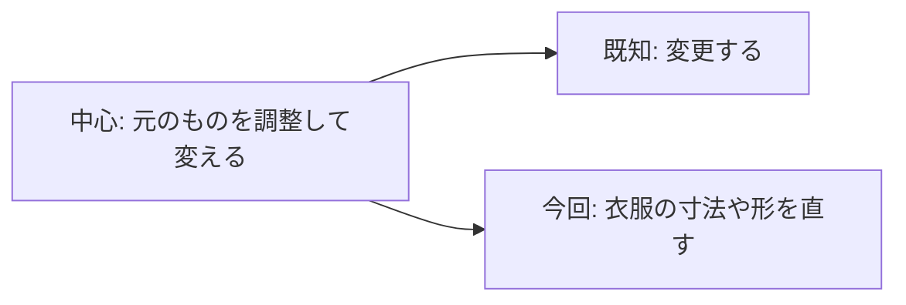

**重要語法：** `have a dress altered`

<small>index: `2209` / candidate_id: `ev-02209-verb-01`</small>

---

## 1377. sleep

**品詞：** verb　**発音：** /sliːp/

<small>よく知られている意味：眠る</small>

### 見落としやすい意味

**宿泊場所が一定人数を収容できる**

**例文：** The small cottage sleeps up to five guests.

**和訳：** その小さなコテージには最大5人まで宿泊できる。

**コアイメージ：** 眠るという行為から、眠る人のための場所へ焦点が移った用法。宿泊施設を主語にして、何人泊まれるかを表す。

**図：**

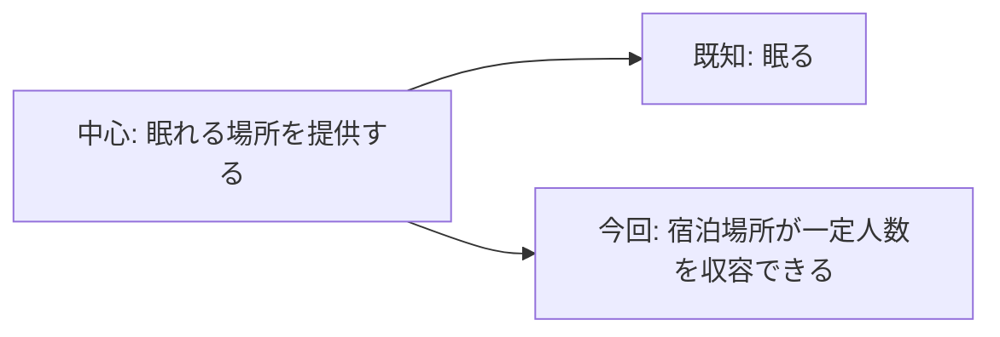

**重要語法：** `sleeps five`

<small>index: `2212` / candidate_id: `ev-02212-verb-01`</small>

---

## 1378. sleep

**品詞：** verb　**発音：** /sliːp/

<small>よく知られている意味：眠る</small>

### 見落としやすい意味

**決める前に一晩考える**

**例文：** I won't decide today; I'll sleep on it.

**和訳：** 今日は決めず、一晩考えてみる。

**コアイメージ：** 眠っている間に時間を置き、翌日改めて判断するという慣用表現。文字どおり物の上で眠る意味ではない。

**図：**

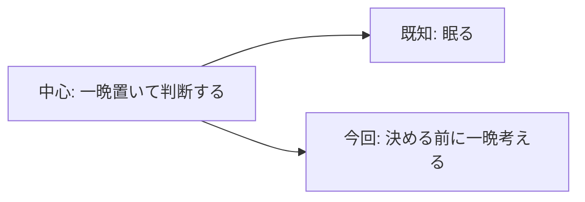

**重要語法：** `sleep on it`

<small>index: `2212` / candidate_id: `ev-02212-verb-02`</small>

---

## 1379. transportation

**品詞：** noun　**発音：** /ˌtrænspərˈteɪʃən/

<small>よく知られている意味：輸送・交通</small>

### 見落としやすい意味

**歴史的な処罰としての海外流刑**

**例文：** In the past, some prisoners were sentenced to transportation overseas.

**和訳：** 昔は、海外流刑を言い渡される囚人もいた。

**コアイメージ：** transportation は人や物を別の場所へ移すこと。歴史的な法制度では、囚人を遠い地域へ送る刑罰を指した。

**図：**

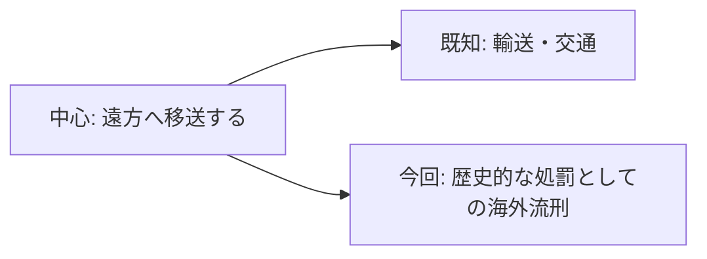

**重要語法：** `sentence someone to transportation`

<small>index: `2214` / candidate_id: `ev-02214-noun-01`</small>

---

## 1380. translate

**品詞：** verb　**発音：** /trænzˈleɪt/

<small>よく知られている意味：翻訳する</small>

### 見落としやすい意味

**努力や方針が実際の成果につながる**

**例文：** The extra funding did not translate into better results.

**和訳：** 追加資金は成果の改善にはつながらなかった。

**コアイメージ：** 一つの形で表されたものを別の形へ移すのが中心。言葉の翻訳だけでなく、努力や資金が実際の結果へ変わることにも使う。

**図：**

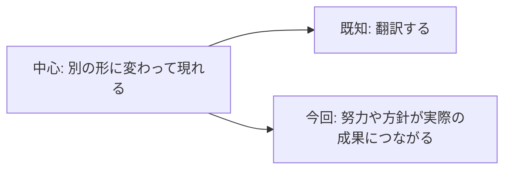

**重要語法：** `translate into`

<small>index: `2218` / candidate_id: `ev-02218-verb-01`</small>

---

## 1381. comfortable

**品詞：** adjective　**発音：** /ˈkʌmftəbəl/

<small>よく知られている意味：快適な</small>

### 見落としやすい意味

**経済的に余裕のある・十分な**

**例文：** They live on a comfortable income after retirement.

**和訳：** 彼らは退職後も十分な収入でゆとりある暮らしをしている。

**コアイメージ：** 不安や苦労が少なく安心できる状態が中心。生活や収入については、金銭面で困らない余裕を表す。

**図：**

```mermaid
flowchart LR
    A["中心: 不自由せず安心できる"]
    B["既知: 快適な"]
    C["今回: 経済的に余裕のある・十分な"]
    A --> B
    A --> C
```

**重要語法：** `a comfortable income`

<small>index: `2220` / candidate_id: `ev-02220-adjective-01`</small>

---

## 1382. remote

**品詞：** adjective　**発音：** /rɪˈmoʊt/

<small>よく知られている意味：遠く離れた</small>

### 見落としやすい意味

**可能性がごくわずかである**

**例文：** There is only a remote chance that the plan will succeed.

**和訳：** その計画が成功する可能性はごくわずかだ。

**コアイメージ：** remote の中心は距離が遠いこと。可能性について使うと、実現から遠く離れている、つまり見込みが薄いという意味になる。

**図：**

```mermaid
flowchart LR
    A["中心: 実現から遠く離れる"]
    B["既知: 遠く離れた"]
    C["今回: 可能性がごくわずかである"]
    A --> B
    A --> C
```

**重要語法：** `a remote chance`

<small>index: `2221` / candidate_id: `ev-02221-adjective-01`</small>

---

## 1383. demonstration

**品詞：** noun　**発音：** /ˌdemənˈstreɪʃən/

<small>よく知られている意味：実演・証明</small>

### 見落としやすい意味

**集団が意見を示す抗議活動・デモ**

**例文：** Thousands attended a peaceful demonstration in the square.

**和訳：** 何千人もの人が広場での平和的な抗議デモに参加した。

**コアイメージ：** 人に見える形ではっきり示すことが共通する。方法を示せば「実演」、集団で意見を示せば「デモ」になる。

**図：**

```mermaid
flowchart LR
    A["中心: 人前ではっきり示す"]
    B["既知: 実演・証明"]
    C["今回: 集団が意見を示す抗議活動・デモ"]
    A --> B
    A --> C
```

**重要語法：** `a peaceful demonstration`

<small>index: `2224` / candidate_id: `ev-02224-noun-01`</small>

---

## 1384. steel

**品詞：** verb　**発音：** /stiːl/

<small>よく知られている意味：鋼</small>

### 見落としやすい意味

**自分の気持ちを固め困難に備える**

**例文：** She steeled herself before delivering the difficult news.

**和訳：** 彼女はつらい知らせを伝える前に気持ちを固めた。

**コアイメージ：** 鋼のように強く硬くするという比喩が中心。動詞では、困難に動じないよう気持ちを強くする。

**図：**

```mermaid
flowchart LR
    A["中心: 鋼のように強くする"]
    B["既知: 鋼"]
    C["今回: 自分の気持ちを固め困難に備える"]
    A --> B
    A --> C
```

**重要語法：** `steel oneself for`

<small>index: `2225` / candidate_id: `ev-02225-verb-01`</small>

---

## 1385. occasional

**品詞：** adjective　**発音：** /əˈkeɪʒənəl/

<small>よく知られている意味：時折の</small>

### 見落としやすい意味

**臨時にその役目を担う**

**例文：** He worked as an occasional lecturer during the summer.

**和訳：** 彼は夏の間、臨時講師として働いた。

**コアイメージ：** 常時ではなく必要な時にだけ起こる、という意味が中心。職務に用いると、その役目を常勤ではなく臨時に担うことを表す。

**図：**

```mermaid
flowchart LR
    A["中心: 常時ではなく必要時だけ"]
    B["既知: 時折の"]
    C["今回: 臨時にその役目を担う"]
    A --> B
    A --> C
```

**重要語法：** `an occasional lecturer`

<small>index: `2226` / candidate_id: `ev-02226-adjective-01`</small>

---

## 1386. sequence

**品詞：** verb　**発音：** /ˈsiːkwəns/

<small>よく知られている意味：順序・連続</small>

### 見落としやすい意味

**一定の順序で並べる**

**例文：** The editor sequenced the scenes to build suspense.

**和訳：** 編集者は緊張感が高まるよう場面を順番に並べた。

**コアイメージ：** sequence は物事が一定の順に並ぶこと。動詞では、その順序を意図的に決めて並べる行為を指す。

**図：**

```mermaid
flowchart LR
    A["中心: 順番に並ぶ・並べる"]
    B["既知: 順序・連続"]
    C["今回: 一定の順序で並べる"]
    A --> B
    A --> C
```

**重要語法：** `sequence the events`

<small>index: `2227` / candidate_id: `ev-02227-verb-01`</small>

---

## 1387. bid

**品詞：** noun　**発音：** /bɪd/

<small>よく知られている意味：入札・入札額</small>

### 見落としやすい意味

**目標達成を目指す試み**

**例文：** Her bid to win the championship ended in defeat.

**和訳：** 優勝を目指した彼女の試みは敗北に終わった。

**コアイメージ：** bid は何かを手に入れようとして働きかけること。入札だけでなく、目標を達成しようとする試みにも用いられる。

**図：**

```mermaid
flowchart LR
    A["中心: 目標に向けて試みる"]
    B["既知: 入札・入札額"]
    C["今回: 目標達成を目指す試み"]
    A --> B
    A --> C
```

**重要語法：** `a bid to do`

<small>index: `2228` / candidate_id: `ev-02228-noun-02`</small>

---

## 1388. bid

**品詞：** verb　**発音：** /bɪd/

<small>よく知られている意味：入札する</small>

### 見落としやすい意味

**誰かに～するよう命じる**

**例文：** The king bade the messenger enter the hall.

**和訳：** 王は使者に広間へ入るよう命じた。

**コアイメージ：** 相手に言葉で働きかける古い動詞用法。文学的な文脈では、入札でなく命令する意味を持つ。

**図：**

```mermaid
flowchart LR
    A["中心: 言葉で相手に命じる"]
    B["既知: 入札する"]
    C["今回: 誰かに～するよう命じる"]
    A --> B
    A --> C
```

**重要語法：** `bid someone do; past: bade`

<small>index: `2228` / candidate_id: `ev-02228-verb-01`</small>

---

## 1389. bid

**品詞：** verb　**発音：** /bɪd/

<small>よく知られている意味：入札する</small>

### 見落としやすい意味

**別れを告げる・別れの挨拶をする**

**例文：** We bid farewell to our neighbors before moving.

**和訳：** 引っ越す前に、私たちは近所の人々に別れを告げた。

**コアイメージ：** bid は定型表現では挨拶の言葉を相手に述べることも表す。bid farewell は、別れの言葉を伝えるまとまりとして覚える。

**図：**

```mermaid
flowchart LR
    A["中心: 挨拶の言葉を述べる"]
    B["既知: 入札する"]
    C["今回: 別れを告げる・別れの挨拶をする"]
    A --> B
    A --> C
```

**重要語法：** `bid farewell to`

<small>index: `2228` / candidate_id: `ev-02228-verb-02`</small>

---

## 1390. designate

**品詞：** adjective　**発音：** /ˈdezɪɡnət/

<small>よく知られている意味：指名・指定する</small>

### 見落としやすい意味

**役職に選任されているが未就任である**

**例文：** The director-designate met the staff before taking office.

**和訳：** 次期理事は就任前に職員と面会した。

**コアイメージ：** 役職に就く人としてすでに指定されている状態。役職名の後ろに付く形容詞用法では、正式就任前であることを表す。

**図：**

```mermaid
flowchart LR
    A["中心: 役職を指定され就任を待つ"]
    B["既知: 指名・指定する"]
    C["今回: 役職に選任されているが未就任である"]
    A --> B
    A --> C
```

**重要語法：** `director-designate`

<small>index: `2229` / candidate_id: `ev-02229-adjective-01`</small>

---

## 1391. elect

**品詞：** adjective　**発音：** /ɪˈlekt/

<small>よく知られている意味：選挙で選ぶ</small>

### 見落としやすい意味

**当選したがまだ就任していない**

**例文：** The mayor-elect announced her priorities.

**和訳：** 次期市長は優先課題を発表した。

**コアイメージ：** 選挙によって選ばれたという事実が中心。役職名の後ろの -elect は、当選済みだが未就任という状態を示す。

**図：**

```mermaid
flowchart LR
    A["中心: 選ばれたがまだ就任前"]
    B["既知: 選挙で選ぶ"]
    C["今回: 当選したがまだ就任していない"]
    A --> B
    A --> C
```

**重要語法：** `mayor-elect`

<small>index: `2232` / candidate_id: `ev-02232-adjective-02`</small>

---

## 1392. elect

**品詞：** verb　**発音：** /ɪˈlekt/

<small>よく知られている意味：選挙で選ぶ</small>

### 見落としやすい意味

**ある行動を取ると決める・選択する**

**例文：** The company elected to postpone the launch.

**和訳：** その会社は発売を延期することを選択した。

**コアイメージ：** 複数の選択肢から一つを選ぶことが基本。選挙だけでなく、行動方針を自分で決める場合にも用いられる。

**図：**

```mermaid
flowchart LR
    A["中心: 選択肢から選ぶ"]
    B["既知: 選挙で選ぶ"]
    C["今回: ある行動を取ると決める・選択する"]
    A --> B
    A --> C
```

**重要語法：** `elect to do`

<small>index: `2232` / candidate_id: `ev-02232-verb-01`</small>

---

## 1393. violent

**品詞：** adjective　**発音：** /ˈvaɪələnt/

<small>よく知られている意味：暴力的な</small>

### 見落としやすい意味

**感情や色彩などが極めて激しい**

**例文：** He felt a violent surge of anger.

**和訳：** 彼は激しい怒りが一気にこみ上げるのを感じた。

**コアイメージ：** violent は力や程度が非常に強いことを表す。人の攻撃だけでなく、感情や変化の激しさにも使える。

**図：**

```mermaid
flowchart LR
    A["中心: 非常に強く激しい"]
    B["既知: 暴力的な"]
    C["今回: 感情や色彩などが極めて激しい"]
    A --> B
    A --> C
```

**重要語法：** `violent emotions`

<small>index: `2235` / candidate_id: `ev-02235-adjective-01`</small>

---

## 1394. silver

**品詞：** noun　**発音：** /ˈsɪlvər/

<small>よく知られている意味：銀</small>

### 見落としやすい意味

**銀製の食器類・銀器**

**例文：** She polished the family silver before the dinner party.

**和訳：** 彼女は夕食会の前に家の銀食器を磨いた。

**コアイメージ：** silver は素材としての銀を表す。素材名をそのまま使って、銀でできた食器類全体を指すこともある。

**図：**

```mermaid
flowchart LR
    A["中心: 素材名から製品を指す"]
    B["既知: 銀"]
    C["今回: 銀製の食器類・銀器"]
    A --> B
    A --> C
```

**重要語法：** `polish the silver`

<small>index: `2236` / candidate_id: `ev-02236-noun-01`</small>

---

## 1395. boss

**品詞：** verb　**発音：** /bɔːs/

<small>よく知られている意味：上司</small>

### 見落としやすい意味

**人にあれこれ命令して動かす**

**例文：** Please don't boss everyone around during the project.

**和訳：** その作業中、みんなにあれこれ命令しないでください。

**コアイメージ：** boss は人に指図する立場の人を表す。動詞になると、その立場のように相手を一方的に動かそうとすることを指す。

**図：**

```mermaid
flowchart LR
    A["中心: 上から指図して動かす"]
    B["既知: 上司"]
    C["今回: 人にあれこれ命令して動かす"]
    A --> B
    A --> C
```

**重要語法：** `boss someone around`

<small>index: `2237` / candidate_id: `ev-02237-verb-01`</small>

---

## 1396. compound

**品詞：** noun　**発音：** /ˈkɑːmpaʊnd/

<small>よく知られている意味：化合物</small>

### 見落としやすい意味

**複数の建物がまとまった囲い地・構内**

**例文：** The researchers entered the secure laboratory compound.

**和訳：** 研究者たちは警備された研究施設の構内に入った。

**コアイメージ：** ここでの compound は、複数の建物や施設が一つの区域にまとまっている場所。化合物という科学用語とは別の名詞義。

**図：**

```mermaid
flowchart LR
    A["中心: まとまった囲い地"]
    B["既知: 化合物"]
    C["今回: 複数の建物がまとまった囲い地・構内"]
    A --> B
    A --> C
```

**重要語法：** `a residential compound`

<small>index: `2239` / candidate_id: `ev-02239-noun-01`</small>

---

## 1397. compound

**品詞：** verb　**発音：** /kəmˈpaʊnd/

<small>よく知られている意味：組み合わせる</small>

### 見落としやすい意味

**問題や困難をいっそう悪くする**

**例文：** The sudden rain compounded the traffic problems.

**和訳：** 突然の雨が交通の問題をさらに悪化させた。

**コアイメージ：** 複数の要因が重なり合うのが中心。すでにある問題に新しい問題が加わると、困難がさらに増すという意味になる。

**図：**

```mermaid
flowchart LR
    A["中心: 問題が重なって増す"]
    B["既知: 組み合わせる"]
    C["今回: 問題や困難をいっそう悪くする"]
    A --> B
    A --> C
```

**重要語法：** `compound a problem`

<small>index: `2239` / candidate_id: `ev-02239-verb-02`</small>

---

## 1398. manufacture

**品詞：** verb　**発音：** /ˌmænjəˈfæktʃər/

<small>よく知られている意味：製造する</small>

### 見落としやすい意味

**証拠や話をでっち上げて作り出す**

**例文：** The suspect manufactured a false story to explain his absence.

**和訳：** 容疑者は自分が不在だった理由として偽の話をでっち上げた。

**コアイメージ：** 本来は物を作り出すことを表す。事実や証拠について用いると、人工的に作り上げて偽るという否定的な意味になる。

**図：**

```mermaid
flowchart LR
    A["中心: 本当でないものを作り出す"]
    B["既知: 製造する"]
    C["今回: 証拠や話をでっち上げて作り出す"]
    A --> B
    A --> C
```

**重要語法：** `manufacture evidence`

<small>index: `2241` / candidate_id: `ev-02241-verb-01`</small>

---

## 1399. resolution

**品詞：** noun　**発音：** /ˌrezəˈluːʃən/

<small>よく知られている意味：解決・決意</small>

### 見落としやすい意味

**議会などで正式に採択された決議**

**例文：** The assembly passed a resolution to protect the river.

**和訳：** 議会は川を保護する決議を採択した。

**コアイメージ：** resolution は正式に決める・決意するという意味でも使われる。集団の意思を文書として決めると、議会などの「決議」になる。

**図：**

```mermaid
flowchart LR
    A["中心: 正式に意思を決める"]
    B["既知: 解決・決意"]
    C["今回: 議会などで正式に採択された決議"]
    A --> B
    A --> C
```

**重要語法：** `pass a resolution`

<small>index: `2242` / candidate_id: `ev-02242-noun-01`</small>

---

## 1400. resolution

**品詞：** noun　**発音：** /ˌrezəˈluːʃən/

<small>よく知られている意味：解決・決意</small>

### 見落としやすい意味

**画像や映像で細部をどこまで表せるかという解像度**

**例文：** This scanner can produce images at a higher resolution.

**和訳：** このスキャナーはより高い解像度の画像を生成できる。

**コアイメージ：** 技術用語の resolution は、画像の細かな違いをどこまで見分けられるかを表す。問題の「解決」という一般義と混同せず、画像の細かさとして読む。

**図：**

```mermaid
flowchart LR
    A["中心: 細部を識別する細かさ"]
    B["既知: 解決・決意"]
    C["今回: 画像や映像で細部をどこまで表せるかという解像度"]
    A --> B
    A --> C
```

**重要語法：** `high resolution`

<small>index: `2242` / candidate_id: `ev-02242-noun-02`</small>

---

## 1401. artifact

**品詞：** noun　**発音：** /ˈɑːrtɪfækt/

<small>よく知られている意味：人工物・遺物</small>

### 見落としやすい意味

**実験・測定・画像処理によって生じた見かけ上の偽の現象**

**例文：** The strange line on the scan was only an imaging artifact.

**和訳：** スキャン画像の奇妙な線は、画像処理による見かけ上のものにすぎなかった。

**コアイメージ：** 人工的な操作が生み出したもの、という発想が共通する。科学では、実際の対象ではなく測定や処理の過程で生じた見かけの現象を指す。

**図：**

```mermaid
flowchart LR
    A["中心: 処理の過程で生じた見かけ"]
    B["既知: 人工物・遺物"]
    C["今回: 実験・測定・画像処理によって生じた見かけ上の偽の現象"]
    A --> B
    A --> C
```

**重要語法：** `an imaging artifact`

<small>index: `2243` / candidate_id: `ev-02243-noun-01`</small>

---

## 1402. spell

**品詞：** noun　**発音：** /spel/

<small>よく知られている意味：つづり・呪文</small>

### 見落としやすい意味

**ある状態が続くひとまとまりの期間**

**例文：** The region experienced a long spell of dry weather.

**和訳：** その地域では乾燥した天気が長い期間続いた。

**コアイメージ：** spell には、ある状態がひと続きになった期間を示す名詞用法がある。天候や体調などが続く時間のまとまりを表す。

**図：**

```mermaid
flowchart LR
    A["中心: ある状態が続く一区切り"]
    B["既知: つづり・呪文"]
    C["今回: ある状態が続くひとまとまりの期間"]
    A --> B
    A --> C
```

**重要語法：** `a dry spell`

<small>index: `2244` / candidate_id: `ev-02244-noun-01`</small>

---

## 1403. spell

**品詞：** verb　**発音：** /spel/

<small>よく知られている意味：つづる</small>

### 見落としやすい意味

**（ある結果が災難などを）意味する・もたらす**

**例文：** A serious mistake could spell disaster for the project.

**和訳：** 重大なミスはその計画に災難をもたらしかねない。

**コアイメージ：** spell は文字を並べて意味を示すだけでなく、ある事態が結果を意味する用法もある。特に望ましくない結果を予告するときによく使う。

**図：**

```mermaid
flowchart LR
    A["中心: 結果を意味し予告する"]
    B["既知: つづる"]
    C["今回: （ある結果が災難などを）意味する・もたらす"]
    A --> B
    A --> C
```

**重要語法：** `spell disaster`

<small>index: `2244` / candidate_id: `ev-02244-verb-01`</small>

---

## 1404. ring

**品詞：** verb　**発音：** /rɪŋ/

<small>よく知られている意味：指輪・輪</small>

### 見落としやすい意味

**電話をかける（主に英国英語）**

**例文：** I'll ring you when I arrive in London.

**和訳：** ロンドンに着いたら電話するね。

**コアイメージ：** ring はベルなどが鳴ることを表す動詞でもある。英国英語では電話の呼び出し音を鳴らすことから「電話する」という意味になる。

**図：**

```mermaid
flowchart LR
    A["中心: 呼び出し音を鳴らす"]
    B["既知: 指輪・輪"]
    C["今回: 電話をかける（主に英国英語）"]
    A --> B
    A --> C
```

**重要語法：** `ring someone (British English)`

<small>index: `2245` / candidate_id: `ev-02245-verb-01`</small>

---

## 1405. ring

**品詞：** verb　**発音：** /rɪŋ/

<small>よく知られている意味：鳴る</small>

### 見落としやすい意味

**（話などが）真実らしく聞こえる**

**例文：** His excuse didn't ring true to me.

**和訳：** 彼の言い訳は私には本当らしく聞こえなかった。

**コアイメージ：** 音がどう響くかという感覚を、話の印象にたとえた表現。ring true は、聞いた話が本当らしく感じられることを表す。

**図：**

```mermaid
flowchart LR
    A["中心: 本当らしい響きがする"]
    B["既知: 鳴る"]
    C["今回: （話などが）真実らしく聞こえる"]
    A --> B
    A --> C
```

**重要語法：** `ring true`

<small>index: `2245` / candidate_id: `ev-02245-verb-02`</small>

---

## 1406. sweep

**品詞：** verb　**発音：** /swiːp/

<small>よく知られている意味：掃く</small>

### 見落としやすい意味

**競技などで対戦相手を一度も勝たせず連勝する**

**例文：** Our team swept the series without losing a game.

**和訳：** 私たちのチームは一試合も負けずにシリーズを全勝した。

**コアイメージ：** 一気に全体をさらうように進むことが中心。競技では、対戦をすべて勝って相手に一勝も許さないことを表す。

**図：**

```mermaid
flowchart LR
    A["中心: 一気にすべてをさらう"]
    B["既知: 掃く"]
    C["今回: 競技などで対戦相手を一度も勝たせず連勝する"]
    A --> B
    A --> C
```

**重要語法：** `sweep a series`

<small>index: `2249` / candidate_id: `ev-02249-verb-01`</small>

---

## 1407. sweep

**品詞：** verb　**発音：** /swiːp/

<small>よく知られている意味：掃く</small>

### 見落としやすい意味

**（運動・感情・変化などが）地域や社会を勢いよく席巻する**

**例文：** A wave of excitement swept through the school.

**和訳：** 興奮の波が学校中に一気に広がった。

**コアイメージ：** ほうきで広い範囲を勢いよく動かす感覚からの比喩。感情や流行が集団・地域に急速に広がる場合に使う。

**図：**

```mermaid
flowchart LR
    A["中心: 勢いよく全体へ広がる"]
    B["既知: 掃く"]
    C["今回: （運動・感情・変化などが）地域や社会を勢いよく席巻する"]
    A --> B
    A --> C
```

**重要語法：** `sweep through`

<small>index: `2249` / candidate_id: `ev-02249-verb-02`</small>

---

## 1408. testify

**品詞：** verb　**発音：** /ˈtestɪfaɪ/

<small>よく知られている意味：証言する</small>

### 見落としやすい意味

**ある事実を裏付ける証拠となる**

**例文：** The empty shelves testify to the seriousness of the shortage.

**和訳：** 空っぽの棚が品不足の深刻さを物語っている。

**コアイメージ：** testify は事実が本当だと示すこと。人が証言するだけでなく、物や状況が証拠になる場合にも用いられる。

**図：**

```mermaid
flowchart LR
    A["中心: 事実を裏付ける"]
    B["既知: 証言する"]
    C["今回: ある事実を裏付ける証拠となる"]
    A --> B
    A --> C
```

**重要語法：** `testify to`

<small>index: `2254` / candidate_id: `ev-02254-verb-01`</small>

---

## 1409. fruit

**品詞：** noun　**発音：** /fruːt/

<small>よく知られている意味：果物</small>

### 見落としやすい意味

**行動や努力の結果・成果**

**例文：** Their patience and hard work finally bore fruit.

**和訳：** 彼らの忍耐と努力はついに実を結んだ。

**コアイメージ：** 植物が成長した末に実を付けることから生まれた比喩。行動や努力によって得られた成果を「実」として表す。

**図：**

```mermaid
flowchart LR
    A["中心: 成長の末に得られる実り"]
    B["既知: 果物"]
    C["今回: 行動や努力の結果・成果"]
    A --> B
    A --> C
```

**重要語法：** `bear fruit`

<small>index: `2256` / candidate_id: `ev-02256-noun-01`</small>

---

## 1410. recover

**品詞：** verb　**発音：** /rɪˈkʌvər/

<small>よく知られている意味：回復する</small>

### 見落としやすい意味

**裁判や補償制度を通じて金銭を取り戻す**

**例文：** The tenants hope to recover the money through legal action.

**和訳：** 借り主たちは法的手続きを通じてそのお金を取り戻したいと考えている。

**コアイメージ：** 失ったものを再び手にするのが中心。健康の回復だけでなく、裁判などで損失分の金銭を回収する意味にもなる。

**図：**

```mermaid
flowchart LR
    A["中心: 失ったものを取り戻す"]
    B["既知: 回復する"]
    C["今回: 裁判や補償制度を通じて金銭を取り戻す"]
    A --> B
    A --> C
```

**重要語法：** `recover damages`

<small>index: `2259` / candidate_id: `ev-02259-verb-01`</small>

---

## 1411. stream

**品詞：** verb　**発音：** /striːm/

<small>よく知られている意味：小川</small>

### 見落としやすい意味

**音声・映像などを再生しながら連続配信する**

**例文：** The lecture will be streamed live on the university website.

**和訳：** 講義は大学のウェブサイトで生配信される。

**コアイメージ：** stream は絶えず流れるものを表す。デジタル情報が連続的に届くことから、映像や音声の配信・再生を意味する。

**図：**

```mermaid
flowchart LR
    A["中心: 途切れず流れ続ける"]
    B["既知: 小川"]
    C["今回: 音声・映像などを再生しながら連続配信する"]
    A --> B
    A --> C
```

**重要語法：** `stream live`

<small>index: `2260` / candidate_id: `ev-02260-verb-01`</small>

---

## 1412. bind

**品詞：** noun　**発音：** /baɪnd/

<small>よく知られている意味：縛る</small>

### 見落としやすい意味

**困った立場・窮地**

**例文：** We're in a bind because the deadline is tomorrow.

**和訳：** 締め切りが明日なので、私たちは困った立場にいる。

**コアイメージ：** 自由に動けないよう縛られている感覚が中心。名詞の a bind は、選択肢が限られて困っている状態を表す。

**図：**

```mermaid
flowchart LR
    A["中心: 身動きが取れない"]
    B["既知: 縛る"]
    C["今回: 困った立場・窮地"]
    A --> B
    A --> C
```

**重要語法：** `in a bind`

<small>index: `2262` / candidate_id: `ev-02262-noun-01`</small>

---

## 1413. bind

**品詞：** verb　**発音：** /baɪnd/

<small>よく知られている意味：縛る</small>

### 見落としやすい意味

**法・規則・約束によって義務を負わせる**

**例文：** The agreement binds both sides to keep the information secret.

**和訳：** その合意は双方に情報を秘密にする義務を負わせる。

**コアイメージ：** ひもで縛って自由を制限する感覚が基本。法や契約の場合、守るべき義務によって行動が拘束される。

**図：**

```mermaid
flowchart LR
    A["中心: 義務で行動を縛る"]
    B["既知: 縛る"]
    C["今回: 法・規則・約束によって義務を負わせる"]
    A --> B
    A --> C
```

**重要語法：** `bind someone to do`

<small>index: `2262` / candidate_id: `ev-02262-verb-01`</small>

---

## 1414. consultant

**品詞：** noun　**発音：** /kənˈsʌltənt/

<small>よく知られている意味：相談役</small>

### 見落としやすい意味

**英国などの病院で診療を統括する上級専門医**

**例文：** The consultant examined the patient at the British hospital.

**和訳：** その英国の病院では、上級専門医が患者を診察した。

**コアイメージ：** consultant は専門知識を持って助言する人。英国の医療では、診療を担う上級の専門医を指す職名として使われる。

**図：**

```mermaid
flowchart LR
    A["中心: 高度な専門知識を担う"]
    B["既知: 相談役"]
    C["今回: 英国などの病院で診療を統括する上級専門医"]
    A --> B
    A --> C
```

**重要語法：** `consultant surgeon (UK)`

<small>index: `2263` / candidate_id: `ev-02263-noun-01`</small>

---

## 1415. margin

**品詞：** noun　**発音：** /ˈmɑːrdʒɪn/

<small>よく知られている意味：余白</small>

### 見落としやすい意味

**結果の差・余裕・利益幅**

**例文：** She won the election by a very narrow margin.

**和訳：** 彼女はごくわずかな票差で選挙に勝った。

**コアイメージ：** margin は端から残る幅や余裕を表す。結果の比較では勝ち負けの差、経済では利益の幅に使う。

**図：**

```mermaid
flowchart LR
    A["中心: 二つの間にある幅"]
    B["既知: 余白"]
    C["今回: 結果の差・余裕・利益幅"]
    A --> B
    A --> C
```

**重要語法：** `by a narrow margin`

<small>index: `2264` / candidate_id: `ev-02264-noun-01`</small>

---

## 1416. equivalent

**品詞：** noun　**発音：** /ɪˈkwɪvələnt/

<small>よく知られている意味：同等の</small>

### 見落としやすい意味

**同じ価値・働きを持つ相当物**

**例文：** This expression has no exact equivalent in Japanese.

**和訳：** この表現にぴったり対応する日本語はない。

**コアイメージ：** 同じ価値や働きを持つことが中心。形容詞だけでなく名詞として、別の言語や制度で対応するものを指す。

**図：**

```mermaid
flowchart LR
    A["中心: 働きや価値が等しいもの"]
    B["既知: 同等の"]
    C["今回: 同じ価値・働きを持つ相当物"]
    A --> B
    A --> C
```

**重要語法：** `the equivalent of`

<small>index: `2265` / candidate_id: `ev-02265-noun-01`</small>

---

## 1417. fourth

**品詞：** noun　**発音：** /fɔːrθ/

<small>よく知られている意味：四番目の</small>

### 見落としやすい意味

**四等分したうちの一つ**

**例文：** One fourth of the students walked to school.

**和訳：** 生徒の4分の1は歩いて通学した。

**コアイメージ：** 順番の四番目を表す語が、全体を四つに分けた一部分も表す。名詞の fourth は割合としての4分の1を意味する。

**図：**

```mermaid
flowchart LR
    A["中心: 四つに分けた一つ"]
    B["既知: 四番目の"]
    C["今回: 四等分したうちの一つ"]
    A --> B
    A --> C
```

**重要語法：** `one fourth of`

<small>index: `2266` / candidate_id: `ev-02266-noun-01`</small>

---

## 1418. treasure

**品詞：** verb　**発音：** /ˈtreʒər/

<small>よく知られている意味：宝物</small>

### 見落としやすい意味

**何かを非常に大切にする・貴重に思う**

**例文：** I treasure the letters my grandmother wrote to me.

**和訳：** 私は祖母が書いてくれた手紙をとても大切にしている。

**コアイメージ：** 宝物として価値を置く気持ちが中心。動詞になると、思い出や物をかけがえのないものとして大切にする意味になる。

**図：**

```mermaid
flowchart LR
    A["中心: 宝物のように大切にする"]
    B["既知: 宝物"]
    C["今回: 何かを非常に大切にする・貴重に思う"]
    A --> B
    A --> C
```

**重要語法：** `treasure a memory`

<small>index: `2268` / candidate_id: `ev-02268-verb-01`</small>

---

## 1419. concentrate

**品詞：** noun　**発音：** /ˈkɑːnsəntreɪt/

<small>よく知られている意味：集中する</small>

### 見落としやすい意味

**濃縮された液体や物質**

**例文：** Mix one part orange juice concentrate with three parts water.

**和訳：** 濃縮オレンジジュース1に対して水3の割合で混ぜてください。

**コアイメージ：** 一か所に集めて密度を高めることが中心。名詞では、水分などを減らして成分を濃くした物質を指す。

**図：**

```mermaid
flowchart LR
    A["中心: 成分を集めて濃くする"]
    B["既知: 集中する"]
    C["今回: 濃縮された液体や物質"]
    A --> B
    A --> C
```

**重要語法：** `juice concentrate`

<small>index: `2269` / candidate_id: `ev-02269-noun-01`</small>

---

## 1420. trap

**品詞：** noun　**発音：** /træp/

<small>よく知られている意味：わな</small>

### 見落としやすい意味

**排水管の臭気を防ぐ曲がり部分**

**例文：** The plumber replaced the trap beneath the sink.

**和訳：** 配管工は流し台の下にある排水トラップを交換した。

**コアイメージ：** trap は何かを中にとどめて外へ出さない仕組み。配管では水をためて下水の臭いが上がるのを防ぐ部分を指す。

**図：**

```mermaid
flowchart LR
    A["中心: 中にとどめて通さない"]
    B["既知: わな"]
    C["今回: 排水管の臭気を防ぐ曲がり部分"]
    A --> B
    A --> C
```

**重要語法：** `a sink trap`

<small>index: `2270` / candidate_id: `ev-02270-noun-01`</small>

---

## 1421. prayer

**品詞：** noun　**発音：** /prer/

<small>よく知られている意味：祈り</small>

### 見落としやすい意味

**ごくわずかな希望・見込み**

**例文：** Without any clues, we haven't a prayer of finding it.

**和訳：** 手がかりが何もなければ、それを見つけられる見込みはまったくない。

**コアイメージ：** 祈りに頼るしかないほど望みが薄いという比喩がある。否定形の not have a prayer は、成功の見込みがほぼないことを示す。

**図：**

```mermaid
flowchart LR
    A["中心: 祈りに頼るほど小さい見込み"]
    B["既知: 祈り"]
    C["今回: ごくわずかな希望・見込み"]
    A --> B
    A --> C
```

**重要語法：** `not have a prayer`

<small>index: `2271` / candidate_id: `ev-02271-noun-01`</small>

---

## 1422. crack

**品詞：** verb　**発音：** /kræk/

<small>よく知られている意味：割る</small>

### 見落としやすい意味

**暗号・問題などを解き明かす**

**例文：** After months of work, the team cracked the code.

**和訳：** 数か月の作業の末、チームは暗号を解読した。

**コアイメージ：** 硬い殻や壁を割って中へ入る感覚が中心。難問や暗号については、障害を突破して解法を見つける意味になる。

**図：**

```mermaid
flowchart LR
    A["中心: 障壁を破って解く"]
    B["既知: 割る"]
    C["今回: 暗号・問題などを解き明かす"]
    A --> B
    A --> C
```

**重要語法：** `crack a code`

<small>index: `2272` / candidate_id: `ev-02272-verb-01`</small>

---

## 1423. recruit

**品詞：** noun　**発音：** /rɪˈkruːt/

<small>よく知られている意味：採用する</small>

### 見落としやすい意味

**組織・軍隊に新しく加入した人**

**例文：** The new recruits started their training this morning.

**和訳：** 新しく入った隊員たちは今朝訓練を始めた。

**コアイメージ：** 組織に新しい人を迎えることが中心。動詞から名詞に変わると、新たに採用・入隊した人そのものを指す。

**図：**

```mermaid
flowchart LR
    A["中心: 新しく迎えられた人"]
    B["既知: 採用する"]
    C["今回: 組織・軍隊に新しく加入した人"]
    A --> B
    A --> C
```

**重要語法：** `new recruits`

<small>index: `2274` / candidate_id: `ev-02274-noun-01`</small>

---

## 1424. corruption

**品詞：** noun　**発音：** /kəˈrʌpʃən/

<small>よく知られている意味：汚職</small>

### 見落としやすい意味

**データが壊れて正確に読み取れなくなること**

**例文：** The computer crashed because of file corruption.

**和訳：** ファイルの破損が原因でコンピューターが停止した。

**コアイメージ：** 本来の正しい状態が損なわれることが中心。社会の不正だけでなく、データが壊れて正常に読めない状態も表す。

**図：**

```mermaid
flowchart LR
    A["中心: 正常な状態が損なわれる"]
    B["既知: 汚職"]
    C["今回: データが壊れて正確に読み取れなくなること"]
    A --> B
    A --> C
```

**重要語法：** `data corruption`

<small>index: `2275` / candidate_id: `ev-02275-noun-01`</small>

---

## 1425. mortality

**品詞：** noun　**発音：** /mɔːrˈtæləti/

<small>よく知られている意味：死すべき運命</small>

### 見落としやすい意味

**一定の集団・期間における死亡数・死亡率**

**例文：** The study found a decline in infant mortality.

**和訳：** その研究では乳児死亡率の低下が確認された。

**コアイメージ：** 人間が死を免れないという性質から、集団の死亡状況を表す用法へ広がる。統計では一定期間に何人が亡くなるかという率や数を指す。

**図：**

```mermaid
flowchart LR
    A["中心: 集団での死亡の発生"]
    B["既知: 死すべき運命"]
    C["今回: 一定の集団・期間における死亡数・死亡率"]
    A --> B
    A --> C
```

**重要語法：** `infant mortality`

<small>index: `2278` / candidate_id: `ev-02278-noun-01`</small>

---

## 1426. truck

**品詞：** noun　**発音：** /trʌk/

<small>よく知られている意味：トラック・貨物車</small>

### 見落としやすい意味

**付き合い・関わり合い**

**例文：** I will have no truck with that dishonest scheme.

**和訳：** 私はその不正な企てとは一切関わらない。

**コアイメージ：** この truck は車両ではなく、関わり合いや取引を表す古風な名詞用法。特に have no truck with という否定の慣用句で使われる。

**図：**

```mermaid
flowchart LR
    A["中心: 人や物事との関わり"]
    B["既知: トラック・貨物車"]
    C["今回: 付き合い・関わり合い"]
    A --> B
    A --> C
```

**重要語法：** `have no truck with`

<small>index: `2279` / candidate_id: `ev-02279-noun-01`</small>

---

## 1427. rush

**品詞：** noun　**発音：** /rʌʃ/

<small>よく知られている意味：急ぐ・殺到する</small>

### 見落としやすい意味

**湿地に生える細長い植物・イグサ**

**例文：** Tall rushes grew beside the marsh.

**和訳：** 湿地のそばには背の高いイグサが生えていた。

**コアイメージ：** rush には動きの速さと無関係な植物名の用法がある。湿った場所に生える細長い茎の植物を指し、自然描写で現れる。

**図：**

```mermaid
flowchart LR
    A["中心: 湿地に生える細い草"]
    B["既知: 急ぐ・殺到する"]
    C["今回: 湿地に生える細長い植物・イグサ"]
    A --> B
    A --> C
```

**重要語法：** `rushes by the pond`

<small>index: `2281` / candidate_id: `ev-02281-noun-01`</small>

---

## 1428. coin

**品詞：** verb　**発音：** /kɔɪn/

<small>よく知られている意味：硬貨</small>

### 見落としやすい意味

**新語・新しい言い回しを作る**

**例文：** A writer coined the phrase more than a century ago.

**和訳：** ある作家が一世紀以上前にその表現を作り出した。

**コアイメージ：** 硬貨を鋳造して新しく作ることからの比喩。言葉については、それまでになかった語句を生み出すことを表す。

**図：**

```mermaid
flowchart LR
    A["中心: 新しいものを作り出す"]
    B["既知: 硬貨"]
    C["今回: 新語・新しい言い回しを作る"]
    A --> B
    A --> C
```

**重要語法：** `coin a phrase`

<small>index: `2282` / candidate_id: `ev-02282-verb-01`</small>

---

## 1429. lover

**品詞：** noun　**発音：** /ˈlʌvər/

<small>よく知られている意味：恋人</small>

### 見落としやすい意味

**何かを特に好む愛好家**

**例文：** My brother is a great lover of jazz.

**和訳：** 私の兄は大のジャズ愛好家だ。

**コアイメージ：** 何かに強い愛情や好みを持つ人を表す。恋愛の相手に限らず、芸術や自然などを特に好む人にも使う。

**図：**

```mermaid
flowchart LR
    A["中心: 何かを強く好む人"]
    B["既知: 恋人"]
    C["今回: 何かを特に好む愛好家"]
    A --> B
    A --> C
```

**重要語法：** `a lover of music`

<small>index: `2283` / candidate_id: `ev-02283-noun-01`</small>

---

## 1430. barely

**品詞：** adverb　**発音：** /ˈberli/

<small>よく知られている意味：bare（別語）の意味：裸の</small>

### 見落としやすい意味

**かろうじて・ほとんど～ない**

**例文：** We barely caught the last train.

**和訳：** 私たちはかろうじて終電に間に合った。

**コアイメージ：** barely は必要な量や程度にぎりぎり達することを表す。その結果、文脈によって「かろうじて」「ほとんど～ない」と訳せる。

**図：**

```mermaid
flowchart LR
    A["中心: 必要量のぎりぎり"]
    B["既知: bare（別語）の意味：裸の"]
    C["今回: かろうじて・ほとんど～ない"]
    A --> B
    A --> C
```

**重要語法：** `barely enough`

<small>index: `2284` / candidate_id: `ev-02284-adverb-01`</small>

---

## 1431. sustain

**品詞：** verb　**発音：** /səˈsteɪn/

<small>よく知られている意味：維持する・支える</small>

### 見落としやすい意味

**けが・損失などを被る**

**例文：** Several buildings sustained damage during the storm.

**和訳：** 嵐の間に複数の建物が損害を受けた。

**コアイメージ：** ある状態や影響を受け止めて持ちこたえる感覚がある。損害や負傷を目的語にすると、それを被るという意味になる。

**図：**

```mermaid
flowchart LR
    A["中心: 影響を受け止める"]
    B["既知: 維持する・支える"]
    C["今回: けが・損失などを被る"]
    A --> B
    A --> C
```

**重要語法：** `sustain damage`

<small>index: `2287` / candidate_id: `ev-02287-verb-01`</small>

---

## 1432. drama

**品詞：** noun　**発音：** /ˈdrɑːmə/

<small>よく知られている意味：演劇・ドラマ</small>

### 見落としやすい意味

**大げさな騒動・不必要な対立**

**例文：** I don't want any more drama in our group project.

**和訳：** グループ課題でこれ以上の面倒な騒動は起こしてほしくない。

**コアイメージ：** 人間関係の緊張や大げさな展開を、劇のような出来事として表す。日常会話では、不要な対立や騒ぎを指すことがある。

**図：**

```mermaid
flowchart LR
    A["中心: 劇のように大げさな騒動"]
    B["既知: 演劇・ドラマ"]
    C["今回: 大げさな騒動・不必要な対立"]
    A --> B
    A --> C
```

**重要語法：** `avoid drama`

<small>index: `2289` / candidate_id: `ev-02289-noun-01`</small>

---

## 1433. immediate

**品詞：** adjective　**発音：** /ɪˈmiːdiət/

<small>よく知られている意味：即座の</small>

### 見落としやすい意味

**直属の・ごく身近な・直接関係する**

**例文：** Only her immediate family knew about the change.

**和訳：** その変更を知っていたのは彼女の近親者だけだった。

**コアイメージ：** 間に何も挟まらないという近さが中心。時間なら「すぐの」、家族や上司なら「直接の・ごく身近な」になる。

**図：**

```mermaid
flowchart LR
    A["中心: 間に隔たりがない"]
    B["既知: 即座の"]
    C["今回: 直属の・ごく身近な・直接関係する"]
    A --> B
    A --> C
```

**重要語法：** `immediate family`

<small>index: `2294` / candidate_id: `ev-02294-adjective-01`</small>

---

## 1434. seize

**品詞：** verb　**発音：** /siːz/

<small>よく知られている意味：つかむ・奪う</small>

### 見落としやすい意味

**機械や身体などが動かなくなる**

**例文：** The engine seized because it had no oil.

**和訳：** エンジンはオイルがなくなって動かなくなった。

**コアイメージ：** seize には強くつかんで離さないという感覚がある。機械の部品が固着して自由に動けなくなる場合にも使う。

**図：**

```mermaid
flowchart LR
    A["中心: 固着して動かない"]
    B["既知: つかむ・奪う"]
    C["今回: 機械や身体などが動かなくなる"]
    A --> B
    A --> C
```

**重要語法：** `the engine seized`

<small>index: `2295` / candidate_id: `ev-02295-verb-01`</small>

---

## 1435. seize

**品詞：** verb　**発音：** /siːz/

<small>よく知られている意味：つかむ・奪う</small>

### 見落としやすい意味

**法的権限によって物品や財産を押収・差し押さえる**

**例文：** Customs officers seized the illegal goods.

**和訳：** 税関職員は違法な物品を押収した。

**コアイメージ：** 物を確実に押さえて手元に置くことが中心。権限を持つ当局が物品や財産を押さえると「押収・差し押さえ」になる。

**図：**

```mermaid
flowchart LR
    A["中心: 権限で押さえて確保する"]
    B["既知: つかむ・奪う"]
    C["今回: 法的権限によって物品や財産を押収・差し押さえる"]
    A --> B
    A --> C
```

**重要語法：** `seize property`

<small>index: `2295` / candidate_id: `ev-02295-verb-02`</small>

---

## 1436. conviction

**品詞：** noun　**発音：** /kənˈvɪkʃən/

<small>よく知られている意味：有罪判決</small>

### 見落としやすい意味

**固く信じている信念・確信**

**例文：** She spoke with deep conviction about the value of education.

**和訳：** 彼女は教育の価値について強い確信を持って語った。

**コアイメージ：** conviction は何かが正しいと強く信じている状態も指す。有罪を確定する法的な意味とは別に、心の中の揺るがない信念を表す。

**図：**

```mermaid
flowchart LR
    A["中心: 疑いなく固く信じる"]
    B["既知: 有罪判決"]
    C["今回: 固く信じている信念・確信"]
    A --> B
    A --> C
```

**重要語法：** `a strong conviction`

<small>index: `2296` / candidate_id: `ev-02296-noun-01`</small>

---

## 1437. healthy

**品詞：** adjective　**発音：** /ˈhelθi/

<small>よく知られている意味：健康な</small>

### 見落としやすい意味

**相当な額・量の・十分に大きな**

**例文：** The shop made a healthy profit last year.

**和訳：** その店は昨年、かなりの利益を上げた。

**コアイメージ：** healthy は望ましい状態で活力があることを表す。利益や金額については、十分に大きく好調だという意味になる。

**図：**

```mermaid
flowchart LR
    A["中心: 十分で好調な状態"]
    B["既知: 健康な"]
    C["今回: 相当な額・量の・十分に大きな"]
    A --> B
    A --> C
```

**重要語法：** `a healthy profit`

<small>index: `2302` / candidate_id: `ev-02302-adjective-01`</small>

---

## 1438. stamp

**品詞：** noun　**発音：** /stæmp/

<small>よく知られている意味：切手・印鑑</small>

### 見落としやすい意味

**特徴・種類を示すしるし・性質**

**例文：** The poem bears the stamp of its author's unique style.

**和訳：** その詩には作者独特の作風が色濃く表れている。

**コアイメージ：** stamp は押して残る印を表す。比喩的には、人や作品を特徴付けるはっきりした性質を指す。

**図：**

```mermaid
flowchart LR
    A["中心: はっきり残る特徴の印"]
    B["既知: 切手・印鑑"]
    C["今回: 特徴・種類を示すしるし・性質"]
    A --> B
    A --> C
```

**重要語法：** `bear the stamp of`

<small>index: `2303` / candidate_id: `ev-02303-noun-01`</small>

---

## 1439. stamp

**品詞：** verb　**発音：** /stæmp/

<small>よく知られている意味：切手・押印する</small>

### 見落としやすい意味

**望ましくないものを根絶する・撲滅する**

**例文：** The new rules aim to stamp out cheating in exams.

**和訳：** 新しい規則は試験での不正行為を根絶することを目指している。

**コアイメージ：** 足で踏みつけて消すような強い動きからの比喩。stamp out は、好ましくないものを完全になくすことを意味する。

**図：**

```mermaid
flowchart LR
    A["中心: 踏み消してなくす"]
    B["既知: 切手・押印する"]
    C["今回: 望ましくないものを根絶する・撲滅する"]
    A --> B
    A --> C
```

**重要語法：** `stamp out`

<small>index: `2303` / candidate_id: `ev-02303-verb-01`</small>

---

## 1440. fighter

**品詞：** noun　**発音：** /ˈfaɪtər/

<small>よく知られている意味：格闘家・戦士</small>

### 見落としやすい意味

**空中戦を行う戦闘機**

**例文：** A fighter flew overhead to intercept the aircraft.

**和訳：** その航空機を迎撃するため戦闘機が頭上を飛んだ。

**コアイメージ：** 戦う役割を担うものが fighter の中心。人間の戦士・格闘家だけでなく、空中戦を担う航空機も指す。

**図：**

```mermaid
flowchart LR
    A["中心: 戦う役割を担うもの"]
    B["既知: 格闘家・戦士"]
    C["今回: 空中戦を行う戦闘機"]
    A --> B
    A --> C
```

**重要語法：** `fighter jet`

<small>index: `2304` / candidate_id: `ev-02304-noun-01`</small>

---
