# EasyVoca 完成教材｜Batch 019

- 担当：19
- global_order：1441〜1520（80語義）
- 採用元：`main` の `data/candidates/batch_02001_02500.jsonl`
- 配列順：`index` 昇順、同一indexでは `candidate_id` 昇順
- 既知の意味は補足、**見落としやすい意味を主役**として記載。発音は参考（主に米語）。

---

## 1441. relief

*品詞：noun ｜ 発音：/rɪˈliːf/*

<small>よく知られている意味：安堵・救済</small>

**見落としやすい意味：浮き彫りの彫刻**

**例文**

> The figures on the temple wall are carved in low relief.

**和訳**

> 寺院の壁の人物像は浅い浮き彫りになっている。

**コアイメージ**

reliefには持ち上げて軽くするという発想がある。負担を軽くする意味のほか、背景面から形が浮き上がった彫刻にも使われる。

**図**

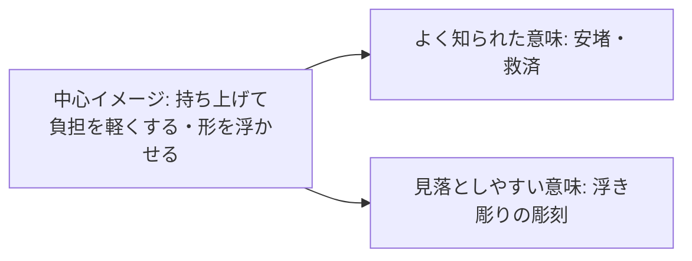

**重要語法**

 - `in low relief（浅い浮き彫り）`

---

## 1442. relief

*品詞：noun ｜ 発音：/rɪˈliːf/*

<small>よく知られている意味：安堵・救済</small>

**見落としやすい意味：裁判所から与えられる救済・救済措置**

**例文**

> The residents asked the court for relief from the unfair rule.

**和訳**

> 住民たちは不公平な規則からの救済を裁判所に求めた。

**コアイメージ**

苦痛や負担を軽くするという感覚が法律にも広がる。裁判所が不利益を取り除くために与える措置がrelief。

**図**

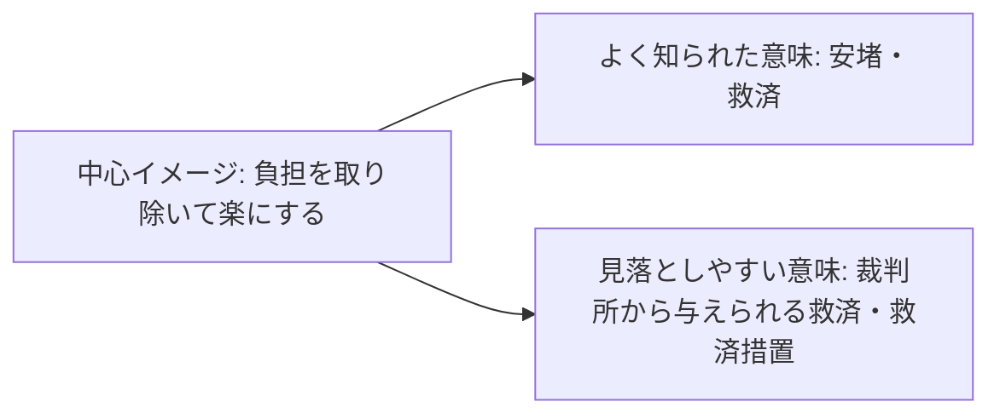

**重要語法**

 - `seek relief（法的救済を求める）`

---

## 1443. venture

*品詞：verb ｜ 発音：/ˈventʃər/*

<small>よく知られている意味：冒険する</small>

**見落としやすい意味：批判覚悟で意見・推測を控えめに述べる**

**例文**

> I would venture to suggest that we need more evidence.

**和訳**

> あえて申し上げるなら、もっと証拠が必要だと思います。

**コアイメージ**

未知の場所へ踏み出すことがventureの出発点。批判の可能性を承知で意見を口にする場合にも使う。

**図**

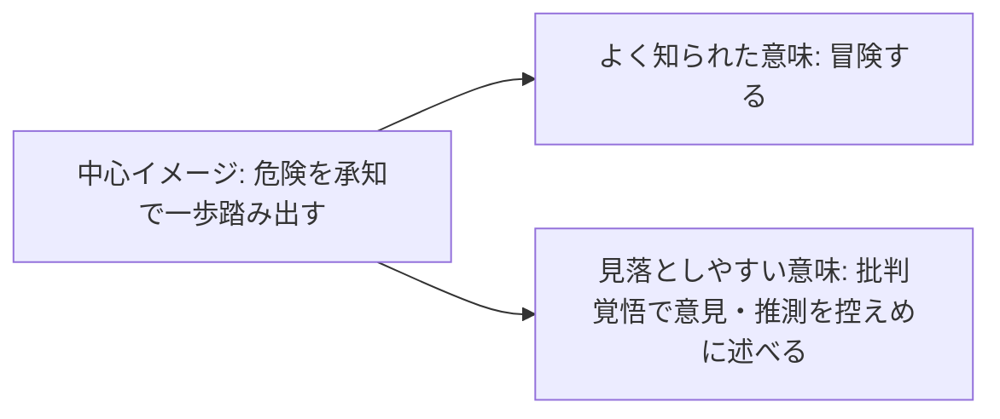

**重要語法**

 - `venture to suggest / venture an opinion`

---

## 1444. obligation

*品詞：noun ｜ 発音：/ˌɑːblɪˈɡeɪʃən/*

<small>よく知られている意味：義務</small>

**見落としやすい意味：好意を受けたことへの恩義・感謝の気持ち**

**例文**

> I feel a deep obligation to the teacher who supported me.

**和訳**

> 私は支えてくれた先生に深い恩義を感じている。

**コアイメージ**

義務は行動を求める拘束である。親切を受けたために何か返したいと感じる心理にもobligationを使う。

**図**

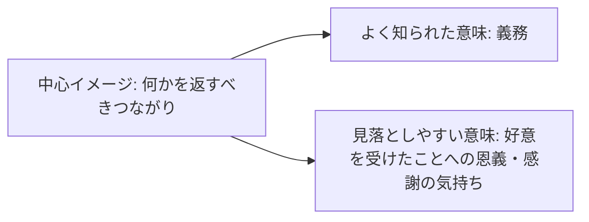

**重要語法**

 - `feel an obligation to someone`

---

## 1445. donor

*品詞：noun ｜ 発音：/ˈdoʊnər/*

<small>よく知られている意味：寄付者</small>

**見落としやすい意味：化学反応で電子などを供与する物質**

**例文**

> In this reaction, one molecule acts as an electron donor.

**和訳**

> この反応では、一方の分子が電子供与体として働く。

**コアイメージ**

donorの中心は受け取る側ではなく与える側にあること。寄付金の代わりに電子を与える物質もdonorと呼ぶ。

**図**

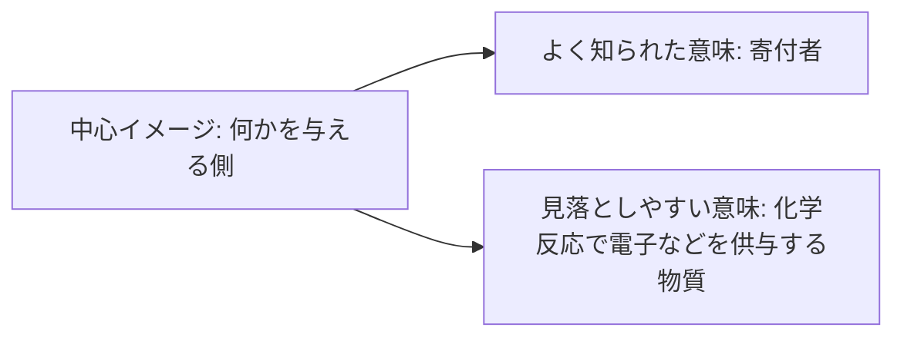

**重要語法**

 - `electron donor（電子供与体）`

---

## 1446. humor

*品詞：verb ｜ 発音：/ˈhjuːmər/*

<small>よく知られている意味：ユーモア</small>

**見落としやすい意味：相手が不機嫌にならないように言い分を聞く**

**例文**

> We humored our little brother and listened to his long story.

**和訳**

> 私たちは弟の機嫌を損ねないよう、長い話を聞いてあげた。

**コアイメージ**

相手の気分をよく保とうとする働きかけを表す。笑わせるというより、反論せず相手に付き合う意味の動詞。

**図**

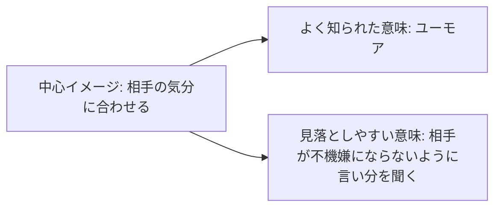

**重要語法**

 - `humor someone（人の機嫌を取る）`

---

## 1447. ultimate

*品詞：adjective ｜ 発音：/ˈʌltɪmət/*

<small>よく知られている意味：最終の</small>

**見落としやすい意味：物事の最も根本的な・究極の原因である**

**例文**

> Scientists are still studying the ultimate cause of the disease.

**和訳**

> 科学者たちはその病気の根本原因をなお研究している。

**コアイメージ**

ultimateは連なりのいちばん端を表す。時間の最後だけでなく、原因をたどった先の根本にも使える。

**図**

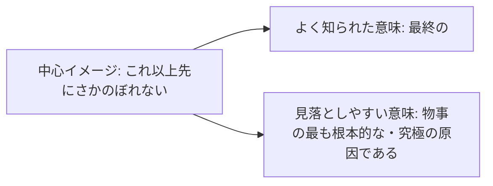

**重要語法**

 - `the ultimate cause`

---

## 1448. viewer

*品詞：noun ｜ 発音：/ˈvjuːər/*

<small>よく知られている意味：視聴者</small>

**見落としやすい意味：ファイルを表示・閲覧するソフトウェア**

**例文**

> You need a PDF viewer to open this document.

**和訳**

> この文書を開くにはPDF閲覧ソフトが必要だ。

**コアイメージ**

viewerは見る人を表すだけではない。ファイルを画面に表示して見られるようにするソフトにも使う。

**図**

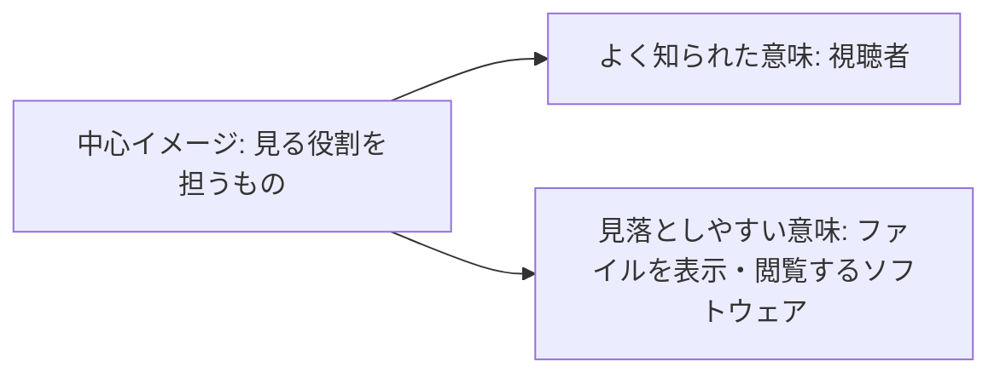

**重要語法**

 - `PDF viewer / image viewer`

---

## 1449. moderate

*品詞：noun ｜ 発音：/ˈmɑːdərət/*

<small>よく知られている意味：穏健な</small>

**見落としやすい意味：政治的に中道的な立場の人**

**例文**

> The proposal appealed to moderates in both parties.

**和訳**

> その提案は両党の中道派の人々に支持された。

**コアイメージ**

moderateは極端に寄らないことを表す。政治では、その立場を取る人自体を名詞でa moderateという。

**図**

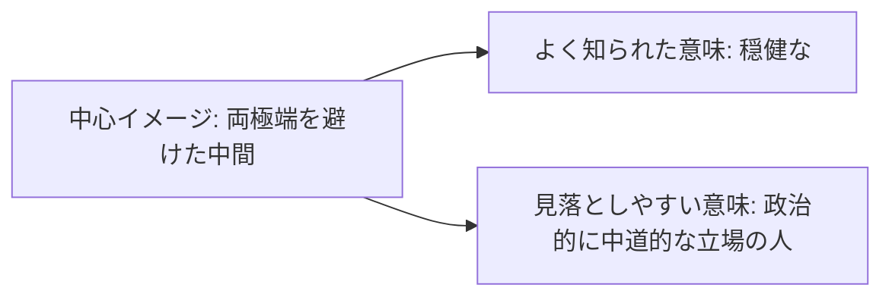

**重要語法**

 - `political moderate`

---

## 1450. moderate

*品詞：verb ｜ 発音：/ˈmɑːdəreɪt/*

<small>よく知られている意味：適度な</small>

**見落としやすい意味：討論・会議などの進行を調整する**

**例文**

> A journalist will moderate the debate tonight.

**和訳**

> 今夜の討論会は記者が司会進行を務める。

**コアイメージ**

moderateは程度を適切に保つイメージを持つ。討論が一方に偏らないよう進行を調整する役割にも広がる。

**図**

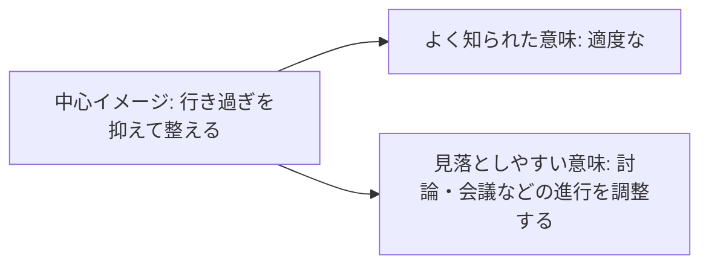

**重要語法**

 - `moderate a debate`

---

## 1451. sanction

*品詞：noun ｜ 発音：/ˈsæŋkʃən/*

<small>よく知られている意味：制裁</small>

**見落としやすい意味：正式な許可・承認**

**例文**

> The project began only after receiving official sanction.

**和訳**

> その計画は正式な承認を得てから始まった。

**コアイメージ**

sanctionは権限ある機関の正式な判断に関わる語。許してよいという判断なら承認の意味になる。

**図**

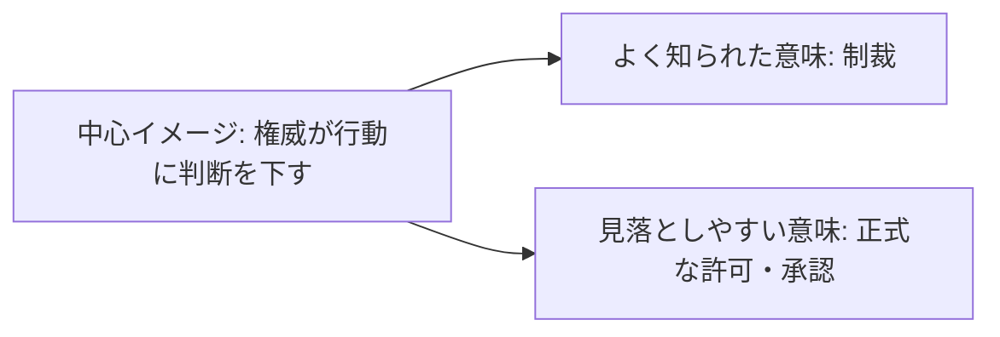

**重要語法**

 - `official sanction`

---

## 1452. sanction

*品詞：noun ｜ 発音：/ˈsæŋkʃən/*

<small>よく知られている意味：承認</small>

**見落としやすい意味：規則違反に対する制裁措置**

**例文**

> The league imposed sanctions on the team for breaking the rules.

**和訳**

> リーグは規則違反をしたチームに制裁を科した。

**コアイメージ**

sanctionは正式な判断という中心を持つ。違反に対する不利益を課す判断なら制裁の意味になるため文脈で区別する。

**図**

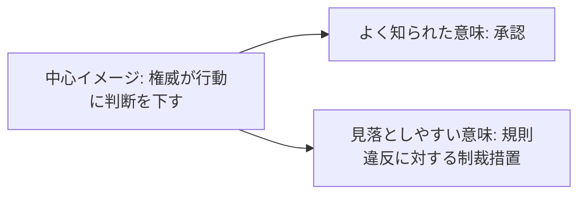

**重要語法**

 - `impose sanctions on`

---

## 1453. sanction

*品詞：verb ｜ 発音：/ˈsæŋkʃən/*

<small>よく知られている意味：制裁を科す</small>

**見落としやすい意味：行動や計画を公的に承認する**

**例文**

> The committee sanctioned the new safety plan.

**和訳**

> 委員会は新しい安全計画を正式に承認した。

**コアイメージ**

同じsanctionでも動詞では公的な承認を表せる。何を目的語に取るかと周囲の文脈を見て制裁と取り違えない。

**図**

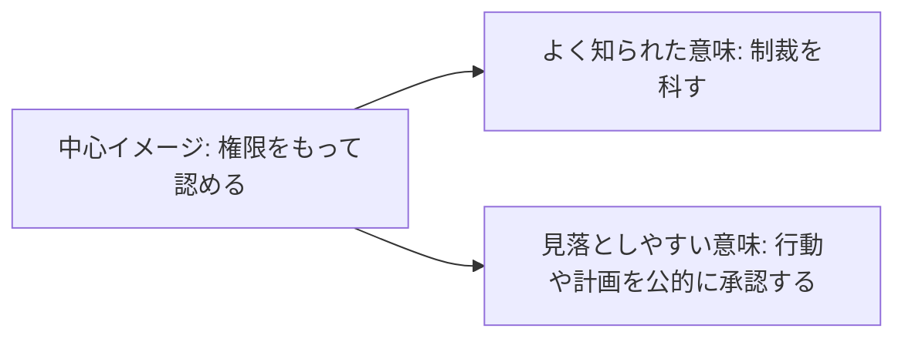

**重要語法**

 - `sanction a plan`

---

## 1454. virtue

*品詞：noun ｜ 発音：/ˈvɝːtʃuː/*

<small>よく知られている意味：美徳</small>

**見落としやすい意味：ある行為・制度の利点・長所**

**例文**

> One virtue of this design is that it saves space.

**和訳**

> この設計の長所の一つは省スペースなことだ。

**コアイメージ**

人の優れた性質がvirtueの基本。人だけでなく、方法や制度の評価できる点もvirtueと呼ぶ。

**図**

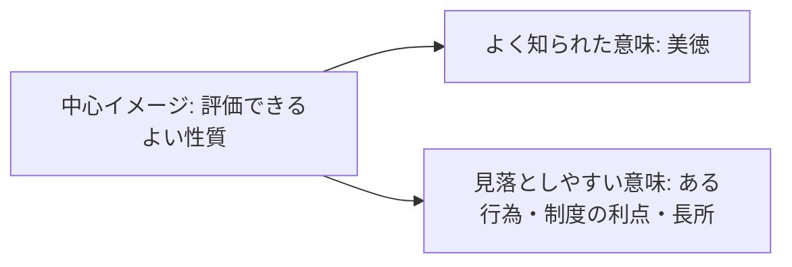

**重要語法**

 - `the virtue of`

---

## 1455. pace

*品詞：verb ｜ 発音：/peɪs/*

<small>よく知られている意味：速度・歩調</small>

**見落としやすい意味：行ったり来たり歩き回る**

**例文**

> He paced the hallway while waiting for the results.

**和訳**

> 彼は結果を待つ間、廊下を行ったり来たり歩いた。

**コアイメージ**

paceは足取りや歩調と結び付く。落ち着かず繰り返し歩く動きは動詞paceで表せる。

**図**

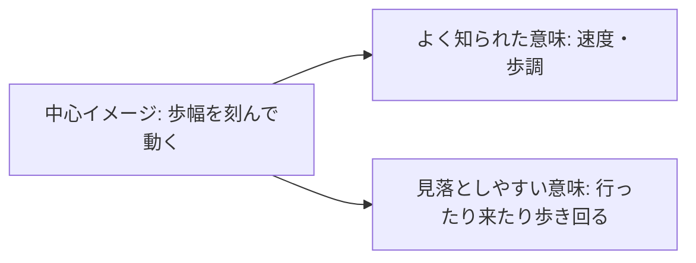

**重要語法**

 - `pace back and forth`

---

## 1456. render

*品詞：verb ｜ 発音：/ˈrendər/*

<small>よく知られている意味：画像を描画する</small>

**見落としやすい意味：人や物をある状態にする**

**例文**

> The new evidence rendered the old theory useless.

**和訳**

> 新たな証拠によって古い理論は役に立たなくなった。

**コアイメージ**

renderには結果としてある状態を生じさせる働きがある。render A BでAをBの状態にする意味になる。

**図**

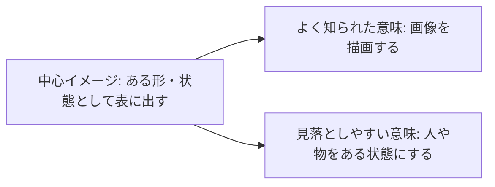

**重要語法**

 - `render A B`

---

## 1457. render

*品詞：verb ｜ 発音：/ˈrendər/*

<small>よく知られている意味：～の状態にする</small>

**見落としやすい意味：文章などを別の言語に翻訳する**

**例文**

> The poem has been rendered into several languages.

**和訳**

> その詩はいくつかの言語に翻訳されている。

**コアイメージ**

renderは表現を別の形にする意味を持つ。文章を別の言語で表現し直す場合は翻訳の意味になる。

**図**

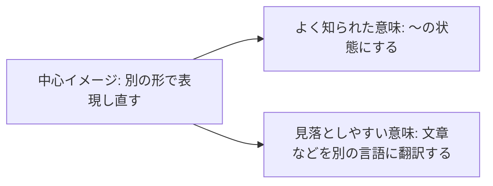

**重要語法**

 - `render A into B`

---

## 1458. besides

*品詞：preposition ｜ 発音：/bɪˈsaɪdz/*

<small>よく知られている意味：～に加えて</small>

**見落としやすい意味：～を除けば・～以外には**

**例文**

> Besides Anna, no one knew the password.

**和訳**

> アンナ以外は誰もパスワードを知らなかった。

**コアイメージ**

besidesは対象をほかのものと分けて考える語。否定の文脈では「～以外に誰もいない」のような除外の読みが自然になる。

**図**

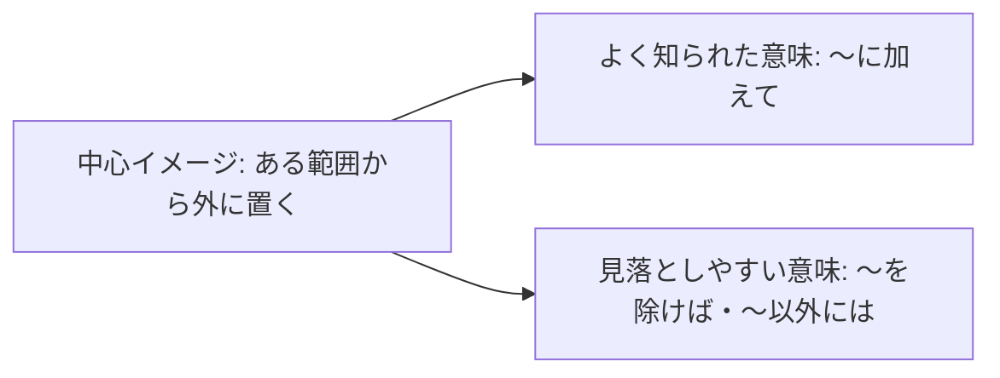

**重要語法**

 - `besides A, no one ...`

---

## 1459. arrival

*品詞：noun ｜ 発音：/əˈraɪvəl/*

<small>よく知られている意味：到着</small>

**見落としやすい意味：新たに到着した人や新参者**

**例文**

> The new arrival introduced herself to the class.

**和訳**

> 新しく来た人がクラスに自己紹介した。

**コアイメージ**

arrivalは到着という行為を表す。到着した人そのものを指す場合にも使われる。

**図**

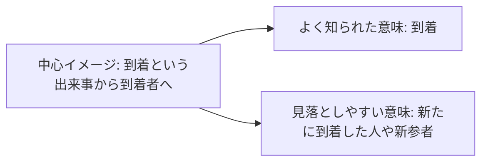

**重要語法**

 - `a new arrival`

---

## 1460. curious

*品詞：adjective ｜ 発音：/ˈkjʊriəs/*

<small>よく知られている意味：好奇心が強い</small>

**見落としやすい意味：奇妙で不可解な・普通と違う**

**例文**

> A curious smell came from the empty room.

**和訳**

> 誰もいない部屋から奇妙なにおいがした。

**コアイメージ**

curiousは気になる状態を表す語。人が知りたがる場合は好奇心、物事が普通と違う場合は奇妙さを表す。

**図**

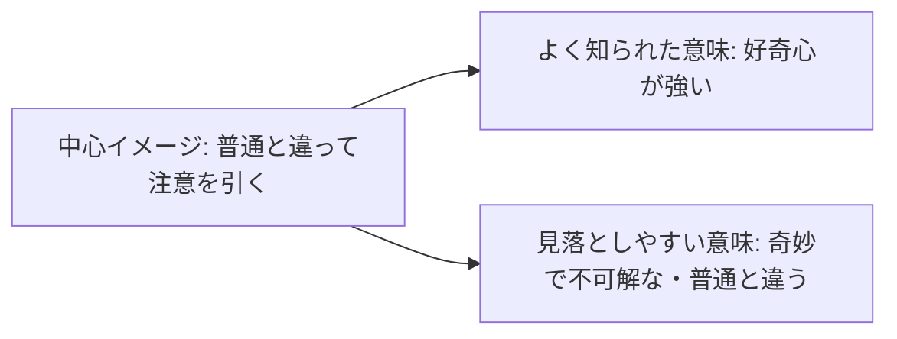

**重要語法**

 - `a curious fact`

---

## 1461. ton

*品詞：noun ｜ 発音：/tʌn/*

<small>よく知られている意味：重さのトン</small>

**見落としやすい意味：非常に多くの量・山ほど**

**例文**

> We still have tons of work to finish.

**和訳**

> 私たちにはまだ山ほど終わらせる仕事がある。

**コアイメージ**

tonは大きな重量の単位。会話では数量が非常に多いことを強調する比喩にもなる。

**図**

```mermaid
flowchart LR
    A["中心イメージ: 重く積み上がる大きな量"]
    B["よく知られた意味: 重さのトン"]
    C["見落としやすい意味: 非常に多くの量・山ほど"]
    A --> B
    A --> C
```

**重要語法**

 - `tons of`

---

## 1462. resistance

*品詞：noun ｜ 発音：/rɪˈzɪstəns/*

<small>よく知られている意味：反対・抵抗</small>

**見落としやすい意味：電流の流れにくさを表す電気抵抗**

**例文**

> Copper has lower electrical resistance than rubber.

**和訳**

> 銅の電気抵抗はゴムより小さい。

**コアイメージ**

resistanceは進もうとするものへの妨げを表す。電気では電流の流れにくさを数値化したものを指す。

**図**

```mermaid
flowchart LR
    A["中心イメージ: 流れや動きを妨げる力"]
    B["よく知られた意味: 反対・抵抗"]
    C["見落としやすい意味: 電流の流れにくさを表す電気抵抗"]
    A --> B
    A --> C
```

**重要語法**

 - `electrical resistance`

---

## 1463. chamber

*品詞：noun ｜ 発音：/ˈtʃeɪmbər/*

<small>よく知られている意味：部屋</small>

**見落としやすい意味：議会・議院・会議体**

**例文**

> The bill passed through the upper chamber.

**和訳**

> その法案は上院を通過した。

**コアイメージ**

chamberは仕切られた部屋を表す。政治では議員が集まり審議する場から議院そのものを指す。

**図**

```mermaid
flowchart LR
    A["中心イメージ: 区切られた公的な場"]
    B["よく知られた意味: 部屋"]
    C["見落としやすい意味: 議会・議院・会議体"]
    A --> B
    A --> C
```

**重要語法**

 - `upper chamber / lower chamber`

---

## 1464. discrimination

*品詞：noun ｜ 発音：/dɪˌskrɪməˈneɪʃən/*

<small>よく知られている意味：差別</small>

**見落としやすい意味：違いを正確に見分ける識別能力**

**例文**

> Good discrimination between similar sounds takes practice.

**和訳**

> 似た音を正確に聞き分けるには練習が必要だ。

**コアイメージ**

discriminationの中心は差異を見分けること。人への不当な扱いではなく、感覚や判断の識別力を指す場合もある。

**図**

```mermaid
flowchart LR
    A["中心イメージ: 違いを見極めて区別する"]
    B["よく知られた意味: 差別"]
    C["見落としやすい意味: 違いを正確に見分ける識別能力"]
    A --> B
    A --> C
```

**重要語法**

 - `discrimination between A and B`

---

## 1465. shock

*品詞：noun ｜ 発音：/ʃɑːk/*

<small>よく知られている意味：衝撃</small>

**見落としやすい意味：車の衝撃を吸収する装置**

**例文**

> The mechanic replaced the car's worn shocks.

**和訳**

> 整備士は車の摩耗したショックアブソーバーを交換した。

**コアイメージ**

shockは強い衝撃を指す。車の部品については衝撃を吸収する装置を短くshocksと呼ぶ。

**図**

```mermaid
flowchart LR
    A["中心イメージ: 衝撃を受け止める"]
    B["よく知られた意味: 衝撃"]
    C["見落としやすい意味: 車の衝撃を吸収する装置"]
    A --> B
    A --> C
```

**重要語法**

 - `shocks（ショックアブソーバー）`

---

## 1466. lock

*品詞：noun ｜ 発音：/lɑːk/*

<small>よく知られている意味：錠前</small>

**見落としやすい意味：運河で水位の異なる場所を船が通るための水門**

**例文**

> The boat entered the lock to reach the higher canal.

**和訳**

> 船は高い水位の運河へ進むため水門に入った。

**コアイメージ**

lockは通過を制限する仕組みを指す。運河では水位を調整して船を通す区画・水門を表す。

**図**

```mermaid
flowchart LR
    A["中心イメージ: 通り道を閉じて制御する仕組み"]
    B["よく知られた意味: 錠前"]
    C["見落としやすい意味: 運河で水位の異なる場所を船が通るための水門"]
    A --> B
    A --> C
```

**重要語法**

 - `canal lock`

---

## 1467. retire

*品詞：verb ｜ 発音：/rɪˈtaɪər/*

<small>よく知られている意味：引退する</small>

**見落としやすい意味：就寝するため部屋に退く**

**例文**

> After dinner, the guests retired to their rooms.

**和訳**

> 夕食後、客たちはそれぞれの部屋に引き揚げた。

**コアイメージ**

retireは今いる場所や活動から退くこと。職業からの引退だけでなく、夜に部屋へ戻る行為にも使う。

**図**

```mermaid
flowchart LR
    A["中心イメージ: 活動の場から身を引く"]
    B["よく知られた意味: 引退する"]
    C["見落としやすい意味: 就寝するため部屋に退く"]
    A --> B
    A --> C
```

**重要語法**

 - `retire to bed / retire to one's room`

---

## 1468. somewhere

*品詞：adverb ｜ 発音：/ˈsʌmwer/*

<small>よく知られている意味：どこかに</small>

**見落としやすい意味：数値が～くらい・～前後である**

**例文**

> The repairs will cost somewhere around $500.

**和訳**

> 修理には500ドル前後かかるだろう。

**コアイメージ**

somewhereは場所が特定できない感覚を持つ。数値に使うと、ぴったりではないおおよその範囲を示す。

**図**

```mermaid
flowchart LR
    A["中心イメージ: 正確な一点を定めない"]
    B["よく知られた意味: どこかに"]
    C["見落としやすい意味: 数値が～くらい・～前後である"]
    A --> B
    A --> C
```

**重要語法**

 - `somewhere around / somewhere between`

---

## 1469. discovery

*品詞：noun ｜ 発音：/dɪˈskʌvəri/*

<small>よく知られている意味：発見</small>

**見落としやすい意味：裁判前に証拠を収集・開示する法的手続き**

**例文**

> The lawyers requested more documents during discovery.

**和訳**

> 弁護士たちは証拠開示手続き中に追加の文書を求めた。

**コアイメージ**

discoveryは知らなかったものを見つけること。米国法などでは裁判前に双方が証拠を開示・収集する手続きを指す。

**図**

```mermaid
flowchart LR
    A["中心イメージ: 隠れた情報を明らかにする"]
    B["よく知られた意味: 発見"]
    C["見落としやすい意味: 裁判前に証拠を収集・開示する法的手続き"]
    A --> B
    A --> C
```

**重要語法**

 - `pretrial discovery`

---

## 1470. fuel

*品詞：verb ｜ 発音：/ˈfjuːəl/*

<small>よく知られている意味：燃料を供給する</small>

**見落としやすい意味：感情・対立・問題などをあおって強める**

**例文**

> False rumors fueled public anger.

**和訳**

> 誤ったうわさが人々の怒りをあおった。

**コアイメージ**

fuelは燃えるためのエネルギーを補うこと。感情や対立にも比喩的な燃料を与え、勢いを強める意味になる。

**図**

```mermaid
flowchart LR
    A["中心イメージ: 勢いを保つための燃料を与える"]
    B["よく知られた意味: 燃料を供給する"]
    C["見落としやすい意味: 感情・対立・問題などをあおって強める"]
    A --> B
    A --> C
```

**重要語法**

 - `fuel anger / fuel debate`

---

## 1471. contest

*品詞：verb ｜ 発音：/kənˈtest/*

<small>よく知られている意味：競争・試合</small>

**見落としやすい意味：主張や選挙結果などに異議を唱える**

**例文**

> The losing candidate contested the election results.

**和訳**

> 落選した候補者は選挙結果に異議を申し立てた。

**コアイメージ**

contestは競い合うことを軸にする。相手が出した結果や判断をそのまま受け入れず争う意味にもなる。

**図**

```mermaid
flowchart LR
    A["中心イメージ: 相手の主張に対して競い合う"]
    B["よく知られた意味: 競争・試合"]
    C["見落としやすい意味: 主張や選挙結果などに異議を唱える"]
    A --> B
    A --> C
```

**重要語法**

 - `contest a decision`

---

## 1472. wake

*品詞：noun ｜ 発音：/weɪk/*

<small>よく知られている意味：目を覚ます</small>

**見落としやすい意味：船や飛行機が通過した後に残る波や航跡**

**例文**

> The boat left a wide wake behind it.

**和訳**

> 船は後方に幅広い航跡を残した。

**コアイメージ**

wakeには何かが通った後に生じる水面の乱れという意味がある。目覚めの動詞とは異なる名詞の用法。

**図**

```mermaid
flowchart LR
    A["中心イメージ: 通り過ぎた後に残るもの"]
    B["よく知られた意味: 目を覚ます"]
    C["見落としやすい意味: 船や飛行機が通過した後に残る波や航跡"]
    A --> B
    A --> C
```

**重要語法**

 - `in a boat's wake`

---

## 1473. wake

*品詞：noun ｜ 発音：/weɪk/*

<small>よく知られている意味：目覚め</small>

**見落としやすい意味：ある出来事の直後・その影響下**

**例文**

> Several rules changed in the wake of the accident.

**和訳**

> 事故を受けて、いくつかの規則が変わった。

**コアイメージ**

船の通過後に波が残るように、大きな出来事の後にも影響が続く。in the wake ofはその直後や影響を受けてという意味になる。

**図**

```mermaid
flowchart LR
    A["中心イメージ: 出来事の後ろに続く余波"]
    B["よく知られた意味: 目覚め"]
    C["見落としやすい意味: ある出来事の直後・その影響下"]
    A --> B
    A --> C
```

**重要語法**

 - `in the wake of`

---

## 1474. cream

*品詞：noun ｜ 発音：/kriːm/*

<small>よく知られている意味：乳製品のクリーム</small>

**見落としやすい意味：ある集団の最上位・最良の部分**

**例文**

> Only the cream of the applicant pool received interview invitations.

**和訳**

> 応募者の中でも特に優秀な人たちだけが面接に招かれた。

**コアイメージ**

乳脂肪の濃い部分が上に集まることから、集団の中の最良の部分を表す。the cream ofという形でよく使う。

**図**

```mermaid
flowchart LR
    A["中心イメージ: 上に集まる上質な部分"]
    B["よく知られた意味: 乳製品のクリーム"]
    C["見落としやすい意味: ある集団の最上位・最良の部分"]
    A --> B
    A --> C
```

**重要語法**

 - `the cream of the crop`

---

## 1475. summit

*品詞：noun ｜ 発音：/ˈsʌmɪt/*

<small>よく知られている意味：山頂</small>

**見落としやすい意味：政府や組織の首脳が集まる会議**

**例文**

> Leaders from five countries attended the summit.

**和訳**

> 5か国の首脳がその首脳会議に出席した。

**コアイメージ**

summitは山の最も高い点を指す。政治では各国の指導者という上位の人たちが集まる会議を表す。

**図**

```mermaid
flowchart LR
    A["中心イメージ: 集まりの最上位"]
    B["よく知られた意味: 山頂"]
    C["見落としやすい意味: 政府や組織の首脳が集まる会議"]
    A --> B
    A --> C
```

**重要語法**

 - `a summit meeting`

---

## 1476. forever

*品詞：adverb ｜ 発音：/fərˈevər/*

<small>よく知られている意味：永久に</small>

**見落としやすい意味：頻繁に繰り返して・いつも**

**例文**

> My neighbor is forever complaining about the weather.

**和訳**

> 隣人はしょっちゅう天気に文句を言っている。

**コアイメージ**

foreverは終わらない長さを強調する。繰り返しがうんざりするほど多いときにも「いつも」という意味で使う。

**図**

```mermaid
flowchart LR
    A["中心イメージ: 終わりなく続くように感じられる"]
    B["よく知られた意味: 永久に"]
    C["見落としやすい意味: 頻繁に繰り返して・いつも"]
    A --> B
    A --> C
```

**重要語法**

 - `be forever doing`

---

## 1477. electricity

*品詞：noun ｜ 発音：/ɪˌlekˈtrɪsəti/*

<small>よく知られている意味：電気</small>

**見落としやすい意味：興奮や緊張が漂う空気**

**例文**

> There was electricity in the room before the final vote.

**和訳**

> 最終投票の前、部屋には張り詰めた興奮が漂っていた。

**コアイメージ**

electricityは電気的な力のこと。人々の緊張や興奮がその場に満ちている様子を比喩的に表せる。

**図**

```mermaid
flowchart LR
    A["中心イメージ: 見えないエネルギーが満ちる"]
    B["よく知られた意味: 電気"]
    C["見落としやすい意味: 興奮や緊張が漂う空気"]
    A --> B
    A --> C
```

**重要語法**

 - `electricity in the air`

---

## 1478. depart

*品詞：verb ｜ 発音：/dɪˈpɑːrt/*

<small>よく知られている意味：出発する</small>

**見落としやすい意味：既存の方法や規範から外れる**

**例文**

> The writer departs from the usual approach.

**和訳**

> その作家は従来の方法から外れた手法を取っている。

**コアイメージ**

departは場所を離れて出発すること。方法や慣習という抽象的な道筋から外れる意味にも広がる。

**図**

```mermaid
flowchart LR
    A["中心イメージ: 今いる道筋から離れる"]
    B["よく知られた意味: 出発する"]
    C["見落としやすい意味: 既存の方法や規範から外れる"]
    A --> B
    A --> C
```

**重要語法**

 - `depart from tradition`

---

## 1479. arch

*品詞：adjective ｜ 発音：/ɑːrtʃ/*

<small>よく知られている意味：アーチ形の</small>

**見落としやすい意味：いたずらっぽく意味ありげな**

**例文**

> She gave him an arch smile when he denied the obvious.

**和訳**

> 彼が明白なことを否定すると、彼女は意味ありげないたずらっぽい笑みを浮かべた。

**コアイメージ**

形のアーチを表すarchとは別に、表情や言葉がいたずらっぽく意味ありげだという形容詞の用法がある。arch smileのように、からかう含みを読み取る。

**図**

```mermaid
flowchart LR
    A["中心イメージ: 同じ綴りの異なる形容詞用法"]
    B["よく知られた意味: アーチ形の"]
    C["見落としやすい意味: いたずらっぽく意味ありげな"]
    A --> B
    A --> C
```

**重要語法**

 - `an arch smile`

---

## 1480. installation

*品詞：noun ｜ 発音：/ˌɪnstəˈleɪʃən/*

<small>よく知られている意味：設備の設置</small>

**見落としやすい意味：空間全体を作品にした展示芸術**

**例文**

> The artist created an installation using mirrors and light.

**和訳**

> その芸術家は鏡と光を使ったインスタレーション作品を制作した。

**コアイメージ**

installationは何かを設置すること。現代美術では作品を空間に配置し、鑑賞者が場全体を体験する表現を指す。

**図**

```mermaid
flowchart LR
    A["中心イメージ: 空間に要素を配置して成立させる"]
    B["よく知られた意味: 設備の設置"]
    C["見落としやすい意味: 空間全体を作品にした展示芸術"]
    A --> B
    A --> C
```

**重要語法**

 - `art installation`

---

## 1481. switch

*品詞：noun ｜ 発音：/swɪtʃ/*

<small>よく知られている意味：電源スイッチ</small>

**見落としやすい意味：鉄道の進路を切り替える転轍器**

**例文**

> The railway worker checked the switch before the train arrived.

**和訳**

> 列車が到着する前に、鉄道員は転轍器を点検した。

**コアイメージ**

switchは流れや接続先を切り替えるものを指す。電気だけでなく線路の進路を変える装置にも使う。

**図**

```mermaid
flowchart LR
    A["中心イメージ: 進む方向を切り替える仕組み"]
    B["よく知られた意味: 電源スイッチ"]
    C["見落としやすい意味: 鉄道の進路を切り替える転轍器"]
    A --> B
    A --> C
```

**重要語法**

 - `railway switch`

---

## 1482. slip

*品詞：noun ｜ 発音：/slɪp/*

<small>よく知られている意味：滑る</small>

**見落としやすい意味：不注意による小さな間違い・失言**

**例文**

> A slip of the tongue caused an awkward silence.

**和訳**

> ちょっとした失言で気まずい沈黙が生まれた。

**コアイメージ**

slipには足が滑って位置を外す感覚がある。言葉や判断が意図から少し外れると、小さなミスを表す。

**図**

```mermaid
flowchart LR
    A["中心イメージ: 意図したところから外れる"]
    B["よく知られた意味: 滑る"]
    C["見落としやすい意味: 不注意による小さな間違い・失言"]
    A --> B
    A --> C
```

**重要語法**

 - `a slip of the tongue`

---

## 1483. slip

*品詞：verb ｜ 発音：/slɪp/*

<small>よく知られている意味：滑る</small>

**見落としやすい意味：うっかり秘密や情報を口にしてしまう**

**例文**

> She accidentally let the surprise slip during dinner.

**和訳**

> 彼女は夕食中にうっかりサプライズの計画を漏らした。

**コアイメージ**

slipは何かが滑って外へ出る動きを表す。言葉や秘密が口から意図せず出てしまう様子にも使う。

**図**

```mermaid
flowchart LR
    A["中心イメージ: 手元からするりと抜け出す"]
    B["よく知られた意味: 滑る"]
    C["見落としやすい意味: うっかり秘密や情報を口にしてしまう"]
    A --> B
    A --> C
```

**重要語法**

 - `let something slip`

---

## 1484. slip

*品詞：verb ｜ 発音：/slɪp/*

<small>よく知られている意味：滑る</small>

**見落としやすい意味：紙片や金などをそっと渡す**

**例文**

> He quietly slipped the guard a note.

**和訳**

> 彼は警備員にそっとメモを手渡した。

**コアイメージ**

slipは物を滑るように動かすイメージを持つ。人の手に物を目立たないように渡す場合にも使う。

**図**

```mermaid
flowchart LR
    A["中心イメージ: 目立たず滑り込ませる"]
    B["よく知られた意味: 滑る"]
    C["見落としやすい意味: 紙片や金などをそっと渡す"]
    A --> B
    A --> C
```

**重要語法**

 - `slip someone something`

---

## 1485. slip

*品詞：verb ｜ 発音：/slɪp/*

<small>よく知られている意味：滑る</small>

**見落としやすい意味：うっかり間違える・失敗する**

**例文**

> I slipped up and wrote the wrong date.

**和訳**

> 私はうっかり間違えて日付を誤記した。

**コアイメージ**

滑ると足元が狂うように、作業や判断でもミスをすることがある。slip upはその比喩から生まれた句動詞。

**図**

```mermaid
flowchart LR
    A["中心イメージ: 正しい道筋から足を踏み外す"]
    B["よく知られた意味: 滑る"]
    C["見落としやすい意味: うっかり間違える・失敗する"]
    A --> B
    A --> C
```

**重要語法**

 - `slip up`

---

## 1486. steep

*品詞：adjective ｜ 発音：/stiːp/*

<small>よく知られている意味：急勾配の</small>

**見落としやすい意味：価格・要求などが極端に高い**

**例文**

> The hotel charges a steep fee for parking.

**和訳**

> そのホテルは駐車料金をかなり高く設定している。

**コアイメージ**

steepは坂が急に上がる様子を表す。金額や条件にも使うと、普通より大幅に高い印象になる。

**図**

```mermaid
flowchart LR
    A["中心イメージ: 上方向への大きな傾き"]
    B["よく知られた意味: 急勾配の"]
    C["見落としやすい意味: 価格・要求などが極端に高い"]
    A --> B
    A --> C
```

**重要語法**

 - `a steep price / a steep fee`

---

## 1487. steep

*品詞：verb ｜ 発音：/stiːp/*

<small>よく知られている意味：急勾配の</small>

**見落としやすい意味：湯・水などに浸して成分を抽出する**

**例文**

> Steep the tea leaves in hot water for three minutes.

**和訳**

> 茶葉をお湯に3分間浸してください。

**コアイメージ**

動詞のsteepには、坂が急なsteepとは別に液体へ浸す意味がある。茶葉などを湯に浸し、成分を抽出する様子を表す。

**図**

```mermaid
flowchart LR
    A["中心イメージ: 同じ綴りにある別の動詞用法"]
    B["よく知られた意味: 急勾配の"]
    C["見落としやすい意味: 湯・水などに浸して成分を抽出する"]
    A --> B
    A --> C
```

**重要語法**

 - `steep tea in hot water`

---

## 1488. aggressive

*品詞：adjective ｜ 発音：/əˈɡresɪv/*

<small>よく知られている意味：攻撃的な</small>

**見落としやすい意味：高い利益を狙ってリスクを積極的に取る**

**例文**

> The firm adopted an aggressive investment strategy.

**和訳**

> その企業はリスクを積極的に取る投資戦略を採用した。

**コアイメージ**

aggressiveは相手に攻撃するだけではなく、前へ強く押し進む姿勢を表す。投資では成果を求めて大きなリスクを受け入れることがある。

**図**

```mermaid
flowchart LR
    A["中心イメージ: 目標へ強く踏み込む"]
    B["よく知られた意味: 攻撃的な"]
    C["見落としやすい意味: 高い利益を狙ってリスクを積極的に取る"]
    A --> B
    A --> C
```

**重要語法**

 - `aggressive strategy`

---

## 1489. comfort

*品詞：verb ｜ 発音：/ˈkʌmfərt/*

<small>よく知られている意味：快適さ</small>

**見落としやすい意味：悲しみや不安のある人を慰める**

**例文**

> Her friends comforted her after the disappointing news.

**和訳**

> 残念な知らせの後、友人たちは彼女を慰めた。

**コアイメージ**

comfortの中心は心身の苦しさを軽くすること。状態を表す名詞だけでなく、人を慰める動詞にもなる。

**図**

```mermaid
flowchart LR
    A["中心イメージ: つらさを和らげ安心させる"]
    B["よく知られた意味: 快適さ"]
    C["見落としやすい意味: 悲しみや不安のある人を慰める"]
    A --> B
    A --> C
```

**重要語法**

 - `comfort someone`

---

## 1490. retreat

*品詞：noun ｜ 発音：/rɪˈtriːt/*

<small>よく知られている意味：撤退</small>

**見落としやすい意味：人目を離れて休息・思索する静かな場所**

**例文**

> The cabin became her quiet retreat from city life.

**和訳**

> その小屋は都会の生活から離れて静かに過ごせる彼女の隠れ家になった。

**コアイメージ**

retreatは前線や日常の場から退くこと。そこから人が静かに休める場所という名詞の意味にもなる。

**図**

```mermaid
flowchart LR
    A["中心イメージ: 騒がしい場所から離れる"]
    B["よく知られた意味: 撤退"]
    C["見落としやすい意味: 人目を離れて休息・思索する静かな場所"]
    A --> B
    A --> C
```

**重要語法**

 - `a peaceful retreat`

---

## 1491. lower

*品詞：verb ｜ 発音：/ˈloʊər/*

<small>よく知られている意味：低い（比較級）</small>

**見落としやすい意味：数量・値段・音量などを下げる**

**例文**

> Please lower the volume before the meeting starts.

**和訳**

> 会議が始まる前に音量を下げてください。

**コアイメージ**

lowerは低い位置を表す形容詞の比較級にも見える。動詞では数値や位置を実際に下げる行為を表す。

**図**

```mermaid
flowchart LR
    A["中心イメージ: 高さ・水準を下の方へ動かす"]
    B["よく知られた意味: 低い（比較級）"]
    C["見落としやすい意味: 数量・値段・音量などを下げる"]
    A --> B
    A --> C
```

**重要語法**

 - `lower the price / lower the volume`

---

## 1492. ceiling

*品詞：noun ｜ 発音：/ˈsiːlɪŋ/*

<small>よく知られている意味：天井</small>

**見落としやすい意味：数値・金額などの上限**

**例文**

> The government set a ceiling on ticket prices.

**和訳**

> 政府はチケット価格に上限を設けた。

**コアイメージ**

天井は上方向の限界になるもの。数値や費用にも比喩的な天井を設けると、それが上限になる。

**図**

```mermaid
flowchart LR
    A["中心イメージ: これ以上上に行けない境界"]
    B["よく知られた意味: 天井"]
    C["見落としやすい意味: 数値・金額などの上限"]
    A --> B
    A --> C
```

**重要語法**

 - `a ceiling on prices`

---

## 1493. initiate

*品詞：noun ｜ 発音：/ɪˈnɪʃiət/*

<small>よく知られている意味：始める</small>

**見落としやすい意味：新たに組織・儀式へ参加した人**

**例文**

> The new initiates learned the club's traditions.

**和訳**

> 新しく加入した人たちはクラブの伝統を学んだ。

**コアイメージ**

initiateは始まりへ導く動詞としてよく使われる。名詞では儀式などを経て集団へ入ったばかりの人を指す。

**図**

```mermaid
flowchart LR
    A["中心イメージ: 新しい段階へ入る"]
    B["よく知られた意味: 始める"]
    C["見落としやすい意味: 新たに組織・儀式へ参加した人"]
    A --> B
    A --> C
```

**重要語法**

 - `an initiate into a group`

---

## 1494. characterize

*品詞：verb ｜ 発音：/ˈkærəktəraɪz/*

<small>よく知られている意味：特徴を述べる</small>

**見落としやすい意味：～の典型的特徴となる**

**例文**

> Long winters characterize the region.

**和訳**

> 長い冬がその地域の特徴となっている。

**コアイメージ**

characterizeは特徴を言葉で説明するだけではない。ある性質がそのものを特徴づけているという関係も表す。

**図**

```mermaid
flowchart LR
    A["中心イメージ: そのものらしさを示す"]
    B["よく知られた意味: 特徴を述べる"]
    C["見落としやすい意味: ～の典型的特徴となる"]
    A --> B
    A --> C
```

**重要語法**

 - `A is characterized by B`

---

## 1495. soviet

*品詞：noun ｜ 発音：/ˈsoʊviət/*

<small>よく知られている意味：ソ連の</small>

**見落としやすい意味：革命期などの労働者や兵士による評議会**

**例文**

> Workers elected delegates to the local soviet.

**和訳**

> 労働者たちは地元の評議会へ送る代表者を選出した。

**コアイメージ**

sovietは歴史的には労働者や兵士などの評議会を指した。国名を連想する形容詞だけでなく、組織を表す名詞としても使う。

**図**

```mermaid
flowchart LR
    A["中心イメージ: 人々の代表が集まって協議する"]
    B["よく知られた意味: ソ連の"]
    C["見落としやすい意味: 革命期などの労働者や兵士による評議会"]
    A --> B
    A --> C
```

**重要語法**

 - `a workers' soviet`

---

## 1496. ferry

*品詞：verb ｜ 発音：/ˈferi/*

<small>よく知られている意味：連絡船</small>

**見落としやすい意味：水路に限らず人や物を運び移動させる**

**例文**

> Buses ferried visitors from the station to the museum.

**和訳**

> バスが駅から博物館へ来館者を運んだ。

**コアイメージ**

ferryは船で人や物を渡すことが基本。動詞では車や航空機など船以外の輸送にも使える。

**図**

```mermaid
flowchart LR
    A["中心イメージ: 二つの地点を行き来して運ぶ"]
    B["よく知られた意味: 連絡船"]
    C["見落としやすい意味: 水路に限らず人や物を運び移動させる"]
    A --> B
    A --> C
```

**重要語法**

 - `ferry people from A to B`

---

## 1497. implication

*品詞：noun ｜ 発音：/ˌɪmplɪˈkeɪʃən/*

<small>よく知られている意味：言外の意味</small>

**見落としやすい意味：ある決定が招く影響や結果**

**例文**

> We must consider the long-term implications of this decision.

**和訳**

> この決定が長期的に及ぼす影響を考えなければならない。

**コアイメージ**

implicationは直接述べられていないことへのつながりを指す。決定から将来生じる結果や影響も、その決定に含まれるものとして表せる。

**図**

```mermaid
flowchart LR
    A["中心イメージ: 表面に出ていないつながり"]
    B["よく知られた意味: 言外の意味"]
    C["見落としやすい意味: ある決定が招く影響や結果"]
    A --> B
    A --> C
```

**重要語法**

 - `implications for the future`

---

## 1498. operative

*品詞：noun ｜ 発音：/ˈɑːpərətɪv/*

<small>よく知られている意味：作動する</small>

**見落としやすい意味：特定の任務を持つ工作員・担当者**

**例文**

> An undercover operative gathered information for the agency.

**和訳**

> 潜入任務の工作員がその機関のために情報を集めた。

**コアイメージ**

operativeは実際に働く・作動するという考えに結び付く。名詞では特定の活動を実行する担当者や工作員を指す。

**図**

```mermaid
flowchart LR
    A["中心イメージ: 具体的な任務を遂行する人"]
    B["よく知られた意味: 作動する"]
    C["見落としやすい意味: 特定の任務を持つ工作員・担当者"]
    A --> B
    A --> C
```

**重要語法**

 - `an undercover operative`

---

## 1499. ice

*品詞：verb ｜ 発音：/aɪs/*

<small>よく知られている意味：氷</small>

**見落としやすい意味：菓子をアイシングで覆う**

**例文**

> She iced the cupcakes with lemon frosting.

**和訳**

> 彼女はカップケーキにレモン風味のアイシングを塗った。

**コアイメージ**

iceは氷を意味する名詞としてよく知られる。菓子作りでは糖衣を表面に塗って覆う動詞としても使われる。

**図**

```mermaid
flowchart LR
    A["中心イメージ: 表面を薄く覆う"]
    B["よく知られた意味: 氷"]
    C["見落としやすい意味: 菓子をアイシングで覆う"]
    A --> B
    A --> C
```

**重要語法**

 - `ice a cake`

---

## 1500. everyday

*品詞：adjective ｜ 発音：/ˈevrideɪ/*

<small>よく知られている意味：every day＝毎日（別表記）</small>

**見落としやすい意味：「毎日」ではなく「日常で使う・ありふれた」**

**例文**

> This guide explains everyday English expressions.

**和訳**

> この案内書は日常で使う英語表現を説明している。

**コアイメージ**

一語のeverydayは名詞を修飾する形容詞で、日常的・ありふれたという意味。二語のevery dayは「毎日」を表す副詞的表現なので区別する。

**図**

```mermaid
flowchart LR
    A["中心イメージ: 日々の生活に属する"]
    B["よく知られた意味: every day＝毎日（別表記）"]
    C["見落としやすい意味: 「毎日」ではなく「日常で使う・ありふれた」"]
    A --> B
    A --> C
```

**重要語法**

 - `everyday life / every day`

---

## 1501. pride

*品詞：verb ｜ 発音：/praɪd/*

<small>よく知られている意味：誇り</small>

**見落としやすい意味：自分の特長や成果を誇りに思う**

**例文**

> The school prides itself on its science program.

**和訳**

> その学校は理科教育の充実を誇りにしている。

**コアイメージ**

prideは誇りの気持ちを表す名詞。pride oneself onという形では、自分の強みを誇りとする動詞になる。

**図**

```mermaid
flowchart LR
    A["中心イメージ: 価値を高く評価する気持ち"]
    B["よく知られた意味: 誇り"]
    C["見落としやすい意味: 自分の特長や成果を誇りに思う"]
    A --> B
    A --> C
```

**重要語法**

 - `pride oneself on`

---

## 1502. appoint

*品詞：verb ｜ 発音：/əˈpɔɪnt/*

<small>よく知られている意味：任命する</small>

**見落としやすい意味：会合や作業の日時・場所を正式に決める**

**例文**

> The two sides appointed a date for the next meeting.

**和訳**

> 双方は次回の会議の日取りを正式に決めた。

**コアイメージ**

appointは人を役職に指定することが多い。日時や場所を定めて指定する場合にも使うが、やや改まった言い方。

**図**

```mermaid
flowchart LR
    A["中心イメージ: 権限を持って決める"]
    B["よく知られた意味: 任命する"]
    C["見落としやすい意味: 会合や作業の日時・場所を正式に決める"]
    A --> B
    A --> C
```

**重要語法**

 - `appoint a time / appoint a day`

---

## 1503. assault

*品詞：verb ｜ 発音：/əˈsɔːlt/*

<small>よく知られている意味：暴行する</small>

**見落としやすい意味：言葉で激しく非難する**

**例文**

> The speaker assaulted the proposal with harsh criticism.

**和訳**

> 演説者はその提案を厳しい言葉で非難した。

**コアイメージ**

assaultは直接的な攻撃を指す。言葉で相手や案を激しく攻撃することも比喩的に表せる。

**図**

```mermaid
flowchart LR
    A["中心イメージ: 強い勢いで攻撃を加える"]
    B["よく知られた意味: 暴行する"]
    C["見落としやすい意味: 言葉で激しく非難する"]
    A --> B
    A --> C
```

**重要語法**

 - `verbally assault`

---

## 1504. assembly

*品詞：noun ｜ 発音：/əˈsembli/*

<small>よく知られている意味：集会</small>

**見落としやすい意味：立法を行う議会や議院**

**例文**

> The assembly voted to approve the new law.

**和訳**

> 議会はその新法を承認するための採決を行った。

**コアイメージ**

assemblyは人の集まりを表す。法律などを審議・決定する代表者の集まりは議会になる。

**図**

```mermaid
flowchart LR
    A["中心イメージ: 人々が集まり意思を決める"]
    B["よく知られた意味: 集会"]
    C["見落としやすい意味: 立法を行う議会や議院"]
    A --> B
    A --> C
```

**重要語法**

 - `legislative assembly`

---

## 1505. agenda

*品詞：noun ｜ 発音：/əˈdʒendə/*

<small>よく知られている意味：議題・議事日程</small>

**見落としやすい意味：表向きの説明とは別の隠れた目的・思惑**

**例文**

> The manager seemed to have a hidden agenda.

**和訳**

> その管理者には隠れた思惑があるようだった。

**コアイメージ**

agendaは会議で扱う項目の一覧。誰かが実際に進めたい目的や思惑を指す場合もあり、hiddenが付くと表に出さない狙いを表す。

**図**

```mermaid
flowchart LR
    A["中心イメージ: 行動を進めるための予定や目的"]
    B["よく知られた意味: 議題・議事日程"]
    C["見落としやすい意味: 表向きの説明とは別の隠れた目的・思惑"]
    A --> B
    A --> C
```

**重要語法**

 - `a hidden agenda`

---

## 1506. pledge

*品詞：verb ｜ 発音：/pledʒ/*

<small>よく知られている意味：誓約する</small>

**見落としやすい意味：資産などを担保として差し出す**

**例文**

> They pledged their house as security for the loan.

**和訳**

> 彼らは融資の担保として自宅を差し入れた。

**コアイメージ**

pledgeは約束して責任を負うことを表す。返済などの約束を保証するため、財産を担保にする意味にもなる。

**図**

```mermaid
flowchart LR
    A["中心イメージ: 約束の保証として差し出す"]
    B["よく知られた意味: 誓約する"]
    C["見落としやすい意味: 資産などを担保として差し出す"]
    A --> B
    A --> C
```

**重要語法**

 - `pledge A as security`

---

## 1507. statistic

*品詞：noun ｜ 発音：/stəˈtɪstɪk/*

<small>よく知られている意味：統計値</small>

**見落としやすい意味：個人を統計上の一件としてしか見ないときのその人**

**例文**

> She wanted the victims to be remembered as people, not statistics.

**和訳**

> 彼女は犠牲者たちが単なる統計上の数字ではなく、一人ひとりの人間として記憶されることを望んだ。

**コアイメージ**

statisticはデータを示す数字を指す。人が統計上の一件として扱われるとき、その人自身を指す比喩にもなる。

**図**

```mermaid
flowchart LR
    A["中心イメージ: 個別の存在を数字で代表させる"]
    B["よく知られた意味: 統計値"]
    C["見落としやすい意味: 個人を統計上の一件としてしか見ないときのその人"]
    A --> B
    A --> C
```

**重要語法**

 - `become just another statistic`

---

## 1508. tea

*品詞：noun ｜ 発音：/tiː/*

<small>よく知られている意味：お茶</small>

**見落としやすい意味：英国などでの夕食・軽食**

**例文**

> The children had sandwiches and fruit for tea.

**和訳**

> 子どもたちは夕方の軽食にサンドイッチと果物を食べた。

**コアイメージ**

teaは飲み物のお茶を表す。英国などではお茶を飲む時間に取る軽食や夕食自体もteaと呼ぶ。

**図**

```mermaid
flowchart LR
    A["中心イメージ: お茶を飲む時間から食事へ"]
    B["よく知られた意味: お茶"]
    C["見落としやすい意味: 英国などでの夕食・軽食"]
    A --> B
    A --> C
```

**重要語法**

 - `have tea`

---

## 1509. fat

*品詞：adjective ｜ 発音：/fæt/*

<small>よく知られている意味：脂肪の多い</small>

**見落としやすい意味：利益や収入などが豊かな・多額の**

**例文**

> The company offered her a fat bonus for the successful project.

**和訳**

> 会社はその企画の成功に対して彼女に多額の賞与を提示した。

**コアイメージ**

fatは厚みや量の多さを表す。お金や利益について使うと、豊富でかなり大きな額を意味する。

**図**

```mermaid
flowchart LR
    A["中心イメージ: 量がたっぷりある"]
    B["よく知られた意味: 脂肪の多い"]
    C["見落としやすい意味: 利益や収入などが豊かな・多額の"]
    A --> B
    A --> C
```

**重要語法**

 - `a fat bonus / a fat profit`

---

## 1510. fat

*品詞：adjective ｜ 発音：/fæt/*

<small>よく知られている意味：太い・大量の</small>

**見落としやすい意味：（皮肉的表現で）見込みがほとんどない**

**例文**

> Fat chance he'll agree to that plan!

**和訳**

> 彼がその計画に賛成するなんて、まずありえないよ！

**コアイメージ**

fat chanceは直訳すると大きな可能性だが、実際は皮肉の定型表現。可能性が非常に低いことを強調するので、普通のfatの意味から直訳しない。

**図**

```mermaid
flowchart LR
    A["中心イメージ: 大きそうに見せて逆を皮肉る"]
    B["よく知られた意味: 太い・大量の"]
    C["見落としやすい意味: （皮肉的表現で）見込みがほとんどない"]
    A --> B
    A --> C
```

**重要語法**

 - `fat chance!`

---

## 1511. flood

*品詞：noun ｜ 発音：/flʌd/*

<small>よく知られている意味：洪水</small>

**見落としやすい意味：一度に大量に殺到する物事**

**例文**

> The office received a flood of complaints after the change.

**和訳**

> 変更後、その事務所には苦情が殺到した。

**コアイメージ**

floodは水があふれて流れ込むこと。人・連絡・情報などが一斉に押し寄せる様子も表す。

**図**

```mermaid
flowchart LR
    A["中心イメージ: 一度に大量に押し寄せる"]
    B["よく知られた意味: 洪水"]
    C["見落としやすい意味: 一度に大量に殺到する物事"]
    A --> B
    A --> C
```

**重要語法**

 - `a flood of messages`

---

## 1512. outstanding

*品詞：adjective ｜ 発音：/aʊtˈstændɪŋ/*

<small>よく知られている意味：傑出した</small>

**見落としやすい意味：未解決の・未処理の・未払いの**

**例文**

> Please pay the outstanding invoices by Friday.

**和訳**

> 未払いの請求書については金曜日までに支払ってください。

**コアイメージ**

outstandingには目立って優れている意味がある。一方、処理すべきものが残ったままという意味でも使われ、請求や課題によく現れる。

**図**

```mermaid
flowchart LR
    A["中心イメージ: まだ処理の列から残っている"]
    B["よく知られた意味: 傑出した"]
    C["見落としやすい意味: 未解決の・未処理の・未払いの"]
    A --> B
    A --> C
```

**重要語法**

 - `outstanding balance / outstanding issues`

---

## 1513. platform

*品詞：noun ｜ 発音：/ˈplætfɔːrm/*

<small>よく知られている意味：駅のホーム</small>

**見落としやすい意味：政党・候補者の政策綱領**

**例文**

> The party announced its platform on education and housing.

**和訳**

> その政党は教育と住宅に関する政策綱領を発表した。

**コアイメージ**

platformは人や物を支える台という意味を持つ。政党が何を実現するかを示す政策の土台もplatformと呼ばれる。

**図**

```mermaid
flowchart LR
    A["中心イメージ: 主張を支える土台"]
    B["よく知られた意味: 駅のホーム"]
    C["見落としやすい意味: 政党・候補者の政策綱領"]
    A --> B
    A --> C
```

**重要語法**

 - `party platform`

---

## 1514. stake

*品詞：noun ｜ 発音：/steɪk/*

<small>よく知られている意味：杭</small>

**見落としやすい意味：会社や事業に対して保有する持分・利害関係**

**例文**

> She owns a small stake in the startup.

**和訳**

> 彼女はその新興企業の少数持分を保有している。

**コアイメージ**

stakeは自分が何かに投じている利害や持分を指す。会社では所有割合やそこから生じる利害関係を表せる。

**図**

```mermaid
flowchart LR
    A["中心イメージ: 自分のものとして関わる部分"]
    B["よく知られた意味: 杭"]
    C["見落としやすい意味: 会社や事業に対して保有する持分・利害関係"]
    A --> B
    A --> C
```

**重要語法**

 - `a stake in a company`

---

## 1515. bury

*品詞：verb ｜ 発音：/ˈberi/*

<small>よく知られている意味：埋める</small>

**見落としやすい意味：問題や感情を表に出さず隠す・封じる**

**例文**

> He tried to bury his worries and focus on work.

**和訳**

> 彼は不安を胸にしまい、仕事に集中しようとした。

**コアイメージ**

buryは物を土の下に埋めること。感情や問題を表に出さないよう内側にしまう意味にも広がる。

**図**

```mermaid
flowchart LR
    A["中心イメージ: 見えない場所に覆い隠す"]
    B["よく知られた意味: 埋める"]
    C["見落としやすい意味: 問題や感情を表に出さず隠す・封じる"]
    A --> B
    A --> C
```

**重要語法**

 - `bury one's feelings`

---

## 1516. narrative

*品詞：noun ｜ 発音：/ˈnærətɪv/*

<small>よく知られている意味：物語</small>

**見落としやすい意味：特定の立場に沿って組み立てられた説明の筋書き**

**例文**

> The article challenged the official narrative of the event.

**和訳**

> その記事は出来事についての公式な説明の筋書きに疑問を投げかけた。

**コアイメージ**

narrativeは事柄を順序立てて語る枠組み。現実の出来事についても、特定の見方でまとめた説明の構図を指す。

**図**

```mermaid
flowchart LR
    A["中心イメージ: 出来事を一つの筋道に並べる"]
    B["よく知られた意味: 物語"]
    C["見落としやすい意味: 特定の立場に沿って組み立てられた説明の筋書き"]
    A --> B
    A --> C
```

**重要語法**

 - `the official narrative`

---

## 1517. ruler

*品詞：noun ｜ 発音：/ˈruːlər/*

<small>よく知られている意味：定規</small>

**見落としやすい意味：国や地方を統治する支配者・君主**

**例文**

> The ruler introduced new laws during his first year.

**和訳**

> その統治者は即位後最初の年に新しい法律を導入した。

**コアイメージ**

rulerには長さを測る道具の意味がある。ruleを「統治する」と捉えると、rulerは国を治める人にもなる。

**図**

```mermaid
flowchart LR
    A["中心イメージ: 基準を定め支配する者"]
    B["よく知られた意味: 定規"]
    C["見落としやすい意味: 国や地方を統治する支配者・君主"]
    A --> B
    A --> C
```

**重要語法**

 - `a country's ruler`

---

## 1518. solid

*品詞：adjective ｜ 発音：/ˈsɑːlɪd/*

<small>よく知られている意味：固体の・固い</small>

**見落としやすい意味：信頼できる・根拠が確かな**

**例文**

> The report provides solid evidence for the claim.

**和訳**

> その報告書はその主張を裏付ける確かな証拠を示している。

**コアイメージ**

solidは形がしっかり保たれたものを表す。根拠や判断にも使うと、簡単に崩れない信頼性を意味する。

**図**

```mermaid
flowchart LR
    A["中心イメージ: ぐらつかない確かさ"]
    B["よく知られた意味: 固体の・固い"]
    C["見落としやすい意味: 信頼できる・根拠が確かな"]
    A --> B
    A --> C
```

**重要語法**

 - `solid evidence / solid reasoning`

---

## 1519. solid

*品詞：adjective ｜ 発音：/ˈsɑːlɪd/*

<small>よく知られている意味：固体の・固い</small>

**見落としやすい意味：途切れずに続く・まるまるの**

**例文**

> She studied for three solid hours without a break.

**和訳**

> 彼女は休みなしでまる3時間勉強した。

**コアイメージ**

solidは中身が詰まっている状態を表す。時間については途中に空白がなく連続していることを強調する。

**図**

```mermaid
flowchart LR
    A["中心イメージ: 途中に隙間がない"]
    B["よく知られた意味: 固体の・固い"]
    C["見落としやすい意味: 途切れずに続く・まるまるの"]
    A --> B
    A --> C
```

**重要語法**

 - `three solid hours`

---

## 1520. dive

*品詞：verb ｜ 発音：/daɪv/*

<small>よく知られている意味：水に飛び込む</small>

**見落としやすい意味：数量・評価などが急落する**

**例文**

> Shares in the company dived after the announcement.

**和訳**

> 発表後、その企業の株価は急落した。

**コアイメージ**

diveは体を勢いよく下に向けて飛び込むこと。価格や評価が急激に下がる様子にも使う。

**図**

```mermaid
flowchart LR
    A["中心イメージ: 一気に下へ飛び込む"]
    B["よく知られた意味: 水に飛び込む"]
    C["見落としやすい意味: 数量・評価などが急落する"]
    A --> B
    A --> C
```

**重要語法**

 - `prices dive / shares dive`

---

