# EasyVoca｜完成教材カード Batch 021

- 採用済み語義から作成した学習カード：**80件**
- 対象：`global_order` **1601〜1680**（`index` 2518〜2631）
- 並び順：`index` 昇順・同一 `index` 内は `candidate_id` 昇順
- 発音はカタカナによる目安で、IPAなどの厳密な発音記号ではありません。
- 一部の意味は文語・法律・技術・口語など特定の文脈で使われます。

---

### 1601. owe

**品詞：** 動詞　　**発音（目安）：** オウ

<small>よく知られている意味：借りがある・返済義務がある</small>

#### 見落としやすい意味

**思想や成果の源を他者に負っている**

**例文**
She owes her love of science to her grandfather.

**和訳**
彼女が科学を好きになったのは、祖父のおかげだ。

**コアイメージの説明**
owe は、何かを受け取った源が相手にあるという感覚を表す。お金の借りだけでなく、能力や成果が誰のおかげかを示す場合にも使う。

**図：意味のつながり**

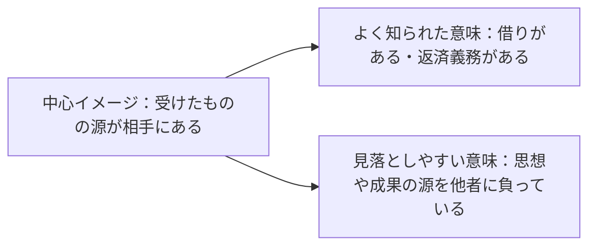

**重要語法**

- owe A to B：AはBのおかげである

<small>出典候補 ID：`ev-02518-verb-01` ／ 元データ index：2518</small>

---

### 1602. oh

**品詞：** 名詞　　**発音（目安）：** オウ

<small>よく知られている意味：驚いたときの「ああ」</small>

#### 見落としやすい意味

**数字のゼロを読み上げるときの「オー」**

**例文**
The room number is three oh five.

**和訳**
部屋番号は305です。

**コアイメージの説明**
oh は感嘆の声として知られるが、数字を口頭で伝えるときにはゼロの読みとしても使う。部屋番号や電話番号などで耳にする用法だ。

**図：意味のつながり**

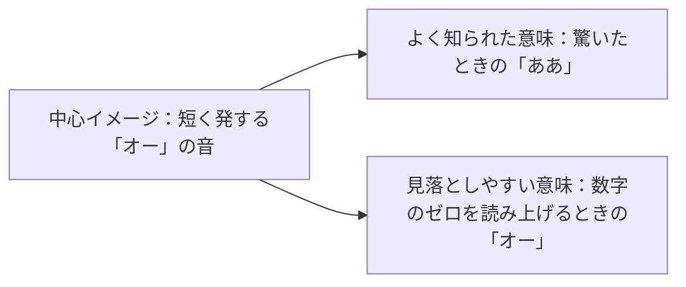

**重要語法**

- three oh five＝305（番号の読み方）

<small>出典候補 ID：`ev-02521-noun-01` ／ 元データ index：2521</small>

---

### 1603. cook

**品詞：** 動詞　　**発音（目安）：** クック

<small>よく知られている意味：料理する</small>

#### 見落としやすい意味

**数字・帳簿などを不正に改ざんする**

**例文**
The manager was fired for cooking the books.

**和訳**
その管理職は帳簿を不正に改ざんしたため解雇された。

**コアイメージの説明**
cook の基本は材料に手を加えて変えることだ。数字を都合よく加工することを、帳簿の不正操作にたとえる。

**図：意味のつながり**

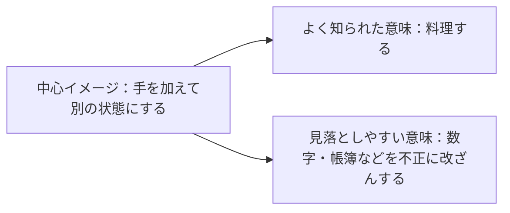

**重要語法**

- cook the books：帳簿を粉飾する

<small>出典候補 ID：`ev-02523-verb-01` ／ 元データ index：2523</small>

---

### 1604. dish

**品詞：** 名詞　　**発音（目安）：** ディッシュ

<small>よく知られている意味：皿・料理</small>

#### 見落としやすい意味

**衛星通信などに使う皿形アンテナ**

**例文**
A large dish on the roof receives satellite signals.

**和訳**
屋根の上の大きな皿形アンテナが衛星信号を受信する。

**コアイメージの説明**
dish の形の中心には、浅くくぼんだ皿がある。その形に似た通信設備も dish と呼ばれる。

**図：意味のつながり**

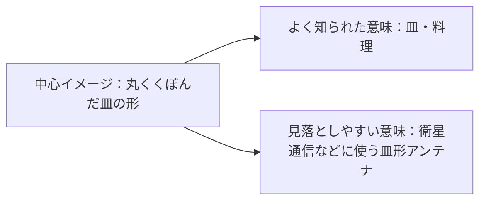

**重要語法**

- satellite dish：衛星放送用アンテナ

<small>出典候補 ID：`ev-02524-noun-01` ／ 元データ index：2524</small>

---

### 1605. uniform

**品詞：** 形容詞　　**発音（目安）：** ユーニフォーム

<small>よく知られている意味：制服（名詞）</small>

#### 見落としやすい意味

**全体にわたって均一な**

**例文**
The paint must be of uniform thickness.

**和訳**
塗料の厚さは全体で均一でなければならない。

**コアイメージの説明**
uniform は各部分が同じ状態にそろっていることを表す。制服も見た目をそろえるものだが、形容詞では厚さや品質などの均一性を示せる。

**図：意味のつながり**

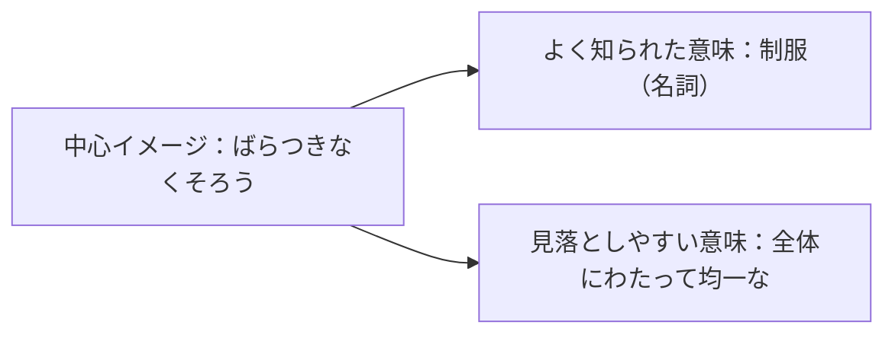

**重要語法**

- uniform thickness：均一な厚さ

<small>出典候補 ID：`ev-02525-adjective-01` ／ 元データ index：2525</small>

---

### 1606. preparation

**品詞：** 名詞　　**発音（目安）：** プレパレーション

<small>よく知られている意味：準備</small>

#### 見落としやすい意味

**処方に従って調製した薬剤・製剤**

**例文**
This herbal preparation should be stored in a cool place.

**和訳**
この生薬製剤は涼しい場所で保管すべきだ。

**コアイメージの説明**
preparation は何かを使える状態に整える行為を表す。薬の分野では、その過程で調製された製剤そのものを指す。

**図：意味のつながり**

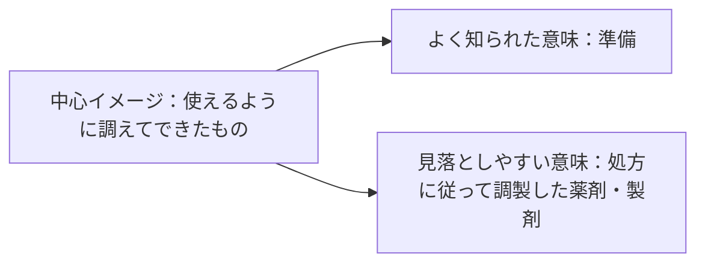

<small>出典候補 ID：`ev-02528-noun-01` ／ 元データ index：2528</small>

---

### 1607. prize

**品詞：** 動詞　　**発音（目安）：** プライズ

<small>よく知られている意味：賞・賞品（名詞）</small>

#### 見落としやすい意味

**大切にする、高く評価する**

**例文**
The museum prizes its collection of ancient maps.

**和訳**
その博物館は古地図のコレクションを大切にしている。

**コアイメージの説明**
prize は価値の高いものを賞として認める感覚と結びつく。動詞では、何かに高い価値を置き、非常に大切にすることを表す。

**図：意味のつながり**

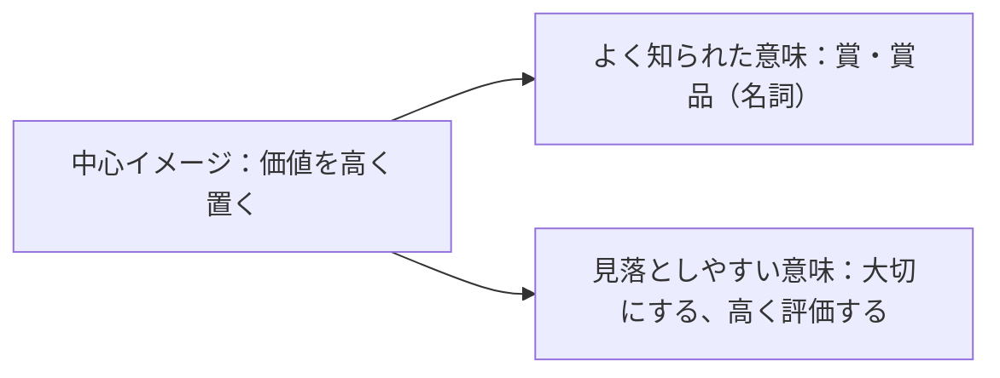

**重要語法**

- prize A highly：Aを高く評価する

<small>出典候補 ID：`ev-02531-verb-01` ／ 元データ index：2531</small>

---

### 1608. corrupt

**品詞：** 動詞　　**発音（目安）：** コラプト

<small>よく知られている意味：堕落させる・腐敗させる</small>

#### 見落としやすい意味

**原文や元データを改変する**

**例文**
Careless editing corrupted the original passage.

**和訳**
不用意な編集によって原文の一節が損なわれた。

**コアイメージの説明**
corrupt は本来あるべき状態を傷つけることを表す。人の倫理だけでなく、文章やデータの正しさが失われる場合にも使う。

**図：意味のつながり**

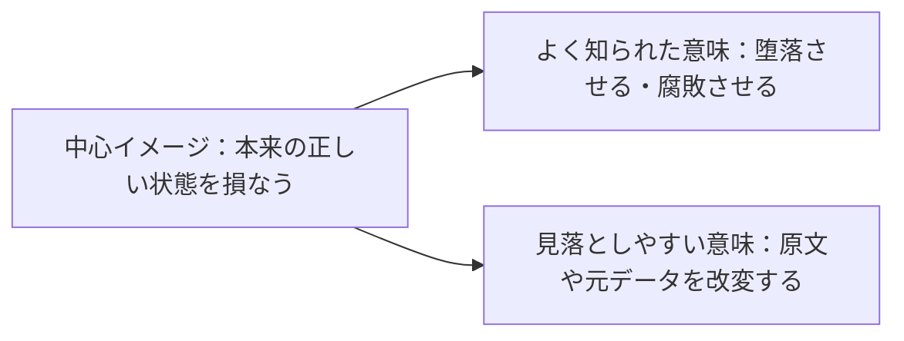

**重要語法**

- corrupted data：破損したデータ

<small>出典候補 ID：`ev-02532-verb-01` ／ 元データ index：2532</small>

---

### 1609. sail

**品詞：** 動詞　　**発音（目安）：** セイル

<small>よく知られている意味：帆走する</small>

#### 見落としやすい意味

**滑るように進む**

**例文**
The skater sailed across the ice.

**和訳**
スケーターは氷の上を滑るように進んだ。

**コアイメージの説明**
sail には帆船が滑らかに進むイメージがある。船でなくても、抵抗を感じさせずすっと移動する様子を表せる。

**図：意味のつながり**

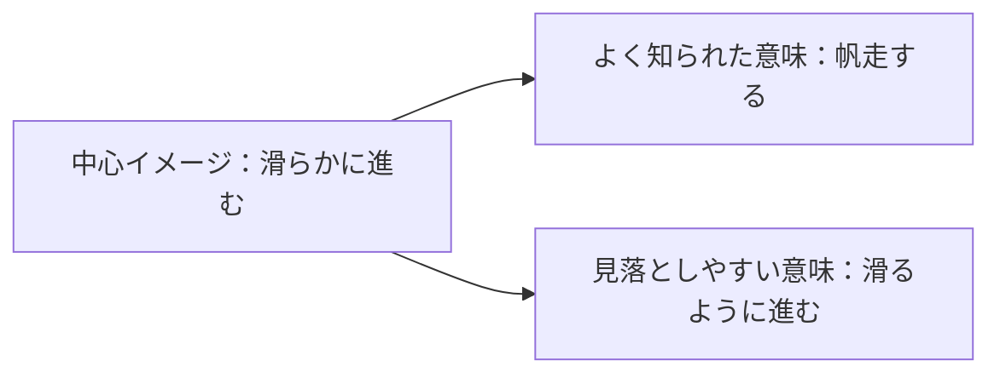

<small>出典候補 ID：`ev-02533-verb-01` ／ 元データ index：2533</small>

---

### 1610. merit

**品詞：** 動詞　　**発音（目安）：** メリット

<small>よく知られている意味：長所・価値（名詞）</small>

#### 見落としやすい意味

**評価や待遇などに値する**

**例文**
Her proposal merits serious consideration.

**和訳**
彼女の提案は真剣に検討するに値する。

**コアイメージの説明**
merit は評価できる価値を表す。動詞になると、その価値があるため一定の扱いや評価にふさわしいという意味になる。

**図：意味のつながり**

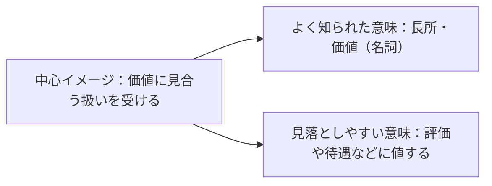

**重要語法**

- merit attention：注目に値する

<small>出典候補 ID：`ev-02534-verb-01` ／ 元データ index：2534</small>

---

### 1611. alarm

**品詞：** 動詞　　**発音（目安）：** アラーム

<small>よく知られている意味：警報・警報器</small>

#### 見落としやすい意味

**人に不安や危機感を抱かせる**

**例文**
The sudden silence alarmed the parents.

**和訳**
突然の静けさが両親を不安にさせた。

**コアイメージの説明**
alarm は危険の知らせを受けて身構える感覚を表す。動詞では、人に不安や警戒心を起こさせる。

**図：意味のつながり**

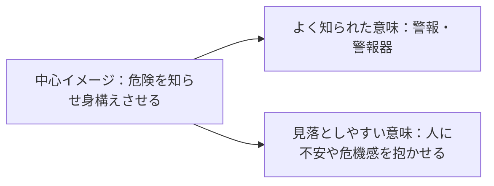

<small>出典候補 ID：`ev-02538-verb-01` ／ 元データ index：2538</small>

---

### 1612. web

**品詞：** 名詞　　**発音（目安）：** ウェブ

<small>よく知られている意味：クモの巣・ウェブ</small>

#### 見落としやすい意味

**人や物事の相互に結びついた関係網**

**例文**
The report describes a web of financial ties.

**和訳**
その報告書は複雑に結びついた金銭関係の網を描いている。

**コアイメージの説明**
web は糸が多方向につながった網のことだ。その形から、人や組織の複雑なつながりを表す比喩にもなる。

**図：意味のつながり**

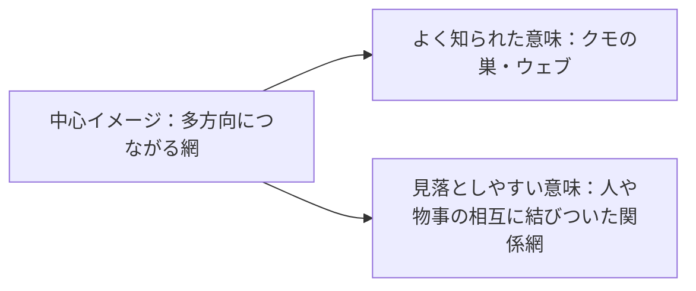

**重要語法**

- a web of relationships：複雑な人間関係の網

<small>出典候補 ID：`ev-02541-noun-01` ／ 元データ index：2541</small>

---

### 1613. collective

**品詞：** 名詞　　**発音（目安）：** コレクティブ

<small>よく知られている意味：集団の・共同の（形容詞）</small>

#### 見落としやすい意味

**共同で運営する団体、共同事業体**

**例文**
The artists formed a collective to share studio space.

**和訳**
芸術家たちは制作場所を共同利用する団体を作った。

**コアイメージの説明**
collective は個々の人が一つに集まるという感覚を持つ。名詞では、共同で活動や事業を進める集団そのものを指す。

**図：意味のつながり**

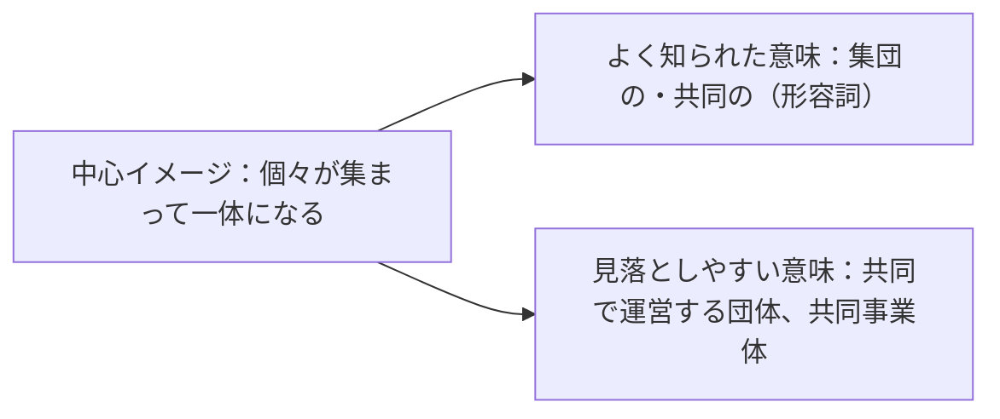

<small>出典候補 ID：`ev-02542-noun-01` ／ 元データ index：2542</small>

---

### 1614. height

**品詞：** 名詞　　**発音（目安）：** ハイト

<small>よく知られている意味：高さ・身長</small>

#### 見落としやすい意味

**最高点、最盛期**

**例文**
The festival was at its height in August.

**和訳**
祭りは8月に最盛期を迎えた。

**コアイメージの説明**
height は物理的な高さだけでなく、何かが最も高いところに達した状態にも使う。勢いや活動が頂点にある時期を表せる。

**図：意味のつながり**

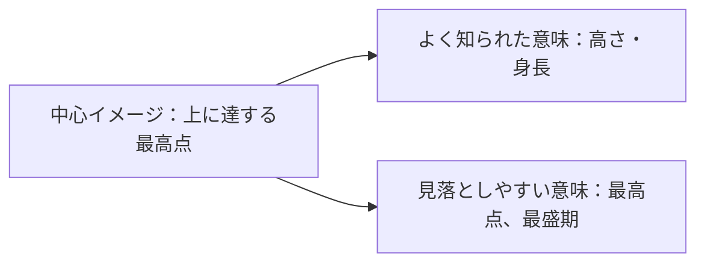

**重要語法**

- at its height：最盛期に

<small>出典候補 ID：`ev-02543-noun-01` ／ 元データ index：2543</small>

---

### 1615. dignity

**品詞：** 名詞　　**発音（目安）：** ディグニティ

<small>よく知られている意味：尊厳・品位</small>

#### 見落としやすい意味

**高い地位、位階**

**例文**
He was raised to the dignity of a bishop.

**和訳**
彼は司教の位に昇った。

**コアイメージの説明**
dignity は敬意に値する重みや品格を表す。格式ある文章では、その重みを持つ地位や位階そのものを指すことがある。

**図：意味のつながり**

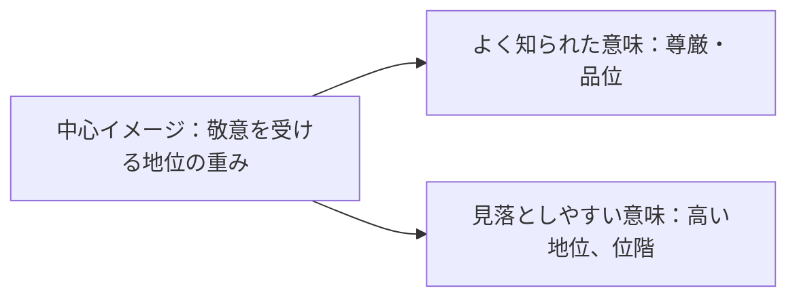

**重要語法**

- 格式ある文脈で用いる語義

<small>出典候補 ID：`ev-02544-noun-01` ／ 元データ index：2544</small>

---

### 1616. wing

**品詞：** 名詞　　**発音（目安）：** ウィング

<small>よく知られている意味：翼</small>

#### 見落としやすい意味

**政党・組織内の一派**

**例文**
The party's left wing opposed the proposal.

**和訳**
党内左派はその提案に反対した。

**コアイメージの説明**
wing は本体から左右に広がる部分を指す。組織の中で立場の異なる一群を、左右の翼に見立てて表す。

**図：意味のつながり**

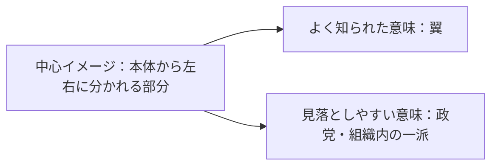

**重要語法**

- left wing / right wing：左派／右派

<small>出典候補 ID：`ev-02546-noun-01` ／ 元データ index：2546</small>

---

### 1617. feed

**品詞：** 動詞　　**発音（目安）：** フィード

<small>よく知られている意味：食べ物を与える</small>

#### 見落としやすい意味

**感情や欲望などを増長させる**

**例文**
Constant praise fed his arrogance.

**和訳**
絶え間ない称賛が彼の思い上がりを助長した。

**コアイメージの説明**
feed は何かに栄養を与えて大きくすることだ。感情や欲望について使うと、それをさらに強めるという意味になる。

**図：意味のつながり**

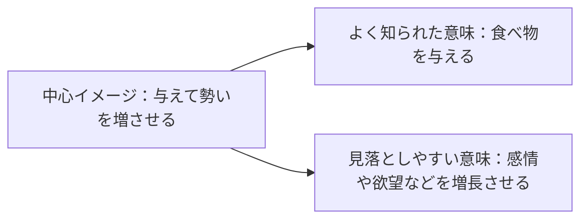

**重要語法**

- feed someone's fears：人の恐怖心をあおる

<small>出典候補 ID：`ev-02549-verb-01` ／ 元データ index：2549</small>

---

### 1618. plate

**品詞：** 名詞　　**発音（目安）：** プレイト

<small>よく知られている意味：皿・平たい板</small>

#### 見落としやすい意味

**書物などに載せる図版**

**例文**
The textbook includes a color plate of the painting.

**和訳**
その教科書には絵画のカラー図版が載っている。

**コアイメージの説明**
plate は平たい面を持つものを表す。印刷の版やその版で刷られた図から、書籍に載せる図版も指すようになった。

**図：意味のつながり**

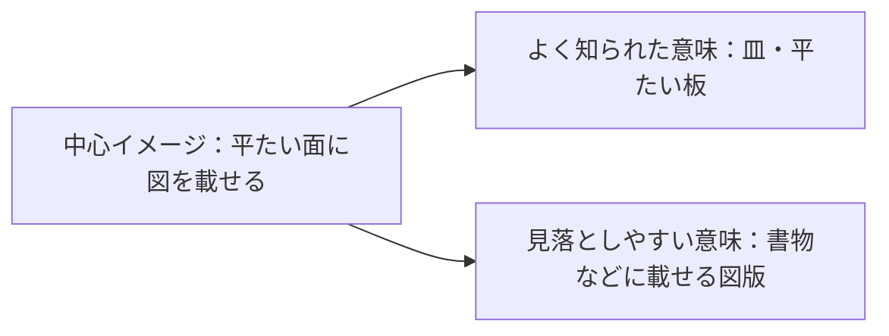

**重要語法**

- color plate：カラー図版

<small>出典候補 ID：`ev-02550-noun-01` ／ 元データ index：2550</small>

---

### 1619. philosophy

**品詞：** 名詞　　**発音（目安）：** フィロソフィー

<small>よく知られている意味：哲学</small>

#### 見落としやすい意味

**人生への基本的な考え方**

**例文**
Her philosophy is to listen before judging.

**和訳**
彼女の信条は、判断する前に話を聞くことだ。

**コアイメージの説明**
philosophy は世界や生き方をどう理解するかという根本的な考え方だ。学問としての哲学以外にも、個人の行動を支える信条を表す。

**図：意味のつながり**

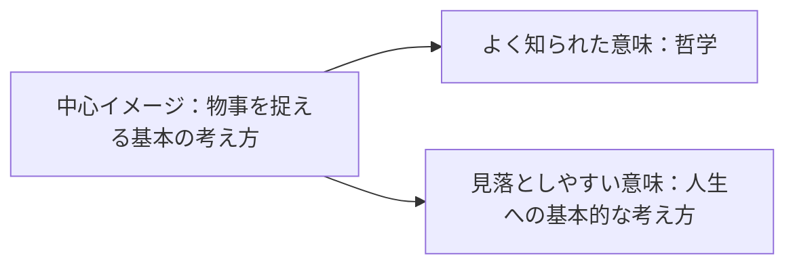

<small>出典候補 ID：`ev-02551-noun-01` ／ 元データ index：2551</small>

---

### 1620. rebel

**品詞：** 動詞　　**発音（目安）：** リベル

<small>よく知られている意味：反乱を起こす</small>

#### 見落としやすい意味

**慣習・従来のやり方に逆らう**

**例文**
Young designers rebelled against the old rules.

**和訳**
若いデザイナーたちは古い決まりに反発した。

**コアイメージの説明**
rebel は権威や決められた秩序に逆らうことを表す。政治的な反乱だけでなく、慣習や古い価値観への反発にも使う。

**図：意味のつながり**

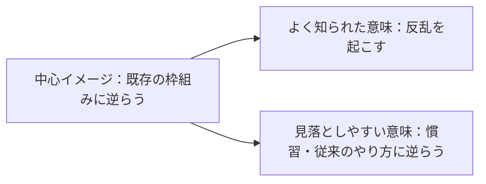

**重要語法**

- rebel against A：Aに反発する

<small>出典候補 ID：`ev-02553-verb-01` ／ 元データ index：2553</small>

---

### 1621. grace

**品詞：** 名詞　　**発音（目安）：** グレイス

<small>よく知られている意味：優雅さ・恩恵</small>

#### 見落としやすい意味

**期限を過ぎても罰則を免れる猶予期間**

**例文**
There is a ten-day grace period after the deadline.

**和訳**
期限の後に10日間の猶予期間が設けられている。

**コアイメージの説明**
grace には厳しい扱いを和らげる恩恵の意味がある。そこから、期限を過ぎても直ちに罰則を受けない猶予を表す。

**図：意味のつながり**

```mermaid
flowchart LR
    A["中心イメージ：厳しい条件を一時的に和らげる"]
    B["よく知られた意味：優雅さ・恩恵"]
    C["見落としやすい意味：期限を過ぎても罰則を免れる猶予期間"]
    A --> B
    A --> C
```

**重要語法**

- grace period：猶予期間

<small>出典候補 ID：`ev-02562-noun-01` ／ 元データ index：2562</small>

---

### 1622. grace

**品詞：** 動詞　　**発音（目安）：** グレイス

<small>よく知られている意味：優雅さ・恩恵（名詞）</small>

#### 見落としやすい意味

**（場や人を）美しく彩る、名誉を添える**

**例文**
A rare painting graces the entrance hall.

**和訳**
珍しい絵画が玄関ホールを美しく彩っている。

**コアイメージの説明**
grace の中心には美しさや品位がある。動詞では、場所を美しくしたり、人や場に光彩を添えたりすることを表す。

**図：意味のつながり**

```mermaid
flowchart LR
    A["中心イメージ：美しさや品位を添える"]
    B["よく知られた意味：優雅さ・恩恵（名詞）"]
    C["見落としやすい意味：（場や人を）美しく彩る、名誉を添える"]
    A --> B
    A --> C
```

**重要語法**

- grace a room：部屋を美しく飾る

<small>出典候補 ID：`ev-02562-verb-01` ／ 元データ index：2562</small>

---

### 1623. stable

**品詞：** 名詞　　**発音（目安）：** ステイブル

<small>よく知られている意味：安定した（形容詞）</small>

#### 見落としやすい意味

**馬小屋、家畜小屋**

**例文**
The horses returned to the stable before sunset.

**和訳**
馬たちは日没前に馬小屋へ戻った。

**コアイメージの説明**
stable は形容詞では動かず安定した状態を表す。名詞では馬などが落ち着いて過ごす小屋を指し、品詞と意味の切り替えに注意する。

**図：意味のつながり**

```mermaid
flowchart LR
    A["中心イメージ：落ち着いてとどまる場所"]
    B["よく知られた意味：安定した（形容詞）"]
    C["見落としやすい意味：馬小屋、家畜小屋"]
    A --> B
    A --> C
```

<small>出典候補 ID：`ev-02563-noun-01` ／ 元データ index：2563</small>

---

### 1624. rage

**品詞：** 名詞　　**発音（目安）：** レイジ

<small>よく知られている意味：激怒</small>

#### 見落としやすい意味

**大流行のもの**

**例文**
That puzzle game is all the rage at school.

**和訳**
そのパズルゲームは学校で大流行している。

**コアイメージの説明**
rage は強い感情や熱気を表す。人々の関心が一つのものに熱中する様子から、大流行という意味でも用いられる。

**図：意味のつながり**

```mermaid
flowchart LR
    A["中心イメージ：人々の熱気が集中する"]
    B["よく知られた意味：激怒"]
    C["見落としやすい意味：大流行のもの"]
    A --> B
    A --> C
```

**重要語法**

- all the rage：大流行している

<small>出典候補 ID：`ev-02564-noun-01` ／ 元データ index：2564</small>

---

### 1625. tune

**品詞：** 動詞　　**発音（目安）：** チューン

<small>よく知られている意味：曲・調子を合わせる</small>

#### 見落としやすい意味

**機械の動作を調整・最適化する**

**例文**
We tuned the software for faster performance.

**和訳**
私たちは動作を速くするためソフトウェアを調整した。

**コアイメージの説明**
tune は楽器の音を適切な状態に合わせることだ。機械やソフトウェアでも、性能がよくなるよう細部を調整する意味で使う。

**図：意味のつながり**

```mermaid
flowchart LR
    A["中心イメージ：最適な調子に合わせる"]
    B["よく知られた意味：曲・調子を合わせる"]
    C["見落としやすい意味：機械の動作を調整・最適化する"]
    A --> B
    A --> C
```

**重要語法**

- tune A for B：Bに向けてAを調整する

<small>出典候補 ID：`ev-02565-verb-01` ／ 元データ index：2565</small>

---

### 1626. consult

**品詞：** 動詞　　**発音（目安）：** コンサルト

<small>よく知られている意味：相談する</small>

#### 見落としやすい意味

**専門家として助言する**

**例文**
She consults for several small businesses.

**和訳**
彼女はいくつかの小規模企業に専門家として助言している。

**コアイメージの説明**
consult には知識を求めて専門家に相談する意味がある。逆に、専門家の側が助言を提供する活動も consult と表せる。

**図：意味のつながり**

```mermaid
flowchart LR
    A["中心イメージ：専門知識をやり取りする"]
    B["よく知られた意味：相談する"]
    C["見落としやすい意味：専門家として助言する"]
    A --> B
    A --> C
```

**重要語法**

- consult for a company：企業の顧問として助言する

<small>出典候補 ID：`ev-02569-verb-01` ／ 元データ index：2569</small>

---

### 1627. consult

**品詞：** 動詞　　**発音（目安）：** コンサルト

<small>よく知られている意味：相談する</small>

#### 見落としやすい意味

**辞書や文献などを参照する**

**例文**
Consult the manual before installing the device.

**和訳**
機器を設置する前に説明書を参照してください。

**コアイメージの説明**
consult は答えを求めて知識に当たる動作を表す。相手が人でなく辞書や資料なら、調べる・参照するという意味になる。

**図：意味のつながり**

```mermaid
flowchart LR
    A["中心イメージ：答えを求めて情報源に当たる"]
    B["よく知られた意味：相談する"]
    C["見落としやすい意味：辞書や文献などを参照する"]
    A --> B
    A --> C
```

**重要語法**

- consult a dictionary：辞書を引く

<small>出典候補 ID：`ev-02569-verb-02` ／ 元データ index：2569</small>

---

### 1628. convey

**品詞：** 動詞　　**発音（目安）：** コンベイ

<small>よく知られている意味：伝える・運ぶ</small>

#### 見落としやすい意味

**財産・権利を譲渡する**

**例文**
The deed conveys ownership of the land to the buyer.

**和訳**
その証書によって土地の所有権が買い手に譲渡される。

**コアイメージの説明**
convey は何かを一方から他方へ運ぶ感覚が中心だ。情報だけでなく、法律上の財産や権利を移す場合にも使う。

**図：意味のつながり**

```mermaid
flowchart LR
    A["中心イメージ：一方から他方へ移す"]
    B["よく知られた意味：伝える・運ぶ"]
    C["見落としやすい意味：財産・権利を譲渡する"]
    A --> B
    A --> C
```

**重要語法**

- convey ownership：所有権を譲渡する

<small>出典候補 ID：`ev-02570-verb-01` ／ 元データ index：2570</small>

---

### 1629. bet

**品詞：** 動詞　　**発音（目安）：** ベット

<small>よく知られている意味：賭ける</small>

#### 見落としやすい意味

**〜に違いないと確信する**

**例文**
I bet she's already at the station.

**和訳**
彼女はもう駅に着いているに違いない。

**コアイメージの説明**
bet は結果について自分の判断に賭けることを表す。日常会話では実際のお金の賭けを伴わず、強い確信を言う表現になる。

**図：意味のつながり**

```mermaid
flowchart LR
    A["中心イメージ：自分の予想に強く賭ける"]
    B["よく知られた意味：賭ける"]
    C["見落としやすい意味：〜に違いないと確信する"]
    A --> B
    A --> C
```

**重要語法**

- I bet (that) ...：きっと…だ

<small>出典候補 ID：`ev-02572-verb-01` ／ 元データ index：2572</small>

---

### 1630. oversight

**品詞：** 名詞　　**発音（目安）：** オウバーサイト

<small>よく知られている意味：監督・管理</small>

#### 見落としやすい意味

**不注意による見落とし・ミス**

**例文**
Leaving out the date was an oversight.

**和訳**
日付を書き忘れたのは、うっかりした見落としだった。

**コアイメージの説明**
oversight には『監督』と『見落とし』という異なる方向の意味がある。この文では注意が届かず何かを見逃したことを表す。

**図：意味のつながり**

```mermaid
flowchart LR
    A["中心イメージ：注意が届く／届かないという視点"]
    B["よく知られた意味：監督・管理"]
    C["見落としやすい意味：不注意による見落とし・ミス"]
    A --> B
    A --> C
```

**重要語法**

- an oversight：うっかりミス

<small>出典候補 ID：`ev-02574-noun-01` ／ 元データ index：2574</small>

---

### 1631. oversight

**品詞：** 名詞　　**発音（目安）：** オウバーサイト

<small>よく知られている意味：見落とし・ミス</small>

#### 見落としやすい意味

**業務などの監督・管理**

**例文**
The committee provides oversight of public spending.

**和訳**
その委員会は公金の支出を監督している。

**コアイメージの説明**
oversight は上から見守り、全体に目を配る意味でも使う。こちらはミスではなく、業務が正しく進むかを監督する働きを指す。

**図：意味のつながり**

```mermaid
flowchart LR
    A["中心イメージ：上から見渡して管理する"]
    B["よく知られた意味：見落とし・ミス"]
    C["見落としやすい意味：業務などの監督・管理"]
    A --> B
    A --> C
```

**重要語法**

- regulatory oversight：規制上の監督

<small>出典候補 ID：`ev-02574-noun-02` ／ 元データ index：2574</small>

---

### 1632. prompt

**品詞：** 形容詞　　**発音（目安）：** プロンプト

<small>よく知られている意味：促す（動詞）</small>

#### 見落としやすい意味

**遅れのない、迅速な**

**例文**
Thank you for your prompt reply.

**和訳**
迅速なご返信をありがとうございます。

**コアイメージの説明**
prompt の形容詞用法は、ためらったり遅れたりせず動くことを表す。返事や対応などが速いという意味になる。

**図：意味のつながり**

```mermaid
flowchart LR
    A["中心イメージ：遅れずすぐに動く"]
    B["よく知られた意味：促す（動詞）"]
    C["見落としやすい意味：遅れのない、迅速な"]
    A --> B
    A --> C
```

**重要語法**

- prompt response：迅速な対応

<small>出典候補 ID：`ev-02575-adjective-01` ／ 元データ index：2575</small>

---

### 1633. prompt

**品詞：** 副詞　　**発音（目安）：** プロンプト

<small>よく知られている意味：促す・指示（動詞・名詞）</small>

#### 見落としやすい意味

**時刻の直後に置いて「ちょうど定刻に」**

**例文**
The meeting starts at nine prompt.

**和訳**
会議は9時ちょうどに始まる。

**コアイメージの説明**
prompt は遅れずに始めるという感覚を持つ。時刻の直後に置かれると、定刻きっかりであることを強調する。

**図：意味のつながり**

```mermaid
flowchart LR
    A["中心イメージ：定刻に遅れない"]
    B["よく知られた意味：促す・指示（動詞・名詞）"]
    C["見落としやすい意味：時刻の直後に置いて「ちょうど定刻に」"]
    A --> B
    A --> C
```

**重要語法**

- nine prompt：9時ちょうど（主にイギリス英語）

<small>出典候補 ID：`ev-02575-adverb-01` ／ 元データ index：2575</small>

---

### 1634. prompt

**品詞：** 名詞　　**発音（目安）：** プロンプト

<small>よく知られている意味：促す（動詞）</small>

#### 見落としやすい意味

**発言や行動のきっかけとなる合図、促し**

**例文**
The actor missed a prompt and stayed silent.

**和訳**
その俳優はせりふの合図を逃して黙ったままだった。

**コアイメージの説明**
prompt は次に何かを言ったり行ったりするきっかけだ。演劇などでは、せりふや行動を促す合図を指すことがある。

**図：意味のつながり**

```mermaid
flowchart LR
    A["中心イメージ：次の反応を引き出す合図"]
    B["よく知られた意味：促す（動詞）"]
    C["見落としやすい意味：発言や行動のきっかけとなる合図、促し"]
    A --> B
    A --> C
```

<small>出典候補 ID：`ev-02575-noun-01` ／ 元データ index：2575</small>

---

### 1635. prompt

**品詞：** 名詞　　**発音（目安）：** プロンプト

<small>よく知られている意味：促す・合図</small>

#### 見落としやすい意味

**AIに与える自然言語の指示文**

**例文**
The AI gave a clearer answer after I revised the prompt.

**和訳**
指示文を書き直すと、AIはより明確な回答を返した。

**コアイメージの説明**
prompt は相手から反応を引き出すために与える言葉を表す。AIでは、モデルに入力する質問や指示文のことを指す。

**図：意味のつながり**

```mermaid
flowchart LR
    A["中心イメージ：反応を引き出す指示"]
    B["よく知られた意味：促す・合図"]
    C["見落としやすい意味：AIに与える自然言語の指示文"]
    A --> B
    A --> C
```

**重要語法**

- write a prompt：AIへの指示文を書く

<small>出典候補 ID：`ev-02575-noun-02` ／ 元データ index：2575</small>

---

### 1636. prompt

**品詞：** 動詞　　**発音（目安）：** プロンプト

<small>よく知られている意味：AIへの指示文（名詞）</small>

#### 見落としやすい意味

**ある行動を引き起こす、促す**

**例文**
The smell prompted a childhood memory.

**和訳**
そのにおいで子どものころの記憶がよみがえった。

**コアイメージの説明**
prompt は何かのきっかけを作り、反応を生むことを表す。人の記憶や感情、行動を引き起こす場合にも使える。

**図：意味のつながり**

```mermaid
flowchart LR
    A["中心イメージ：きっかけから反応が生まれる"]
    B["よく知られた意味：AIへの指示文（名詞）"]
    C["見落としやすい意味：ある行動を引き起こす、促す"]
    A --> B
    A --> C
```

**重要語法**

- prompt A to do：Aが…するきっかけとなる

<small>出典候補 ID：`ev-02575-verb-01` ／ 元データ index：2575</small>

---

### 1637. prompt

**品詞：** 動詞　　**発音（目安）：** プロンプト

<small>よく知られている意味：促す・引き起こす</small>

#### 見落としやすい意味

**AIに自然言語で指示を与える**

**例文**
Students prompted the AI to explain the chart.

**和訳**
生徒たちはAIにその図表を説明するよう指示した。

**コアイメージの説明**
prompt の動詞には、入力を与えて望む応答を引き出すという使い方がある。AIへの具体的な自然言語の指示にも使われる。

**図：意味のつながり**

```mermaid
flowchart LR
    A["中心イメージ：言葉で反応を引き出す"]
    B["よく知られた意味：促す・引き起こす"]
    C["見落としやすい意味：AIに自然言語で指示を与える"]
    A --> B
    A --> C
```

**重要語法**

- prompt an AI to do：AIに…するよう指示する

<small>出典候補 ID：`ev-02575-verb-02` ／ 元データ index：2575</small>

---

### 1638. inch

**品詞：** 動詞　　**発音（目安）：** インチ

<small>よく知られている意味：インチ（長さの単位）</small>

#### 見落としやすい意味

**少しずつ進む**

**例文**
Traffic inched forward after the accident.

**和訳**
事故の後、車の列は少しずつ前に進んだ。

**コアイメージの説明**
inch はごく短い距離の単位だ。動詞では、その小さな距離だけじりじり動くことを表す。

**図：意味のつながり**

```mermaid
flowchart LR
    A["中心イメージ：わずかな距離ずつ動く"]
    B["よく知られた意味：インチ（長さの単位）"]
    C["見落としやすい意味：少しずつ進む"]
    A --> B
    A --> C
```

**重要語法**

- inch forward：少しずつ前進する

<small>出典候補 ID：`ev-02578-verb-01` ／ 元データ index：2578</small>

---

### 1639. portrait

**品詞：** 名詞　　**発音（目安）：** ポートレイト

<small>よく知られている意味：肖像画・写真</small>

#### 見落としやすい意味

**人物の外見・性格を文章で描いた描写**

**例文**
The article paints a warm portrait of the poet.

**和訳**
その記事は、その詩人の人物像を温かく描いている。

**コアイメージの説明**
portrait は人物の姿や特徴を捉えた表現だ。筆で描く絵だけでなく、文章による性格や生き方の描写にも使う。

**図：意味のつながり**

```mermaid
flowchart LR
    A["中心イメージ：人物の特徴を描き出す"]
    B["よく知られた意味：肖像画・写真"]
    C["見落としやすい意味：人物の外見・性格を文章で描いた描写"]
    A --> B
    A --> C
```

**重要語法**

- a portrait of A：Aの人物像・描写

<small>出典候補 ID：`ev-02579-noun-01` ／ 元データ index：2579</small>

---

### 1640. substitute

**品詞：** 形容詞　　**発音（目安）：** サブスティチュート

<small>よく知られている意味：代わりの（形容詞）</small>

#### 見落としやすい意味

**質が劣る人工的な代用品の**

**例文**
During the shortage, they drank a substitute coffee made from roasted grains.

**和訳**
品不足の間、彼らは炒った穀物で作った代用コーヒーを飲んだ。

**コアイメージの説明**
substitute は本来のものの代わりに用意されたものを表す。人工的な代用品を指す文脈では本物に比べた物足りなさが含まれることもあるが、必ず低品質という意味ではない。

**図：意味のつながり**

```mermaid
flowchart LR
    A["中心イメージ：本物の代わりに作ったもの"]
    B["よく知られた意味：代わりの（形容詞）"]
    C["見落としやすい意味：質が劣る人工的な代用品の"]
    A --> B
    A --> C
```

**重要語法**

- substitute coffee：代用コーヒー

<small>出典候補 ID：`ev-02580-adjective-01` ／ 元データ index：2580</small>

---

### 1641. substitute

**品詞：** 形容詞　　**発音（目安）：** サブスティチュート

<small>よく知られている意味：代用品・代わりにする</small>

#### 見落としやすい意味

**代わりのものとして用いる**

**例文**
The substitute teacher arrived early.

**和訳**
代理の先生は早めに到着した。

**コアイメージの説明**
substitute は本来の人やものが担う役割を別のものが引き受けることだ。形容詞では、代わりとして使われる人や物を修飾する。

**図：意味のつながり**

```mermaid
flowchart LR
    A["中心イメージ：本来の役割の穴を埋める"]
    B["よく知られた意味：代用品・代わりにする"]
    C["見落としやすい意味：代わりのものとして用いる"]
    A --> B
    A --> C
```

**重要語法**

- substitute teacher：代理教員

<small>出典候補 ID：`ev-02580-adjective-02` ／ 元データ index：2580</small>

---

### 1642. thread

**品詞：** 動詞　　**発音（目安）：** スレッド

<small>よく知られている意味：糸</small>

#### 見落としやすい意味

**曲がりくねった道を進む**

**例文**
We threaded our way through the narrow streets.

**和訳**
私たちは細い通りを縫うように進んだ。

**コアイメージの説明**
thread は細い糸を狭いところに通す感覚が中心だ。そこから、人や物の間を巧みにすり抜けて進む動作を表す。

**図：意味のつながり**

```mermaid
flowchart LR
    A["中心イメージ：細い隙間を通り抜ける"]
    B["よく知られた意味：糸"]
    C["見落としやすい意味：曲がりくねった道を進む"]
    A --> B
    A --> C
```

**重要語法**

- thread one's way through：…を縫うように進む

<small>出典候補 ID：`ev-02581-verb-01` ／ 元データ index：2581</small>

---

### 1643. broadcast

**品詞：** 動詞　　**発音（目安）：** ブロードキャスト

<small>よく知られている意味：放送する</small>

#### 見落としやすい意味

**種子を広い範囲にまく**

**例文**
Farmers broadcast seed across the field.

**和訳**
農家の人々は畑一面に種をまいた。

**コアイメージの説明**
broadcast の中心には広い範囲へばらまく動きがある。情報を広く届ける放送だけでなく、種を一面にまく農業用語としても使う。

**図：意味のつながり**

```mermaid
flowchart LR
    A["中心イメージ：広い範囲に散らして届ける"]
    B["よく知られた意味：放送する"]
    C["見落としやすい意味：種子を広い範囲にまく"]
    A --> B
    A --> C
```

**重要語法**

- broadcast seed：種をばらまく

<small>出典候補 ID：`ev-02582-verb-01` ／ 元データ index：2582</small>

---

### 1644. click

**品詞：** 動詞　　**発音（目安）：** クリック

<small>よく知られている意味：クリックする</small>

#### 見落としやすい意味

**突然腑に落ちる、理解できる**

**例文**
Then it clicked: I had read the map backward.

**和訳**
そのとき、地図を逆向きに読んでいたのだとはっと気づいた。

**コアイメージの説明**
click はカチッとはまる音を表す。分からなかったことが突然つながり、頭の中で理解が成立する感覚を示す。

**図：意味のつながり**

```mermaid
flowchart LR
    A["中心イメージ：カチッとつながる瞬間"]
    B["よく知られた意味：クリックする"]
    C["見落としやすい意味：突然腑に落ちる、理解できる"]
    A --> B
    A --> C
```

**重要語法**

- It clicked.：腑に落ちた

<small>出典候補 ID：`ev-02583-verb-01` ／ 元データ index：2583</small>

---

### 1645. coach

**品詞：** 名詞　　**発音（目安）：** コウチ

<small>よく知られている意味：指導者・コーチ</small>

#### 見落としやすい意味

**乗合バス、長距離バス**

**例文**
We traveled to the village by coach.

**和訳**
私たちは長距離バスでその村へ向かった。

**コアイメージの説明**
coach には人を運ぶ乗り物という名詞の用法がある。人を指導する『コーチ』だけを思い浮かべず、交通手段の話かどうかで判断する。

**図：意味のつながり**

```mermaid
flowchart LR
    A["中心イメージ：人を目的地まで運ぶ"]
    B["よく知られた意味：指導者・コーチ"]
    C["見落としやすい意味：乗合バス、長距離バス"]
    A --> B
    A --> C
```

**重要語法**

- by coach：長距離バスで

<small>出典候補 ID：`ev-02585-noun-01` ／ 元データ index：2585</small>

---

### 1646. dear

**品詞：** 副詞　　**発音（目安）：** ディア

<small>よく知られている意味：親愛なる・大切な</small>

#### 見落としやすい意味

**高い代償を払って**

**例文**
The town paid dear for delaying the repairs.

**和訳**
その町は修理を先延ばしにしたことで大きな代償を払った。

**コアイメージの説明**
dear には単に愛しいだけでなく、価値や負担が高いという感覚もある。副詞としては、特に代償が大きいことを示す慣用表現に現れる。

**図：意味のつながり**

```mermaid
flowchart LR
    A["中心イメージ：負担・代価が高い"]
    B["よく知られた意味：親愛なる・大切な"]
    C["見落としやすい意味：高い代償を払って"]
    A --> B
    A --> C
```

**重要語法**

- pay dear for A：Aのために高い代償を払う

<small>出典候補 ID：`ev-02586-adverb-01` ／ 元データ index：2586</small>

---

### 1647. triumph

**品詞：** 動詞　　**発音（目安）：** トライアンフ

<small>よく知られている意味：勝利・大成功（名詞）</small>

#### 見落としやすい意味

**優位に立つ、勝利する**

**例文**
In the end, patience triumphed over fear.

**和訳**
最後には忍耐が恐れに打ち勝った。

**コアイメージの説明**
triumph は競い合うものの中で勝利を収める感覚を表す。人の勝利だけでなく、考え方や感情が優勢になる場合にも使う。

**図：意味のつながり**

```mermaid
flowchart LR
    A["中心イメージ：争いを経て勝る"]
    B["よく知られた意味：勝利・大成功（名詞）"]
    C["見落としやすい意味：優位に立つ、勝利する"]
    A --> B
    A --> C
```

**重要語法**

- triumph over A：Aに打ち勝つ

<small>出典候補 ID：`ev-02589-verb-01` ／ 元データ index：2589</small>

---

### 1648. journal

**品詞：** 名詞　　**発音（目安）：** ジャーナル

<small>よく知られている意味：日記・雑誌</small>

#### 見落としやすい意味

**取引を日付順に記録する仕訳帳**

**例文**
The accountant entered the purchase in the journal.

**和訳**
会計担当者はその購入を仕訳帳に記入した。

**コアイメージの説明**
journal は日々の出来事を日付に沿って記録するものだ。会計では、取引を発生順に記す帳簿を指す。

**図：意味のつながり**

```mermaid
flowchart LR
    A["中心イメージ：日付順に記録する帳面"]
    B["よく知られた意味：日記・雑誌"]
    C["見落としやすい意味：取引を日付順に記録する仕訳帳"]
    A --> B
    A --> C
```

**重要語法**

- accounting journal：会計の仕訳帳

<small>出典候補 ID：`ev-02590-noun-01` ／ 元データ index：2590</small>

---

### 1649. extract

**品詞：** 名詞　　**発音（目安）：** エクストラクト

<small>よく知られている意味：抽出物・エキス</small>

#### 見落としやすい意味

**書籍や文書の抜粋、引用部分**

**例文**
The teacher gave us an extract from the novel.

**和訳**
先生はその小説の抜粋を配った。

**コアイメージの説明**
extract は全体から一部分を取り出したものを指す。液体の抽出物だけでなく、文章から選んで抜き出した箇所も表す。

**図：意味のつながり**

```mermaid
flowchart LR
    A["中心イメージ：全体から一部を取り出す"]
    B["よく知られた意味：抽出物・エキス"]
    C["見落としやすい意味：書籍や文書の抜粋、引用部分"]
    A --> B
    A --> C
```

**重要語法**

- an extract from a novel：小説の抜粋

<small>出典候補 ID：`ev-02591-noun-01` ／ 元データ index：2591</small>

---

### 1650. extract

**品詞：** 動詞　　**発音（目安）：** イクストラクト

<small>よく知られている意味：取り出す・抽出する</small>

#### 見落としやすい意味

**情報・原理・結論を導き出す**

**例文**
We extracted the key idea from the survey results.

**和訳**
私たちは調査結果から中心となる考えを導き出した。

**コアイメージの説明**
extract はまとまりの中から必要なものを引き出すことを表す。物質だけでなく、データから情報や結論を取り出す場合にも使う。

**図：意味のつながり**

```mermaid
flowchart LR
    A["中心イメージ：中から必要なものを引き出す"]
    B["よく知られた意味：取り出す・抽出する"]
    C["見落としやすい意味：情報・原理・結論を導き出す"]
    A --> B
    A --> C
```

**重要語法**

- extract A from B：BからAを取り出す

<small>出典候補 ID：`ev-02591-verb-01` ／ 元データ index：2591</small>

---

### 1651. transcript

**品詞：** 名詞　　**発音（目安）：** トランスクリプト

<small>よく知られている意味：文字起こし・書き起こし</small>

#### 見落としやすい意味

**学校の成績などの公式な記録写し**

**例文**
The university asked for an official transcript of my grades.

**和訳**
大学は私の正式な成績証明書を求めた。

**コアイメージの説明**
transcript は内容を文書として正式に書き写した記録を表す。会話の文字起こしだけでなく、学校の成績の公式な記録にも使う。

**図：意味のつながり**

```mermaid
flowchart LR
    A["中心イメージ：情報を書き写した正式な記録"]
    B["よく知られた意味：文字起こし・書き起こし"]
    C["見落としやすい意味：学校の成績などの公式な記録写し"]
    A --> B
    A --> C
```

**重要語法**

- academic transcript：成績証明書

<small>出典候補 ID：`ev-02594-noun-01` ／ 元データ index：2594</small>

---

### 1652. leg

**品詞：** 名詞　　**発音（目安）：** レッグ

<small>よく知られている意味：脚</small>

#### 見落としやすい意味

**旅程・行程の一区間**

**例文**
The final leg of the journey took two hours.

**和訳**
旅の最後の区間には2時間かかった。

**コアイメージの説明**
leg は体を支えて移動する脚だ。旅行や競技の道のりを区切った一部分も、移動を構成する一区間として leg と呼ぶ。

**図：意味のつながり**

```mermaid
flowchart LR
    A["中心イメージ：移動を構成する一区間"]
    B["よく知られた意味：脚"]
    C["見落としやすい意味：旅程・行程の一区間"]
    A --> B
    A --> C
```

**重要語法**

- the first leg of a trip：旅の最初の区間

<small>出典候補 ID：`ev-02595-noun-01` ／ 元データ index：2595</small>

---

### 1653. handsome

**品詞：** 形容詞　　**発音（目安）：** ハンサム

<small>よく知られている意味：顔立ちのよい・立派な</small>

#### 見落としやすい意味

**金額などが気前よい、かなりの**

**例文**
She received a handsome reward for her work.

**和訳**
彼女は仕事に対してかなりの額の報酬を受け取った。

**コアイメージの説明**
handsome は見た目が立派で十分に整っていることを表す。金額に使うと、見劣りしないほど十分な大きさを示す。

**図：意味のつながり**

```mermaid
flowchart LR
    A["中心イメージ：十分に立派で見劣りしない"]
    B["よく知られた意味：顔立ちのよい・立派な"]
    C["見落としやすい意味：金額などが気前よい、かなりの"]
    A --> B
    A --> C
```

**重要語法**

- a handsome sum：かなりの金額

<small>出典候補 ID：`ev-02597-adjective-01` ／ 元データ index：2597</small>

---

### 1654. disagree

**品詞：** 動詞　　**発音（目安）：** ディサグリー

<small>よく知られている意味：意見が合わない</small>

#### 見落としやすい意味

**意見ではなく物事の性質・状態が食い違う**

**例文**
The two reports disagree on the number of visitors.

**和訳**
二つの報告書では来場者数が食い違っている。

**コアイメージの説明**
disagree は二つ以上のものが一致しないことを表す。人同士の意見だけでなく、数値や記述が互いに合わない場合にも使う。

**図：意味のつながり**

```mermaid
flowchart LR
    A["中心イメージ：二つのものが一致しない"]
    B["よく知られた意味：意見が合わない"]
    C["見落としやすい意味：意見ではなく物事の性質・状態が食い違う"]
    A --> B
    A --> C
```

**重要語法**

- disagree on the figures：数字が食い違う

<small>出典候補 ID：`ev-02598-verb-01` ／ 元データ index：2598</small>

---

### 1655. charity

**品詞：** 名詞　　**発音（目安）：** チャリティー

<small>よく知られている意味：慈善活動・寄付</small>

#### 見落としやすい意味

**他人への寛容・好意**

**例文**
Try to show a little charity toward his mistakes.

**和訳**
彼の失敗にも少し寛容な態度を示してほしい。

**コアイメージの説明**
charity は人に対する思いやりや善意が中心だ。寄付活動だけでなく、相手の欠点を大目に見る寛容さにも使う。

**図：意味のつながり**

```mermaid
flowchart LR
    A["中心イメージ：相手を思いやって受け止める"]
    B["よく知られた意味：慈善活動・寄付"]
    C["見落としやすい意味：他人への寛容・好意"]
    A --> B
    A --> C
```

**重要語法**

- show charity toward A：Aに寛容に接する

<small>出典候補 ID：`ev-02599-noun-01` ／ 元データ index：2599</small>

---

### 1656. residence

**品詞：** 名詞　　**発音（目安）：** レジデンス

<small>よく知られている意味：住居・居住</small>

#### 見落としやすい意味

**要人の公邸**

**例文**
The ambassador welcomed guests to the official residence.

**和訳**
大使は公邸に客を迎えた。

**コアイメージの説明**
residence は人が住む場所を表す。公的な役職に伴って用意された住居にも使い、その場合は『公邸』と訳す。

**図：意味のつながり**

```mermaid
flowchart LR
    A["中心イメージ：人が居住する場所"]
    B["よく知られた意味：住居・居住"]
    C["見落としやすい意味：要人の公邸"]
    A --> B
    A --> C
```

**重要語法**

- official residence：公邸

<small>出典候補 ID：`ev-02600-noun-01` ／ 元データ index：2600</small>

---

### 1657. prohibit

**品詞：** 動詞　　**発音（目安）：** プロヒビット

<small>よく知られている意味：禁止する</small>

#### 見落としやすい意味

**prohibit A from doing：Aが〜することを禁止する**

**例文**
The rules prohibit visitors from taking photographs.

**和訳**
規則は来訪者が写真を撮ることを禁止している。

**コアイメージの説明**
prohibit はある行動をしてはならないと制限することを表す。誰が何をするのを禁止されるかは、A from -ing の形で明確に言える。

**図：意味のつながり**

```mermaid
flowchart LR
    A["中心イメージ：行動への道をふさぐ"]
    B["よく知られた意味：禁止する"]
    C["見落としやすい意味：prohibit A from doing：Aが〜することを禁止する"]
    A --> B
    A --> C
```

**重要語法**

- prohibit A from doing：Aが…することを禁止する

<small>出典候補 ID：`ev-02602-verb-01` ／ 元データ index：2602</small>

---

### 1658. reviewer

**品詞：** 名詞　　**発音（目安）：** リビューアー

<small>よく知られている意味：レビューを書く人</small>

#### 見落としやすい意味

**投稿論文などを審査する人**

**例文**
Two reviewers evaluated the paper before publication.

**和訳**
出版前に二人の査読者がその論文を審査した。

**コアイメージの説明**
reviewer は内容を注意深く検討し評価する人を指す。商品のレビューだけでなく、学術論文を専門的に審査する人にも使う。

**図：意味のつながり**

```mermaid
flowchart LR
    A["中心イメージ：内容を吟味して評価する人"]
    B["よく知られた意味：レビューを書く人"]
    C["見落としやすい意味：投稿論文などを審査する人"]
    A --> B
    A --> C
```

**重要語法**

- peer reviewer：学術論文の査読者

<small>出典候補 ID：`ev-02603-noun-01` ／ 元データ index：2603</small>

---

### 1659. string

**品詞：** 名詞　　**発音（目安）：** ストリング

<small>よく知られている意味：ひも・糸</small>

#### 見落としやすい意味

**一連の事柄や出来事**

**例文**
The city faced a string of power outages.

**和訳**
その市では停電が相次いだ。

**コアイメージの説明**
string はものを一つにつなぐひもだ。そこから、出来事が次々と連なるまとまりを表す。

**図：意味のつながり**

```mermaid
flowchart LR
    A["中心イメージ：一つにつながって並ぶもの"]
    B["よく知られた意味：ひも・糸"]
    C["見落としやすい意味：一連の事柄や出来事"]
    A --> B
    A --> C
```

**重要語法**

- a string of accidents：相次ぐ事故

<small>出典候補 ID：`ev-02604-noun-01` ／ 元データ index：2604</small>

---

### 1660. tall

**品詞：** 形容詞　　**発音（目安）：** トール

<small>よく知られている意味：背の高い</small>

#### 見落としやすい意味

**（話などが）信じ難い、大げさな（tall tale）**

**例文**
He told us a tall tale about finding treasure.

**和訳**
彼は宝を見つけたという大げさな話をした。

**コアイメージの説明**
tall は物理的に高く伸びる様子を表す。話について使うと、事実より大きく膨らませた、信じ難い内容を示す。

**図：意味のつながり**

```mermaid
flowchart LR
    A["中心イメージ：実際より大きく引き伸ばす"]
    B["よく知られた意味：背の高い"]
    C["見落としやすい意味：（話などが）信じ難い、大げさな（tall tale）"]
    A --> B
    A --> C
```

**重要語法**

- tall tale：大げさで信じ難い話

<small>出典候補 ID：`ev-02605-adjective-01` ／ 元データ index：2605</small>

---

### 1661. bath

**品詞：** 名詞　　**発音（目安）：** バス

<small>よく知られている意味：入浴・浴槽</small>

#### 見落としやすい意味

**物を液体に浸して処理する槽・液体**

**例文**
The metal part was dipped into a chemical bath.

**和訳**
その金属部品は薬液槽に浸された。

**コアイメージの説明**
bath の中心は液体に浸す場所や行為だ。人が入る風呂だけでなく、部品や試料を処理する液体や槽も指す。

**図：意味のつながり**

```mermaid
flowchart LR
    A["中心イメージ：液体に浸して処理する"]
    B["よく知られた意味：入浴・浴槽"]
    C["見落としやすい意味：物を液体に浸して処理する槽・液体"]
    A --> B
    A --> C
```

**重要語法**

- chemical bath：薬液槽

<small>出典候補 ID：`ev-02606-noun-01` ／ 元データ index：2606</small>

---

### 1662. sing

**品詞：** 動詞　　**発音（目安）：** シング

<small>よく知られている意味：歌う</small>

#### 見落としやすい意味

**秘密・機密を漏らす**

**例文**
The former employee sang about the firm's secret deal.

**和訳**
元社員はその会社の秘密取引について口を割った。

**コアイメージの説明**
sing は声に出して歌うことを表す。口語では隠していた情報を話してしまうことを、口を開いて歌うようにたとえる。

**図：意味のつながり**

```mermaid
flowchart LR
    A["中心イメージ：隠していたことを声に出す"]
    B["よく知られた意味：歌う"]
    C["見落としやすい意味：秘密・機密を漏らす"]
    A --> B
    A --> C
```

**重要語法**

- 秘密を漏らす意味は口語的

<small>出典候補 ID：`ev-02607-verb-01` ／ 元データ index：2607</small>

---

### 1663. ease

**品詞：** 動詞　　**発音（目安）：** イーズ

<small>よく知られている意味：和らげる・楽にする</small>

#### 見落としやすい意味

**慎重に、ゆっくり動かす**

**例文**
She eased the door open without making a sound.

**和訳**
彼女は音を立てずにドアをそっと開けた。

**コアイメージの説明**
ease は力や緊張を減らす感覚を持つ。物を動かすときには、急に力を加えず慎重に少しずつ動かすことを表す。

**図：意味のつながり**

```mermaid
flowchart LR
    A["中心イメージ：力を抑えながら動かす"]
    B["よく知られた意味：和らげる・楽にする"]
    C["見落としやすい意味：慎重に、ゆっくり動かす"]
    A --> B
    A --> C
```

**重要語法**

- ease a door open：ドアをそっと開ける

<small>出典候補 ID：`ev-02611-verb-01` ／ 元データ index：2611</small>

---

### 1664. convention

**品詞：** 名詞　　**発音（目安）：** コンベンション

<small>よく知られている意味：大会・慣習</small>

#### 見落としやすい意味

**国際協定・条約**

**例文**
The countries signed a convention on marine protection.

**和訳**
各国は海洋保護に関する条約に署名した。

**コアイメージの説明**
convention は人々が集まり、共通の決まりを受け入れることと結びつく。国どうしの正式な取り決めなら、条約や協定を指す。

**図：意味のつながり**

```mermaid
flowchart LR
    A["中心イメージ：関係者が共有する取り決め"]
    B["よく知られた意味：大会・慣習"]
    C["見落としやすい意味：国際協定・条約"]
    A --> B
    A --> C
```

**重要語法**

- international convention：国際条約

<small>出典候補 ID：`ev-02612-noun-01` ／ 元データ index：2612</small>

---

### 1665. convention

**品詞：** 名詞　　**発音（目安）：** コンベンション

<small>よく知られている意味：大会・会議</small>

#### 見落としやすい意味

**慣習、広く守られるしきたり**

**例文**
By convention, the oldest member speaks first.

**和訳**
慣習上、最年長の委員が最初に発言する。

**コアイメージの説明**
convention は人々の間で共有されてきた取り決めを表す。法律で定められていなくても、広く守られるしきたりを指す。

**図：意味のつながり**

```mermaid
flowchart LR
    A["中心イメージ：皆が共有して守る決まり"]
    B["よく知られた意味：大会・会議"]
    C["見落としやすい意味：慣習、広く守られるしきたり"]
    A --> B
    A --> C
```

**重要語法**

- by convention：慣習上

<small>出典候補 ID：`ev-02612-noun-02` ／ 元データ index：2612</small>

---

### 1666. outline

**品詞：** 動詞　　**発音（目安）：** アウトライン

<small>よく知られている意味：概要を述べる</small>

#### 見落としやすい意味

**輪郭をなぞる**

**例文**
The artist outlined the figure in pencil.

**和訳**
画家は鉛筆で人物の輪郭を描いた。

**コアイメージの説明**
outline は対象の外側を線でたどって形を示すことだ。そこから、話の要点だけを示すという抽象的な用法にもつながる。

**図：意味のつながり**

```mermaid
flowchart LR
    A["中心イメージ：外側の線で形を示す"]
    B["よく知られた意味：概要を述べる"]
    C["見落としやすい意味：輪郭をなぞる"]
    A --> B
    A --> C
```

**重要語法**

- outline a figure：人物の輪郭を描く

<small>出典候補 ID：`ev-02614-verb-01` ／ 元データ index：2614</small>

---

### 1667. allegation

**品詞：** 名詞　　**発音（目安）：** アレゲイション

<small>よく知られている意味：疑惑・主張</small>

#### 見落としやすい意味

**法廷などでの正式な申し立て・主張**

**例文**
The court examined the allegation of fraud.

**和訳**
裁判所は詐欺があったという申し立てを審理した。

**コアイメージの説明**
allegation はある事実を主張して申し立てることだ。法律の文脈では正式な主張を指すが、主張された内容が立証済みとは限らない。

**図：意味のつながり**

```mermaid
flowchart LR
    A["中心イメージ：事実だとして述べる主張"]
    B["よく知られた意味：疑惑・主張"]
    C["見落としやすい意味：法廷などでの正式な申し立て・主張"]
    A --> B
    A --> C
```

**重要語法**

- allegation of fraud：詐欺の申し立て

<small>出典候補 ID：`ev-02615-noun-01` ／ 元データ index：2615</small>

---

### 1668. hurt

**品詞：** 動詞　　**発音（目安）：** ハート

<small>よく知られている意味：けがをさせる・傷つく</small>

#### 見落としやすい意味

**事業や利益などに悪影響を与える**

**例文**
The delay hurt the company's sales.

**和訳**
その遅れは会社の売上に悪影響を与えた。

**コアイメージの説明**
hurt は何かに損傷や不利益を生じさせることを表す。体の痛みだけでなく、売上や評判を損なうことにも使う。

**図：意味のつながり**

```mermaid
flowchart LR
    A["中心イメージ：相手に損害を与える"]
    B["よく知られた意味：けがをさせる・傷つく"]
    C["見落としやすい意味：事業や利益などに悪影響を与える"]
    A --> B
    A --> C
```

**重要語法**

- hurt sales：売上に悪影響を与える

<small>出典候補 ID：`ev-02616-verb-01` ／ 元データ index：2616</small>

---

### 1669. foreigner

**品詞：** 名詞　　**発音（目安）：** フォリナー

<small>よく知られている意味：外国人</small>

#### 見落としやすい意味

**ある集団の部外者**

**例文**
Though she lived nearby, she was treated as a foreigner in the village.

**和訳**
彼女は近くに住んでいたのに、その村ではよそ者扱いされた。

**コアイメージの説明**
foreigner はもともと、その共同体の外から来た人を指す。国籍の違いだけでなく、ある集団に属さない人という広い意味でも使われる。

**図：意味のつながり**

```mermaid
flowchart LR
    A["中心イメージ：その集団の外にいる人"]
    B["よく知られた意味：外国人"]
    C["見落としやすい意味：ある集団の部外者"]
    A --> B
    A --> C
```

<small>出典候補 ID：`ev-02618-noun-01` ／ 元データ index：2618</small>

---

### 1670. ourselves

**品詞：** 代名詞　　**発音（目安）：** アワセルブズ

<small>よく知られている意味：私たち自身</small>

#### 見落としやすい意味

**all to ourselves：自分たちだけで独占して**

**例文**
We had the whole beach all to ourselves.

**和訳**
私たちは浜辺を自分たちだけで独占できた。

**コアイメージの説明**
ourselves は私たち自身を指す。all to ourselves とすると、場所や物を他人と共有せず自分たちだけで使えるという意味になる。

**図：意味のつながり**

```mermaid
flowchart LR
    A["中心イメージ：自分たちの範囲だけで占める"]
    B["よく知られた意味：私たち自身"]
    C["見落としやすい意味：all to ourselves：自分たちだけで独占して"]
    A --> B
    A --> C
```

**重要語法**

- all to ourselves：自分たちだけで独占して

<small>出典候補 ID：`ev-02620-pronoun-01` ／ 元データ index：2620</small>

---

### 1671. tank

**品詞：** 動詞　　**発音（目安）：** タンク

<small>よく知られている意味：水槽・戦車</small>

#### 見落としやすい意味

**（株価・景気などが）急落する**

**例文**
The company's shares tanked after the announcement.

**和訳**
発表後、その会社の株価は急落した。

**コアイメージの説明**
tank の動詞には、価値や業績が急激に落ち込むという口語用法がある。水槽や戦車という基本義から無理につなげず、相場の急落を表す別用法として覚える。

**図：意味のつながり**

```mermaid
flowchart LR
    A["中心イメージ：急に大きく落ち込む"]
    B["よく知られた意味：水槽・戦車"]
    C["見落としやすい意味：（株価・景気などが）急落する"]
    A --> B
    A --> C
```

**重要語法**

- shares tanked：株価が急落した

<small>出典候補 ID：`ev-02621-verb-01` ／ 元データ index：2621</small>

---

### 1672. assignment

**品詞：** 名詞　　**発音（目安）：** アサインメント

<small>よく知られている意味：課題・割り当て</small>

#### 見落としやすい意味

**権利・財産などの法律上の譲渡**

**例文**
The contract includes an assignment of the copyright.

**和訳**
その契約には著作権の譲渡が含まれている。

**コアイメージの説明**
assignment は何かの持ち主や担当者を割り当てることを表す。法律では権利の帰属先を別の人に移すことも指す。

**図：意味のつながり**

```mermaid
flowchart LR
    A["中心イメージ：帰属先を割り当て直す"]
    B["よく知られた意味：課題・割り当て"]
    C["見落としやすい意味：権利・財産などの法律上の譲渡"]
    A --> B
    A --> C
```

**重要語法**

- assignment of rights：権利の譲渡

<small>出典候補 ID：`ev-02622-noun-01` ／ 元データ index：2622</small>

---

### 1673. gesture

**品詞：** 名詞　　**発音（目安）：** ジェスチャー

<small>よく知られている意味：身ぶり・手ぶり</small>

#### 見落としやすい意味

**意思を象徴的に示す行為**

**例文**
The donation was a gesture of goodwill.

**和訳**
その寄付は善意を示す行為だった。

**コアイメージの説明**
gesture は気持ちや意思を外に示す動作を表す。手の動きに限らず、象徴的な行為全体を指すことがある。

**図：意味のつながり**

```mermaid
flowchart LR
    A["中心イメージ：気持ちを形で表す"]
    B["よく知られた意味：身ぶり・手ぶり"]
    C["見落としやすい意味：意思を象徴的に示す行為"]
    A --> B
    A --> C
```

**重要語法**

- a gesture of goodwill：善意を示す行為

<small>出典候補 ID：`ev-02623-noun-01` ／ 元データ index：2623</small>

---

### 1674. gross

**品詞：** 形容詞　　**発音（目安）：** グロウス

<small>よく知られている意味：ひどい・不快な</small>

#### 見落としやすい意味

**控除・差し引き前の総額の**

**例文**
The figure shows gross income before any deductions.

**和訳**
その数字は一切の控除を行う前の総収入を示している。

**コアイメージの説明**
gross は会計では差し引く前の全体を表す。日常語の『不快な』という意味とは別に、net『純額の』との対比で覚えるとよい。

**図：意味のつながり**

```mermaid
flowchart LR
    A["中心イメージ：差し引く前の全体"]
    B["よく知られた意味：ひどい・不快な"]
    C["見落としやすい意味：控除・差し引き前の総額の"]
    A --> B
    A --> C
```

**重要語法**

- gross income：総収入
- gross ⇔ net：総額 ⇔ 純額

<small>出典候補 ID：`ev-02625-adjective-01` ／ 元データ index：2625</small>

---

### 1675. gross

**品詞：** 動詞　　**発音（目安）：** グロウス

<small>よく知られている意味：総額の（形容詞）</small>

#### 見落としやすい意味

**経費や税の控除前に収入を得る**

**例文**
The film grossed over ten million dollars in its first week.

**和訳**
その映画は初週に1000万ドルを超える興行収入を上げた。

**コアイメージの説明**
gross は経費や税などを差し引く前の総額を表す。動詞では、映画や事業などが総収入を上げることを意味する。

**図：意味のつながり**

```mermaid
flowchart LR
    A["中心イメージ：控除前の収入を得る"]
    B["よく知られた意味：総額の（形容詞）"]
    C["見落としやすい意味：経費や税の控除前に収入を得る"]
    A --> B
    A --> C
```

**重要語法**

- gross ten million dollars：総収入1000万ドルを上げる

<small>出典候補 ID：`ev-02625-verb-01` ／ 元データ index：2625</small>

---

### 1676. noble

**品詞：** 形容詞　　**発音（目安）：** ノウブル

<small>よく知られている意味：高貴な・気高い</small>

#### 見落としやすい意味

**化学反応を起こしにくい**

**例文**
Gold is a noble metal that resists corrosion.

**和訳**
金は腐食しにくい貴金属だ。

**コアイメージの説明**
noble は化学では他の物質と反応しにくい性質を表す。人の身分や人格の『高貴さ』とは異なる、専門的な形容詞の用法だ。

**図：意味のつながり**

```mermaid
flowchart LR
    A["中心イメージ：反応しにくい貴金属の性質"]
    B["よく知られた意味：高貴な・気高い"]
    C["見落としやすい意味：化学反応を起こしにくい"]
    A --> B
    A --> C
```

**重要語法**

- noble metal：貴金属

<small>出典候補 ID：`ev-02626-adjective-01` ／ 元データ index：2626</small>

---

### 1677. neglect

**品詞：** 動詞　　**発音（目安）：** ネグレクト

<small>よく知られている意味：無視する・世話をしない</small>

#### 見落としやすい意味

**すべきことをせず放置する**

**例文**
He neglected to lock the door before leaving.

**和訳**
彼は出かける前にドアに鍵をかけるのを怠った。

**コアイメージの説明**
neglect は必要な注意や手間を向けないことを表す。人や物を放置するだけでなく、すべき行動をしないことにも使う。

**図：意味のつながり**

```mermaid
flowchart LR
    A["中心イメージ：必要な注意を向けない"]
    B["よく知られた意味：無視する・世話をしない"]
    C["見落としやすい意味：すべきことをせず放置する"]
    A --> B
    A --> C
```

**重要語法**

- neglect to do：…するのを怠る

<small>出典候補 ID：`ev-02627-verb-01` ／ 元データ index：2627</small>

---

### 1678. biological

**品詞：** 形容詞　　**発音（目安）：** バイオロジカル

<small>よく知られている意味：生物学の</small>

#### 見落としやすい意味

**血縁上の、実の**

**例文**
She met her biological father for the first time.

**和訳**
彼女は実の父親と初めて会った。

**コアイメージの説明**
biological は生物としてのつながりに基づくことを示す。家族関係では、養育上・法律上の関係ではなく血縁上の親子を表す。

**図：意味のつながり**

```mermaid
flowchart LR
    A["中心イメージ：生物学的なつながり"]
    B["よく知られた意味：生物学の"]
    C["見落としやすい意味：血縁上の、実の"]
    A --> B
    A --> C
```

**重要語法**

- biological parent：実の親

<small>出典候補 ID：`ev-02628-adjective-01` ／ 元データ index：2628</small>

---

### 1679. mechanism

**品詞：** 名詞　　**発音（目安）：** メカニズム

<small>よく知られている意味：機械の仕組み・機構</small>

#### 見落としやすい意味

**物事を動かす方法・仕組み**

**例文**
The researchers proposed a mechanism for reducing errors.

**和訳**
研究者たちは誤りを減らす仕組みを提案した。

**コアイメージの説明**
mechanism は複数の部分が働き、一定の結果を生む仕組みを表す。機械の内部だけでなく、社会や制度の働き方も説明できる。

**図：意味のつながり**

```mermaid
flowchart LR
    A["中心イメージ：働きがつながって結果を生む"]
    B["よく知られた意味：機械の仕組み・機構"]
    C["見落としやすい意味：物事を動かす方法・仕組み"]
    A --> B
    A --> C
```

**重要語法**

- a mechanism for doing：…するための仕組み

<small>出典候補 ID：`ev-02630-noun-01` ／ 元データ index：2630</small>

---

### 1680. exclude

**品詞：** 動詞　　**発音（目安）：** イクスクルード

<small>よく知られている意味：除外する</small>

#### 見落としやすい意味

**検討・考慮の対象から外す**

**例文**
We cannot exclude the possibility of rain.

**和訳**
雨が降る可能性を排除することはできない。

**コアイメージの説明**
exclude はある集合や範囲の外に置くことを表す。人や物を外すだけでなく、検討すべき可能性を除くという抽象的な使い方もある。

**図：意味のつながり**

```mermaid
flowchart LR
    A["中心イメージ：考える範囲の外へ置く"]
    B["よく知られた意味：除外する"]
    C["見落としやすい意味：検討・考慮の対象から外す"]
    A --> B
    A --> C
```

**重要語法**

- cannot exclude the possibility of：…の可能性を否定できない

<small>出典候補 ID：`ev-02631-verb-01` ／ 元データ index：2631</small>

---
