# EasyVoca 完成教材｜バッチ022

対象：採用済み語義 global_order 1681〜1760（80件）。main統合済みの採用候補のみを使用。例文は独自作成。

### 01. index

**品詞:** verb　**発音:** /ˈɪndeks/（米語中心の目安）

<small>よく知られている意味：目次・索引</small>

#### 見落としやすい意味

**物価などの指標に連動させて調整する**

**例文**　Their wages are indexed to the cost of living.

**和訳**　彼らの賃金は生活費の変動に連動して調整される。

**コアイメージ**　indexには基準に照らして位置づけるという考えがある。物価指数を基準に賃金を動かす場合にも使う。

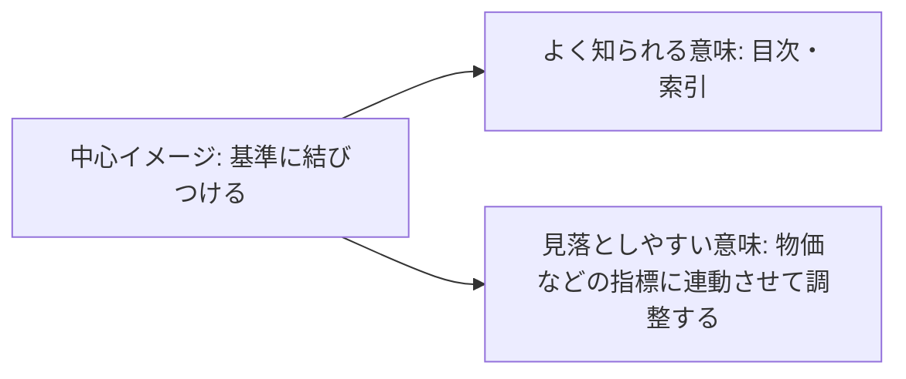

**重要語法**　be indexed to ～：～に連動する

<small>global_order: 1681 / index: 2632 / candidate_id: ev-02632-verb-01</small>

---

### 02. severe

**品詞:** adjective　**発音:** /sɪˈvɪr/（米語中心の目安）

<small>よく知られている意味：厳しい</small>

#### 見落としやすい意味

**飾り気のない、簡素で厳格な**

**例文**　The room had a severe beauty, with plain walls and no decoration.

**和訳**　その部屋には、飾りのない壁と装飾を省いた厳格な美しさがあった。

**コアイメージ**　severeは余計なものを許さない厳しさを表す。規則の厳しさだけでなく、装飾をそぎ落とした様式にも当てはまる。

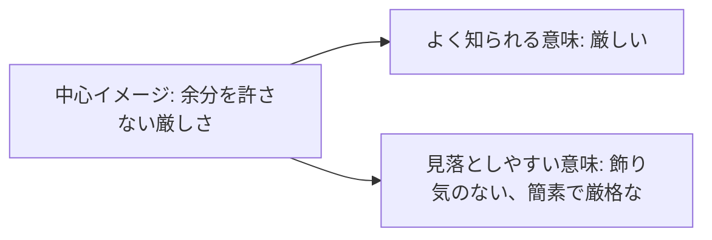

**重要語法**　severe style：装飾を抑えた厳格な様式

<small>global_order: 1682 / index: 2637 / candidate_id: ev-02637-adjective-01</small>

---

### 03. meat

**品詞:** noun　**発音:** /miːt/（米語中心の目安）

<small>よく知られている意味：肉</small>

#### 見落としやすい意味

**話や議論の核心**

**例文**　We finally reached the meat of the argument.

**和訳**　私たちはようやくその議論の核心にたどり着いた。

**コアイメージ**　食事のmeatは栄養のある主要な部分を指す。そこから話の中身や、最も重要な論点を表せる。

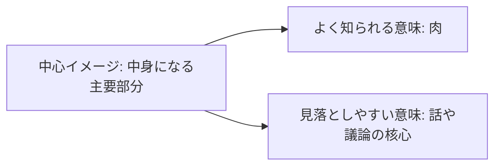

**重要語法**　the meat of ～：～の核心

<small>global_order: 1683 / index: 2638 / candidate_id: ev-02638-noun-01</small>

---

### 04. sweet

**品詞:** noun　**発音:** /swiːt/（米語中心の目安）

<small>よく知られている意味：菓子</small>

#### 見落としやすい意味

**（主に英国英語）食後のデザート**

**例文**　What are we having for sweet after dinner?

**和訳**　夕食のあと、デザートは何を食べるの？

**コアイメージ**　sweetは甘い食べ物を指す名詞にもなる。英国英語では食事の最後に出す一皿、つまりデザートを指すことがある。

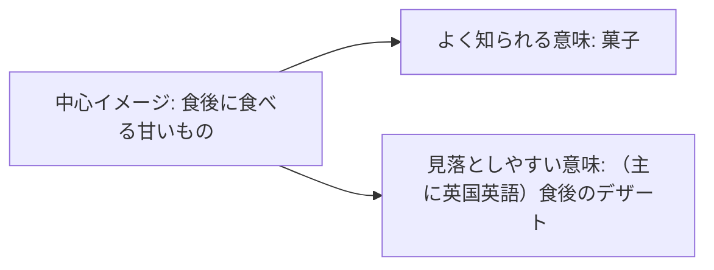

**重要語法**　for sweet：デザートに（主に英国英語）

<small>global_order: 1684 / index: 2639 / candidate_id: ev-02639-noun-01</small>

---

### 05. ear

**品詞:** noun　**発音:** /ɪr/（米語中心の目安）

<small>よく知られている意味：耳</small>

#### 見落としやすい意味

**トウモロコシや麦などの穂**

**例文**　Each stalk had two ears of corn.

**和訳**　それぞれの茎にはトウモロコシの穂が二つ付いていた。

**コアイメージ**　earには人の耳とは別に、穀物の穂を指す語義がある。耳という日本語に無理に置き換えず、植物についてなら穂と読む。

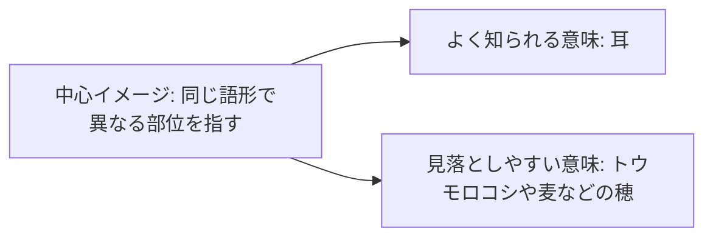

**重要語法**　an ear of corn：トウモロコシの穂一本

<small>global_order: 1685 / index: 2640 / candidate_id: ev-02640-noun-01</small>

---

### 06. spy

**品詞:** verb　**発音:** /spaɪ/（米語中心の目安）

<small>よく知られている意味：スパイ活動をする</small>

#### 見落としやすい意味

**遠方の人・物を見つける**

**例文**　From the hill, we spied a small boat near the shore.

**和訳**　丘の上から、私たちは岸辺の小さな船を見つけた。

**コアイメージ**　spyの中心には注意深く観察する動作がある。秘密を探るだけでなく、遠くの物を見つける意味にもなる。

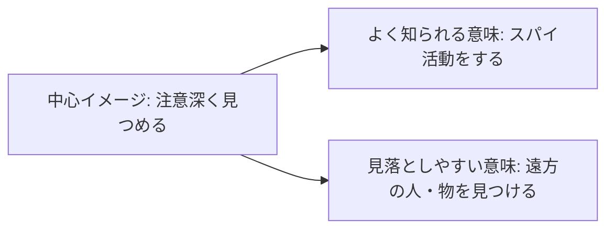

**重要語法**　spy + 目的語：～を見つける（やや文語的）

<small>global_order: 1686 / index: 2641 / candidate_id: ev-02641-verb-01</small>

---

### 07. gender

**品詞:** noun　**発音:** /ˈdʒendər/（米語中心の目安）

<small>よく知られている意味：性別・ジェンダー</small>

#### 見落としやすい意味

**文法上の性**

**例文**　In German, every noun has a grammatical gender.

**和訳**　ドイツ語では、すべての名詞に文法上の性がある。

**コアイメージ**　genderは性による分類を示す言葉である。人の性別だけでなく、名詞を文法上の種類に分ける場合にも使う。

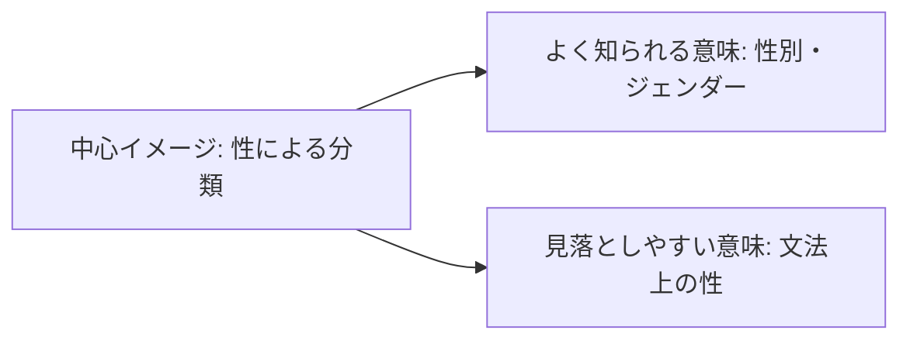

**重要語法**　grammatical gender：文法上の性

<small>global_order: 1687 / index: 2642 / candidate_id: ev-02642-noun-01</small>

---

### 08. comic

**品詞:** noun　**発音:** /ˈkɑːmɪk/（米語中心の目安）

<small>よく知られている意味：漫画</small>

#### 見落としやすい意味

**喜劇役者、コメディアン**

**例文**　The comic made the whole audience laugh.

**和訳**　そのコメディアンは観客全員を笑わせた。

**コアイメージ**　comicは笑いや喜劇に関わるものを指す。漫画の意味だけでなく、笑わせることを仕事にする人を表す名詞にもなる。

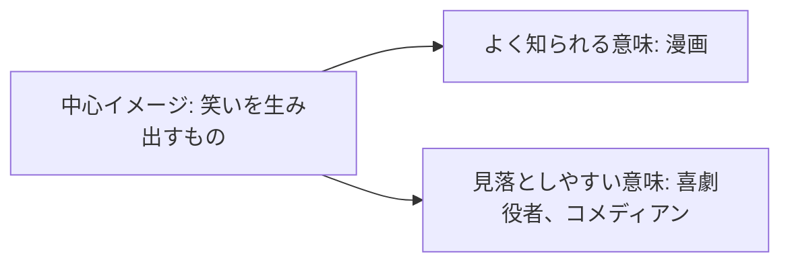

**重要語法**　a stand-up comic：スタンドアップ・コメディアン

<small>global_order: 1688 / index: 2643 / candidate_id: ev-02643-noun-01</small>

---

### 09. invade

**品詞:** verb　**発音:** /ɪnˈveɪd/（米語中心の目安）

<small>よく知られている意味：侵略する</small>

#### 見落としやすい意味

**病原体などが体内組織に侵入する**

**例文**　The virus can invade cells in the lungs.

**和訳**　そのウイルスは肺の細胞に侵入することがある。

**コアイメージ**　invadeは境界を越えて内部へ入り込むことを表す。国境だけでなく、生物の細胞や組織についても使われる。

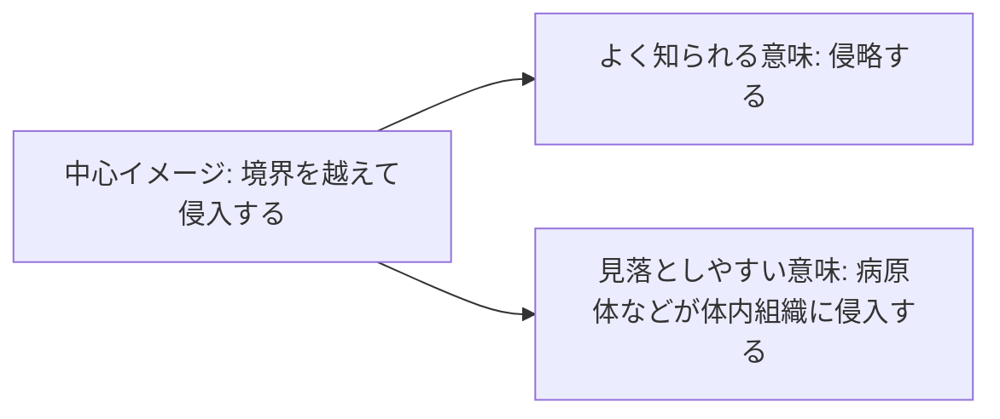

**重要語法**　invade tissue：組織に侵入する

<small>global_order: 1689 / index: 2644 / candidate_id: ev-02644-verb-01</small>

---

### 10. proof

**品詞:** verb　**発音:** /pruːf/（米語中心の目安）

<small>よく知られている意味：証明する</small>

#### 見落としやすい意味

**素材を損傷に強くする加工を施す**

**例文**　The manufacturer proofed the fabric against water.

**和訳**　製造業者はその布地に防水加工を施した。

**コアイメージ**　proofには外からの影響に耐えられるようにする動詞の用法がある。証拠を示すproofとは別に、素材を保護する加工を表す。

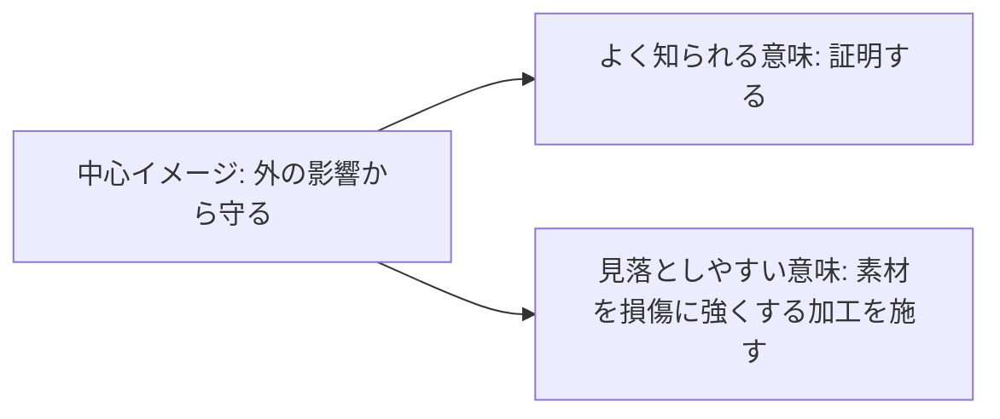

**重要語法**　proof A against B：AをBに耐えるよう加工する

<small>global_order: 1690 / index: 2645 / candidate_id: ev-02645-verb-01</small>

---

### 11. slavery

**品詞:** noun　**発音:** /ˈsleɪvəri/（米語中心の目安）

<small>よく知られている意味：奴隷制度</small>

#### 見落としやすい意味

**ほとんど報酬のない過酷な労働状態**

**例文**　The employees called the unpaid overtime a form of slavery.

**和訳**　従業員たちは、無給の残業を一種の奴隷的な労働だと呼んだ。

**コアイメージ**　slaveryは自由を奪われた状態を表す。比喩的には、極端に不公平で過酷な労働環境への強い批判にも使われる。

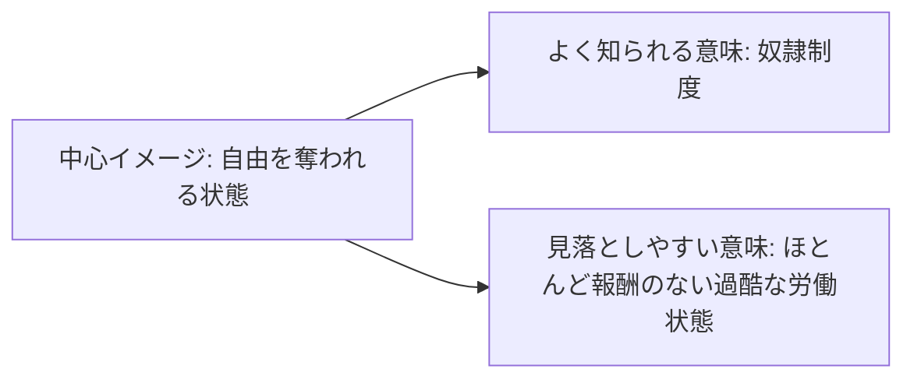

**重要語法**　比喩では強い非難になるため、使用場面に注意

<small>global_order: 1691 / index: 2646 / candidate_id: ev-02646-noun-01</small>

---

### 12. endure

**品詞:** verb　**発音:** /ɪnˈdʊr/（米語中心の目安）

<small>よく知られている意味：耐え忍ぶ</small>

#### 見落としやすい意味

**伝統や伝説などが存続する**

**例文**　The tradition has endured for hundreds of years.

**和訳**　その伝統は何百年もの間、存続してきた。

**コアイメージ**　endureは負担や時間に負けず持ちこたえることを表す。人の忍耐だけでなく、文化や伝統が残り続ける場合にも使う。

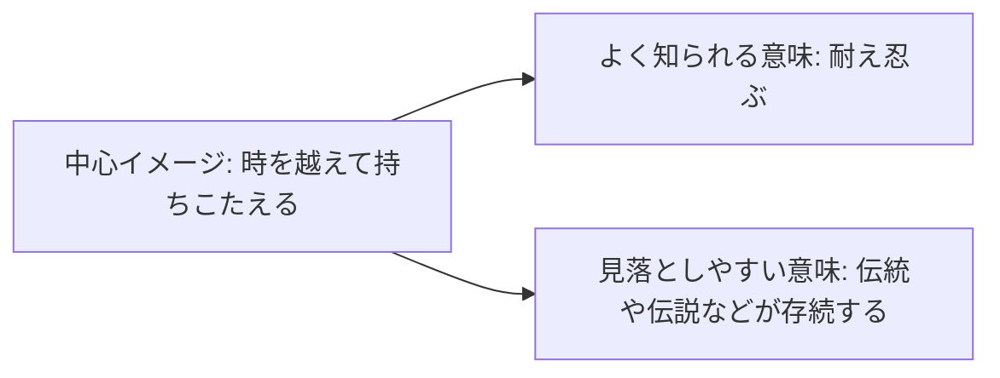

**重要語法**　endure for centuries：何世紀も存続する

<small>global_order: 1692 / index: 2648 / candidate_id: ev-02648-verb-01</small>

---

### 13. alert

**品詞:** noun　**発音:** /əˈlɝːt/（米語中心の目安）

<small>よく知られている意味：警報</small>

#### 見落としやすい意味

**緊急時に備えた警戒態勢**

**例文**　The hospital remained on high alert throughout the night.

**和訳**　その病院は夜通し厳重な警戒態勢を保った。

**コアイメージ**　alertは危険をすぐ察知できるよう注意を向けた状態を指す。警報という知らせだけでなく、組織全体の警戒態勢も表す。

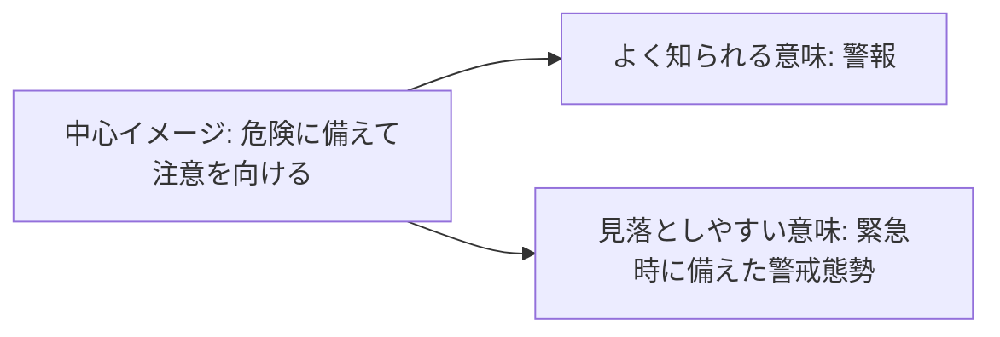

**重要語法**　on high alert：厳重な警戒態勢で

<small>global_order: 1693 / index: 2649 / candidate_id: ev-02649-noun-01</small>

---

### 14. rocky

**品詞:** adjective　**発音:** /ˈrɑːki/（米語中心の目安）

<small>よく知られている意味：岩の多い</small>

#### 見落としやすい意味

**前途多難な**

**例文**　Their new business got off to a rocky start.

**和訳**　彼らの新しい事業は波乱含みのスタートを切った。

**コアイメージ**　岩だらけの道は歩きにくく、先が読みにくい。そこから計画や人間関係が不安定で困難な状態を表す。

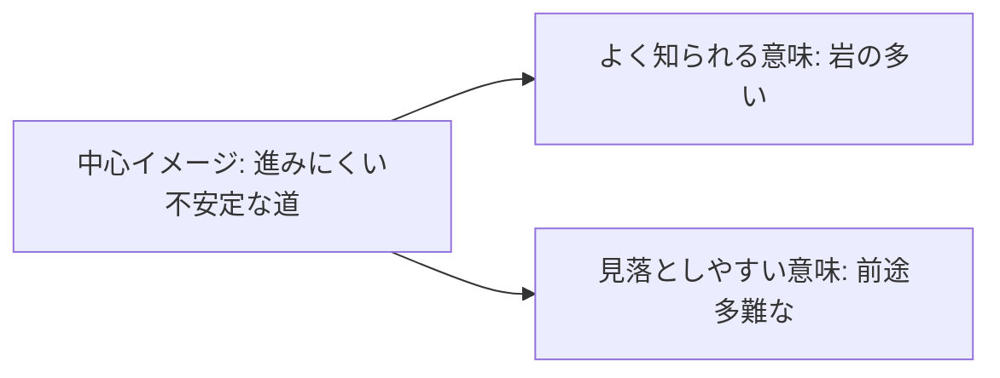

**重要語法**　a rocky start：波乱含みの出だし

<small>global_order: 1694 / index: 2650 / candidate_id: ev-02650-adjective-01</small>

---

### 15. faculty

**品詞:** noun　**発音:** /ˈfækəlti/（米語中心の目安）

<small>よく知られている意味：大学の学部・教職員</small>

#### 見落としやすい意味

**知的能力・知覚能力**

**例文**　She retained all her mental faculties into old age.

**和訳**　彼女は高齢になっても知的能力をすべて保っていた。

**コアイメージ**　facultyには人に備わった働きや能力という意味がある。制度上の学部とは別に、記憶や判断などの心の機能を指す。

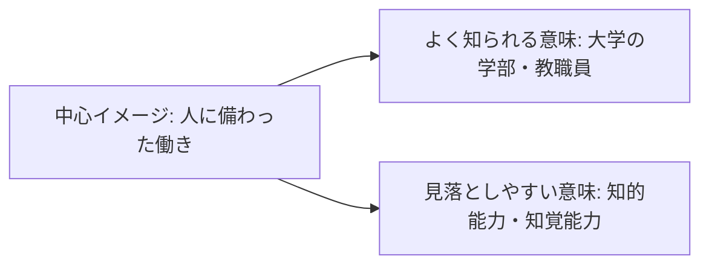

**重要語法**　mental faculties：知的能力

<small>global_order: 1695 / index: 2651 / candidate_id: ev-02651-noun-01</small>

---

### 16. emotional

**品詞:** adjective　**発音:** /ɪˈmoʊʃənəl/（米語中心の目安）

<small>よく知られている意味：感情の・感動的な</small>

#### 見落としやすい意味

**感情に左右されやすい、感情的になりすぎる**

**例文**　He gets emotional whenever the subject comes up.

**和訳**　その話題が出るたびに、彼は感情的になる。

**コアイメージ**　emotionalは感情と強く結びついていることを表す。単に心を打つだけでなく、気持ちが判断や態度に表れやすい様子にも使う。

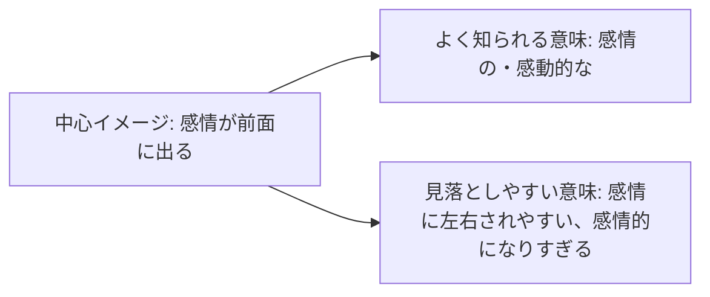

**重要語法**　get emotional：感情的になる

<small>global_order: 1696 / index: 2653 / candidate_id: ev-02653-adjective-01</small>

---

### 17. expenditure

**品詞:** noun　**発音:** /ɪkˈspendɪtʃər/（米語中心の目安）

<small>よく知られている意味：支出・経費</small>

#### 見落としやすい意味

**金銭以外のエネルギー・資源などの消費**

**例文**　The task required a large expenditure of energy.

**和訳**　その作業には多大なエネルギーの消費が必要だった。

**コアイメージ**　expenditureは手持ちの資源を使うことを表す。支払うお金だけでなく、体力や時間などの消費にも広がる。

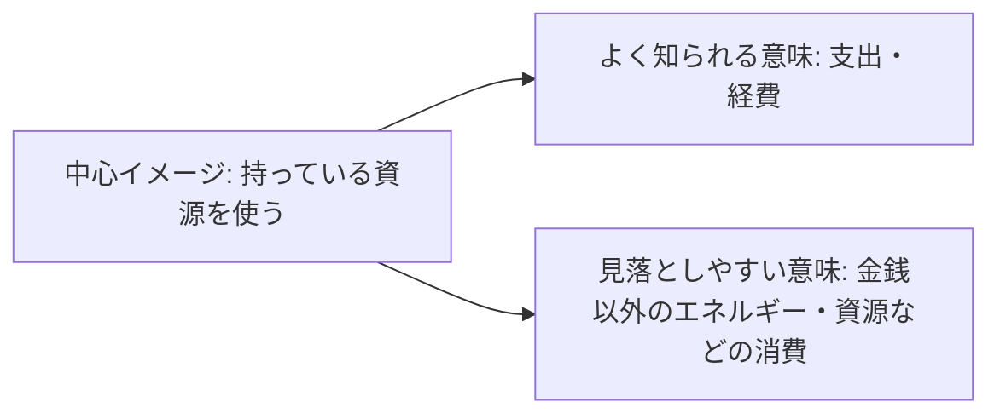

**重要語法**　expenditure of energy：エネルギーの消費

<small>global_order: 1697 / index: 2654 / candidate_id: ev-02654-noun-01</small>

---

### 18. invasion

**品詞:** noun　**発音:** /ɪnˈveɪʒən/（米語中心の目安）

<small>よく知られている意味：侵略・侵入</small>

#### 見落としやすい意味

**病原体や悪性細胞が体内で広がること**

**例文**　Researchers studied the invasion of healthy tissue by harmful cells.

**和訳**　研究者たちは有害な細胞が健康な組織に侵入する過程を調べた。

**コアイメージ**　invasionは外から内部へ入り込む動きである。軍事的な侵攻だけでなく、病原体や細胞が組織に広がる現象にも使う。

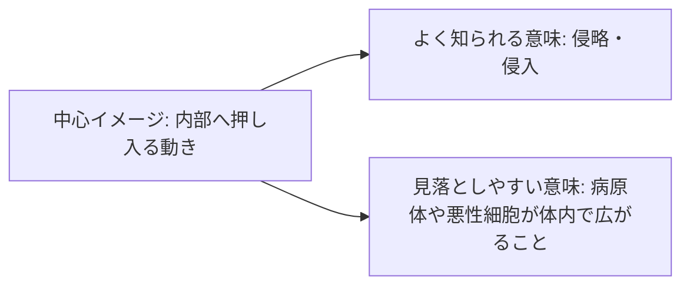

**重要語法**　invasion of tissue：組織への侵入

<small>global_order: 1698 / index: 2656 / candidate_id: ev-02656-noun-01</small>

---

### 19. saint

**品詞:** noun　**発音:** /seɪnt/（米語中心の目安）

<small>よく知られている意味：聖人</small>

#### 見落としやすい意味

**並外れて立派な人、模範**

**例文**　You were a saint to help us move all those boxes.

**和訳**　あんなにたくさんの箱を運ぶのを手伝ってくれて、本当に親切だったね。

**コアイメージ**　saintは徳の高い人を表す。宗教上の聖人から転じて、普通の人の並外れた親切さをほめるときにも使う。

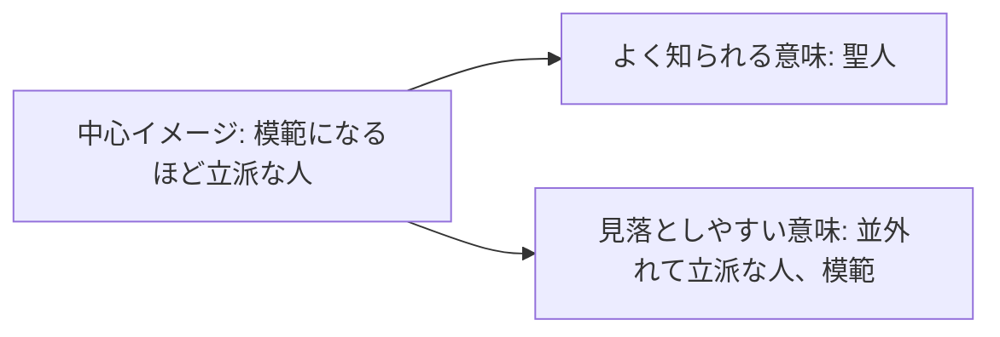

**重要語法**　be a saint：とても親切な人だ

<small>global_order: 1699 / index: 2657 / candidate_id: ev-02657-noun-01</small>

---

### 20. significance

**品詞:** noun　**発音:** /sɪɡˈnɪfɪkəns/（米語中心の目安）

<small>よく知られている意味：重要性</small>

#### 見落としやすい意味

**言葉に明示されていない含意**

**例文**　The significance of her silence was clear: she disagreed.

**和訳**　彼女の沈黙が示す意味は明らかだった。反対していたのだ。

**コアイメージ**　significanceは表面の出来事が持つ意味を指す。重要性だけでなく、言葉にされなくても伝わる含みを読み取る場合に使う。

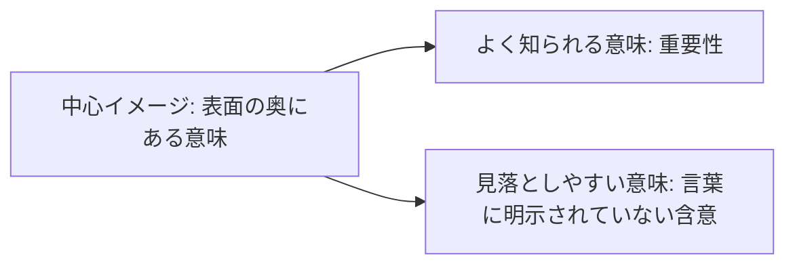

**重要語法**　the significance of ～：～が意味すること

<small>global_order: 1700 / index: 2658 / candidate_id: ev-02658-noun-01</small>

---

### 21. tendency

**品詞:** noun　**発音:** /ˈtendənsi/（米語中心の目安）

<small>よく知られている意味：傾向</small>

#### 見落としやすい意味

**特定の考えや選択肢を好む傾向**

**例文**　He has a tendency toward practical solutions rather than bold ideas.

**和訳**　彼は大胆な発想より実用的な解決策を好む傾向がある。

**コアイメージ**　tendencyはある方向へ傾く性質を示す。単なる行動の頻度だけでなく、選択するときの好みにも表れる。

```mermaid
flowchart LR
    A["中心イメージ: ある方向へ傾く"]
    B["よく知られる意味: 傾向"]
    C["見落としやすい意味: 特定の考えや選択肢を好む傾向"]
    A --> B
    A --> C
```

**重要語法**　a tendency toward ～：～を好む傾向

<small>global_order: 1701 / index: 2659 / candidate_id: ev-02659-noun-01</small>

---

### 22. personally

**品詞:** adverb　**発音:** /ˈpɝːsənəli/（米語中心の目安）

<small>よく知られている意味：個人的に</small>

#### 見落としやすい意味

**人任せにせず本人が直接**

**例文**　The principal personally welcomed every new student.

**和訳**　校長は新入生一人ひとりを自ら出迎えた。

**コアイメージ**　personallyはその人自身が関わることを示す。個人的な意見だけでなく、代理人に任せず本人が直接行うことを強調できる。

```mermaid
flowchart LR
    A["中心イメージ: その人自身が関わる"]
    B["よく知られる意味: 個人的に"]
    C["見落としやすい意味: 人任せにせず本人が直接"]
    A --> B
    A --> C
```

**重要語法**　personally handle ～：～を自ら担当する

<small>global_order: 1702 / index: 2662 / candidate_id: ev-02662-adverb-01</small>

---

### 23. commerce

**品詞:** noun　**発音:** /ˈkɑːmɝːs/（米語中心の目安）

<small>よく知られている意味：商業・取引</small>

#### 見落としやすい意味

**意見や態度などの社会的交流**

**例文**　The conference encouraged a free commerce of ideas.

**和訳**　その会議は自由な意見の交流を促した。

**コアイメージ**　commerceの中心は人や組織の間で何かが行き交うことにある。商品だけでなく、思想や意見を交換することにも比喩的に使う。

```mermaid
flowchart LR
    A["中心イメージ: 互いに行き交い交換する"]
    B["よく知られる意味: 商業・取引"]
    C["見落としやすい意味: 意見や態度などの社会的交流"]
    A --> B
    A --> C
```

**重要語法**　commerce of ideas：意見の交流（文語的）

<small>global_order: 1703 / index: 2665 / candidate_id: ev-02665-noun-01</small>

---

### 24. revolutionary

**品詞:** noun　**発音:** /ˌrevəˈluːʃəneri/（米語中心の目安）

<small>よく知られている意味：革命的な</small>

#### 見落としやすい意味

**革命を支持・推進する人**

**例文**　She was a revolutionary who worked to change the political system.

**和訳**　彼女は政治制度を変えようと活動する革命家だった。

**コアイメージ**　revolutionaryは大きな変革に関わる人や物を指す。形容詞として新しい仕組みを表すだけでなく、革命を進める人を名詞で指す。

```mermaid
flowchart LR
    A["中心イメージ: 大きな変革を起こす"]
    B["よく知られる意味: 革命的な"]
    C["見落としやすい意味: 革命を支持・推進する人"]
    A --> B
    A --> C
```

**重要語法**　a revolutionary：革命家

<small>global_order: 1704 / index: 2666 / candidate_id: ev-02666-noun-01</small>

---

### 25. colony

**品詞:** noun　**発音:** /ˈkɑːləni/（米語中心の目安）

<small>よく知られている意味：植民地</small>

#### 見落としやすい意味

**生物の群体・集団**

**例文**　A large colony of seabirds nests on the island.

**和訳**　その島には海鳥の大きな群れが巣を作っている。

**コアイメージ**　colonyは同じ場所に集まって暮らす集団を指す。人の入植地だけでなく、鳥や昆虫などの生物の群れにも使う。

```mermaid
flowchart LR
    A["中心イメージ: 一か所に集まる共同体"]
    B["よく知られる意味: 植民地"]
    C["見落としやすい意味: 生物の群体・集団"]
    A --> B
    A --> C
```

**重要語法**　a colony of ants：アリの群れ

<small>global_order: 1705 / index: 2669 / candidate_id: ev-02669-noun-01</small>

---

### 26. nose

**品詞:** noun　**発音:** /noʊz/（米語中心の目安）

<small>よく知られている意味：鼻</small>

#### 見落としやすい意味

**好機や情報をかぎつける勘**

**例文**　The journalist has a nose for interesting stories.

**和訳**　その記者は面白い話題をかぎつける勘が鋭い。

**コアイメージ**　鼻でにおいを察知する感覚がもとになっている。見えない機会や情報を敏感に見つける能力をnoseと呼べる。

```mermaid
flowchart LR
    A["中心イメージ: 気配をかぎ取る"]
    B["よく知られる意味: 鼻"]
    C["見落としやすい意味: 好機や情報をかぎつける勘"]
    A --> B
    A --> C
```

**重要語法**　have a nose for ～：～を見つける勘がある

<small>global_order: 1706 / index: 2670 / candidate_id: ev-02670-noun-01</small>

---

### 27. adventure

**品詞:** verb　**発音:** /ədˈventʃər/（米語中心の目安）

<small>よく知られている意味：冒険</small>

#### 見落としやすい意味

**危険を承知で賭ける、危険にさらす**

**例文**　She refused to adventure her savings on such an uncertain plan.

**和訳**　彼女はそんな不確かな計画に貯金を賭けることを拒んだ。

**コアイメージ**　adventureは危険があっても未知のことに踏み出す行為を表す。動詞では大切なものをあえて危険にさらす意味になる。

```mermaid
flowchart LR
    A["中心イメージ: 危険を承知で踏み出す"]
    B["よく知られる意味: 冒険"]
    C["見落としやすい意味: 危険を承知で賭ける、危険にさらす"]
    A --> B
    A --> C
```

**重要語法**　adventure one's money：お金を危険にさらす（古風・文語的）

<small>global_order: 1707 / index: 2672 / candidate_id: ev-02672-verb-01</small>

---

### 28. poetry

**品詞:** noun　**発音:** /ˈpoʊətri/（米語中心の目安）

<small>よく知られている意味：詩・詩文学</small>

#### 見落としやすい意味

**詩のような美しさのある表現**

**例文**　There was poetry in the way he described the night sky.

**和訳**　彼の夜空の描写には詩のような美しさがあった。

**コアイメージ**　poetryは詩という作品だけでなく、詩のような美しさや余韻を表す。日常の表現や光景にも使われる。

```mermaid
flowchart LR
    A["中心イメージ: 詩のような美しさ"]
    B["よく知られる意味: 詩・詩文学"]
    C["見落としやすい意味: 詩のような美しさのある表現"]
    A --> B
    A --> C
```

**重要語法**　there is poetry in ～：～に詩情がある

<small>global_order: 1708 / index: 2673 / candidate_id: ev-02673-noun-01</small>

---

### 29. et

**品詞:** conjunction　**発音:** /et/（米語中心の目安）

<small>よく知られている意味：ラテン語のand</small>

#### 見落としやすい意味

**et al. で「〜とその他の人々、〜ほか」**

**例文**　Tanaka et al. reported similar results.

**和訳**　田中らも同様の結果を報告した。

**コアイメージ**　etはラテン語で「そして」を意味する。英語の学術文献ではet al.という略記の中で、共著者などをまとめて示す。

```mermaid
flowchart LR
    A["中心イメージ: ラテン語で「そして」"]
    B["よく知られる意味: ラテン語のand"]
    C["見落としやすい意味: et al. で「〜とその他の人々、〜ほか」"]
    A --> B
    A --> C
```

**重要語法**　et al.：～ほか（学術引用に使う。et単独を普通の英語接続詞として使わない）

<small>global_order: 1709 / index: 2675 / candidate_id: ev-02675-conjunction-01</small>

---

### 30. marketing

**品詞:** noun　**発音:** /ˈmɑːrkɪtɪŋ/（米語中心の目安）

<small>よく知られている意味：販売促進・マーケティング</small>

#### 見落としやすい意味

**市場での買い物（主に英国英語）**

**例文**　My grandmother went out to do the marketing before lunch.

**和訳**　祖母は昼食前に市場へ買い物に出かけた。

**コアイメージ**　marketingは市場に関わる活動を指す。販売戦略の意味のほか、特に古めの英国英語では食料品などの買い物を指すことがある。

```mermaid
flowchart LR
    A["中心イメージ: 市場で品物を扱う"]
    B["よく知られる意味: 販売促進・マーケティング"]
    C["見落としやすい意味: 市場での買い物（主に英国英語）"]
    A --> B
    A --> C
```

**重要語法**　do the marketing：買い物をする（地域差・やや古風）

<small>global_order: 1710 / index: 2677 / candidate_id: ev-02677-noun-01</small>

---

### 31. resemble

**品詞:** verb　**発音:** /rɪˈzembəl/（米語中心の目安）

<small>よく知られている意味：～に似ている</small>

#### 見落としやすい意味

**resemble + 名詞：〜に似ている（前置詞toを付けない他動詞）**

**例文**　The new building resembles a ship.

**和訳**　その新しい建物は船に似ている。

**コアイメージ**　resembleは二つのものに共通の特徴があることを表す。日本語では「～に」と言うが、英語では目的語を直接取る。

```mermaid
flowchart LR
    A["中心イメージ: 共通する姿・特徴がある"]
    B["よく知られる意味: ～に似ている"]
    C["見落としやすい意味: resemble + 名詞：〜に似ている（前置詞toを付けない他動詞）"]
    A --> B
    A --> C
```

**重要語法**　resemble + 名詞：toを付けない

<small>global_order: 1711 / index: 2678 / candidate_id: ev-02678-verb-01</small>

---

### 32. excuse

**品詞:** noun　**発音:** /ˈekskjuːs/（米語中心の目安）

<small>よく知られている意味：言い訳</small>

#### 見落としやすい意味

**名ばかりで実質の伴わないもの（a poor excuse for）**

**例文**　The tiny room was a poor excuse for a library.

**和訳**　その狭い部屋は図書館とは名ばかりだった。

**コアイメージ**　excuseは不十分なことを正当化する説明を指す。a poor excuse forでは、名目はあっても実態が伴わないものを皮肉る。

```mermaid
flowchart LR
    A["中心イメージ: 体裁だけで実質が乏しい"]
    B["よく知られる意味: 言い訳"]
    C["見落としやすい意味: 名ばかりで実質の伴わないもの（a poor excuse for）"]
    A --> B
    A --> C
```

**重要語法**　a poor excuse for ～：～とは名ばかりのもの

<small>global_order: 1712 / index: 2679 / candidate_id: ev-02679-noun-01</small>

---

### 33. generous

**品詞:** adjective　**発音:** /ˈdʒenərəs/（米語中心の目安）

<small>よく知られている意味：気前のよい</small>

#### 見落としやすい意味

**量がたっぷりした、十分以上の**

**例文**　The restaurant serves generous portions of vegetables.

**和訳**　そのレストランは野菜をたっぷり盛り付けてくれる。

**コアイメージ**　generousは出し惜しみしない姿勢を表す。人の親切さに限らず、量や大きさが十分以上であることにも使う。

```mermaid
flowchart LR
    A["中心イメージ: 惜しまずたっぷり与える"]
    B["よく知られる意味: 気前のよい"]
    C["見落としやすい意味: 量がたっぷりした、十分以上の"]
    A --> B
    A --> C
```

**重要語法**　a generous portion：たっぷりの一人前

<small>global_order: 1713 / index: 2681 / candidate_id: ev-02681-adjective-01</small>

---

### 34. civilization

**品詞:** noun　**発音:** /ˌsɪvəlɪˈzeɪʃən/（米語中心の目安）

<small>よく知られている意味：文明</small>

#### 見落としやすい意味

**洗練された考え方や礼節**

**例文**　Their kindness and good manners showed a sense of civilization.

**和訳**　彼らの親切さと礼儀正しさには洗練された品格が感じられた。

**コアイメージ**　civilizationは社会が発展した状態を意味する。そこから、人との接し方に表れる教養や礼節も指す。

```mermaid
flowchart LR
    A["中心イメージ: 社会の成熟が態度に表れる"]
    B["よく知られる意味: 文明"]
    C["見落としやすい意味: 洗練された考え方や礼節"]
    A --> B
    A --> C
```

**重要語法**　ここでは技術水準よりも礼節・教養を指す

<small>global_order: 1714 / index: 2682 / candidate_id: ev-02682-noun-01</small>

---

### 35. possess

**品詞:** verb　**発音:** /pəˈzes/（米語中心の目安）

<small>よく知られている意味：所有する</small>

#### 見落としやすい意味

**感情・観念が人を支配する**

**例文**　He was possessed by an unreasonable fear of failure.

**和訳**　彼は失敗への根拠のない恐怖に支配されていた。

**コアイメージ**　possessは何かを自分の支配下に置くことを表す。感情が主語側の力として人をとらえる場合は、受け身で「支配される」となる。

```mermaid
flowchart LR
    A["中心イメージ: 支配下に置く"]
    B["よく知られる意味: 所有する"]
    C["見落としやすい意味: 感情・観念が人を支配する"]
    A --> B
    A --> C
```

**重要語法**　be possessed by fear：恐怖に取りつかれる

<small>global_order: 1715 / index: 2684 / candidate_id: ev-02684-verb-01</small>

---

### 36. terrace

**品詞:** noun　**発音:** /ˈterəs/（米語中心の目安）

<small>よく知られている意味：屋外のテラス</small>

#### 見落としやすい意味

**斜面にできた段状の平地**

**例文**　Farmers built narrow terraces into the steep hillside.

**和訳**　農家の人々は急な斜面に細長い段状の平地を築いた。

**コアイメージ**　terraceは平らな面が段状に続く地形を指す。建物に付いたテラスだけでなく、山の斜面の段々畑にも使える。

```mermaid
flowchart LR
    A["中心イメージ: 段状に並ぶ平らな面"]
    B["よく知られる意味: 屋外のテラス"]
    C["見落としやすい意味: 斜面にできた段状の平地"]
    A --> B
    A --> C
```

**重要語法**　terraced fields：段々畑

<small>global_order: 1716 / index: 2685 / candidate_id: ev-02685-noun-01</small>

---

### 37. exotic

**品詞:** adjective　**発音:** /ɪɡˈzɑːtɪk/（米語中心の目安）

<small>よく知られている意味：異国情緒のある</small>

#### 見落としやすい意味

**（生物が）生態系にもともといない、外来の**

**例文**　The lake is threatened by exotic fish introduced from abroad.

**和訳**　その湖は国外から持ち込まれた外来魚の影響を受けている。

**コアイメージ**　exoticはその土地にもともとない、外から来たものを指す。観光での珍しさだけでなく、生態学では外来の生物を表す。

```mermaid
flowchart LR
    A["中心イメージ: その土地の外から来た"]
    B["よく知られる意味: 異国情緒のある"]
    C["見落としやすい意味: （生物が）生態系にもともといない、外来の"]
    A --> B
    A --> C
```

**重要語法**　exotic species：外来種

<small>global_order: 1717 / index: 2687 / candidate_id: ev-02687-adjective-01</small>

---

### 38. legacy

**品詞:** noun　**発音:** /ˈleɡəsi/（米語中心の目安）

<small>よく知られている意味：過去から受け継ぐ遺産</small>

#### 見落としやすい意味

**遺言による財産の遺贈**

**例文**　She left a legacy of ten thousand dollars to the museum.

**和訳**　彼女は博物館に一万ドルを遺贈した。

**コアイメージ**　legacyは前の世代や人から後に残されるものを指す。業績や影響だけでなく、遺言によって贈られる財産にも使う。

```mermaid
flowchart LR
    A["中心イメージ: 後の人に残すもの"]
    B["よく知られる意味: 過去から受け継ぐ遺産"]
    C["見落としやすい意味: 遺言による財産の遺贈"]
    A --> B
    A --> C
```

**重要語法**　leave a legacy to ～：～に遺贈する

<small>global_order: 1718 / index: 2688 / candidate_id: ev-02688-noun-01</small>

---

### 39. register

**品詞:** noun　**発音:** /ˈredʒɪstər/（米語中心の目安）

<small>よく知られている意味：登録簿・登録すること</small>

#### 見落としやすい意味

**場面や相手によって使い分ける言葉遣い、使用域**

**例文**　The writer shifts from a formal register to everyday speech.

**和訳**　その作家は格式ばった言葉遣いから日常的な口調へ切り替える。

**コアイメージ**　registerは一定のまとまりや区分を持つものを指す。言語では、場面や相手に合わせた言葉遣いの種類を表す。

```mermaid
flowchart LR
    A["中心イメージ: 場面に応じた区分"]
    B["よく知られる意味: 登録簿・登録すること"]
    C["見落としやすい意味: 場面や相手によって使い分ける言葉遣い、使用域"]
    A --> B
    A --> C
```

**重要語法**　formal register：改まった言葉遣い

<small>global_order: 1719 / index: 2689 / candidate_id: ev-02689-noun-01</small>

---

### 40. register

**品詞:** verb　**発音:** /ˈredʒɪstər/（米語中心の目安）

<small>よく知られている意味：登録する</small>

#### 見落としやすい意味

**人の意識に届く、心に刻まれる**

**例文**　His final remark did not register with me until later.

**和訳**　彼の最後の一言は、あとになってようやく私の心に届いた。

**コアイメージ**　registerは情報が記録に残ることを表す。心の中に印象として刻まれる場合、理解する・気づくという意味になる。

```mermaid
flowchart LR
    A["中心イメージ: 情報が意識に記録される"]
    B["よく知られる意味: 登録する"]
    C["見落としやすい意味: 人の意識に届く、心に刻まれる"]
    A --> B
    A --> C
```

**重要語法**　register with someone：人に伝わる・認識される

<small>global_order: 1720 / index: 2689 / candidate_id: ev-02689-verb-01</small>

---

### 41. register

**品詞:** verb　**発音:** /ˈredʒɪstər/（米語中心の目安）

<small>よく知られている意味：登録する</small>

#### 見落としやすい意味

**計器が数値・測定結果を示す**

**例文**　The thermometer registered thirty-eight degrees.

**和訳**　温度計は38度を示した。

**コアイメージ**　registerは情報や結果を記録する働きを表す。計器が測定値を表示する場合も、数値を記録するという発想が続いている。

```mermaid
flowchart LR
    A["中心イメージ: 数値を記録して示す"]
    B["よく知られる意味: 登録する"]
    C["見落としやすい意味: 計器が数値・測定結果を示す"]
    A --> B
    A --> C
```

**重要語法**　register a temperature：温度を示す

<small>global_order: 1721 / index: 2689 / candidate_id: ev-02689-verb-02</small>

---

### 42. update

**品詞:** noun　**発音:** /ˈʌpdeɪt/（米語中心の目安）

<small>よく知られている意味：更新</small>

#### 見落としやすい意味

**最新情報、近況報告**

**例文**　Could you send me an update on the repair?

**和訳**　修理の進み具合について最新情報を送ってくれませんか。

**コアイメージ**　updateは古い情報を新しくすることから生まれた名詞である。更新作業そのものではなく、新たに伝える近況や進捗報告も指す。

```mermaid
flowchart LR
    A["中心イメージ: 情報を新しい状態にする"]
    B["よく知られる意味: 更新"]
    C["見落としやすい意味: 最新情報、近況報告"]
    A --> B
    A --> C
```

**重要語法**　an update on ～：～についての近況

<small>global_order: 1722 / index: 2692 / candidate_id: ev-02692-noun-01</small>

---

### 43. drawing

**品詞:** noun　**発音:** /ˈdrɔːɪŋ/（米語中心の目安）

<small>よく知られている意味：描画・絵</small>

#### 見落としやすい意味

**くじ引き、抽選**

**例文**　The drawing for the prize will take place on Friday.

**和訳**　賞品の抽選は金曜日に行われる。

**コアイメージ**　drawingにはくじを引く行為を指す用法がある。絵を描くdrawingとは別に、当選者を選ぶ抽選を意味するので文脈で区別する。

```mermaid
flowchart LR
    A["中心イメージ: くじを引いて選ぶ"]
    B["よく知られる意味: 描画・絵"]
    C["見落としやすい意味: くじ引き、抽選"]
    A --> B
    A --> C
```

**重要語法**　a prize drawing：賞品の抽選

<small>global_order: 1723 / index: 2696 / candidate_id: ev-02696-noun-01</small>

---

### 44. imagination

**品詞:** noun　**発音:** /ɪˌmædʒɪˈneɪʃən/（米語中心の目安）

<small>よく知られている意味：想像力</small>

#### 見落としやすい意味

**予想外の状況に対処する創意工夫**

**例文**　It took imagination to repair the machine without proper tools.

**和訳**　適切な工具もない中でその機械を直すには、創意工夫が必要だった。

**コアイメージ**　imaginationは頭の中でまだない形や可能性を思い描く力を指す。その力を現実の問題解決に使うと、機転や独創的な工夫になる。

```mermaid
flowchart LR
    A["中心イメージ: ないものを思い描く力"]
    B["よく知られる意味: 想像力"]
    C["見落としやすい意味: 予想外の状況に対処する創意工夫"]
    A --> B
    A --> C
```

**重要語法**　show imagination：創意工夫を発揮する

<small>global_order: 1724 / index: 2698 / candidate_id: ev-02698-noun-01</small>

---

### 45. horror

**品詞:** noun　**発音:** /ˈhɔːrər/（米語中心の目安）

<small>よく知られている意味：恐怖</small>

#### 見落としやすい意味

**強い嫌悪感**

**例文**　She looked at the wasted food with horror.

**和訳**　彼女は捨てられた食べ物を強い嫌悪感を抱いて見た。

**コアイメージ**　horrorは強い拒絶反応を表す。怖がる場合だけでなく、ひどく不快で受け入れ難いと感じる場合にも使われる。

```mermaid
flowchart LR
    A["中心イメージ: 強く拒絶する感覚"]
    B["よく知られる意味: 恐怖"]
    C["見落としやすい意味: 強い嫌悪感"]
    A --> B
    A --> C
```

**重要語法**　with horror：恐怖・嫌悪を感じて

<small>global_order: 1725 / index: 2699 / candidate_id: ev-02699-noun-01</small>

---

### 46. wander

**品詞:** verb　**発音:** /ˈwɑːndər/（米語中心の目安）

<small>よく知られている意味：歩き回る</small>

#### 見落としやすい意味

**話や考えが本筋からそれる**

**例文**　His thoughts began to wander during the long speech.

**和訳**　長い演説の途中で彼の考えはあちこちにそれ始めた。

**コアイメージ**　wanderは決まった道筋から外れて動くことを表す。体の移動だけでなく、思考や話題が本筋からそれるときにも使う。

```mermaid
flowchart LR
    A["中心イメージ: 道筋からそれる"]
    B["よく知られる意味: 歩き回る"]
    C["見落としやすい意味: 話や考えが本筋からそれる"]
    A --> B
    A --> C
```

**重要語法**　one's mind wanders：注意がそれる

<small>global_order: 1726 / index: 2700 / candidate_id: ev-02700-verb-01</small>

---

### 47. fiction

**品詞:** noun　**発音:** /ˈfɪkʃən/（米語中心の目安）

<small>よく知られている意味：小説・創作文学</small>

#### 見落としやすい意味

**事実とは異なる作り話**

**例文**　The rumor about a secret tunnel turned out to be pure fiction.

**和訳**　秘密のトンネルがあるといううわさは、全くの作り話だった。

**コアイメージ**　fictionは現実の事実ではなく作られた話を表す。文学作品だけでなく、現実に反する説明やでっち上げを指すこともある。

```mermaid
flowchart LR
    A["中心イメージ: 事実ではなく作られた話"]
    B["よく知られる意味: 小説・創作文学"]
    C["見落としやすい意味: 事実とは異なる作り話"]
    A --> B
    A --> C
```

**重要語法**　pure fiction：全くの作り話

<small>global_order: 1727 / index: 2702 / candidate_id: ev-02702-noun-01</small>

---

### 48. medium

**品詞:** noun　**発音:** /ˈmiːdiəm/（米語中心の目安）

<small>よく知られている意味：媒体・中間のもの</small>

#### 見落としやすい意味

**細菌などを培養する培地**

**例文**　The bacteria grew quickly in a nutrient-rich medium.

**和訳**　その細菌は栄養分の豊富な培地ですばやく増殖した。

**コアイメージ**　mediumは何かが生じたり伝わったりするための環境を指す。微生物を育てるための物質も、その成長を支える環境としてmediumと呼ぶ。

```mermaid
flowchart LR
    A["中心イメージ: 活動を支える環境"]
    B["よく知られる意味: 媒体・中間のもの"]
    C["見落としやすい意味: 細菌などを培養する培地"]
    A --> B
    A --> C
```

**重要語法**　culture medium：培地

<small>global_order: 1728 / index: 2703 / candidate_id: ev-02703-noun-01</small>

---

### 49. medium

**品詞:** noun　**発音:** /ˈmiːdiəm/（米語中心の目安）

<small>よく知られている意味：媒体・中間のもの</small>

#### 見落としやすい意味

**絵画などの画材、芸術的な表現手段**

**例文**　Watercolor is her favorite artistic medium.

**和訳**　水彩絵の具は彼女のお気に入りの画材だ。

**コアイメージ**　mediumは表現を成り立たせる手段や材料を指す。情報を運ぶ媒体だけでなく、絵具や彫刻材料のような芸術の素材にも使う。

```mermaid
flowchart LR
    A["中心イメージ: 表現を通す手段"]
    B["よく知られる意味: 媒体・中間のもの"]
    C["見落としやすい意味: 絵画などの画材、芸術的な表現手段"]
    A --> B
    A --> C
```

**重要語法**　an artistic medium：芸術表現の媒体・材料

<small>global_order: 1729 / index: 2703 / candidate_id: ev-02703-noun-02</small>

---

### 50. plausible

**品詞:** adjective　**発音:** /ˈplɔːzəbəl/（米語中心の目安）

<small>よく知られている意味：もっともらしい</small>

#### 見落としやすい意味

**もっともらしい理屈で人を惑わす**

**例文**　His plausible excuse fooled us for a while.

**和訳**　彼のもっともらしい言い訳に、私たちはしばらくだまされた。

**コアイメージ**　plausibleは筋が通って聞こえ、信じられそうなことを表す。説明が事実とは限らないため、うその言い訳が人を納得させる場面でも使われる。

```mermaid
flowchart LR
    A["中心イメージ: 信じられそうに聞こえる"]
    B["よく知られる意味: もっともらしい"]
    C["見落としやすい意味: もっともらしい理屈で人を惑わす"]
    A --> B
    A --> C
```

**重要語法**　plausible自体に「うそ」の意味はない。文脈で判断

<small>global_order: 1730 / index: 2706 / candidate_id: ev-02706-adjective-01</small>

---

### 51. mailer

**品詞:** noun　**発音:** /ˈmeɪlər/（米語中心の目安）

<small>よく知られている意味：郵便発送人・発送用のもの</small>

#### 見落としやすい意味

**郵送広告物**

**例文**　A colorful mailer arrived advertising a weekend sale.

**和訳**　週末のセールを知らせる色鮮やかな郵送広告が届いた。

**コアイメージ**　mailerは郵送に関わるものを指す名詞である。人や道具を指す場合のほか、宣伝のために送られる印刷物にも使う。

```mermaid
flowchart LR
    A["中心イメージ: 郵送されるもの"]
    B["よく知られる意味: 郵便発送人・発送用のもの"]
    C["見落としやすい意味: 郵送広告物"]
    A --> B
    A --> C
```

**重要語法**　promotional mailer：郵送広告

<small>global_order: 1731 / index: 2709 / candidate_id: ev-02709-noun-01</small>

---

### 52. prominent

**品詞:** adjective　**発音:** /ˈprɑːmɪnənt/（米語中心の目安）

<small>よく知られている意味：著名な・目立つ</small>

#### 見落としやすい意味

**表面から突き出て目立つ**

**例文**　The bird has a prominent beak.

**和訳**　その鳥には目立って突き出たくちばしがある。

**コアイメージ**　prominentは周囲から前に出て目立つ様子を表す。社会的に目立つ人という意味だけでなく、体の一部が物理的に突出している場合にも使う。

```mermaid
flowchart LR
    A["中心イメージ: 周りより前に突き出る"]
    B["よく知られる意味: 著名な・目立つ"]
    C["見落としやすい意味: 表面から突き出て目立つ"]
    A --> B
    A --> C
```

**重要語法**　a prominent feature：目立つ特徴

<small>global_order: 1732 / index: 2712 / candidate_id: ev-02712-adjective-01</small>

---

### 53. sick

**品詞:** adjective　**発音:** /sɪk/（米語中心の目安）

<small>よく知られている意味：病気の</small>

#### 見落としやすい意味

**〜にうんざりしている（sick of）**

**例文**　I'm sick of hearing the same excuse.

**和訳**　同じ言い訳を聞くのにはもううんざりだ。

**コアイメージ**　sickは気分が悪い状態を示す。sick ofでは、何度も繰り返される物事に嫌気が差している状態を表す。

```mermaid
flowchart LR
    A["中心イメージ: 不快で耐えられない"]
    B["よく知られる意味: 病気の"]
    C["見落としやすい意味: 〜にうんざりしている（sick of）"]
    A --> B
    A --> C
```

**重要語法**　be sick of ～：～にうんざりしている

<small>global_order: 1733 / index: 2715 / candidate_id: ev-02715-adjective-01</small>

---

### 54. sick

**品詞:** adjective　**発音:** /sɪk/（米語中心の目安）

<small>よく知られている意味：病気の</small>

#### 見落としやすい意味

**強い感情にとらわれた**

**例文**　She was sick with worry while waiting for the results.

**和訳**　結果を待つ間、彼女は心配でたまらなかった。

**コアイメージ**　sickは身体的な不調だけでなく、感情による強い不快感にも使う。心配や不安が人を圧倒している様子を表せる。

```mermaid
flowchart LR
    A["中心イメージ: 感情で心が参る"]
    B["よく知られる意味: 病気の"]
    C["見落としやすい意味: 強い感情にとらわれた"]
    A --> B
    A --> C
```

**重要語法**　be sick with worry：心配でたまらない

<small>global_order: 1734 / index: 2715 / candidate_id: ev-02715-adjective-02</small>

---

### 55. shadow

**品詞:** verb　**発音:** /ˈʃædoʊ/（米語中心の目安）

<small>よく知られている意味：影</small>

#### 見落としやすい意味

**ひそかに人を尾行する**

**例文**　The detective shadowed the suspect for several hours.

**和訳**　その刑事は容疑者を数時間ひそかに尾行した。

**コアイメージ**　shadowは人について回る影を表す。動詞では影のように人の後を離れず、気づかれないよう追う意味になる。

```mermaid
flowchart LR
    A["中心イメージ: 影のようについていく"]
    B["よく知られる意味: 影"]
    C["見落としやすい意味: ひそかに人を尾行する"]
    A --> B
    A --> C
```

**重要語法**　shadow someone：人を尾行する

<small>global_order: 1735 / index: 2716 / candidate_id: ev-02716-verb-01</small>

---

### 56. iron

**品詞:** adjective　**発音:** /ˈaɪərn/（米語中心の目安）

<small>よく知られている意味：鉄製の</small>

#### 見落としやすい意味

**鉄のように強固な**

**例文**　She maintained an iron determination to finish the project.

**和訳**　彼女はその計画をやり遂げるという固い決意を保った。

**コアイメージ**　ironは丈夫で簡単には曲がらない鉄の性質を表す。そこから意志や規律が非常に強く揺るがない様子を示す。

```mermaid
flowchart LR
    A["中心イメージ: 曲がらない強さ"]
    B["よく知られる意味: 鉄製の"]
    C["見落としやすい意味: 鉄のように強固な"]
    A --> B
    A --> C
```

**重要語法**　iron will：鉄の意志

<small>global_order: 1736 / index: 2718 / candidate_id: ev-02718-adjective-01</small>

---

### 57. passport

**品詞:** noun　**発音:** /ˈpæspɔːrt/（米語中心の目安）

<small>よく知られている意味：旅券</small>

#### 見落としやすい意味

**成功や承認を得るための手段**

**例文**　Learning another language can be a passport to new opportunities.

**和訳**　別の言語を学ぶことは、新しい機会への道を開く手段になりうる。

**コアイメージ**　passportは国境を越えることを可能にする書類である。比喩的には、目標に進むための通行証となる能力や条件を指す。

```mermaid
flowchart LR
    A["中心イメージ: 先へ進むための通行証"]
    B["よく知られる意味: 旅券"]
    C["見落としやすい意味: 成功や承認を得るための手段"]
    A --> B
    A --> C
```

**重要語法**　a passport to success：成功への足がかり

<small>global_order: 1737 / index: 2719 / candidate_id: ev-02719-noun-01</small>

---

### 58. tension

**品詞:** noun　**発音:** /ˈtenʃən/（米語中心の目安）

<small>よく知られている意味：緊張</small>

#### 見落としやすい意味

**対立する要素の張り合い**

**例文**　The story explores the tension between freedom and responsibility.

**和訳**　その物語は自由と責任の間のせめぎ合いを描いている。

**コアイメージ**　tensionは互いに引っ張り合う張力を表す。考えや価値観が反対方向に働くときにも、両者の対立や緊張関係を示す。

```mermaid
flowchart LR
    A["中心イメージ: 反対方向への引っ張り合い"]
    B["よく知られる意味: 緊張"]
    C["見落としやすい意味: 対立する要素の張り合い"]
    A --> B
    A --> C
```

**重要語法**　tension between A and B：AとBの対立

<small>global_order: 1738 / index: 2720 / candidate_id: ev-02720-noun-01</small>

---

### 59. myth

**品詞:** noun　**発音:** /mɪθ/（米語中心の目安）

<small>よく知られている意味：神話</small>

#### 見落としやすい意味

**広く信じられているが事実でない考え、俗説**

**例文**　It's a myth that adults cannot learn new languages.

**和訳**　大人は新しい言語を学べないというのは俗説だ。

**コアイメージ**　mythは昔から語り継がれる物語を指す。そこから広く信じられていても根拠に乏しい考えを表すようになった。

```mermaid
flowchart LR
    A["中心イメージ: 広く語られる話"]
    B["よく知られる意味: 神話"]
    C["見落としやすい意味: 広く信じられているが事実でない考え、俗説"]
    A --> B
    A --> C
```

**重要語法**　It's a myth that ～：～というのは俗説だ

<small>global_order: 1739 / index: 2721 / candidate_id: ev-02721-noun-01</small>

---

### 60. legitimate

**品詞:** verb　**発音:** /lɪˈdʒɪtəmeɪt/（米語中心の目安）

<small>よく知られている意味：正当な・合法の</small>

#### 見落としやすい意味

**正当性を証明する**

**例文**　The new evidence helped legitimate her claim to the property.

**和訳**　新しい証拠は、その財産に対する彼女の権利の正当性を裏付けた。

**コアイメージ**　legitimateは正当だと認められる状態と関わる。動詞では証拠や制度によって正当だと示すことを表す。

```mermaid
flowchart LR
    A["中心イメージ: 正当だと認められる"]
    B["よく知られる意味: 正当な・合法の"]
    C["見落としやすい意味: 正当性を証明する"]
    A --> B
    A --> C
```

**重要語法**　legitimate（動詞）はlegitimizeに近い硬い表現

<small>global_order: 1740 / index: 2722 / candidate_id: ev-02722-verb-01</small>

---

### 61. premise

**品詞:** noun　**発音:** /ˈpremɪs/（米語中心の目安）

<small>よく知られている意味：前提</small>

#### 見落としやすい意味

**建物とその敷地（通常複数形premises）**

**例文**　Visitors must not smoke anywhere on the premises.

**和訳**　来訪者は敷地内のどこでも喫煙してはいけない。

**コアイメージ**　premisesという複数形は建物とそれに付随する土地をまとめて指す。論理の前提を意味する単数形premiseと、用法を区別する。

```mermaid
flowchart LR
    A["中心イメージ: 一まとまりの場所"]
    B["よく知られる意味: 前提"]
    C["見落としやすい意味: 建物とその敷地（通常複数形premises）"]
    A --> B
    A --> C
```

**重要語法**　on the premises：敷地・建物内で

<small>global_order: 1741 / index: 2723 / candidate_id: ev-02723-noun-01</small>

---

### 62. premise

**品詞:** verb　**発音:** /prɪˈmaɪz/（米語中心の目安）

<small>よく知られている意味：前提</small>

#### 見落としやすい意味

**前提とする**

**例文**　The proposal is premised on steady growth in demand.

**和訳**　その提案は需要が安定して増加することを前提としている。

**コアイメージ**　premiseを動詞にすると、考えの土台を置くことを表す。何かを当然の条件として計画や議論を組み立てる場合に使う。

```mermaid
flowchart LR
    A["中心イメージ: 考えの土台に置く"]
    B["よく知られる意味: 前提"]
    C["見落としやすい意味: 前提とする"]
    A --> B
    A --> C
```

**重要語法**　be premised on ～：～を前提とする

<small>global_order: 1742 / index: 2723 / candidate_id: ev-02723-verb-01</small>

---

### 63. input

**品詞:** noun　**発音:** /ˈɪnpʊt/（米語中心の目安）

<small>よく知られている意味：入力</small>

#### 見落としやすい意味

**意見・情報の提供、助言**

**例文**　We need your input before choosing a design.

**和訳**　デザインを選ぶ前に、あなたの意見を聞かせてほしい。

**コアイメージ**　inputは外から何かを入れることを表す。機械への入力だけでなく、決定に役立つ情報や意見を提供することも指す。

```mermaid
flowchart LR
    A["中心イメージ: 外から判断材料を入れる"]
    B["よく知られる意味: 入力"]
    C["見落としやすい意味: 意見・情報の提供、助言"]
    A --> B
    A --> C
```

**重要語法**　ask for input：意見を求める

<small>global_order: 1743 / index: 2726 / candidate_id: ev-02726-noun-01</small>

---

### 64. exact

**品詞:** verb　**発音:** /ɪɡˈzækt/（米語中心の目安）

<small>よく知られている意味：正確な</small>

#### 見落としやすい意味

**損害や犠牲などを強いる**

**例文**　The long journey exacted a heavy toll on their energy.

**和訳**　長旅は彼らの体力を大きく消耗させた。

**コアイメージ**　動詞exactは代償や負担を厳しく要求することを表す。努力や出来事が大きな犠牲を強いる場合にも使われる。

```mermaid
flowchart LR
    A["中心イメージ: 容赦なく代償を要求する"]
    B["よく知られる意味: 正確な"]
    C["見落としやすい意味: 損害や犠牲などを強いる"]
    A --> B
    A --> C
```

**重要語法**　exact a toll on ～：～に大きな負担を強いる

<small>global_order: 1744 / index: 2730 / candidate_id: ev-02730-verb-01</small>

---

### 65. rough

**品詞:** verb　**発音:** /rʌf/（米語中心の目安）

<small>よく知られている意味：粗い・大まかな</small>

#### 見落としやすい意味

**概略・下書きを作る**

**例文**　She roughed out the first sketch in ten minutes.

**和訳**　彼女は10分で最初のスケッチの大まかな形を描いた。

**コアイメージ**　roughは細部を整える前の粗い状態を示す。動詞では完成前の骨組みを手早く作ることを表す。

```mermaid
flowchart LR
    A["中心イメージ: 細部を省いて形にする"]
    B["よく知られる意味: 粗い・大まかな"]
    C["見落としやすい意味: 概略・下書きを作る"]
    A --> B
    A --> C
```

**重要語法**　rough out ～：～の下書きを作る

<small>global_order: 1745 / index: 2731 / candidate_id: ev-02731-verb-01</small>

---

### 66. dramatically

**品詞:** adverb　**発音:** /drəˈmætɪkli/（米語中心の目安）

<small>よく知られている意味：劇的に</small>

#### 見落としやすい意味

**大幅に、劇的に**

**例文**　The number of visitors increased dramatically this year.

**和訳**　今年、来訪者の数は大幅に増えた。

**コアイメージ**　dramaticallyは舞台の劇のように目立つ変化を示す。必ずしも演劇的という意味ではなく、数字や状況の変化が非常に大きい場合にも使う。

```mermaid
flowchart LR
    A["中心イメージ: 目立つほど大きく変わる"]
    B["よく知られる意味: 劇的に"]
    C["見落としやすい意味: 大幅に、劇的に"]
    A --> B
    A --> C
```

**重要語法**　increase dramatically：大幅に増える

<small>global_order: 1746 / index: 2734 / candidate_id: ev-02734-adverb-01</small>

---

### 67. advanced

**品詞:** adjective　**発音:** /ədˈvænst/（米語中心の目安）

<small>よく知られている意味：高度な・進歩した</small>

#### 見落としやすい意味

**年齢などが進んだ**

**例文**　He continued teaching even at an advanced age.

**和訳**　彼は高齢になっても教え続けた。

**コアイメージ**　advancedは前へ進んだ段階にあることを示す。技術の進歩だけでなく、年齢が高い段階まで進んでいる状態にも使う。

```mermaid
flowchart LR
    A["中心イメージ: 段階が先まで進む"]
    B["よく知られる意味: 高度な・進歩した"]
    C["見落としやすい意味: 年齢などが進んだ"]
    A --> B
    A --> C
```

**重要語法**　at an advanced age：高齢で

<small>global_order: 1747 / index: 2738 / candidate_id: ev-02738-adjective-01</small>

---

### 68. plastic

**品詞:** adjective　**発音:** /ˈplæstɪk/（米語中心の目安）

<small>よく知られている意味：プラスチック製の</small>

#### 見落としやすい意味

**変形・変化しやすい、柔軟な**

**例文**　The young brain is especially plastic and can adapt quickly.

**和訳**　若い脳は特に柔軟で、すばやく適応することができる。

**コアイメージ**　plasticは形を変えられる性質を表す言葉である。材料だけでなく、脳や制度などが変化に応じて形を変えることにも使う。

```mermaid
flowchart LR
    A["中心イメージ: 形を変えられる"]
    B["よく知られる意味: プラスチック製の"]
    C["見落としやすい意味: 変形・変化しやすい、柔軟な"]
    A --> B
    A --> C
```

**重要語法**　brain plasticity：脳の可塑性

<small>global_order: 1748 / index: 2739 / candidate_id: ev-02739-adjective-01</small>

---

### 69. sacred

**品詞:** adjective　**発音:** /ˈseɪkrɪd/（米語中心の目安）

<small>よく知られている意味：神聖な</small>

#### 見落としやすい意味

**特定の目的に専用で、他に使えない**

**例文**　Sunday mornings are sacred to family time in their house.

**和訳**　その家では日曜の朝は家族のための時間と決まっている。

**コアイメージ**　sacredは特別な価値があり侵してはいけないものを示す。宗教に限らず、ある用途のために確保して他のことに使わない時間にも使われる。

```mermaid
flowchart LR
    A["中心イメージ: 特別に守っておく"]
    B["よく知られる意味: 神聖な"]
    C["見落としやすい意味: 特定の目的に専用で、他に使えない"]
    A --> B
    A --> C
```

**重要語法**　be sacred to ～：～のために大切に確保される

<small>global_order: 1749 / index: 2743 / candidate_id: ev-02743-adjective-01</small>

---

### 70. temporary

**品詞:** noun　**発音:** /ˈtempəreri/（米語中心の目安）

<small>よく知られている意味：一時的な</small>

#### 見落としやすい意味

**臨時雇用者**

**例文**　The office hired two temporaries during the busy season.

**和訳**　その事務所は繁忙期に臨時雇用者を二人採用した。

**コアイメージ**　temporaryは限られた期間だけ続くことを示す。形容詞だけでなく、短期間雇われる人を指す名詞にもなる。

```mermaid
flowchart LR
    A["中心イメージ: 一定期間だけの役割"]
    B["よく知られる意味: 一時的な"]
    C["見落としやすい意味: 臨時雇用者"]
    A --> B
    A --> C
```

**重要語法**　a temporary / temporaries：臨時雇用者

<small>global_order: 1750 / index: 2744 / candidate_id: ev-02744-noun-01</small>

---

### 71. brick

**品詞:** noun　**発音:** /brɪk/（米語中心の目安）

<small>よく知られている意味：レンガ</small>

#### 見落としやすい意味

**頼りになる親切な人**

**例文**　You're a brick for helping me carry these books.

**和訳**　この本を運ぶのを手伝ってくれて、本当に頼りになるね。

**コアイメージ**　brickは頑丈な建材を表す。英国の古風な口語では、頼れて親切な人をほめる名詞としても使われる。

```mermaid
flowchart LR
    A["中心イメージ: しっかり支えてくれるもの"]
    B["よく知られる意味: レンガ"]
    C["見落としやすい意味: 頼りになる親切な人"]
    A --> B
    A --> C
```

**重要語法**　You're a brick!：本当にいい人だね（英・古風）

<small>global_order: 1751 / index: 2746 / candidate_id: ev-02746-noun-01</small>

---

### 72. compose

**品詞:** verb　**発音:** /kəmˈpoʊz/（米語中心の目安）

<small>よく知られている意味：作曲する・構成する</small>

#### 見落としやすい意味

**気持ちを落ち着ける**

**例文**　She took a deep breath to compose herself before the speech.

**和訳**　彼女はスピーチの前に気持ちを落ち着けるため深呼吸した。

**コアイメージ**　composeはばらばらのものを整えて一つにまとめることを表す。乱れた感情を整え、平静さを取り戻す場合にも使う。

```mermaid
flowchart LR
    A["中心イメージ: 乱れを整えてまとめる"]
    B["よく知られる意味: 作曲する・構成する"]
    C["見落としやすい意味: 気持ちを落ち着ける"]
    A --> B
    A --> C
```

**重要語法**　compose oneself：気持ちを落ち着ける

<small>global_order: 1752 / index: 2747 / candidate_id: ev-02747-verb-01</small>

---

### 73. compose

**品詞:** verb　**発音:** /kəmˈpoʊz/（米語中心の目安）

<small>よく知られている意味：作曲する</small>

#### 見落としやすい意味

**全体の一部として構成する**

**例文**　The final report is composed of five short sections.

**和訳**　最終報告書は五つの短い節で構成されている。

**コアイメージ**　composeは要素を組み合わせて全体を作ることを表す。音を組み合わせて曲を作るだけでなく、文章や集団の構成にも使われる。

```mermaid
flowchart LR
    A["中心イメージ: 要素を組み合わせて作る"]
    B["よく知られる意味: 作曲する"]
    C["見落としやすい意味: 全体の一部として構成する"]
    A --> B
    A --> C
```

**重要語法**　be composed of ～：～から構成される

<small>global_order: 1753 / index: 2747 / candidate_id: ev-02747-verb-02</small>

---

### 74. subtle

**品詞:** adjective　**発音:** /ˈsʌtəl/（米語中心の目安）

<small>よく知られている意味：微妙な・かすかな</small>

#### 見落としやすい意味

**細かな違いを見分ける鋭さのある**

**例文**　She made a subtle distinction between caution and fear.

**和訳**　彼女は慎重さと恐怖の細かな違いを鋭く区別した。

**コアイメージ**　subtleは表面にははっきり現れない細部に関わる。そうした違いを捉えられる分析や判断の鋭さにも使う。

```mermaid
flowchart LR
    A["中心イメージ: 小さな違いに気づく"]
    B["よく知られる意味: 微妙な・かすかな"]
    C["見落としやすい意味: 細かな違いを見分ける鋭さのある"]
    A --> B
    A --> C
```

**重要語法**　a subtle distinction：微妙だが重要な区別

<small>global_order: 1754 / index: 2749 / candidate_id: ev-02749-adjective-01</small>

---

### 75. subtle

**品詞:** adjective　**発音:** /ˈsʌtəl/（米語中心の目安）

<small>よく知られている意味：微妙な・かすかな</small>

#### 見落としやすい意味

**巧妙で見抜きにくい、ひそかな**

**例文**　He made a subtle attempt to change the topic.

**和訳**　彼は気づかれにくいやり方で話題を変えようとした。

**コアイメージ**　subtleははっきり表に出ない様子を示す。意図的な働きかけでは、露骨でない巧みなやり方を表すことがある。

```mermaid
flowchart LR
    A["中心イメージ: 目立たず働きかける"]
    B["よく知られる意味: 微妙な・かすかな"]
    C["見落としやすい意味: 巧妙で見抜きにくい、ひそかな"]
    A --> B
    A --> C
```

**重要語法**　a subtle attempt：巧妙で目立たない試み

<small>global_order: 1755 / index: 2749 / candidate_id: ev-02749-adjective-02</small>

---

### 76. hint

**品詞:** noun　**発音:** /hɪnt/（米語中心の目安）

<small>よく知られている意味：ヒント・手掛かり</small>

#### 見落としやすい意味

**わずかな量・兆し**

**例文**　There was a hint of lemon in the sauce.

**和訳**　そのソースにはかすかにレモンの風味があった。

**コアイメージ**　hintは何かがわずかに示されることを表す。言葉による手掛かりだけでなく、味や色などのごく少量を指す。

```mermaid
flowchart LR
    A["中心イメージ: わずかに現れるしるし"]
    B["よく知られる意味: ヒント・手掛かり"]
    C["見落としやすい意味: わずかな量・兆し"]
    A --> B
    A --> C
```

**重要語法**　a hint of ～：ほんの少しの～

<small>global_order: 1756 / index: 2752 / candidate_id: ev-02752-noun-01</small>

---

### 77. proportion

**品詞:** verb　**発音:** /prəˈpɔːrʃən/（米語中心の目安）

<small>よく知られている意味：割合・比率</small>

#### 見落としやすい意味

**他と釣り合う大きさに調整する**

**例文**　The windows were proportioned to match the height of the walls.

**和訳**　窓は壁の高さと釣り合う大きさに調整されていた。

**コアイメージ**　proportionは部分同士の大きさの関係を示す。動詞では各部分を適切な比率になるよう設計・調整する意味になる。

```mermaid
flowchart LR
    A["中心イメージ: 部分の比率を整える"]
    B["よく知られる意味: 割合・比率"]
    C["見落としやすい意味: 他と釣り合う大きさに調整する"]
    A --> B
    A --> C
```

**重要語法**　be proportioned to ～：～に合わせて釣り合いが取れている

<small>global_order: 1757 / index: 2753 / candidate_id: ev-02753-verb-01</small>

---

### 78. adequate

**品詞:** adjective　**発音:** /ˈædɪkwət/（米語中心の目安）

<small>よく知られている意味：十分な</small>

#### 見落としやすい意味

**優秀ではないが一応合格点の、まずまずの**

**例文**　His performance was adequate but not especially impressive.

**和訳**　彼の出来は一応合格点だったが、特に印象的ではなかった。

**コアイメージ**　adequateは必要な水準に達していることを表す。絶賛ではなく、最低限の条件は満たすという控えめな評価になることもある。

```mermaid
flowchart LR
    A["中心イメージ: 必要な基準に届く"]
    B["よく知られる意味: 十分な"]
    C["見落としやすい意味: 優秀ではないが一応合格点の、まずまずの"]
    A --> B
    A --> C
```

**重要語法**　adequate but not outstanding：まずまずだが優秀ではない

<small>global_order: 1758 / index: 2754 / candidate_id: ev-02754-adjective-01</small>

---

### 79. envelope

**品詞:** noun　**発音:** /ˈenvəloʊp/（米語中心の目安）

<small>よく知られている意味：封筒</small>

#### 見落としやすい意味

**物を包み込む外側の層**

**例文**　A thick envelope of gas surrounds the planet.

**和訳**　その惑星は厚いガスの層に包まれている。

**コアイメージ**　envelopeは中身を包む外側のものを指す。手紙の封筒だけでなく、惑星や物体を取り囲む層も表せる。

```mermaid
flowchart LR
    A["中心イメージ: 中身を外から包む"]
    B["よく知られる意味: 封筒"]
    C["見落としやすい意味: 物を包み込む外側の層"]
    A --> B
    A --> C
```

**重要語法**　an envelope of gas：ガスの外層

<small>global_order: 1759 / index: 2758 / candidate_id: ev-02758-noun-01</small>

---

### 80. cure

**品詞:** verb　**発音:** /kjʊr/（米語中心の目安）

<small>よく知られている意味：病気を治す</small>

#### 見落としやすい意味

**樹脂・セメントなどを硬化させる**

**例文**　The resin needs several hours to cure completely.

**和訳**　その樹脂が完全に硬化するには数時間かかる。

**コアイメージ**　cureは状態を安定させ、適切な仕上がりにする意味を持つ。医療の治療とは別に、樹脂やコンクリートが固まる工程にも使う。

```mermaid
flowchart LR
    A["中心イメージ: 所定の状態に仕上げる"]
    B["よく知られる意味: 病気を治す"]
    C["見落としやすい意味: 樹脂・セメントなどを硬化させる"]
    A --> B
    A --> C
```

**重要語法**　cure completely：完全に硬化する

<small>global_order: 1760 / index: 2760 / candidate_id: ev-02760-verb-01</small>

---

