# EasyVoca 完成教材｜Batch 023

採用済み語義の global_order **1761〜1840**（80件）。元データ：`data/candidates/batch_02501_03000.jsonl`。既知の意味は補足、見落としやすい意味が学習の中心です。発音は米国英語を目安とした簡略IPA表記です。

## 01. cure

**品詞：** 動詞　**発音：** /kjʊr/

<small>よく知られている意味：治す・治療する</small>

### 見落としやすい意味：食品を乾燥・塩漬けなどで保存処理する

**例文：** The fish was cured with salt before it was stored.

**和訳：** その魚は保存する前に塩漬け処理された。

**コアイメージ：** cure には、悪い状態を抑えて良好な状態にする感覚がある。病気なら「治す」、食品なら腐敗しにくい状態に処理することを表す。

**図：**

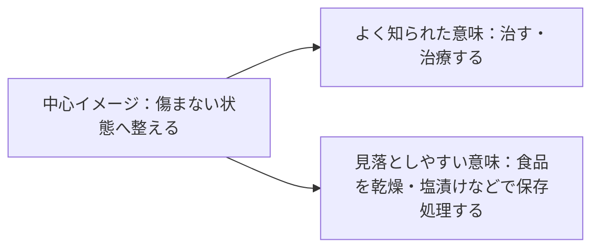

**重要語法：** cure meat / cure fish：肉・魚を塩漬けや乾燥などで保存処理する

<small>global_order: 1761 / index: 2760 / candidate_id: `ev-02760-verb-02`</small>

---

## 02. inevitable

**品詞：** 名詞　**発音：** /ɪnɛvətəbəl/

<small>よく知られている意味：避けられない</small>

### 見落としやすい意味：避けられない出来事

**例文：** They finally accepted the inevitable.

**和訳：** 彼らはついに避けられない事態を受け入れた。

**コアイメージ：** inevitable は「避けることができない」という形容詞である。the inevitable ではその性質を持つ出来事自体を名詞として指す。

**図：**

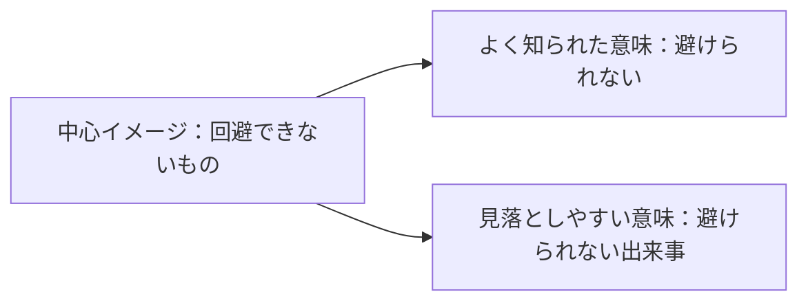

**重要語法：** the inevitable：避けられない事態（名詞的用法）

<small>global_order: 1762 / index: 2761 / candidate_id: `ev-02761-noun-01`</small>

---

## 03. mask

**品詞：** 動詞　**発音：** /mæsk/

<small>よく知られている意味：仮面・覆い</small>

### 見落としやすい意味：感情・事実などを隠す

**例文：** Her calm voice masked her fear.

**和訳：** 落ち着いた声は彼女の恐怖を隠していた。

**コアイメージ：** mask の基本は表面を覆い、本来の姿を見えなくすること。顔を覆う物から、感情や事実を隠す動作へと広がる。

**図：**

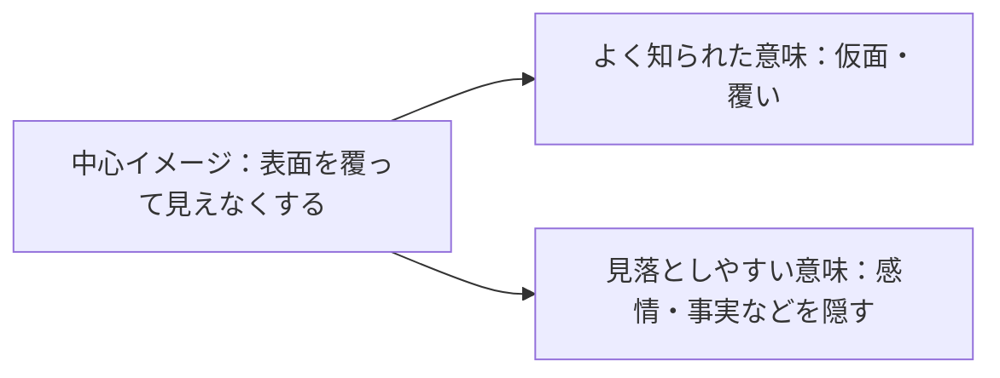

**重要語法：** mask one's feelings：感情を隠す

<small>global_order: 1763 / index: 2762 / candidate_id: `ev-02762-verb-01`</small>

---

## 04. puzzle

**品詞：** 動詞　**発音：** /pʌzəl/

<small>よく知られている意味：パズル・難問</small>

### 見落としやすい意味：困惑させる、理解に苦しませる

**例文：** The sudden change puzzled the researchers.

**和訳：** その突然の変化は研究者たちを困惑させた。

**コアイメージ：** puzzle は答えをすぐには見つけられない難問を表す。動詞では、相手をそのような分からない状態に置くことを意味する。

**図：**

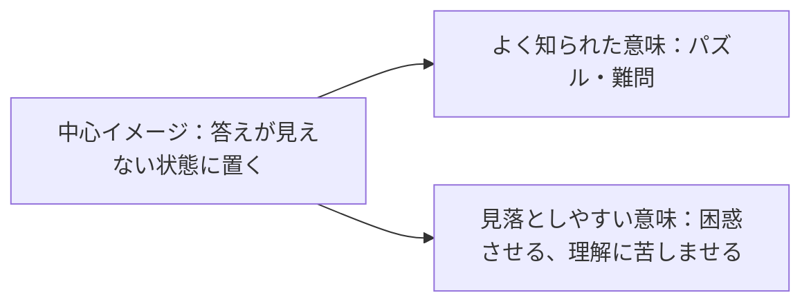

**重要語法：** be puzzled by ...：…に困惑する

<small>global_order: 1764 / index: 2763 / candidate_id: `ev-02763-verb-01`</small>

---

## 05. grade

**品詞：** 名詞　**発音：** /ɡreɪd/

<small>よく知られている意味：成績・等級</small>

### 見落としやすい意味：道路・地面などの勾配

**例文：** The truck struggled on the steep grade.

**和訳：** トラックは急な坂道で苦労した。

**コアイメージ：** grade は物事の程度や段階を表す。土地について使うと、高さが変わる度合い、すなわち勾配を指す。

**図：**

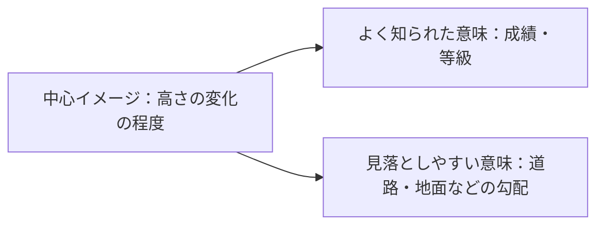

**重要語法：** a steep grade：急勾配

<small>global_order: 1765 / index: 2768 / candidate_id: `ev-02768-noun-01`</small>

---

## 06. grade

**品詞：** 動詞　**発音：** /ɡreɪd/

<small>よく知られている意味：採点する</small>

### 見落としやすい意味：地面を適切な勾配に整える

**例文：** Workers graded the land to improve drainage.

**和訳：** 作業員は排水をよくするために土地の勾配を整えた。

**コアイメージ：** grade は一定の基準に沿って程度を整えることにも使う。地面を対象にすると、高低差を調整して適切な傾きにする作業となる。

**図：**

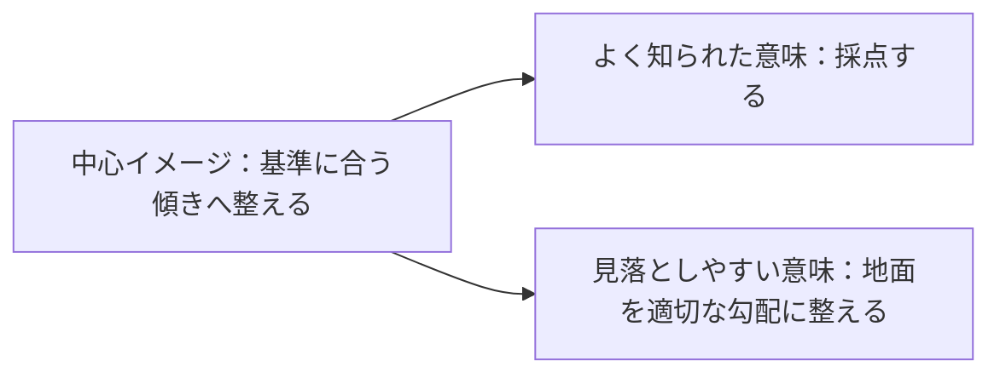

**重要語法：** grade a road：道路の勾配を整える

<small>global_order: 1766 / index: 2768 / candidate_id: `ev-02768-verb-01`</small>

---

## 07. coat

**品詞：** 名詞　**発音：** /koʊt/

<small>よく知られている意味：コート・上着</small>

### 見落としやすい意味：動物の毛皮・体毛

**例文：** The dog's thick coat kept it warm.

**和訳：** その犬の厚い毛並みが寒さから身を守っていた。

**コアイメージ：** coat の中心には、物や体の外側を覆う層がある。人が着る上着だけでなく、動物の全身を覆う毛にも使う。

**図：**

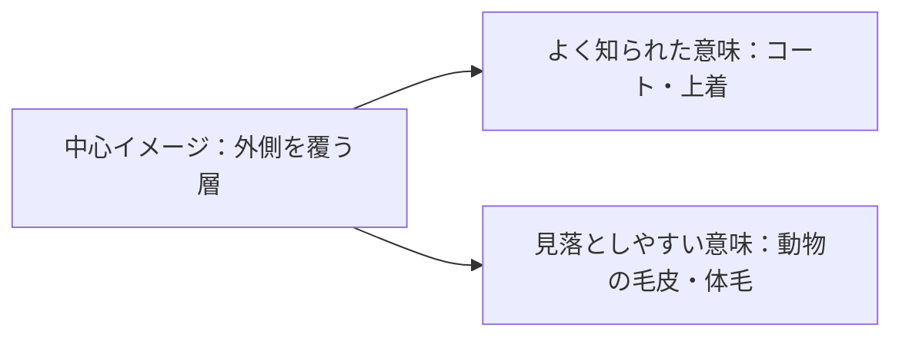

**重要語法：** a thick coat：厚い毛並み

<small>global_order: 1767 / index: 2769 / candidate_id: `ev-02769-noun-01`</small>

---

## 08. silence

**品詞：** 動詞　**発音：** /saɪləns/

<small>よく知られている意味：沈黙</small>

### 見落としやすい意味：意見などの表明を封じる

**例文：** The new rule silenced critics of the policy.

**和訳：** 新しい規則はその政策への批判者たちの発言を封じた。

**コアイメージ：** silence は音や声を消すことに関わる。人の意見を対象にすると、声を出せなくする、発言の機会を奪うという意味になる。

**図：**

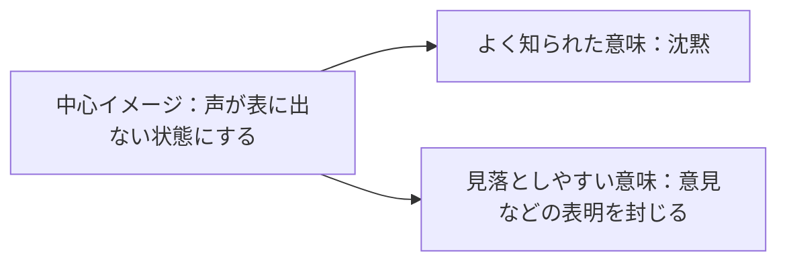

**重要語法：** silence critics：批判の声を封じる

<small>global_order: 1768 / index: 2771 / candidate_id: `ev-02771-verb-01`</small>

---

## 09. worthy

**品詞：** 名詞　**発音：** /wɝði/

<small>よく知られている意味：価値がある・ふさわしい</small>

### 見落としやすい意味：尊敬される人物、地域の有力者

**例文：** Several local worthies attended the opening ceremony.

**和訳：** 地元の名士数人が開会式に出席した。

**コアイメージ：** worthy は尊敬や評価に値するという性質を表す。名詞ではその評価を受ける人、特に地域で名の知られた人物を指す。

**図：**

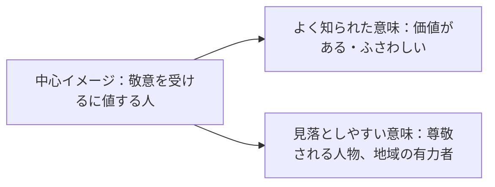

**重要語法：** local worthies：地元の名士たち（やや格式ばった表現）

<small>global_order: 1769 / index: 2772 / candidate_id: `ev-02772-noun-01`</small>

---

## 10. vessel

**品詞：** 名詞　**発音：** /vɛsəl/

<small>よく知られている意味：容器</small>

### 見落としやすい意味：船舶

**例文：** The fishing vessel returned to port at dawn.

**和訳：** その漁船は夜明けに港へ戻った。

**コアイメージ：** vessel は何かを収めたり運んだりする入れ物のイメージを持つ。船は人や荷物を載せて運ぶ大きな「容れ物」と捉えられる。

**図：**

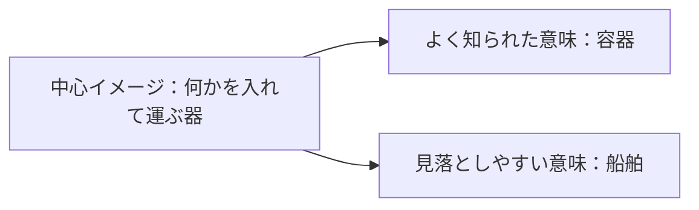

**重要語法：** a cargo vessel：貨物船

<small>global_order: 1770 / index: 2773 / candidate_id: `ev-02773-noun-01`</small>

---

## 11. mercury

**品詞：** 名詞　**発音：** /mɝkjɚi/

<small>よく知られている意味：水銀</small>

### 見落としやすい意味：温度計の水銀柱が表す気温

**例文：** The mercury rose above thirty degrees yesterday.

**和訳：** 昨日は気温が30度を超えた。

**コアイメージ：** かつての温度計は水銀柱の高さで温度を示していた。そのため mercury が水銀柱、さらにその示す気温を表すことがある。

**図：**

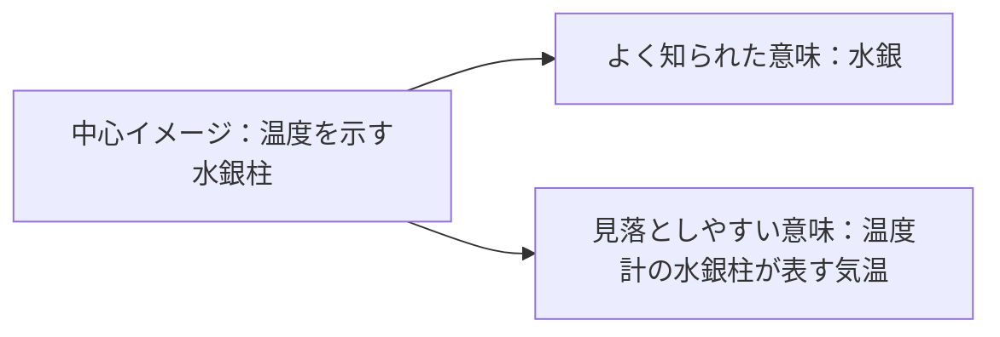

**重要語法：** the mercury rises / falls：気温が上がる／下がる（やや古風な表現）

<small>global_order: 1771 / index: 2778 / candidate_id: `ev-02778-noun-01`</small>

---

## 12. readily

**品詞：** 副詞　**発音：** /rɛdəli/

<small>よく知られている意味：容易に・たやすく</small>

### 見落としやすい意味：快く、ためらわずに

**例文：** She readily agreed to help.

**和訳：** 彼女は快く手伝いを引き受けた。

**コアイメージ：** readily の中心には、抵抗や障害がほとんどない感覚がある。行動が簡単にできる場合にも、気持ちの上でためらわず応じる場合にも使う。

**図：**

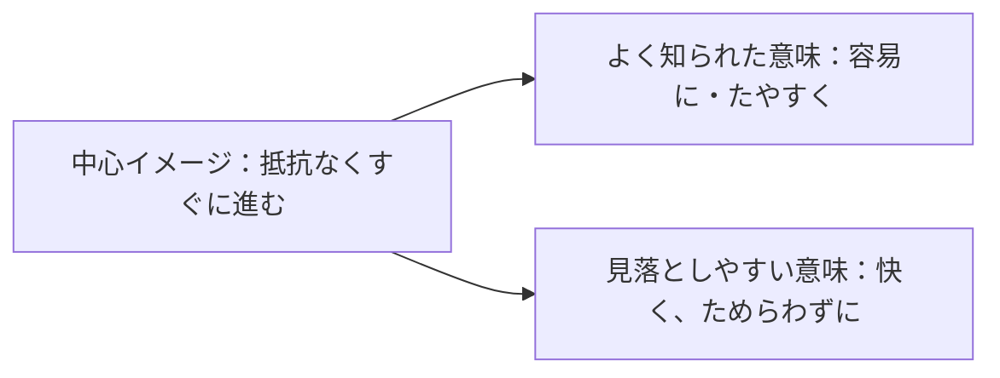

**重要語法：** readily agree：快く同意する

<small>global_order: 1772 / index: 2781 / candidate_id: `ev-02781-adverb-01`</small>

---

## 13. sin

**品詞：** 動詞　**発音：** /sɪn/

<small>よく知られている意味：罪・罪悪</small>

### 見落としやすい意味：重大な間違いや過失を犯す

**例文：** The manager sinned by ignoring clear warning signs.

**和訳：** その管理者は明白な警告を無視するという重大な過ちを犯した。

**コアイメージ：** sin は宗教的・道徳的な基準に反することを表す。比喩的には、当然守るべき判断基準を破る重大な失策にも使える。

**図：**

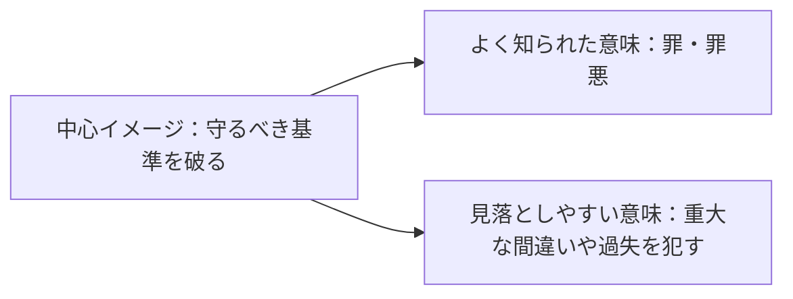

**重要語法：** sin against ...：…に背く・…を損なう（比喩的用法もある）

<small>global_order: 1773 / index: 2783 / candidate_id: `ev-02783-verb-01`</small>

---

## 14. yard

**品詞：** 名詞　**発音：** /jɑrd/

<small>よく知られている意味：庭・中庭</small>

### 見落としやすい意味：鉄道車両の留置・整備場

**例文：** The empty trains were parked in a rail yard.

**和訳：** 使われていない列車は車両基地に留められていた。

**コアイメージ：** yard は一定の目的のために確保された広い場所を指す。鉄道の文脈では、車両を留置したり整備したりする構内のことになる。

**図：**

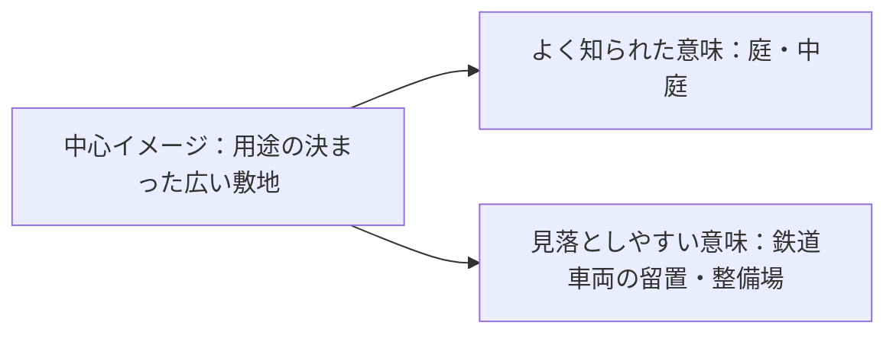

**重要語法：** rail yard：鉄道の車両基地

<small>global_order: 1774 / index: 2784 / candidate_id: `ev-02784-noun-01`</small>

---

## 15. ocean

**品詞：** 名詞　**発音：** /oʊʃən/

<small>よく知られている意味：海・大洋</small>

### 見落としやすい意味：膨大な量

**例文：** An ocean of possibilities opened up before us.

**和訳：** 私たちの前には無数の可能性が広がっていた。

**コアイメージ：** ocean には広大で果てが見えないという感覚がある。その広がりを量の多さに重ねると、「膨大な量」という比喩になる。

**図：**

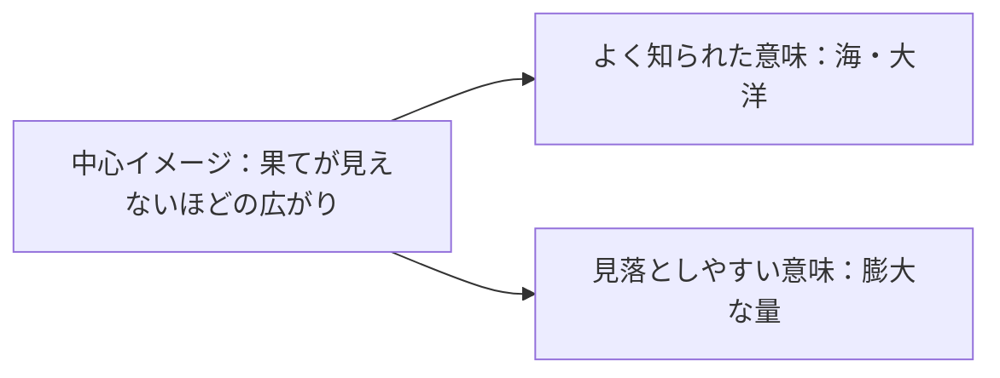

**重要語法：** an ocean of ...：膨大な…

<small>global_order: 1775 / index: 2787 / candidate_id: `ev-02787-noun-01`</small>

---

## 16. identification

**品詞：** 名詞　**発音：** /aɪdɛntəfəkeɪʃən/

<small>よく知られている意味：身元の確認・識別</small>

### 見落としやすい意味：他人や集団の特徴を自分と同一視すること

**例文：** Her identification with the hero made the ending especially moving.

**和訳：** 主人公への彼女の強い感情移入が、結末をひときわ感動的なものにした。

**コアイメージ：** identification は、二つのものを同じものとして結びつけることに関係する。身元を同定する場合と、自分を他人に重ねて感じる場合がある。

**図：**

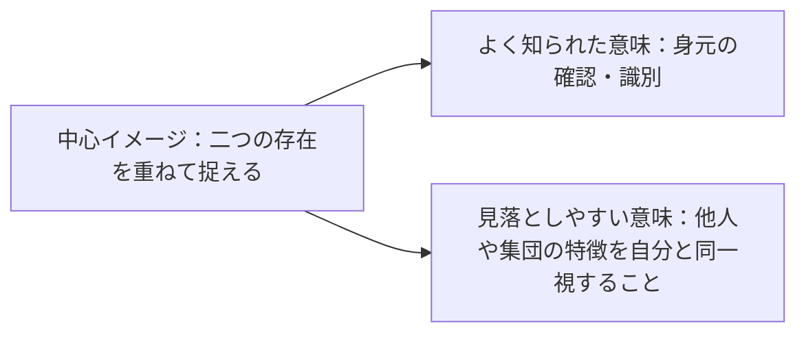

**重要語法：** identification with ...：…への同一視・感情移入

<small>global_order: 1776 / index: 2788 / candidate_id: `ev-02788-noun-01`</small>

---

## 17. molecule

**品詞：** 名詞　**発音：** /mɑləkjul/

<small>よく知られている意味：分子</small>

### 見落としやすい意味：ごく小さな断片

**例文：** There wasn't a molecule of doubt in his mind.

**和訳：** 彼の心には一片の疑いもなかった。

**コアイメージ：** molecule は非常に小さな構成単位を指す。比喩では、感情や疑いを極小の量にまで分けて考え、「ほんのわずか」を強調する。

**図：**

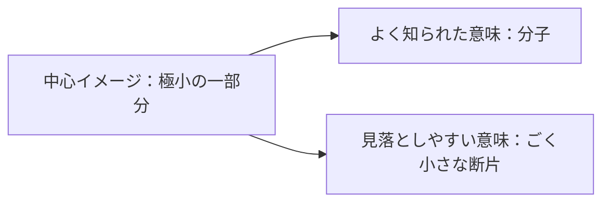

**重要語法：** not a molecule of ...：…がほんのわずかもない（比喩的表現）

<small>global_order: 1777 / index: 2795 / candidate_id: `ev-02795-noun-01`</small>

---

## 18. specify

**品詞：** 動詞　**発音：** /spɛsəfaɪ/

<small>よく知られている意味：明確に述べる・指定する</small>

### 見落としやすい意味：特定の用途に指定する

**例文：** The engineer specified steel for the bridge supports.

**和訳：** 技師は橋の支柱に使う材料として鋼材を指定した。

**コアイメージ：** specify は曖昧な選択肢を絞り、対象をはっきり決めること。単に名前を明記するだけでなく、ある用途に用いるものを指定する場合にも使う。

**図：**

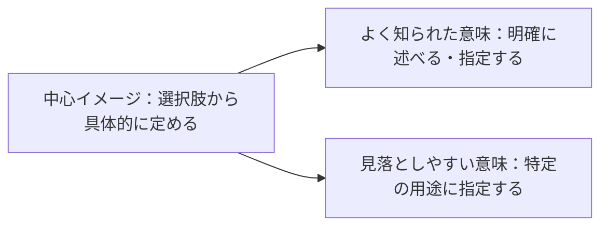

**重要語法：** specify A for B：Bに使うものとしてAを指定する

<small>global_order: 1778 / index: 2797 / candidate_id: `ev-02797-verb-01`</small>

---

## 19. yellow

**品詞：** 形容詞　**発音：** /jɛloʊ/

<small>よく知られている意味：黄色い</small>

### 見落としやすい意味：臆病な

**例文：** He was too yellow to admit the truth.

**和訳：** 彼には本当のことを認める勇気がなかった。

**コアイメージ：** yellow は通常は色を表すが、くだけた古い用法では臆病さを表す。色の意味から直接推測しにくい慣用的な形容詞として区別するとよい。

**図：**

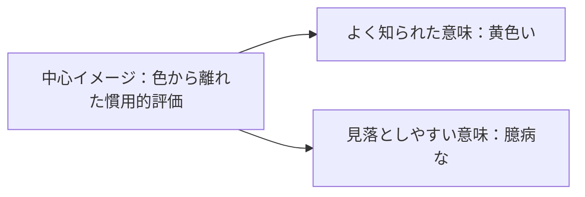

**重要語法：** yellow＝臆病な、は口語的・やや古風

<small>global_order: 1779 / index: 2798 / candidate_id: `ev-02798-adjective-01`</small>

---

## 20. shoulder

**品詞：** 動詞　**発音：** /ʃoʊldɚ/

<small>よく知られている意味：肩</small>

### 見落としやすい意味：責任や重荷を引き受ける

**例文：** She shouldered the responsibility for the mistake.

**和訳：** 彼女はその失敗の責任を引き受けた。

**コアイメージ：** shoulder は体の重さを支える部分を表す。動詞では荷を肩に載せる感覚から、責任や負担を自分で担うことを意味する。

**図：**

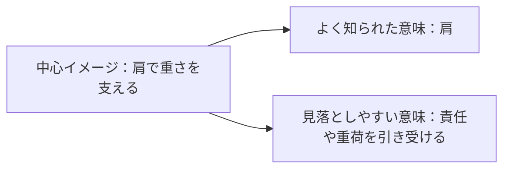

**重要語法：** shoulder responsibility：責任を引き受ける

<small>global_order: 1780 / index: 2799 / candidate_id: `ev-02799-verb-01`</small>

---

## 21. fault

**品詞：** 名詞　**発音：** /fɔlt/

<small>よく知られている意味：欠点・過失</small>

### 見落としやすい意味：地殻の断層

**例文：** A major fault runs beneath the valley.

**和訳：** 大きな断層がその谷の地下を走っている。

**コアイメージ：** fault には連続しているはずのものにずれや切れ目が生じる感覚がある。地質学では岩盤がずれた境界を指す。

**図：**

```mermaid
flowchart LR
    A["中心イメージ：つながりのずれ・割れ目"]
    B["よく知られた意味：欠点・過失"]
    C["見落としやすい意味：地殻の断層"]
    A --> B
    A --> C
```

**重要語法：** an active fault：活断層

<small>global_order: 1781 / index: 2800 / candidate_id: `ev-02800-noun-01`</small>

---

## 22. motion

**品詞：** 名詞　**発音：** /moʊʃən/

<small>よく知られている意味：動き・運動</small>

### 見落としやすい意味：会議・議会に出す動議

**例文：** The committee passed a motion to revise the rules.

**和訳：** 委員会は規則改正の動議を可決した。

**コアイメージ：** motion は物事を動かすことに関係する。会議では議論や決定の手続きを動かすために正式に提出する提案を表す。

**図：**

```mermaid
flowchart LR
    A["中心イメージ：決定を前へ動かす提案"]
    B["よく知られた意味：動き・運動"]
    C["見落としやすい意味：会議・議会に出す動議"]
    A --> B
    A --> C
```

**重要語法：** pass a motion：動議を可決する

<small>global_order: 1782 / index: 2804 / candidate_id: `ev-02804-noun-01`</small>

---

## 23. motion

**品詞：** 名詞　**発音：** /moʊʃən/

<small>よく知られている意味：動き・運動</small>

### 見落としやすい意味：裁判所に正式に出す申立て

**例文：** The lawyer filed a motion to dismiss the case.

**和訳：** 弁護士はその訴訟を退けるよう裁判所に申し立てた。

**コアイメージ：** motion は手続きを動かすための正式な働きかけを指す。裁判では裁判所に特定の判断や命令を求める申立てとなる。

**図：**

```mermaid
flowchart LR
    A["中心イメージ：法的手続きを動かす申請"]
    B["よく知られた意味：動き・運動"]
    C["見落としやすい意味：裁判所に正式に出す申立て"]
    A --> B
    A --> C
```

**重要語法：** file a motion：申立てを提出する

<small>global_order: 1783 / index: 2804 / candidate_id: `ev-02804-noun-02`</small>

---

## 24. intent

**品詞：** 形容詞　**発音：** /ɪntɛnt/

<small>よく知られている意味：意図・目的（名詞）</small>

### 見落としやすい意味：一心に集中している

**例文：** He was intent on finishing the project.

**和訳：** 彼はその計画を完成させることに一心に取り組んでいた。

**コアイメージ：** intent は心の向きが定まった状態を表す。形容詞では意識が一つの対象へ強く向き、集中していることを意味する。

**図：**

```mermaid
flowchart LR
    A["中心イメージ：意識が一点に向かう"]
    B["よく知られた意味：意図・目的（名詞）"]
    C["見落としやすい意味：一心に集中している"]
    A --> B
    A --> C
```

**重要語法：** be intent on doing：…することに集中している

<small>global_order: 1784 / index: 2805 / candidate_id: `ev-02805-adjective-01`</small>

---

## 25. undermine

**品詞：** 動詞　**発音：** /ʌndɚmaɪn/

<small>よく知られている意味：信用・影響力を損なう</small>

### 見落としやすい意味：下を削って土台を弱める

**例文：** Rainwater undermined the foundation of the wall.

**和訳：** 雨水が壁の基礎の下を削り、弱くした。

**コアイメージ：** undermine の文字どおりの動作は、下から掘って支えを失わせること。そこから、信頼や権威など目に見えない土台を弱める意味になる。

**図：**

```mermaid
flowchart LR
    A["中心イメージ：土台を下から弱める"]
    B["よく知られた意味：信用・影響力を損なう"]
    C["見落としやすい意味：下を削って土台を弱める"]
    A --> B
    A --> C
```

**重要語法：** undermine a foundation：基礎の下を削って弱める

<small>global_order: 1785 / index: 2806 / candidate_id: `ev-02806-verb-01`</small>

---

## 26. endorse

**品詞：** 動詞　**発音：** /ɛndɔrs/

<small>よく知られている意味：支持する・推薦する</small>

### 見落としやすい意味：小切手などに裏書する

**例文：** Please endorse the check on the back.

**和訳：** 小切手の裏に裏書きしてください。

**コアイメージ：** endorse は署名などによって承認を示すことに関わる。意見への支持から、金融文書の裏面に署名して権利を確認する行為にも使う。

**図：**

```mermaid
flowchart LR
    A["中心イメージ：署名で承認を示す"]
    B["よく知られた意味：支持する・推薦する"]
    C["見落としやすい意味：小切手などに裏書する"]
    A --> B
    A --> C
```

**重要語法：** endorse a check：小切手に裏書きする（米国綴り）

<small>global_order: 1786 / index: 2808 / candidate_id: `ev-02808-verb-01`</small>

---

## 27. modify

**品詞：** 動詞　**発音：** /mɑdəfaɪ/

<small>よく知られている意味：変更する</small>

### 見落としやすい意味：文法で他の語句を修飾する

**例文：** In this sentence, the adjective modifies the noun.

**和訳：** この文では形容詞が名詞を修飾している。

**コアイメージ：** modify は対象に情報や条件を加えて、その働きや意味を限定すること。文法では形容詞などが別の語の意味を詳しくする関係を表す。

**図：**

```mermaid
flowchart LR
    A["中心イメージ：対象の意味を限定・調整する"]
    B["よく知られた意味：変更する"]
    C["見落としやすい意味：文法で他の語句を修飾する"]
    A --> B
    A --> C
```

**重要語法：** modify a noun：名詞を修飾する

<small>global_order: 1787 / index: 2810 / candidate_id: `ev-02810-verb-01`</small>

---

## 28. modify

**品詞：** 動詞　**発音：** /mɑdəfaɪ/

<small>よく知られている意味：変更する・修正する</small>

### 見落としやすい意味：規則や要求などの厳しさを和らげる

**例文：** The school modified the rule to allow more exceptions.

**和訳：** 学校は例外をより多く認めるように規則を緩和した。

**コアイメージ：** modify は元の仕組みを残しながら一部を変えること。厳しすぎる条件に手を加える文脈では、制限を弱める意味になる。

**図：**

```mermaid
flowchart LR
    A["中心イメージ：一部を調整して厳しさを変える"]
    B["よく知られた意味：変更する・修正する"]
    C["見落としやすい意味：規則や要求などの厳しさを和らげる"]
    A --> B
    A --> C
```

**重要語法：** modify a requirement：要求を緩和・変更する（文脈による）

<small>global_order: 1788 / index: 2810 / candidate_id: `ev-02810-verb-02`</small>

---

## 29. swimming

**品詞：** 形容詞　**発音：** /swɪmɪŋ/

<small>よく知られている意味：泳いでいる</small>

### 見落としやすい意味：涙で目がうるんだ

**例文：** His eyes were swimming with tears.

**和訳：** 彼の目には涙があふれていた。

**コアイメージ：** swim には水の中で揺れ動く感覚もある。目を主語にして涙とともに使うと、涙で目がうるみ、視界がにじむ様子を表す。

**図：**

```mermaid
flowchart LR
    A["中心イメージ：液体で揺れ・にじみが生じる"]
    B["よく知られた意味：泳いでいる"]
    C["見落としやすい意味：涙で目がうるんだ"]
    A --> B
    A --> C
```

**重要語法：** eyes swimming with tears：涙でうるんだ目

<small>global_order: 1789 / index: 2811 / candidate_id: `ev-02811-adjective-01`</small>

---

## 30. salt

**品詞：** 動詞　**発音：** /sɔlt/

<small>よく知られている意味：塩・塩を振る</small>

### 見落としやすい意味：話などに面白みを加える

**例文：** The speaker salted her talk with jokes.

**和訳：** 話し手はスピーチに冗談をちりばめた。

**コアイメージ：** 塩を少し加えると料理の味が引き立つ。そこから、話や文章に面白い要素を少しずつ加える比喩が生まれる。

**図：**

```mermaid
flowchart LR
    A["中心イメージ：少量を散らして味を付ける"]
    B["よく知られた意味：塩・塩を振る"]
    C["見落としやすい意味：話などに面白みを加える"]
    A --> B
    A --> C
```

**重要語法：** salt a speech with jokes：話に冗談をちりばめる

<small>global_order: 1790 / index: 2812 / candidate_id: `ev-02812-verb-01`</small>

---

## 31. progressive

**品詞：** 形容詞　**発音：** /prəɡrɛsɪv/

<small>よく知られている意味：進歩的な</small>

### 見落としやすい意味：（病気などが）次第に進行して悪化する

**例文：** The scan showed progressive damage to the nerves.

**和訳：** 検査画像から神経の損傷が徐々に進行していることが分かった。

**コアイメージ：** progressive は段階を追って進むことを表す。進歩という肯定的な意味に限らず、病気や損傷の悪化が進む場合にも使う。

**図：**

```mermaid
flowchart LR
    A["中心イメージ：段階を追って進んでいく"]
    B["よく知られた意味：進歩的な"]
    C["見落としやすい意味：（病気などが）次第に進行して悪化する"]
    A --> B
    A --> C
```

**重要語法：** progressive disease：進行性の病気

<small>global_order: 1791 / index: 2813 / candidate_id: `ev-02813-adjective-01`</small>

---

## 32. progressive

**品詞：** 名詞　**発音：** /prəɡrɛsɪv/

<small>よく知られている意味：進歩的な（形容詞）</small>

### 見落としやすい意味：文法上の進行形

**例文：** Rewrite the sentence in the present progressive.

**和訳：** その文を現在進行形に書き換えなさい。

**コアイメージ：** progressive は動作が進んでいる過程に目を向ける語である。文法では進行形そのものを名詞として指す。

**図：**

```mermaid
flowchart LR
    A["中心イメージ：動作が進行している途中"]
    B["よく知られた意味：進歩的な（形容詞）"]
    C["見落としやすい意味：文法上の進行形"]
    A --> B
    A --> C
```

**重要語法：** the present progressive：現在進行形

<small>global_order: 1792 / index: 2813 / candidate_id: `ev-02813-noun-01`</small>

---

## 33. working

**品詞：** 形容詞　**発音：** /wɝkɪŋ/

<small>よく知られている意味：働いている</small>

### 見落としやすい意味：実用に足る、暫定的に使える

**例文：** This is only a working hypothesis, not a final conclusion.

**和訳：** これはあくまで暫定的な仮説で、最終結論ではない。

**コアイメージ：** working は、今の作業に使える程度に機能するという意味を持つ。完成形でなくても当面の判断に役立つものを表す。

**図：**

```mermaid
flowchart LR
    A["中心イメージ：今の作業に使える状態"]
    B["よく知られた意味：働いている"]
    C["見落としやすい意味：実用に足る、暫定的に使える"]
    A --> B
    A --> C
```

**重要語法：** a working hypothesis：作業仮説・暫定仮説

<small>global_order: 1793 / index: 2814 / candidate_id: `ev-02814-adjective-01`</small>

---

## 34. leak

**品詞：** 動詞　**発音：** /lik/

<small>よく知られている意味：液体が漏れる</small>

### 見落としやすい意味：機密情報を匿名で漏らす

**例文：** Someone leaked the confidential plan to a reporter.

**和訳：** 何者かが機密計画を記者に漏らした。

**コアイメージ：** leak は閉じた場所から意図せず外へ出ることが基本。情報では非公開のはずの内容を外へ流すことを表し、秘密の暴露にも使う。

**図：**

```mermaid
flowchart LR
    A["中心イメージ：内側のものが外へ漏れ出す"]
    B["よく知られた意味：液体が漏れる"]
    C["見落としやすい意味：機密情報を匿名で漏らす"]
    A --> B
    A --> C
```

**重要語法：** leak information to ...：…に情報を漏らす

<small>global_order: 1794 / index: 2817 / candidate_id: `ev-02817-verb-01`</small>

---

## 35. deem

**品詞：** 動詞　**発音：** /dim/

<small>よく知られている意味：〜と考える・判断する</small>

### 見落としやすい意味：deem A B / deem A to be B：AをBだと見なす

**例文：** The court deemed the evidence unreliable.

**和訳：** 裁判所はその証拠を信頼できないと判断した。

**コアイメージ：** deem は対象に一定の判断を与えて位置づける動詞である。Aの後ろにBやto be Bを置き、「AをBとみなす」と表せる。

**図：**

```mermaid
flowchart LR
    A["中心イメージ：対象に判断を与える"]
    B["よく知られた意味：〜と考える・判断する"]
    C["見落としやすい意味：deem A B / deem A to be B：AをBだと見なす"]
    A --> B
    A --> C
```

**重要語法：** deem A B / deem A to be B：AをBだとみなす

<small>global_order: 1795 / index: 2818 / candidate_id: `ev-02818-verb-01`</small>

---

## 36. imperial

**品詞：** 形容詞　**発音：** /ɪmpɪriəl/

<small>よく知られている意味：皇帝の・帝国の</small>

### 見落としやすい意味：ヤード・ポンド法の

**例文：** The recipe uses imperial measurements rather than metric ones.

**和訳：** そのレシピではメートル法でなくヤード・ポンド法の単位を使っている。

**コアイメージ：** imperial は帝国に関係することを表す。単位については、歴史的にイギリスで使われてきた計量制度を指す。

**図：**

```mermaid
flowchart LR
    A["中心イメージ：帝国に由来する制度"]
    B["よく知られた意味：皇帝の・帝国の"]
    C["見落としやすい意味：ヤード・ポンド法の"]
    A --> B
    A --> C
```

**重要語法：** imperial units：ヤード・ポンド法の単位

<small>global_order: 1796 / index: 2819 / candidate_id: `ev-02819-adjective-01`</small>

---

## 37. interpret

**品詞：** 動詞　**発音：** /ɪntɝprət/

<small>よく知られている意味：解釈する</small>

### 見落としやすい意味：音楽・演劇作品を自分なりに解釈して演じる・演奏する

**例文：** The pianist interpreted the piece with unusual tenderness.

**和訳：** ピアニストはその曲を並外れて優しく表現して演奏した。

**コアイメージ：** interpret は内容の意味を受け取り、理解の仕方を示すこと。音楽や演劇では自分なりの読み取りを実際の演奏・演技で表す。

**図：**

```mermaid
flowchart LR
    A["中心イメージ：理解を自分の表現へ移す"]
    B["よく知られた意味：解釈する"]
    C["見落としやすい意味：音楽・演劇作品を自分なりに解釈して演じる・演奏する"]
    A --> B
    A --> C
```

**重要語法：** interpret a piece：作品を解釈して演奏する

<small>global_order: 1797 / index: 2820 / candidate_id: `ev-02820-verb-01`</small>

---

## 38. sad

**品詞：** 形容詞　**発音：** /sæd/

<small>よく知られている意味：悲しい</small>

### 見落としやすい意味：ひどい、お粗末な

**例文：** The report was a sad excuse for serious research.

**和訳：** その報告書は本格的な研究と呼ぶにはお粗末だった。

**コアイメージ：** sad は残念で落胆する感覚から、期待した水準に達していないという評価にも使われる。感情の描写ではなく、質の低さを批判する表現になる。

**図：**

```mermaid
flowchart LR
    A["中心イメージ：期待に届かず残念な"]
    B["よく知られた意味：悲しい"]
    C["見落としやすい意味：ひどい、お粗末な"]
    A --> B
    A --> C
```

**重要語法：** a sad excuse for ...：…とは到底呼べないお粗末なもの

<small>global_order: 1798 / index: 2824 / candidate_id: `ev-02824-adjective-01`</small>

---

## 39. relax

**品詞：** 動詞　**発音：** /rɪlæks/

<small>よく知られている意味：くつろぐ</small>

### 見落としやすい意味：法律・規則・制約などを緩和する

**例文：** The government relaxed the restrictions on outdoor events.

**和訳：** 政府は屋外行事への制限を緩和した。

**コアイメージ：** relax の中心には、緊張したり締めつけられたりした状態を緩める感覚がある。人の心身だけでなく、規則や制限の厳しさも緩められる。

**図：**

```mermaid
flowchart LR
    A["中心イメージ：締めつけを緩くする"]
    B["よく知られた意味：くつろぐ"]
    C["見落としやすい意味：法律・規則・制約などを緩和する"]
    A --> B
    A --> C
```

**重要語法：** relax restrictions：制限を緩和する

<small>global_order: 1799 / index: 2825 / candidate_id: `ev-02825-verb-01`</small>

---

## 40. provoke

**品詞：** 動詞　**発音：** /prəvoʊk/

<small>よく知られている意味：怒らせる・挑発する</small>

### 見落としやすい意味：同情・笑いなどの感情を引き起こす

**例文：** The comedian's remark provoked laughter.

**和訳：** そのコメディアンの発言は笑いを引き起こした。

**コアイメージ：** provoke は刺激を加えて反応を生じさせること。怒りだけでなく、笑い・同情・議論なども引き起こす。

**図：**

```mermaid
flowchart LR
    A["中心イメージ：刺激して反応を引き出す"]
    B["よく知られた意味：怒らせる・挑発する"]
    C["見落としやすい意味：同情・笑いなどの感情を引き起こす"]
    A --> B
    A --> C
```

**重要語法：** provoke laughter / sympathy：笑い／同情を引き起こす

<small>global_order: 1800 / index: 2827 / candidate_id: `ev-02827-verb-01`</small>

---

## 41. flourish

**品詞：** 名詞　**発音：** /flɝɪʃ/

<small>よく知られている意味：繁栄する（動詞）</small>

### 見落としやすい意味：大げさな身振り、装飾的な表現

**例文：** The actor bowed with a dramatic flourish.

**和訳：** 俳優は大げさな身振りを添えてお辞儀した。

**コアイメージ：** flourish は人目を引くように大きく広がる動きや表現にも関係する。名詞では劇的な身振りや飾り立てた演出を指す。

**図：**

```mermaid
flowchart LR
    A["中心イメージ：目立つように大きく広げる"]
    B["よく知られた意味：繁栄する（動詞）"]
    C["見落としやすい意味：大げさな身振り、装飾的な表現"]
    A --> B
    A --> C
```

**重要語法：** with a flourish：派手な身振りを添えて

<small>global_order: 1801 / index: 2828 / candidate_id: `ev-02828-noun-01`</small>

---

## 42. flourish

**品詞：** 動詞　**発音：** /flɝɪʃ/

<small>よく知られている意味：繁栄する</small>

### 見落としやすい意味：手に持つものを誇示するように振る

**例文：** He flourished the letter above his head.

**和訳：** 彼は手紙を頭上で誇らしげに振り回した。

**コアイメージ：** flourish には大きく目立つように動かす感覚がある。手にした物を人の目に入るように掲げたり振ったりする動作を表せる。

**図：**

```mermaid
flowchart LR
    A["中心イメージ：人目に付くように振る"]
    B["よく知られた意味：繁栄する"]
    C["見落としやすい意味：手に持つものを誇示するように振る"]
    A --> B
    A --> C
```

**重要語法：** flourish a document：書類を得意げに振って見せる

<small>global_order: 1802 / index: 2828 / candidate_id: `ev-02828-verb-01`</small>

---

## 43. administer

**品詞：** 動詞　**発音：** /ədmɪnəstɚ/

<small>よく知られている意味：管理する</small>

### 見落としやすい意味：試験・宣誓などを実施する

**例文：** The school will administer the exam on Friday.

**和訳：** 学校は金曜日に試験を実施する。

**コアイメージ：** administer は手順や制度を責任をもって運営すること。試験や宣誓については、定められた手続きを実際に行うことを意味する。

**図：**

```mermaid
flowchart LR
    A["中心イメージ：手続きを管理して実行する"]
    B["よく知られた意味：管理する"]
    C["見落としやすい意味：試験・宣誓などを実施する"]
    A --> B
    A --> C
```

**重要語法：** administer an exam：試験を実施する

<small>global_order: 1803 / index: 2829 / candidate_id: `ev-02829-verb-01`</small>

---

## 44. integrity

**品詞：** 名詞　**発音：** /ɪntɛɡrəti/

<small>よく知られている意味：誠実さ・高潔さ</small>

### 見落としやすい意味：構造・体系の完全性

**例文：** The engineers checked the bridge's structural integrity.

**和訳：** 技師たちは橋の構造上の健全性を確認した。

**コアイメージ：** integrity の中心は部分が欠けず、一体として保たれている状態である。人格なら信念の一貫性、建造物なら構造が損なわれていないことを表す。

**図：**

```mermaid
flowchart LR
    A["中心イメージ：欠けずに一体性を保つ"]
    B["よく知られた意味：誠実さ・高潔さ"]
    C["見落としやすい意味：構造・体系の完全性"]
    A --> B
    A --> C
```

**重要語法：** structural integrity：構造的な健全性

<small>global_order: 1804 / index: 2831 / candidate_id: `ev-02831-noun-01`</small>

---

## 45. smell

**品詞：** 動詞　**発音：** /smɛl/

<small>よく知られている意味：においをかぐ</small>

### 見落としやすい意味：危険や問題を直感的に察する

**例文：** The detective smelled trouble before the meeting began.

**和訳：** 探偵は会議が始まる前に問題の兆しを感じ取った。

**コアイメージ：** smell は目に見えないものを感覚で捉える動詞である。比喩では、状況から危険や不正の兆候を直感的に察することを表す。

**図：**

```mermaid
flowchart LR
    A["中心イメージ：目に見えない兆候を察する"]
    B["よく知られた意味：においをかぐ"]
    C["見落としやすい意味：危険や問題を直感的に察する"]
    A --> B
    A --> C
```

**重要語法：** smell trouble：問題の気配を感じ取る

<small>global_order: 1805 / index: 2832 / candidate_id: `ev-02832-verb-01`</small>

---

## 46. storm

**品詞：** 動詞　**発音：** /stɔrm/

<small>よく知られている意味：嵐</small>

### 見落としやすい意味：（怒って）勢いよく移動する、飛び出す

**例文：** She stormed out of the room without a word.

**和訳：** 彼女は一言も言わず怒って部屋を飛び出した。

**コアイメージ：** storm は激しく勢いのある嵐を表す。動詞ではその勢いを人の動きに重ね、怒って乱暴な勢いで移動することを示す。

**図：**

```mermaid
flowchart LR
    A["中心イメージ：嵐のような激しい勢い"]
    B["よく知られた意味：嵐"]
    C["見落としやすい意味：（怒って）勢いよく移動する、飛び出す"]
    A --> B
    A --> C
```

**重要語法：** storm out：怒って飛び出す

<small>global_order: 1806 / index: 2833 / candidate_id: `ev-02833-verb-01`</small>

---

## 47. receipt

**品詞：** 名詞　**発音：** /rɪsit/

<small>よく知られている意味：領収書</small>

### 見落としやすい意味：物品・情報などの受領

**例文：** Receipt of your application will be confirmed by email.

**和訳：** 申請書を受領したことはメールでお知らせします。

**コアイメージ：** receipt は何かが手元に届き、受け取られることを指す。領収書は受領の証拠であり、文書では受領という行為自体を表す。

**図：**

```mermaid
flowchart LR
    A["中心イメージ：受け取ったことの確認"]
    B["よく知られた意味：領収書"]
    C["見落としやすい意味：物品・情報などの受領"]
    A --> B
    A --> C
```

**重要語法：** upon receipt of ...：…の受領後に

<small>global_order: 1807 / index: 2834 / candidate_id: `ev-02834-noun-01`</small>

---

## 48. receipt

**品詞：** 名詞　**発音：** /rɪsit/

<small>よく知られている意味：領収書</small>

### 見落としやすい意味：受け取った金銭の額、収入（通常複数形receipts）

**例文：** Ticket receipts increased after the renovation.

**和訳：** 改装後、チケットの売上収入が増えた。

**コアイメージ：** receipt は受け取ることから、受け取った金銭そのものも表す。会計・事業の文脈では通常複数形 receipts で収入額を指す。

**図：**

```mermaid
flowchart LR
    A["中心イメージ：受け取った金銭"]
    B["よく知られた意味：領収書"]
    C["見落としやすい意味：受け取った金銭の額、収入（通常複数形receipts）"]
    A --> B
    A --> C
```

**重要語法：** ticket receipts：チケット収入（通常複数形）

<small>global_order: 1808 / index: 2834 / candidate_id: `ev-02834-noun-02`</small>

---

## 49. badly

**品詞：** 副詞　**発音：** /bædli/

<small>よく知られている意味：悪く・下手に</small>

### 見落としやすい意味：どうしても、非常に強く

**例文：** The old roof badly needs repair.

**和訳：** その古い屋根はどうしても修理が必要だ。

**コアイメージ：** badly は悪い状態や大きな程度を強調する語である。need や want などと結びつくと、必要性や願望の切実さを強める。

**図：**

```mermaid
flowchart LR
    A["中心イメージ：程度が大きく切実"]
    B["よく知られた意味：悪く・下手に"]
    C["見落としやすい意味：どうしても、非常に強く"]
    A --> B
    A --> C
```

**重要語法：** badly need ...：…を切実に必要とする

<small>global_order: 1809 / index: 2835 / candidate_id: `ev-02835-adverb-01`</small>

---

## 50. execution

**品詞：** 名詞　**発音：** /ɛksəkjuʃən/

<small>よく知られている意味：実行・執行</small>

### 見落としやすい意味：契約の正式な締結、署名による法的な効力の成立

**例文：** The contract takes effect upon execution by both parties.

**和訳：** その契約は両当事者が正式に署名すると効力を生じる。

**コアイメージ：** execution は決められた行為を正式に遂行することを表す。法律文書では、契約当事者が必要な署名などを行って成立させることを指す場合がある。

**図：**

```mermaid
flowchart LR
    A["中心イメージ：正式な行為を完了する"]
    B["よく知られた意味：実行・執行"]
    C["見落としやすい意味：契約の正式な締結、署名による法的な効力の成立"]
    A --> B
    A --> C
```

**重要語法：** execution of a contract：契約への署名・正式な締結（文脈による）

<small>global_order: 1810 / index: 2838 / candidate_id: `ev-02838-noun-01`</small>

---

## 51. strictly

**品詞：** 副詞　**発音：** /strɪktli/

<small>よく知られている意味：厳格に</small>

### 見落としやすい意味：もっぱら、特定のことだけに限って

**例文：** The trip is strictly for research purposes.

**和訳：** その旅行は純粋に研究目的のためだけのものだ。

**コアイメージ：** strictly は曖昧な余地を認めず境界を守る感覚を持つ。行動を厳しくする場合だけでなく、範囲を一つの目的に限定する意味にもなる。

**図：**

```mermaid
flowchart LR
    A["中心イメージ：範囲を厳しく限定する"]
    B["よく知られた意味：厳格に"]
    C["見落としやすい意味：もっぱら、特定のことだけに限って"]
    A --> B
    A --> C
```

**重要語法：** strictly for ...：もっぱら…のために

<small>global_order: 1811 / index: 2839 / candidate_id: `ev-02839-adverb-01`</small>

---

## 52. likewise

**品詞：** 副詞　**発音：** /laɪkwaɪz/

<small>よく知られている意味：同様に</small>

### 見落としやすい意味：同じように、またそれに加えて

**例文：** The school improved its labs. Likewise, it expanded the library.

**和訳：** 学校は実験室を改善した。また、図書館も拡充した。

**コアイメージ：** likewise は前に述べた事柄と並ぶ内容をつなぐ。単なる類似だけでなく、同じ流れの追加事項を示す接続語としても使う。

**図：**

```mermaid
flowchart LR
    A["中心イメージ：前の内容と並行して加える"]
    B["よく知られた意味：同様に"]
    C["見落としやすい意味：同じように、またそれに加えて"]
    A --> B
    A --> C
```

**重要語法：** Likewise, ...：同様に／また…

<small>global_order: 1812 / index: 2840 / candidate_id: `ev-02840-adverb-01`</small>

---

## 53. accommodation

**品詞：** 名詞　**発音：** /əkɑmədeɪʃən/

<small>よく知られている意味：宿泊設備</small>

### 見落としやすい意味：対立を解消する妥協・調整

**例文：** Both sides sought an accommodation over the disputed border.

**和訳：** 双方は争いのある国境をめぐって妥協点を探った。

**コアイメージ：** accommodation は相手や状況に合うように調整することに関係する。泊まる場所の提供だけでなく、対立する立場を折り合わせる妥協も指す。

**図：**

```mermaid
flowchart LR
    A["中心イメージ：違いに合わせて調整する"]
    B["よく知られた意味：宿泊設備"]
    C["見落としやすい意味：対立を解消する妥協・調整"]
    A --> B
    A --> C
```

**重要語法：** reach an accommodation：妥協に達する

<small>global_order: 1813 / index: 2841 / candidate_id: `ev-02841-noun-01`</small>

---

## 54. accessible

**品詞：** 形容詞　**発音：** /æksɛsəbəl/

<small>よく知られている意味：近づきやすい・利用できる</small>

### 見落としやすい意味：話しかけやすい、親しみやすい

**例文：** Despite her fame, the professor remained accessible to students.

**和訳：** 有名になっても、その教授は学生にとって話しかけやすい人であり続けた。

**コアイメージ：** accessible は対象に無理なく近づけることを表す。場所や情報だけでなく、人との心理的な距離が近く接しやすい場合にも使う。

**図：**

```mermaid
flowchart LR
    A["中心イメージ：近づくための障壁が低い"]
    B["よく知られた意味：近づきやすい・利用できる"]
    C["見落としやすい意味：話しかけやすい、親しみやすい"]
    A --> B
    A --> C
```

**重要語法：** accessible to students：学生が気軽に接することができる

<small>global_order: 1814 / index: 2842 / candidate_id: `ev-02842-adjective-01`</small>

---

## 55. accessible

**品詞：** 形容詞　**発音：** /æksɛsəbəl/

<small>よく知られている意味：近づきやすい</small>

### 見落としやすい意味：専門外の人にも理解しやすい

**例文：** The book makes complex physics accessible to beginners.

**和訳：** その本は難しい物理学を初心者にも理解しやすくしている。

**コアイメージ：** accessible は対象へ到達するのが難しくないこと。知識を対象にすると、専門知識がなくても理解にたどり着けるという意味になる。

**図：**

```mermaid
flowchart LR
    A["中心イメージ：理解へ届く障壁が低い"]
    B["よく知られた意味：近づきやすい"]
    C["見落としやすい意味：専門外の人にも理解しやすい"]
    A --> B
    A --> C
```

**重要語法：** make A accessible to B：AをBにも理解・利用しやすくする

<small>global_order: 1815 / index: 2842 / candidate_id: `ev-02842-adjective-02`</small>

---

## 56. rumor

**品詞：** 動詞　**発音：** /rumɚ/

<small>よく知られている意味：うわさ（名詞）</small>

### 見落としやすい意味：噂として広める

**例文：** The singer is rumored to be planning a new album.

**和訳：** その歌手は新しいアルバムを計画しているとうわさされている。

**コアイメージ：** rumor は未確認の情報が人づてに広がることを表す。動詞ではその話をうわさとして伝えることを意味し、受動態がよく使われる。

**図：**

```mermaid
flowchart LR
    A["中心イメージ：未確認の話を広める"]
    B["よく知られた意味：うわさ（名詞）"]
    C["見落としやすい意味：噂として広める"]
    A --> B
    A --> C
```

**重要語法：** be rumored to do：…するとうわさされている

<small>global_order: 1816 / index: 2846 / candidate_id: `ev-02846-verb-01`</small>

---

## 57. superior

**品詞：** 形容詞　**発音：** /supɪriɚ/

<small>よく知られている意味：より優れた</small>

### 見落としやすい意味：〜の影響を受けない（superior to）

**例文：** She seemed superior to the temptation to cheat.

**和訳：** 彼女は不正をしたいという誘惑に左右されないように見えた。

**コアイメージ：** superior to は単に能力が上という比較に限らない。誘惑や圧力などの影響より高いところに立ち、左右されないという比喩にもなる。

**図：**

```mermaid
flowchart LR
    A["中心イメージ：影響に引きずられない位置"]
    B["よく知られた意味：より優れた"]
    C["見落としやすい意味：〜の影響を受けない（superior to）"]
    A --> B
    A --> C
```

**重要語法：** be superior to temptation：誘惑に負けない（やや文語的）

<small>global_order: 1817 / index: 2847 / candidate_id: `ev-02847-adjective-01`</small>

---

## 58. superior

**品詞：** 名詞　**発音：** /supɪriɚ/

<small>よく知られている意味：より優れた（形容詞）</small>

### 見落としやすい意味：上司、目上の人

**例文：** Ask your superior before changing the schedule.

**和訳：** 予定を変更する前に上司に確認してください。

**コアイメージ：** superior は上下関係の中で上位にあることを表す。名詞になると組織や立場の上で目上に当たる人を指す。

**図：**

```mermaid
flowchart LR
    A["中心イメージ：序列で上に位置する"]
    B["よく知られた意味：より優れた（形容詞）"]
    C["見落としやすい意味：上司、目上の人"]
    A --> B
    A --> C
```

**重要語法：** one's superior：自分の上司・目上の人

<small>global_order: 1818 / index: 2847 / candidate_id: `ev-02847-noun-01`</small>

---

## 59. bore

**品詞：** 動詞　**発音：** /bɔr/

<small>よく知られている意味：退屈させる</small>

### 見落としやすい意味：穴を掘る・あける

**例文：** The workers bored a hole through the rock.

**和訳：** 作業員たちは岩に穴を貫通させた。

**コアイメージ：** 「退屈させる」の bore と「穴を開ける」の bore は同じつづりでも語源が異なる。穴を開ける用法は、道具を材料の内部へ進める動作として独立して覚える。

**図：**

```mermaid
flowchart LR
    A["中心イメージ：同綴りの異なる語義"]
    B["よく知られた意味：退屈させる"]
    C["見落としやすい意味：穴を掘る・あける"]
    A --> B
    A --> C
```

**重要語法：** bore a hole：穴を掘る・あける

<small>global_order: 1819 / index: 2849 / candidate_id: `ev-02849-verb-01`</small>

---

## 60. breast

**品詞：** 動詞　**発音：** /brɛst/

<small>よく知られている意味：胸・乳房</small>

### 見落としやすい意味：困難や向かい風に立ち向かう

**例文：** The hikers breasted the strong wind on the ridge.

**和訳：** 登山者たちは尾根で強い向かい風に立ち向かった。

**コアイメージ：** breast は胸の部分を指す。動詞では胸を正面に向けて進むイメージから、風や困難に正面から立ち向かうことを表す。

**図：**

```mermaid
flowchart LR
    A["中心イメージ：胸を前にして立ち向かう"]
    B["よく知られた意味：胸・乳房"]
    C["見落としやすい意味：困難や向かい風に立ち向かう"]
    A --> B
    A --> C
```

**重要語法：** breast the wind：向かい風に立ち向かう

<small>global_order: 1820 / index: 2851 / candidate_id: `ev-02851-verb-01`</small>

---

## 61. concrete

**品詞：** 名詞　**発音：** /kɑnkrit/

<small>よく知られている意味：具体的な（形容詞）</small>

### 見落としやすい意味：コンクリート（建築材料）

**例文：** The workers poured concrete into the foundation.

**和訳：** 作業員たちは基礎にコンクリートを流し込んだ。

**コアイメージ：** concrete には抽象的でなく、固まった実体があるという感覚がある。形容詞では「具体的な」、名詞では建築材料のコンクリートを指す。

**図：**

```mermaid
flowchart LR
    A["中心イメージ：固まった実体を持つ"]
    B["よく知られた意味：具体的な（形容詞）"]
    C["見落としやすい意味：コンクリート（建築材料）"]
    A --> B
    A --> C
```

**重要語法：** reinforced concrete：鉄筋コンクリート

<small>global_order: 1821 / index: 2853 / candidate_id: `ev-02853-noun-01`</small>

---

## 62. revelation

**品詞：** 名詞　**発音：** /rɛvəleɪʃən/

<small>よく知られている意味：啓示</small>

### 見落としやすい意味：驚くべき新事実の発覚

**例文：** The audit led to a shocking revelation.

**和訳：** 監査によって衝撃的な新事実が明らかになった。

**コアイメージ：** revelation は隠されていたものの覆いが取れて明らかになること。宗教的な啓示だけでなく、新事実の発覚にも使われる。

**図：**

```mermaid
flowchart LR
    A["中心イメージ：隠れたことが明らかになる"]
    B["よく知られた意味：啓示"]
    C["見落としやすい意味：驚くべき新事実の発覚"]
    A --> B
    A --> C
```

**重要語法：** a startling revelation：驚くべき新事実

<small>global_order: 1822 / index: 2857 / candidate_id: `ev-02857-noun-01`</small>

---

## 63. allocation

**品詞：** 名詞　**発音：** /ælokeɪʃən/

<small>よく知られている意味：配分・割り当て</small>

### 見落としやすい意味：コンピューターの記憶領域の割り当て

**例文：** Memory allocation failed when the program started.

**和訳：** プログラムの起動時にメモリー領域の割り当てに失敗した。

**コアイメージ：** allocation は限りある資源を用途に応じて振り分けること。コンピューターでは、使える記憶領域を処理に割り当てる操作を指す。

**図：**

```mermaid
flowchart LR
    A["中心イメージ：資源を用途に振り分ける"]
    B["よく知られた意味：配分・割り当て"]
    C["見落としやすい意味：コンピューターの記憶領域の割り当て"]
    A --> B
    A --> C
```

**重要語法：** memory allocation：メモリー領域の割り当て

<small>global_order: 1823 / index: 2858 / candidate_id: `ev-02858-noun-01`</small>

---

## 64. combat

**品詞：** 動詞　**発音：** /kəmbæt/

<small>よく知られている意味：戦闘（名詞）</small>

### 見落としやすい意味：問題や困難などに対抗する

**例文：** The city introduced new measures to combat pollution.

**和訳：** 市は汚染に対抗するため新たな対策を導入した。

**コアイメージ：** combat は相手に抵抗し、負けないように取り組むことを表す。動詞では敵だけでなく、汚染や貧困などの問題に対抗する意味で使える。

**図：**

```mermaid
flowchart LR
    A["中心イメージ：問題を相手にして対抗する"]
    B["よく知られた意味：戦闘（名詞）"]
    C["見落としやすい意味：問題や困難などに対抗する"]
    A --> B
    A --> C
```

**重要語法：** combat poverty / pollution：貧困／汚染と闘う

<small>global_order: 1824 / index: 2864 / candidate_id: `ev-02864-verb-01`</small>

---

## 65. erect

**品詞：** 動詞　**発音：** /ɪrɛkt/

<small>よく知られている意味：直立した（形容詞）</small>

### 見落としやすい意味：建物などを建設する

**例文：** The city plans to erect a new monument.

**和訳：** 市は新しい記念碑を建てる計画だ。

**コアイメージ：** erect の基本は何かを直立した状態にすること。動詞では柱や建物などを実際に立ち上げ、建設することを表す。

**図：**

```mermaid
flowchart LR
    A["中心イメージ：立たせて形を作る"]
    B["よく知られた意味：直立した（形容詞）"]
    C["見落としやすい意味：建物などを建設する"]
    A --> B
    A --> C
```

**重要語法：** erect a building / monument：建物／記念碑を建てる

<small>global_order: 1825 / index: 2867 / candidate_id: `ev-02867-verb-01`</small>

---

## 66. founder

**品詞：** 動詞　**発音：** /faʊndɚ/

<small>よく知られている意味：創設者（名詞）</small>

### 見落としやすい意味：計画・事業などが頓挫する

**例文：** The negotiations foundered over a disagreement about funding.

**和訳：** 資金をめぐる意見の対立で交渉は行き詰まった。

**コアイメージ：** 「創設者」という名詞と「行き詰まる」という動詞は同じつづりでも別の語として区別する。動詞 founder の「沈む」という感覚から、計画が前進できず頓挫する意味につながる。

**図：**

```mermaid
flowchart LR
    A["中心イメージ：沈んで前進できなくなる"]
    B["よく知られた意味：創設者（名詞）"]
    C["見落としやすい意味：計画・事業などが頓挫する"]
    A --> B
    A --> C
```

**重要語法：** founder on / over ...：…が原因で頓挫する

<small>global_order: 1826 / index: 2869 / candidate_id: `ev-02869-verb-01`</small>

---

## 67. founder

**品詞：** 動詞　**発音：** /faʊndɚ/

<small>よく知られている意味：創設者（名詞）</small>

### 見落としやすい意味：（船が）浸水して沈む

**例文：** The small boat foundered in heavy seas.

**和訳：** その小舟は荒れた海で浸水して沈んだ。

**コアイメージ：** 動詞 founder には船が水を取り込み沈没する意味がある。名詞「創設者」とは直接つなげず、同じつづりの別語として覚える。

**図：**

```mermaid
flowchart LR
    A["中心イメージ：船が沈んでしまう"]
    B["よく知られた意味：創設者（名詞）"]
    C["見落としやすい意味：（船が）浸水して沈む"]
    A --> B
    A --> C
```

**重要語法：** a ship founders：船が沈没する

<small>global_order: 1827 / index: 2869 / candidate_id: `ev-02869-verb-02`</small>

---

## 68. striking

**品詞：** 形容詞　**発音：** /straɪkɪŋ/

<small>よく知られている意味：印象的な・目立つ</small>

### 見落としやすい意味：（労働者が）ストライキを行っている

**例文：** Striking workers gathered outside the factory.

**和訳：** ストライキ中の労働者たちが工場の外に集まった。

**コアイメージ：** strike には労働を一斉に停止する動詞用法がある。striking はその動作を行っている労働者を形容し、目を引くという通常の形容詞とは別の意味になる。

**図：**

```mermaid
flowchart LR
    A["中心イメージ：仕事を集団で止める"]
    B["よく知られた意味：印象的な・目立つ"]
    C["見落としやすい意味：（労働者が）ストライキを行っている"]
    A --> B
    A --> C
```

**重要語法：** striking workers：ストライキ中の労働者

<small>global_order: 1828 / index: 2874 / candidate_id: `ev-02874-adjective-01`</small>

---

## 69. fate

**品詞：** 動詞　**発音：** /feɪt/

<small>よく知られている意味：運命（名詞）</small>

### 見落としやすい意味：あらかじめ運命づける

**例文：** The town was fated to become a major port.

**和訳：** その町は大きな港町になる運命にあった。

**コアイメージ：** fate はあらかじめ決まっている成り行きを表す。動詞では何かがそうなるよう運命づけられることを意味し、受動態でよく使う。

**図：**

```mermaid
flowchart LR
    A["中心イメージ：将来の成り行きが定まる"]
    B["よく知られた意味：運命（名詞）"]
    C["見落としやすい意味：あらかじめ運命づける"]
    A --> B
    A --> C
```

**重要語法：** be fated to do：…する運命にある

<small>global_order: 1829 / index: 2875 / candidate_id: `ev-02875-verb-01`</small>

---

## 70. revive

**品詞：** 動詞　**発音：** /rɪvaɪv/

<small>よく知られている意味：生き返らせる</small>

### 見落としやすい意味：廃れた習慣・様式を復活させる

**例文：** The festival revived an old local tradition.

**和訳：** その祭りは地元の古い伝統を復活させた。

**コアイメージ：** revive は弱くなった生命や活動に再び力を与えることを表す。人だけでなく、長く行われていなかった習慣や様式を再開させる場合にも使う。

**図：**

```mermaid
flowchart LR
    A["中心イメージ：失われかけた活力を取り戻す"]
    B["よく知られた意味：生き返らせる"]
    C["見落としやすい意味：廃れた習慣・様式を復活させる"]
    A --> B
    A --> C
```

**重要語法：** revive a tradition：伝統を復活させる

<small>global_order: 1830 / index: 2876 / candidate_id: `ev-02876-verb-01`</small>

---

## 71. observer

**品詞：** 名詞　**発音：** /əbzɝvɚ/

<small>よく知られている意味：観察者</small>

### 見落としやすい意味：専門的な観察者・解説者

**例文：** Political observers expect the vote to be close.

**和訳：** 政治評論家たちは投票が接戦になると見ている。

**コアイメージ：** observer は対象を注意深く見て判断する人を表す。社会や政治の文脈では、専門的な立場から動向を分析する人を指すことがある。

**図：**

```mermaid
flowchart LR
    A["中心イメージ：観察して意味を読み取る人"]
    B["よく知られた意味：観察者"]
    C["見落としやすい意味：専門的な観察者・解説者"]
    A --> B
    A --> C
```

**重要語法：** political observers：政治情勢の観察者・評論家

<small>global_order: 1831 / index: 2878 / candidate_id: `ev-02878-noun-01`</small>

---

## 72. offshore

**品詞：** 形容詞　**発音：** /ɔfʃɔr/

<small>よく知られている意味：沖合の</small>

### 見落としやすい意味：風が陸から海へ吹く

**例文：** An offshore wind pushed the smoke out to sea.

**和訳：** 陸から海へ吹く風が煙を沖へ運んだ。

**コアイメージ：** offshore には海岸から離れて沖へ向かうという方向感覚がある。風について使うと、陸から海へ吹いていく風を指す。

**図：**

```mermaid
flowchart LR
    A["中心イメージ：陸から沖へ向かう"]
    B["よく知られた意味：沖合の"]
    C["見落としやすい意味：風が陸から海へ吹く"]
    A --> B
    A --> C
```

**重要語法：** offshore wind：陸から海へ吹く風（逆は onshore wind）

<small>global_order: 1832 / index: 2879 / candidate_id: `ev-02879-adjective-01`</small>

---

## 73. outrage

**品詞：** 動詞　**発音：** /aʊtreɪdʒ/

<small>よく知られている意味：激怒（名詞）</small>

### 見落としやすい意味：人に強い憤りを感じさせる

**例文：** The decision outraged many local residents.

**和訳：** その決定は多くの地元住民を激怒させた。

**コアイメージ：** outrage は到底受け入れられないと感じる強い憤りに関係する。動詞では人にその感情を引き起こすことを表す。

**図：**

```mermaid
flowchart LR
    A["中心イメージ：受け入れ難さから強く怒る"]
    B["よく知られた意味：激怒（名詞）"]
    C["見落としやすい意味：人に強い憤りを感じさせる"]
    A --> B
    A --> C
```

**重要語法：** outrage the public：世間の強い怒りを買う

<small>global_order: 1833 / index: 2880 / candidate_id: `ev-02880-verb-01`</small>

---

## 74. surrender

**品詞：** 動詞　**発音：** /sɚɛndɚ/

<small>よく知られている意味：降伏する</small>

### 見落としやすい意味：所持・支配・権利を譲り渡す

**例文：** The company surrendered its rights to the patent.

**和訳：** その会社は特許に関する権利を譲り渡した。

**コアイメージ：** surrender は自分が握っていた支配や所有を手放すこと。戦争での降伏から、権利・財産などを相手に明け渡す意味にもなる。

**図：**

```mermaid
flowchart LR
    A["中心イメージ：握っていたものを手放す"]
    B["よく知られた意味：降伏する"]
    C["見落としやすい意味：所持・支配・権利を譲り渡す"]
    A --> B
    A --> C
```

**重要語法：** surrender one's rights：権利を放棄・譲渡する

<small>global_order: 1834 / index: 2881 / candidate_id: `ev-02881-verb-01`</small>

---

## 75. maximize

**品詞：** 動詞　**発音：** /mæksəmaɪz/

<small>よく知られている意味：最大化する</small>

### 見落としやすい意味：機会や長所を最大限利用する

**例文：** You can maximize the benefit by preparing in advance.

**和訳：** 事前に準備すれば、その効果を最大限に引き出せる。

**コアイメージ：** maximize は得られる量や価値を可能な限り大きくすること。機会や長所を対象にすると、持っている可能性を最大限活用する意味になる。

**図：**

```mermaid
flowchart LR
    A["中心イメージ：得られる価値を限界まで引き出す"]
    B["よく知られた意味：最大化する"]
    C["見落としやすい意味：機会や長所を最大限利用する"]
    A --> B
    A --> C
```

**重要語法：** maximize an opportunity：機会を最大限生かす

<small>global_order: 1835 / index: 2882 / candidate_id: `ev-02882-verb-01`</small>

---

## 76. documentation

**品詞：** 名詞　**発音：** /dɑkjəmɛnteɪʃən/

<small>よく知られている意味：文書化・証拠書類</small>

### 見落としやすい意味：ソフトウェアなどの技術説明書

**例文：** Check the documentation before installing the software.

**和訳：** ソフトウェアをインストールする前に技術説明書を確認してください。

**コアイメージ：** documentation は必要な情報を体系的な文書にまとめたものを指す。ソフトウェアの文脈では設定方法や使い方を説明する技術資料のことになる。

**図：**

```mermaid
flowchart LR
    A["中心イメージ：必要な情報を記録し共有する"]
    B["よく知られた意味：文書化・証拠書類"]
    C["見落としやすい意味：ソフトウェアなどの技術説明書"]
    A --> B
    A --> C
```

**重要語法：** technical documentation：技術説明書

<small>global_order: 1836 / index: 2883 / candidate_id: `ev-02883-noun-01`</small>

---

## 77. entitle

**品詞：** 動詞　**発音：** /ɛntaɪtəl/

<small>よく知られている意味：題名を付ける</small>

### 見落としやすい意味：法などにより権利を与える

**例文：** The ticket entitles you to free entry.

**和訳：** そのチケットがあれば無料で入場する権利があります。

**コアイメージ：** entitle は人や物に一定の資格・権限を与えることを表す。題名を付ける意味とは別に、制度や条件により権利を与える用法がある。

**図：**

```mermaid
flowchart LR
    A["中心イメージ：資格や権利を与える"]
    B["よく知られた意味：題名を付ける"]
    C["見落としやすい意味：法などにより権利を与える"]
    A --> B
    A --> C
```

**重要語法：** entitle A to B：AにBの権利を与える

<small>global_order: 1837 / index: 2884 / candidate_id: `ev-02884-verb-01`</small>

---

## 78. pretend

**品詞：** 名詞　**発音：** /pritɛnd/

<small>よく知られている意味：〜のふりをする（動詞）</small>

### 見落としやすい意味：まねごと、ふり

**例文：** The children knew it was only pretend.

**和訳：** 子どもたちはそれがただのまねごとだと分かっていた。

**コアイメージ：** pretend は現実と違う役割や状況を演じること。名詞ではその想像上の遊びや、ふりそのものを指す。

**図：**

```mermaid
flowchart LR
    A["中心イメージ：現実でないことを演じる"]
    B["よく知られた意味：〜のふりをする（動詞）"]
    C["見落としやすい意味：まねごと、ふり"]
    A --> B
    A --> C
```

**重要語法：** play pretend：ごっこ遊びをする（くだけた用法）

<small>global_order: 1838 / index: 2886 / candidate_id: `ev-02886-noun-01`</small>

---

## 79. revise

**品詞：** 動詞　**発音：** /rɪvaɪz/

<small>よく知られている意味：修正する・改訂する</small>

### 見落としやすい意味：試験のために復習する（主に英国英語）

**例文：** I spent the evening revising for my history exam.

**和訳：** 私は夕方を歴史の試験勉強の復習に費やした。

**コアイメージ：** revise にはすでにある内容を見直して整える感覚がある。英国英語では、試験に向けて学習済みの内容を復習する意味にも使う。

**図：**

```mermaid
flowchart LR
    A["中心イメージ：既に学んだ内容を見直す"]
    B["よく知られた意味：修正する・改訂する"]
    C["見落としやすい意味：試験のために復習する（主に英国英語）"]
    A --> B
    A --> C
```

**重要語法：** revise for an exam：試験に備えて復習する（主に英国英語）

<small>global_order: 1839 / index: 2887 / candidate_id: `ev-02887-verb-01`</small>

---

## 80. thin

**品詞：** 動詞　**発音：** /θɪn/

<small>よく知られている意味：薄い（形容詞）</small>

### 見落としやすい意味：液体などを薄める

**例文：** Thin the paint with a little water.

**和訳：** 少量の水で絵の具を薄めなさい。

**コアイメージ：** thin は厚みや密度が小さい状態を表す。動詞では液体に水などを加えて、濃さや粘り気を下げることを意味する。

**図：**

```mermaid
flowchart LR
    A["中心イメージ：厚み・密度・濃さを小さくする"]
    B["よく知られた意味：薄い（形容詞）"]
    C["見落としやすい意味：液体などを薄める"]
    A --> B
    A --> C
```

**重要語法：** thin paint with water：絵の具を水で薄める

<small>global_order: 1840 / index: 2888 / candidate_id: `ev-02888-verb-01`</small>

---

