# EasyVoca｜完成教材 Batch 024（global_order 1841–1920）

採用済み語義から作成した学習カード。既知の意味を小さく示し、見落としやすい意味を中心に学ぶ。

### 1841. mood

**品詞**：noun　**発音**：/muːd/

<small>よく知られている意味：気分・雰囲気</small>

**見落としやすい意味：文法上の法**

**例文**：The verb is in the subjunctive mood.

**和訳**：その動詞は仮定法の形になっている。

**コアイメージ**：moodは単なる気分だけでなく、話し手が事態をどう捉えるかにも関わる。文法ではその姿勢を示す動詞の形式を「法」と呼ぶ。

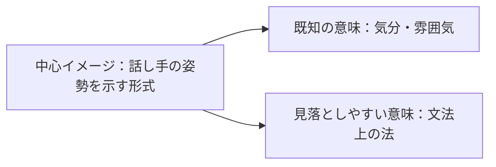

**重要語法**：`indicative mood / subjunctive mood`

<small>出典候補ID：ev-02891-noun-01（index 2891）</small>

---
### 1842. artificial

**品詞**：adjective　**発音**：/ˌɑːrtɪˈfɪʃəl/

<small>よく知られている意味：人工の</small>

**見落としやすい意味：わざとらしい、不自然な**

**例文**：His artificial smile made everyone uncomfortable.

**和訳**：彼のわざとらしい笑顔に、皆は居心地の悪さを覚えた。

**コアイメージ**：artificialは人の手で作られたものを指す。表情や態度に使うと、自然な気持ちから出たように見えないという否定的な意味になる。

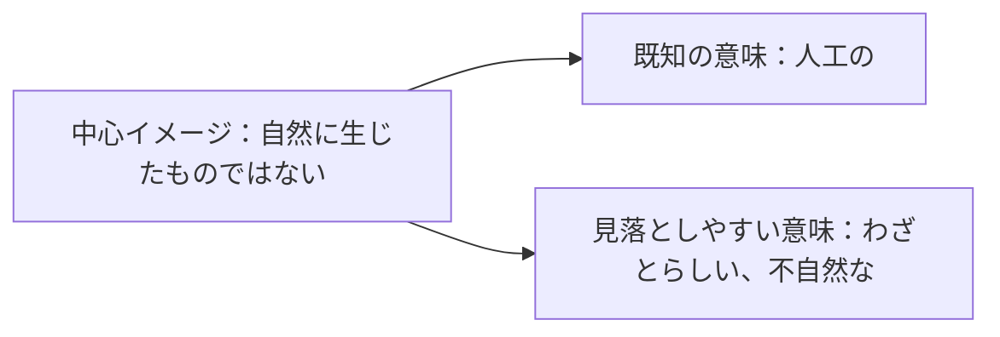

**重要語法**：`an artificial smile`

<small>出典候補ID：ev-02892-adjective-01（index 2892）</small>

---
### 1843. intimate

**品詞**：verb　**発音**：/ˈɪntɪmeɪt/（動詞）

<small>よく知られている意味：親密な（形容詞）</small>

**見落としやすい意味：それとなくほのめかす**

**例文**：She intimated that the plan might be canceled.

**和訳**：彼女はその計画が中止になるかもしれないとほのめかした。

**コアイメージ**：形容詞では人との距離の近さを表す。一方、動詞では内容をはっきり言い切らず、相手にそれとなく知らせることを意味する。

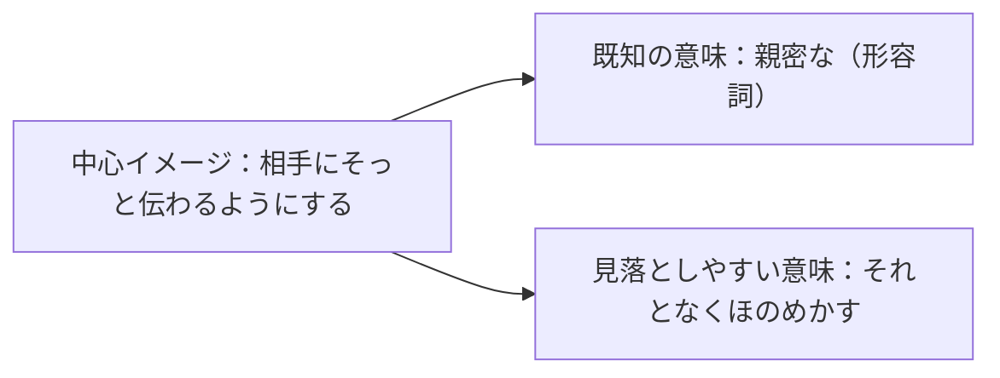

**重要語法**：`intimate that ...`

<small>出典候補ID：ev-02893-verb-01（index 2893）</small>

---
### 1844. notable

**品詞**：noun　**発音**：/ˈnoʊtəbəl/

<small>よく知られている意味：注目すべき（形容詞）</small>

**見落としやすい意味：著名人**

**例文**：Several local notables attended the ceremony.

**和訳**：地元の著名人が数人、その式典に出席した。

**コアイメージ**：notableは人々に注目されるほど目立つことを表す。名詞になると、地域や社会でよく知られた人物を指す。

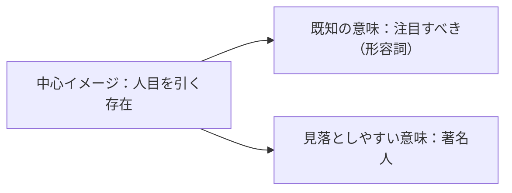

**重要語法**：`local notables`

<small>出典候補ID：ev-02894-noun-01（index 2894）</small>

---
### 1845. counterpart

**品詞**：noun　**発音**：/ˈkaʊntərpɑːrt/

<small>よく知られている意味：対応する人・物</small>

**見落としやすい意味：複製品、対応する写し**

**例文**：The two documents are exact counterparts of each other.

**和訳**：その二つの文書は互いに正確に対応する写しである。

**コアイメージ**：counterpartは別の場所や組織に同じ役割を持つものを指す。形や内容が対応する場合には、元のものに相当する写しや複製を表すこともある。

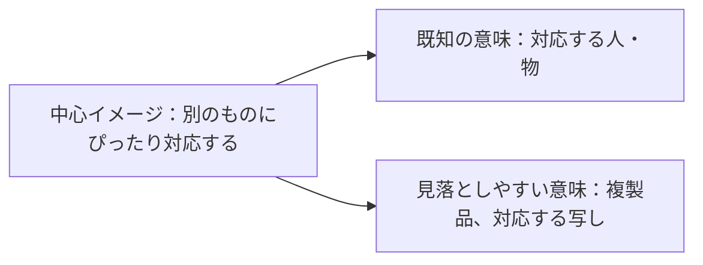

<small>出典候補ID：ev-02895-noun-01（index 2895）</small>

---
### 1846. coalition

**品詞**：noun　**発音**：/ˌkoʊəˈlɪʃən/

<small>よく知られている意味：連立・同盟</small>

**見落としやすい意味：異なる要素が結合した集合体**

**例文**：The exhibition brought together a coalition of styles from different eras.

**和訳**：その展覧会では、異なる時代の様式を組み合わせた集合体が示された。

**コアイメージ**：coalitionは別々の人や集団が共通の目的で結び付くことを表す。比喩的には、異なる要素がまとまってできた一つの集合体も指す。


<small>出典候補ID：ev-02896-noun-01（index 2896）</small>

---
### 1847. effluent

**品詞**：adjective　**発音**：/ˈefluənt/

<small>よく知られている意味：排水（名詞）</small>

**見落としやすい意味：外へ流れ出る**

**例文**：The engineers tested the effluent water at the outlet.

**和訳**：技術者たちは排出口から流れ出る水を検査した。

**コアイメージ**：effluentの中心には、ある場所から外へ流れ出る動きがある。名詞では排水そのもの、形容詞では外へ流出する性質を表す。

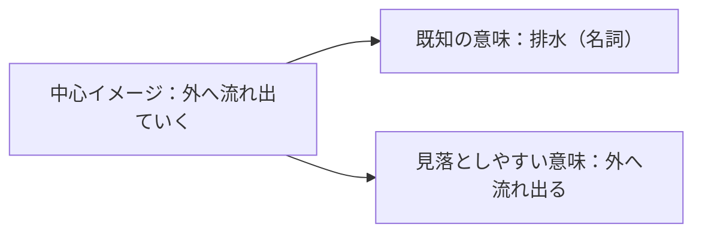

**重要語法**：`effluent water`

<small>出典候補ID：ev-02898-adjective-01（index 2898）</small>

---
### 1848. thick

**品詞**：adjective　**発音**：/θɪk/

<small>よく知られている意味：厚い・濃い</small>

**見落としやすい意味：頭が鈍い、ばかな（口語）**

**例文**：Don't be thick; the answer is right in front of you.

**和訳**：鈍いことを言わないで。答えは目の前にあるでしょう。

**コアイメージ**：thickは物が厚く密集している状態を表す。口語では考えが頭に入っていかないようだという比喩から、理解の鈍さを指すことがある。

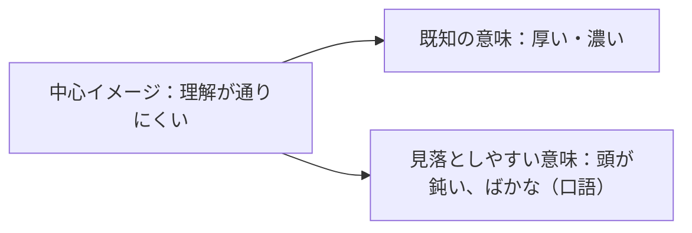

**重要語法**：`be thick（主に英口語、失礼な表現）`

<small>出典候補ID：ev-02902-adjective-01（index 2902）</small>

---
### 1849. mirror

**品詞**：verb　**発音**：/ˈmɪrər/

<small>よく知られている意味：鏡（名詞）</small>

**見落としやすい意味：行動や状況を映すように反映する**

**例文**：Her reaction mirrored the audience's disappointment.

**和訳**：彼女の反応は観客の失望をそのまま映し出していた。

**コアイメージ**：mirrorの基本は鏡が外の姿を写すこと。動詞では別の人の行動や状況とよく似た形で現れ、それを反映することをいう。

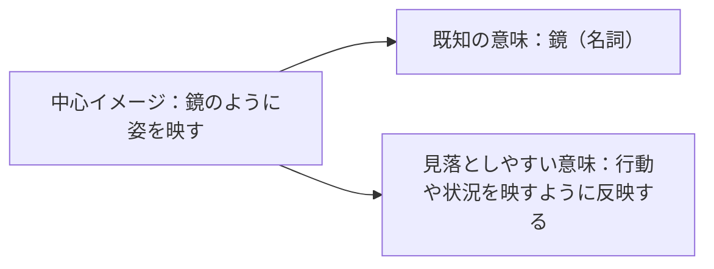

**重要語法**：`mirror someone's behavior`

<small>出典候補ID：ev-02904-verb-01（index 2904）</small>

---
### 1850. ill

**品詞**：adverb　**発音**：/ɪl/

<small>よく知られている意味：病気の・悪い</small>

**見落としやすい意味：ほとんど…できない、…する余裕が乏しい**

**例文**：We can ill afford another delay.

**和訳**：これ以上の遅れを受け入れる余裕はほとんどない。

**コアイメージ**：illは望ましくない状態を表す語。副詞では『うまく』『十分に』の逆に働き、とりわけill affordで『〜する余裕がほとんどない』を表す。

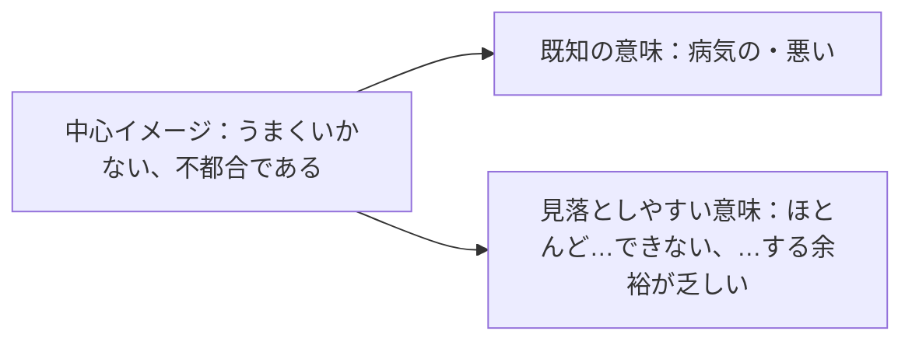

**重要語法**：`can ill afford to do / can ill afford ...`

<small>出典候補ID：ev-02905-adverb-01（index 2905）</small>

---
### 1851. float

**品詞**：verb　**発音**：/floʊt/

<small>よく知られている意味：浮く・浮かべる</small>

**見落としやすい意味：通貨を変動相場制にする**

**例文**：The government decided to float its currency.

**和訳**：政府は自国通貨を変動相場制にすることを決めた。

**コアイメージ**：floatは水面などに浮いて自由に動くこと。通貨に用いると、交換レートを固定せず市場に応じて変動させることを指す。

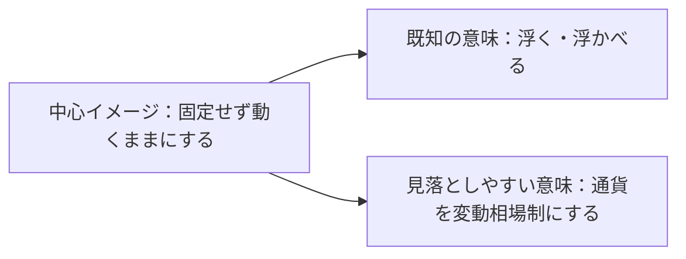

**重要語法**：`float a currency`

<small>出典候補ID：ev-02906-verb-02（index 2906）</small>

---
### 1852. float

**品詞**：verb　**発音**：/floʊt/

<small>よく知られている意味：浮く・浮かべる</small>

**見落としやすい意味：考え・提案を試しに持ち出す**

**例文**：The manager floated an idea at the meeting.

**和訳**：その管理職は会議で一つの案を試しに出した。

**コアイメージ**：floatには物を浮かべるという基本イメージがある。提案をfloatするのは、決定する前に場に出して人々の反応をうかがうこと。

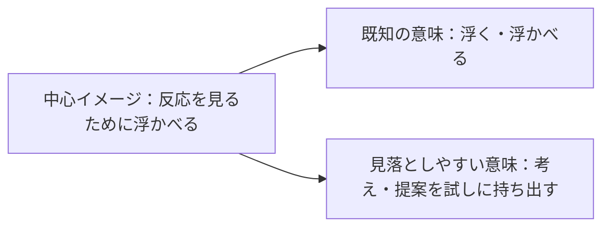

**重要語法**：`float an idea / float a proposal`

<small>出典候補ID：ev-02906-verb-03（index 2906）</small>

---
### 1853. sharp

**品詞**：noun　**発音**：/ʃɑːrp/

<small>よく知られている意味：鋭い・急な</small>

**見落としやすい意味：音を半音高くするシャープ記号**

**例文**：There is a sharp before the final note.

**和訳**：最後の音符の前にシャープ記号がある。

**コアイメージ**：sharpは先端が鋭いことや、急激な変化を表す。音楽では音を半音上げる記号の名前として使われる。

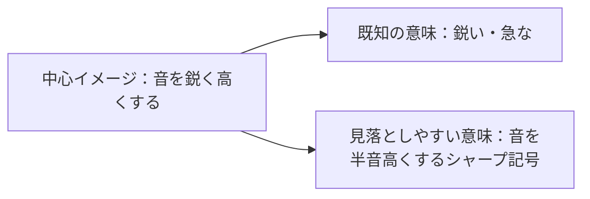

**重要語法**：`C sharp（嬰ハ）`

<small>出典候補ID：ev-02907-noun-01（index 2907）</small>

---
### 1854. chaos

**品詞**：noun　**発音**：/ˈkeɪɑːs/

<small>よく知られている意味：混乱</small>

**見落としやすい意味：物理学で初期条件のわずかな違いに敏感な力学系**

**例文**：Chaos can make long-term prediction difficult even in a simple system.

**和訳**：カオスは単純な系であっても長期予測を難しくすることがある。

**コアイメージ**：日常語のchaosは無秩序な混乱を指す。力学では、初期条件の小さな違いが後の挙動の大きな差につながる現象を表す。

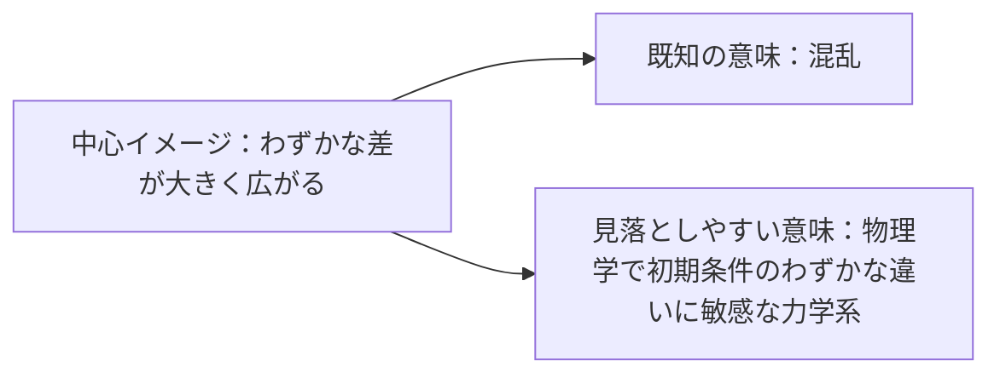

**重要語法**：`chaos theory`

<small>出典候補ID：ev-02908-noun-01（index 2908）</small>

---
### 1855. alike

**品詞**：adverb　**発音**：/əˈlaɪk/

<small>よく知られている意味：似ている</small>

**見落としやすい意味：どちらも等しく**

**例文**：The rule applies to students and teachers alike.

**和訳**：その規則は生徒にも教師にも等しく適用される。

**コアイメージ**：alikeは二つ以上のものの似た状態を表す。後ろに置かれる副詞としては、複数の対象を区別せず同様に扱う意味になる。

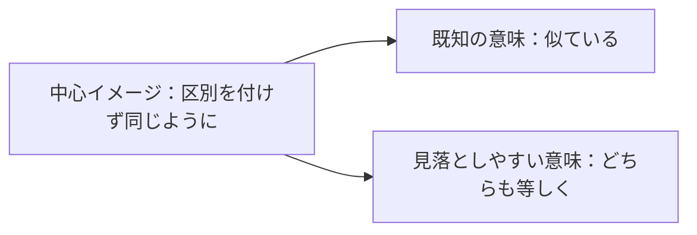

**重要語法**：`A and B alike`

<small>出典候補ID：ev-02909-adverb-01（index 2909）</small>

---
### 1856. acid

**品詞**：adjective　**発音**：/ˈæsɪd/

<small>よく知られている意味：酸・酸性の</small>

**見落としやすい意味：口調などが辛辣な、皮肉な**

**例文**：Her acid remark silenced the room.

**和訳**：彼女の辛辣な一言で、その場は静まり返った。

**コアイメージ**：酸には物を刺激し傷める性質がある。言葉や態度についてacidと言うと、聞く人を刺すような皮肉や辛辣さを表す。

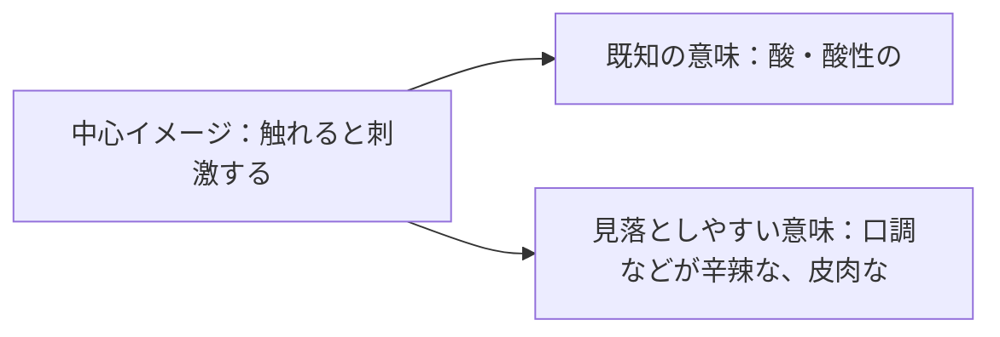

**重要語法**：`an acid remark`

<small>出典候補ID：ev-02910-adjective-01（index 2910）</small>

---
### 1857. whereas

**品詞**：conjunction　**発音**：/weərˈæz/

<small>よく知られている意味：〜であるのに対して</small>

**見落としやすい意味：二つの事実を対比する「一方で」**

**例文**：The first method is cheap, whereas the second is more reliable.

**和訳**：一つ目の方法は安価だが、二つ目の方が信頼性が高い。

**コアイメージ**：whereasは二つの事実を並べ、その違いを際立たせる接続詞。必ずしも強い逆接ではなく、単純な対比を示す『一方で』として使える。

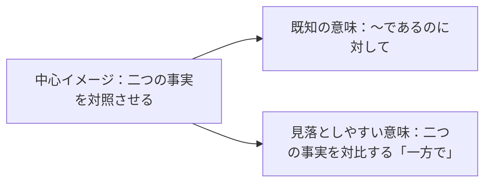

**重要語法**：`A ..., whereas B ...`

<small>出典候補ID：ev-02911-conjunction-01（index 2911）</small>

---
### 1858. flaw

**品詞**：noun　**発音**：/flɔː/

<small>よく知られている意味：傷・欠点</small>

**見落としやすい意味：理論や計画などの欠陥**

**例文**：The report revealed a serious flaw in the argument.

**和訳**：その報告書はその議論の重大な欠陥を明らかにした。

**コアイメージ**：flawは物の表面の傷や不完全な箇所を指す。その発想が議論や計画に広がると、全体を弱くする論理的な欠陥になる。

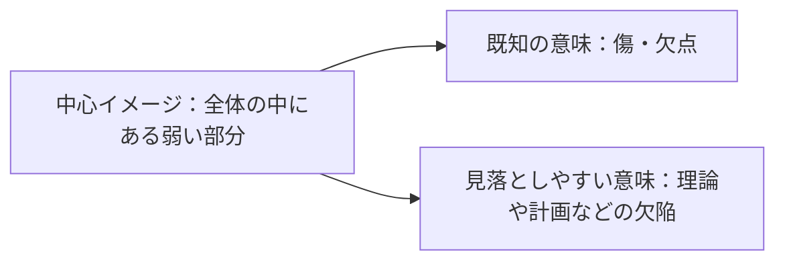

**重要語法**：`a flaw in an argument`

<small>出典候補ID：ev-02913-noun-01（index 2913）</small>

---
### 1859. flaw

**品詞**：verb　**発音**：/flɔː/

<small>よく知られている意味：欠陥（名詞）</small>

**見落としやすい意味：（計画や理論などに）欠点を生じさせる**

**例文**：A false assumption flawed the entire analysis.

**和訳**：誤った前提が分析全体に欠陥を生じさせた。

**コアイメージ**：名詞のflawは欠陥を意味する。動詞では、ある要素が計画や議論を不完全なものにしてしまうことを表す。

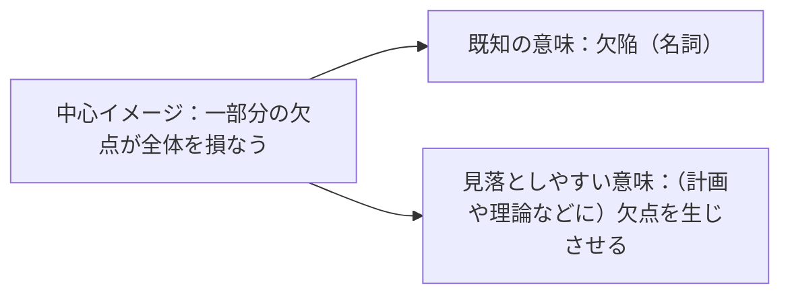

**重要語法**：`be flawed by ...`

<small>出典候補ID：ev-02913-verb-01（index 2913）</small>

---
### 1860. diminish

**品詞**：verb　**発音**：/dɪˈmɪnɪʃ/

<small>よく知られている意味：減少する・減らす</small>

**見落としやすい意味：権威・評判を損なう**

**例文**：The scandal diminished his authority.

**和訳**：その不祥事は彼の権威を損なった。

**コアイメージ**：diminishは量が減ったり、小さくなったりすること。人の権威や評判については、その重みや価値が低下する意味になる。

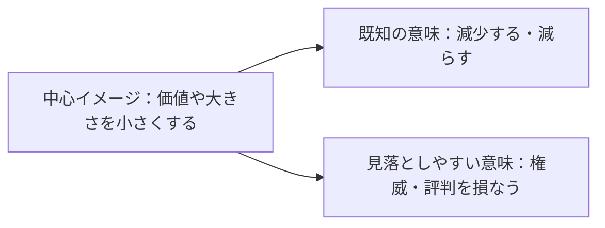

**重要語法**：`diminish someone's reputation`

<small>出典候補ID：ev-02914-verb-01（index 2914）</small>

---
### 1861. emphasis

**品詞**：noun　**発音**：/ˈemfəsɪs/

<small>よく知られている意味：強調・重点</small>

**見落としやすい意味：音節・音符の強調、アクセント**

**例文**：Place the emphasis on the second syllable.

**和訳**：二番目の音節にアクセントを置いてください。

**コアイメージ**：emphasisは何かに特に重みを置くこと。発音や音楽では、一つの音節や音を他より強く響かせることも指す。

```mermaid
flowchart LR
    A["中心イメージ：一部を目立たせる"]
    B["既知の意味：強調・重点"]
    C["見落としやすい意味：音節・音符の強調、アクセント"]
    A --> B
    A --> C
```

**重要語法**：`put/place emphasis on ...`

<small>出典候補ID：ev-02916-noun-01（index 2916）</small>

---
### 1862. variable

**品詞**：noun　**発音**：/ˈveriəbəl/

<small>よく知られている意味：変わりやすい（形容詞）</small>

**見落としやすい意味：数学・論理学で使う変数の記号**

**例文**：In this formula, the letter x is a variable.

**和訳**：この公式では、文字xが変数である。

**コアイメージ**：variableは条件に応じて変わる性質を表す。数学ではさまざまな値を取り得る量や、それを表す文字をいう。

```mermaid
flowchart LR
    A["中心イメージ：値が変わり得るもの"]
    B["既知の意味：変わりやすい（形容詞）"]
    C["見落としやすい意味：数学・論理学で使う変数の記号"]
    A --> B
    A --> C
```

**重要語法**：`independent variable / dependent variable`

<small>出典候補ID：ev-02918-noun-01（index 2918）</small>

---
### 1863. boot

**品詞**：verb　**発音**：/buːt/

<small>よく知られている意味：長靴・ブーツ</small>

**見落としやすい意味：コンピューターを起動する**

**例文**：The computer took a minute to boot.

**和訳**：そのコンピューターは起動するのに1分かかった。

**コアイメージ**：bootは名詞では履物を表すが、コンピューターの動詞では起動処理を進めること。機器が使用可能になるまでの立ち上がりを表す。

```mermaid
flowchart LR
    A["中心イメージ：使える状態へ立ち上げる"]
    B["既知の意味：長靴・ブーツ"]
    C["見落としやすい意味：コンピューターを起動する"]
    A --> B
    A --> C
```

**重要語法**：`boot up / reboot`

<small>出典候補ID：ev-02919-verb-01（index 2919）</small>

---
### 1864. slight

**品詞**：noun　**発音**：/slaɪt/

<small>よく知られている意味：わずかな（形容詞）</small>

**見落としやすい意味：侮辱・軽視する態度**

**例文**：She took his silence as a slight.

**和訳**：彼女は彼の沈黙を自分への侮辱と受け取った。

**コアイメージ**：slightには小さい、重要でないという感覚がある。名詞では相手を軽んじ、その人の価値を低く見たような言動を指す。

```mermaid
flowchart LR
    A["中心イメージ：相手を軽く扱う"]
    B["既知の意味：わずかな（形容詞）"]
    C["見落としやすい意味：侮辱・軽視する態度"]
    A --> B
    A --> C
```

**重要語法**：`take something as a slight`

<small>出典候補ID：ev-02920-noun-01（index 2920）</small>

---
### 1865. exclusive

**品詞**：noun　**発音**：/ɪkˈskluːsɪv/

<small>よく知られている意味：排他的な・独占的な</small>

**見落としやすい意味：他社に先駆けた独占記事・スクープ**

**例文**：The newspaper published an exclusive on the investigation.

**和訳**：その新聞は捜査についての独占記事を掲載した。

**コアイメージ**：exclusiveは特定の相手だけが利用できることを表す。報道では一社だけが手に入れた情報や独占記事を指す名詞になる。

```mermaid
flowchart LR
    A["中心イメージ：ほかを締め出して独占する"]
    B["既知の意味：排他的な・独占的な"]
    C["見落としやすい意味：他社に先駆けた独占記事・スクープ"]
    A --> B
    A --> C
```

**重要語法**：`an exclusive interview / an exclusive`

<small>出典候補ID：ev-02923-noun-01（index 2923）</small>

---
### 1866. fifth

**品詞**：noun　**発音**：/fɪfθ/

<small>よく知られている意味：五番目の</small>

**見落としやすい意味：音楽での5度音程**

**例文**：The two notes are a perfect fifth apart.

**和訳**：その二つの音は完全5度離れている。

**コアイメージ**：fifthは順序の五番目を示す語。音楽では音階上の五度という音程を表し、二音の隔たりをいう。

```mermaid
flowchart LR
    A["中心イメージ：五つ分の位置関係"]
    B["既知の意味：五番目の"]
    C["見落としやすい意味：音楽での5度音程"]
    A --> B
    A --> C
```

**重要語法**：`a perfect fifth`

<small>出典候補ID：ev-02924-noun-01（index 2924）</small>

---
### 1867. invoke

**品詞**：verb　**発音**：/ɪnˈvoʊk/

<small>よく知られている意味：呼び起こす</small>

**見落としやすい意味：法や先例を根拠に持ち出す**

**例文**：The lawyer invoked a previous ruling to support her case.

**和訳**：その弁護士は主張を裏付けるために過去の判決を根拠として持ち出した。

**コアイメージ**：invokeは名を呼び出したり、力を求めたりすること。法律や先例の場合は、それを主張の根拠として援用する意味になる。

```mermaid
flowchart LR
    A["中心イメージ：権威を呼び出して頼る"]
    B["既知の意味：呼び起こす"]
    C["見落としやすい意味：法や先例を根拠に持ち出す"]
    A --> B
    A --> C
```

**重要語法**：`invoke a law / invoke a precedent`

<small>出典候補ID：ev-02925-verb-01（index 2925）</small>

---
### 1868. raid

**品詞**：verb　**発音**：/reɪd/

<small>よく知られている意味：急襲する</small>

**見落としやすい意味：必要な物を求めて場所をあさる**

**例文**：We raided the kitchen for a late-night snack.

**和訳**：私たちは夜食を探して台所をあさった。

**コアイメージ**：raidはもともと急に押し入ることを表す。日常では食べ物などを探して場所をあさる、という軽い言い方にもなる。

```mermaid
flowchart LR
    A["中心イメージ：目的の物を一気に取りに行く"]
    B["既知の意味：急襲する"]
    C["見落としやすい意味：必要な物を求めて場所をあさる"]
    A --> B
    A --> C
```

**重要語法**：`raid the fridge`

<small>出典候補ID：ev-02927-verb-01（index 2927）</small>

---
### 1869. ruling

**品詞**：noun　**発音**：/ˈruːlɪŋ/

<small>よく知られている意味：支配している（形容詞）</small>

**見落としやすい意味：裁判所・当局による公式の判断、裁定・判決**

**例文**：The court issued a ruling on the case.

**和訳**：裁判所はその事件について判決を下した。

**コアイメージ**：ruleは支配するだけでなく判断を下すことも意味する。rulingという名詞は裁判所などが正式に示した決定を指す。

```mermaid
flowchart LR
    A["中心イメージ：権限を持って決定する"]
    B["既知の意味：支配している（形容詞）"]
    C["見落としやすい意味：裁判所・当局による公式の判断、裁定・判決"]
    A --> B
    A --> C
```

**重要語法**：`issue a ruling`

<small>出典候補ID：ev-02928-noun-01（index 2928）</small>

---
### 1870. voucher

**品詞**：noun　**発音**：/ˈvaʊtʃər/

<small>よく知られている意味：引換券・割引券</small>

**見落としやすい意味：支出・支払いを証明する書類**

**例文**：Keep the voucher as proof of payment.

**和訳**：支払いの証明としてその証憑書類を保管してください。

**コアイメージ**：voucherは何かを引き換えられる券として知られる。一方、会計では支払いなどの事実を証明する書類として使う。

```mermaid
flowchart LR
    A["中心イメージ：取引の正当性を裏付ける紙"]
    B["既知の意味：引換券・割引券"]
    C["見落としやすい意味：支出・支払いを証明する書類"]
    A --> B
    A --> C
```

**重要語法**：`payment voucher`

<small>出典候補ID：ev-02929-noun-01（index 2929）</small>

---
### 1871. layer

**品詞**：noun　**発音**：/ˈleɪər/

<small>よく知られている意味：層・重なり</small>

**見落としやすい意味：卵を産む雌鶏**

**例文**：This breed is an excellent layer.

**和訳**：この品種は卵をよく産む鶏だ。

**コアイメージ**：layerは層や重ねる人を意味する語として使われる。鶏については卵を産むもの、特に産卵能力のある雌鶏を指す。

```mermaid
flowchart LR
    A["中心イメージ：ものを次々と置く存在"]
    B["既知の意味：層・重なり"]
    C["見落としやすい意味：卵を産む雌鶏"]
    A --> B
    A --> C
```

**重要語法**：`a good layer`

<small>出典候補ID：ev-02932-noun-01（index 2932）</small>

---
### 1872. overcome

**品詞**：verb　**発音**：/ˌoʊvərˈkʌm/

<small>よく知られている意味：打ち勝つ・克服する</small>

**見落としやすい意味：感情に圧倒される**

**例文**：She was overcome with relief when he returned.

**和訳**：彼が帰ってきて、彼女は安堵の気持ちでいっぱいになった。

**コアイメージ**：overcomeは障害を乗り越えることを表す。一方、受け身では感情の力に圧倒され、自分で抑えられない状態をいう。

```mermaid
flowchart LR
    A["中心イメージ：強い力に覆われる"]
    B["既知の意味：打ち勝つ・克服する"]
    C["見落としやすい意味：感情に圧倒される"]
    A --> B
    A --> C
```

**重要語法**：`be overcome with emotion`

<small>出典候補ID：ev-02933-verb-01（index 2933）</small>

---
### 1873. march

**品詞**：noun　**発音**：/mɑːrtʃ/

<small>よく知られている意味：行進（名詞）</small>

**見落としやすい意味：時間や科学などの着実な進展**

**例文**：Nothing seemed able to stop the march of technology.

**和訳**：技術の着実な進歩を止められるものはないように思われた。

**コアイメージ**：marchは足並みをそろえて前へ進むこと。時間や科学の進歩に使うと、止まらず続く着実な進展を表す。

```mermaid
flowchart LR
    A["中心イメージ：一定方向へ着実に進む"]
    B["既知の意味：行進（名詞）"]
    C["見落としやすい意味：時間や科学などの着実な進展"]
    A --> B
    A --> C
```

**重要語法**：`the march of progress`

<small>出典候補ID：ev-02936-noun-01（index 2936）</small>

---
### 1874. pro

**品詞**：noun　**発音**：/proʊ/

<small>よく知られている意味：プロ選手・専門家</small>

**見落としやすい意味：賛成論、利点**

**例文**：We should weigh the pros and cons before deciding.

**和訳**：決める前に賛成材料と反対材料を比べるべきだ。

**コアイメージ**：proは『賛成の』という意味にもつながる。名詞ではある案に有利な理由や利点を表し、反対材料のconと対で使う。

```mermaid
flowchart LR
    A["中心イメージ：ある立場を支持する側"]
    B["既知の意味：プロ選手・専門家"]
    C["見落としやすい意味：賛成論、利点"]
    A --> B
    A --> C
```

**重要語法**：`pros and cons`

<small>出典候補ID：ev-02939-noun-01（index 2939）</small>

---
### 1875. drag

**品詞**：noun　**発音**：/dræɡ/

<small>よく知られている意味：引きずる（動詞）</small>

**見落としやすい意味：進行の妨げ・足かせ**

**例文**：The outdated system is a drag on productivity.

**和訳**：古いシステムは生産性の足かせになっている。

**コアイメージ**：dragは物を引きずる動作を表す。比喩的には前に進もうとする人や活動の動きを鈍らせる負担を指す。

```mermaid
flowchart LR
    A["中心イメージ：前進を引っ張って遅くする"]
    B["既知の意味：引きずる（動詞）"]
    C["見落としやすい意味：進行の妨げ・足かせ"]
    A --> B
    A --> C
```

**重要語法**：`a drag on ...`

<small>出典候補ID：ev-02940-noun-01（index 2940）</small>

---
### 1876. signature

**品詞**：noun　**発音**：/ˈsɪɡnətʃər/

<small>よく知られている意味：署名</small>

**見落としやすい意味：作品・人物などを特徴づける独自の様式**

**例文**：The chef added her signature touch to the dish.

**和訳**：シェフはその料理に自分ならではの工夫を加えた。

**コアイメージ**：signatureは本人であることを示す署名。そこから、作者や人物を見分けられる特徴的な様式や工夫という意味になる。

```mermaid
flowchart LR
    A["中心イメージ：その人だと分かる印"]
    B["既知の意味：署名"]
    C["見落としやすい意味：作品・人物などを特徴づける独自の様式"]
    A --> B
    A --> C
```

**重要語法**：`signature style / signature touch`

<small>出典候補ID：ev-02941-noun-01（index 2941）</small>

---
### 1877. surgery

**品詞**：noun　**発音**：/ˈsɜːrdʒəri/

<small>よく知られている意味：外科手術</small>

**見落としやすい意味：診療所、医師の診察室（英国英語）**

**例文**：The doctor's surgery opens at nine.

**和訳**：その医師の診療所は9時に開く。

**コアイメージ**：surgeryは手術そのものを指すことが多い。英国英語では医師が患者を診察する場所や診療時間も意味する。

```mermaid
flowchart LR
    A["中心イメージ：医療を行う場所・時間"]
    B["既知の意味：外科手術"]
    C["見落としやすい意味：診療所、医師の診察室（英国英語）"]
    A --> B
    A --> C
```

**重要語法**：`a doctor's surgery（英）`

<small>出典候補ID：ev-02942-noun-01（index 2942）</small>

---
### 1878. surgery

**品詞**：noun　**発音**：/ˈsɜːrdʒəri/

<small>よく知られている意味：外科手術</small>

**見落としやすい意味：議員が住民の相談に応じる定例の面会時間（英国英語）**

**例文**：The MP holds a weekly surgery for local residents.

**和訳**：その国会議員は地元住民の相談に応じる面会時間を毎週設けている。

**コアイメージ**：英国英語のsurgeryは医師の診察に関連する場所や時間を表す。その発想から、議員が住民の悩みを直接聞く定例相談の時間も指す。

```mermaid
flowchart LR
    A["中心イメージ：個別の問題を相談する場"]
    B["既知の意味：外科手術"]
    C["見落としやすい意味：議員が住民の相談に応じる定例の面会時間（英国英語）"]
    A --> B
    A --> C
```

**重要語法**：`hold a constituency surgery（英）`

<small>出典候補ID：ev-02942-noun-02（index 2942）</small>

---
### 1879. frequency

**品詞**：noun　**発音**：/ˈfriːkwənsi/

<small>よく知られている意味：頻度・周波数</small>

**見落としやすい意味：統計的な度数**

**例文**：The table shows the frequency of each response.

**和訳**：その表は各回答の度数を示している。

**コアイメージ**：frequencyは何かが繰り返される頻度を表す。統計では特定の値や回答が実際に観測された回数、つまり度数になる。

```mermaid
flowchart LR
    A["中心イメージ：何回現れたかを数える"]
    B["既知の意味：頻度・周波数"]
    C["見落としやすい意味：統計的な度数"]
    A --> B
    A --> C
```

**重要語法**：`frequency distribution`

<small>出典候補ID：ev-02943-noun-01（index 2943）</small>

---
### 1880. segment

**品詞**：verb　**発音**：/seɡˈment/

<small>よく知られている意味：区分・部分（名詞）</small>

**見落としやすい意味：いくつかの部分に分ける**

**例文**：The researchers segmented the data by age group.

**和訳**：研究者たちはデータを年齢層ごとに分けた。

**コアイメージ**：segmentは全体の一部分を意味する。動詞になると、全体をいくつかの意味ある部分に分割する操作を表す。

```mermaid
flowchart LR
    A["中心イメージ：一続きのものを区切る"]
    B["既知の意味：区分・部分（名詞）"]
    C["見落としやすい意味：いくつかの部分に分ける"]
    A --> B
    A --> C
```

**重要語法**：`segment A by B`

<small>出典候補ID：ev-02945-verb-01（index 2945）</small>

---
### 1881. reasonably

**品詞**：adverb　**発音**：/ˈriːzənəbli/

<small>よく知られている意味：合理的に・適切に</small>

**見落としやすい意味：かなり、ある程度**

**例文**：The instructions were reasonably clear.

**和訳**：説明はかなり分かりやすかった。

**コアイメージ**：reasonablyは理にかなっている様子を表す。程度を示す副詞では、期待に照らしてまずまず十分な水準にあることを表す。

```mermaid
flowchart LR
    A["中心イメージ：無理のない範囲で十分に"]
    B["既知の意味：合理的に・適切に"]
    C["見落としやすい意味：かなり、ある程度"]
    A --> B
    A --> C
```

**重要語法**：`reasonably good / reasonably clear`

<small>出典候補ID：ev-02946-adverb-01（index 2946）</small>

---
### 1882. aggregate

**品詞**：verb　**発音**：/ˈæɡrɪɡeɪt/（動詞）

<small>よく知られている意味：集計・総計（名詞）</small>

**見落としやすい意味：合計すると一定の額になる**

**例文**：The fees aggregate to nearly a thousand dollars.

**和訳**：手数料は合計すると千ドル近くになる。

**コアイメージ**：aggregateはばらばらの要素を集めることを表す。動詞では個々の数値が集まり、合計で一定の額になる意味になる。

```mermaid
flowchart LR
    A["中心イメージ：小さなものが集まって全体になる"]
    B["既知の意味：集計・総計（名詞）"]
    C["見落としやすい意味：合計すると一定の額になる"]
    A --> B
    A --> C
```

**重要語法**：`aggregate to ...`

<small>出典候補ID：ev-02947-verb-01（index 2947）</small>

---
### 1883. diplomatic

**品詞**：adjective　**発音**：/ˌdɪpləˈmætɪk/

<small>よく知られている意味：外交の</small>

**見落としやすい意味：人への対応が巧みで気配りがある**

**例文**：She was diplomatic when pointing out his error.

**和訳**：彼女は彼の誤りを指摘するとき、相手に配慮した言い方をした。

**コアイメージ**：diplomaticは国や人の間の関係を円滑に扱うことと結び付く。対人場面では、角を立てずに伝える気配りや巧みさを表す。

```mermaid
flowchart LR
    A["中心イメージ：関係を壊さず調整する"]
    B["既知の意味：外交の"]
    C["見落としやすい意味：人への対応が巧みで気配りがある"]
    A --> B
    A --> C
```

**重要語法**：`a diplomatic response`

<small>出典候補ID：ev-02950-adjective-01（index 2950）</small>

---
### 1884. skirt

**品詞**：verb　**発音**：/skɜːrt/

<small>よく知られている意味：スカート（名詞）</small>

**見落としやすい意味：問題・質問・義務などを避ける**

**例文**：The speaker skirted the difficult question.

**和訳**：講演者はその難しい質問を避けた。

**コアイメージ**：skirtは物の周囲や縁に関わる語。動詞では問題の中心に踏み込まず、その周りを通って回避することを意味する。

```mermaid
flowchart LR
    A["中心イメージ：縁を回り込む"]
    B["既知の意味：スカート（名詞）"]
    C["見落としやすい意味：問題・質問・義務などを避ける"]
    A --> B
    A --> C
```

**重要語法**：`skirt an issue / skirt a question`

<small>出典候補ID：ev-02954-verb-01（index 2954）</small>

---
### 1885. ok

**品詞**：noun　**発音**：/ˌoʊˈkeɪ/

<small>よく知られている意味：大丈夫・よい（形容詞）</small>

**見落としやすい意味：許可、了承**

**例文**：We finally got the OK to begin the project.

**和訳**：私たちはついにその企画を始める許可を得た。

**コアイメージ**：OKは物事に問題がないと認める表現。名詞として使うと、開始や実行を認める了承・許可そのものを指す。

```mermaid
flowchart LR
    A["中心イメージ：問題ないという合図"]
    B["既知の意味：大丈夫・よい（形容詞）"]
    C["見落としやすい意味：許可、了承"]
    A --> B
    A --> C
```

**重要語法**：`get the OK / give the OK`

<small>出典候補ID：ev-02955-noun-01（index 2955）</small>

---
### 1886. smooth

**品詞**：verb　**発音**：/smuːð/

<small>よく知られている意味：滑らかな（形容詞）</small>

**見落としやすい意味：障害を取り除いて進みやすくする**

**例文**：The new policy smoothed the way for small firms.

**和訳**：新しい政策は小規模企業が進出しやすいよう道を整えた。

**コアイメージ**：smoothは表面の凹凸をなくして滑らかにすること。動詞で手続きや計画に使うと、障害を取り除いて進行を円滑にする意味になる。

```mermaid
flowchart LR
    A["中心イメージ：でこぼこをなくす"]
    B["既知の意味：滑らかな（形容詞）"]
    C["見落としやすい意味：障害を取り除いて進みやすくする"]
    A --> B
    A --> C
```

**重要語法**：`smooth the way for ...`

<small>出典候補ID：ev-02956-verb-01（index 2956）</small>

---
### 1887. tap

**品詞**：verb　**発音**：/tæp/

<small>よく知られている意味：軽くたたく</small>

**見落としやすい意味：資源・知識などを利用する**

**例文**：The team tapped local knowledge to solve the problem.

**和訳**：チームは問題を解決するために地域の知識を活用した。

**コアイメージ**：tapは軽く触れる意味のほかに、容器から液体を取り出す栓にも関係する。そこから知識・人材・資金などを引き出して利用する意味になる。

```mermaid
flowchart LR
    A["中心イメージ：中にある資源を引き出す"]
    B["既知の意味：軽くたたく"]
    C["見落としやすい意味：資源・知識などを利用する"]
    A --> B
    A --> C
```

**重要語法**：`tap into resources / tap expertise`

<small>出典候補ID：ev-02958-verb-01（index 2958）</small>

---
### 1888. precious

**品詞**：adverb　**発音**：/ˈpreʃəs/

<small>よく知られている意味：貴重な（形容詞）</small>

**見落としやすい意味：極めて（少ないことを強調して）**

**例文**：We have precious little time to prepare.

**和訳**：準備する時間は本当にごくわずかしかない。

**コアイメージ**：preciousは大切で価値が高いことを表す。少なさを表す語の前では、その少なさを強調して『ほんのわずか』という意味になる。

```mermaid
flowchart LR
    A["中心イメージ：価値を強く感じさせる"]
    B["既知の意味：貴重な（形容詞）"]
    C["見落としやすい意味：極めて（少ないことを強調して）"]
    A --> B
    A --> C
```

**重要語法**：`precious little / precious few`

<small>出典候補ID：ev-02959-adverb-01（index 2959）</small>

---
### 1889. clinic

**品詞**：noun　**発音**：/ˈklɪnɪk/

<small>よく知られている意味：診療所</small>

**見落としやすい意味：問題を診断して実地指導する講習会**

**例文**：The school held a writing clinic for new students.

**和訳**：学校は新入生向けに作文の実地指導講習会を開いた。

**コアイメージ**：clinicは医師が症状を見て適切に対処する場所。教育やスポーツでは、個々の問題を見つけて実践的に教える講習会を指す。

```mermaid
flowchart LR
    A["中心イメージ：問題点を見つけて改善する場"]
    B["既知の意味：診療所"]
    C["見落としやすい意味：問題を診断して実地指導する講習会"]
    A --> B
    A --> C
```

**重要語法**：`a writing clinic / a sports clinic`

<small>出典候補ID：ev-02960-noun-01（index 2960）</small>

---
### 1890. dynamic

**品詞**：adjective　**発音**：/daɪˈnæmɪk/

<small>よく知られている意味：活動的な・力強い</small>

**見落としやすい意味：動詞が動作・変化を表す**

**例文**：Walk is a dynamic verb, but know is usually stative.

**和訳**：walkは動作動詞だが、knowは普通、状態動詞だ。

**コアイメージ**：dynamicは動きや変化のある性質を表す。文法では動作・変化を表す動詞をdynamic verbといい、状態を示す動詞と区別する。

```mermaid
flowchart LR
    A["中心イメージ：変化や動きを伴う"]
    B["既知の意味：活動的な・力強い"]
    C["見落としやすい意味：動詞が動作・変化を表す"]
    A --> B
    A --> C
```

**重要語法**：`dynamic verb / stative verb`

<small>出典候補ID：ev-02961-adjective-01（index 2961）</small>

---
### 1891. alongside

**品詞**：preposition　**発音**：/əˌlɔːŋˈsaɪd/

<small>よく知られている意味：〜の横に</small>

**見落としやすい意味：〜と共に、〜と並行して**

**例文**：Volunteers worked alongside local doctors.

**和訳**：ボランティアは地元の医師たちと共に活動した。

**コアイメージ**：alongsideは物理的に隣に並ぶことを表す。人や活動については、同じ方向に協力したり並行して行ったりする意味になる。

```mermaid
flowchart LR
    A["中心イメージ：横に並んで進む"]
    B["既知の意味：〜の横に"]
    C["見落としやすい意味：〜と共に、〜と並行して"]
    A --> B
    A --> C
```

**重要語法**：`work alongside ...`

<small>出典候補ID：ev-02962-preposition-01（index 2962）</small>

---
### 1892. rally

**品詞**：verb　**発音**：/ˈræli/

<small>よく知られている意味：集会・結集する</small>

**見落としやすい意味：体力・株価などが回復する**

**例文**：The stock market rallied after the announcement.

**和訳**：その発表を受けて株式市場は持ち直した。

**コアイメージ**：rallyは人々や力を再び集めることを表す。体力や株価などでは、落ち込んだ状態から勢いを取り戻す意味になる。

```mermaid
flowchart LR
    A["中心イメージ：散った力を再び集める"]
    B["既知の意味：集会・結集する"]
    C["見落としやすい意味：体力・株価などが回復する"]
    A --> B
    A --> C
```

**重要語法**：`rally after a fall`

<small>出典候補ID：ev-02963-verb-01（index 2963）</small>

---
### 1893. columns

**品詞**：noun　**発音**：/ˈkɑːləmz/

<small>よく知られている意味：柱・縦の列</small>

**見落としやすい意味：新聞・雑誌の連載コラム、寄稿欄（複数形）**

**例文**：She writes weekly columns for a local newspaper.

**和訳**：彼女は地元紙に毎週コラムを寄稿している。

**コアイメージ**：columnは紙面に縦に分かれた欄を指す。そこに載る定期的な論評記事もcolumnと呼び、複数形では一連の寄稿記事を指すことがある。

```mermaid
flowchart LR
    A["中心イメージ：紙面の縦の区画"]
    B["既知の意味：柱・縦の列"]
    C["見落としやすい意味：新聞・雑誌の連載コラム、寄稿欄（複数形）"]
    A --> B
    A --> C
```

**重要語法**：`write a column / weekly columns`

<small>出典候補ID：ev-02966-noun-01（index 2966）</small>

---
### 1894. contributor

**品詞**：noun　**発音**：/kənˈtrɪbjətər/

<small>よく知られている意味：貢献者・寄与するもの</small>

**見落としやすい意味：雑誌・新聞などの寄稿者**

**例文**：The magazine invited several contributors to write essays.

**和訳**：その雑誌は複数の寄稿者に随筆の執筆を依頼した。

**コアイメージ**：contributorは活動や成果に何かを提供する人。雑誌や新聞では、記事を提供する執筆者、つまり寄稿者を意味する。

```mermaid
flowchart LR
    A["中心イメージ：全体に何かを加える人"]
    B["既知の意味：貢献者・寄与するもの"]
    C["見落としやすい意味：雑誌・新聞などの寄稿者"]
    A --> B
    A --> C
```

**重要語法**：`a regular contributor to a magazine`

<small>出典候補ID：ev-02968-noun-01（index 2968）</small>

---
### 1895. meant

**品詞**：verb　**発音**：/ment/

<small>よく知られている意味：meanの過去形・意図した</small>

**見落としやすい意味：be meant to do：〜することになっている、〜する意図である**

**例文**：You are meant to sign at the bottom of the form.

**和訳**：あなたは用紙の一番下に署名することになっています。

**コアイメージ**：meanには言葉が意味することだけでなく、意図することも含まれる。be meant to doは、その意図や取り決めによって何かをすることになっている状態を表す。

```mermaid
flowchart LR
    A["中心イメージ：ある目的や予定が定められている"]
    B["既知の意味：meanの過去形・意図した"]
    C["見落としやすい意味：be meant to do：〜することになっている、〜する意図である"]
    A --> B
    A --> C
```

**重要語法**：`be meant to do`

<small>出典候補ID：ev-02970-verb-01（index 2970）</small>

---
### 1896. meant

**品詞**：verb　**発音**：/ment/

<small>よく知られている意味：meanの過去形・意図した</small>

**見落としやすい意味：be meant for：〜向けに作られた、〜を対象としている**

**例文**：This guide is meant for first-time visitors.

**和訳**：この案内書は初めて訪れる人向けに作られている。

**コアイメージ**：何かをmeanするのは、その目的や意図を持つことでもある。be meant forでは、物やサービスの利用者・用途が初めから想定されている。

```mermaid
flowchart LR
    A["中心イメージ：対象があらかじめ想定されている"]
    B["既知の意味：meanの過去形・意図した"]
    C["見落としやすい意味：be meant for：〜向けに作られた、〜を対象としている"]
    A --> B
    A --> C
```

**重要語法**：`be meant for ...`

<small>出典候補ID：ev-02970-verb-02（index 2970）</small>

---
### 1897. mount

**品詞**：verb　**発音**：/maʊnt/

<small>よく知られている意味：山（名詞）・登る</small>

**見落としやすい意味：運動・活動などを始める**

**例文**：The students mounted a campaign to save the library.

**和訳**：生徒たちは図書館を守る運動を始めた。

**コアイメージ**：mountには登る、上へ持ち上げるという感覚がある。運動や調査などを目的に向けて組み立て、実行に移す意味でも使われる。

```mermaid
flowchart LR
    A["中心イメージ：活動を立ち上げる"]
    B["既知の意味：山（名詞）・登る"]
    C["見落としやすい意味：運動・活動などを始める"]
    A --> B
    A --> C
```

**重要語法**：`mount a campaign / mount an investigation`

<small>出典候補ID：ev-02971-verb-01（index 2971）</small>

---
### 1898. mount

**品詞**：verb　**発音**：/maʊnt/

<small>よく知られている意味：登る・取り付ける</small>

**見落としやすい意味：数値・数量などが増加する**

**例文**：Public concern mounted as the storm approached.

**和訳**：嵐が近づくにつれて市民の不安が高まった。

**コアイメージ**：mountは高い所に上がる動きを表す。数値・不安・圧力などについては、量や程度が次第に増す意味になる。

```mermaid
flowchart LR
    A["中心イメージ：上に積み重なっていく"]
    B["既知の意味：登る・取り付ける"]
    C["見落としやすい意味：数値・数量などが増加する"]
    A --> B
    A --> C
```

**重要語法**：`pressure mounts / costs mount`

<small>出典候補ID：ev-02971-verb-02（index 2971）</small>

---
### 1899. shake

**品詞**：verb　**発音**：/ʃeɪk/

<small>よく知られている意味：振る・揺らす</small>

**見落としやすい意味：信頼・確信などを揺るがす**

**例文**：The news shook her confidence in the plan.

**和訳**：その知らせは彼女の計画への確信を揺るがした。

**コアイメージ**：shakeは物理的に揺らすこと。自信や信頼といった心の支えについても、安定を崩して不安にさせることを表す。

```mermaid
flowchart LR
    A["中心イメージ：安定していたものが揺れる"]
    B["既知の意味：振る・揺らす"]
    C["見落としやすい意味：信頼・確信などを揺るがす"]
    A --> B
    A --> C
```

**重要語法**：`shake someone's confidence`

<small>出典候補ID：ev-02973-verb-01（index 2973）</small>

---
### 1900. pour

**品詞**：verb　**発音**：/pɔːr/

<small>よく知られている意味：液体を注ぐ</small>

**見落としやすい意味：人々が大量に押し寄せる**

**例文**：Fans poured into the stadium before the match.

**和訳**：試合前にファンが競技場へ大勢押し寄せた。

**コアイメージ**：pourは液体が勢いよく流れる様子を表す。人や情報にも使うと、次々に大量に押し寄せるという意味になる。

```mermaid
flowchart LR
    A["中心イメージ：大量のものが途切れず流れる"]
    B["既知の意味：液体を注ぐ"]
    C["見落としやすい意味：人々が大量に押し寄せる"]
    A --> B
    A --> C
```

**重要語法**：`pour into / pour out of`

<small>出典候補ID：ev-02974-verb-01（index 2974）</small>

---
### 1901. glory

**品詞**：verb　**発音**：/ˈɡlɔːri/

<small>よく知られている意味：栄光（名詞）</small>

**見落としやすい意味：誇らしげに喜ぶ**

**例文**：She gloried in her team's unexpected victory.

**和訳**：彼女はチームの予想外の勝利を誇らしげに喜んだ。

**コアイメージ**：gloryは栄光や名誉を意味する。動詞のglory inでは、よい結果や自分の立場を誇りに思い、喜びを感じることをいう。

```mermaid
flowchart LR
    A["中心イメージ：栄誉を十分に味わう"]
    B["既知の意味：栄光（名詞）"]
    C["見落としやすい意味：誇らしげに喜ぶ"]
    A --> B
    A --> C
```

**重要語法**：`glory in ...`

<small>出典候補ID：ev-02975-verb-01（index 2975）</small>

---
### 1902. explosion

**品詞**：noun　**発音**：/ɪkˈsploʊʒən/

<small>よく知られている意味：爆発</small>

**見落としやすい意味：人口や情報などの急増**

**例文**：The city saw an explosion in demand for housing.

**和訳**：その都市では住宅需要が急増した。

**コアイメージ**：explosionは突然大きな力が解き放たれること。人口・情報・需要などでは、短期間で急激に増える様子を表す。

```mermaid
flowchart LR
    A["中心イメージ：短時間で一気に広がる"]
    B["既知の意味：爆発"]
    C["見落としやすい意味：人口や情報などの急増"]
    A --> B
    A --> C
```

**重要語法**：`an explosion in demand / population explosion`

<small>出典候補ID：ev-02976-noun-01（index 2976）</small>

---
### 1903. sheer

**品詞**：adjective　**発音**：/ʃɪr/

<small>よく知られている意味：薄く透ける・切り立った</small>

**見落としやすい意味：まったくの、純然たる（強調用法）**

**例文**：The sheer scale of the problem surprised everyone.

**和訳**：問題のあまりの規模の大きさに皆が驚いた。

**コアイメージ**：sheerには余計なものがなく、まっすぐ純粋な感覚がある。数量や大きさの前に置くと、それ自体が圧倒的だと強調する。

```mermaid
flowchart LR
    A["中心イメージ：ほかの要素を取り去った、まさにそれだけの"]
    B["既知の意味：薄く透ける・切り立った"]
    C["見落としやすい意味：まったくの、純然たる（強調用法）"]
    A --> B
    A --> C
```

**重要語法**：`the sheer size / sheer luck`

<small>出典候補ID：ev-02977-adjective-01（index 2977）</small>

---
### 1904. sheer

**品詞**：verb　**発音**：/ʃɪr/

<small>よく知られている意味：まったくの（形容詞）</small>

**見落としやすい意味：急に進路を変える**

**例文**：The boat sheered away from the rocks.

**和訳**：船は岩場から急に進路を変えた。

**コアイメージ**：動詞のsheerは船などが進む向きを突然変えること。形容詞の強調用法とは区別して、進路の変化として覚えるとよい。

```mermaid
flowchart LR
    A["中心イメージ：進む向きが急にそれる"]
    B["既知の意味：まったくの（形容詞）"]
    C["見落としやすい意味：急に進路を変える"]
    A --> B
    A --> C
```

**重要語法**：`sheer away from ...`

<small>出典候補ID：ev-02977-verb-01（index 2977）</small>

---
### 1905. pirate

**品詞**：verb　**発音**：/ˈpaɪrət/

<small>よく知られている意味：海賊（名詞）</small>

**見落としやすい意味：著作物などを無断で複製する**

**例文**：The company discovered that its software had been pirated.

**和訳**：その会社は自社ソフトウェアが無断複製されていたと知った。

**コアイメージ**：pirateはもともと海上で略奪する人物。動詞では著作物やソフトなどを権利者の許可なくコピー・配布する行為を表す。

```mermaid
flowchart LR
    A["中心イメージ：許可なく他人のものを奪う"]
    B["既知の意味：海賊（名詞）"]
    C["見落としやすい意味：著作物などを無断で複製する"]
    A --> B
    A --> C
```

**重要語法**：`pirated software`

<small>出典候補ID：ev-02981-verb-01（index 2981）</small>

---
### 1906. chart

**品詞**：verb　**発音**：/tʃɑːrt/

<small>よく知られている意味：図表・海図（名詞）</small>

**見落としやすい意味：詳細に計画する**

**例文**：The team charted a course toward lower emissions.

**和訳**：チームは排出量削減に向けて詳しい方針を立てた。

**コアイメージ**：chartは海図や表など、情報を見える形にするもの。動詞では目標までの道筋を考え、具体的な計画として示すことを意味する。

```mermaid
flowchart LR
    A["中心イメージ：先の道筋を図に描く"]
    B["既知の意味：図表・海図（名詞）"]
    C["見落としやすい意味：詳細に計画する"]
    A --> B
    A --> C
```

**重要語法**：`chart a course for ...`

<small>出典候補ID：ev-02982-verb-01（index 2982）</small>

---
### 1907. climate

**品詞**：noun　**発音**：/ˈklaɪmət/

<small>よく知られている意味：気候</small>

**見落としやすい意味：世論や社会の雰囲気**

**例文**：The political climate became more favorable to reform.

**和訳**：改革に好意的な政治的雰囲気が強まった。

**コアイメージ**：climateはある地域を長期にわたって特徴づける気候を表す。比喩的には社会・政治などの全体に広がる雰囲気や風潮を指す。

```mermaid
flowchart LR
    A["中心イメージ：周囲を取り巻く全体的な状態"]
    B["既知の意味：気候"]
    C["見落としやすい意味：世論や社会の雰囲気"]
    A --> B
    A --> C
```

**重要語法**：`political climate / climate of opinion`

<small>出典候補ID：ev-02983-noun-01（index 2983）</small>

---
### 1908. offering

**品詞**：noun　**発音**：/ˈɔːfərɪŋ/

<small>よく知られている意味：提供すること・供え物</small>

**見落としやすい意味：企業などが提供する製品・サービスや提案**

**例文**：The firm's newest offering is a free language-learning app.

**和訳**：その企業が新たに提供する製品は、無料の語学学習アプリだ。

**コアイメージ**：offerは提案したり差し出したりすること。offeringは企業や組織が利用者に向けて提供する製品・サービス・提案そのものを指す。

```mermaid
flowchart LR
    A["中心イメージ：相手に差し出すもの"]
    B["既知の意味：提供すること・供え物"]
    C["見落としやすい意味：企業などが提供する製品・サービスや提案"]
    A --> B
    A --> C
```

**重要語法**：`a new offering / product offerings`

<small>出典候補ID：ev-02984-noun-01（index 2984）</small>

---
### 1909. quantum

**品詞**：noun　**発音**：/ˈkwɑːntəm/

<small>よく知られている意味：量子</small>

**見落としやすい意味：まとまりとして区切られた一定量**

**例文**：The atom absorbed a quantum of energy.

**和訳**：その原子は一定のまとまりのエネルギーを吸収した。

**コアイメージ**：quantumは連続しているように見える量のうち、区切られた一まとまりを表す。物理ではエネルギーなどが一定の単位でやり取りされることに関わる。

```mermaid
flowchart LR
    A["中心イメージ：切り分けられた一単位の量"]
    B["既知の意味：量子"]
    C["見落としやすい意味：まとまりとして区切られた一定量"]
    A --> B
    A --> C
```

**重要語法**：`a quantum of energy`

<small>出典候補ID：ev-02986-noun-01（index 2986）</small>

---
### 1910. tabloid

**品詞**：noun　**発音**：/ˈtæblɔɪd/

<small>よく知られている意味：大衆紙・タブロイド紙</small>

**見落としやすい意味：扇情的な報道**

**例文**：The report was little more than tabloid dressed up as analysis.

**和訳**：その報道は分析を装った扇情的な記事にすぎなかった。

**コアイメージ**：tabloidは大衆紙の形態や新聞を指す語。その報道の特徴から、事実の深い検討より刺激の強さを重んじる報道内容を表すこともある。

```mermaid
flowchart LR
    A["中心イメージ：人の注目を強く引く報道"]
    B["既知の意味：大衆紙・タブロイド紙"]
    C["見落としやすい意味：扇情的な報道"]
    A --> B
    A --> C
```

**重要語法**：`tabloid journalism`

<small>出典候補ID：ev-02987-noun-01（index 2987）</small>

---
### 1911. pocket

**品詞**：noun　**発音**：/ˈpɑːkɪt/

<small>よく知られている意味：ポケット</small>

**見落としやすい意味：局地的に孤立した小集団・区域**

**例文**：Small pockets of resistance remained in the region.

**和訳**：その地域には抵抗勢力の小集団が点在していた。

**コアイメージ**：pocketは物を入れるための小さな空間。比喩的には周囲と違う人や状況が局地的に残る小さな集団・区域を指す。

```mermaid
flowchart LR
    A["中心イメージ：周囲から区切られた小空間"]
    B["既知の意味：ポケット"]
    C["見落としやすい意味：局地的に孤立した小集団・区域"]
    A --> B
    A --> C
```

**重要語法**：`pockets of resistance / pockets of poverty`

<small>出典候補ID：ev-02989-noun-01（index 2989）</small>

---
### 1912. wash

**品詞**：noun　**発音**：/wɑːʃ/

<small>よく知られている意味：洗うこと（名詞）</small>

**見落としやすい意味：損益を相殺して差し引きゼロになること**

**例文**：The savings and extra costs made it a wash.

**和訳**：節約分と追加費用が相殺され、差し引きゼロになった。

**コアイメージ**：washは洗うことや水の流れに由来する語。損得が互いに打ち消されて結局同じになる場合、名詞で『差し引きゼロ』を表す。

```mermaid
flowchart LR
    A["中心イメージ：反対の力が打ち消し合う"]
    B["既知の意味：洗うこと（名詞）"]
    C["見落としやすい意味：損益を相殺して差し引きゼロになること"]
    A --> B
    A --> C
```

**重要語法**：`be a wash（主に米口語）`

<small>出典候補ID：ev-02990-noun-01（index 2990）</small>

---
### 1913. wash

**品詞**：verb　**発音**：/wɑːʃ/

<small>よく知られている意味：洗う</small>

**見落としやすい意味：（主張・説明が）批判や検証に耐え、筋が通る**

**例文**：That excuse won't wash with the committee.

**和訳**：その言い訳は委員会には通用しないだろう。

**コアイメージ**：washは通常は洗う動作を表す。口語では説明や言い訳が妥当なものとして受け入れられるかどうかを示し、否定文でよく使う。

```mermaid
flowchart LR
    A["中心イメージ：吟味に耐えて通る"]
    B["既知の意味：洗う"]
    C["見落としやすい意味：（主張・説明が）批判や検証に耐え、筋が通る"]
    A --> B
    A --> C
```

**重要語法**：`that won't wash / wash with someone`

<small>出典候補ID：ev-02990-verb-01（index 2990）</small>

---
### 1914. cow

**品詞**：verb　**発音**：/kaʊ/

<small>よく知られている意味：雌牛（名詞）</small>

**見落としやすい意味：威圧して従わせる**

**例文**：The witnesses refused to be cowed by threats.

**和訳**：証人たちは脅迫されても屈しなかった。

**コアイメージ**：名詞cowの牛とは別に、動詞cowは威圧によって相手をおとなしく従わせることを表す。受け身のbe cowed byがよく使われる。

```mermaid
flowchart LR
    A["中心イメージ：恐怖で相手を押さえつける"]
    B["既知の意味：雌牛（名詞）"]
    C["見落としやすい意味：威圧して従わせる"]
    A --> B
    A --> C
```

**重要語法**：`be cowed by threats`

<small>出典候補ID：ev-02991-verb-01（index 2991）</small>

---
### 1915. distant

**品詞**：adjective　**発音**：/ˈdɪstənt/

<small>よく知られている意味：遠い</small>

**見落としやすい意味：感情的によそよそしい、冷淡な**

**例文**：He became distant after the disagreement.

**和訳**：意見が食い違ってから、彼はよそよそしくなった。

**コアイメージ**：distantは場所や時間の隔たりを表す。人の態度に使うと、感情的な距離があり、親しみを感じさせない様子になる。

```mermaid
flowchart LR
    A["中心イメージ：心の距離が離れている"]
    B["既知の意味：遠い"]
    C["見落としやすい意味：感情的によそよそしい、冷淡な"]
    A --> B
    A --> C
```

**重要語法**：`a distant manner`

<small>出典候補ID：ev-02992-adjective-01（index 2992）</small>

---
### 1916. finger

**品詞**：verb　**発音**：/ˈfɪŋɡər/

<small>よく知られている意味：指（名詞）</small>

**見落としやすい意味：手で触れて確かめる**

**例文**：She fingered the worn fabric as she spoke.

**和訳**：彼女は話しながら、すり切れた布を指で触って確かめた。

**コアイメージ**：fingerは指そのものを指す名詞。動詞では指先で物を触ったり、細かな部分を確かめたりする動きを表す。

```mermaid
flowchart LR
    A["中心イメージ：指で触れ、感触を確かめる"]
    B["既知の意味：指（名詞）"]
    C["見落としやすい意味：手で触れて確かめる"]
    A --> B
    A --> C
```

**重要語法**：`finger the fabric / finger an object`

<small>出典候補ID：ev-02993-verb-01（index 2993）</small>

---
### 1917. ambitious

**品詞**：adjective　**発音**：/æmˈbɪʃəs/

<small>よく知られている意味：野心的な</small>

**見落としやすい意味：多くの労力や能力を要する**

**例文**：Completing the bridge in one year is an ambitious project.

**和訳**：その橋を1年で完成させるのは、多大な労力を要する事業だ。

**コアイメージ**：ambitiousは大きな成功を望む人だけに使う語ではない。計画や事業が通常より難しく、多くの努力や技術を必要とする場合にも使う。

```mermaid
flowchart LR
    A["中心イメージ：高い目標を掲げる"]
    B["既知の意味：野心的な"]
    C["見落としやすい意味：多くの労力や能力を要する"]
    A --> B
    A --> C
```

**重要語法**：`an ambitious plan / an ambitious project`

<small>出典候補ID：ev-02995-adjective-01（index 2995）</small>

---
### 1918. seal

**品詞**：verb　**発音**：/siːl/

<small>よく知られている意味：封をする・印章</small>

**見落としやすい意味：結果・運命を決定づける**

**例文**：Their final mistake sealed their defeat.

**和訳**：最後のミスが彼らの敗北を決定づけた。

**コアイメージ**：sealは封印して中身や状態を固定すること。結果や運命について使うと、もはや変えられないほど決定的にすることを表す。

```mermaid
flowchart LR
    A["中心イメージ：後から変えられないよう確定する"]
    B["既知の意味：封をする・印章"]
    C["見落としやすい意味：結果・運命を決定づける"]
    A --> B
    A --> C
```

**重要語法**：`seal someone's fate / seal a victory`

<small>出典候補ID：ev-02997-verb-01（index 2997）</small>

---
### 1919. oral

**品詞**：noun　**発音**：/ˈɔːrəl/

<small>よく知られている意味：口頭の（形容詞）</small>

**見落としやすい意味：口頭試験**

**例文**：My French oral is scheduled for Friday.

**和訳**：私のフランス語の口頭試験は金曜日に予定されている。

**コアイメージ**：oralは書面ではなく口を使うことを表す形容詞。名詞としては、特に学校などで口頭で受ける試験を指す。

```mermaid
flowchart LR
    A["中心イメージ：口で伝える形式"]
    B["既知の意味：口頭の（形容詞）"]
    C["見落としやすい意味：口頭試験"]
    A --> B
    A --> C
```

**重要語法**：`an oral exam / an oral`

<small>出典候補ID：ev-02998-noun-01（index 2998）</small>

---
### 1920. concede

**品詞**：verb　**発音**：/kənˈsiːd/

<small>よく知られている意味：譲歩する</small>

**見落としやすい意味：不本意ながら事実や敗北を認める**

**例文**：He conceded that the criticism was partly justified.

**和訳**：彼はその批判に一部正当な点があると渋々認めた。

**コアイメージ**：concedeは争っていた点について譲ることを表す。議論や競争では、不本意でも事実や敗北を認めることを意味する。

```mermaid
flowchart LR
    A["中心イメージ：抵抗をやめて相手に認める"]
    B["既知の意味：譲歩する"]
    C["見落としやすい意味：不本意ながら事実や敗北を認める"]
    A --> B
    A --> C
```

**重要語法**：`concede that ... / concede defeat`

<small>出典候補ID：ev-03002-verb-01（index 3002）</small>

---
