# EasyVoca｜完成教材 Batch 024（global_order 1841–1920）

採用済み語義から作成した学習カード。既知の意味を小さく示し、見落としやすい意味を中心に学ぶ。

### 1841. mood

**品詞**：noun　**発音**：/muːd/

<small>よく知られている意味：気分・雰囲気</small>

**見落としやすい意味：文法上の法**

**例文**：The verb is in the subjunctive mood.

**和訳**：その動詞は仮定法の形になっている。

**コアイメージ**：moodは単なる気分だけでなく、話し手が事態をどう捉えるかにも関わる。文法ではその姿勢を示す動詞の形式を「法」と呼ぶ。

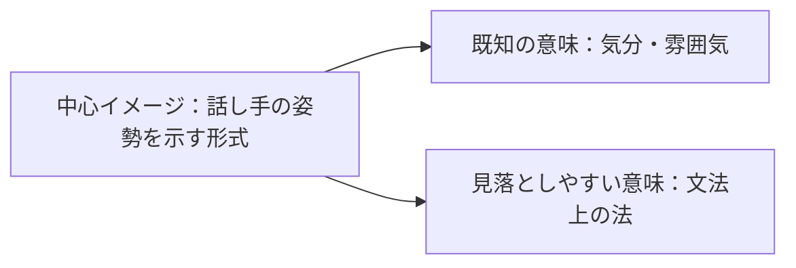

**重要語法**：`indicative mood / subjunctive mood`

<small>出典候補ID：ev-02891-noun-01（index 2891）</small>

---
### 1842. artificial

**品詞**：adjective　**発音**：/ˌɑːrtɪˈfɪʃəl/

<small>よく知られている意味：人工の</small>

**見落としやすい意味：わざとらしい、不自然な**

**例文**：His artificial smile made everyone uncomfortable.

**和訳**：彼のわざとらしい笑顔に、皆は居心地の悪さを覚えた。

**コアイメージ**：artificialは人の手で作られたものを指す。表情や態度に使うと、自然な気持ちから出たように見えないという否定的な意味になる。

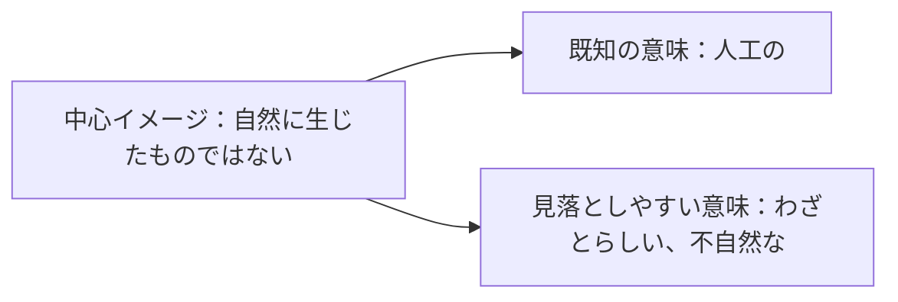

**重要語法**：`an artificial smile`

<small>出典候補ID：ev-02892-adjective-01（index 2892）</small>

---
### 1843. intimate

**品詞**：verb　**発音**：/ˈɪntɪmeɪt/（動詞）

<small>よく知られている意味：親密な（形容詞）</small>

**見落としやすい意味：それとなくほのめかす**

**例文**：She intimated that the plan might be canceled.

**和訳**：彼女はその計画が中止になるかもしれないとほのめかした。

**コアイメージ**：形容詞では人との距離の近さを表す。一方、動詞では内容をはっきり言い切らず、相手にそれとなく知らせることを意味する。

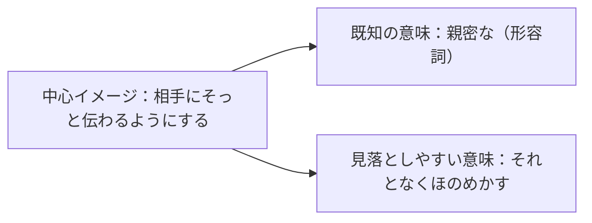

**重要語法**：`intimate that ...`

<small>出典候補ID：ev-02893-verb-01（index 2893）</small>

---
### 1844. notable

**品詞**：noun　**発音**：/ˈnoʊtəbəl/

<small>よく知られている意味：注目すべき（形容詞）</small>

**見落としやすい意味：著名人**

**例文**：Several local notables attended the ceremony.

**和訳**：地元の著名人が数人、その式典に出席した。

**コアイメージ**：notableは人々に注目されるほど目立つことを表す。名詞になると、地域や社会でよく知られた人物を指す。

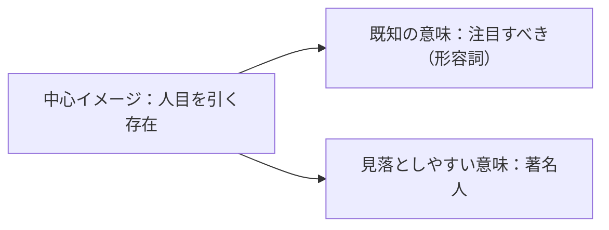

**重要語法**：`local notables`

<small>出典候補ID：ev-02894-noun-01（index 2894）</small>

---
### 1845. counterpart

**品詞**：noun　**発音**：/ˈkaʊntərpɑːrt/

<small>よく知られている意味：対応する人・物</small>

**見落としやすい意味：複製品、対応する写し**

**例文**：The two documents are exact counterparts of each other.

**和訳**：その二つの文書は互いに正確に対応する写しである。

**コアイメージ**：counterpartは別の場所や組織に同じ役割を持つものを指す。形や内容が対応する場合には、元のものに相当する写しや複製を表すこともある。

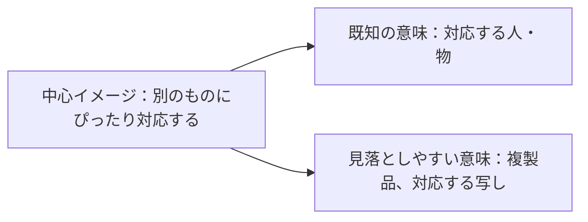

<small>出典候補ID：ev-02895-noun-01（index 2895）</small>

---
### 1846. coalition

**品詞**：noun　**発音**：/ˌkoʊəˈlɪʃən/

<small>よく知られている意味：連立・同盟</small>

**見落としやすい意味：異なる要素が結合した集合体**

**例文**：The exhibition brought together a coalition of styles from different eras.

**和訳**：その展覧会では、異なる時代の様式を組み合わせた集合体が示された。

**コアイメージ**：coalitionは別々の人や集団が共通の目的で結び付くことを表す。比喩的には、異なる要素がまとまってできた一つの集合体も指す。


<small>出典候補ID：ev-02896-noun-01（index 2896）</small>

---
### 1847. effluent

**品詞**：adjective　**発音**：/ˈefluənt/

<small>よく知られている意味：排水（名詞）</small>

**見落としやすい意味：外へ流れ出る**

**例文**：The engineers tested the effluent water at the outlet.

**和訳**：技術者たちは排出口から流れ出る水を検査した。

**コアイメージ**：effluentの中心には、ある場所から外へ流れ出る動きがある。名詞では排水そのもの、形容詞では外へ流出する性質を表す。

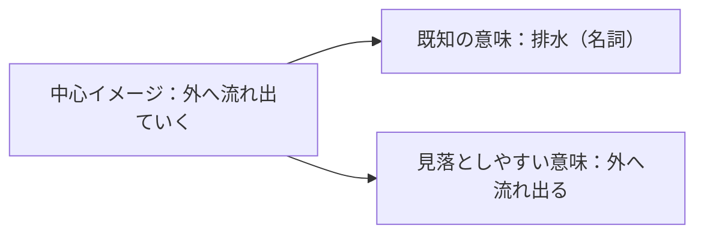

**重要語法**：`effluent water`

<small>出典候補ID：ev-02898-adjective-01（index 2898）</small>

---
### 1848. thick

**品詞**：adjective　**発音**：/θɪk/

<small>よく知られている意味：厚い・濃い</small>

**見落としやすい意味：頭が鈍い、ばかな（口語）**

**例文**：Don't be thick; the answer is right in front of you.

**和訳**：鈍いことを言わないで。答えは目の前にあるでしょう。

**コアイメージ**：thickは物が厚く密集している状態を表す。口語では考えが頭に入っていかないようだという比喩から、理解の鈍さを指すことがある。

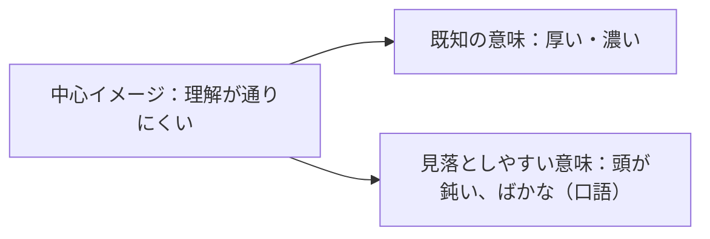

**重要語法**：`be thick（主に英口語、失礼な表現）`

<small>出典候補ID：ev-02902-adjective-01（index 2902）</small>

---
### 1849. mirror

**品詞**：verb　**発音**：/ˈmɪrər/

<small>よく知られている意味：鏡（名詞）</small>

**見落としやすい意味：行動や状況を映すように反映する**

**例文**：Her reaction mirrored the audience's disappointment.

**和訳**：彼女の反応は観客の失望をそのまま映し出していた。

**コアイメージ**：mirrorの基本は鏡が外の姿を写すこと。動詞では別の人の行動や状況とよく似た形で現れ、それを反映することをいう。

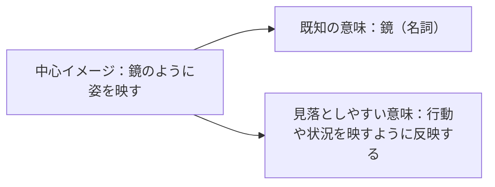

**重要語法**：`mirror someone's behavior`

<small>出典候補ID：ev-02904-verb-01（index 2904）</small>

---
### 1850. ill

**品詞**：adverb　**発音**：/ɪl/

<small>よく知られている意味：病気の・悪い</small>

**見落としやすい意味：ほとんど…できない、…する余裕が乏しい**

**例文**：We can ill afford another delay.

**和訳**：これ以上の遅れを受け入れる余裕はほとんどない。

**コアイメージ**：illは望ましくない状態を表す語。副詞では『うまく』『十分に』の逆に働き、とりわけill affordで『〜する余裕がほとんどない』を表す。

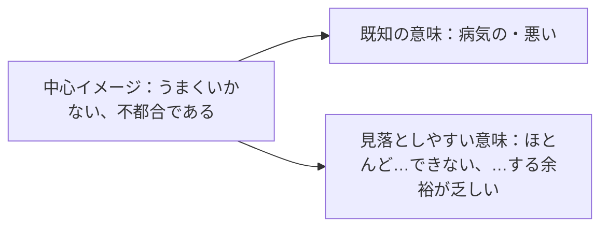

**重要語法**：`can ill afford to do / can ill afford ...`

<small>出典候補ID：ev-02905-adverb-01（index 2905）</small>

---
### 1851. float

**品詞**：verb　**発音**：/floʊt/

<small>よく知られている意味：浮く・浮かべる</small>

**見落としやすい意味：通貨を変動相場制にする**

**例文**：The government decided to float its currency.

**和訳**：政府は自国通貨を変動相場制にすることを決めた。

**コアイメージ**：floatは水面などに浮いて自由に動くこと。通貨に用いると、交換レートを固定せず市場に応じて変動させることを指す。

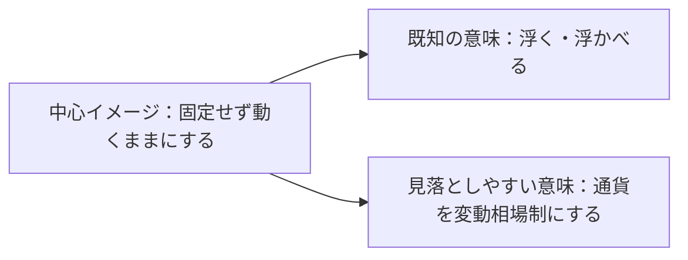

**重要語法**：`float a currency`

<small>出典候補ID：ev-02906-verb-02（index 2906）</small>

---
### 1852. float

**品詞**：verb　**発音**：/floʊt/

<small>よく知られている意味：浮く・浮かべる</small>

**見落としやすい意味：考え・提案を試しに持ち出す**

**例文**：The manager floated an idea at the meeting.

**和訳**：その管理職は会議で一つの案を試しに出した。

**コアイメージ**：floatには物を浮かべるという基本イメージがある。提案をfloatするのは、決定する前に場に出して人々の反応をうかがうこと。

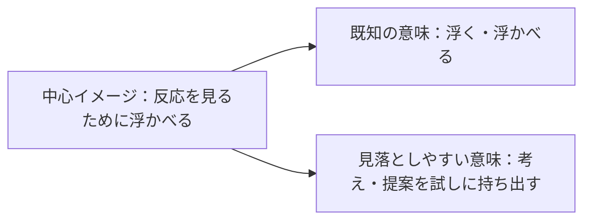

**重要語法**：`float an idea / float a proposal`

<small>出典候補ID：ev-02906-verb-03（index 2906）</small>

---
### 1853. sharp

**品詞**：noun　**発音**：/ʃɑːrp/

<small>よく知られている意味：鋭い・急な</small>

**見落としやすい意味：音を半音高くするシャープ記号**

**例文**：There is a sharp before the final note.

**和訳**：最後の音符の前にシャープ記号がある。

**コアイメージ**：sharpは先端が鋭いことや、急激な変化を表す。音楽では音を半音上げる記号の名前として使われる。

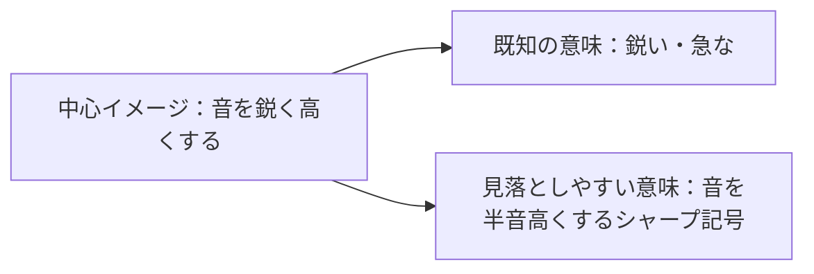

**重要語法**：`C sharp（嬰ハ）`

<small>出典候補ID：ev-02907-noun-01（index 2907）</small>

---
### 1854. chaos

**品詞**：noun　**発音**：/ˈkeɪɑːs/

<small>よく知られている意味：混乱</small>

**見落としやすい意味：物理学で初期条件のわずかな違いに敏感な力学系**

**例文**：Chaos can make long-term prediction difficult even in a simple system.

**和訳**：カオスは単純な系であっても長期予測を難しくすることがある。

**コアイメージ**：日常語のchaosは無秩序な混乱を指す。力学では、初期条件の小さな違いが後の挙動の大きな差につながる現象を表す。

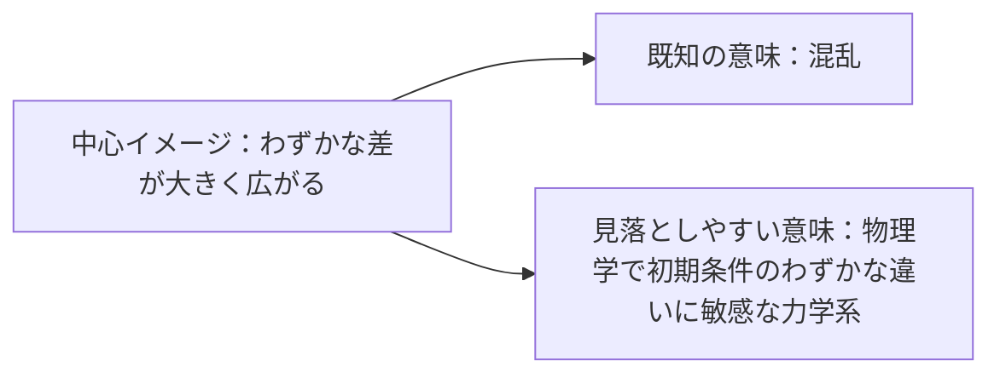

**重要語法**：`chaos theory`

<small>出典候補ID：ev-02908-noun-01（index 2908）</small>

---
### 1855. alike

**品詞**：adverb　**発音**：/əˈlaɪk/

<small>よく知られている意味：似ている</small>

**見落としやすい意味：どちらも等しく**

**例文**：The rule applies to students and teachers alike.

**和訳**：その規則は生徒にも教師にも等しく適用される。

**コアイメージ**：alikeは二つ以上のものの似た状態を表す。後ろに置かれる副詞としては、複数の対象を区別せず同様に扱う意味になる。

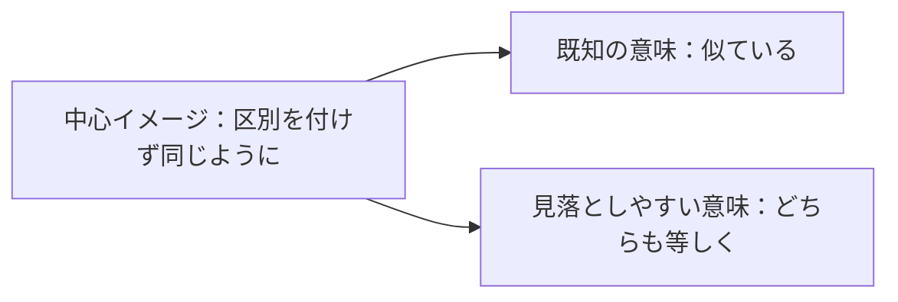

**重要語法**：`A and B alike`

<small>出典候補ID：ev-02909-adverb-01（index 2909）</small>

---
### 1856. acid

**品詞**：adjective　**発音**：/ˈæsɪd/

<small>よく知られている意味：酸・酸性の</small>

**見落としやすい意味：口調などが辛辣な、皮肉な**

**例文**：Her acid remark silenced the room.

**和訳**：彼女の辛辣な一言で、その場は静まり返った。

**コアイメージ**：酸には物を刺激し傷める性質がある。言葉や態度についてacidと言うと、聞く人を刺すような皮肉や辛辣さを表す。

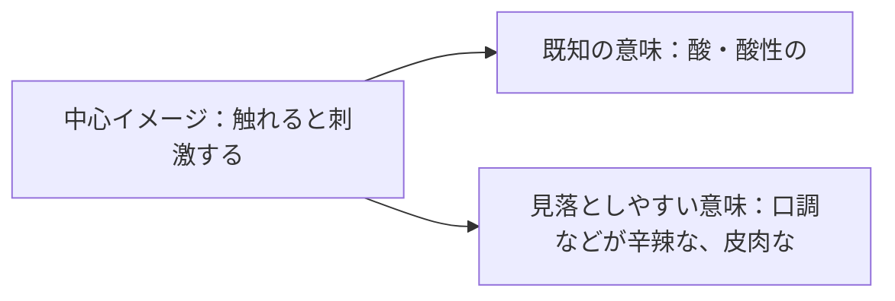

**重要語法**：`an acid remark`

<small>出典候補ID：ev-02910-adjective-01（index 2910）</small>

---
### 1857. whereas

**品詞**：conjunction　**発音**：/weərˈæz/

<small>よく知られている意味：〜であるのに対して</small>

**見落としやすい意味：二つの事実を対比する「一方で」**

**例文**：The first method is cheap, whereas the second is more reliable.

**和訳**：一つ目の方法は安価だが、二つ目の方が信頼性が高い。

**コアイメージ**：whereasは二つの事実を並べ、その違いを際立たせる接続詞。必ずしも強い逆接ではなく、単純な対比を示す『一方で』として使える。

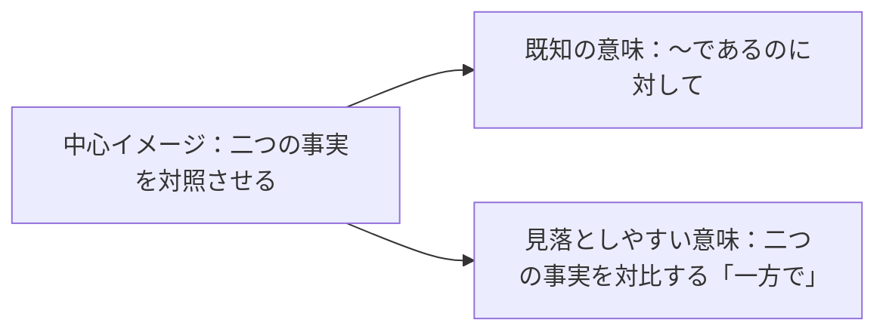

**重要語法**：`A ..., whereas B ...`

<small>出典候補ID：ev-02911-conjunction-01（index 2911）</small>

---
### 1858. flaw

**品詞**：noun　**発音**：/flɔː/

<small>よく知られている意味：傷・欠点</small>

**見落としやすい意味：理論や計画などの欠陥**

**例文**：The report revealed a serious flaw in the argument.

**和訳**：その報告書はその議論の重大な欠陥を明らかにした。

**コアイメージ**：flawは物の表面の傷や不完全な箇所を指す。その発想が議論や計画に広がると、全体を弱くする論理的な欠陥になる。

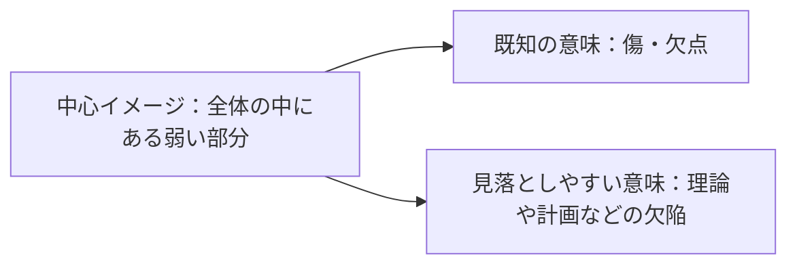

**重要語法**：`a flaw in an argument`

<small>出典候補ID：ev-02913-noun-01（index 2913）</small>

---
### 1859. flaw

**品詞**：verb　**発音**：/flɔː/

<small>よく知られている意味：欠陥（名詞）</small>

**見落としやすい意味：（計画や理論などに）欠点を生じさせる**

**例文**：A false assumption flawed the entire analysis.

**和訳**：誤った前提が分析全体に欠陥を生じさせた。

**コアイメージ**：名詞のflawは欠陥を意味する。動詞では、ある要素が計画や議論を不完全なものにしてしまうことを表す。

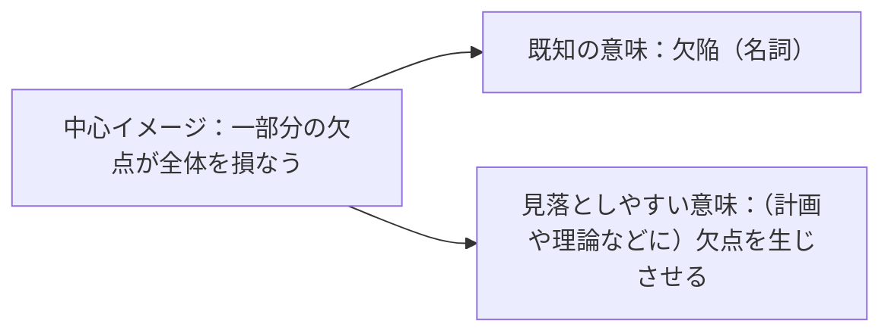

**重要語法**：`be flawed by ...`

<small>出典候補ID：ev-02913-verb-01（index 2913）</small>

---
### 1860. diminish

**品詞**：verb　**発音**：/dɪˈmɪnɪʃ/

<small>よく知られている意味：減少する・減らす</small>

**見落としやすい意味：権威・評判を損なう**

**例文**：The scandal diminished his authority.

**和訳**：その不祥事は彼の権威を損なった。

**コアイメージ**：diminishは量が減ったり、小さくなったりすること。人の権威や評判については、その重みや価値が低下する意味になる。

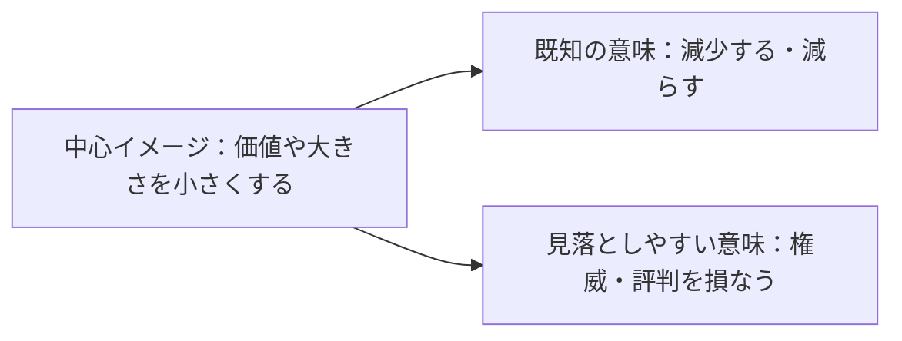

**重要語法**：`diminish someone's reputation`

<small>出典候補ID：ev-02914-verb-01（index 2914）</small>

---
### 1861. emphasis

**品詞**：noun　**発音**：/ˈemfəsɪs/

<small>よく知られている意味：強調・重点</small>

**見落としやすい意味：音節・音符の強調、アクセント**

**例文**：Place the emphasis on the second syllable.

**和訳**：二番目の音節にアクセントを置いてください。

**コアイメージ**：emphasisは何かに特に重みを置くこと。発音や音楽では、一つの音節や音を他より強く響かせることも指す。

```mermaid
flowchart LR
    A["中心イメージ：一部を目立たせる"]
    B["既知の意味：強調・重点"]
    C["見落としやすい意味：音節・音符の強調、アクセント"]
    A --> B
    A --> C
```

**重要語法**：`put/place emphasis on ...`

<small>出典候補ID：ev-02916-noun-01（index 2916）</small>

---
### 1862. variable

**品詞**：noun　**発音**：/ˈveriəbəl/

<small>よく知られている意味：変わりやすい（形容詞）</small>

**見落としやすい意味：数学・論理学で使う変数の記号**

**例文**：In this formula, the letter x is a variable.

**和訳**：この公式では、文字xが変数である。

**コアイメージ**：variableは条件に応じて変わる性質を表す。数学ではさまざまな値を取り得る量や、それを表す文字をいう。

```mermaid
flowchart LR
    A["中心イメージ：値が変わり得るもの"]
    B["既知の意味：変わりやすい（形容詞）"]
    C["見落としやすい意味：数学・論理学で使う変数の記号"]
    A --> B
    A --> C
```

**重要語法**：`independent variable / dependent variable`

<small>出典候補ID：ev-02918-noun-01（index 2918）</small>

---
### 1863. boot

**品詞**：verb　**発音**：/buːt/

<small>よく知られている意味：長靴・ブーツ</small>

**見落としやすい意味：コンピューターを起動する**

**例文**：The computer took a minute to boot.

**和訳**：そのコンピューターは起動するのに1分かかった。

**コアイメージ**：bootは名詞では履物を表すが、コンピューターの動詞では起動処理を進めること。機器が使用可能になるまでの立ち上がりを表す。

```mermaid
flowchart LR
    A["中心イメージ：使える状態へ立ち上げる"]
    B["既知の意味：長靴・ブーツ"]
    C["見落としやすい意味：コンピューターを起動する"]
    A --> B
    A --> C
```

**重要語法**：`boot up / reboot`

<small>出典候補ID：ev-02919-verb-01（index 2919）</small>

---
### 1864. slight

**品詞**：noun　**発音**：/slaɪt/

<small>よく知られている意味：わずかな（形容詞）</small>

**見落としやすい意味：侮辱・軽視する態度**

**例文**：She took his silence as a slight.

**和訳**：彼女は彼の沈黙を自分への侮辱と受け取った。

**コアイメージ**：slightには小さい、重要でないという感覚がある。名詞では相手を軽んじ、その人の価値を低く見たような言動を指す。

```mermaid
flowchart LR
    A["中心イメージ：相手を軽く扱う"]
    B["既知の意味：わずかな（形容詞）"]
    C["見落としやすい意味：侮辱・軽視する態度"]
    A --> B
    A --> C
```

**重要語法**：`take something as a slight`

<small>出典候補ID：ev-02920-noun-01（index 2920）</small>

---
### 1865. exclusive

**品詞**：noun　**発音**：/ɪkˈskluːsɪv/

<small>よく知られている意味：排他的な・独占的な</small>

**見落としやすい意味：他社に先駆けた独占記事・スクープ**

**例文**：The newspaper published an exclusive on the investigation.

**和訳**：その新聞は捜査についての独占記事を掲載した。

**コアイメージ**：exclusiveは特定の相手だけが利用できることを表す。報道では一社だけが手に入れた情報や独占記事を指す名詞になる。

```mermaid
flowchart LR
    A["中心イメージ：ほかを締め出して独占する"]
    B["既知の意味：排他的な・独占的な"]
    C["見落としやすい意味：他社に先駆けた独占記事・スクープ"]
    A --> B
    A --> C
```

**重要語法**：`an exclusive interview / an exclusive`

<small>出典候補ID：ev-02923-noun-01（index 2923）</small>

---
### 1866. fifth

**品詞**：noun　**発音**：/fɪfθ/

<small>よく知られている意味：五番目の</small>

**見落としやすい意味：音楽での5度音程**

**例文**：The two notes are a perfect fifth apart.

**和訳**：その二つの音は完全5度離れている。

**コアイメージ**：fifthは順序の五番目を示す語。音楽では音階上の五度という音程を表し、二音の隔たりをいう。

```mermaid
flowchart LR
    A["中心イメージ：五つ分の位置関係"]
    B["既知の意味：五番目の"]
    C["見落としやすい意味：音楽での5度音程"]
    A --> B
    A --> C
```

**重要語法**：`a perfect fifth`

<small>出典候補ID：ev-02924-noun-01（index 2924）</small>

---
### 1867. invoke

**品詞**：verb　**発音**：/ɪnˈvoʊk/

<small>よく知られている意味：呼び起こす</small>

**見落としやすい意味：法や先例を根拠に持ち出す**

**例文**：The lawyer invoked a previous ruling to support her case.

**和訳**：その弁護士は主張を裏付けるために過去の判決を根拠として持ち出した。

**コアイメージ**：invokeは名を呼び出したり、力を求めたりすること。法律や先例の場合は、それを主張の根拠として援用する意味になる。

```mermaid
flowchart LR
    A["中心イメージ：権威を呼び出して頼る"]
    B["既知の意味：呼び起こす"]
    C["見落としやすい意味：法や先例を根拠に持ち出す"]
    A --> B
    A --> C
```

**重要語法**：`invoke a law / invoke a precedent`

<small>出典候補ID：ev-02925-verb-01（index 2925）</small>

---
### 1868. raid

**品詞**：verb　**発音**：/reɪd/

<small>よく知られている意味：急襲する</small>

**見落としやすい意味：必要な物を求めて場所をあさる**

**例文**：We raided the kitchen for a late-night snack.

**和訳**：私たちは夜食を探して台所をあさった。

**コアイメージ**：raidはもともと急に押し入ることを表す。日常では食べ物などを探して場所をあさる、という軽い言い方にもなる。

```mermaid
flowchart LR
    A["中心イメージ：目的の物を一気に取りに行く"]
    B["既知の意味：急襲する"]
    C["見落としやすい意味：必要な物を求めて場所をあさる"]
    A --> B
    A --> C
```

**重要語法**：`raid the fridge`

<small>出典候補ID：ev-02927-verb-01（index 2927）</small>

---
### 1869. ruling

**品詞**：noun　**発音**：/ˈruːlɪŋ/

<small>よく知られている意味：支配している（形容詞）</small>

**見落としやすい意味：裁判所・当局による公式の判断、裁定・判決**

**例文**：The court issued a ruling on the case.

**和訳**：裁判所はその事件について判決を下した。

**コアイメージ**：ruleは支配するだけでなく判断を下すことも意味する。rulingという名詞は裁判所などが正式に示した決定を指す。

```mermaid
flowchart LR
    A["中心イメージ：権限を持って決定する"]
    B["既知の意味：支配している（形容詞）"]
    C["見落としやすい意味：裁判所・当局による公式の判断、裁定・判決"]
    A --> B
    A --> C
```

**重要語法**：`issue a ruling`

<small>出典候補ID：ev-02928-noun-01（index 2928）</small>

---
### 1870. voucher

**品詞**：noun　**発音**：/ˈvaʊtʃər/

<small>よく知られている意味：引換券・割引券</small>

**見落としやすい意味：支出・支払いを証明する書類**

**例文**：Keep the voucher as proof of payment.

**和訳**：支払いの証明としてその証憑書類を保管してください。

**コアイメージ**：voucherは何かを引き換えられる券として知られる。一方、会計では支払いなどの事実を証明する書類として使う。

```mermaid
flowchart LR
    A["中心イメージ：取引の正当性を裏付ける紙"]
    B["既知の意味：引換券・割引券"]
    C["見落としやすい意味：支出・支払いを証明する書類"]
    A --> B
    A --> C
```

**重要語法**：`payment voucher`

<small>出典候補ID：ev-02929-noun-01（index 2929）</small>

---
### 1871. layer

**品詞**：noun　**発音**：/ˈleɪər/

<small>よく知られている意味：層・重なり</small>

**見落としやすい意味：卵を産む雌鶏**

**例文**：This breed is an excellent layer.

**和訳**：この品種は卵をよく産む鶏だ。

**コアイメージ**：layerは層や重ねる人を意味する語として使われる。鶏については卵を産むもの、特に産卵能力のある雌鶏を指す。

```mermaid
flowchart LR
    A["中心イメージ：ものを次々と置く存在"]
    B["既知の意味：層・重なり"]
    C["見落としやすい意味：卵を産む雌鶏"]
    A --> B
    A --> C
```

**重要語法**：`a good layer`

<small>出典候補ID：ev-02932-noun-01（index 2932）</small>

---
### 1872. overcome

**品詞**：verb　**発音**：/ˌoʊvərˈkʌm/

<small>よく知られている意味：打ち勝つ・克服する</small>

**見落としやすい意味：感情に圧倒される**

**例文**：She was overcome with relief when he returned.

**和訳**：彼が帰ってきて、彼女は安堵の気持ちでいっぱいになった。

**コアイメージ**：overcomeは障害を乗り越えることを表す。一方、受け身では感情の力に圧倒され、自分で抑えられない状態をいう。

```mermaid
flowchart LR
    A["中心イメージ：強い力に覆われる"]
    B["既知の意味：打ち勝つ・克服する"]
    C["見落としやすい意味：感情に圧倒される"]
    A --> B
    A --> C
```

**重要語法**：`be overcome with emotion`

<small>出典候補ID：ev-02933-verb-01（index 2933）</small>

---
### 1873. march

**品詞**：noun　**発音**：/mɑːrtʃ/

<small>よく知られている意味：行進（名詞）</small>

**見落としやすい意味：時間や科学などの着実な進展**

**例文**：Nothing seemed able to stop the march of technology.

**和訳**：技術の着実な進歩を止められるものはないように思われた。

**コアイメージ**：marchは足並みをそろえて前へ進むこと。時間や科学の進歩に使うと、止まらず続く着実な進展を表す。

```mermaid
flowchart LR
    A["中心イメージ：一定方向へ着実に進む"]
    B["既知の意味：行進（名詞）"]
    C["見落としやすい意味：時間や科学などの着実な進展"]
    A --> B
    A --> C
```

**重要語法**：`the march of progress`

<small>出典候補ID：ev-02936-noun-01（index 2936）</small>

---
### 1874. pro

**品詞**：noun　**発音**：/proʊ/

<small>よく知られている意味：プロ選手・専門家</small>

**見落としやすい意味：賛成論、利点**

**例文**：We should weigh the pros and cons before deciding.

**和訳**：決める前に賛成材料と反対材料を比べるべきだ。

**コアイメージ**：proは『賛成の』という意味にもつながる。名詞ではある案に有利な理由や利点を表し、反対材料のconと対で使う。

```mermaid
flowchart LR
    A["中心イメージ：ある立場を支持する側"]
    B["既知の意味：プロ選手・専門家"]
    C["見落としやすい意味：賛成論、利点"]
    A --> B
    A --> C
```

**重要語法**：`pros and cons`

<small>出典候補ID：ev-02939-noun-01（index 2939）</small>

---
### 1875. drag

**品詞**：noun　**発音**：/dræɡ/

<small>よく知られている意味：引きずる（動詞）</small>

**見落としやすい意味：進行の妨げ・足かせ**

**例文**：The outdated system is a drag on productivity.

**和訳**：古いシステムは生産性の足かせになっている。

**コアイメージ**：dragは物を引きずる動作を表す。比喩的には前に進もうとする人や活動の動きを鈍らせる負担を指す。

```mermaid
flowchart LR
    A["中心イメージ：前進を引っ張って遅くする"]
    B["既知の意味：引きずる（動詞）"]
    C["見落としやすい意味：進行の妨げ・足かせ"]
    A --> B
    A --> C
```

**重要語法**：`a drag on ...`

<small>出典候補ID：ev-02940-noun-01（index 2940）</small>

---
### 1876. signature

**品詞**：noun　**発音**：/ˈsɪɡnətʃər/

<small>よく知られている意味：署名</small>

**見落としやすい意味：作品・人物などを特徴づける独自の様式**

**例文**：The chef added her signature touch to the dish.

**和訳**：シェフはその料理に自分ならではの工夫を加えた。

**コアイメージ**：signatureは本人であることを示す署名。そこから、作者や人物を見分けられる特徴的な様式や工夫という意味になる。

```mermaid
flowchart LR
    A["中心イメージ：その人だと分かる印"]
    B["既知の意味：署名"]
    C["見落としやすい意味：作品・人物などを特徴づける独自の様式"]
    A --> B
    A --> C
```

**重要語法**：`signature style / signature touch`

<small>出典候補ID：ev-02941-noun-01（index 2941）</small>

---
### 1877. surgery

**品詞**：noun　**発音**：/ˈsɜːrdʒəri/

<small>よく知られている意味：外科手術</small>

**見落としやすい意味：診療所、医師の診察室（英国英語）**

**例文**：The doctor's surgery opens at nine.

**和訳**：その医師の診療所は9時に開く。

**コアイメージ**：surgeryは手術そのものを指すことが多い。英国英語では医師が患者を診察する場所や診療時間も意味する。

```mermaid
flowchart LR
    A["中心イメージ：医療を行う場所・時間"]
    B["既知の意味：外科手術"]
    C["見落としやすい意味：診療所、医師の診察室（英国英語）"]
    A --> B
    A --> C
```

**重要語法**：`a doctor's surgery（英）`

<small>出典候補ID：ev-02942-noun-01（index 2942）</small>

---
### 1878. surgery

**品詞**：noun　**発音**：/ˈsɜːrdʒəri/

<small>よく知られている意味：外科手術</small>

**見落としやすい意味：議員が住民の相談に応じる定例の面会時間（英国英語）**

**例文**：The MP holds a weekly surgery for local residents.

**和訳**：その国会議員は地元住民の相談に応じる面会時間を毎週設けている。

**コアイメージ**：英国英語のsurgeryは医師の診察に関連する場所や時間を表す。その発想から、議員が住民の悩みを直接聞く定例相談の時間も指す。

```mermaid
flowchart LR
    A["中心イメージ：個別の問題を相談する場"]
    B["既知の意味：外科手術"]
    C["見落としやすい意味：議員が住民の相談に応じる定例の面会時間（英国英語）"]
    A --> B
    A --> C
```

**重要語法**：`hold a constituency surgery（英）`

<small>出典候補ID：ev-02942-noun-02（index 2942）</small>

---
### 1879. frequency

**品詞**：noun　**発音**：/ˈfriːkwənsi/

<small>よく知られている意味：頻度・周波数</small>

**見落としやすい意味：統計的な度数**

**例文**：The table shows the frequency of each response.

**和訳**：その表は各回答の度数を示している。

**コアイメージ**：frequencyは何かが繰り返される頻度を表す。統計では特定の値や回答が実際に観測された回数、つまり度数になる。

```mermaid
flowchart LR
    A["中心イメージ：何回現れたかを数える"]
    B["既知の意味：頻度・周波数"]
    C["見落としやすい意味：統計的な度数"]
    A --> B
    A --> C
```

**重要語法**：`frequency distribution`

<small>出典候補ID：ev-02943-noun-01（index 2943）</small>

---
### 1880. segment

**品詞**：verb　**発音**：/ˈseɡment/（動詞も同形）

<small>よく知られている意味：区分・部分（名詞）</small>

**見落としやすい意味：いくつかの部分に分ける**

**例文**：The researchers segmented the data by age group.

**和訳**：研究者たちはデータを年齢層ごとに分けた。

**コアイメージ**：segmentは全体の一部分を意味する。動詞になると、全体をいくつかの意味ある部分に分割する操作を表す。

```mermaid
flowchart LR
    A["中心イメージ：一続きのものを区切る"]
    B["既知の意味：区分・部分（名詞）"]
    C["見落としやすい意味：いくつかの部分に分ける"]
    A --> B
    A --> C
```

**重要語法**：`segment A by B`

<small>出典候補ID：ev-02945-verb-01（index 2945）</small>

---
