# EasyVoca｜完成教材 バッチ025

- 対象：採用済み語義の global_order 1921〜2000（全80件）
- 順序：`decision == "accepted"` の候補を `index`、`candidate_id` 昇順
- 出典：`main` の `data/candidates/*.jsonl`。例文と説明文は新規作成。

## 01. hijack

- **品詞**：動詞
- **発音**：/ˈhaɪdʒæk/

<small>よく知られている意味：（乗り物を）乗っ取る</small>

### 見落としやすい意味

**（議論・企画などを）乗っ取り本来の目的からそらす**

**例文**：One participant hijacked the discussion and turned it into an argument about budgets.

**和訳**：ある参加者が議論を乗っ取り、予算についての口論に変えてしまった。

**コアイメージ**：本来の進行を支配する権限を奪うイメージ。乗り物なら操縦を奪い、議論なら話題や進行方向を勝手に変える。

**図**

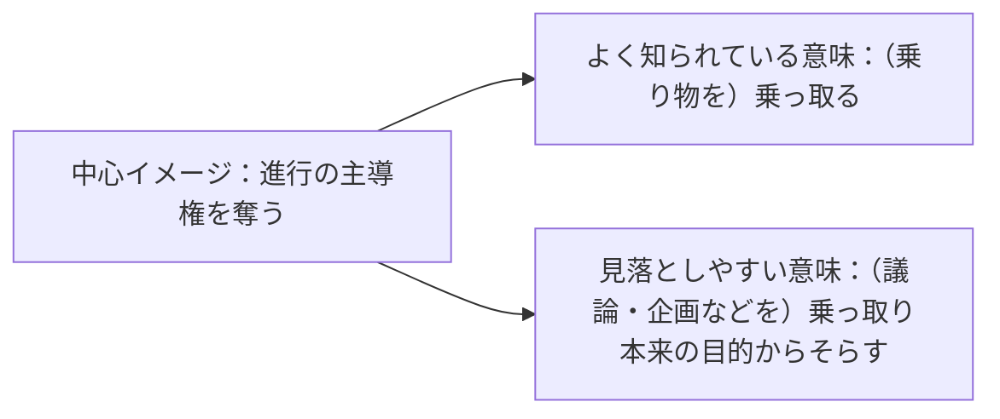

**重要語法**：hijack a discussion

---

## 02. quit

- **品詞**：動詞
- **発音**：/kwɪt/

<small>よく知られている意味：（仕事を）辞める</small>

### 見落としやすい意味

**（quit doingで）〜するのをやめる**

**例文**：She quit checking her phone during meals.

**和訳**：彼女は食事中にスマートフォンを確認するのをやめた。

**コアイメージ**：続けていたことから身を引くイメージ。仕事から離れる場合だけでなく、続けていた習慣や行為をやめる場合にも使う。

**図**

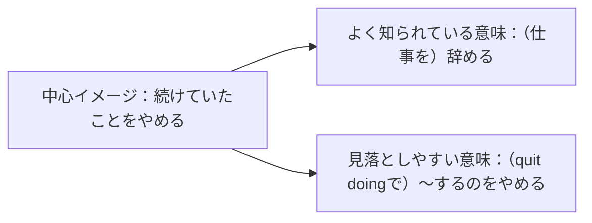

**重要語法**：quit doing（動名詞を続ける）

---

## 03. wire

- **品詞**：動詞
- **発音**：/waɪər/

<small>よく知られている意味：（機器を）配線する</small>

### 見落としやすい意味

**銀行送金する**

**例文**：Please wire the deposit to the seller by Friday.

**和訳**：金曜日までに売り手へ手付金を銀行送金してください。

**コアイメージ**：電線をつないで電気や信号を送ることが出発点。送金の意味では、電信送金に由来して現在の電子的な銀行振込にも使う。

**図**

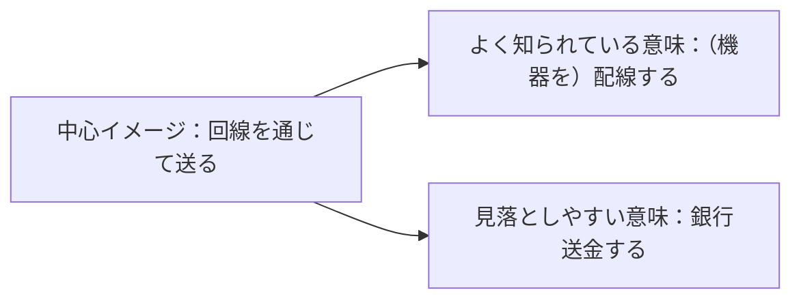

**重要語法**：wire money to a person

---

## 04. gear

- **品詞**：動詞
- **発音**：/ɡɪr/

<small>よく知られている意味：（機械に）歯車を取り付ける</small>

### 見落としやすい意味

**（be geared toward/toで）〜向けに設計・調整されている**

**例文**：The course is geared toward students with little experience.

**和訳**：その講座は経験の少ない学生向けに作られている。

**コアイメージ**：歯車や装備を目的に合うよう調整することから来るイメージ。講座や製品などを特定の人や目的に合わせて設計することを表す。

**図**

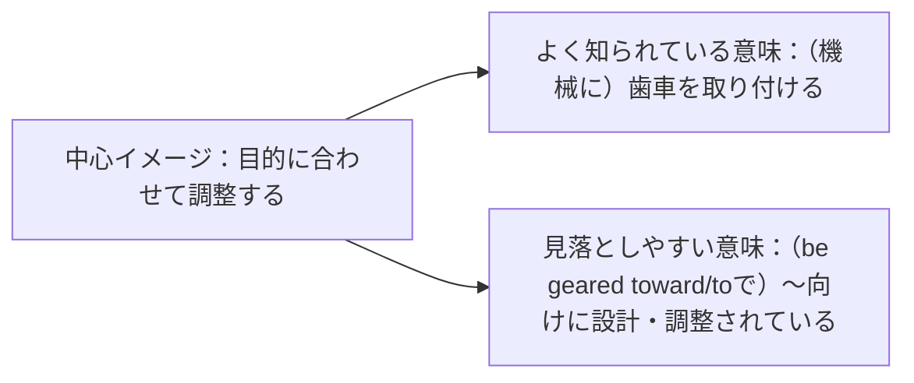

**重要語法**：be geared toward/to + 名詞

---

## 05. sentiment

- **品詞**：名詞
- **発音**：/ˈsɛntɪmənt/

<small>よく知られている意味：感情、心情</small>

### 見落としやすい意味

**意見、考え方、（集団の）見解**

**例文**：Public sentiment shifted after the announcement.

**和訳**：発表後、世論の見方が変わった。

**コアイメージ**：人々の心にある考えや感じ方を表す語。個人の感情だけでなく、集団に広がる評価や意見を指す。

**図**

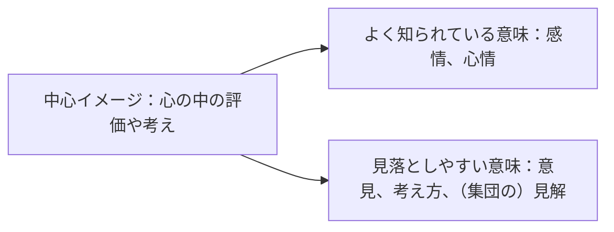

**重要語法**：public sentiment

---

## 06. aesthetic

- **品詞**：名詞
- **発音**：/esˈθetɪk/

<small>よく知られている意味：美的な（形容詞）</small>

### 見落としやすい意味

**美的感覚、独特の美学・様式**

**例文**：The café has a simple, modern aesthetic.

**和訳**：そのカフェにはシンプルで現代的な美的様式がある。

**コアイメージ**：美しさをどう捉え、表現するかという感覚が中心。形容詞の『美的な』に加えて、名詞では独特の美意識や様式を表す。

**図**

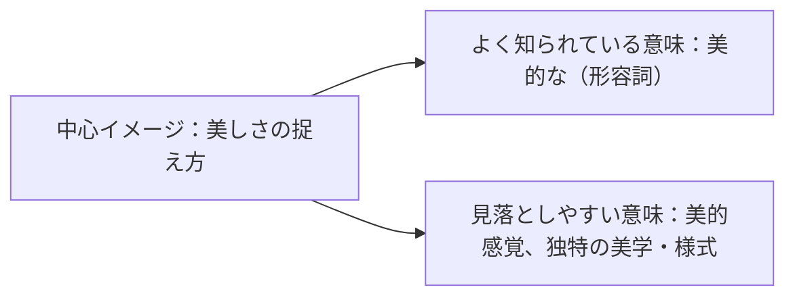

**重要語法**：an aesthetic（名詞）

---

## 07. contend

- **品詞**：動詞
- **発音**：/kənˈtend/

<small>よく知られている意味：争う、競う</small>

### 見落としやすい意味

**議論の中で「〜だ」と主張する**

**例文**：Several researchers contend that the policy will fail.

**和訳**：複数の研究者が、その政策は失敗すると主張している。

**コアイメージ**：自分の立場を相手に押し出すイメージ。競い争う行為から、議論の中で自説を強く主張する意味につながる。

**図**

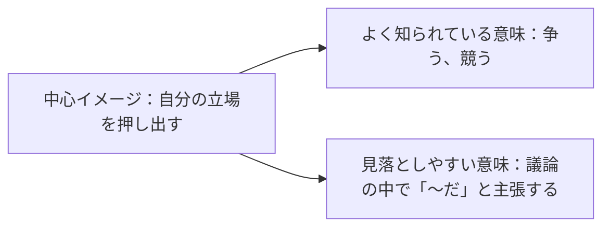

**重要語法**：contend that + 文

---

## 08. accent

- **品詞**：動詞
- **発音**：/ˈæksent/

<small>よく知られている意味：アクセント（名詞）</small>

### 見落としやすい意味

**言葉や特徴を際立たせて強調する**

**例文**：The lighting accents the texture of the walls.

**和訳**：照明が壁の質感を際立たせている。

**コアイメージ**：ある部分に注意が集まるように際立たせること。発音の強勢だけでなく、特徴を目立たせる動詞としても使う。

**図**

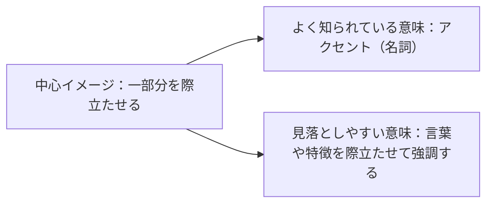

**重要語法**：accent a feature

---

## 09. strain

- **品詞**：名詞
- **発音**：/streɪn/

<small>よく知られている意味：緊張、負担</small>

### 見落としやすい意味

**動植物・微生物などの品種・系統**

**例文**：Scientists discovered a new strain of the virus.

**和訳**：科学者たちはそのウイルスの新たな系統を発見した。

**コアイメージ**：strain には負担を表す語義と、生物の系統を表す別の語義がある。この二つを無理に同じイメージへ結びつけず、生物学の文脈では『型・系統』と読む。

**図**

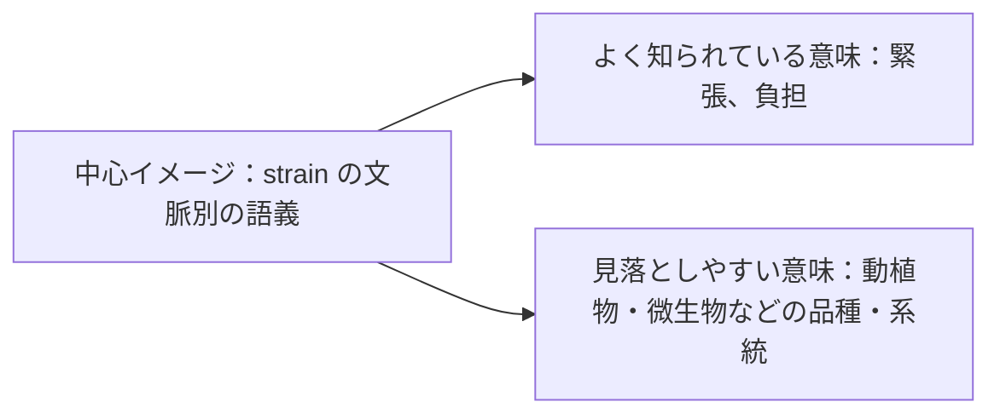

**重要語法**：a strain of a virus

---

## 10. strain

- **品詞**：動詞
- **発音**：/streɪn/

<small>よく知られている意味：（物を）強く引っ張る</small>

### 見落としやすい意味

**（関係・財政・身体などに）負荷をかけて悪化させる**

**例文**：The long dispute strained relations between the two towns.

**和訳**：長引く争いが二つの町の関係を悪化させた。

**コアイメージ**：何かを限界近くまで引き伸ばして負担を与えるイメージ。筋肉だけでなく、人間関係や財政も緊張させ、悪化させることがある。

**図**

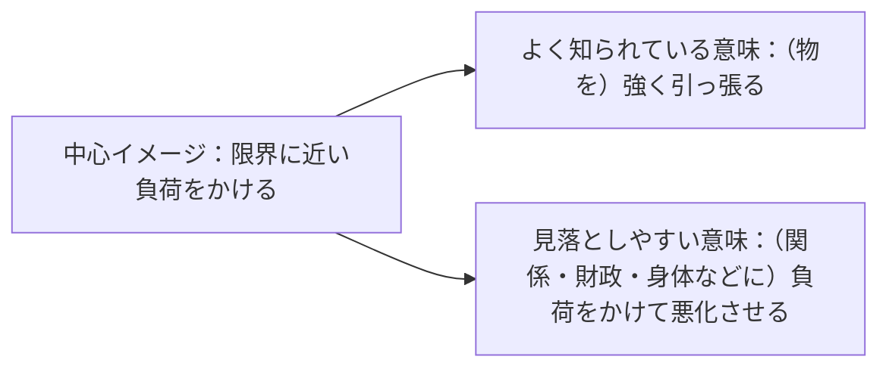

**重要語法**：strain relations

---

## 11. anticipate

- **品詞**：動詞
- **発音**：/ænˈtɪsəpeɪt/

<small>よく知られている意味：予期する</small>

### 見落としやすい意味

**出来事を見越して先手を打つ**

**例文**：The team anticipated the demand and hired more staff.

**和訳**：チームは需要を見越して人員を増やした。

**コアイメージ**：これから起こることを心の中で先取りするイメージ。単なる予想から、予想に基づき前もって対処する意味へ広がる。

**図**

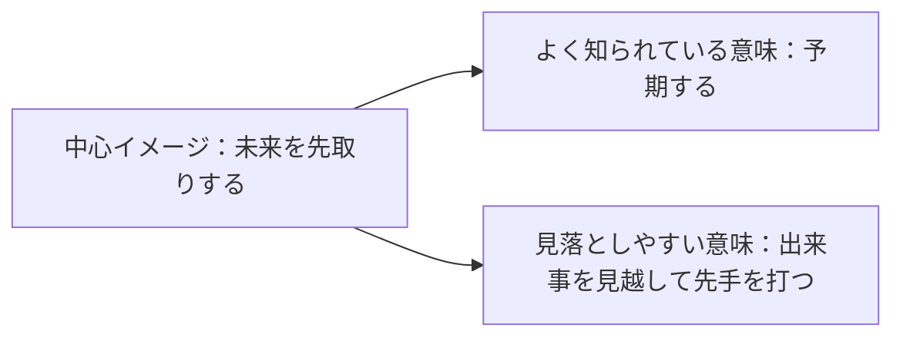

**重要語法**：anticipate demand

---

## 12. array

- **品詞**：名詞
- **発音**：/əˈreɪ/

<small>よく知られている意味：配列、整列</small>

### 見落としやすい意味

**見事な陳列・勢ぞろい**

**例文**：An impressive array of paintings filled the hall.

**和訳**：見事な絵画の数々が広間を埋め尽くしていた。

**コアイメージ**：人や物がずらりと並ぶ姿が中心。整然とした配列から、目を引く品ぞろえや勢ぞろいを表す。

**図**

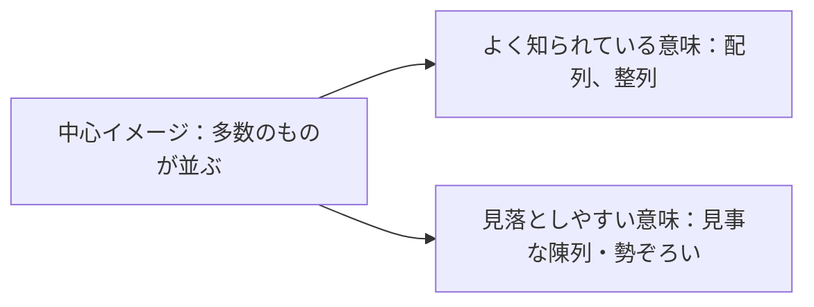

**重要語法**：an array of ...

---

## 13. clock

- **品詞**：動詞
- **発音**：/klɑːk/

<small>よく知られている意味：時計（名詞）</small>

### 見落としやすい意味

**時間や速度を計測・記録する**

**例文**：The runner clocked a time of 10.2 seconds.

**和訳**：その走者は10.2秒を記録した。

**コアイメージ**：時計で時間を測り、数字を記録すること。時間や速度などを測定して記録する動詞として使われる。

**図**

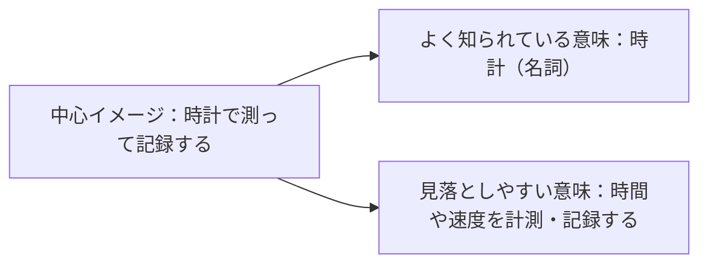

**重要語法**：clock a time/speed

---

## 14. clock

- **品詞**：動詞
- **発音**：/klɑːk/

<small>よく知られている意味：時間や速度を計測する</small>

### 見落としやすい意味

**（clock in/outで）出勤・退勤の時刻を記録する**

**例文**：Staff must clock in before starting work.

**和訳**：職員は勤務開始前に出勤時刻を打刻しなければならない。

**コアイメージ**：時刻を計測・記録する動作が中心。勤務時間の管理では、出勤や退勤の時刻を記録する意味に特化する。

**図**

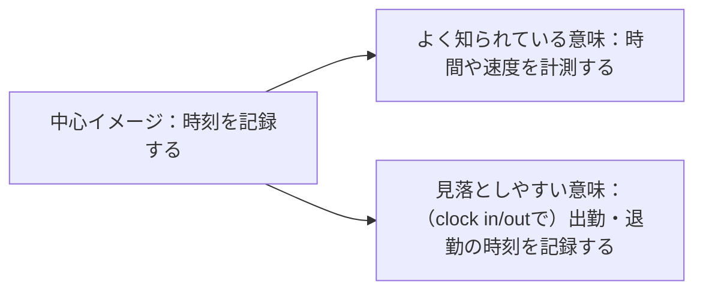

**重要語法**：clock in / clock out

---

## 15. pile

- **品詞**：動詞
- **発音**：/paɪl/

<small>よく知られている意味：積み重ねる</small>

### 見落としやすい意味

**（pile onで）次々と加わって非難・負担などを集中させる**

**例文**：After the mistake, critics piled on the coach.

**和訳**：その失敗の後、批判者たちが次々に監督を非難した。

**コアイメージ**：何かの上に次々と物が重なるイメージ。人々の非難や負担が一つの対象に集中する様子も表す。

**図**

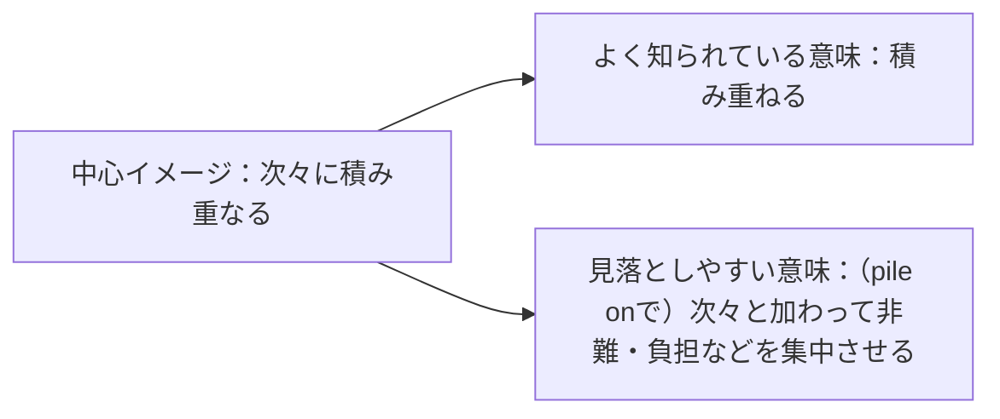

**重要語法**：pile on (someone)

---

## 16. occupation

- **品詞**：名詞
- **発音**：/ˌɑːkjəˈpeɪʃən/

<small>よく知られている意味：職業</small>

### 見落としやすい意味

**（軍隊による地域などの）占領・占領状態**

**例文**：The city endured years of military occupation.

**和訳**：その都市は何年にもわたる軍事占領に耐えた。

**コアイメージ**：場所や役割を占める状態が中心。職業という社会的な役割だけでなく、軍隊が地域を支配して占める状態も表す。

**図**

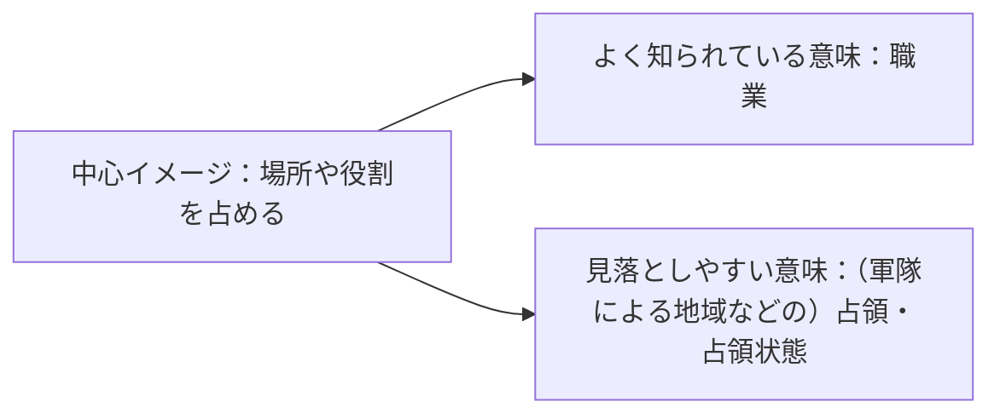

**重要語法**：military occupation

---

## 17. departure

- **品詞**：名詞
- **発音**：/dɪˈpɑːrtʃər/

<small>よく知られている意味：出発</small>

### 見落としやすい意味

**基準や慣例からの逸脱**

**例文**：The decision was a sharp departure from past practice.

**和訳**：その決定は従来の慣行からの大きな逸脱だった。

**コアイメージ**：元いた地点から離れて別の方向へ進むこと。物理的な出発から、基準や慣例を離れる比喩へ広がる。

**図**

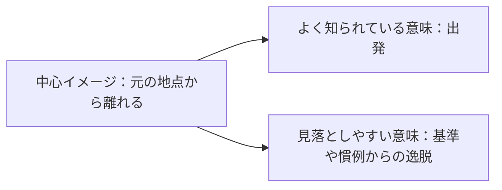

**重要語法**：a departure from ...

---

## 18. projection

- **品詞**：名詞
- **発音**：/prəˈdʒekʃən/

<small>よく知られている意味：映像の投影</small>

### 見落としやすい意味

**過去の傾向から算出した将来予測**

**例文**：The budget projection assumes steady growth.

**和訳**：その予算予測は安定した成長を前提としている。

**コアイメージ**：手元にある情報を前方へ映し出すイメージ。映像を映すことから、現在のデータを将来へ延ばして見通しを示す意味になる。

**図**

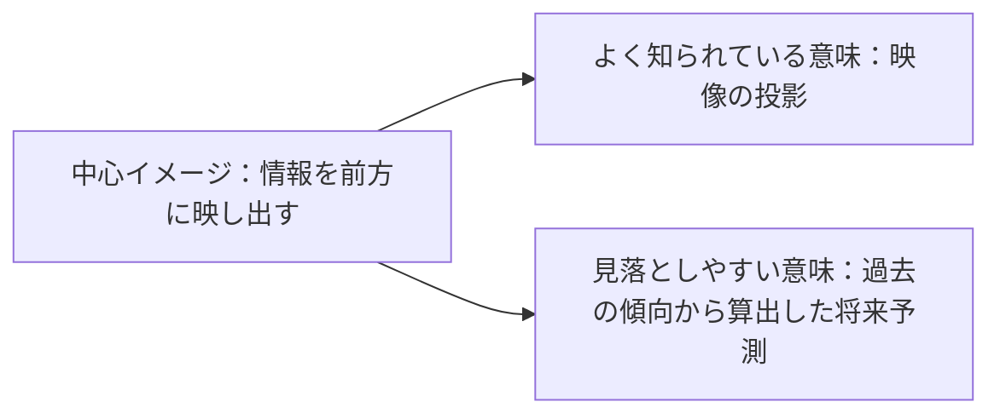

**重要語法**：economic projections

---

## 19. spare

- **品詞**：動詞
- **発音**：/sper/

<small>よく知られている意味：（時間や金を）割く、惜しむ</small>

### 見落としやすい意味

**人を望ましくない経験から救う・免れさせる**

**例文**：The shortcut spared us a long walk.

**和訳**：その近道のおかげで、私たちは長い距離を歩かずに済んだ。

**コアイメージ**：使わずに残して負担を避けるというイメージ。資源を節約する場合だけでなく、人に苦労をさせずに済ませる場合にも使う。

**図**

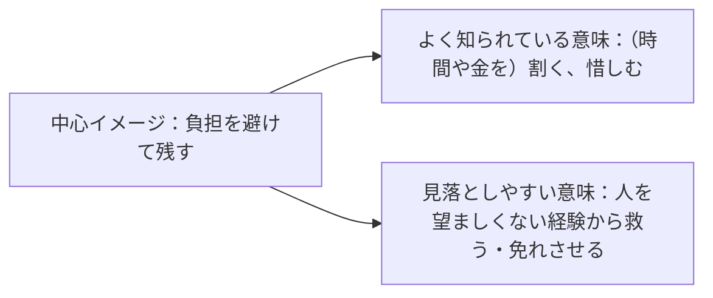

**重要語法**：spare A B（AにBを免れさせる）

---

## 20. spare

- **品詞**：動詞
- **発音**：/sper/

<small>よく知られている意味：（費用などを）惜しむ</small>

### 見落としやすい意味

**（spare no effort/expenseで）努力・費用を惜しまない**

**例文**：They spared no effort to find the missing files.

**和訳**：彼らは紛失した書類を探すためにあらゆる努力を尽くした。

**コアイメージ**：spare は使わずに残すこと。no が付くと『少しも惜しまない』となり、全力を尽くす意味になる。

**図**

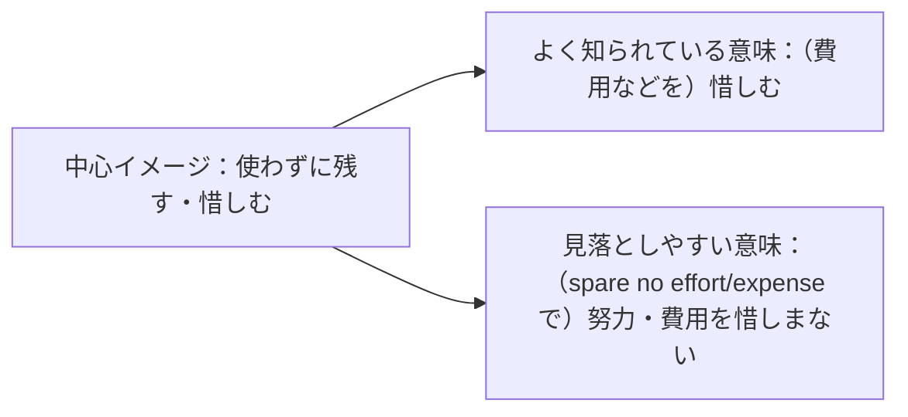

**重要語法**：spare no effort to do / spare no expense

---

## 21. decent

- **品詞**：形容詞
- **発音**：/ˈdiːsənt/

<small>よく知られている意味：礼儀正しい、品位のある</small>

### 見落としやすい意味

**（量・質・収入などが）十分な、かなり良い**

**例文**：The apartment is small but has a decent kitchen.

**和訳**：そのアパートは小さいが、台所は十分使いやすい。

**コアイメージ**：期待される水準をきちんと満たす感覚。人の品行だけでなく、量・品質・収入がまずまず良いと評価する場合にも使う。

**図**

```mermaid
flowchart LR
    A["中心イメージ：満足できる水準に達する"]
    B["よく知られている意味：礼儀正しい、品位のある"]
    C["見落としやすい意味：（量・質・収入などが）十分な、かなり良い"]
    A --> B
    A --> C
```

**重要語法**：a decent amount of ...

---

## 22. innocent

- **品詞**：形容詞
- **発音**：/ˈɪnəsənt/

<small>よく知られている意味：無実の、純真な</small>

### 見落としやすい意味

**（行為や物などが）無害な**

**例文**：What seemed like an innocent question caused confusion.

**和訳**：一見何気ない質問が混乱を招いた。

**コアイメージ**：罪や害がない状態を表す。人の無実に加えて、質問や行為に悪意や危険がないことも意味する。

**図**

```mermaid
flowchart LR
    A["中心イメージ：罪や害を持たない"]
    B["よく知られている意味：無実の、純真な"]
    C["見落としやすい意味：（行為や物などが）無害な"]
    A --> B
    A --> C
```

**重要語法**：an innocent remark

---

## 23. proceeding

- **品詞**：名詞
- **発音**：/prəˈsiːdɪŋ/

<small>よく知られている意味：進行、手続き</small>

### 見落としやすい意味

**（proceedingsで）裁判手続き・会議の議事録**

**例文**：The court proceedings began on Monday.

**和訳**：裁判手続きは月曜日に始まった。

**コアイメージ**：物事が正式な順序に沿って進むこと。複数形の proceedings は裁判などの手続きや、会議で行われた内容の記録を指す。

**図**

```mermaid
flowchart LR
    A["中心イメージ：正式な手順で進む"]
    B["よく知られている意味：進行、手続き"]
    C["見落としやすい意味：（proceedingsで）裁判手続き・会議の議事録"]
    A --> B
    A --> C
```

**重要語法**：legal proceedings / conference proceedings

---

## 24. province

- **品詞**：名詞
- **発音**：/ˈprɑːvɪns/

<small>よく知られている意味：州、省、地方</small>

### 見落としやすい意味

**自分の活動・権限・専門の領域**

**例文**：Budget decisions are outside my province.

**和訳**：予算の決定は私の担当領域ではない。

**コアイメージ**：地図上で区切られた管轄区域のイメージ。そこから個人の権限や専門分野という比喩的な領域を表す。

**図**

```mermaid
flowchart LR
    A["中心イメージ：区切られた担当領域"]
    B["よく知られている意味：州、省、地方"]
    C["見落としやすい意味：自分の活動・権限・専門の領域"]
    A --> B
    A --> C
```

**重要語法**：outside someone's province

---

## 25. tight

- **品詞**：形容詞
- **発音**：/taɪt/

<small>よく知られている意味：きつい、締まった</small>

### 見落としやすい意味

**（資金や市場が）逼迫した**

**例文**：Credit is tight for small businesses this year.

**和訳**：今年は中小企業にとって融資を受けにくい状況だ。

**コアイメージ**：余分な空間や余裕がほとんどないこと。衣服のきつさから、資金や市場で余力が乏しい状態を表す。

**図**

```mermaid
flowchart LR
    A["中心イメージ：余裕がない"]
    B["よく知られている意味：きつい、締まった"]
    C["見落としやすい意味：（資金や市場が）逼迫した"]
    A --> B
    A --> C
```

**重要語法**：tight credit / a tight market

---

## 26. pet

- **品詞**：形容詞
- **発音**：/pet/

<small>よく知られている意味：ペット（名詞）</small>

### 見落としやすい意味

**特別にひいきしている、お気に入りの**

**例文**：The professor discussed his pet theory again.

**和訳**：その教授はお気に入りの持論をまた語った。

**コアイメージ**：身近に置いて特別にかわいがる対象のイメージ。考えや計画に強い愛着を抱いている場合にも使う。

**図**

```mermaid
flowchart LR
    A["中心イメージ：特別にかわいがる"]
    B["よく知られている意味：ペット（名詞）"]
    C["見落としやすい意味：特別にひいきしている、お気に入りの"]
    A --> B
    A --> C
```

**重要語法**：a pet theory / a pet project

---

## 27. duck

- **品詞**：動詞
- **発音**：/dʌk/

<small>よく知られている意味：（頭を）さっと下げる</small>

### 見落としやすい意味

**質問・責任などを巧みにかわす**

**例文**：The spokesperson ducked the question about costs.

**和訳**：広報担当者は費用についての質問をかわした。

**コアイメージ**：向かって来るものを身を低くして避ける動作。質問や責任も、比喩的に『かわす』対象になる。

**図**

```mermaid
flowchart LR
    A["中心イメージ：素早く身をかわす"]
    B["よく知られている意味：（頭を）さっと下げる"]
    C["見落としやすい意味：質問・責任などを巧みにかわす"]
    A --> B
    A --> C
```

**重要語法**：duck a question

---

## 28. lend

- **品詞**：動詞
- **発音**：/lend/

<small>よく知られている意味：貸す</small>

### 見落としやすい意味

**物事に特定の性質・特徴を与える**

**例文**：The trees lend the garden a peaceful atmosphere.

**和訳**：木々がその庭に穏やかな雰囲気を与えている。

**コアイメージ**：自分が持つものを相手へ渡すこと。物だけでなく、雰囲気や特徴をある対象に与える意味にも広がる。

**図**

```mermaid
flowchart LR
    A["中心イメージ：別のものに何かを与える"]
    B["よく知られている意味：貸す"]
    C["見落としやすい意味：物事に特定の性質・特徴を与える"]
    A --> B
    A --> C
```

**重要語法**：lend A B

---

## 29. lend

- **品詞**：動詞
- **発音**：/lend/

<small>よく知られている意味：貸す</small>

### 見落としやすい意味

**（lend itself toで）〜に向いている・適している**

**例文**：This topic lends itself to a short presentation.

**和訳**：この話題は短い発表に向いている。

**コアイメージ**：対象の性質がある用途に自然と合うイメージ。人が物を貸すのではなく、主語そのものが特定の用途に適していることを表す。

**図**

```mermaid
flowchart LR
    A["中心イメージ：用途にうまく合う"]
    B["よく知られている意味：貸す"]
    C["見落としやすい意味：（lend itself toで）〜に向いている・適している"]
    A --> B
    A --> C
```

**重要語法**：lend itself to + 名詞・動名詞

---

## 30. twist

- **品詞**：名詞
- **発音**：/twɪst/

<small>よく知られている意味：ひねること、ねじれ</small>

### 見落としやすい意味

**予想外の展開、どんでん返し**

**例文**：The story takes an unexpected twist near the end.

**和訳**：その物語は終盤で予想外の展開を迎える。

**コアイメージ**：まっすぐ進むものが急に曲がること。物理的なねじれから、物語が思いがけない方向へ向かう意味になる。

**図**

```mermaid
flowchart LR
    A["中心イメージ：急に向きが変わる"]
    B["よく知られている意味：ひねること、ねじれ"]
    C["見落としやすい意味：予想外の展開、どんでん返し"]
    A --> B
    A --> C
```

**重要語法**：a twist in the plot

---

## 31. reproduction

- **品詞**：名詞
- **発音**：/ˌriːprəˈdʌkʃən/

<small>よく知られている意味：生殖、繁殖</small>

### 見落としやすい意味

**複製、複製品、再現されたもの**

**例文**：The museum sells reproductions of famous paintings.

**和訳**：その美術館では有名な絵画の複製品を販売している。

**コアイメージ**：元になるものをもう一度作り出すことが中心。生命なら繁殖、美術作品なら複製や再現品を指す。

**図**

```mermaid
flowchart LR
    A["中心イメージ：もう一度生み出す"]
    B["よく知られている意味：生殖、繁殖"]
    C["見落としやすい意味：複製、複製品、再現されたもの"]
    A --> B
    A --> C
```

**重要語法**：a reproduction of a painting

---

## 32. correspond

- **品詞**：動詞
- **発音**：/ˌkɔːrəˈspɑːnd/

<small>よく知られている意味：文通する</small>

### 見落としやすい意味

**別の事実・記述と一致する、符合する**

**例文**：The figures correspond with those in the report.

**和訳**：その数字は報告書の数字と一致している。

**コアイメージ**：離れたもの同士が対応し合うイメージ。手紙をやり取りすることから、数値や説明が互いに符合することにも広がる。

**図**

```mermaid
flowchart LR
    A["中心イメージ：互いに対応し合う"]
    B["よく知られている意味：文通する"]
    C["見落としやすい意味：別の事実・記述と一致する、符合する"]
    A --> B
    A --> C
```

**重要語法**：correspond to/with ...

---

## 33. clinical

- **品詞**：形容詞
- **発音**：/ˈklɪnɪkəl/

<small>よく知られている意味：臨床の、医療の</small>

### 見落としやすい意味

**感情を交えず冷静で客観的な**

**例文**：Her clinical assessment focused only on the facts.

**和訳**：彼女の冷静で客観的な評価は事実だけに注目していた。

**コアイメージ**：感情を抑えて観察と分析に徹する姿勢。診療で求められる客観的な見方が、一般の判断や態度を形容するようになった。

**図**

```mermaid
flowchart LR
    A["中心イメージ：感情を交えず観察する"]
    B["よく知られている意味：臨床の、医療の"]
    C["見落としやすい意味：感情を交えず冷静で客観的な"]
    A --> B
    A --> C
```

**重要語法**：a clinical assessment

---

## 34. nowhere

- **品詞**：副詞
- **発音**：/ˈnoʊwer/

<small>よく知られている意味：どこにも〜ない</small>

### 見落としやすい意味

**（get/go nowhereで）進展しない・成果が出ない**

**例文**：Our negotiations are going nowhere.

**和訳**：私たちの交渉は全く進展していない。

**コアイメージ**：目指す場所にたどり着かないこと。場所を示す言い方が、交渉などで成果が出ない比喩になる。

**図**

```mermaid
flowchart LR
    A["中心イメージ：目指す先に着かない"]
    B["よく知られている意味：どこにも〜ない"]
    C["見落としやすい意味：（get/go nowhereで）進展しない・成果が出ない"]
    A --> B
    A --> C
```

**重要語法**：go nowhere / get nowhere

---

## 35. parallel

- **品詞**：動詞
- **発音**：/ˈpærəlel/

<small>よく知られている意味：平行の（形容詞）</small>

### 見落としやすい意味

**他の物事と対応する、匹敵する**

**例文**：Their career paths parallel each other in several ways.

**和訳**：二人の経歴は複数の点でよく似ている。

**コアイメージ**：二本の線が並んで同じ方向へ進むイメージ。物事の進み方や特徴が互いによく対応することを表す。

**図**

```mermaid
flowchart LR
    A["中心イメージ：並んで対応する"]
    B["よく知られている意味：平行の（形容詞）"]
    C["見落としやすい意味：他の物事と対応する、匹敵する"]
    A --> B
    A --> C
```

**重要語法**：parallel each other

---

## 36. fitness

- **品詞**：名詞
- **発音**：/ˈfɪtnəs/

<small>よく知られている意味：体力、健康状態</small>

### 見落としやすい意味

**（仕事・役割などへの）適性、適格さ**

**例文**：The committee questioned his fitness for the role.

**和訳**：委員会は彼がその役職に適任かどうかを疑問視した。

**コアイメージ**：ある目的に合う状態であること。身体が活動に適しているかだけでなく、仕事や役割を果たす適格さも指す。

**図**

```mermaid
flowchart LR
    A["中心イメージ：求められる状態に合う"]
    B["よく知られている意味：体力、健康状態"]
    C["見落としやすい意味：（仕事・役割などへの）適性、適格さ"]
    A --> B
    A --> C
```

**重要語法**：fitness for a role

---

## 37. tooth

- **品詞**：名詞
- **発音**：/tuːθ/

<small>よく知られている意味：歯</small>

### 見落としやすい意味

**規則などを実効性あるものにする力**

**例文**：The regulation has no teeth without penalties.

**和訳**：罰則がなければ、その規則には実効性がない。

**コアイメージ**：歯は実際にかみつき、作用する力を持つ。比喩では規則などが現実に効果を及ぼす強制力を teeth と表す。

**図**

```mermaid
flowchart LR
    A["中心イメージ：実際にかむ力"]
    B["よく知られている意味：歯"]
    C["見落としやすい意味：規則などを実効性あるものにする力"]
    A --> B
    A --> C
```

**重要語法**：have teeth / give a law teeth（通常は複数形）

---

## 38. kiss

- **品詞**：動詞
- **発音**：/kɪs/

<small>よく知られている意味：キスする</small>

### 見落としやすい意味

**物の表面に軽く触れる**

**例文**：The waves kissed the shore at sunset.

**和訳**：夕暮れ時、波が岸辺にそっと触れた。

**コアイメージ**：軽くやさしく触れることが中心。人へのキスから、波や光が物の表面にそっと触れる描写へ広がる。

**図**

```mermaid
flowchart LR
    A["中心イメージ：そっと触れる"]
    B["よく知られている意味：キスする"]
    C["見落としやすい意味：物の表面に軽く触れる"]
    A --> B
    A --> C
```

**重要語法**：the waves kiss the shore

---

## 39. loose

- **品詞**：形容詞
- **発音**：/luːs/

<small>よく知られている意味：ゆるい</small>

### 見落としやすい意味

**（解釈・表現などが）厳密でない、大まかな**

**例文**：This is only a loose translation of the original.

**和訳**：これは原文の大まかな訳にすぎない。

**コアイメージ**：強く締め付けられていない状態。決まりや原文にも厳密には縛られないため、解釈や表現が大まかになる。

**図**

```mermaid
flowchart LR
    A["中心イメージ：締め付けがゆるい"]
    B["よく知られている意味：ゆるい"]
    C["見落としやすい意味：（解釈・表現などが）厳密でない、大まかな"]
    A --> B
    A --> C
```

**重要語法**：a loose translation

---

## 40. blind

- **品詞**：形容詞
- **発音**：/blaɪnd/

<small>よく知られている意味：目の見えない</small>

### 見落としやすい意味

**（be blind toで）〜に気づかない・〜を理解しない**

**例文**：We cannot be blind to the risks.

**和訳**：私たちはその危険を見過ごしてはならない。

**コアイメージ**：目に入っていない状態を認識の比喩にする。危険や証拠に気づかず、理解していないことを表す。

**図**

```mermaid
flowchart LR
    A["中心イメージ：見えていない"]
    B["よく知られている意味：目の見えない"]
    C["見落としやすい意味：（be blind toで）〜に気づかない・〜を理解しない"]
    A --> B
    A --> C
```

**重要語法**：be blind to ...

---

## 41. pitch

- **品詞**：名詞
- **発音**：/pɪtʃ/

<small>よく知られている意味：投球、音の高さ</small>

### 見落としやすい意味

**説得や販売のための売り込み**

**例文**：She made a convincing pitch to the investors.

**和訳**：彼女は投資家に説得力のある売り込みを行った。

**コアイメージ**：相手へ何かを投げかけるイメージ。ボールではなく提案を提示し、購入や賛同を求める意味になる。

**図**

```mermaid
flowchart LR
    A["中心イメージ：相手へ投げかける"]
    B["よく知られている意味：投球、音の高さ"]
    C["見落としやすい意味：説得や販売のための売り込み"]
    A --> B
    A --> C
```

**重要語法**：a sales pitch / pitch to investors

---

## 42. angle

- **品詞**：動詞
- **発音**：/ˈæŋɡəl/

<small>よく知られている意味：角度</small>

### 見落としやすい意味

**遠回しに何かを得ようとする**

**例文**：He was angling for a promotion without asking directly.

**和訳**：彼は直接頼まずに昇進を狙っていた。

**コアイメージ**：まっすぐでなく、角度をつけて狙うイメージ。欲しいものを間接的な方法で得ようとすることを表す。

**図**

```mermaid
flowchart LR
    A["中心イメージ：斜めから狙う"]
    B["よく知られている意味：角度"]
    C["見落としやすい意味：遠回しに何かを得ようとする"]
    A --> B
    A --> C
```

**重要語法**：angle for ...

---

## 43. dispatch

- **品詞**：動詞
- **発音**：/dɪˈspætʃ/

<small>よく知られている意味：派遣する、発送する</small>

### 見落としやすい意味

**（課題・用件などを）手早く片づける、処理する**

**例文**：She dispatched the remaining tasks before lunch.

**和訳**：彼女は昼食前に残りの仕事を手早く片づけた。

**コアイメージ**：対象を手早く送り出して手元からなくすイメージ。物の発送から、用件や仕事を素早く処理する意味になる。

**図**

```mermaid
flowchart LR
    A["中心イメージ：手早く手元から片づける"]
    B["よく知られている意味：派遣する、発送する"]
    C["見落としやすい意味：（課題・用件などを）手早く片づける、処理する"]
    A --> B
    A --> C
```

**重要語法**：dispatch a task

---

## 44. foster

- **品詞**：動詞
- **発音**：/ˈfɑːstər/

<small>よく知られている意味：里親として育てる</small>

### 見落としやすい意味

**成長や発達を促進する**

**例文**：The project fosters cooperation among schools.

**和訳**：その事業は学校間の協力を促進する。

**コアイメージ**：育つものを支え、成長させること。子どもを育てるだけでなく、協力や能力を育む意味にも使う。

**図**

```mermaid
flowchart LR
    A["中心イメージ：成長するよう支える"]
    B["よく知られている意味：里親として育てる"]
    C["見落としやすい意味：成長や発達を促進する"]
    A --> B
    A --> C
```

**重要語法**：foster cooperation

---

## 45. pronounce

- **品詞**：動詞
- **発音**：/prəˈnaʊns/

<small>よく知られている意味：発音する</small>

### 見落としやすい意味

**判断・判決を言い渡す**

**例文**：The judge pronounced the defendant not guilty.

**和訳**：裁判官は被告に無罪を言い渡した。

**コアイメージ**：言葉を声に出して公に示すこと。音を発するだけでなく、正式な判断を言葉で宣言する意味になる。

**図**

```mermaid
flowchart LR
    A["中心イメージ：公に言葉にして示す"]
    B["よく知られている意味：発音する"]
    C["見落としやすい意味：判断・判決を言い渡す"]
    A --> B
    A --> C
```

**重要語法**：pronounce A + 形容詞・名詞（補語）

---

## 46. reign

- **品詞**：動詞
- **発音**：/reɪn/

<small>よく知られている意味：君臨する</small>

### 見落としやすい意味

**ある時期に優勢・支配的である**

**例文**：Confusion reigned after the announcement.

**和訳**：発表後は混乱が支配的だった。

**コアイメージ**：あるものがその場を支配するイメージ。王が治める場合だけでなく、混乱や静けさが広く行き渡る場合にも使う。

**図**

```mermaid
flowchart LR
    A["中心イメージ：その場を支配する"]
    B["よく知られている意味：君臨する"]
    C["見落としやすい意味：ある時期に優勢・支配的である"]
    A --> B
    A --> C
```

**重要語法**：confusion reigns / silence reigns

---

## 47. lip

- **品詞**：名詞
- **発音**：/lɪp/

<small>よく知られている意味：唇</small>

### 見落としやすい意味

**生意気な口答え**

**例文**：The student got in trouble for giving the teacher lip.

**和訳**：その生徒は先生に生意気な口答えをして叱られた。

**コアイメージ**：唇から出る言葉に注目した表現。くだけた言い方で、相手への無礼な言い返しを指す。

**図**

```mermaid
flowchart LR
    A["中心イメージ：口から出る言い返し"]
    B["よく知られている意味：唇"]
    C["見落としやすい意味：生意気な口答え"]
    A --> B
    A --> C
```

**重要語法**：give someone lip（口語）

---

## 48. palm

- **品詞**：動詞
- **発音**：/pɑːm/

<small>よく知られている意味：手のひら</small>

### 見落としやすい意味

**（palm A off on Bで）AをBに押し付ける・だまして渡す**

**例文**：He tried to palm the broken device off on his colleague.

**和訳**：彼は壊れた機器を同僚に押し付けようとした。

**コアイメージ**：手のひらで物を巧みに扱うイメージ。不要なものを相手にこっそり渡し、押し付ける句動詞になる。

**図**

```mermaid
flowchart LR
    A["中心イメージ：手のひらで巧みに渡す"]
    B["よく知られている意味：手のひら"]
    C["見落としやすい意味：（palm A off on Bで）AをBに押し付ける・だまして渡す"]
    A --> B
    A --> C
```

**重要語法**：palm A off on B

---

## 49. mock

- **品詞**：形容詞
- **発音**：/mɑːk/

<small>よく知られている意味：あざける（動詞）</small>

### 見落としやすい意味

**模擬の、練習用の**

**例文**：The students held a mock election in class.

**和訳**：生徒たちは授業で模擬選挙を行った。

**コアイメージ**：本物の形をまねることが中心。からかう模倣だけでなく、練習のために本番を再現する行事や試験にも使う。

**図**

```mermaid
flowchart LR
    A["中心イメージ：本物をまねる"]
    B["よく知られている意味：あざける（動詞）"]
    C["見落としやすい意味：模擬の、練習用の"]
    A --> B
    A --> C
```

**重要語法**：mock exam / mock election

---

## 50. conceive

- **品詞**：動詞
- **発音**：/kənˈsiːv/

<small>よく知られている意味：妊娠する</small>

### 見落としやすい意味

**考え・計画を思いつく、構想する**

**例文**：She conceived the idea during a long train ride.

**和訳**：彼女は長い列車移動の間にその構想を思いついた。

**コアイメージ**：何かを内側に新しく生み出すイメージ。命を宿すことだけでなく、頭の中でアイデアを生むことも表す。

**図**

```mermaid
flowchart LR
    A["中心イメージ：内側に新しく生み出す"]
    B["よく知られている意味：妊娠する"]
    C["見落としやすい意味：考え・計画を思いつく、構想する"]
    A --> B
    A --> C
```

**重要語法**：conceive an idea

---

## 51. absorb

- **品詞**：動詞
- **発音**：/əbˈzɔːrb/

<small>よく知られている意味：（水分などを）吸収する</small>

### 見落としやすい意味

**費用や負担を引き受ける、吸収する**

**例文**：The company agreed to absorb the extra shipping costs.

**和訳**：会社は追加の送料を負担することに同意した。

**コアイメージ**：外から来たものを自分の中に取り込むイメージ。液体だけでなく、外部から生じた費用や損失も引き受ける。

**図**

```mermaid
flowchart LR
    A["中心イメージ：外から来たものを引き受ける"]
    B["よく知られている意味：（水分などを）吸収する"]
    C["見落としやすい意味：費用や負担を引き受ける、吸収する"]
    A --> B
    A --> C
```

**重要語法**：absorb costs / absorb losses

---

## 52. milk

- **品詞**：動詞
- **発音**：/mɪlk/

<small>よく知られている意味：牛乳を搾る</small>

### 見落としやすい意味

**人・状況を徹底的に利用する**

**例文**：The company milked the old product for profit.

**和訳**：その会社は旧製品を徹底的に利用して利益を得た。

**コアイメージ**：乳をできるだけ搾り取る動作が中心。人や状況から利益や情報などを徹底的に引き出す比喩になる。

**図**

```mermaid
flowchart LR
    A["中心イメージ：価値を搾り取る"]
    B["よく知られている意味：牛乳を搾る"]
    C["見落としやすい意味：人・状況を徹底的に利用する"]
    A --> B
    A --> C
```

**重要語法**：milk A for B

---

## 53. shell

- **品詞**：名詞
- **発音**：/ʃel/

<small>よく知られている意味：貝殻、外皮</small>

### 見落としやすい意味

**（a shell ofで）かつての面影だけの姿・抜け殻**

**例文**：After the fire, the house was a shell of its former self.

**和訳**：火事の後、その家はかつての姿を失った抜け殻のようだった。

**コアイメージ**：中身を失って外側だけが残った殻のイメージ。人や建物が以前の活力や姿を失った状態を表す。

**図**

```mermaid
flowchart LR
    A["中心イメージ：中身のない外側だけ残る"]
    B["よく知られている意味：貝殻、外皮"]
    C["見落としやすい意味：（a shell ofで）かつての面影だけの姿・抜け殻"]
    A --> B
    A --> C
```

**重要語法**：a shell of one's former self

---

## 54. repair

- **品詞**：動詞
- **発音**：/rɪˈper/

<small>よく知られている意味：修理する</small>

### 見落としやすい意味

**ある場所へ赴く、出向く**

**例文**：After the ceremony, the guests repaired to the garden.

**和訳**：式典の後、客たちは庭へ移動した。

**コアイメージ**：ここでの『出向く』は修理の比喩ではなく、由来の異なる語義。現代では硬い文体で用いられ、to の後に行き先が続く。

**図**

```mermaid
flowchart LR
    A["中心イメージ：repair の文脈で異なる語義"]
    B["よく知られている意味：修理する"]
    C["見落としやすい意味：ある場所へ赴く、出向く"]
    A --> B
    A --> C
```

**重要語法**：repair to + 場所（文語・格式ばった表現）

---

## 55. crush

- **品詞**：名詞
- **発音**：/krʌʃ/

<small>よく知られている意味：押しつぶすこと</small>

### 見落としやすい意味

**（a crushで）一時的な憧れ・恋心**

**例文**：He had a crush on a classmate in middle school.

**和訳**：彼は中学生の頃、同級生に淡い恋心を抱いていた。

**コアイメージ**：『押しつぶす』との結びつきを無理に作らず、a crush on ... というまとまりで覚える。多くの場合、一時的な強い憧れや好意をいう。

**図**

```mermaid
flowchart LR
    A["中心イメージ：crush の文脈で異なる語義"]
    B["よく知られている意味：押しつぶすこと"]
    C["見落としやすい意味：（a crushで）一時的な憧れ・恋心"]
    A --> B
    A --> C
```

**重要語法**：have a crush on ...

---

## 56. offense

- **品詞**：名詞
- **発音**：（発音表記は省略）

<small>よく知られている意味：違反、侮辱</small>

### 見落としやすい意味

**競技で攻撃側のチーム**

**例文**：The offense played well in the second half.

**和訳**：後半は攻撃側のチームがよく機能した。

**コアイメージ**：相手に向かって攻める意味が中心。違反や侮辱とは別に、スポーツでは攻撃の役割を担う選手たちをまとめて指す。

**図**

```mermaid
flowchart LR
    A["中心イメージ：相手に向かって攻める"]
    B["よく知られている意味：違反、侮辱"]
    C["見落としやすい意味：競技で攻撃側のチーム"]
    A --> B
    A --> C
```

**重要語法**：the offense（主に米国スポーツ）

---

## 57. speculate

- **品詞**：動詞
- **発音**：/ˈspekjəleɪt/

<small>よく知られている意味：推測する</small>

### 見落としやすい意味

**値動きを狙って投機する**

**例文**：Some investors speculate in foreign currencies.

**和訳**：一部の投資家は外国通貨に投機している。

**コアイメージ**：不確かな先行きを見込むことが中心。言葉で推測する場合だけでなく、価格変動を見込んで実際に取引する場合にも使う。

**図**

```mermaid
flowchart LR
    A["中心イメージ：不確かな先行きを見込む"]
    B["よく知られている意味：推測する"]
    C["見落としやすい意味：値動きを狙って投機する"]
    A --> B
    A --> C
```

**重要語法**：speculate in/on ...

---

## 58. resign

- **品詞**：動詞
- **発音**：/rɪˈzaɪn/

<small>よく知られている意味：辞職する</small>

### 見落としやすい意味

**避けられないことを受け入れる**

**例文**：She resigned herself to the long wait.

**和訳**：彼女は長い待ち時間を受け入れるしかないと覚悟した。

**コアイメージ**：自ら役割や抵抗から身を引く感覚。辞職する場合とは別に、避けられない状況を仕方なく受け入れる用法がある。

**図**

```mermaid
flowchart LR
    A["中心イメージ：抵抗や役割から手を引く"]
    B["よく知られている意味：辞職する"]
    C["見落としやすい意味：避けられないことを受け入れる"]
    A --> B
    A --> C
```

**重要語法**：resign oneself to + 名詞・動名詞

---

## 59. thrive

- **品詞**：動詞
- **発音**：/θraɪv/

<small>よく知られている意味：繁栄する</small>

### 見落としやすい意味

**（thrive onで）〜を糧にしていきいきと活躍する**

**例文**：He thrives on difficult questions.

**和訳**：彼は難しい質問を受けると、かえっていきいきと力を発揮する。

**コアイメージ**：栄養や刺激を得て活力を増すイメージ。難題などを糧として好調になる場合にも使う。

**図**

```mermaid
flowchart LR
    A["中心イメージ：糧を得て勢いよく育つ"]
    B["よく知られている意味：繁栄する"]
    C["見落としやすい意味：（thrive onで）〜を糧にしていきいきと活躍する"]
    A --> B
    A --> C
```

**重要語法**：thrive on ...

---

## 60. chicken

- **品詞**：形容詞
- **発音**：/ˈtʃɪkɪn/

<small>よく知られている意味：鶏、鶏肉</small>

### 見落としやすい意味

**臆病な、怖がっている**

**例文**：Don't be chicken about asking for help.

**和訳**：助けを求めることを怖がらないで。

**コアイメージ**：臆病さを鶏になぞらえたくだけた用法。名詞の鶏とは違い、形容詞として『怖がっている』ことを表す。

**図**

```mermaid
flowchart LR
    A["中心イメージ：臆病さを表す口語表現"]
    B["よく知られている意味：鶏、鶏肉"]
    C["見落としやすい意味：臆病な、怖がっている"]
    A --> B
    A --> C
```

**重要語法**：be chicken about ...（口語）

---

## 61. cloud

- **品詞**：動詞
- **発音**：/klaʊd/

<small>よく知られている意味：雲</small>

### 見落としやすい意味

**（判断・記憶・見通しなどを）曇らせる、鈍らせる**

**例文**：Anger clouded his judgment.

**和訳**：怒りが彼の判断力を鈍らせた。

**コアイメージ**：雲が空を覆って見通しを悪くすること。感情や偏見が判断や記憶を曇らせる比喩へ広がる。

**図**

```mermaid
flowchart LR
    A["中心イメージ：視界を覆って曇らせる"]
    B["よく知られている意味：雲"]
    C["見落としやすい意味：（判断・記憶・見通しなどを）曇らせる、鈍らせる"]
    A --> B
    A --> C
```

**重要語法**：cloud someone's judgment

---

## 62. steady

- **品詞**：動詞
- **発音**：/ˈstedi/

<small>よく知られている意味：安定した（形容詞）</small>

### 見落としやすい意味

**（人・物事・感情などを）安定させる、落ち着かせる**

**例文**：She took a breath to steady her voice.

**和訳**：彼女は声を落ち着かせるために一呼吸置いた。

**コアイメージ**：揺れや変化を抑え、一定の状態に保つこと。形容詞の『安定した』から、動詞の『安定させる』になる。

**図**

```mermaid
flowchart LR
    A["中心イメージ：揺れを抑えて安定させる"]
    B["よく知られている意味：安定した（形容詞）"]
    C["見落としやすい意味：（人・物事・感情などを）安定させる、落ち着かせる"]
    A --> B
    A --> C
```

**重要語法**：steady one's voice / steady oneself

---

## 63. wound

- **品詞**：動詞
- **発音**：/waʊnd/

<small>よく知られている意味：傷、傷つける（別語義）</small>

### 見落としやすい意味

**（windの過去形・過去分詞として）巻いた**

**例文**：She wound the thread around a small spool.

**和訳**：彼女は小さな糸巻きに糸を巻いた。

**コアイメージ**：ここでの wound は wind（巻く）の過去形・過去分詞。傷を表す wound とは同じ綴りでも発音と由来が異なるので、意味を無理に結びつけず区別する。

**図**

```mermaid
flowchart LR
    A["中心イメージ：同じ綴りの異なる語形"]
    B["よく知られている意味：傷、傷つける（別語義）"]
    C["見落としやすい意味：（windの過去形・過去分詞として）巻いた"]
    A --> B
    A --> C
```

**重要語法**：wind–wound–wound（/waɪnd/–/waʊnd/–/waʊnd/）。傷の wound は /wuːnd/

---

## 64. flash

- **品詞**：形容詞
- **発音**：/flæʃ/

<small>よく知られている意味：閃光、ひらめき</small>

### 見落としやすい意味

**派手でけばけばしい**

**例文**：He arrived in a flash suit that drew everyone's attention.

**和訳**：彼は誰もが目を向けるような派手なスーツを着て現れた。

**コアイメージ**：ぱっと目を引く強い光のような印象。服装などが華美で目立つことを指し、主に英国英語で使われる。

**図**

```mermaid
flowchart LR
    A["中心イメージ：一瞬で目を引く"]
    B["よく知られている意味：閃光、ひらめき"]
    C["見落としやすい意味：派手でけばけばしい"]
    A --> B
    A --> C
```

**重要語法**：flash clothes（主に英国英語・口語）

---

## 65. bitter

- **品詞**：形容詞
- **発音**：/ˈbɪtər/

<small>よく知られている意味：苦い</small>

### 見落としやすい意味

**（寒さ・失望・争いなどが）ひどく厳しい・痛烈な**

**例文**：They faced bitter cold on the mountain.

**和訳**：彼らは山で厳しい寒さに直面した。

**コアイメージ**：強くつらい刺激を与える感覚が中心。味の苦さから、寒さや失望、対立の程度がひどいことへ広がる。

**図**

```mermaid
flowchart LR
    A["中心イメージ：強くつらい刺激"]
    B["よく知られている意味：苦い"]
    C["見落としやすい意味：（寒さ・失望・争いなどが）ひどく厳しい・痛烈な"]
    A --> B
    A --> C
```

**重要語法**：bitter cold / a bitter dispute

---

## 66. caution

- **品詞**：動詞
- **発音**：/ˈkɔːʃən/

<small>よく知られている意味：注意、用心（名詞）</small>

### 見落としやすい意味

**強く警告する**

**例文**：The guide cautioned us against walking on the ice.

**和訳**：案内人は私たちに氷の上を歩かないよう警告した。

**コアイメージ**：危険を事前に意識させて慎重にすること。名詞の『用心』から、相手に警告する動詞へ広がる。

**図**

```mermaid
flowchart LR
    A["中心イメージ：危険を知らせ慎重にさせる"]
    B["よく知られている意味：注意、用心（名詞）"]
    C["見落としやすい意味：強く警告する"]
    A --> B
    A --> C
```

**重要語法**：caution A against doing

---

## 67. leap

- **品詞**：名詞
- **発音**：/liːp/

<small>よく知られている意味：跳躍</small>

### 見落としやすい意味

**急激な増加、飛躍的変化**

**例文**：The company reported a leap in sales.

**和訳**：その会社は売上高の急増を報告した。

**コアイメージ**：一度に大きく跳び上がるイメージ。数値や成果が短期間で大きく変わることも表す。

**図**

```mermaid
flowchart LR
    A["中心イメージ：大きく跳び上がる"]
    B["よく知られている意味：跳躍"]
    C["見落としやすい意味：急激な増加、飛躍的変化"]
    A --> B
    A --> C
```

**重要語法**：a leap in ...

---

## 68. fulfill

- **品詞**：動詞
- **発音**：/fʊlˈfɪl/

<small>よく知られている意味：夢や約束を実現する</small>

### 見落としやすい意味

**（条件・義務・基準などを）満たす**

**例文**：Applicants must fulfill all the requirements.

**和訳**：応募者はすべての要件を満たさなければならない。

**コアイメージ**：必要なものを満たして完全な状態にすること。夢の実現だけでなく、条件・義務・基準を充足する意味にも使う。

**図**

```mermaid
flowchart LR
    A["中心イメージ：必要なものを満たす"]
    B["よく知られている意味：夢や約束を実現する"]
    C["見落としやすい意味：（条件・義務・基準などを）満たす"]
    A --> B
    A --> C
```

**重要語法**：fulfill requirements / fulfill an obligation

---

## 69. briefly

- **品詞**：副詞
- **発音**：/ˈbriːfli/

<small>よく知られている意味：短時間に</small>

### 見落としやすい意味

**短く簡潔に述べると**

**例文**：Briefly, the experiment supports our hypothesis.

**和訳**：簡単に言えば、その実験結果は私たちの仮説を裏付けている。

**コアイメージ**：何かを短くする副詞。時間の短さだけでなく、説明を要点だけにまとめる場面でも使う。

**図**

```mermaid
flowchart LR
    A["中心イメージ：短くまとめる"]
    B["よく知られている意味：短時間に"]
    C["見落としやすい意味：短く簡潔に述べると"]
    A --> B
    A --> C
```

**重要語法**：Briefly, ...（文頭で）

---

## 70. deputy

- **品詞**：名詞
- **発音**：/ˈdepjəti/

<small>よく知られている意味：副官、副責任者</small>

### 見落としやすい意味

**本人の代わりに権限を行使する代理人**

**例文**：The director sent her deputy to the meeting.

**和訳**：部長は代理人をその会議に出席させた。

**コアイメージ**：本人の代わりに役割を果たす人というイメージ。単なる副の肩書きに限らず、権限を代行する代理人を表す。

**図**

```mermaid
flowchart LR
    A["中心イメージ：本人の代わりに動く"]
    B["よく知られている意味：副官、副責任者"]
    C["見落としやすい意味：本人の代わりに権限を行使する代理人"]
    A --> B
    A --> C
```

**重要語法**：a deputy director / someone's deputy

---

## 71. distinct

- **品詞**：形容詞
- **発音**：/dɪˈstɪŋkt/

<small>よく知られている意味：別個の、異なる</small>

### 見落としやすい意味

**明確な、はっきり知覚できる**

**例文**：There was a distinct smell of smoke.

**和訳**：煙のにおいがはっきりと感じられた。

**コアイメージ**：他と区別できるほど輪郭が明確な状態。別々であることに加え、感覚ではっきり捉えられる意味にもなる。

**図**

```mermaid
flowchart LR
    A["中心イメージ：境界や輪郭がはっきりしている"]
    B["よく知られている意味：別個の、異なる"]
    C["見落としやすい意味：明確な、はっきり知覚できる"]
    A --> B
    A --> C
```

**重要語法**：a distinct smell / distinct possibility

---

## 72. offensive

- **品詞**：形容詞
- **発音**：/əˈfensɪv/

<small>よく知られている意味：不快な、侮辱的な</small>

### 見落としやすい意味

**攻撃用の、攻勢の**

**例文**：The team adopted an offensive strategy after halftime.

**和訳**：そのチームはハーフタイム後に攻撃的な戦術を採用した。

**コアイメージ**：相手に向かって攻める性質が中心。不快な言動という意味とは別に、スポーツや軍事で攻勢を取ることを表す。

**図**

```mermaid
flowchart LR
    A["中心イメージ：相手に向かって攻める"]
    B["よく知られている意味：不快な、侮辱的な"]
    C["見落としやすい意味：攻撃用の、攻勢の"]
    A --> B
    A --> C
```

**重要語法**：an offensive strategy

---

## 73. premium

- **品詞**：名詞
- **発音**：/ˈpriːmiəm/

<small>よく知られている意味：高い価値、割増分</small>

### 見落としやすい意味

**保険料、割増料金**

**例文**：Our insurance premium increased this year.

**和訳**：今年、私たちの保険料が上がった。

**コアイメージ**：通常の額に上乗せして支払う金額という感覚。高価・高級というイメージだけでなく、保険契約で支払う保険料も表す。

**図**

```mermaid
flowchart LR
    A["中心イメージ：追加して支払う価値や額"]
    B["よく知られている意味：高い価値、割増分"]
    C["見落としやすい意味：保険料、割増料金"]
    A --> B
    A --> C
```

**重要語法**：insurance premium / pay a premium

---

## 74. champion

- **品詞**：動詞
- **発音**：/ˈtʃæmpiən/

<small>よく知られている意味：優勝者（名詞）</small>

### 見落としやすい意味

**理念・権利・人物などを擁護する**

**例文**：The organization champions equal access to education.

**和訳**：その団体は教育を受ける機会の平等を積極的に擁護している。

**コアイメージ**：代表として前に立ち、戦って守る人が中心のイメージ。そこから理念や権利を支持して守る動詞として使われる。

**図**

```mermaid
flowchart LR
    A["中心イメージ：前に立って守り支える"]
    B["よく知られている意味：優勝者（名詞）"]
    C["見落としやすい意味：理念・権利・人物などを擁護する"]
    A --> B
    A --> C
```

**重要語法**：champion a cause / champion rights

---

## 75. muscle

- **品詞**：動詞
- **発音**：/ˈmʌsəl/

<small>よく知られている意味：筋肉</small>

### 見落としやすい意味

**力ずくで押し進む**

**例文**：The company tried to muscle its way into the market.

**和訳**：その会社は強引に市場へ参入しようとした。

**コアイメージ**：筋力で押しのけながら進むイメージ。身体的な力に限らず、強引な手段で地位や市場に入り込む意味になる。

**図**

```mermaid
flowchart LR
    A["中心イメージ：力で押し進む"]
    B["よく知られている意味：筋肉"]
    C["見落としやすい意味：力ずくで押し進む"]
    A --> B
    A --> C
```

**重要語法**：muscle one's way into ...

---

## 76. routine

- **品詞**：形容詞
- **発音**：/ruːˈtiːn/

<small>よく知られている意味：日課（名詞）</small>

### 見落としやすい意味

**定例の、決まり切った、日常的な**

**例文**：The machine needs routine maintenance.

**和訳**：その機械には定期的な保守点検が必要だ。

**コアイメージ**：決まった手順を繰り返し行うこと。名詞の『日課』から、形容詞の『定例の・日常的な』へ広がる。

**図**

```mermaid
flowchart LR
    A["中心イメージ：決まった手順を繰り返す"]
    B["よく知られている意味：日課（名詞）"]
    C["見落としやすい意味：定例の、決まり切った、日常的な"]
    A --> B
    A --> C
```

**重要語法**：routine maintenance / a routine check

---

## 77. organ

- **品詞**：名詞
- **発音**：/ˈɔːrɡən/

<small>よく知られている意味：身体の器官、オルガン</small>

### 見落としやすい意味

**政府・団体の機関、あるいはその機関誌**

**例文**：The newspaper became the official organ of the association.

**和訳**：その新聞はその団体の公式機関誌になった。

**コアイメージ**：全体の中で特定の働きを担う部分が中心。身体の器官から、団体を代表する機関やその刊行物を指す。

**図**

```mermaid
flowchart LR
    A["中心イメージ：全体の中で働きを担う部分"]
    B["よく知られている意味：身体の器官、オルガン"]
    C["見落としやすい意味：政府・団体の機関、あるいはその機関誌"]
    A --> B
    A --> C
```

**重要語法**：the official organ of an organization

---

## 78. rear

- **品詞**：動詞
- **発音**：/rɪr/

<small>よく知られている意味：後部、後ろの</small>

### 見落としやすい意味

**子どもや動物を育てる**

**例文**：The family reared three children on the farm.

**和訳**：その家族は農場で三人の子どもを育てた。

**コアイメージ**：『後ろ』という語義と育児の意味を無理につなげる必要はない。動詞 rear は子どもや動物が大きくなるまで育てる意味として区別して覚える。

**図**

```mermaid
flowchart LR
    A["中心イメージ：rear の品詞で異なる語義"]
    B["よく知られている意味：後部、後ろの"]
    C["見落としやすい意味：子どもや動物を育てる"]
    A --> B
    A --> C
```

**重要語法**：rear children / rear animals

---

## 79. dependent

- **品詞**：名詞
- **発音**：/dɪˈpendənt/

<small>よく知られている意味：依存している（形容詞）</small>

### 見落としやすい意味

**扶養・支援を受けて暮らす人**

**例文**：Employees can add their dependents to the health plan.

**和訳**：従業員は扶養家族をその医療保障制度の対象に加えられる。

**コアイメージ**：他者の支えを必要とする状態が中心。形容詞から名詞となり、経済的な扶養や支援を受ける人を指す。

**図**

```mermaid
flowchart LR
    A["中心イメージ：他者の支えを必要とする"]
    B["よく知られている意味：依存している（形容詞）"]
    C["見落としやすい意味：扶養・支援を受けて暮らす人"]
    A --> B
    A --> C
```

**重要語法**：a dependent / dependents（扶養家族）

---

## 80. isolated

- **品詞**：形容詞
- **発音**：/ˈaɪsəleɪtɪd/

<small>よく知られている意味：孤立した</small>

### 見落としやすい意味

**単発の、例外的な（事象）**

**例文**：The report describes an isolated incident, not a pattern.

**和訳**：その報告書が述べているのは単発の出来事であり、繰り返される傾向ではない。

**コアイメージ**：周囲から切り離されて一つだけ存在するイメージ。人や地域の孤立から、他の事象と連続しない単発の出来事を表す。

**図**

```mermaid
flowchart LR
    A["中心イメージ：周囲から切り離された一つ"]
    B["よく知られている意味：孤立した"]
    C["見落としやすい意味：単発の、例外的な（事象）"]
    A --> B
    A --> C
```

**重要語法**：an isolated incident
