# EasyVoca 完成教材｜Batch 026

> 採用済み候補のみ｜global_order 2001–2080｜index 3186–3390｜全80カード

## 2001. intervene

**品詞：** 動詞（verb）　**発音：** /ˌɪntərˈviːn/

<small>よく知られている意味：仲裁する・介入する</small>

### 見落としやすい意味

**二つの出来事の間に起こる**

**例文**  Several quiet weeks intervened between the two announcements.

**和訳**  二つの発表の間には、静かな数週間があった。

**コアイメージ**  intervene の中心は、二つのものの間に入ること。人が争いの間に入れば「介入する」、時間や出来事が間に入れば「その間に起こる」となる。

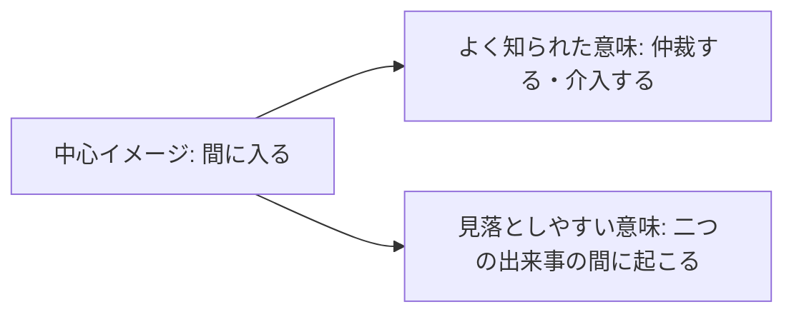

**重要語法：** intervene between A and B


## 2002. constitution

**品詞：** 名詞（noun）　**発音：** /ˌkɑːnstɪˈtuːʃən/

<small>よく知られている意味：憲法</small>

### 見落としやすい意味

**体質、身体的・精神的な強さ**

**例文**  Her strong constitution helped her recover from the illness.

**和訳**  彼女は丈夫な体質のおかげで病気から回復できた。

**コアイメージ**  constitution は、あるものを成り立たせる基本的な構成を表す。国の成り立ちを定めるのが「憲法」で、身体や精神の基本的な性質を指すと「体質」になる。

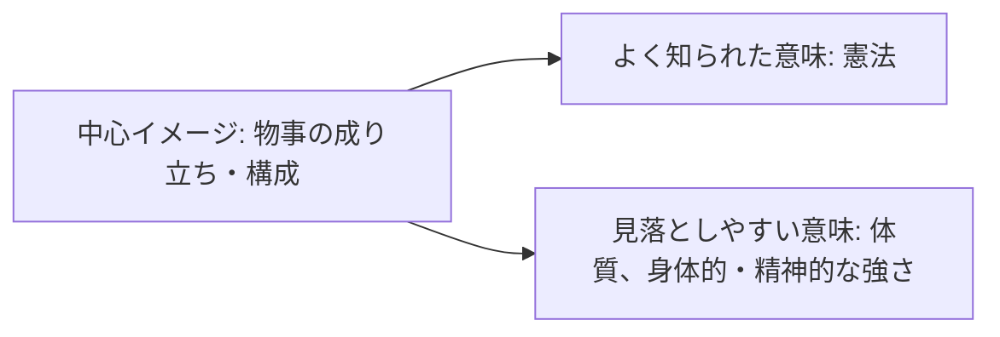

**重要語法：** a strong constitution


## 2003. dig

**品詞：** 名詞（noun）　**発音：** /dɪɡ/

<small>よく知られている意味：掘る</small>

### 見落としやすい意味

**相手に向けた嫌味、当てこすり**

**例文**  His joke about my accent was a dig at me.

**和訳**  私のなまりについての彼の冗談は、私への嫌味だった。

**コアイメージ**  dig には地面を掘る動作の意味がある。名詞では、相手を言葉で突くような一言を指し、「嫌味」になる。

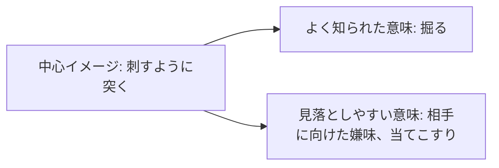

**重要語法：** a dig at someone


## 2004. fancy

**品詞：** 動詞（verb）　**発音：** /ˈfænsi/

<small>よく知られている意味：凝った・しゃれた</small>

### 見落としやすい意味

**〜を好む、望む**

**例文**  Do you fancy a walk by the river?

**和訳**  川沿いを散歩したい気分ですか。

**コアイメージ**  fancy は、心に思い描くことや、それに心を引かれることに関わる。形容詞の「しゃれた」だけでなく、動詞では「〜したい」「〜が好きだ」と言える。

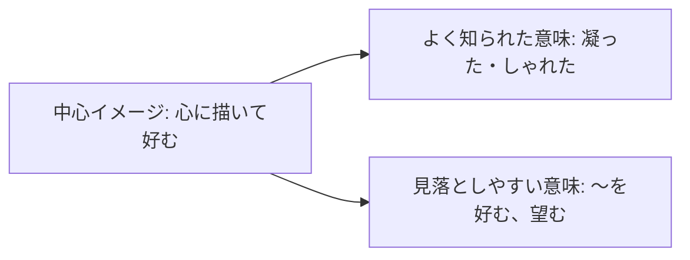

**重要語法：** fancy doing something（主にイギリス英語）


## 2005. altogether

**品詞：** 副詞（adverb）　**発音：** /ˌɔːltəˈɡeðər/

<small>よく知られている意味：全部で・すっかり</small>

### 見落としやすい意味

**細部を除いて全体的に判断すると**

**例文**  Altogether, the trip went well despite the rain.

**和訳**  雨は降ったものの、旅行は全体としてうまくいった。

**コアイメージ**  altogether には、ばらばらの部分を一つの全体として扱う感覚がある。合計を表すほか、細部を踏まえて「全体としては」と判断するときにも使う。

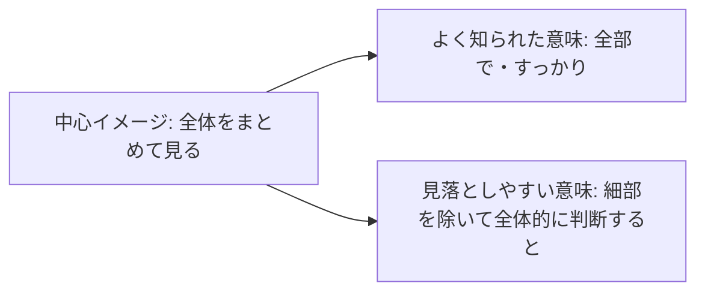

**重要語法：** 文頭の Altogether, は「全体として」


## 2006. await

**品詞：** 動詞（verb）　**発音：** /əˈweɪt/

<small>よく知られている意味：待ち受ける</small>

### 見落としやすい意味

**前置詞なしで目的語を直接取り「〜を待つ」**

**例文**  A difficult decision awaits the new director.

**和訳**  新しい責任者には難しい決断が待ち受けている。

**コアイメージ**  await は、対象が来るのを待つことを表す。wait for と異なり、待つ対象を前置詞なしで直接目的語に取る。

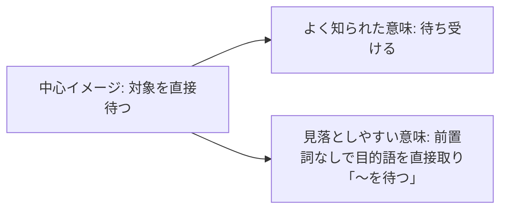

**重要語法：** await＋目的語（await for は不可）


## 2007. plunge

**品詞：** 動詞（verb）　**発音：** /plʌndʒ/

<small>よく知られている意味：飛び込む</small>

### 見落としやすい意味

**仕事・活動などに思い切り没頭する**

**例文**  She plunged into her research after the summer break.

**和訳**  彼女は夏休み後、研究に一気に没頭した。

**コアイメージ**  plunge の中心は、勢いよく深く入り込むこと。水へ飛び込むだけでなく、活動の中へ深く入り込むと「没頭する」になる。

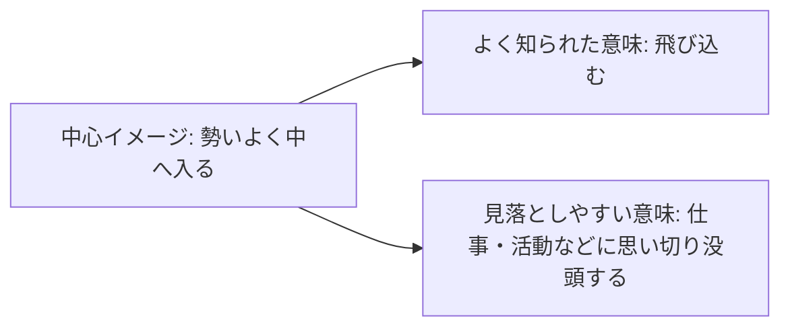

**重要語法：** plunge into work / research


## 2008. plunge

**品詞：** 動詞（verb）　**発音：** /plʌndʒ/

<small>よく知られている意味：飛び込む</small>

### 見落としやすい意味

**（数値・価格などが）急落する、急激に下がる**

**例文**  Ticket sales plunged when prices rose.

**和訳**  価格が上がると、チケットの売り上げは急落した。

**コアイメージ**  plunge は急激で大きな動きを示す。下方向への動きが数値や価格に使われると、「急落する」という意味になる。

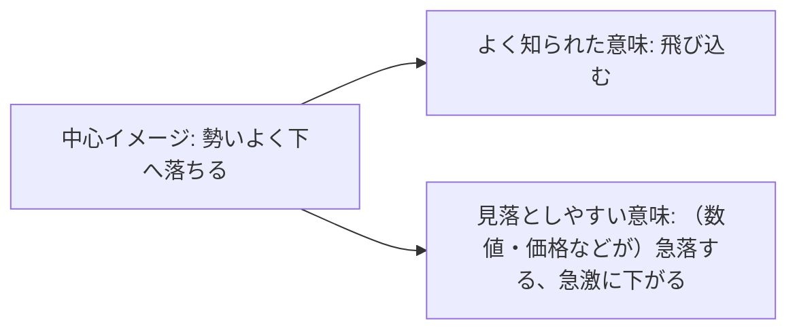

**重要語法：** sales / prices plunge


## 2009. advertise

**品詞：** 動詞（verb）　**発音：** /ˈædvərtaɪz/

<small>よく知られている意味：宣伝する</small>

### 見落としやすい意味

**（性格・無知などを）公然と示す、露呈する**

**例文**  He advertised his ignorance with that careless remark.

**和訳**  彼はその不用意な発言で自分の無知をさらけ出した。

**コアイメージ**  advertise の中心は、何かを人に広く見せたり知らせたりすること。商品ではなく欠点や感情が対象になると、「露呈する」の意味になる。

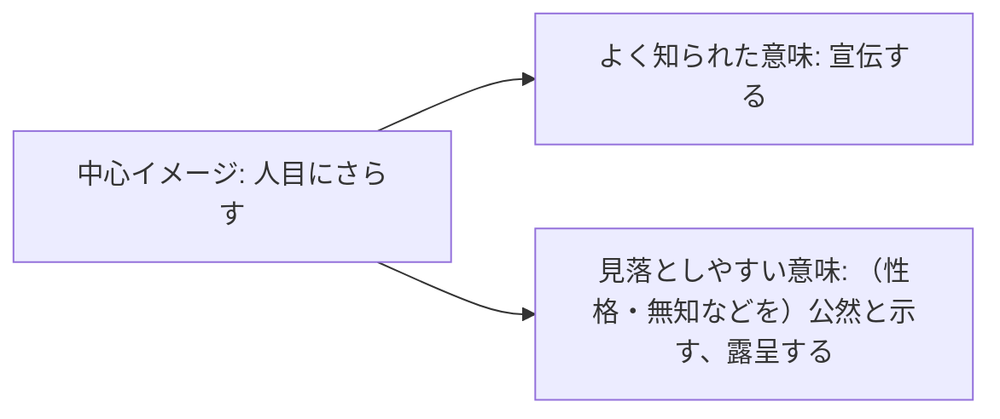

**重要語法：** advertise one's ignorance


## 2010. handful

**品詞：** 名詞（noun）　**発音：** /ˈhændfʊl/

<small>よく知られている意味：片手いっぱい</small>

### 見落としやすい意味

**一握りほどの少数・小量**

**例文**  Only a handful of people knew the secret.

**和訳**  その秘密を知っていたのはほんの一握りの人だけだった。

**コアイメージ**  handful は、手で一度に握れる分量を表す。そこから数や量がごく少ないことを表す比喩にもなる。

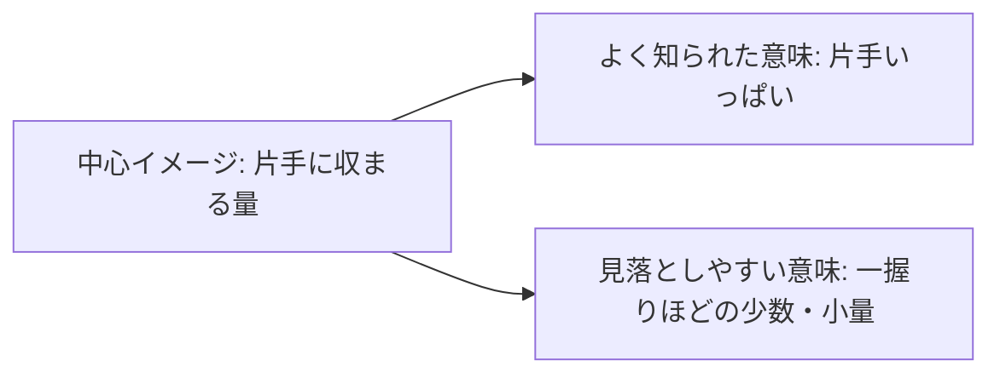

**重要語法：** a handful of＋複数名詞


## 2011. handful

**品詞：** 名詞（noun）　**発音：** /ˈhændfʊl/

<small>よく知られている意味：片手いっぱい</small>

### 見落としやすい意味

**（a handfulで）手のかかる厄介な人**

**例文**  The young puppy is a handful at mealtimes.

**和訳**  その子犬は食事の時間になると本当に手がかかる。

**コアイメージ**  handful は「一度に手で扱う量」を表す語。人や動物について a handful と言うと、扱うのに手間がかかるという意味になる。

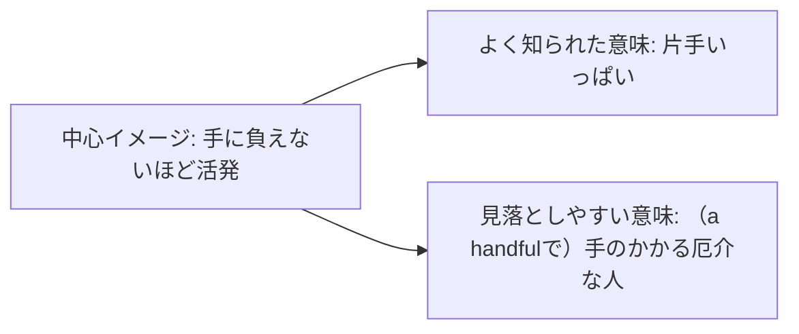

**重要語法：** be a handful


## 2012. fake

**品詞：** 動詞（verb）　**発音：** /feɪk/

<small>よく知られている意味：偽物の</small>

### 見落としやすい意味

**（感情・態度・出来事などを）装う、偽る**

**例文**  She faked a smile to hide her disappointment.

**和訳**  彼女はがっかりした気持ちを隠すために笑顔を装った。

**コアイメージ**  fake の中心は、実際と違うものを本物のように見せること。物だけでなく、笑顔や感情、出来事も「装う」ことができる。

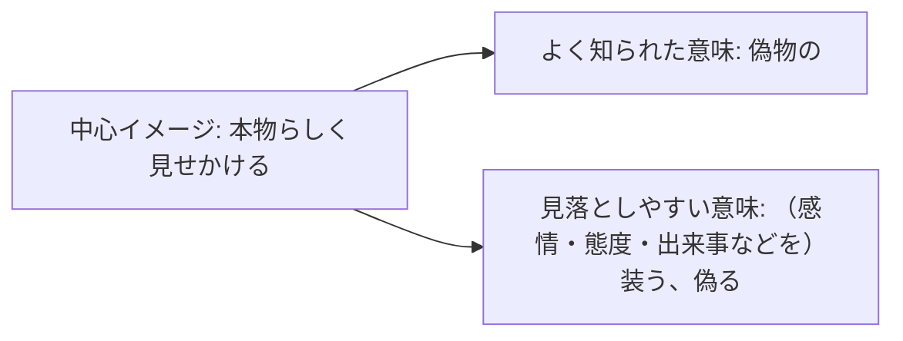

**重要語法：** fake a smile / an illness


## 2013. avenue

**品詞：** 名詞（noun）　**発音：** /ˈævənuː/

<small>よく知られている意味：大通り</small>

### 見落としやすい意味

**目的へ至るための手段・方法**

**例文**  The team explored several avenues for reducing waste.

**和訳**  チームは廃棄物を減らすためのいくつかの方法を検討した。

**コアイメージ**  avenue はもともと進んでいく道を表す。物理的な道路から、目的へ向かうための方法・手段へと意味が広がる。

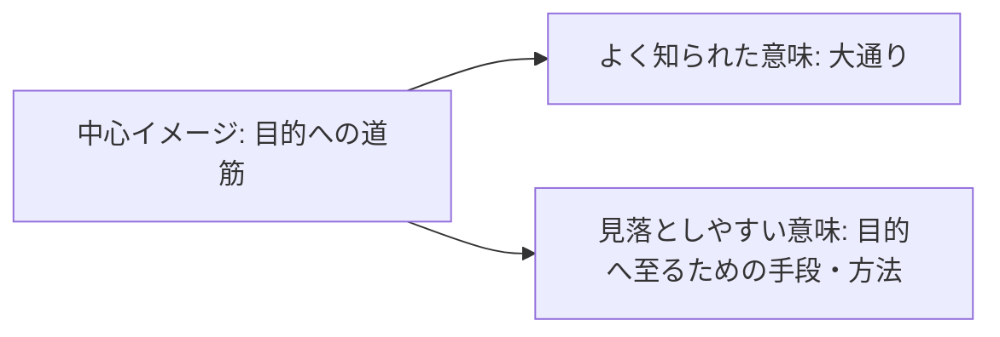

**重要語法：** an avenue for / of investigation


## 2014. hook

**品詞：** 名詞（noun）　**発音：** /hʊk/

<small>よく知られている意味：かぎ・引っ掛ける道具</small>

### 見落としやすい意味

**人の関心を引きつける魅力・仕掛け**

**例文**  The opening question provided a hook for the audience.

**和訳**  冒頭の問いが聴衆の関心を引きつける仕掛けになった。

**コアイメージ**  hook は何かを引っ掛けて離さない道具。そこから、人の注意や興味をつかむものも hook と呼ぶ。

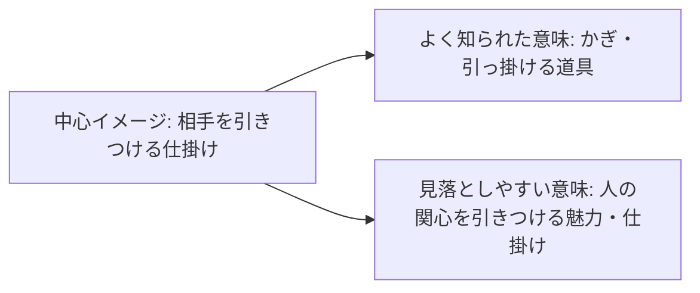

**重要語法：** a hook for the audience


## 2015. stroke

**品詞：** 動詞（verb）　**発音：** /stroʊk/

<small>よく知られている意味：一打・一筆</small>

### 見落としやすい意味

**注意深く優しく扱う**

**例文**  She gently stroked the injured bird's feathers.

**和訳**  彼女は傷ついた鳥の羽を優しくなでた。

**コアイメージ**  stroke は一定の方向へ手や道具を動かす一動作を表す。力を入れる一打のほか、手を滑らせて優しくなでる動作にも使う。

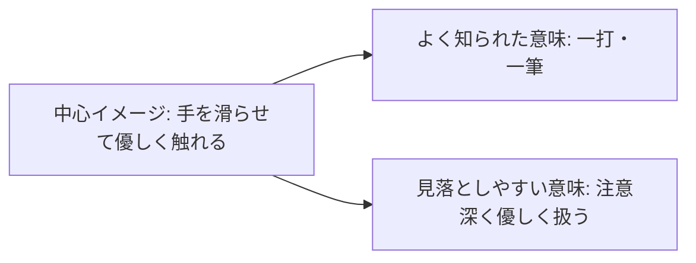

**重要語法：** stroke someone's hair


## 2016. till

**品詞：** 名詞（noun）　**発音：** /tɪl/

<small>よく知られている意味：〜まで（接続詞・前置詞）</small>

### 見落としやすい意味

**店のレジの現金入れ**

**例文**  The cashier put the coins back in the till.

**和訳**  レジ係は硬貨をレジの現金入れに戻した。

**コアイメージ**  名詞 till は店で現金を入れておく場所を指す。「〜まで」という till と同じ綴りだが、意味を一つのイメージに無理に結びつける必要はない。

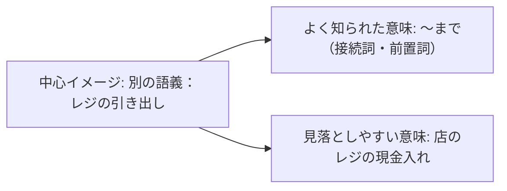

**重要語法：** in the till


## 2017. till

**品詞：** 動詞（verb）　**発音：** /tɪl/

<small>よく知られている意味：〜まで（接続詞・前置詞）</small>

### 見落としやすい意味

**土地を耕す**

**例文**  The farmers tilled the soil before planting.

**和訳**  農家の人たちは種を植える前に土を耕した。

**コアイメージ**  動詞 till は、作物を育てるために土地を耕すこと。時間を示す till とは別の用法なので、品詞と周囲の語で区別する。

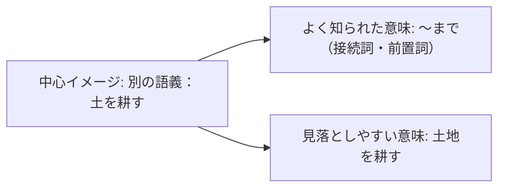

**重要語法：** till the soil


## 2018. forecast

**品詞：** 動詞（verb）　**発音：** /ˈfɔːrkæst/

<small>よく知られている意味：天気などを予報する</small>

### 見落としやすい意味

**兆候によって将来の成り行きを示す**

**例文**  The early results forecast serious problems for the project.

**和訳**  初期の結果は、その計画に深刻な問題が起こることを示していた。

**コアイメージ**  forecast は、得られた情報から先のことを見通す行為を表す。天気を予測するだけでなく、現在の兆候が今後の成り行きを示す場合にも使う。

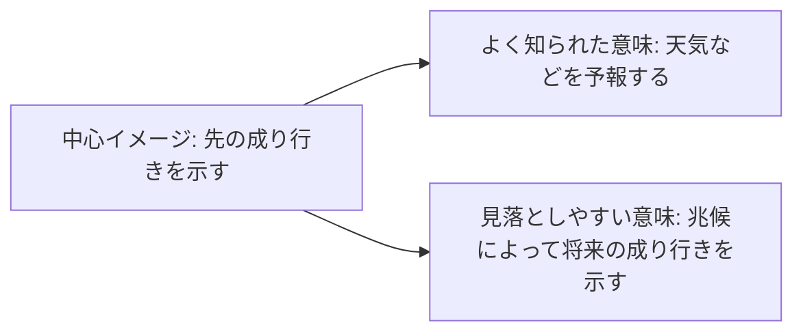

**重要語法：** forecast trouble / difficulties


## 2019. incur

**品詞：** 動詞（verb）　**発音：** /ɪnˈkɜːr/

<small>よく知られている意味：費用・損害を被る</small>

### 見落としやすい意味

**（費用・損害だけでなく非難・怒りなどを）招く**

**例文**  His rude words incurred the anger of his colleagues.

**和訳**  彼の失礼な言葉は同僚たちの怒りを買った。

**コアイメージ**  incur は、自分の行動などによって何かを背負う結果になること。費用や損害だけでなく、非難や怒りなど不利な反応を「招く」ときにも使う。

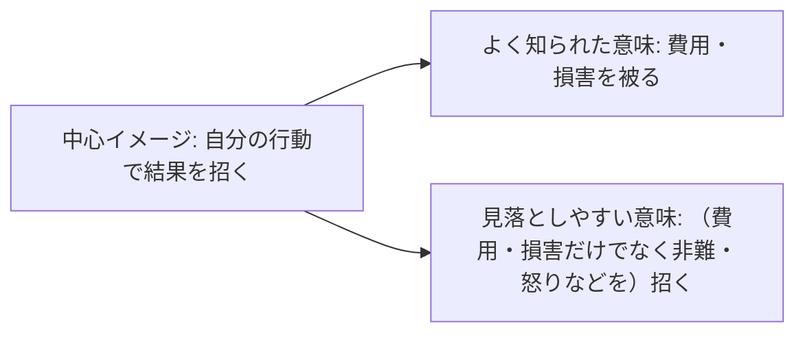

**重要語法：** incur criticism / someone's anger


## 2020. understood

**品詞：** 動詞（verb）　**発音：** /ˌʌndərˈstʊd/

<small>よく知られている意味：理解した（understand の過去分詞）</small>

### 見落としやすい意味

**（it is understood thatで）〜と理解されている・されているとされる**

**例文**  It is understood that the talks will continue next week.

**和訳**  協議は来週も続くと考えられている。

**コアイメージ**  understand は個人が理解する意味のほか、関係者の間でそう受け止められている状態も表せる。It is understood that ... は、その情報が一般に認識・了解されていることを示す。

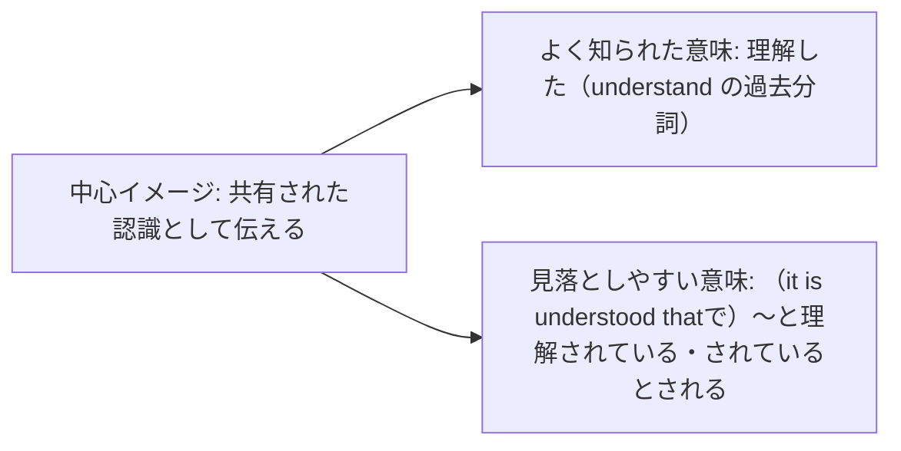

**重要語法：** It is understood that ...


## 2021. terminal

**品詞：** 形容詞（adjective）　**発音：** /ˈtɜːrmɪnəl/

<small>よく知られている意味：終点の・終着駅の</small>

### 見落としやすい意味

**（病気などが）末期の**

**例文**  The doctor explained that the illness was terminal.

**和訳**  医師はその病気が末期の状態にあると説明した。

**コアイメージ**  terminal は物事の終わりや最終段階に関わる語。交通の終点だけでなく、病気が最終段階にある場合にも用いる。

```mermaid
flowchart LR
    A["中心イメージ: 終わりに近い段階"]
    B["よく知られた意味: 終点の・終着駅の"]
    C["見落としやすい意味: （病気などが）末期の"]
    A --> B
    A --> C
```

**重要語法：** a terminal illness


## 2022. chip

**品詞：** 動詞（verb）　**発音：** /tʃɪp/

<small>よく知られている意味：欠けら・小片</small>

### 見落としやすい意味

**（chip inで）お金・労力を出し合う、発言に加わる**

**例文**  Everyone chipped in to pay for the farewell gift.

**和訳**  送別の贈り物代を払うために、皆でお金を出し合った。

**コアイメージ**  chip は小さな一片を表す。chip in では各自が少しずつ加わる感覚から、お金や労力を出し合う意味になる。

```mermaid
flowchart LR
    A["中心イメージ: 少しずつ出し合う"]
    B["よく知られた意味: 欠けら・小片"]
    C["見落としやすい意味: （chip inで）お金・労力を出し合う、発言に加わる"]
    A --> B
    A --> C
```

**重要語法：** chip in (with money)


## 2023. appropriation

**品詞：** 名詞（noun）　**発音：** /əˌproʊpriˈeɪʃən/

<small>よく知られている意味：取り込み・充当</small>

### 見落としやすい意味

**特定の目的のために割り当てられた予算**

**例文**  The city approved an appropriation for library repairs.

**和訳**  市は図書館の修繕に充てる予算を承認した。

**コアイメージ**  appropriation には、何かを特定の用途に取り分けるという意味がある。財政の文脈では、用途を定めて割り当てた予算そのものを指す。

```mermaid
flowchart LR
    A["中心イメージ: 目的のために取り分ける"]
    B["よく知られた意味: 取り込み・充当"]
    C["見落としやすい意味: 特定の目的のために割り当てられた予算"]
    A --> B
    A --> C
```

**重要語法：** a budget appropriation


## 2024. appropriation

**品詞：** 名詞（noun）　**発音：** /əˌproʊpriˈeɪʃən/

<small>よく知られている意味：予算の割り当て</small>

### 見落としやすい意味

**（他者の文化・作品・考えなどの）流用・取り込み**

**例文**  The artist discussed the appropriation of traditional patterns.

**和訳**  その芸術家は伝統的な模様の流用について論じた。

**コアイメージ**  appropriation は、あるものを自分の目的のために取り込むことを表す。予算の充当から、文化や作品の要素を取り入れることまで使われる。

```mermaid
flowchart LR
    A["中心イメージ: 他者のものを取り込む"]
    B["よく知られた意味: 予算の割り当て"]
    C["見落としやすい意味: （他者の文化・作品・考えなどの）流用・取り込み"]
    A --> B
    A --> C
```

**重要語法：** cultural appropriation


## 2025. classify

**品詞：** 動詞（verb）　**発音：** /ˈklæsɪfaɪ/

<small>よく知られている意味：分類する</small>

### 見落としやすい意味

**情報を機密扱いにする**

**例文**  The ministry classified the report for security reasons.

**和訳**  省庁は安全保障上の理由から、その報告書を機密扱いにした。

**コアイメージ**  classify は物事をある区分に入れること。公文書の区分が「機密」であれば、情報を非公開扱いにする意味になる。

```mermaid
flowchart LR
    A["中心イメージ: 公開しない区分に入れる"]
    B["よく知られた意味: 分類する"]
    C["見落としやすい意味: 情報を機密扱いにする"]
    A --> B
    A --> C
```

**重要語法：** classified information


## 2026. venue

**品詞：** 名詞（noun）　**発音：** /ˈvenjuː/

<small>よく知られている意味：会場</small>

### 見落としやすい意味

**裁判が行われる土地・管轄地**

**例文**  The judge agreed to change the venue of the trial.

**和訳**  裁判官はその裁判の実施地を変更することに同意した。

**コアイメージ**  venue は出来事が行われる場所を表す。法律の文脈では、単なる催しの会場ではなく、裁判を開く土地・管轄地を指す。

```mermaid
flowchart LR
    A["中心イメージ: 裁判を開く場所"]
    B["よく知られた意味: 会場"]
    C["見落としやすい意味: 裁判が行われる土地・管轄地"]
    A --> B
    A --> C
```

**重要語法：** change of venue


## 2027. monkey

**品詞：** 動詞（verb）　**発音：** /ˈmʌŋki/

<small>よく知られている意味：猿</small>

### 見落としやすい意味

**（monkey withで）機械・設定などをいじくり回す**

**例文**  Don't monkey with the settings on this machine.

**和訳**  この機械の設定をむやみにいじらないで。

**コアイメージ**  monkey は動詞になると、落ち着きなく物に手を出すような行動を表す。monkey with ... で機械や設定をいじくり回す意味になる。

```mermaid
flowchart LR
    A["中心イメージ: いたずら半分にいじる"]
    B["よく知られた意味: 猿"]
    C["見落としやすい意味: （monkey withで）機械・設定などをいじくり回す"]
    A --> B
    A --> C
```

**重要語法：** monkey with ...


## 2028. convenience

**品詞：** 名詞（noun）　**発音：** /kənˈviːniəns/

<small>よく知られている意味：便利さ</small>

### 見落としやすい意味

**（at one's convenienceで）その人に都合のよい時に**

**例文**  Please send the details at your convenience.

**和訳**  ご都合のよい時に詳細をお送りください。

**コアイメージ**  convenience は何かを行うのに都合がよいこと。at one's convenience では、行動する時期をその人の都合に任せる表現になる。

```mermaid
flowchart LR
    A["中心イメージ: 相手の都合に合う時"]
    B["よく知られた意味: 便利さ"]
    C["見落としやすい意味: （at one's convenienceで）その人に都合のよい時に"]
    A --> B
    A --> C
```

**重要語法：** at your earliest convenience


## 2029. marine

**品詞：** 形容詞（adjective）　**発音：** /məˈriːn/

<small>よく知られている意味：海の・海に住む</small>

### 見落としやすい意味

**船舶・海運に関する**

**例文**  The company offers marine insurance to ship owners.

**和訳**  その会社は船主向けの海上保険を提供している。

**コアイメージ**  marine は海に関係することを表す。生物や自然だけでなく、船・輸送・海運に関係する事柄にも広く使われる。

```mermaid
flowchart LR
    A["中心イメージ: 海を使う産業につながる"]
    B["よく知られた意味: 海の・海に住む"]
    C["見落としやすい意味: 船舶・海運に関する"]
    A --> B
    A --> C
```

**重要語法：** marine insurance


## 2030. extension

**品詞：** 名詞（noun）　**発音：** /ɪkˈstenʃən/

<small>よく知られている意味：延長・拡張</small>

### 見落としやすい意味

**（電話の）内線番号**

**例文**  To reach the office, dial extension 315.

**和訳**  事務室につなぐには内線315番を押してください。

**コアイメージ**  extension は元のものから先へ伸びた部分を表す。電話では代表回線から伸びる内線や、その番号を指す。

```mermaid
flowchart LR
    A["中心イメージ: 電話回線の枝分かれ"]
    B["よく知られた意味: 延長・拡張"]
    C["見落としやすい意味: （電話の）内線番号"]
    A --> B
    A --> C
```

**重要語法：** extension 315


## 2031. costly

**品詞：** 形容詞（adjective）　**発音：** /ˈkɔːstli/

<small>よく知られている意味：値段が高い</small>

### 見落としやすい意味

**金銭以外の大きな損失や犠牲を伴う**

**例文**  The mistake proved costly to the team's reputation.

**和訳**  そのミスはチームの評判に大きな痛手となった。

**コアイメージ**  costly は多くのものを失わせることを表す。失うものはお金に限らず、時間、信頼、評判などでもよい。

```mermaid
flowchart LR
    A["中心イメージ: 大きな犠牲を伴う"]
    B["よく知られた意味: 値段が高い"]
    C["見落としやすい意味: 金銭以外の大きな損失や犠牲を伴う"]
    A --> B
    A --> C
```

**重要語法：** a costly mistake


## 2032. secular

**品詞：** 形容詞（adjective）　**発音：** /ˈsekjələr/

<small>よく知られている意味：宗教と関係のない</small>

### 見落としやすい意味

**（傾向・変化などが）長期的な、構造的な**

**例文**  Economists noted a secular decline in demand.

**和訳**  経済学者たちは需要の長期的な低下を指摘した。

**コアイメージ**  secular には宗教から離れた「世俗的な」という用法がある。一方、経済などの文脈では短期変動ではない長期の動きに使うため、文脈で区別する。

```mermaid
flowchart LR
    A["中心イメージ: 長い期間にわたる傾向"]
    B["よく知られた意味: 宗教と関係のない"]
    C["見落としやすい意味: （傾向・変化などが）長期的な、構造的な"]
    A --> B
    A --> C
```

**重要語法：** secular trend / secular decline


## 2033. shade

**品詞：** 名詞（noun）　**発音：** /ʃeɪd/

<small>よく知られている意味：日陰・色合い</small>

### 見落としやすい意味

**意味・意見の微妙な違い**

**例文**  The two expressions carry different shades of meaning.

**和訳**  その二つの表現には意味の微妙な違いがある。

**コアイメージ**  shade は色の濃淡や微妙な違いを表せる。そこから、意味や意見のわずかな差にも使う。

```mermaid
flowchart LR
    A["中心イメージ: わずかな差や濃淡"]
    B["よく知られた意味: 日陰・色合い"]
    C["見落としやすい意味: 意味・意見の微妙な違い"]
    A --> B
    A --> C
```

**重要語法：** a shade of meaning


## 2034. slide

**品詞：** 動詞（verb）　**発音：** /slaɪd/

<small>よく知られている意味：滑る・滑らせる</small>

### 見落としやすい意味

**さりげなく、気づかれないように動かす**

**例文**  She slid the note into her bag without a word.

**和訳**  彼女は何も言わずにそのメモをかばんへそっと入れた。

**コアイメージ**  slide は滑らかな動きを表す。大きな音や目立つ動作を伴わないため、物をさりげなく移す場面にも合う。

```mermaid
flowchart LR
    A["中心イメージ: 目立たず動かす"]
    B["よく知られた意味: 滑る・滑らせる"]
    C["見落としやすい意味: さりげなく、気づかれないように動かす"]
    A --> B
    A --> C
```

**重要語法：** slide something into ...


## 2035. desperate

**品詞：** 形容詞（adjective）　**発音：** /ˈdespərət/

<small>よく知られている意味：絶望的な</small>

### 見落としやすい意味

**非常に強い・切迫した**

**例文**  The village faced a desperate shortage of water.

**和訳**  その村は深刻な水不足に直面していた。

**コアイメージ**  desperate は余裕がなく追い詰められた状態を表す。人の気持ちだけでなく、必要性や不足の程度が極めて大きいことにも使う。

```mermaid
flowchart LR
    A["中心イメージ: 強さが極限に近い"]
    B["よく知られた意味: 絶望的な"]
    C["見落としやすい意味: 非常に強い・切迫した"]
    A --> B
    A --> C
```

**重要語法：** a desperate need / shortage


## 2036. parade

**品詞：** 動詞（verb）　**発音：** /pəˈreɪd/

<small>よく知られている意味：行進する</small>

### 見落としやすい意味

**人前で見せびらかす**

**例文**  He paraded his achievements at every opportunity.

**和訳**  彼は機会あるごとに自分の業績を見せびらかした。

**コアイメージ**  parade は人の前を堂々と通る行進を表す。自分の持ち物や実績を目立つように示すと、「見せびらかす」となる。

```mermaid
flowchart LR
    A["中心イメージ: 人前へ誇示する"]
    B["よく知られた意味: 行進する"]
    C["見落としやすい意味: 人前で見せびらかす"]
    A --> B
    A --> C
```

**重要語法：** parade one's achievements


## 2037. prevail

**品詞：** 動詞（verb）　**発音：** /prɪˈveɪl/

<small>よく知られている意味：打ち勝つ</small>

### 見落としやすい意味

**（prevail on/upon 人 to doで）人を説得して行動させる**

**例文**  We prevailed upon her to lead the discussion.

**和訳**  私たちは彼女を説得して討論の進行役を引き受けてもらった。

**コアイメージ**  prevail は抵抗を押しのけて力が及ぶ感覚を持つ。prevail on/upon 人 to do は、相手への働きかけが実を結び、行動してもらう意味になる。

```mermaid
flowchart LR
    A["中心イメージ: 働きかけて相手を動かす"]
    B["よく知られた意味: 打ち勝つ"]
    C["見落としやすい意味: （prevail on/upon 人 to doで）人を説得して行動させる"]
    A --> B
    A --> C
```

**重要語法：** prevail on / upon someone to do


## 2038. prevail

**品詞：** 動詞（verb）　**発音：** /prɪˈveɪl/

<small>よく知られている意味：勝つ・打ち勝つ</small>

### 見落としやすい意味

**（考え・状況・慣習などが）広く行われる、優勢である**

**例文**  Silence prevailed after the announcement.

**和訳**  発表の後は静寂がその場を支配した。

**コアイメージ**  prevail は何かが他より強く現れることを表す。勝敗だけでなく、雰囲気や慣習、考え方がその場で優勢であるときにも使える。

```mermaid
flowchart LR
    A["中心イメージ: ある状態が広く行き渡る"]
    B["よく知られた意味: 勝つ・打ち勝つ"]
    C["見落としやすい意味: （考え・状況・慣習などが）広く行われる、優勢である"]
    A --> B
    A --> C
```

**重要語法：** peace / silence prevails


## 2039. apology

**品詞：** 名詞（noun）　**発音：** /əˈpɑːlədʒi/

<small>よく知られている意味：謝罪</small>

### 見落としやすい意味

**名ばかりのもの、ひどく不十分な見本**

**例文**  The tiny room was a poor apology for a classroom.

**和訳**  その狭い部屋は教室とは名ばかりのものだった。

**コアイメージ**  apology は通常、謝罪を意味する。a poor apology for ... という定型表現では、あるものとしてはひどく不十分だという皮肉を表す。

```mermaid
flowchart LR
    A["中心イメージ: 名目だけで実質が足りない"]
    B["よく知られた意味: 謝罪"]
    C["見落としやすい意味: 名ばかりのもの、ひどく不十分な見本"]
    A --> B
    A --> C
```

**重要語法：** a poor apology for ...


## 2040. calculation

**品詞：** 名詞（noun）　**発音：** /ˌkælkjəˈleɪʃən/

<small>よく知られている意味：計算</small>

### 見落としやすい意味

**意図的な打算・計略**

**例文**  Her offer was made out of calculation, not kindness.

**和訳**  彼女の申し出は親切心ではなく打算からなされた。

**コアイメージ**  calculation は数を計算するほか、結果や利益を予測して行動を決めることも表す。そこから「打算・計略」の意味になる。

```mermaid
flowchart LR
    A["中心イメージ: 結果を狙った打算"]
    B["よく知られた意味: 計算"]
    C["見落としやすい意味: 意図的な打算・計略"]
    A --> B
    A --> C
```

**重要語法：** cold calculation


## 2041. leaf

**品詞：** 動詞（verb）　**発音：** /liːf/

<small>よく知られている意味：葉</small>

### 見落としやすい意味

**本のページをぱらぱらめくる**

**例文**  He leafed through the magazine while waiting.

**和訳**  彼は待っている間、雑誌をぱらぱらめくった。

**コアイメージ**  leaf は植物の葉だけでなく、本の一枚の紙を指すことがある。動詞 leaf through は、その紙を次々めくることを表す。

```mermaid
flowchart LR
    A["中心イメージ: 紙の葉をめくる"]
    B["よく知られた意味: 葉"]
    C["見落としやすい意味: 本のページをぱらぱらめくる"]
    A --> B
    A --> C
```

**重要語法：** leaf through a book


## 2042. greet

**品詞：** 動詞（verb）　**発音：** /ɡriːt/

<small>よく知られている意味：あいさつする</small>

### 見落としやすい意味

**（be greeted withで）〜という反応で迎えられる**

**例文**  Her proposal was greeted with loud applause.

**和訳**  彼女の提案には大きな拍手が起こった。

**コアイメージ**  greet は人や出来事を迎えることを表す。知らせや提案が人々に「迎えられる」と、どんな反応が起きたかを示せる。

```mermaid
flowchart LR
    A["中心イメージ: 反応をもって迎える"]
    B["よく知られた意味: あいさつする"]
    C["見落としやすい意味: （be greeted withで）〜という反応で迎えられる"]
    A --> B
    A --> C
```

**重要語法：** be greeted with applause / silence


## 2043. lecture

**品詞：** 動詞（verb）　**発音：** /ˈlektʃər/

<small>よく知られている意味：講義をする</small>

### 見落としやすい意味

**長々と説教する、叱責する**

**例文**  My uncle lectured me about wasting food.

**和訳**  おじは私に食べ物を無駄にしないよう長々と説教した。

**コアイメージ**  lecture は知識をまとめて一方的に話す行為。相手の行動を正そうとして長々と話す場合は「説教する」になる。

```mermaid
flowchart LR
    A["中心イメージ: 一方的に説教する"]
    B["よく知られた意味: 講義をする"]
    C["見落としやすい意味: 長々と説教する、叱責する"]
    A --> B
    A --> C
```

**重要語法：** lecture someone about / on ...


## 2044. entertain

**品詞：** 動詞（verb）　**発音：** /ˌentərˈteɪn/

<small>よく知られている意味：楽しませる</small>

### 見落としやすい意味

**提案・可能性・考えなどを検討する**

**例文**  The committee agreed to entertain the proposal.

**和訳**  委員会はその提案を検討することに同意した。

**コアイメージ**  entertain は人の注意を向けて受け止めることにも関わる。考えや提案を退けずに心に置くと、「検討する」の意味になる。

```mermaid
flowchart LR
    A["中心イメージ: 考えを受け入れて検討する"]
    B["よく知られた意味: 楽しませる"]
    C["見落としやすい意味: 提案・可能性・考えなどを検討する"]
    A --> B
    A --> C
```

**重要語法：** entertain an idea / a proposal


## 2045. pine

**品詞：** 動詞（verb）　**発音：** /paɪn/

<small>よく知られている意味：松の木</small>

### 見落としやすい意味

**会えない人や得られない物を恋しがる**

**例文**  After moving abroad, she pined for her hometown.

**和訳**  海外に引っ越した後、彼女は故郷を恋しく思い続けた。

**コアイメージ**  動詞 pine は、離れた人や場所などを恋しく思ってつらさを感じること。「松の木」という名詞と同じ綴りだが、無理に一つのイメージにまとめず区別する。

```mermaid
flowchart LR
    A["中心イメージ: 強く恋しく思い続ける"]
    B["よく知られた意味: 松の木"]
    C["見落としやすい意味: 会えない人や得られない物を恋しがる"]
    A --> B
    A --> C
```

**重要語法：** pine for someone / something


## 2046. suspicious

**品詞：** 形容詞（adjective）　**発音：** /səˈspɪʃəs/

<small>よく知られている意味：疑わしい・怪しい</small>

### 見落としやすい意味

**（人が）疑っている、うさんくさく思っている**

**例文**  She was suspicious of the unusually cheap offer.

**和訳**  彼女はその不自然に安い申し出を怪しんでいた。

**コアイメージ**  suspicious は、物が怪しく見える意味にも、人が何かを疑っている意味にもなる。be suspicious of ... では疑っている主体に注目する。

```mermaid
flowchart LR
    A["中心イメージ: 相手を疑う気持ち"]
    B["よく知られた意味: 疑わしい・怪しい"]
    C["見落としやすい意味: （人が）疑っている、うさんくさく思っている"]
    A --> B
    A --> C
```

**重要語法：** be suspicious of ...


## 2047. offset

**品詞：** 動詞（verb）　**発音：** /ˌɔːfˈset/

<small>よく知られている意味：位置をずらす</small>

### 見落としやすい意味

**損失・悪影響などを相殺する**

**例文**  The savings offset the increase in transport costs.

**和訳**  その節約分が輸送費の増加を相殺した。

**コアイメージ**  offset は、一方の作用をもう一方で打ち消して釣り合わせること。位置のずれだけでなく、費用や不利益を別の利点で埋める意味にもなる。

```mermaid
flowchart LR
    A["中心イメージ: 損失を埋め合わせる"]
    B["よく知られた意味: 位置をずらす"]
    C["見落としやすい意味: 損失・悪影響などを相殺する"]
    A --> B
    A --> C
```

**重要語法：** offset the cost / loss


## 2048. rhetoric

**品詞：** 名詞（noun）　**発音：** /ˈretərɪk/

<small>よく知られている意味：修辞・説得の技法</small>

### 見落としやすい意味

**中身が乏しい大げさな言葉**

**例文**  Voters grew tired of the candidate's empty rhetoric.

**和訳**  有権者たちはその候補者の中身のない大げさな言葉にうんざりした。

**コアイメージ**  rhetoric は人に訴える言葉の使い方を表す。言葉の技巧ばかりが目立ち、実際の内容が乏しい場合には否定的に使われる。

```mermaid
flowchart LR
    A["中心イメージ: 派手だが中身の乏しい言葉"]
    B["よく知られた意味: 修辞・説得の技法"]
    C["見落としやすい意味: 中身が乏しい大げさな言葉"]
    A --> B
    A --> C
```

**重要語法：** empty rhetoric


## 2049. seemingly

**品詞：** 副詞（adverb）　**発音：** /ˈsiːmɪŋli/

<small>よく知られている意味：見たところ・外見上</small>

### 見落としやすい意味

**一見したところは、表面上は（実際には違う含み）**

**例文**  The seemingly simple puzzle took hours to solve.

**和訳**  一見簡単そうなそのパズルを解くのに何時間もかかった。

**コアイメージ**  seemingly は、外から見たときの印象を示す。実際とは異なる可能性を残すため、「一見〜だが」という対比でよく使う。

```mermaid
flowchart LR
    A["中心イメージ: 見た目だけの印象"]
    B["よく知られた意味: 見たところ・外見上"]
    C["見落としやすい意味: 一見したところは、表面上は（実際には違う含み）"]
    A --> B
    A --> C
```

**重要語法：** seemingly simple / harmless


## 2050. ugly

**品詞：** 形容詞（adjective）　**発音：** /ˈʌɡli/

<small>よく知られている意味：醜い</small>

### 見落としやすい意味

**状況・振る舞いなどが不穏で危険な**

**例文**  The dispute took an ugly turn after the meeting.

**和訳**  会議の後、その対立は険悪な方向へ進んだ。

**コアイメージ**  ugly は見た目の不快さだけでなく、人の行動や状況の不穏さにも使える。争いなどが「醜い」状態になると、危険で険悪な意味合いになる。

```mermaid
flowchart LR
    A["中心イメージ: 危険な方向へ悪化する"]
    B["よく知られた意味: 醜い"]
    C["見落としやすい意味: 状況・振る舞いなどが不穏で危険な"]
    A --> B
    A --> C
```

**重要語法：** take an ugly turn


## 2051. happily

**品詞：** 副詞（adverb）　**発音：** /ˈhæpɪli/

<small>よく知られている意味：幸せそうに</small>

### 見落としやすい意味

**運よく、幸いにも**

**例文**  Happily, the lost keys were found before sunset.

**和訳**  幸い、なくした鍵は日没前に見つかった。

**コアイメージ**  happily は、誰かが幸せな様子を表すほか、話し手が出来事を好ましく評価する副詞にもなる。文頭では「幸いにも」と訳せる。

```mermaid
flowchart LR
    A["中心イメージ: 好ましい結果として"]
    B["よく知られた意味: 幸せそうに"]
    C["見落としやすい意味: 運よく、幸いにも"]
    A --> B
    A --> C
```

**重要語法：** 文頭の Happily, は「幸いにも」


## 2052. mobile

**品詞：** 名詞（noun）　**発音：** /ˈmoʊbiːl/

<small>よく知られている意味：移動できる</small>

### 見落としやすい意味

**吊り下げられて動く彫刻作品**

**例文**  A colorful mobile hung above the baby's bed.

**和訳**  赤ちゃんのベッドの上には色鮮やかなモビールがつるされていた。

**コアイメージ**  mobile の中心には動くことがある。名詞では、つり下げた部品が風などで動く立体作品を指す。

```mermaid
flowchart LR
    A["中心イメージ: 動き続けるつり飾り"]
    B["よく知られた意味: 移動できる"]
    C["見落としやすい意味: 吊り下げられて動く彫刻作品"]
    A --> B
    A --> C
```

**重要語法：** a hanging mobile


## 2053. sympathy

**品詞：** 名詞（noun）　**発音：** /ˈsɪmpəθi/

<small>よく知られている意味：同情</small>

### 見落としやすい意味

**考え・主張に対する賛同、共感**

**例文**  I have some sympathy for her argument.

**和訳**  私は彼女の主張にある程度賛同している。

**コアイメージ**  sympathy は人と気持ちを共にすることを表す。つらさへの同情のほか、考えや立場に気持ちが寄り添うと「賛同」になる。

```mermaid
flowchart LR
    A["中心イメージ: 同じ方向の気持ち"]
    B["よく知られた意味: 同情"]
    C["見落としやすい意味: 考え・主張に対する賛同、共感"]
    A --> B
    A --> C
```

**重要語法：** sympathy for an idea / position


## 2054. reservation

**品詞：** 名詞（noun）　**発音：** /ˌrezərˈveɪʃən/

<small>よく知られている意味：予約</small>

### 見落としやすい意味

**全面的な賛成をためらわせる疑念・留保**

**例文**  I support the goal, but I have reservations about the method.

**和訳**  目的には賛成だが、その方法には懸念がある。

**コアイメージ**  reservation は、何かを確保して取っておくことから、判断をすべて差し出さず留めておくことにも使う。have reservations about ... は「全面的には賛成できない」という意味になる。

```mermaid
flowchart LR
    A["中心イメージ: 判断を留める気持ち"]
    B["よく知られた意味: 予約"]
    C["見落としやすい意味: 全面的な賛成をためらわせる疑念・留保"]
    A --> B
    A --> C
```

**重要語法：** have reservations about ...


## 2055. underground

**品詞：** 形容詞（adjective）　**発音：** /ˌʌndərˈɡraʊnd/

<small>よく知られている意味：地下の</small>

### 見落としやすい意味

**非公然の、秘密裏に行われる**

**例文**  An underground newspaper circulated among the students.

**和訳**  学生たちの間で秘密の新聞が出回っていた。

**コアイメージ**  underground は人目の届かない地下を表す。活動が表に出ないという点から、秘密裏の組織や出版物にも使う。

```mermaid
flowchart LR
    A["中心イメージ: 表に出さず活動する"]
    B["よく知られた意味: 地下の"]
    C["見落としやすい意味: 非公然の、秘密裏に行われる"]
    A --> B
    A --> C
```

**重要語法：** underground movement / press


## 2056. spectrum

**品詞：** 名詞（noun）　**発音：** /ˈspektrəm/

<small>よく知られている意味：光などのスペクトル</small>

### 見落としやすい意味

**（意見・性質などが連続的に並ぶ）幅、範囲**

**例文**  The festival attracts people from across the political spectrum.

**和訳**  その祭りには幅広い政治的立場の人々が集まる。

**コアイメージ**  spectrum は色が連続して並ぶ帯を表す。考え方や性質が少しずつ変わりながら広がる範囲も spectrum と言う。

```mermaid
flowchart LR
    A["中心イメージ: 連続する幅広い範囲"]
    B["よく知られた意味: 光などのスペクトル"]
    C["見落としやすい意味: （意見・性質などが連続的に並ぶ）幅、範囲"]
    A --> B
    A --> C
```

**重要語法：** across the spectrum


## 2057. formidable

**品詞：** 形容詞（adjective）　**発音：** /ˈfɔːrmɪdəbəl/

<small>よく知られている意味：恐ろしい・手ごわい</small>

### 見落としやすい意味

**非常に印象的で手ごわい**

**例文**  She proved to be a formidable debating opponent.

**和訳**  彼女は討論で非常に手ごわい相手だと分かった。

**コアイメージ**  formidable は、相手がひるむほど強い力や能力を示す。怖さだけでなく、優れた実力への驚きや敬意も含む。

```mermaid
flowchart LR
    A["中心イメージ: 圧倒されるほどの力"]
    B["よく知られた意味: 恐ろしい・手ごわい"]
    C["見落としやすい意味: 非常に印象的で手ごわい"]
    A --> B
    A --> C
```

**重要語法：** formidable opponent / challenge


## 2058. pioneer

**品詞：** 動詞（verb）　**発音：** /ˌpaɪəˈnɪr/

<small>よく知られている意味：先駆者</small>

### 見落としやすい意味

**（技術・研究・方法などを）先駆けて開発する**

**例文**  The scientists pioneered a new technique for recycling plastic.

**和訳**  その科学者たちはプラスチックを再利用する新技術を先駆けて開発した。

**コアイメージ**  pioneer は未知の領域を切り開く人を表す。動詞になると、新しい技術や方法を先頭に立って開発する意味になる。

```mermaid
flowchart LR
    A["中心イメージ: 誰より先に切り開く"]
    B["よく知られた意味: 先駆者"]
    C["見落としやすい意味: （技術・研究・方法などを）先駆けて開発する"]
    A --> B
    A --> C
```

**重要語法：** pioneer a method / technique


## 2059. denial

**品詞：** 名詞（noun）　**発音：** /dɪˈnaɪəl/

<small>よく知られている意味：否定</small>

### 見落としやすい意味

**（in denialで）不都合な現実を認めようとしない状態**

**例文**  He was in denial about how serious the problem was.

**和訳**  彼は問題がどれほど深刻かを認めようとしなかった。

**コアイメージ**  denial は何かを否定すること。in denial は単なる否定の発言ではなく、つらい現実を受け入れられない状態を表す。

```mermaid
flowchart LR
    A["中心イメージ: 認めたくない現実を拒む"]
    B["よく知られた意味: 否定"]
    C["見落としやすい意味: （in denialで）不都合な現実を認めようとしない状態"]
    A --> B
    A --> C
```

**重要語法：** be in denial


## 2060. outlet

**品詞：** 名詞（noun）　**発音：** /ˈaʊtlet/

<small>よく知られている意味：出口・コンセント</small>

### 見落としやすい意味

**感情・創造性などの発散手段**

**例文**  Music became an outlet for her stress.

**和訳**  音楽は彼女のストレスを発散する手段になった。

**コアイメージ**  outlet は内側のものが外へ出る場所を表す。感情や創造性が外に出る道も outlet と呼べる。

```mermaid
flowchart LR
    A["中心イメージ: 中の感情を外に出す"]
    B["よく知られた意味: 出口・コンセント"]
    C["見落としやすい意味: 感情・創造性などの発散手段"]
    A --> B
    A --> C
```

**重要語法：** an outlet for stress / creativity


## 2061. outlet

**品詞：** 名詞（noun）　**発音：** /ˈaʊtlet/

<small>よく知られている意味：出口・コンセント</small>

### 見落としやすい意味

**小売店、販売先、販路**

**例文**  The company sells its products through local retail outlets.

**和訳**  その会社は地域の小売店を通して商品を販売している。

**コアイメージ**  outlet は物が外へ流れ出る場所を表す。商業では商品が市場に出ていく販売先や小売店を指す。

```mermaid
flowchart LR
    A["中心イメージ: 商品が外へ流れる経路"]
    B["よく知られた意味: 出口・コンセント"]
    C["見落としやすい意味: 小売店、販売先、販路"]
    A --> B
    A --> C
```

**重要語法：** retail outlet


## 2062. quotation

**品詞：** 名詞（noun）　**発音：** /kwoʊˈteɪʃən/

<small>よく知られている意味：引用・引用文</small>

### 見落としやすい意味

**価格の見積もり、見積額**

**例文**  We requested a quotation for the roof repairs.

**和訳**  私たちは屋根の修理費の見積もりを依頼した。

**コアイメージ**  quotation は何かを取り出して示した内容を表す。引用文だけでなく、取引のために提示する価格の数字も quotation と呼ぶ。

```mermaid
flowchart LR
    A["中心イメージ: 依頼に応じて提示する価格"]
    B["よく知られた意味: 引用・引用文"]
    C["見落としやすい意味: 価格の見積もり、見積額"]
    A --> B
    A --> C
```

**重要語法：** request a quotation


## 2063. consume

**品詞：** 動詞（verb）　**発音：** /kənˈsuːm/

<small>よく知られている意味：消費する</small>

### 見落としやすい意味

**人の関心・感情などを完全に占める**

**例文**  Worry about the exam consumed all his attention.

**和訳**  試験への心配が彼の注意をすっかり奪っていた。

**コアイメージ**  consume は資源を使い尽くすことを表す。時間や注意、感情を使い尽くすように占める場合にも使う。

```mermaid
flowchart LR
    A["中心イメージ: 心の大部分を占める"]
    B["よく知られた意味: 消費する"]
    C["見落としやすい意味: 人の関心・感情などを完全に占める"]
    A --> B
    A --> C
```

**重要語法：** be consumed by worry


## 2064. instruct

**品詞：** 動詞（verb）　**発音：** /ɪnˈstrʌkt/

<small>よく知られている意味：指示する・教える</small>

### 見落としやすい意味

**人に知らせる、認識させる**

**例文**  The guide instructed the visitors about the safety rules.

**和訳**  案内係は来訪者に安全上の規則を説明した。

**コアイメージ**  instruct は単に命令するだけでなく、必要な知識を相手に伝えることも表す。何を知るべきかを説明する文脈では「知らせる・教える」となる。

```mermaid
flowchart LR
    A["中心イメージ: 知識を伝えて理解させる"]
    B["よく知られた意味: 指示する・教える"]
    C["見落としやすい意味: 人に知らせる、認識させる"]
    A --> B
    A --> C
```

**重要語法：** instruct someone about / in ...


## 2065. regret

**品詞：** 動詞（verb）　**発音：** /rɪˈɡret/

<small>よく知られている意味：後悔する</small>

### 見落としやすい意味

**申し出などを丁重に断る**

**例文**  We regret that we cannot accept your request.

**和訳**  残念ながら、ご依頼をお受けすることはできません。

**コアイメージ**  regret は望ましくない事実を残念に思うこと。ビジネス文などでは、その気持ちを添えて断りや不都合を丁寧に伝える。

```mermaid
flowchart LR
    A["中心イメージ: 丁重に残念だと伝える"]
    B["よく知られた意味: 後悔する"]
    C["見落としやすい意味: 申し出などを丁重に断る"]
    A --> B
    A --> C
```

**重要語法：** We regret to inform you that ...


## 2066. remedy

**品詞：** 動詞（verb）　**発音：** /ˈremədi/

<small>よく知られている意味：治療法・改善策</small>

### 見落としやすい意味

**（問題・欠陥・不正などを）是正する、改善する**

**例文**  The school took steps to remedy the lack of textbooks.

**和訳**  学校は教科書の不足を改善するために対策を取った。

**コアイメージ**  remedy は悪い状態を正す手段を表す。動詞では病気だけでなく、欠陥や不足などの問題を是正することにも使える。

```mermaid
flowchart LR
    A["中心イメージ: 問題を直してよい状態に戻す"]
    B["よく知られた意味: 治療法・改善策"]
    C["見落としやすい意味: （問題・欠陥・不正などを）是正する、改善する"]
    A --> B
    A --> C
```

**重要語法：** remedy a problem / defect


## 2067. span

**品詞：** 動詞（verb）　**発音：** /spæn/

<small>よく知られている意味：期間・幅</small>

### 見落としやすい意味

**地域・期間などにまたがる**

**例文**  The bridge spans the river at its narrowest point.

**和訳**  その橋は川の最も狭い部分に架かっている。

**コアイメージ**  span は端から端までの広がりを表す。長さや期間という名詞のほか、川や地域、年代にまたがる動詞としても使う。

```mermaid
flowchart LR
    A["中心イメージ: 端から端まで広がる"]
    B["よく知られた意味: 期間・幅"]
    C["見落としやすい意味: 地域・期間などにまたがる"]
    A --> B
    A --> C
```

**重要語法：** span several decades


## 2068. picnic

**品詞：** 名詞（noun）　**発音：** /ˈpɪknɪk/

<small>よく知られている意味：ピクニック</small>

### 見落としやすい意味

**楽にできる仕事（否定のno picnicも重要）**

**例文**  Managing a busy shop is no picnic.

**和訳**  忙しい店を経営するのは決して楽なことではない。

**コアイメージ**  picnic は楽しい屋外の食事を指す。比喩では気楽な活動を表し、特に no picnic で「決して楽ではない」と強調する。

```mermaid
flowchart LR
    A["中心イメージ: 気楽で楽しいこと"]
    B["よく知られた意味: ピクニック"]
    C["見落としやすい意味: 楽にできる仕事（否定のno picnicも重要）"]
    A --> B
    A --> C
```

**重要語法：** be no picnic


## 2069. bug

**品詞：** 動詞（verb）　**発音：** /bʌɡ/

<small>よく知られている意味：虫</small>

### 見落としやすい意味

**人をしつこく悩ませる**

**例文**  The constant noise from upstairs really bugs me.

**和訳**  上の階からの絶え間ない騒音には本当にいらいらさせられる。

**コアイメージ**  bug は小さな虫という意味のほか、人を煩わせるものにも使われる。動詞では、相手をしつこく困らせることを表す。

```mermaid
flowchart LR
    A["中心イメージ: 小さなことでもしつこく悩ませる"]
    B["よく知られた意味: 虫"]
    C["見落としやすい意味: 人をしつこく悩ませる"]
    A --> B
    A --> C
```

**重要語法：** Something bugs me.


## 2070. married

**品詞：** 名詞（noun）　**発音：** /ˈmærid/

<small>よく知られている意味：結婚している（形容詞）</small>

### 見落としやすい意味

**既婚者**

**例文**  The survey compared the married with the unmarried.

**和訳**  その調査は既婚者と未婚者を比較した。

**コアイメージ**  married は通常、結婚している状態を表す形容詞。the married の形では、その状態にある人々をまとめて指す名詞的な用法になる。

```mermaid
flowchart LR
    A["中心イメージ: その性質を持つ人々"]
    B["よく知られた意味: 結婚している（形容詞）"]
    C["見落としやすい意味: 既婚者"]
    A --> B
    A --> C
```

**重要語法：** the married / the unmarried


## 2071. diet

**品詞：** 名詞（noun）　**発音：** /ˈdaɪət/

<small>よく知られている意味：食事・食事制限</small>

### 見落としやすい意味

**（日本などの）国会・議会**

**例文**  The proposal was debated in the Japanese Diet.

**和訳**  その提案は日本の国会で審議された。

**コアイメージ**  diet が大文字の Diet として使われると、日本などの立法府を指すことがある。食事を指す diet とは別の由来を持つため、綴りが同じでも文脈で区別する。

```mermaid
flowchart LR
    A["中心イメージ: 同じ綴りの別語義：議会"]
    B["よく知られた意味: 食事・食事制限"]
    C["見落としやすい意味: （日本などの）国会・議会"]
    A --> B
    A --> C
```

**重要語法：** the Japanese Diet


## 2072. overnight

**品詞：** 副詞（adverb）　**発音：** /ˌoʊvərˈnaɪt/

<small>よく知られている意味：一晩中・一泊で</small>

### 見落としやすい意味

**ごく短期間で、一夜にして**

**例文**  The small village became famous almost overnight.

**和訳**  その小さな村はほとんど一夜にして有名になった。

**コアイメージ**  overnight は夜を越える短い時間を表す。文字どおり一晩の場合のほか、驚くほど短期間の変化を表す。

```mermaid
flowchart LR
    A["中心イメージ: 一夜ほどの短い間に"]
    B["よく知られた意味: 一晩中・一泊で"]
    C["見落としやすい意味: ごく短期間で、一夜にして"]
    A --> B
    A --> C
```

**重要語法：** become famous overnight


## 2073. shooting

**品詞：** 名詞（noun）　**発音：** /ˈʃuːtɪŋ/

<small>よく知られている意味：発砲・射撃</small>

### 見落としやすい意味

**（写真・映画の）撮影**

**例文**  Shooting the film took nearly two months.

**和訳**  その映画の撮影にはほぼ2か月かかった。

**コアイメージ**  shoot は何かを狙って放つ動作から、カメラで対象を撮る動作にも使われる。shooting は文脈によって「撮影」という意味になる。

```mermaid
flowchart LR
    A["中心イメージ: カメラで映像を撮る"]
    B["よく知られた意味: 発砲・射撃"]
    C["見落としやすい意味: （写真・映画の）撮影"]
    A --> B
    A --> C
```

**重要語法：** film shooting / photo shoot


## 2074. grip

**品詞：** 名詞（noun）　**発音：** /ɡrɪp/

<small>よく知られている意味：握ること・支配力</small>

### 見落としやすい意味

**物事を理解し把握する力**

**例文**  She has a good grip on the basic principles.

**和訳**  彼女は基本原理をしっかり理解している。

**コアイメージ**  grip は手で強くつかむことを表す。考えや事実を頭の中でつかむという比喩から、理解・把握する力にも使う。

```mermaid
flowchart LR
    A["中心イメージ: 頭の中でしっかりつかむ"]
    B["よく知られた意味: 握ること・支配力"]
    C["見落としやすい意味: 物事を理解し把握する力"]
    A --> B
    A --> C
```

**重要語法：** have a good grip on ...


## 2075. verbal

**品詞：** 形容詞（adjective）　**発音：** /ˈvɜːrbəl/

<small>よく知られている意味：言葉の・口頭の</small>

### 見落としやすい意味

**動詞の、動詞に関する**

**例文**  A verbal noun can act like a noun in a sentence.

**和訳**  動名詞的な名詞は文中で名詞のように働くことがある。

**コアイメージ**  verbal は日常では言葉に関する意味が多い。文法用語では verb（動詞）に関係するという意味になり、言葉によるという意味とは区別する。

```mermaid
flowchart LR
    A["中心イメージ: 動詞としての性質を持つ"]
    B["よく知られた意味: 言葉の・口頭の"]
    C["見落としやすい意味: 動詞の、動詞に関する"]
    A --> B
    A --> C
```

**重要語法：** verbal noun / verbal adjective


## 2076. blend

**品詞：** 名詞（noun）　**発音：** /blend/

<small>よく知られている意味：混ぜ合わせたもの</small>

### 見落としやすい意味

**二つ以上の語を組み合わせた混成語**

**例文**  Brunch is a blend of breakfast and lunch.

**和訳**  brunch は breakfast と lunch を組み合わせた混成語だ。

**コアイメージ**  blend は複数の要素を混ぜたものを表す。語形成では、二つ以上の語の一部を組み合わせた新しい語を指す。

```mermaid
flowchart LR
    A["中心イメージ: 語を混ぜて新しい語を作る"]
    B["よく知られた意味: 混ぜ合わせたもの"]
    C["見落としやすい意味: 二つ以上の語を組み合わせた混成語"]
    A --> B
    A --> C
```

**重要語法：** a blend of two words


## 2077. glimpse

**品詞：** 名詞（noun）　**発音：** /ɡlɪmps/

<small>よく知られている意味：ちらりと見ること</small>

### 見落としやすい意味

**わずかな兆候、かすかな気配**

**例文**  The first test offered a glimpse of hope.

**和訳**  最初の試験結果は、わずかな希望の兆しを示した。

**コアイメージ**  glimpse は一瞬だけ見えるものを表す。未来の可能性や感情がかすかに見えた場合にも用いる。

```mermaid
flowchart LR
    A["中心イメージ: ほんの少し見える可能性"]
    B["よく知られた意味: ちらりと見ること"]
    C["見落としやすい意味: わずかな兆候、かすかな気配"]
    A --> B
    A --> C
```

**重要語法：** a glimpse of hope


## 2078. precede

**品詞：** 動詞（verb）　**発音：** /prɪˈsiːd/

<small>よく知られている意味：先行する</small>

### 見落としやすい意味

**文章や発言に前置き・導入を加える**

**例文**  She preceded her speech with a short anecdote.

**和訳**  彼女は短い逸話を話してからスピーチの本題に入った。

**コアイメージ**  precede は何かの前に来ること。発言や文章を目的語に取ると、その前に導入や前置きを付けるという意味になる。

```mermaid
flowchart LR
    A["中心イメージ: 本題より前に言葉を置く"]
    B["よく知られた意味: 先行する"]
    C["見落としやすい意味: 文章や発言に前置き・導入を加える"]
    A --> B
    A --> C
```

**重要語法：** precede A with B


## 2079. rental

**品詞：** 名詞（noun）　**発音：** /ˈrentəl/

<small>よく知られている意味：賃借料・レンタル料金</small>

### 見落としやすい意味

**賃貸・レンタルに出される物件**

**例文**  We found a small rental near the station.

**和訳**  私たちは駅の近くで小さな賃貸物件を見つけた。

**コアイメージ**  rental は貸し借りに関わるものを表す。料金や契約だけでなく、借りる対象である家や車などの物件そのものも指す。

```mermaid
flowchart LR
    A["中心イメージ: 借りられる物件そのもの"]
    B["よく知られた意味: 賃借料・レンタル料金"]
    C["見落としやすい意味: 賃貸・レンタルに出される物件"]
    A --> B
    A --> C
```

**重要語法：** a vacation rental


## 2080. pill

**品詞：** 名詞（noun）　**発音：** /pɪl/

<small>よく知られている意味：錠剤・丸薬</small>

### 見落としやすい意味

**不愉快で扱いにくい人**

**例文**  He can be a real pill when he is tired.

**和訳**  彼は疲れていると本当に扱いにくい人になることがある。

**コアイメージ**  pill は通常、薬の錠剤を指す。人について a pill と言うと、接するのが不愉快で厄介な人を表すくだけた用法になる。

```mermaid
flowchart LR
    A["中心イメージ: 一緒にいると扱いにくい人"]
    B["よく知られた意味: 錠剤・丸薬"]
    C["見落としやすい意味: 不愉快で扱いにくい人"]
    A --> B
    A --> C
```

**重要語法：** be a pill（口語）

