# EasyVoca 完成教材｜Batch 027（前半）

対象：global_order 2081–2160、全80件。以下は2081–2120番の40件（後半は作成中）。

## 2081. pill

**品詞：** noun　**発音：** /pɪl/

<sub>よく知られている意味：錠剤・丸薬</sub>

**見落としやすい意味：（a bitter pill to swallowで）受け入れがたい現実・事実**

**例文：** Losing the final was a bitter pill to swallow.

**和訳：** 決勝での敗北は受け入れがたい現実だった。

**コアイメージ：** 苦い錠剤は飲み込むのがつらい。そこから、認めたり受け入れたりするのがつらい事実を表す。

**図：**

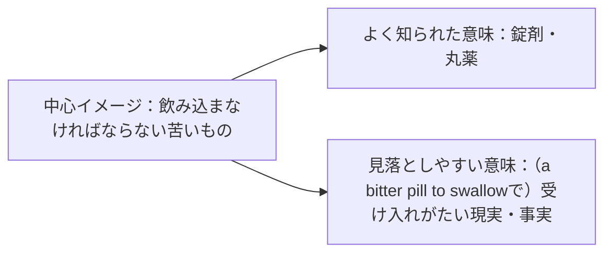

**重要語法：** a bitter pill to swallow

<sub>index: 3390 / candidate_id: ev-03390-noun-02</sub>

---

## 2082. silent

**品詞：** adjective　**発音：** /ˈsaɪlənt/

<sub>よく知られている意味：静かな・無言の</sub>

**見落としやすい意味：言葉にされず暗黙に示された**

**例文：** They reached a silent agreement not to discuss the issue.

**和訳：** 彼らはその問題を話題にしないという暗黙の合意に達した。

**コアイメージ：** 声や言葉が表に出ていないことが中心にある。明言されなくても態度や行動から伝わる合意などにも使う。

**図：**

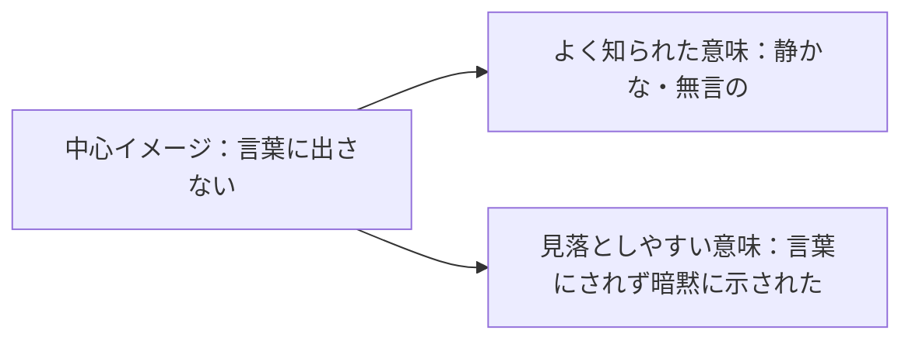

**重要語法：** silent agreement（暗黙の合意）

<sub>index: 3391 / candidate_id: ev-03391-adjective-01</sub>

---

## 2083. mutual

**品詞：** adjective　**発音：** /ˈmjuːtʃuəl/

<sub>よく知られている意味：相互の・お互いの</sub>

**見落としやすい意味：（友人・利益・関心などが）共通の**

**例文：** We discovered that we had a mutual friend.

**和訳：** 私たちには共通の友人がいることが分かった。

**コアイメージ：** 二人の側が同じ対象に結び付いている状態を表す。「互いにする」だけでなく「両者に共通する」にも広がる。

**図：**

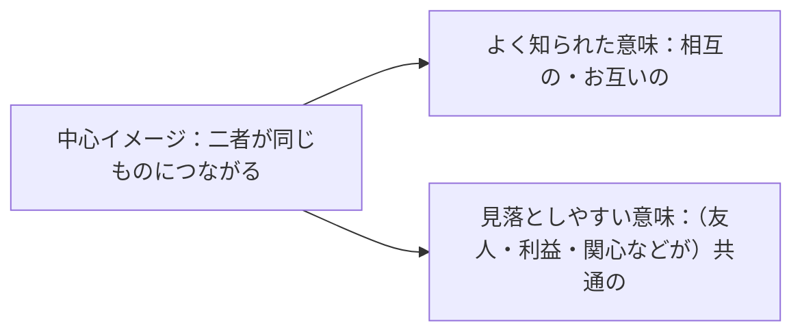

**重要語法：** a mutual friend（共通の友人）

<sub>index: 3392 / candidate_id: ev-03392-adjective-01</sub>

---

## 2084. sole

**品詞：** noun　**発音：** /soʊl/

<sub>よく知られている意味：唯一の（形容詞）</sub>

**見落としやすい意味：足の裏、靴の底**

**例文：** The soles of my shoes were worn thin.

**和訳：** 私の靴の底はすり減って薄くなっていた。

**コアイメージ：** 足や靴の下に接する面を指す名詞で、形容詞の「唯一の」とは語源も異なる。文中の品詞で区別する。

**図：**

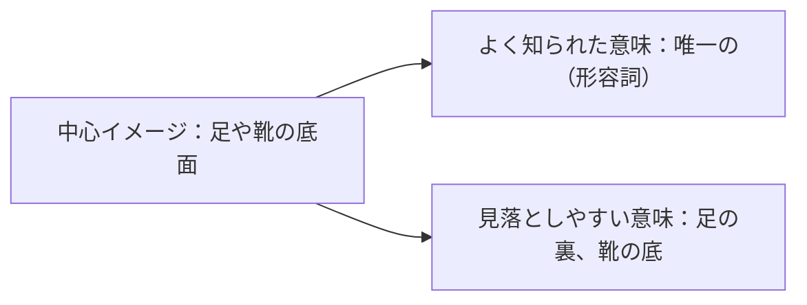

**重要語法：** the sole of a shoe（靴底）

<sub>index: 3396 / candidate_id: ev-03396-noun-01</sub>

---

## 2085. charter

**品詞：** verb　**発音：** /ˈtʃɑːrtər/

<sub>よく知られている意味：憲章・認可状</sub>

**見落としやすい意味：船・飛行機などを貸し切る**

**例文：** We chartered a boat for the afternoon.

**和訳：** 私たちは午後のために船を貸し切った。

**コアイメージ：** 特定の目的のために乗り物を契約で確保するイメージ。文書としての認可状から、契約による貸切りという動詞用法にもつながる。

**図：**

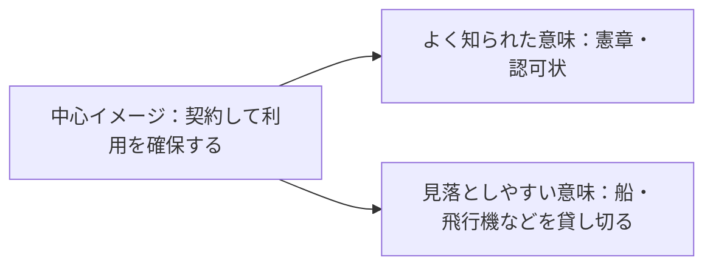

**重要語法：** charter a plane（飛行機を貸し切る）

<sub>index: 3397 / candidate_id: ev-03397-verb-01</sub>

---

## 2086. predecessor

**品詞：** noun　**発音：** /ˈpredəsesər/

<sub>よく知られている意味：前任者・先任者</sub>

**見落としやすい意味：前触れとなるもの**

**例文：** This simple device was a predecessor of the modern smartphone.

**和訳：** この単純な機器は現代のスマートフォンの先駆けだった。

**コアイメージ：** 時間や発展の流れで先に位置するものを指す。人の前任者だけでなく、後の製品・制度につながる前身も表す。

**図：**

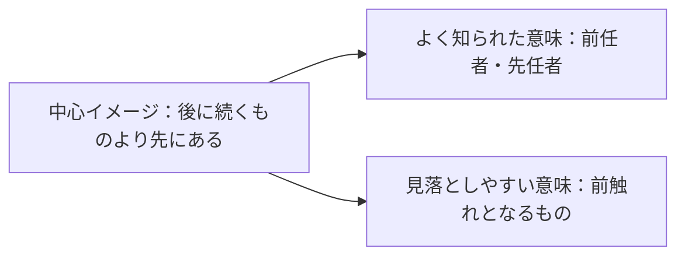

**重要語法：** a predecessor of ～（～の前身）

<sub>index: 3399 / candidate_id: ev-03399-noun-01</sub>

---

## 2087. catalyst

**品詞：** noun　**発音：** /ˈkætəlɪst/

<sub>よく知られている意味：触媒（化学）</sub>

**見落としやすい意味：変化を引き起こすきっかけ・触媒**

**例文：** The debate became a catalyst for reform.

**和訳：** その議論は改革のきっかけとなった。

**コアイメージ：** 化学反応を進める触媒から、変化を促進する出来事や人へ比喩的に広がる。変化そのものではなく起こすきっかけに焦点がある。

**図：**

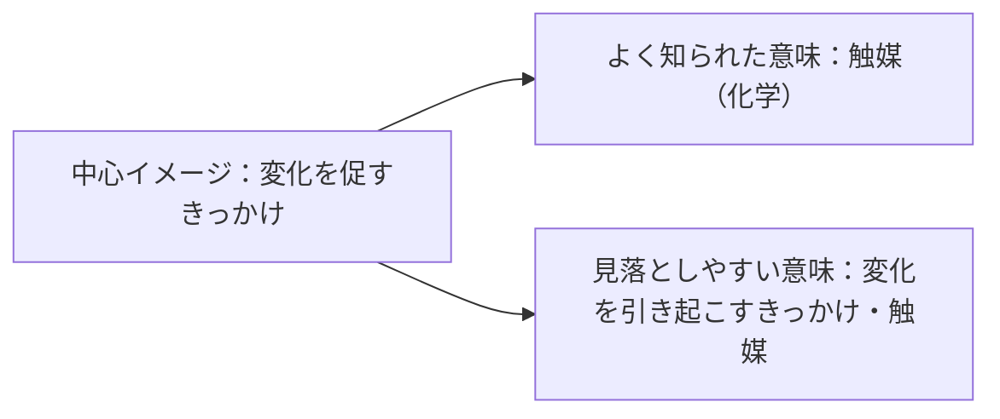

**重要語法：** a catalyst for change（変化のきっかけ）

<sub>index: 3400 / candidate_id: ev-03400-noun-01</sub>

---

## 2088. pant

**品詞：** verb　**発音：** /pænt/

<sub>よく知られている意味：ズボン（pants）を連想しやすい語</sub>

**見落としやすい意味：息を切らして呼吸する、あえぐ**

**例文：** The dog panted after running up the hill.

**和訳：** 犬は丘を駆け上がったあと、はあはあと息をした。

**コアイメージ：** 息を短く速く繰り返している様子を表す。衣服のpantsとはつづりが似ていても別の語として捉える。

**図：**

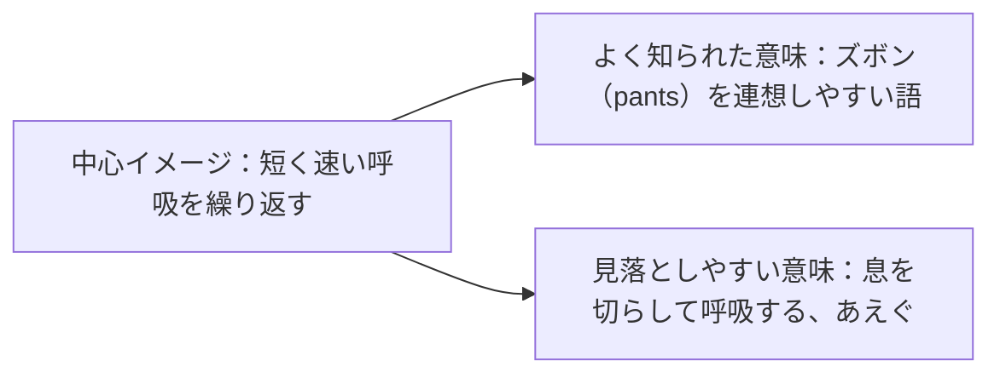

**重要語法：** pant for breath（息を切らす）

<sub>index: 3405 / candidate_id: ev-03405-verb-01</sub>

---

## 2089. impress

**品詞：** verb　**発音：** /ɪmˈpres/

<sub>よく知られている意味：感銘を与える</sub>

**見落としやすい意味：印を押す、刻みつける**

**例文：** The artist impressed a pattern into the wet clay.

**和訳：** 芸術家は湿った粘土に模様を押しつけて刻んだ。

**コアイメージ：** 何かを押しつけて跡を残すことが核となる。物に印を刻む意味から、心に強い印象を残す意味にもつながる。

**図：**

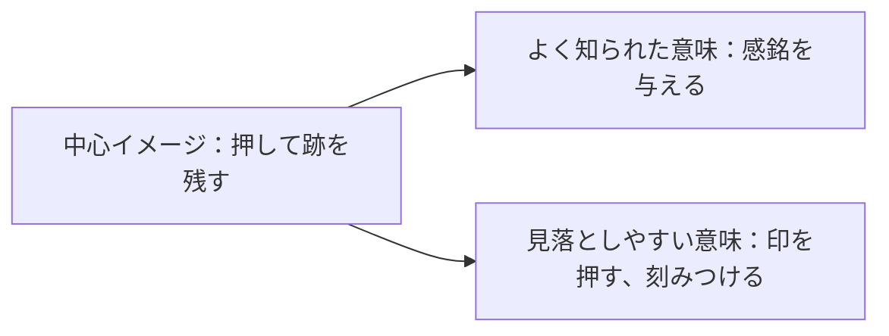

**重要語法：** impress A on/into B（BにAを刻む）

<sub>index: 3407 / candidate_id: ev-03407-verb-01</sub>

---

## 2090. nail

**品詞：** verb　**発音：** /neɪl/

<sub>よく知られている意味：爪・くぎ</sub>

**見落としやすい意味：答え・位置などを正確に突き止める**

**例文：** The reporter nailed the exact date of the meeting.

**和訳：** 記者は会議の正確な日付を突き止めた。

**コアイメージ：** くぎを打って位置を固定することから、曖昧だった答えを正確に定める意味に広がる。何かを確実に押さえる感覚がある。

**図：**

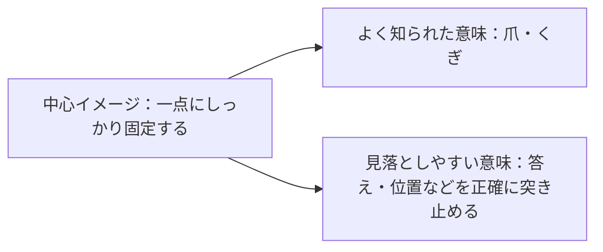

**重要語法：** nail down the details（詳細を確定する）

<sub>index: 3411 / candidate_id: ev-03411-verb-01</sub>

---

## 2091. grab

**品詞：** verb　**発音：** /ɡræb/

<sub>よく知られている意味：つかむ・ひったくる</sub>

**見落としやすい意味：人の注意や関心を引きつける**

**例文：** The headline immediately grabbed my attention.

**和訳：** その見出しはすぐに私の注意を引いた。

**コアイメージ：** 手で素早くつかんで離さない動作から、視線や関心を強く引き付ける意味になる。対象が物から注意へ移る。

**図：**

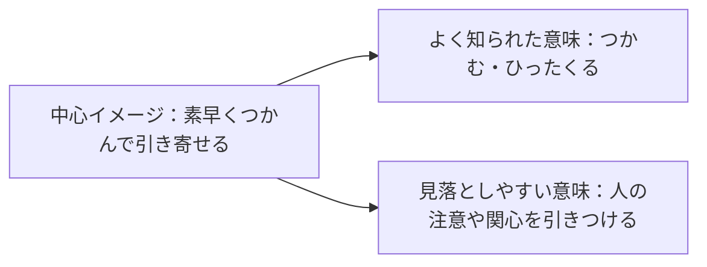

**重要語法：** grab someone's attention（人の注意を引く）

<sub>index: 3413 / candidate_id: ev-03413-verb-01</sub>

---

## 2092. mature

**品詞：** verb　**発音：** /məˈtʃʊr/

<sub>よく知られている意味：成熟する・大人になる</sub>

**見落としやすい意味：（債券・借入金などの）満期が来る**

**例文：** The bond will mature in five years.

**和訳：** その債券は5年後に満期を迎える。

**コアイメージ：** 成長が最終段階に達するイメージを持つ。金融では、あらかじめ定められた期限に達して支払いを受けられる状態を指す。

**図：**

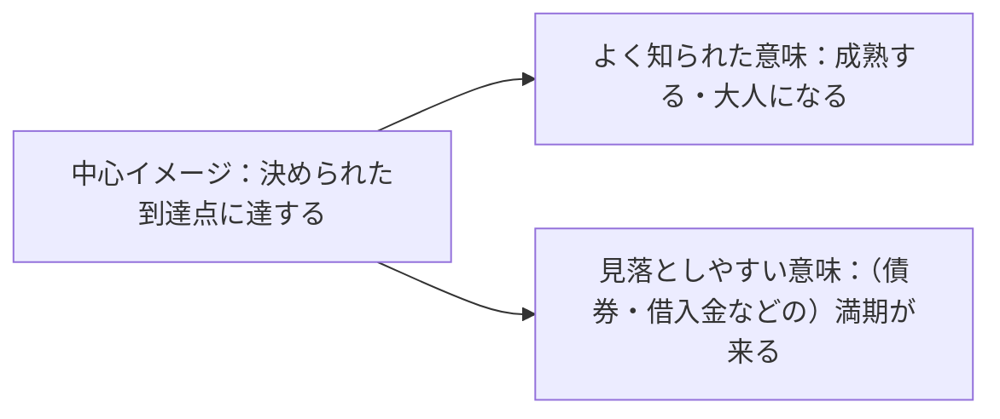

**重要語法：** a bond matures（債券が満期になる）

<sub>index: 3415 / candidate_id: ev-03415-verb-01</sub>

---

## 2093. wit

**品詞：** noun　**発音：** /wɪt/

<sub>よく知られている意味：機知・ユーモア</sub>

**見落としやすい意味：（複数形witsで）機転、判断力、冷静さ**

**例文：** Keep your wits about you when crossing the busy road.

**和訳：** 交通量の多い道路を渡るときは冷静に周囲に注意しなさい。

**コアイメージ：** 頭がすばやく働く力を意味する。複数形のwitsは、冗談のうまさではなく状況を判断する冷静さや機転を表すことがある。

**図：**

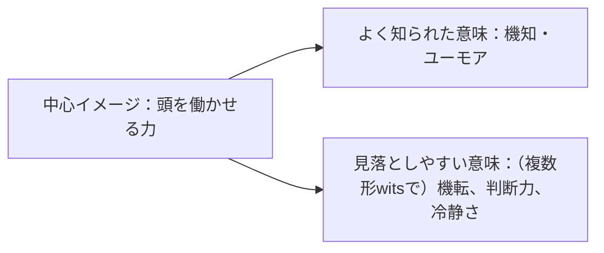

**重要語法：** keep your wits about you（冷静さを保つ）

<sub>index: 3416 / candidate_id: ev-03416-noun-01</sub>

---

## 2094. exquisite

**品詞：** adjective　**発音：** /ɪkˈskwɪzɪt/

<sub>よく知られている意味：精巧な・この上なく美しい</sub>

**見落としやすい意味：（痛み・感覚が）非常に強烈な**

**例文：** He felt exquisite pain whenever he moved his injured wrist.

**和訳：** 傷めた手首を動かすたび、彼は激しい痛みを感じた。

**コアイメージ：** 細部まで際立つほど程度が高い、という強調の感覚がある。美しさだけでなく、痛みの強烈さにも使われる文語的な用法。

**図：**

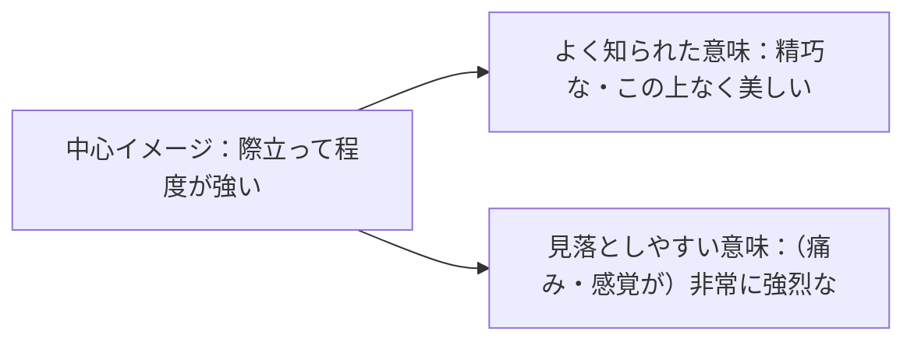

**重要語法：** exquisite pain（激痛；文語的）

<sub>index: 3418 / candidate_id: ev-03418-adjective-01</sub>

---

## 2095. spark

**品詞：** verb　**発音：** /spɑːrk/

<sub>よく知られている意味：火花・きっかけ</sub>

**見落としやすい意味：出来事・反応などを引き起こす**

**例文：** The announcement sparked a heated debate.

**和訳：** その発表が激しい議論を引き起こした。

**コアイメージ：** 小さな火花が大きな火を生むというつながり。小さな出来事が議論や反応の始まりになることを表す。

**図：**

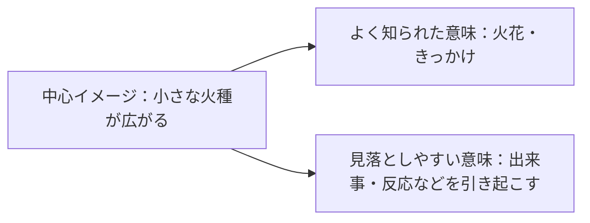

**重要語法：** spark debate（議論を引き起こす）

<sub>index: 3419 / candidate_id: ev-03419-verb-01</sub>

---

## 2096. discharge

**品詞：** verb　**発音：** /dɪsˈtʃɑːrdʒ/

<sub>よく知られている意味：放出する・排出する</sub>

**見落としやすい意味：義務・任務を果たす**

**例文：** Every official must discharge their duties responsibly.

**和訳：** すべての職員は責任を持って職務を果たさなければならない。

**コアイメージ：** 引き受けた負担を外へ出して終える感覚がある。義務を最後まで遂行して、その責任を果たす意味に使われる。

**図：**

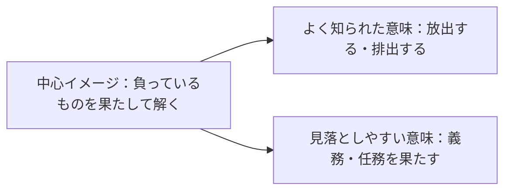

**重要語法：** discharge a duty（義務を果たす）

<sub>index: 3420 / candidate_id: ev-03420-verb-01</sub>

---

## 2097. discharge

**品詞：** verb　**発音：** /dɪsˈtʃɑːrdʒ/

<sub>よく知られている意味：放出する・排出する</sub>

**見落としやすい意味：退院させる、（正式に）職務から解く**

**例文：** The hospital discharged her the following morning.

**和訳：** 病院は翌朝、彼女を退院させた。

**コアイメージ：** 所属や拘束の状態から外に出すことが中心。患者を病院から出すことや、人を職務から解くことを表す。

**図：**

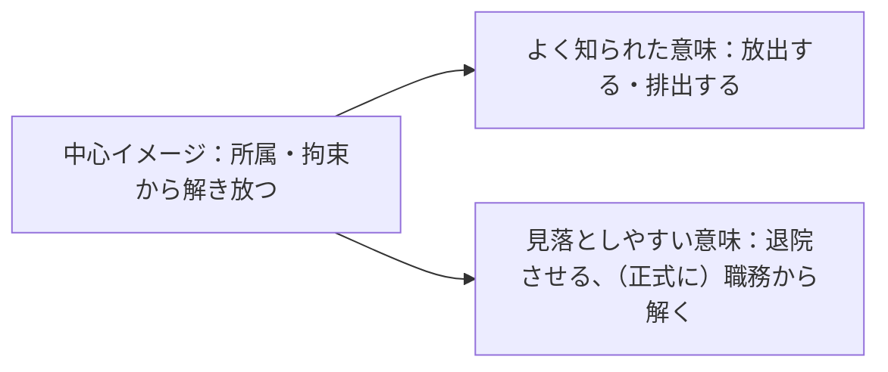

**重要語法：** be discharged from hospital（退院する）

<sub>index: 3420 / candidate_id: ev-03420-verb-02</sub>

---

## 2098. practically

**品詞：** adverb　**発音：** /ˈpræktɪkli/

<sub>よく知られている意味：実際的に・実用的に</sub>

**見落としやすい意味：ほとんど、事実上**

**例文：** The museum was practically empty on Monday.

**和訳：** 月曜日、その博物館はほとんど空だった。

**コアイメージ：** 現実に照らして見るという意味から、例外を無視できるほどある状態に近いことを表す。完全に同じと断定しない。

**図：**

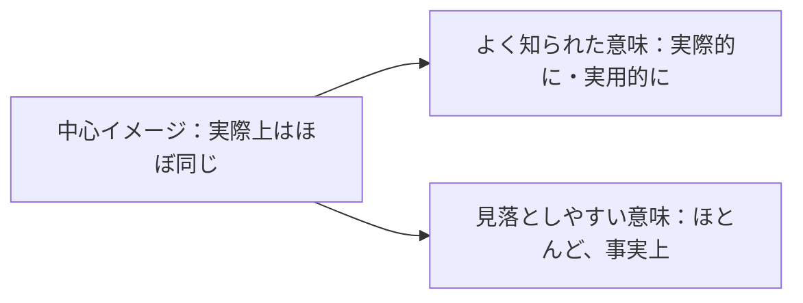

**重要語法：** practically impossible（事実上不可能な）

<sub>index: 3421 / candidate_id: ev-03421-adverb-01</sub>

---

## 2099. citation

**品詞：** noun　**発音：** /saɪˈteɪʃən/

<sub>よく知られている意味：引用・引用文</sub>

**見落としやすい意味：裁判所などからの出頭命令**

**例文：** He received a citation requiring him to appear in court.

**和訳：** 彼は裁判所への出頭を求める通知を受け取った。

**コアイメージ：** 正式に人や文書を呼び出して示す行為に関わる語。出典を示す引用のほか、法的な出頭通知を表すことがある。

**図：**

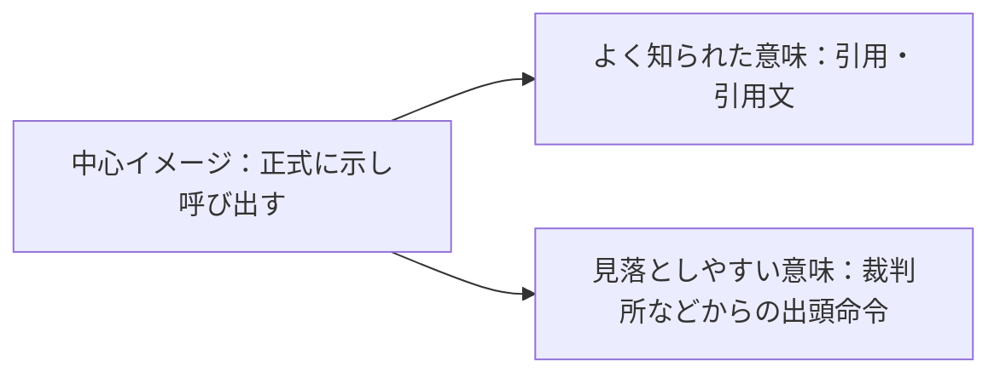

**重要語法：** receive a citation（出頭通知・違反切符などを受ける）

<sub>index: 3427 / candidate_id: ev-03427-noun-01</sub>

---

## 2100. casual

**品詞：** adjective　**発音：** /ˈkæʒuəl/

<sub>よく知られている意味：気軽な・普段着の</sub>

**見落としやすい意味：偶然の、たまたま生じた**

**例文：** A casual meeting at the station led to a long friendship.

**和訳：** 駅での偶然の出会いが長い友情につながった。

**コアイメージ：** 特別に計画されたものではないという感覚が基礎。服装の気軽さだけでなく、予定外に起きた出来事にも使う。

**図：**

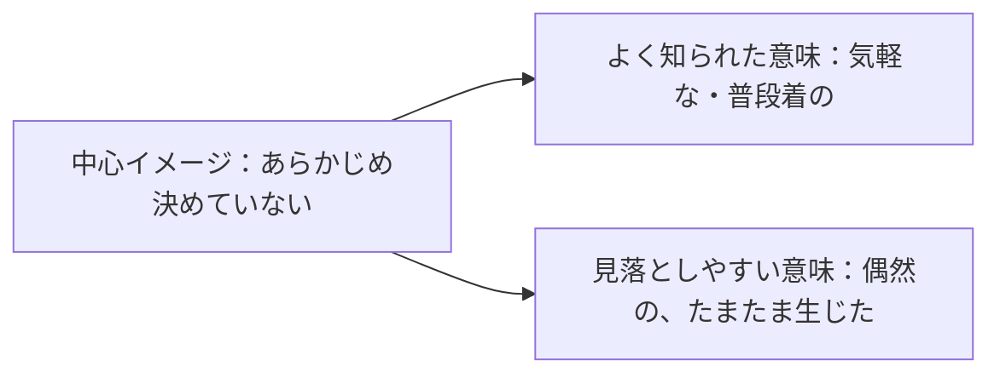

**重要語法：** a casual encounter（偶然の出会い）

<sub>index: 3430 / candidate_id: ev-03430-adjective-01</sub>

---

## 2101. blanket

**品詞：** adjective　**発音：** /ˈblæŋkɪt/

<sub>よく知られている意味：毛布</sub>

**見落としやすい意味：広い範囲全体に及ぶ、包括的な**

**例文：** The city introduced a blanket ban on outdoor fires.

**和訳：** 市は屋外での火の使用を全面的に禁止した。

**コアイメージ：** 毛布が全体を覆うように、例外なく広い対象をひとまとめに覆うイメージ。規則や禁止などの範囲を表す。

**図：**

```mermaid
flowchart LR
    A["中心イメージ：全体を一面に覆う"]
    B["よく知られた意味：毛布"]
    C["見落としやすい意味：広い範囲全体に及ぶ、包括的な"]
    A --> B
    A --> C
```

**重要語法：** a blanket ban（全面禁止）

<sub>index: 3438 / candidate_id: ev-03438-adjective-01</sub>

---

## 2102. fold

**品詞：** verb　**発音：** /foʊld/

<sub>よく知られている意味：折る・畳む</sub>

**見落としやすい意味：材料を切るようにして混ぜ込む**

**例文：** Gently fold the beaten egg whites into the batter.

**和訳：** 泡立てた卵白を生地にそっと混ぜ込んでください。

**コアイメージ：** 生地を持ち上げて折り返すように混ぜる動作を指す。強くかき混ぜず、泡を保ちながら材料を合わせる調理用法。

**図：**

```mermaid
flowchart LR
    A["中心イメージ：折り返すように混ぜる"]
    B["よく知られた意味：折る・畳む"]
    C["見落としやすい意味：材料を切るようにして混ぜ込む"]
    A --> B
    A --> C
```

**重要語法：** fold A into B（AをBにさっくり混ぜる）

<sub>index: 3441 / candidate_id: ev-03441-verb-01</sub>

---

## 2103. freely

**品詞：** adverb　**発音：** /ˈfriːli/

<sub>よく知られている意味：自由に・無料で</sub>

**見落としやすい意味：率直に、ためらわずに、自ら進んで**

**例文：** She freely admitted that she had made a mistake.

**和訳：** 彼女は自分が間違えたことを率直に認めた。

**コアイメージ：** 外から強制されたり妨げられたりしないことが核。発言では、遠慮やためらいなく自ら進んで話すことを表す。

**図：**

```mermaid
flowchart LR
    A["中心イメージ：制約なく自分から行う"]
    B["よく知られた意味：自由に・無料で"]
    C["見落としやすい意味：率直に、ためらわずに、自ら進んで"]
    A --> B
    A --> C
```

**重要語法：** freely admit（率直に認める）

<sub>index: 3442 / candidate_id: ev-03442-adverb-01</sub>

---

## 2104. naked

**品詞：** adjective　**発音：** /ˈneɪkɪd/

<sub>よく知られている意味：裸の・むき出しの</sub>

**見落としやすい意味：（the naked eyeで）器具を使わない肉眼の**

**例文：** The planet is visible to the naked eye.

**和訳：** その惑星は肉眼で見ることができる。

**コアイメージ：** 何も覆いや付加物がない状態から、観測器具を介さない目を表す。the naked eyeはひとかたまりで読む。

**図：**

```mermaid
flowchart LR
    A["中心イメージ：何も付け加えていない"]
    B["よく知られた意味：裸の・むき出しの"]
    C["見落としやすい意味：（the naked eyeで）器具を使わない肉眼の"]
    A --> B
    A --> C
```

**重要語法：** visible to the naked eye（肉眼で見える）

<sub>index: 3443 / candidate_id: ev-03443-adjective-01</sub>

---

## 2105. supplement

**品詞：** verb　**発音：** /ˈsʌplɪment/

<sub>よく知られている意味：補足物・サプリメント（名詞）</sub>

**見落としやすい意味：（不足を補うために）〜を補足する、追加する**

**例文：** He supplements his income by teaching online.

**和訳：** 彼はオンラインで教えることで収入を補っている。

**コアイメージ：** 主要なものに不足分を付け足して補うイメージ。名詞だけでなく、目的語を取って「補う」とする動詞にもなる。

**図：**

```mermaid
flowchart LR
    A["中心イメージ：足りない部分を加える"]
    B["よく知られた意味：補足物・サプリメント（名詞）"]
    C["見落としやすい意味：（不足を補うために）〜を補足する、追加する"]
    A --> B
    A --> C
```

**重要語法：** supplement A with B（AをBで補う）

<sub>index: 3445 / candidate_id: ev-03445-verb-01</sub>

---

## 2106. plague

**品詞：** verb　**発音：** /pleɪɡ/

<sub>よく知られている意味：疫病・災厄（名詞）</sub>

**見落としやすい意味：人を絶えず悩ませる**

**例文：** Doubts plagued her throughout the project.

**和訳：** その計画に取り組む間、彼女はずっと疑念に悩まされた。

**コアイメージ：** 災厄が繰り返し人を苦しめるイメージから、心配や問題がしつこく付きまとう意味になる。

**図：**

```mermaid
flowchart LR
    A["中心イメージ：災厄のように苦しめ続ける"]
    B["よく知られた意味：疫病・災厄（名詞）"]
    C["見落としやすい意味：人を絶えず悩ませる"]
    A --> B
    A --> C
```

**重要語法：** be plagued by ～（～に悩まされる）

<sub>index: 3447 / candidate_id: ev-03447-verb-01</sub>

---

## 2107. substantially

**品詞：** adverb　**発音：** /səbˈstænʃəli/

<sub>よく知られている意味：大幅に・相当</sub>

**見落としやすい意味：ほぼ、実質的に（大幅にという意味と区別）**

**例文：** The two plans are substantially the same.

**和訳：** 二つの計画は実質的に同じだ。

**コアイメージ：** 物事の実質・重要な部分に目を向ける。数量が大きい場合とは別に、本質的にはほぼ同じという意味で使える。

**図：**

```mermaid
flowchart LR
    A["中心イメージ：重要な中身に注目する"]
    B["よく知られた意味：大幅に・相当"]
    C["見落としやすい意味：ほぼ、実質的に（大幅にという意味と区別）"]
    A --> B
    A --> C
```

**重要語法：** substantially the same（実質的に同じ）

<sub>index: 3448 / candidate_id: ev-03448-adverb-01</sub>

---

## 2108. adapt

**品詞：** verb　**発音：** /əˈdæpt/

<sub>よく知られている意味：適応する・合わせる</sub>

**見落としやすい意味：（本・物語などを別媒体向けに）脚色・翻案する**

**例文：** The director adapted the novel for television.

**和訳：** 監督はその小説をテレビ向けに脚色した。

**コアイメージ：** ある目的や環境に合うよう形を変えるのが中心。作品を別の媒体に合うよう作り替える場合にも用いる。

**図：**

```mermaid
flowchart LR
    A["中心イメージ：目的に合わせて形を変える"]
    B["よく知られた意味：適応する・合わせる"]
    C["見落としやすい意味：（本・物語などを別媒体向けに）脚色・翻案する"]
    A --> B
    A --> C
```

**重要語法：** adapt A for B（AをB向けに翻案する）

<sub>index: 3449 / candidate_id: ev-03449-verb-01</sub>

---

## 2109. judicial

**品詞：** adjective　**発音：** /dʒuˈdɪʃəl/

<sub>よく知られている意味：司法の・裁判の</sub>

**見落としやすい意味：注意深い判断に基づく、分別のある**

**例文：** Her judicial manner helped both sides discuss the dispute calmly.

**和訳：** 彼女の慎重で公平な態度のおかげで、双方は争いについて冷静に話し合えた。

**コアイメージ：** 裁判官のように一方に偏らず判断する姿勢から、慎重で公平な判断を示す用法がある。ただし通常は「司法の」が中心で、この意味は限られる。

**図：**

```mermaid
flowchart LR
    A["中心イメージ：裁判官のように公平に見極める"]
    B["よく知られた意味：司法の・裁判の"]
    C["見落としやすい意味：注意深い判断に基づく、分別のある"]
    A --> B
    A --> C
```

**重要語法：** judicial manner（慎重で公平な態度；比較的まれ）

<sub>index: 3452 / candidate_id: ev-03452-adjective-01</sub>

---

## 2110. re

**品詞：** preposition　**発音：** /riː/

<sub>よく知られている意味：音階のレ・略号</sub>

**見落としやすい意味：（メールの件名・文書などで）〜に関して**

**例文：** Re: your request, I have attached the revised file.

**和訳：** ご依頼の件ですが、修正版のファイルを添付しました。

**コアイメージ：** ラテン語由来の「〜の件で」という文書用法。特に件名のRe:は、何についての連絡かを指す目印になる。

**図：**

```mermaid
flowchart LR
    A["中心イメージ：話題・案件を指し示す"]
    B["よく知られた意味：音階のレ・略号"]
    C["見落としやすい意味：（メールの件名・文書などで）〜に関して"]
    A --> B
    A --> C
```

**重要語法：** Re: ～（件名で「～について」）

<sub>index: 3455 / candidate_id: ev-03455-preposition-01</sub>

---

## 2111. vulnerable

**品詞：** adjective　**発音：** /ˈvʌlnərəbl/

<sub>よく知られている意味：傷つきやすい・無防備な</sub>

**見落としやすい意味：批判・説得・誘惑などの影響を受けやすい**

**例文：** Young children can be vulnerable to misleading advertisements.

**和訳：** 幼い子どもは誤解を招く広告の影響を受けやすいことがある。

**コアイメージ：** 外からの力に対して守りが弱い状態を表す。身体的な危険だけでなく、批判や誘惑、説得への影響の受けやすさにも広がる。

**図：**

```mermaid
flowchart LR
    A["中心イメージ：外からの影響を受けやすい"]
    B["よく知られた意味：傷つきやすい・無防備な"]
    C["見落としやすい意味：批判・説得・誘惑などの影響を受けやすい"]
    A --> B
    A --> C
```

**重要語法：** be vulnerable to ～（～の影響を受けやすい）

<sub>index: 3458 / candidate_id: ev-03458-adjective-01</sub>

---

## 2112. warrant

**品詞：** verb　**発音：** /ˈwɔːrənt/

<sub>よく知られている意味：令状・保証（名詞）</sub>

**見落としやすい意味：状況・証拠が行為などを正当化する**

**例文：** The evidence warrants further investigation.

**和訳：** その証拠はさらなる調査を行う十分な理由になる。

**コアイメージ：** ある行為をしてよいと裏付けることが中心。証拠や状況が対応を正当化する意味で使われる。

**図：**

```mermaid
flowchart LR
    A["中心イメージ：行為を裏付ける根拠を与える"]
    B["よく知られた意味：令状・保証（名詞）"]
    C["見落としやすい意味：状況・証拠が行為などを正当化する"]
    A --> B
    A --> C
```

**重要語法：** warrant further study（さらなる研究を正当化する）

<sub>index: 3459 / candidate_id: ev-03459-verb-01</sub>

---

## 2113. capita

**品詞：** phrase　**発音：** /ˈkæpɪtə/

<sub>よく知られている意味：単独では一般的な語義を取りにくい</sub>

**見落としやすい意味：（per capitaで）1人当たりの・1人当たりで**

**例文：** The town has more parks per capita than its neighbors.

**和訳：** その町は近隣の町より人口一人当たりの公園数が多い。

**コアイメージ：** per capitaは人を単位として全体を割り振る表現。「人口全体」ではなく、人数で割った一人分の値に注目する。

**図：**

```mermaid
flowchart LR
    A["中心イメージ：人数で割って一人分を見る"]
    B["よく知られた意味：単独では一般的な語義を取りにくい"]
    C["見落としやすい意味：（per capitaで）1人当たりの・1人当たりで"]
    A --> B
    A --> C
```

**重要語法：** per capita income（1人当たり所得）

<sub>index: 3461 / candidate_id: ev-03461-phrase-01</sub>

---

## 2114. upset

**品詞：** noun　**発音：** /ˈʌpset/

<sub>よく知られている意味：動揺・混乱</sub>

**見落としやすい意味：予想外の勝利・番狂わせ**

**例文：** The underdog's victory was the biggest upset of the tournament.

**和訳：** 格下と見られていた選手の勝利は大会最大の番狂わせだった。

**コアイメージ：** 予想されていた順序や状態をひっくり返すことが核。勝敗の見込みを覆す思いがけない結果を指す。

**図：**

```mermaid
flowchart LR
    A["中心イメージ：予想の上下が逆転する"]
    B["よく知られた意味：動揺・混乱"]
    C["見落としやすい意味：予想外の勝利・番狂わせ"]
    A --> B
    A --> C
```

**重要語法：** an upset victory（番狂わせの勝利）

<sub>index: 3467 / candidate_id: ev-03467-noun-01</sub>

---

## 2115. pc

**品詞：** abbreviation　**発音：** /ˌpiːˈsiː/

<sub>よく知られている意味：PC＝パソコン</sub>

**見落としやすい意味：（大文字PCで）政治的に適切な表現に配慮した、politically correctの略**

**例文：** The editor suggested a more PC term for the article.

**和訳：** 編集者は記事に使う、より社会的な配慮のある語を提案した。

**コアイメージ：** politically correctの頭文字で、表現が人々への偏見や差別を助長しないよう配慮されていることを指す。コンピューターのPCとは文脈で区別する。

**図：**

```mermaid
flowchart LR
    A["中心イメージ：表現に社会的配慮を加える"]
    B["よく知られた意味：PC＝パソコン"]
    C["見落としやすい意味：（大文字PCで）政治的に適切な表現に配慮した、politically correctの略"]
    A --> B
    A --> C
```

**重要語法：** PC language（差別や偏見に配慮した表現）

<sub>index: 3468 / candidate_id: ev-03468-abbreviation-01</sub>

---

## 2116. hip

**品詞：** adjective　**発音：** /hɪp/

<sub>よく知られている意味：腰・尻（名詞）</sub>

**見落としやすい意味：流行に敏感な、事情に通じた**

**例文：** She's hip to the latest music trends.

**和訳：** 彼女は最新の音楽の流行によく通じている。

**コアイメージ：** 新しい流行や事情を把握していることを表す口語的な形容詞。身体部位の名詞とは異なる語義として読む。

**図：**

```mermaid
flowchart LR
    A["中心イメージ：今の動きに通じている"]
    B["よく知られた意味：腰・尻（名詞）"]
    C["見落としやすい意味：流行に敏感な、事情に通じた"]
    A --> B
    A --> C
```

**重要語法：** be hip to ～（～に詳しい）

<sub>index: 3469 / candidate_id: ev-03469-adjective-01</sub>

---

## 2117. pregnant

**品詞：** adjective　**発音：** /ˈpreɡnənt/

<sub>よく知られている意味：妊娠している</sub>

**見落としやすい意味：言葉・出来事などが深い意味を含んだ**

**例文：** A pregnant silence followed his unexpected question.

**和訳：** 彼の意外な質問のあと、意味深い沈黙が続いた。

**コアイメージ：** 内側に何かを含んでいるという発想から、表面に出ていない意味や予感をはらむことを表す。言葉や沈黙にも使える。

**図：**

```mermaid
flowchart LR
    A["中心イメージ：内に何かを含んでいる"]
    B["よく知られた意味：妊娠している"]
    C["見落としやすい意味：言葉・出来事などが深い意味を含んだ"]
    A --> B
    A --> C
```

**重要語法：** a pregnant pause（意味深い間）

<sub>index: 3470 / candidate_id: ev-03470-adjective-01</sub>

---

## 2118. depth

**品詞：** noun　**発音：** /depθ/

<sub>よく知られている意味：深さ</sub>

**見落としやすい意味：（in depthで）徹底的に、詳細に**

**例文：** The report examines the problem in depth.

**和訳：** その報告書は問題を詳細に検討している。

**コアイメージ：** 表面だけでなく奥まで入り込むという空間的感覚がある。調査や説明では、その奥行きが詳しさや徹底さを表す。

**図：**

```mermaid
flowchart LR
    A["中心イメージ：表面から奥まで掘り下げる"]
    B["よく知られた意味：深さ"]
    C["見落としやすい意味：（in depthで）徹底的に、詳細に"]
    A --> B
    A --> C
```

**重要語法：** in depth（詳しく・徹底的に）

<sub>index: 3472 / candidate_id: ev-03472-noun-01</sub>

---

## 2119. prejudice

**品詞：** verb　**発音：** /ˈpredʒudɪs/

<sub>よく知られている意味：偏見・先入観（名詞）</sub>

**見落としやすい意味：人の立場・権利などを不利にする**

**例文：** Public comments might prejudice the defendant's right to a fair trial.

**和訳：** 公の発言が被告の公正な裁判を受ける権利を損なうおそれがある。

**コアイメージ：** 前もって偏った見方が判断をゆがめることから、人の利益や権利を不利な状態にする動詞用法に広がる。

**図：**

```mermaid
flowchart LR
    A["中心イメージ：公正さを損なって不利にする"]
    B["よく知られた意味：偏見・先入観（名詞）"]
    C["見落としやすい意味：人の立場・権利などを不利にする"]
    A --> B
    A --> C
```

**重要語法：** prejudice someone's rights（人の権利を害する）

<sub>index: 3473 / candidate_id: ev-03473-verb-01</sub>

---

## 2120. hardware

**品詞：** noun　**発音：** /ˈhɑːrdwer/

<sub>よく知られている意味：コンピューターの機器・装置</sub>

**見落としやすい意味：金物、工具、建築用の金属部品**

**例文：** We bought screws and hinges at the hardware store.

**和訳：** 私たちは金物店でねじと蝶番を買った。

**コアイメージ：** 実際に手に取れる丈夫な器具や部品を指す。コンピューター以外にも、建築や修理に使う金物の意味がある。

**図：**

```mermaid
flowchart LR
    A["中心イメージ：形のある器具・部品"]
    B["よく知られた意味：コンピューターの機器・装置"]
    C["見落としやすい意味：金物、工具、建築用の金属部品"]
    A --> B
    A --> C
```

**重要語法：** hardware store（金物店）

<sub>index: 3475 / candidate_id: ev-03475-noun-01</sub>

---
