# EasyVoca 完成教材｜Batch 027

対象：global_order 2081–2160、全80件。80件収録。

## 2081. pill

**品詞：** noun　**発音：** /pɪl/

<sub>よく知られている意味：錠剤・丸薬</sub>

**見落としやすい意味：（a bitter pill to swallowで）受け入れがたい現実・事実**

**例文：** Losing the final was a bitter pill to swallow.

**和訳：** 決勝での敗北は受け入れがたい現実だった。

**コアイメージ：** 苦い錠剤は飲み込むのがつらい。そこから、認めたり受け入れたりするのがつらい事実を表す。

**図：**

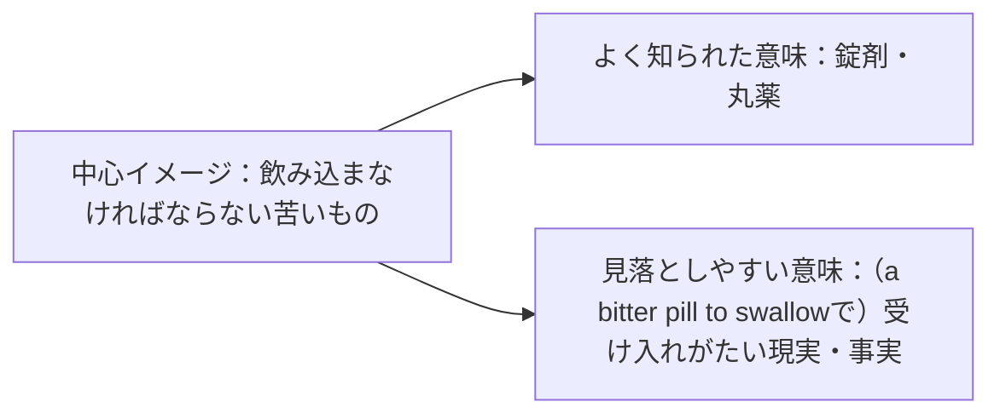

**重要語法：** a bitter pill to swallow

<sub>index: 3390 / candidate_id: ev-03390-noun-02</sub>

---

## 2082. silent

**品詞：** adjective　**発音：** /ˈsaɪlənt/

<sub>よく知られている意味：静かな・無言の</sub>

**見落としやすい意味：言葉にされず暗黙に示された**

**例文：** They reached a silent agreement not to discuss the issue.

**和訳：** 彼らはその問題を話題にしないという暗黙の合意に達した。

**コアイメージ：** 声や言葉が表に出ていないことが中心にある。明言されなくても態度や行動から伝わる合意などにも使う。

**図：**

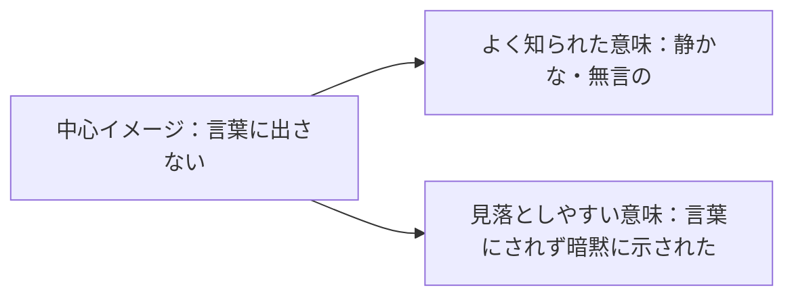

**重要語法：** silent agreement（暗黙の合意）

<sub>index: 3391 / candidate_id: ev-03391-adjective-01</sub>

---

## 2083. mutual

**品詞：** adjective　**発音：** /ˈmjuːtʃuəl/

<sub>よく知られている意味：相互の・お互いの</sub>

**見落としやすい意味：（友人・利益・関心などが）共通の**

**例文：** We discovered that we had a mutual friend.

**和訳：** 私たちには共通の友人がいることが分かった。

**コアイメージ：** 二人の側が同じ対象に結び付いている状態を表す。「互いにする」だけでなく「両者に共通する」にも広がる。

**図：**

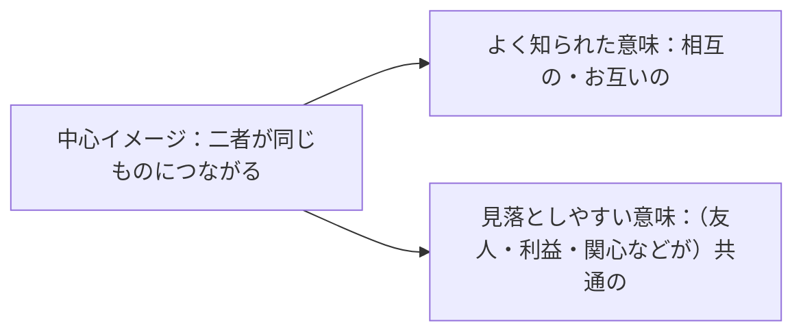

**重要語法：** a mutual friend（共通の友人）

<sub>index: 3392 / candidate_id: ev-03392-adjective-01</sub>

---

## 2084. sole

**品詞：** noun　**発音：** /soʊl/

<sub>よく知られている意味：唯一の（形容詞）</sub>

**見落としやすい意味：足の裏、靴の底**

**例文：** The soles of my shoes were worn thin.

**和訳：** 私の靴の底はすり減って薄くなっていた。

**コアイメージ：** 足や靴の下に接する面を指す名詞で、形容詞の「唯一の」とは語源も異なる。文中の品詞で区別する。

**図：**

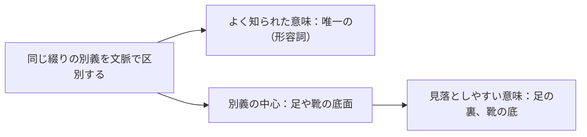

**重要語法：** the sole of a shoe（靴底）

<sub>index: 3396 / candidate_id: ev-03396-noun-01</sub>

---

## 2085. charter

**品詞：** verb　**発音：** /ˈtʃɑːrtər/

<sub>よく知られている意味：憲章・認可状</sub>

**見落としやすい意味：船・飛行機などを貸し切る**

**例文：** We chartered a boat for the afternoon.

**和訳：** 私たちは午後のために船を貸し切った。

**コアイメージ：** 特定の目的のために乗り物を契約で確保するイメージ。文書としての認可状から、契約による貸切りという動詞用法にもつながる。

**図：**

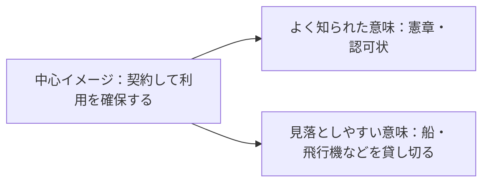

**重要語法：** charter a plane（飛行機を貸し切る）

<sub>index: 3397 / candidate_id: ev-03397-verb-01</sub>

---

## 2086. predecessor

**品詞：** noun　**発音：** /ˈpredəsesər/

<sub>よく知られている意味：前任者・先任者</sub>

**見落としやすい意味：前触れとなるもの**

**例文：** This simple device was a predecessor of the modern smartphone.

**和訳：** この単純な機器は現代のスマートフォンの先駆けだった。

**コアイメージ：** 時間や発展の流れで先に位置するものを指す。人の前任者だけでなく、後の製品・制度につながる前身も表す。

**図：**

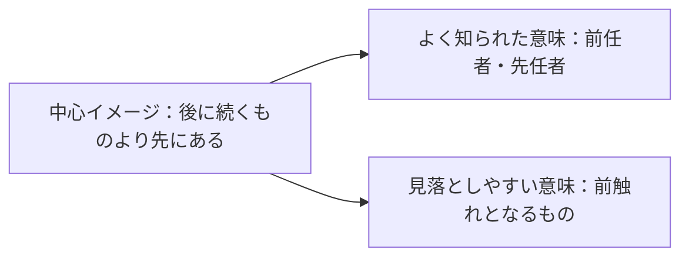

**重要語法：** a predecessor of ～（～の前身）

<sub>index: 3399 / candidate_id: ev-03399-noun-01</sub>

---

## 2087. catalyst

**品詞：** noun　**発音：** /ˈkætəlɪst/

<sub>よく知られている意味：触媒（化学）</sub>

**見落としやすい意味：変化を引き起こすきっかけ・触媒**

**例文：** The debate became a catalyst for reform.

**和訳：** その議論は改革のきっかけとなった。

**コアイメージ：** 化学反応を進める触媒から、変化を促進する出来事や人へ比喩的に広がる。変化そのものではなく起こすきっかけに焦点がある。

**図：**

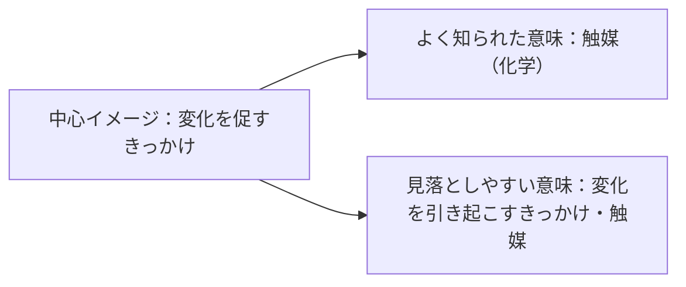

**重要語法：** a catalyst for change（変化のきっかけ）

<sub>index: 3400 / candidate_id: ev-03400-noun-01</sub>

---

## 2088. pant

**品詞：** verb　**発音：** /pænt/

<sub>よく知られている意味：ズボン（pants）を連想しやすい語</sub>

**見落としやすい意味：息を切らして呼吸する、あえぐ**

**例文：** The dog panted after running up the hill.

**和訳：** 犬は丘を駆け上がったあと、はあはあと息をした。

**コアイメージ：** 息を短く速く繰り返している様子を表す。衣服のpantsとはつづりが似ていても別の語として捉える。

**図：**

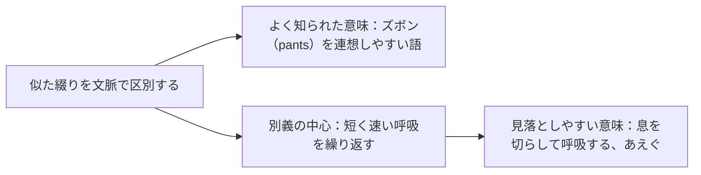

**重要語法：** pant for breath（息を切らす）

<sub>index: 3405 / candidate_id: ev-03405-verb-01</sub>

---

## 2089. impress

**品詞：** verb　**発音：** /ɪmˈpres/

<sub>よく知られている意味：感銘を与える</sub>

**見落としやすい意味：印を押す、刻みつける**

**例文：** The artist impressed a pattern into the wet clay.

**和訳：** 芸術家は湿った粘土に模様を押しつけて刻んだ。

**コアイメージ：** 何かを押しつけて跡を残すことが核となる。物に印を刻む意味から、心に強い印象を残す意味にもつながる。

**図：**

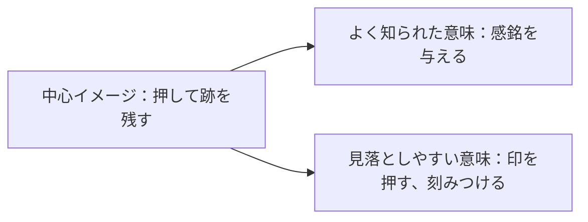

**重要語法：** impress A on/into B（BにAを刻む）

<sub>index: 3407 / candidate_id: ev-03407-verb-01</sub>

---

## 2090. nail

**品詞：** verb　**発音：** /neɪl/

<sub>よく知られている意味：爪・くぎ</sub>

**見落としやすい意味：答え・位置などを正確に突き止める**

**例文：** The reporter nailed the exact date of the meeting.

**和訳：** 記者は会議の正確な日付を突き止めた。

**コアイメージ：** くぎを打って位置を固定することから、曖昧だった答えを正確に定める意味に広がる。何かを確実に押さえる感覚がある。

**図：**

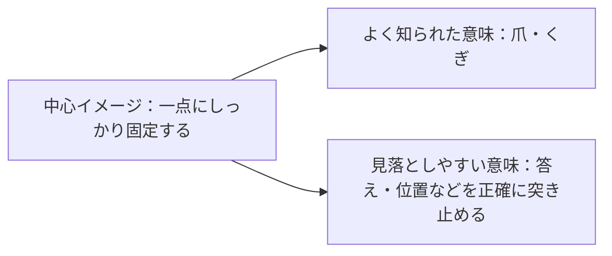

**重要語法：** nail down the details（詳細を確定する）

<sub>index: 3411 / candidate_id: ev-03411-verb-01</sub>

---

## 2091. grab

**品詞：** verb　**発音：** /ɡræb/

<sub>よく知られている意味：つかむ・ひったくる</sub>

**見落としやすい意味：人の注意や関心を引きつける**

**例文：** The headline immediately grabbed my attention.

**和訳：** その見出しはすぐに私の注意を引いた。

**コアイメージ：** 手で素早くつかんで離さない動作から、視線や関心を強く引き付ける意味になる。対象が物から注意へ移る。

**図：**

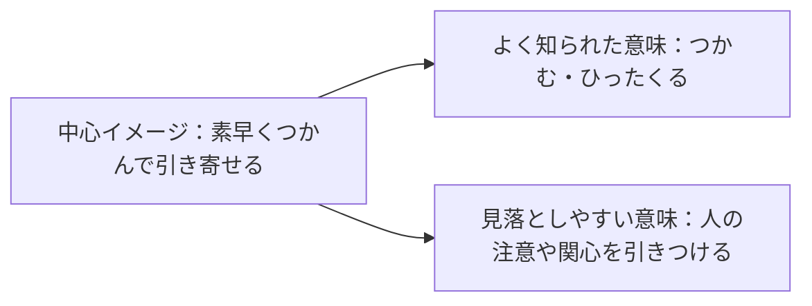

**重要語法：** grab someone's attention（人の注意を引く）

<sub>index: 3413 / candidate_id: ev-03413-verb-01</sub>

---

## 2092. mature

**品詞：** verb　**発音：** /məˈtʃʊr/

<sub>よく知られている意味：成熟する・大人になる</sub>

**見落としやすい意味：（債券・借入金などの）満期が来る**

**例文：** The bond will mature in five years.

**和訳：** その債券は5年後に満期を迎える。

**コアイメージ：** 成長が最終段階に達するイメージを持つ。金融では、あらかじめ定められた期限に達して支払いを受けられる状態を指す。

**図：**

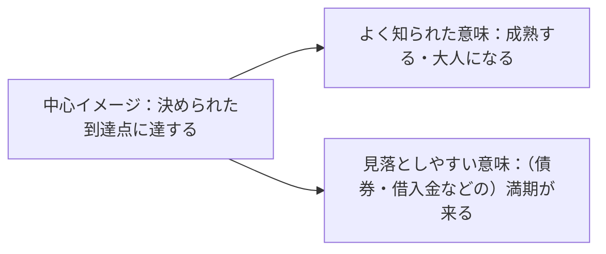

**重要語法：** a bond matures（債券が満期になる）

<sub>index: 3415 / candidate_id: ev-03415-verb-01</sub>

---

## 2093. wit

**品詞：** noun　**発音：** /wɪt/

<sub>よく知られている意味：機知・ユーモア</sub>

**見落としやすい意味：（複数形witsで）機転、判断力、冷静さ**

**例文：** Keep your wits about you when crossing the busy road.

**和訳：** 交通量の多い道路を渡るときは冷静に周囲に注意しなさい。

**コアイメージ：** 頭がすばやく働く力を意味する。複数形のwitsは、冗談のうまさではなく状況を判断する冷静さや機転を表すことがある。

**図：**

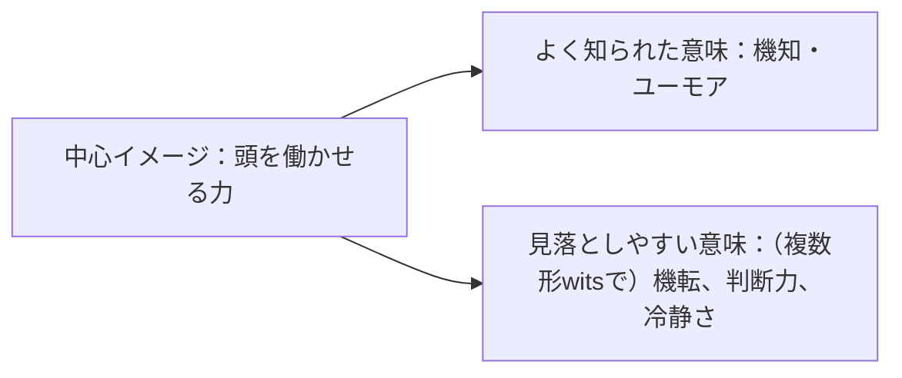

**重要語法：** keep your wits about you（冷静さを保つ）

<sub>index: 3416 / candidate_id: ev-03416-noun-01</sub>

---

## 2094. exquisite

**品詞：** adjective　**発音：** /ɪkˈskwɪzɪt/

<sub>よく知られている意味：精巧な・この上なく美しい</sub>

**見落としやすい意味：（痛み・感覚が）非常に強烈な**

**例文：** He felt exquisite pain whenever he moved his injured wrist.

**和訳：** 傷めた手首を動かすたび、彼は激しい痛みを感じた。

**コアイメージ：** 細部まで際立つほど程度が高い、という強調の感覚がある。美しさだけでなく、痛みの強烈さにも使われる文語的な用法。

**図：**

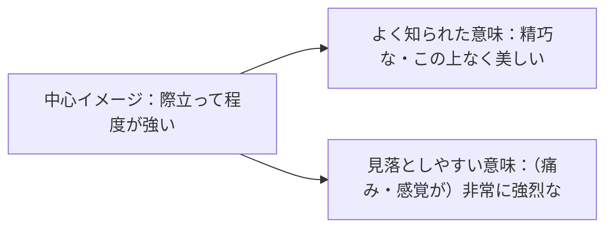

**重要語法：** exquisite pain（激痛；文語的）

<sub>index: 3418 / candidate_id: ev-03418-adjective-01</sub>

---

## 2095. spark

**品詞：** verb　**発音：** /spɑːrk/

<sub>よく知られている意味：火花・きっかけ</sub>

**見落としやすい意味：出来事・反応などを引き起こす**

**例文：** The announcement sparked a heated debate.

**和訳：** その発表が激しい議論を引き起こした。

**コアイメージ：** 小さな火花が大きな火を生むというつながり。小さな出来事が議論や反応の始まりになることを表す。

**図：**

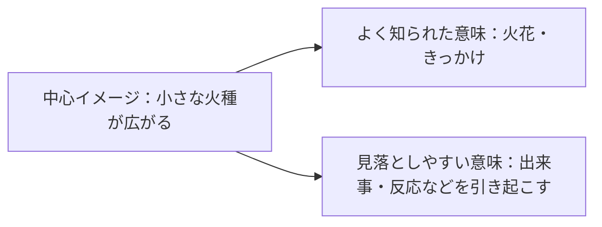

**重要語法：** spark debate（議論を引き起こす）

<sub>index: 3419 / candidate_id: ev-03419-verb-01</sub>

---

## 2096. discharge

**品詞：** verb　**発音：** /dɪsˈtʃɑːrdʒ/

<sub>よく知られている意味：放出する・排出する</sub>

**見落としやすい意味：義務・任務を果たす**

**例文：** Every official must discharge their duties responsibly.

**和訳：** すべての職員は責任を持って職務を果たさなければならない。

**コアイメージ：** 引き受けた負担を外へ出して終える感覚がある。義務を最後まで遂行して、その責任を果たす意味に使われる。

**図：**

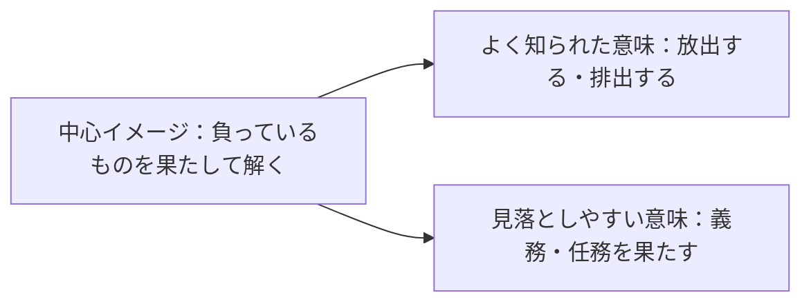

**重要語法：** discharge a duty（義務を果たす）

<sub>index: 3420 / candidate_id: ev-03420-verb-01</sub>

---

## 2097. discharge

**品詞：** verb　**発音：** /dɪsˈtʃɑːrdʒ/

<sub>よく知られている意味：放出する・排出する</sub>

**見落としやすい意味：退院させる、（正式に）職務から解く**

**例文：** The hospital discharged her the following morning.

**和訳：** 病院は翌朝、彼女を退院させた。

**コアイメージ：** 所属や拘束の状態から外に出すことが中心。患者を病院から出すことや、人を職務から解くことを表す。

**図：**

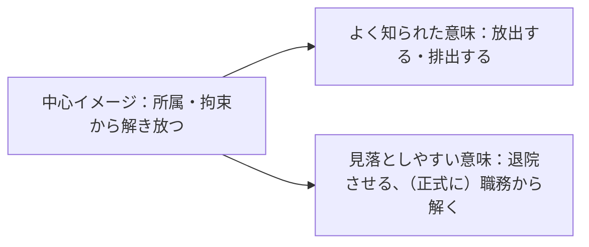

**重要語法：** be discharged from hospital（退院する）

<sub>index: 3420 / candidate_id: ev-03420-verb-02</sub>

---

## 2098. practically

**品詞：** adverb　**発音：** /ˈpræktɪkli/

<sub>よく知られている意味：実際的に・実用的に</sub>

**見落としやすい意味：ほとんど、事実上**

**例文：** The museum was practically empty on Monday.

**和訳：** 月曜日、その博物館はほとんど空だった。

**コアイメージ：** 現実に照らして見るという意味から、例外を無視できるほどある状態に近いことを表す。完全に同じと断定しない。

**図：**

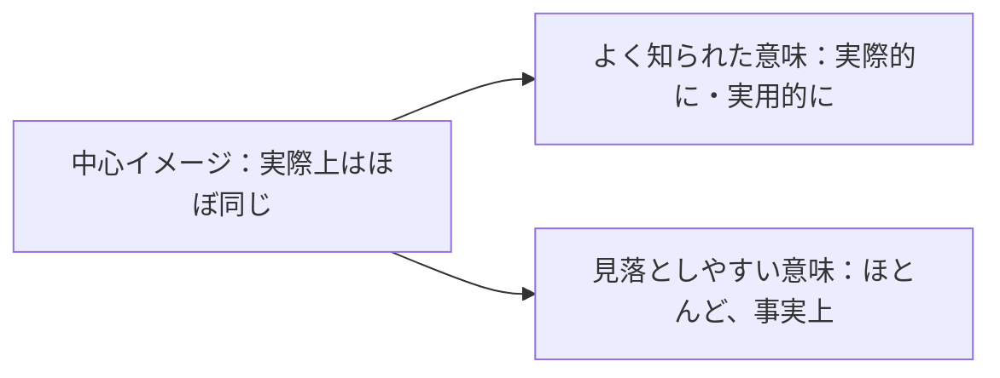

**重要語法：** practically impossible（事実上不可能な）

<sub>index: 3421 / candidate_id: ev-03421-adverb-01</sub>

---

## 2099. citation

**品詞：** noun　**発音：** /saɪˈteɪʃən/

<sub>よく知られている意味：引用・引用文</sub>

**見落としやすい意味：裁判所などからの出頭命令**

**例文：** He received a citation requiring him to appear in court.

**和訳：** 彼は裁判所への出頭を求める通知を受け取った。

**コアイメージ：** 正式に人や文書を呼び出して示す行為に関わる語。出典を示す引用のほか、法的な出頭通知を表すことがある。

**図：**

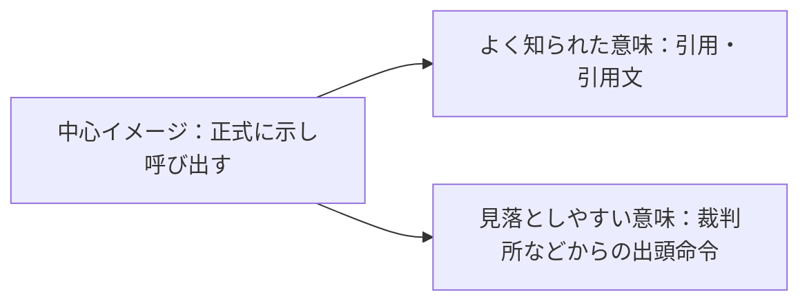

**重要語法：** receive a citation（出頭通知・違反切符などを受ける）

<sub>index: 3427 / candidate_id: ev-03427-noun-01</sub>

---

## 2100. casual

**品詞：** adjective　**発音：** /ˈkæʒuəl/

<sub>よく知られている意味：気軽な・普段着の</sub>

**見落としやすい意味：偶然の、たまたま生じた**

**例文：** A casual meeting at the station led to a long friendship.

**和訳：** 駅での偶然の出会いが長い友情につながった。

**コアイメージ：** 特別に計画されたものではないという感覚が基礎。服装の気軽さだけでなく、予定外に起きた出来事にも使う。

**図：**

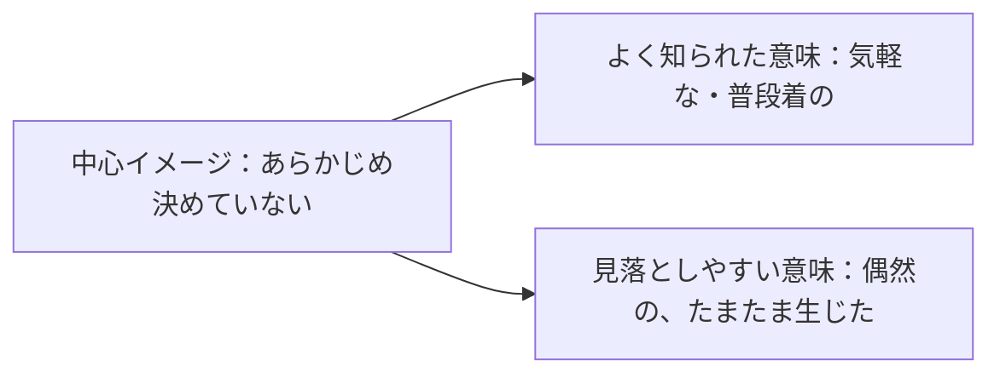

**重要語法：** a casual encounter（偶然の出会い）

<sub>index: 3430 / candidate_id: ev-03430-adjective-01</sub>

---

## 2101. blanket

**品詞：** adjective　**発音：** /ˈblæŋkɪt/

<sub>よく知られている意味：毛布</sub>

**見落としやすい意味：広い範囲全体に及ぶ、包括的な**

**例文：** The city introduced a blanket ban on outdoor fires.

**和訳：** 市は屋外での火の使用を全面的に禁止した。

**コアイメージ：** 毛布が全体を覆うように、例外なく広い対象をひとまとめに覆うイメージ。規則や禁止などの範囲を表す。

**図：**

```mermaid
flowchart LR
    A["中心イメージ：全体を一面に覆う"]
    B["よく知られた意味：毛布"]
    C["見落としやすい意味：広い範囲全体に及ぶ、包括的な"]
    A --> B
    A --> C
```

**重要語法：** a blanket ban（全面禁止）

<sub>index: 3438 / candidate_id: ev-03438-adjective-01</sub>

---

## 2102. fold

**品詞：** verb　**発音：** /foʊld/

<sub>よく知られている意味：折る・畳む</sub>

**見落としやすい意味：材料を切るようにして混ぜ込む**

**例文：** Gently fold the beaten egg whites into the batter.

**和訳：** 泡立てた卵白を生地にそっと混ぜ込んでください。

**コアイメージ：** 生地を持ち上げて折り返すように混ぜる動作を指す。強くかき混ぜず、泡を保ちながら材料を合わせる調理用法。

**図：**

```mermaid
flowchart LR
    A["中心イメージ：折り返すように混ぜる"]
    B["よく知られた意味：折る・畳む"]
    C["見落としやすい意味：材料を切るようにして混ぜ込む"]
    A --> B
    A --> C
```

**重要語法：** fold A into B（AをBにさっくり混ぜる）

<sub>index: 3441 / candidate_id: ev-03441-verb-01</sub>

---

## 2103. freely

**品詞：** adverb　**発音：** /ˈfriːli/

<sub>よく知られている意味：自由に・無料で</sub>

**見落としやすい意味：率直に、ためらわずに、自ら進んで**

**例文：** She freely admitted that she had made a mistake.

**和訳：** 彼女は自分が間違えたことを率直に認めた。

**コアイメージ：** 外から強制されたり妨げられたりしないことが核。発言では、遠慮やためらいなく自ら進んで話すことを表す。

**図：**

```mermaid
flowchart LR
    A["中心イメージ：制約なく自分から行う"]
    B["よく知られた意味：自由に・無料で"]
    C["見落としやすい意味：率直に、ためらわずに、自ら進んで"]
    A --> B
    A --> C
```

**重要語法：** freely admit（率直に認める）

<sub>index: 3442 / candidate_id: ev-03442-adverb-01</sub>

---

## 2104. naked

**品詞：** adjective　**発音：** /ˈneɪkɪd/

<sub>よく知られている意味：裸の・むき出しの</sub>

**見落としやすい意味：（the naked eyeで）器具を使わない肉眼の**

**例文：** The planet is visible to the naked eye.

**和訳：** その惑星は肉眼で見ることができる。

**コアイメージ：** 何も覆いや付加物がない状態から、観測器具を介さない目を表す。the naked eyeはひとかたまりで読む。

**図：**

```mermaid
flowchart LR
    A["中心イメージ：何も付け加えていない"]
    B["よく知られた意味：裸の・むき出しの"]
    C["見落としやすい意味：（the naked eyeで）器具を使わない肉眼の"]
    A --> B
    A --> C
```

**重要語法：** visible to the naked eye（肉眼で見える）

<sub>index: 3443 / candidate_id: ev-03443-adjective-01</sub>

---

## 2105. supplement

**品詞：** verb　**発音：** /ˈsʌplɪment/

<sub>よく知られている意味：補足物・サプリメント（名詞）</sub>

**見落としやすい意味：（不足を補うために）〜を補足する、追加する**

**例文：** He supplements his income by teaching online.

**和訳：** 彼はオンラインで教えることで収入を補っている。

**コアイメージ：** 主要なものに不足分を付け足して補うイメージ。名詞だけでなく、目的語を取って「補う」とする動詞にもなる。

**図：**

```mermaid
flowchart LR
    A["中心イメージ：足りない部分を加える"]
    B["よく知られた意味：補足物・サプリメント（名詞）"]
    C["見落としやすい意味：（不足を補うために）〜を補足する、追加する"]
    A --> B
    A --> C
```

**重要語法：** supplement A with B（AをBで補う）

<sub>index: 3445 / candidate_id: ev-03445-verb-01</sub>

---

## 2106. plague

**品詞：** verb　**発音：** /pleɪɡ/

<sub>よく知られている意味：疫病・災厄（名詞）</sub>

**見落としやすい意味：人を絶えず悩ませる**

**例文：** Doubts plagued her throughout the project.

**和訳：** その計画に取り組む間、彼女はずっと疑念に悩まされた。

**コアイメージ：** 災厄が繰り返し人を苦しめるイメージから、心配や問題がしつこく付きまとう意味になる。

**図：**

```mermaid
flowchart LR
    A["中心イメージ：災厄のように苦しめ続ける"]
    B["よく知られた意味：疫病・災厄（名詞）"]
    C["見落としやすい意味：人を絶えず悩ませる"]
    A --> B
    A --> C
```

**重要語法：** be plagued by ～（～に悩まされる）

<sub>index: 3447 / candidate_id: ev-03447-verb-01</sub>

---

## 2107. substantially

**品詞：** adverb　**発音：** /səbˈstænʃəli/

<sub>よく知られている意味：大幅に・相当</sub>

**見落としやすい意味：ほぼ、実質的に（大幅にという意味と区別）**

**例文：** The two plans are substantially the same.

**和訳：** 二つの計画は実質的に同じだ。

**コアイメージ：** 物事の実質・重要な部分に目を向ける。数量が大きい場合とは別に、本質的にはほぼ同じという意味で使える。

**図：**

```mermaid
flowchart LR
    A["中心イメージ：重要な中身に注目する"]
    B["よく知られた意味：大幅に・相当"]
    C["見落としやすい意味：ほぼ、実質的に（大幅にという意味と区別）"]
    A --> B
    A --> C
```

**重要語法：** substantially the same（実質的に同じ）

<sub>index: 3448 / candidate_id: ev-03448-adverb-01</sub>

---

## 2108. adapt

**品詞：** verb　**発音：** /əˈdæpt/

<sub>よく知られている意味：適応する・合わせる</sub>

**見落としやすい意味：（本・物語などを別媒体向けに）脚色・翻案する**

**例文：** The director adapted the novel for television.

**和訳：** 監督はその小説をテレビ向けに脚色した。

**コアイメージ：** ある目的や環境に合うよう形を変えるのが中心。作品を別の媒体に合うよう作り替える場合にも用いる。

**図：**

```mermaid
flowchart LR
    A["中心イメージ：目的に合わせて形を変える"]
    B["よく知られた意味：適応する・合わせる"]
    C["見落としやすい意味：（本・物語などを別媒体向けに）脚色・翻案する"]
    A --> B
    A --> C
```

**重要語法：** adapt A for B（AをB向けに翻案する）

<sub>index: 3449 / candidate_id: ev-03449-verb-01</sub>

---

## 2109. judicial

**品詞：** adjective　**発音：** /dʒuˈdɪʃəl/

<sub>よく知られている意味：司法の・裁判の</sub>

**見落としやすい意味：注意深い判断に基づく、分別のある**

**例文：** Her judicial manner helped both sides discuss the dispute calmly.

**和訳：** 彼女の慎重で公平な態度のおかげで、双方は争いについて冷静に話し合えた。

**コアイメージ：** 裁判官のように一方に偏らず判断する姿勢から、慎重で公平な判断を示す用法がある。ただし通常は「司法の」が中心で、この意味は限られる。

**図：**

```mermaid
flowchart LR
    A["中心イメージ：裁判官のように公平に見極める"]
    B["よく知られた意味：司法の・裁判の"]
    C["見落としやすい意味：注意深い判断に基づく、分別のある"]
    A --> B
    A --> C
```

**重要語法：** judicial manner（慎重で公平な態度；比較的まれ）

<sub>index: 3452 / candidate_id: ev-03452-adjective-01</sub>

---

## 2110. re

**品詞：** preposition　**発音：** /riː/

<sub>よく知られている意味：音階のレ・略号</sub>

**見落としやすい意味：（メールの件名・文書などで）〜に関して**

**例文：** Re: your request, I have attached the revised file.

**和訳：** ご依頼の件ですが、修正版のファイルを添付しました。

**コアイメージ：** ラテン語由来の「〜の件で」という文書用法。特に件名のRe:は、何についての連絡かを指す目印になる。

**図：**

```mermaid
flowchart LR
    S["同じ綴りの別義を文脈で区別する"]
    B["よく知られた意味：音階のレ・略号"]
    A["別義の中心：話題・案件を指し示す"]
    C["見落としやすい意味：（メールの件名・文書などで）〜に関して"]
    S --> B
    S --> A
    A --> C
```

**重要語法：** Re: ～（件名で「～について」）

<sub>index: 3455 / candidate_id: ev-03455-preposition-01</sub>

---

## 2111. vulnerable

**品詞：** adjective　**発音：** /ˈvʌlnərəbl/

<sub>よく知られている意味：傷つきやすい・無防備な</sub>

**見落としやすい意味：批判・説得・誘惑などの影響を受けやすい**

**例文：** Young children can be vulnerable to misleading advertisements.

**和訳：** 幼い子どもは誤解を招く広告の影響を受けやすいことがある。

**コアイメージ：** 外からの力に対して守りが弱い状態を表す。身体的な危険だけでなく、批判や誘惑、説得への影響の受けやすさにも広がる。

**図：**

```mermaid
flowchart LR
    A["中心イメージ：外からの影響を受けやすい"]
    B["よく知られた意味：傷つきやすい・無防備な"]
    C["見落としやすい意味：批判・説得・誘惑などの影響を受けやすい"]
    A --> B
    A --> C
```

**重要語法：** be vulnerable to ～（～の影響を受けやすい）

<sub>index: 3458 / candidate_id: ev-03458-adjective-01</sub>

---

## 2112. warrant

**品詞：** verb　**発音：** /ˈwɔːrənt/

<sub>よく知られている意味：令状・保証（名詞）</sub>

**見落としやすい意味：状況・証拠が行為などを正当化する**

**例文：** The evidence warrants further investigation.

**和訳：** その証拠はさらなる調査を行う十分な理由になる。

**コアイメージ：** ある行為をしてよいと裏付けることが中心。証拠や状況が対応を正当化する意味で使われる。

**図：**

```mermaid
flowchart LR
    A["中心イメージ：行為を裏付ける根拠を与える"]
    B["よく知られた意味：令状・保証（名詞）"]
    C["見落としやすい意味：状況・証拠が行為などを正当化する"]
    A --> B
    A --> C
```

**重要語法：** warrant further study（さらなる研究を正当化する）

<sub>index: 3459 / candidate_id: ev-03459-verb-01</sub>

---

## 2113. capita

**品詞：** phrase　**発音：** /ˈkæpɪtə/

<sub>よく知られている意味：単独では一般的な語義を取りにくい</sub>

**見落としやすい意味：（per capitaで）1人当たりの・1人当たりで**

**例文：** The town has more parks per capita than its neighbors.

**和訳：** その町は近隣の町より人口一人当たりの公園数が多い。

**コアイメージ：** per capitaは人を単位として全体を割り振る表現。「人口全体」ではなく、人数で割った一人分の値に注目する。

**図：**

```mermaid
flowchart LR
    A["中心イメージ：人数で割って一人分を見る"]
    B["よく知られた意味：単独では一般的な語義を取りにくい"]
    C["見落としやすい意味：（per capitaで）1人当たりの・1人当たりで"]
    A --> B
    A --> C
```

**重要語法：** per capita income（1人当たり所得）

<sub>index: 3461 / candidate_id: ev-03461-phrase-01</sub>

---

## 2114. upset

**品詞：** noun　**発音：** /ˈʌpset/

<sub>よく知られている意味：動揺・混乱</sub>

**見落としやすい意味：予想外の勝利・番狂わせ**

**例文：** The underdog's victory was the biggest upset of the tournament.

**和訳：** 格下と見られていた選手の勝利は大会最大の番狂わせだった。

**コアイメージ：** 予想されていた順序や状態をひっくり返すことが核。勝敗の見込みを覆す思いがけない結果を指す。

**図：**

```mermaid
flowchart LR
    A["中心イメージ：予想の上下が逆転する"]
    B["よく知られた意味：動揺・混乱"]
    C["見落としやすい意味：予想外の勝利・番狂わせ"]
    A --> B
    A --> C
```

**重要語法：** an upset victory（番狂わせの勝利）

<sub>index: 3467 / candidate_id: ev-03467-noun-01</sub>

---

## 2115. pc

**品詞：** abbreviation　**発音：** /ˌpiːˈsiː/

<sub>よく知られている意味：PC＝パソコン</sub>

**見落としやすい意味：（大文字PCで）政治的に適切な表現に配慮した、politically correctの略**

**例文：** The editor suggested a more PC term for the article.

**和訳：** 編集者は記事に使う、より社会的な配慮のある語を提案した。

**コアイメージ：** politically correctの頭文字で、表現が人々への偏見や差別を助長しないよう配慮されていることを指す。コンピューターのPCとは文脈で区別する。

**図：**

```mermaid
flowchart LR
    S["同じ綴りの別義を文脈で区別する"]
    B["よく知られた意味：PC＝パソコン"]
    A["別義の中心：表現に社会的配慮を加える"]
    C["見落としやすい意味：（大文字PCで）政治的に適切な表現に配慮した、politically correctの略"]
    S --> B
    S --> A
    A --> C
```

**重要語法：** PC language（差別や偏見に配慮した表現）

<sub>index: 3468 / candidate_id: ev-03468-abbreviation-01</sub>

---

## 2116. hip

**品詞：** adjective　**発音：** /hɪp/

<sub>よく知られている意味：腰・尻（名詞）</sub>

**見落としやすい意味：流行に敏感な、事情に通じた**

**例文：** She's hip to the latest music trends.

**和訳：** 彼女は最新の音楽の流行によく通じている。

**コアイメージ：** 新しい流行や事情を把握していることを表す口語的な形容詞。身体部位の名詞とは異なる語義として読む。

**図：**

```mermaid
flowchart LR
    S["同じ綴りの別義を文脈で区別する"]
    B["よく知られた意味：腰・尻（名詞）"]
    A["別義の中心：今の動きに通じている"]
    C["見落としやすい意味：流行に敏感な、事情に通じた"]
    S --> B
    S --> A
    A --> C
```

**重要語法：** be hip to ～（～に詳しい）

<sub>index: 3469 / candidate_id: ev-03469-adjective-01</sub>

---

## 2117. pregnant

**品詞：** adjective　**発音：** /ˈpreɡnənt/

<sub>よく知られている意味：妊娠している</sub>

**見落としやすい意味：言葉・出来事などが深い意味を含んだ**

**例文：** A pregnant silence followed his unexpected question.

**和訳：** 彼の意外な質問のあと、意味深い沈黙が続いた。

**コアイメージ：** 内側に何かを含んでいるという発想から、表面に出ていない意味や予感をはらむことを表す。言葉や沈黙にも使える。

**図：**

```mermaid
flowchart LR
    A["中心イメージ：内に何かを含んでいる"]
    B["よく知られた意味：妊娠している"]
    C["見落としやすい意味：言葉・出来事などが深い意味を含んだ"]
    A --> B
    A --> C
```

**重要語法：** a pregnant pause（意味深い間）

<sub>index: 3470 / candidate_id: ev-03470-adjective-01</sub>

---

## 2118. depth

**品詞：** noun　**発音：** /depθ/

<sub>よく知られている意味：深さ</sub>

**見落としやすい意味：（in depthで）徹底的に、詳細に**

**例文：** The report examines the problem in depth.

**和訳：** その報告書は問題を詳細に検討している。

**コアイメージ：** 表面だけでなく奥まで入り込むという空間的感覚がある。調査や説明では、その奥行きが詳しさや徹底さを表す。

**図：**

```mermaid
flowchart LR
    A["中心イメージ：表面から奥まで掘り下げる"]
    B["よく知られた意味：深さ"]
    C["見落としやすい意味：（in depthで）徹底的に、詳細に"]
    A --> B
    A --> C
```

**重要語法：** in depth（詳しく・徹底的に）

<sub>index: 3472 / candidate_id: ev-03472-noun-01</sub>

---

## 2119. prejudice

**品詞：** verb　**発音：** /ˈpredʒudɪs/

<sub>よく知られている意味：偏見・先入観（名詞）</sub>

**見落としやすい意味：人の立場・権利などを不利にする**

**例文：** Public comments might prejudice the defendant's right to a fair trial.

**和訳：** 公の発言が被告の公正な裁判を受ける権利を損なうおそれがある。

**コアイメージ：** 前もって偏った見方が判断をゆがめることから、人の利益や権利を不利な状態にする動詞用法に広がる。

**図：**

```mermaid
flowchart LR
    A["中心イメージ：公正さを損なって不利にする"]
    B["よく知られた意味：偏見・先入観（名詞）"]
    C["見落としやすい意味：人の立場・権利などを不利にする"]
    A --> B
    A --> C
```

**重要語法：** prejudice someone's rights（人の権利を害する）

<sub>index: 3473 / candidate_id: ev-03473-verb-01</sub>

---

## 2120. hardware

**品詞：** noun　**発音：** /ˈhɑːrdwer/

<sub>よく知られている意味：コンピューターの機器・装置</sub>

**見落としやすい意味：金物、工具、建築用の金属部品**

**例文：** We bought screws and hinges at the hardware store.

**和訳：** 私たちは金物店でねじと蝶番を買った。

**コアイメージ：** 実際に手に取れる丈夫な器具や部品を指す。コンピューター以外にも、建築や修理に使う金物の意味がある。

**図：**

```mermaid
flowchart LR
    A["中心イメージ：形のある器具・部品"]
    B["よく知られた意味：コンピューターの機器・装置"]
    C["見落としやすい意味：金物、工具、建築用の金属部品"]
    A --> B
    A --> C
```

**重要語法：** hardware store（金物店）

<sub>index: 3475 / candidate_id: ev-03475-noun-01</sub>

---

## 2121. adoption

**品詞：** noun　**発音：** /əˈdɑːpʃən/

<sub>よく知られている意味：養子縁組</sub>

**見落としやすい意味：（政策・慣行・方針などの）採用、導入**

**例文：** The adoption of the new policy took several months.

**和訳：** 新しい方針の採用には数か月かかった。

**コアイメージ：** 自分のものとして受け入れ取り入れることを意味する。人を家族に迎えるだけでなく、制度や方法を選んで使い始めることにも当てはまる。

**図：**

```mermaid
flowchart LR
    A["中心イメージ：自分たちのものとして取り入れる"]
    B["よく知られた意味：養子縁組"]
    C["見落としやすい意味：（政策・慣行・方針などの）採用、導入"]
    A --> B
    A --> C
```

**重要語法：** the adoption of a policy（政策の採用）

<sub>index: 3477 / candidate_id: ev-03477-noun-01</sub>

---

## 2122. lodge

**品詞：** verb　**発音：** /lɑːdʒ/

<sub>よく知られている意味：宿泊する・宿（名詞）</sub>

**見落としやすい意味：苦情・申立てを正式に提出する**

**例文：** Several residents lodged a formal complaint.

**和訳：** 住民数人が正式に苦情を申し立てた。

**コアイメージ：** 何かを定まった場所に置くという感覚を持つ。苦情や申請を公的な窓口に提出して記録に残す意味に使う。

**図：**

```mermaid
flowchart LR
    A["中心イメージ：正式な受け皿に届ける"]
    B["よく知られた意味：宿泊する・宿（名詞）"]
    C["見落としやすい意味：苦情・申立てを正式に提出する"]
    A --> B
    A --> C
```

**重要語法：** lodge a complaint（苦情を申し立てる）

<sub>index: 3478 / candidate_id: ev-03478-verb-01</sub>

---

## 2123. institute

**品詞：** verb　**発音：** /ˈɪnstɪtuːt/

<sub>よく知られている意味：研究所・協会（名詞）</sub>

**見落としやすい意味：手続き・制度などを開始する**

**例文：** The committee instituted new safety procedures.

**和訳：** 委員会は新しい安全手続きを導入した。

**コアイメージ：** 組織や仕組みを成立させて動かし始めることが中心。名詞だけでなく、制度や調査を開始する動詞になる。

**図：**

```mermaid
flowchart LR
    A["中心イメージ：仕組みを立ち上げる"]
    B["よく知られた意味：研究所・協会（名詞）"]
    C["見落としやすい意味：手続き・制度などを開始する"]
    A --> B
    A --> C
```

**重要語法：** institute an inquiry（調査を開始する）

<sub>index: 3479 / candidate_id: ev-03479-verb-01</sub>

---

## 2124. speculation

**品詞：** noun　**発音：** /ˌspekjəˈleɪʃən/

<sub>よく知られている意味：推測・憶測</sub>

**見落としやすい意味：株式・土地などの投機、思惑売買**

**例文：** Speculation in land drove prices up quickly.

**和訳：** 土地への投機が価格を急速に押し上げた。

**コアイメージ：** 確実ではない将来の見通しに賭けることが核。事実について推測するだけでなく、値上がりを見込んだ売買も表す。

**図：**

```mermaid
flowchart LR
    A["中心イメージ：不確実な見通しに賭ける"]
    B["よく知られた意味：推測・憶測"]
    C["見落としやすい意味：株式・土地などの投機、思惑売買"]
    A --> B
    A --> C
```

**重要語法：** speculation in stocks（土地・株などへの投機）

<sub>index: 3480 / candidate_id: ev-03480-noun-01</sub>

---

## 2125. contemplate

**品詞：** verb　**発音：** /ˈkɑːntəmpleɪt/

<sub>よく知られている意味：熟考する・じっと見つめる</sub>

**見落としやすい意味：（contemplate doingで）〜することを考えている、検討する**

**例文：** I'm contemplating changing my major next year.

**和訳：** 私は来年、専攻を変えることを検討している。

**コアイメージ：** ある可能性を頭の中に置いてじっくり考える意味。実行を決めたわけではなく、行動の選択肢として検討している。

**図：**

```mermaid
flowchart LR
    A["中心イメージ：可能性をじっくり見つめる"]
    B["よく知られた意味：熟考する・じっと見つめる"]
    C["見落としやすい意味：（contemplate doingで）〜することを考えている、検討する"]
    A --> B
    A --> C
```

**重要語法：** contemplate doing（～することを検討する）

<sub>index: 3483 / candidate_id: ev-03483-verb-01</sub>

---

## 2126. partisan

**品詞：** adjective　**発音：** /ˈpɑːrtɪzən/

<sub>よく知られている意味：党派の支持者（名詞）</sub>

**見落としやすい意味：（意見・報道などが）党派的な、偏った**

**例文：** Readers complained about the newspaper's partisan coverage.

**和訳：** 読者はその新聞の党派的な報道に不満を述べた。

**コアイメージ：** 特定の側に強く肩入れするという感覚がある。人を表す名詞だけでなく、報道や意見が一方に偏っていることを表す形容詞にもなる。

**図：**

```mermaid
flowchart LR
    A["中心イメージ：一方の陣営に肩入れする"]
    B["よく知られた意味：党派の支持者（名詞）"]
    C["見落としやすい意味：（意見・報道などが）党派的な、偏った"]
    A --> B
    A --> C
```

**重要語法：** partisan reporting（党派的な報道）

<sub>index: 3489 / candidate_id: ev-03489-adjective-01</sub>

---

## 2127. slate

**品詞：** noun　**発音：** /sleɪt/

<sub>よく知られている意味：粘板岩・石板</sub>

**見落としやすい意味：（wipe the slate cleanで）過去を白紙に戻しやり直す**

**例文：** After the argument, they agreed to wipe the slate clean.

**和訳：** 口論のあと、彼らは過去のことを水に流してやり直すことにした。

**コアイメージ：** 石板に書いた文字を消すと元の白紙状態に戻る。過去の失敗や対立を清算して新たに始める比喩になる。

**図：**

```mermaid
flowchart LR
    A["中心イメージ：書かれた記録を消して白紙に戻す"]
    B["よく知られた意味：粘板岩・石板"]
    C["見落としやすい意味：（wipe the slate cleanで）過去を白紙に戻しやり直す"]
    A --> B
    A --> C
```

**重要語法：** wipe the slate clean（過去を清算する）

<sub>index: 3490 / candidate_id: ev-03490-noun-01</sub>

---

## 2128. slate

**品詞：** verb　**発音：** /sleɪt/

<sub>よく知られている意味：石板・予定表（名詞）</sub>

**見落としやすい意味：人・行事などを予定する、指定する**

**例文：** The new museum is slated to open in April.

**和訳：** 新しい博物館は4月に開館する予定だ。

**コアイメージ：** 石板や一覧に予定を記して決めるイメージ。行事や人事の予定を組む意味で、受動態のbe slated to doがよく使われる。

**図：**

```mermaid
flowchart LR
    A["中心イメージ：予定表に組み入れる"]
    B["よく知られた意味：石板・予定表（名詞）"]
    C["見落としやすい意味：人・行事などを予定する、指定する"]
    A --> B
    A --> C
```

**重要語法：** be slated to do（～する予定である）

<sub>index: 3490 / candidate_id: ev-03490-verb-01</sub>

---

## 2129. visibility

**品詞：** noun　**発音：** /ˌvɪzəˈbɪləti/

<sub>よく知られている意味：見えること・視界の良さ</sub>

**見落としやすい意味：世間に知られている度合い、知名度**

**例文：** The campaign increased the organization's visibility.

**和訳：** そのキャンペーンは団体の知名度を高めた。

**コアイメージ：** どれだけ人の目に入るかが中心。物が見えるかどうかだけでなく、世間に認知される度合いにも使う。

**図：**

```mermaid
flowchart LR
    A["中心イメージ：人の目に入る度合い"]
    B["よく知られた意味：見えること・視界の良さ"]
    C["見落としやすい意味：世間に知られている度合い、知名度"]
    A --> B
    A --> C
```

**重要語法：** increase visibility（知名度を高める）

<sub>index: 3492 / candidate_id: ev-03492-noun-01</sub>

---

## 2130. nurse

**品詞：** verb　**発音：** /nɜːrs/

<sub>よく知られている意味：看護師・看護する</sub>

**見落としやすい意味：感情・考えなどを大切に抱き続ける**

**例文：** He nursed the hope of becoming a writer.

**和訳：** 彼は作家になる希望をずっと胸に抱いていた。

**コアイメージ：** 世話をして大切に育てるという感覚が基礎。体だけでなく、希望や怒りのような感情を心の中で長く保つことにも使う。

**図：**

```mermaid
flowchart LR
    A["中心イメージ：大切に抱えて育て続ける"]
    B["よく知られた意味：看護師・看護する"]
    C["見落としやすい意味：感情・考えなどを大切に抱き続ける"]
    A --> B
    A --> C
```

**重要語法：** nurse a hope / a grudge（希望・恨みを抱き続ける）

<sub>index: 3493 / candidate_id: ev-03493-verb-01</sub>

---

## 2131. steam

**品詞：** verb　**発音：** /stiːm/

<sub>よく知られている意味：蒸気・蒸す</sub>

**見落としやすい意味：ひどく怒る、かんかんになる**

**例文：** She was still steaming about the unfair decision.

**和訳：** 彼女はその不公平な決定にまだかんかんに怒っていた。

**コアイメージ：** 熱くなって蒸気が噴き出す様子を、怒りが内側で沸き立つ様子に重ねる。人の激しい怒りを表す口語用法。

**図：**

```mermaid
flowchart LR
    A["中心イメージ：内側の熱が噴き出す"]
    B["よく知られた意味：蒸気・蒸す"]
    C["見落としやすい意味：ひどく怒る、かんかんになる"]
    A --> B
    A --> C
```

**重要語法：** be steaming about/over ～（～にひどく怒る）

<sub>index: 3497 / candidate_id: ev-03497-verb-01</sub>

---

## 2132. steam

**品詞：** verb　**発音：** /stiːm/

<sub>よく知られている意味：蒸気・蒸す</sub>

**見落としやすい意味：（steam aheadで）勢いよくどんどん進む**

**例文：** Despite the setback, the team steamed ahead with the project.

**和訳：** 障害があったにもかかわらず、チームは計画を勢いよく進めた。

**コアイメージ：** 蒸気機関が力強く進むイメージから、活動や計画が止まらず前進する意味になる。aheadと結び付けて読む。

**図：**

```mermaid
flowchart LR
    A["中心イメージ：勢いよく前進する"]
    B["よく知られた意味：蒸気・蒸す"]
    C["見落としやすい意味：（steam aheadで）勢いよくどんどん進む"]
    A --> B
    A --> C
```

**重要語法：** steam ahead with ～（～を勢いよく進める）

<sub>index: 3497 / candidate_id: ev-03497-verb-02</sub>

---

## 2133. concerned

**品詞：** adjective　**発音：** /kənˈsɜːrnd/

<sub>よく知られている意味：心配している</sub>

**見落としやすい意味：ある事柄に関わっている、利害関係がある**

**例文：** All parties concerned were informed of the change.

**和訳：** すべての関係者に変更が知らされた。

**コアイメージ：** ある事柄が自分に関係するという意味から、直接関わる人や利害を持つ人を示す。心配しているという感情だけを表すわけではない。

**図：**

```mermaid
flowchart LR
    A["中心イメージ：事柄との関わりを持つ"]
    B["よく知られた意味：心配している"]
    C["見落としやすい意味：ある事柄に関わっている、利害関係がある"]
    A --> B
    A --> C
```

**重要語法：** the people concerned（関係者）

<sub>index: 3498 / candidate_id: ev-03498-adjective-01</sub>

---

## 2134. teaching

**品詞：** noun　**発音：** /ˈtiːtʃɪŋ/

<sub>よく知られている意味：教えること・教育</sub>

**見落としやすい意味：（複数形teachingsで）教え、教義、教えられた内容**

**例文：** The teacher's teachings influenced several generations.

**和訳：** その教師の教えは何世代にも影響を与えた。

**コアイメージ：** 教えるという行為から、その行為を通して伝えられた内容にも意味が広がる。複数形teachingsは教義や教えの集合を表す。

**図：**

```mermaid
flowchart LR
    A["中心イメージ：教えることで伝わる内容"]
    B["よく知られた意味：教えること・教育"]
    C["見落としやすい意味：（複数形teachingsで）教え、教義、教えられた内容"]
    A --> B
    A --> C
```

**重要語法：** the teachings of ～（～の教え）

<sub>index: 3499 / candidate_id: ev-03499-noun-01</sub>

---

## 2135. pump

**品詞：** verb　**発音：** /pʌmp/

<sub>よく知られている意味：ポンプ・くみ上げる</sub>

**見落としやすい意味：人にしつこく質問して情報を聞き出そうとする**

**例文：** The journalist pumped the witness for details.

**和訳：** 記者は詳しい情報を聞き出そうと証人を質問攻めにした。

**コアイメージ：** ポンプで何度も押して中身を引き出す動作を、人から情報を引き出そうと質問を繰り返すことに重ねる。

**図：**

```mermaid
flowchart LR
    A["中心イメージ：繰り返し働きかけて引き出す"]
    B["よく知られた意味：ポンプ・くみ上げる"]
    C["見落としやすい意味：人にしつこく質問して情報を聞き出そうとする"]
    A --> B
    A --> C
```

**重要語法：** pump someone for information（人を質問攻めにする）

<sub>index: 3503 / candidate_id: ev-03503-verb-01</sub>

---

## 2136. determination

**品詞：** noun　**発音：** /dɪˌtɜːrmɪˈneɪʃən/

<sub>よく知られている意味：決意・意志の強さ</sub>

**見落としやすい意味：調査・審理に基づく正式な判断・裁定**

**例文：** The agency issued its final determination after the hearing.

**和訳：** その機関は審理のあと最終的な裁定を下した。

**コアイメージ：** 事実や条件を調べ、結論を明確に定めることが中心。自分の気持ちを固める決意と、機関が下す正式な判断の両方を表す。

**図：**

```mermaid
flowchart LR
    A["中心イメージ：結論をはっきり定める"]
    B["よく知られた意味：決意・意志の強さ"]
    C["見落としやすい意味：調査・審理に基づく正式な判断・裁定"]
    A --> B
    A --> C
```

**重要語法：** make a determination（判断・裁定を下す）

<sub>index: 3504 / candidate_id: ev-03504-noun-01</sub>

---

## 2137. deck

**品詞：** noun　**発音：** /dek/

<sub>よく知られている意味：船の甲板・カードの束</sub>

**見落としやすい意味：プレゼンテーションのスライド一式**

**例文：** Could you send me the slide deck before the presentation?

**和訳：** 発表前にスライド一式を送ってもらえますか。

**コアイメージ：** もともと重なりやまとまりを表す用法がある。発表資料では複数のスライドをひと束として扱い、deckと呼ぶ。

**図：**

```mermaid
flowchart LR
    A["中心イメージ：ひとまとまりの束"]
    B["よく知られた意味：船の甲板・カードの束"]
    C["見落としやすい意味：プレゼンテーションのスライド一式"]
    A --> B
    A --> C
```

**重要語法：** slide deck（スライド資料一式）

<sub>index: 3505 / candidate_id: ev-03505-noun-01</sub>

---

## 2138. fatal

**品詞：** adjective　**発音：** /ˈfeɪtəl/

<sub>よく知られている意味：致命的な・死亡につながる</sub>

**見落としやすい意味：計画・事業などの成功を決定的に損なう**

**例文：** A fatal flaw in the design caused the project to fail.

**和訳：** 設計上の致命的な欠陥が原因で、その計画は失敗した。

**コアイメージ：** 結果を取り返しのつかないものにする強さが中心。人の死に限らず、計画の成功を決定的に妨げる欠陥を表す。

**図：**

```mermaid
flowchart LR
    A["中心イメージ：結果を決定的に壊す"]
    B["よく知られた意味：致命的な・死亡につながる"]
    C["見落としやすい意味：計画・事業などの成功を決定的に損なう"]
    A --> B
    A --> C
```

**重要語法：** a fatal flaw（致命的欠陥）

<sub>index: 3506 / candidate_id: ev-03506-adjective-01</sub>

---

## 2139. fleet

**品詞：** adjective　**発音：** /fliːt/

<sub>よく知られている意味：艦隊・車両群（名詞）</sub>

**見落としやすい意味：動きが素早い、足が速い**

**例文：** The fleet runner crossed the finish line first.

**和訳：** その足の速い走者が最初にゴールした。

**コアイメージ：** 素早く動くという古い形容詞用法。乗り物の集団を指す名詞fleetとは品詞と意味を区別して読む。

**図：**

```mermaid
flowchart LR
    S["同じ綴りの別義を文脈で区別する"]
    B["よく知られた意味：艦隊・車両群（名詞）"]
    A["別義の中心：軽やかに素早く動く"]
    C["見落としやすい意味：動きが素早い、足が速い"]
    S --> B
    S --> A
    A --> C
```

**重要語法：** fleet of foot（足の速い；文語的）

<sub>index: 3507 / candidate_id: ev-03507-adjective-01</sub>

---

## 2140. propagate

**品詞：** verb　**発音：** /ˈprɑːpəɡeɪt/

<sub>よく知られている意味：繁殖させる・増やす</sub>

**見落としやすい意味：考え・情報・うわさなどを広める**

**例文：** False rumors spread when people propagate them online.

**和訳：** 人々がネット上で広めることで、誤ったうわさは拡散する。

**コアイメージ：** 元のものを複製・増加させながら広げるイメージ。植物だけでなく、考えや情報を次々に伝えて広めることにも用いる。

**図：**

```mermaid
flowchart LR
    A["中心イメージ：増やしながら広げる"]
    B["よく知られた意味：繁殖させる・増やす"]
    C["見落としやすい意味：考え・情報・うわさなどを広める"]
    A --> B
    A --> C
```

**重要語法：** propagate an idea（考えを広める）

<sub>index: 3516 / candidate_id: ev-03516-verb-01</sub>

---

## 2141. protocol

**品詞：** noun　**発音：** /ˈproʊtəkɔːl/

<sub>よく知られている意味：手順・通信規約</sub>

**見落としやすい意味：外交上の儀礼・礼式**

**例文：** The ambassador followed diplomatic protocol at the ceremony.

**和訳：** 大使は式典で外交上の礼式に従った。

**コアイメージ：** 人々が従うべき決まりや順序を表す。技術的な通信規約だけでなく、外交の場での儀礼や作法も指す。

**図：**

```mermaid
flowchart LR
    A["中心イメージ：決められた手順・作法"]
    B["よく知られた意味：手順・通信規約"]
    C["見落としやすい意味：外交上の儀礼・礼式"]
    A --> B
    A --> C
```

**重要語法：** diplomatic protocol（外交儀礼）

<sub>index: 3517 / candidate_id: ev-03517-noun-01</sub>

---

## 2142. bathroom

**品詞：** noun　**発音：** /ˈbæθruːm/

<sub>よく知られている意味：浴室・風呂場</sub>

**見落としやすい意味：トイレ・化粧室（特に米語での婉曲表現）**

**例文：** Excuse me, where is the bathroom?

**和訳：** すみません、トイレはどこですか。

**コアイメージ：** 家の中で洗面・衛生に関わる部屋を広く指す語。特に米語では浴槽の有無にかかわらず、トイレを遠回しに指すことがある。

**図：**

```mermaid
flowchart LR
    A["中心イメージ：衛生のための部屋"]
    B["よく知られた意味：浴室・風呂場"]
    C["見落としやすい意味：トイレ・化粧室（特に米語での婉曲表現）"]
    A --> B
    A --> C
```

**重要語法：** use the bathroom（トイレに行く；主に米語）

<sub>index: 3518 / candidate_id: ev-03518-noun-01</sub>

---

## 2143. physically

**品詞：** adverb　**発音：** /ˈfɪzɪkli/

<sub>よく知られている意味：身体的に</sub>

**見落としやすい意味：物理的に、物理法則上**

**例文：** It is physically impossible to finish this work in one minute.

**和訳：** この作業を1分で終えるのは物理的に不可能だ。

**コアイメージ：** 人の体だけでなく、物質や物理法則に関わることを表す。努力や意思とは関係なく現実の条件から不可能な場合に使う。

**図：**

```mermaid
flowchart LR
    A["中心イメージ：物質世界の条件に照らす"]
    B["よく知られた意味：身体的に"]
    C["見落としやすい意味：物理的に、物理法則上"]
    A --> B
    A --> C
```

**重要語法：** physically impossible（物理的に不可能な）

<sub>index: 3520 / candidate_id: ev-03520-adverb-01</sub>

---

## 2144. formula

**品詞：** noun　**発音：** /ˈfɔːrmjələ/

<sub>よく知られている意味：公式・数式</sub>

**見落としやすい意味：定型化された方法・決まり文句**

**例文：** There is no simple formula for success.

**和訳：** 成功のための簡単な決まりきった方法はない。

**コアイメージ：** 決まった要素を組み合わせる型を指す。数式だけでなく、目標を達成するための定型的な方法や言い回しを表す。

**図：**

```mermaid
flowchart LR
    A["中心イメージ：決まった型・組み合わせ"]
    B["よく知られた意味：公式・数式"]
    C["見落としやすい意味：定型化された方法・決まり文句"]
    A --> B
    A --> C
```

**重要語法：** a formula for success（成功の秘訣・定型的手法）

<sub>index: 3522 / candidate_id: ev-03522-noun-01</sub>

---

## 2145. sunset

**品詞：** verb　**発音：** /ˈsʌnset/

<sub>よく知られている意味：日没・夕焼け（名詞）</sub>

**見落としやすい意味：製品・サービスなどを段階的に終了する**

**例文：** The company will sunset the old app next year.

**和訳：** その会社は来年、古いアプリの提供を終了する予定だ。

**コアイメージ：** 太陽が沈んで一日の活動が終わるイメージから、製品やサービスを計画的に終了する意味に転じる。ビジネス・ITの動詞用法。

**図：**

```mermaid
flowchart LR
    A["中心イメージ：終わりに向かって沈む"]
    B["よく知られた意味：日没・夕焼け（名詞）"]
    C["見落としやすい意味：製品・サービスなどを段階的に終了する"]
    A --> B
    A --> C
```

**重要語法：** sunset a product（製品の提供を終了する）

<sub>index: 3523 / candidate_id: ev-03523-verb-01</sub>

---

## 2146. toll

**品詞：** noun　**発音：** /toʊl/

<sub>よく知られている意味：通行料・料金</sub>

**見落としやすい意味：犠牲・損失・心身への悪影響**

**例文：** Long working hours took a toll on her health.

**和訳：** 長時間労働は彼女の健康に悪影響を及ぼした。

**コアイメージ：** 何かを得るために払う代償の感覚がある。お金の料金から、健康や生活に生じる損失へ意味が広がる。

**図：**

```mermaid
flowchart LR
    A["中心イメージ：支払わされる代償"]
    B["よく知られた意味：通行料・料金"]
    C["見落としやすい意味：犠牲・損失・心身への悪影響"]
    A --> B
    A --> C
```

**重要語法：** take a toll on ～（～に悪影響を与える）

<sub>index: 3528 / candidate_id: ev-03528-noun-01</sub>

---

## 2147. toll

**品詞：** verb　**発音：** /toʊl/

<sub>よく知られている意味：通行料金（名詞）</sub>

**見落としやすい意味：鐘が鳴る、鐘を鳴らして時刻などを告げる**

**例文：** The church bells tolled at noon.

**和訳：** 教会の鐘が正午に鳴り響いた。

**コアイメージ：** 鐘がゆっくり繰り返し鳴って時刻や出来事を知らせる動詞。料金を表す同形の名詞とは別の文脈で使われる。

**図：**

```mermaid
flowchart LR
    S["同じ綴りの別義を文脈で区別する"]
    B["よく知られた意味：通行料金（名詞）"]
    A["別義の中心：鐘を打って知らせる"]
    C["見落としやすい意味：鐘が鳴る、鐘を鳴らして時刻などを告げる"]
    S --> B
    S --> A
    A --> C
```

**重要語法：** toll the bell（鐘を鳴らす）

<sub>index: 3528 / candidate_id: ev-03528-verb-02</sub>

---

## 2148. breed

**品詞：** verb　**発音：** /briːd/

<sub>よく知られている意味：動植物を繁殖させる</sub>

**見落としやすい意味：事態・感情・行動などを生み出す、引き起こす**

**例文：** Secrecy can breed suspicion among employees.

**和訳：** 秘密主義は従業員の間に疑念を生むことがある。

**コアイメージ：** 生き物が新しい命を生み出すことから、感情や状況が別の結果を生み出す意味に広がる。原因と結果のつながりが中心。

**図：**

```mermaid
flowchart LR
    A["中心イメージ：次のものを生み出す"]
    B["よく知られた意味：動植物を繁殖させる"]
    C["見落としやすい意味：事態・感情・行動などを生み出す、引き起こす"]
    A --> B
    A --> C
```

**重要語法：** breed distrust（不信感を生む）

<sub>index: 3529 / candidate_id: ev-03529-verb-01</sub>

---

## 2149. anchor

**品詞：** noun　**発音：** /ˈæŋkər/

<sub>よく知られている意味：船のいかり</sub>

**見落としやすい意味：テレビなどのニュース番組のキャスター**

**例文：** The news anchor interviewed the scientist live.

**和訳：** ニュースキャスターはその科学者に生放送でインタビューした。

**コアイメージ：** 船を所定の位置に落ち着かせるいかりから、番組の中心となって進行を支える人を指す用法に広がる。

**図：**

```mermaid
flowchart LR
    A["中心イメージ：中心を安定させる"]
    B["よく知られた意味：船のいかり"]
    C["見落としやすい意味：テレビなどのニュース番組のキャスター"]
    A --> B
    A --> C
```

**重要語法：** news anchor（ニュースキャスター）

<sub>index: 3533 / candidate_id: ev-03533-noun-01</sub>

---

## 2150. marvel

**品詞：** verb　**発音：** /ˈmɑːrvəl/

<sub>よく知られている意味：驚異・不思議なもの（名詞）</sub>

**見落としやすい意味：～に驚嘆する、感心する**

**例文：** Visitors marveled at the ancient bridge.

**和訳：** 訪問者たちはその古い橋に驚嘆した。

**コアイメージ：** 目を見張るような不思議さを感じることが核。名詞の驚異だけでなく、驚いて感心する動詞にもなる。

**図：**

```mermaid
flowchart LR
    A["中心イメージ：驚きと感嘆を抱く"]
    B["よく知られた意味：驚異・不思議なもの（名詞）"]
    C["見落としやすい意味：～に驚嘆する、感心する"]
    A --> B
    A --> C
```

**重要語法：** marvel at ～（～に驚嘆する）

<sub>index: 3534 / candidate_id: ev-03534-verb-01</sub>

---

## 2151. demographic

**品詞：** noun　**発音：** /ˌdeməˈɡræfɪk/

<sub>よく知られている意味：人口統計の（形容詞）</sub>

**見落としやすい意味：特定の人口属性を持つ集団・顧客層**

**例文：** The brand is trying to reach a younger demographic.

**和訳：** そのブランドはより若い顧客層に届けようとしている。

**コアイメージ：** 年齢などの人口属性によって人々を分けるという考え方。統計上の特徴から、その特徴を共有する集団そのものを指す。

**図：**

```mermaid
flowchart LR
    A["中心イメージ：属性で区切られた人々"]
    B["よく知られた意味：人口統計の（形容詞）"]
    C["見落としやすい意味：特定の人口属性を持つ集団・顧客層"]
    A --> B
    A --> C
```

**重要語法：** target demographic（対象顧客層）

<sub>index: 3536 / candidate_id: ev-03536-noun-01</sub>

---

## 2152. bin

**品詞：** verb　**発音：** /bɪn/

<sub>よく知られている意味：箱・ごみ箱（名詞）</sub>

**見落としやすい意味：不要なものを捨てる（主に英国英語）**

**例文：** The manager decided to bin the outdated proposal.

**和訳：** 責任者は時代遅れの提案を捨てることにした。

**コアイメージ：** 不要なものをごみ箱に入れる動作が、そのまま動詞になった用法。物だけでなく、案や計画を取りやめる場合にも使う。

**図：**

```mermaid
flowchart LR
    A["中心イメージ：ごみ箱に入れて捨てる"]
    B["よく知られた意味：箱・ごみ箱（名詞）"]
    C["見落としやすい意味：不要なものを捨てる（主に英国英語）"]
    A --> B
    A --> C
```

**重要語法：** bin a proposal（提案を取り下げる；主に英語圏の英国式用法）

<sub>index: 3538 / candidate_id: ev-03538-verb-01</sub>

---

## 2153. appointment

**品詞：** noun　**発音：** /əˈpɔɪntmənts/

<sub>よく知られている意味：予約・任命</sub>

**見落としやすい意味：（複数形 appointments）建物・部屋などの備品や調度品**

**例文：** The hotel room had elegant appointments and comfortable furniture.

**和訳：** そのホテルの部屋には上品な調度品や快適な家具が備えられていた。

**コアイメージ：** 必要なものを所定の場所に整えて備えることに関わる。複数形appointmentsでは部屋や建物を整える設備・調度品を指す。

**図：**

```mermaid
flowchart LR
    A["中心イメージ：用途に合わせて備え付ける"]
    B["よく知られた意味：予約・任命"]
    C["見落としやすい意味：（複数形 appointments）建物・部屋などの備品や調度品"]
    A --> B
    A --> C
```

**重要語法：** well-appointed room（設備の整った部屋）

<sub>index: 3548 / candidate_id: ev-03548-noun-01</sub>

---

## 2154. raw

**品詞：** adjective　**発音：** /rɔː/

<sub>よく知られている意味：生の・加工していない</sub>

**見落としやすい意味：人や組織が未熟な、経験不足の**

**例文：** The company hired several raw recruits and trained them.

**和訳：** 会社は経験の浅い新人を数人採用し、研修を行った。

**コアイメージ：** まだ加工や仕上げが済んでいない状態を人に当てはめる。能力がないと決めつけるのではなく、経験や訓練が不足していることを表す。

**図：**

```mermaid
flowchart LR
    A["中心イメージ：まだ仕上げられていない"]
    B["よく知られた意味：生の・加工していない"]
    C["見落としやすい意味：人や組織が未熟な、経験不足の"]
    A --> B
    A --> C
```

**重要語法：** raw recruit（経験の浅い新人）

<sub>index: 3549 / candidate_id: ev-03549-adjective-01</sub>

---

## 2155. raw

**品詞：** adjective　**発音：** /rɔː/

<sub>よく知られている意味：生の・未加工の</sub>

**見落としやすい意味：寒く湿って不快な（天候）**

**例文：** We walked home in the raw November wind.

**和訳：** 私たちは11月の冷たく湿った風の中を歩いて帰った。

**コアイメージ：** 保護されず外気を直接感じるような厳しさがある。天候に使うと、寒く湿って肌にこたえる状態を示す。

**図：**

```mermaid
flowchart LR
    A["中心イメージ：身にしみる厳しい感触"]
    B["よく知られた意味：生の・未加工の"]
    C["見落としやすい意味：寒く湿って不快な（天候）"]
    A --> B
    A --> C
```

**重要語法：** raw weather（冷たく湿った不快な天気）

<sub>index: 3549 / candidate_id: ev-03549-adjective-02</sub>

---

## 2156. cotton

**品詞：** phrasal verb　**発音：** /ˈkɑːtən/

<sub>よく知られている意味：綿（名詞）</sub>

**見落としやすい意味：（cotton to ～）～を好きになる、好意を持つ**

**例文：** She soon cottoned to her new classmates.

**和訳：** 彼女はすぐに新しいクラスメートを好きになった。

**コアイメージ：** cotton toは口語的なまとまった表現で、人や物に親しみを感じることを表す。綿という名詞から無理に直訳せず熟語として覚える。

**図：**

```mermaid
flowchart LR
    S["同じ綴りの別義を文脈で区別する"]
    B["よく知られた意味：綿（名詞）"]
    A["別義の中心：親しみを持ち始める"]
    C["見落としやすい意味：（cotton to ～）～を好きになる、好意を持つ"]
    S --> B
    S --> A
    A --> C
```

**重要語法：** cotton to ～（～を好きになる；口語）

<sub>index: 3551 / candidate_id: ev-03551-phrasal-verb-01</sub>

---

## 2157. cotton

**品詞：** phrasal verb　**発音：** /ˈkɑːtən/

<sub>よく知られている意味：綿（名詞）</sub>

**見落としやすい意味：（cotton on to ～）～を理解する、察する**

**例文：** It took me a moment to cotton on to the joke.

**和訳：** 私はその冗談の意味を察するのに少し時間がかかった。

**コアイメージ：** cotton on toは状況や意味が頭の中でつながり、分かるようになるという口語表現。cotton toの「好意を持つ」とは区別する。

**図：**

```mermaid
flowchart LR
    S["同じ綴りの別義を文脈で区別する"]
    B["よく知られた意味：綿（名詞）"]
    A["別義の中心：意味がつながって理解できる"]
    C["見落としやすい意味：（cotton on to ～）～を理解する、察する"]
    S --> B
    S --> A
    A --> C
```

**重要語法：** cotton on to ～（～を理解する；主に英口語）

<sub>index: 3551 / candidate_id: ev-03551-phrasal-verb-02</sub>

---

## 2158. specialty

**品詞：** noun　**発音：** /ˈspeʃəlti/

<sub>よく知られている意味：専門分野・得意分野</sub>

**見落としやすい意味：その地域や店の名物・特産品**

**例文：** Fresh apple pie is a local specialty.

**和訳：** 焼きたてのアップルパイはその土地の名物だ。

**コアイメージ：** ある人や場所が特に得意とするものが中心。専門技能から、地域や店が誇る独特の食べ物や商品へ広がる。

**図：**

```mermaid
flowchart LR
    A["中心イメージ：その場所ならではの得意なもの"]
    B["よく知られた意味：専門分野・得意分野"]
    C["見落としやすい意味：その地域や店の名物・特産品"]
    A --> B
    A --> C
```

**重要語法：** local specialty（地元の名物）

<sub>index: 3554 / candidate_id: ev-03554-noun-01</sub>

---

## 2159. suspend

**品詞：** verb　**発音：** /səˈspend/

<sub>よく知られている意味：つるす・中断する</sub>

**見落としやすい意味：判断・信念などをいったん保留する**

**例文：** We should suspend judgment until all the facts are known.

**和訳：** すべての事実が分かるまで判断を保留すべきだ。

**コアイメージ：** 物を空中に保って動きを止める感覚から、結論を出す行為を一時的に止める意味になる。判断を放棄するのではなく延期する。

**図：**

```mermaid
flowchart LR
    A["中心イメージ：決定をいったん宙に置く"]
    B["よく知られた意味：つるす・中断する"]
    C["見落としやすい意味：判断・信念などをいったん保留する"]
    A --> B
    A --> C
```

**重要語法：** suspend judgment（判断を保留する）

<sub>index: 3555 / candidate_id: ev-03555-verb-01</sub>

---

## 2160. bulk

**品詞：** noun　**発音：** /bʌlk/

<sub>よく知られている意味：かさ・容積</sub>

**見落としやすい意味：大部分、大半**

**例文：** The bulk of the budget goes to staff salaries.

**和訳：** 予算の大部分は職員の給与に充てられる。

**コアイメージ：** 全体のうち大きな量を占める塊の感覚。物理的なかさだけでなく、全体に占める大半の部分を表す。

**図：**

```mermaid
flowchart LR
    A["中心イメージ：全体の大きな塊"]
    B["よく知られた意味：かさ・容積"]
    C["見落としやすい意味：大部分、大半"]
    A --> B
    A --> C
```

**重要語法：** the bulk of ～（～の大部分）

<sub>index: 3559 / candidate_id: ev-03559-noun-01</sub>

---
