# EasyVoca｜完成教材 バッチ028

採用済み語義をもとに作成した学習カード。担当global_order：2161〜2240（全80件）。

### 2161. exhaust

品詞：verb　｜　発音：/ɪɡˈzɔːst/

<small>よく知られている意味：排気ガス</small>

**見落としやすい意味：資金・資源・可能性を使い尽くす**

**例文**：The project exhausted its budget before the final stage.

**和訳**：その計画は最終段階に入る前に予算を使い尽くした。

**コアイメージ**：排気ガスは外へ排出されたものを表す。動詞では、使える資金や選択肢を最後まで使い切り、残さないことを表す。

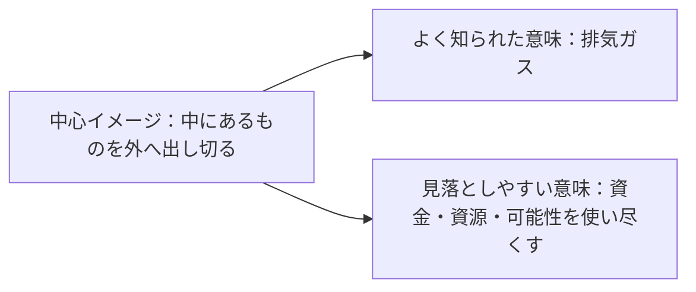

**重要語法**：exhaust all options（あらゆる選択肢を試し尽くす）

<small>index: 3560 / candidate_id: ev-03560-verb-01</small>

---

### 2162. dictate

品詞：verb　｜　発音：/ˈdɪkteɪt/

<small>よく知られている意味：口述する・命令する</small>

**見落としやすい意味：状況・条件などが結果や選択を左右し決定する**

**例文**：Weather conditions will dictate when the flight can leave.

**和訳**：天候が、その便がいつ出発できるかを決める。

**コアイメージ**：言葉で指示や内容を定めるのが基本的な働き。人ではなく条件や状況が主語になると、結果を実質的に決定する意味になる。

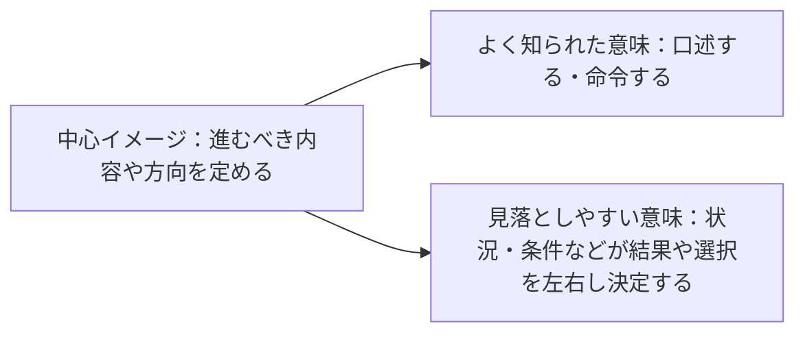

**重要語法**：dictate the outcome（結果を決める）

<small>index: 3561 / candidate_id: ev-03561-verb-01</small>

---

### 2163. boutique

品詞：adjective　｜　発音：/buːˈtiːk/

<small>よく知られている意味：小さな衣料品店</small>

**見落としやすい意味：小規模で専門性が高い**

**例文**：She joined a boutique law firm specializing in environmental cases.

**和訳**：彼女は環境関連の案件を専門とする小規模法律事務所に入った。

**コアイメージ**：小規模な専門店という特徴が、サービス業や企業にも広がる。規模は大きくなくても、特定分野に特化していることを強調する。

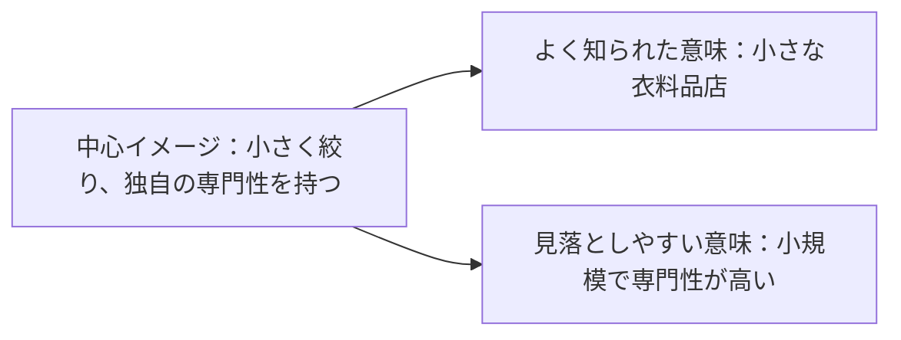

**重要語法**：a boutique firm（専門特化型の小規模企業）

<small>index: 3564 / candidate_id: ev-03564-adjective-01</small>

---

### 2164. tire

品詞：verb　｜　発音：/taɪər/

<small>よく知られている意味：タイヤ</small>

**見落としやすい意味：（tire of ～）～に飽きる、うんざりする**

**例文**：I never tire of listening to my grandfather's stories.

**和訳**：私は祖父の話を聞いても飽きない。

**コアイメージ**：動詞のtireは疲れる・疲れさせるという意味を持つ。tire ofでは、同じことに接して興味が失われ、うんざりする状態を表す。

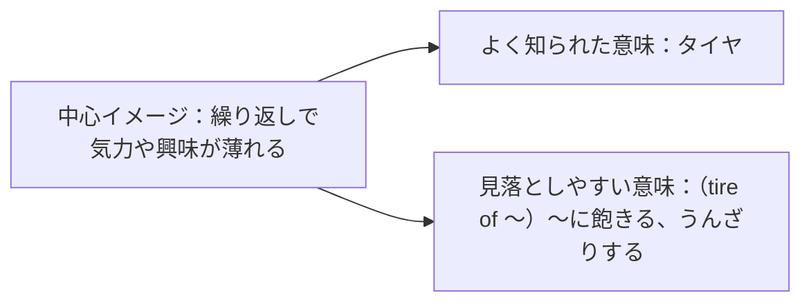

**重要語法**：tire of ～（～に飽きる）

<small>index: 3572 / candidate_id: ev-03572-verb-01</small>

---

### 2165. accommodate

品詞：verb　｜　発音：/əˈkɑːmədeɪt/

<small>よく知られている意味：宿泊させる</small>

**見落としやすい意味：必要や希望に応じて調整し配慮する**

**例文**：The school changed the schedule to accommodate students' needs.

**和訳**：学校は生徒の要望に対応するため日程を変更した。

**コアイメージ**：人を泊めるには、相手が利用できる場所を用意する必要がある。同様に、要望や条件に合わせて仕組みを調整することもaccommodateで表せる。

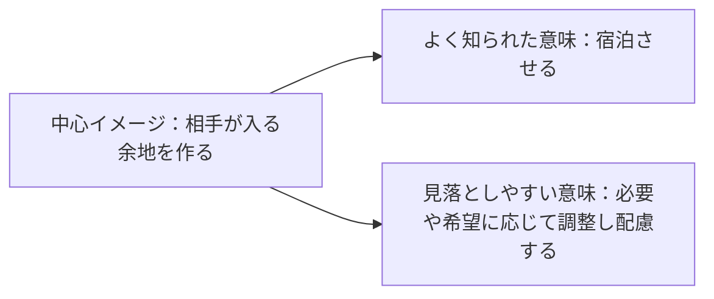

**重要語法**：accommodate a request（要望に対応する）

<small>index: 3573 / candidate_id: ev-03573-verb-01</small>

---

### 2166. compelling

品詞：adjective　｜　発音：/kəmˈpelɪŋ/

<small>よく知られている意味：人を強く引きつける</small>

**見落としやすい意味：証拠・理由などが非常に説得力のある**

**例文**：The scientist presented compelling evidence for her theory.

**和訳**：その科学者は自説を裏づける非常に説得力のある証拠を示した。

**コアイメージ**：興味を引きつけて離さないほどの力を表す。証拠や理由に使うと、相手を納得させる強さがあるという意味になる。

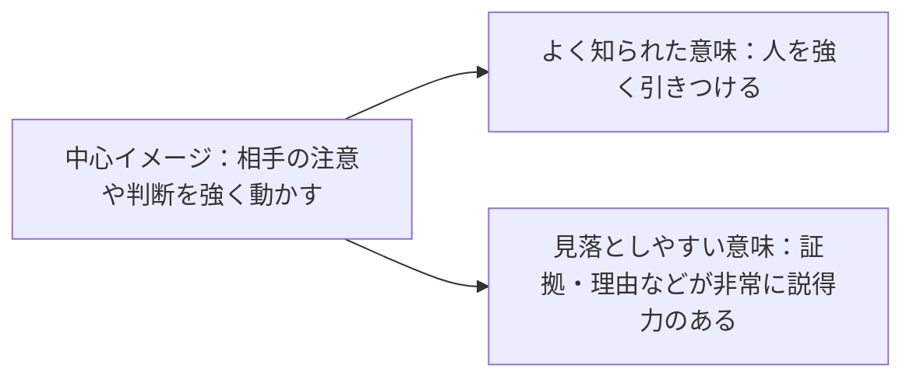

**重要語法**：compelling evidence（有力な証拠）

<small>index: 3575 / candidate_id: ev-03575-adjective-01</small>

---

### 2167. subway

品詞：noun　｜　発音：/ˈsʌbweɪ/

<small>よく知られている意味：地下鉄</small>

**見落としやすい意味：地下歩道・地下通路（英国英語）**

**例文**：Take the pedestrian subway to cross the busy road safely.

**和訳**：交通量の多い道路を安全に渡るには地下歩道を使ってください。

**コアイメージ**：米語では地下を走る鉄道を指すことが多い。英国英語では、歩行者が道路の下をくぐる地下通路を指すこともある。

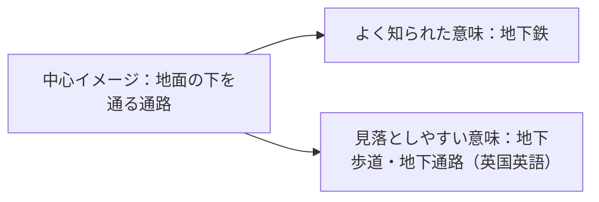

**重要語法**：pedestrian subway（地下歩道、主に英国英語）

<small>index: 3582 / candidate_id: ev-03582-noun-01</small>

---

### 2168. sorry

品詞：adjective　｜　発音：/ˈsɑːri/

<small>よく知られている意味：申し訳なく思う</small>

**見落としやすい意味：ひどい、みじめな、情けない**

**例文**：The old bridge was in a sorry state after years of neglect.

**和訳**：その古い橋は長年放置され、ひどい状態になっていた。

**コアイメージ**：謝罪で使うsorryは、望ましくないことを残念に思う気持ちを示す。物事の状態に使うと、同情したくなるほどひどい・みじめだという評価になる。

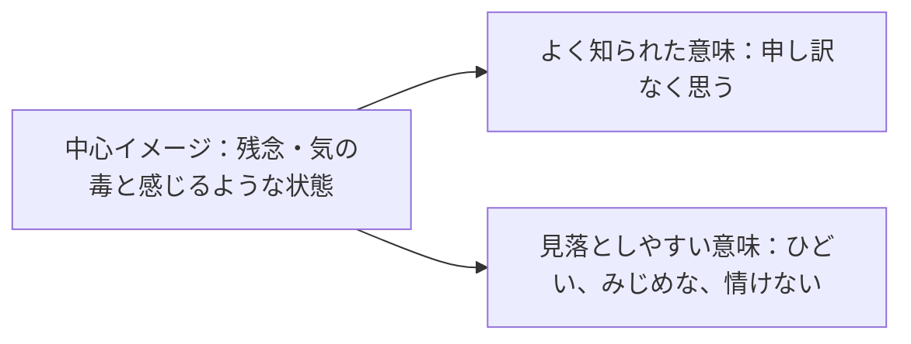

**重要語法**：a sorry state（ひどい状態）

<small>index: 3584 / candidate_id: ev-03584-adjective-01</small>

---

### 2169. marker

品詞：noun　｜　発音：/ˈmɑːrkər/

<small>よく知られている意味：筆記用マーカー</small>

**見落としやすい意味：状態・変化などを判断する指標・目安**

**例文**：A steady pulse can be a useful marker of recovery.

**和訳**：安定した脈拍は回復を判断する有用な指標になることがある。

**コアイメージ**：ペンでつける印は位置や情報を示す。抽象的には、状態や変化が起きたことを示す測定可能な手がかりもmarkerと呼ぶ。

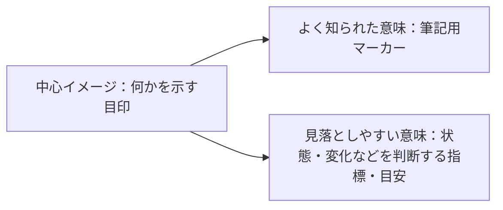

**重要語法**：a marker of progress（進歩の指標）

<small>index: 3587 / candidate_id: ev-03587-noun-01</small>

---

### 2170. workshop

品詞：noun　｜　発音：/ˈwɝːkʃɑːp/

<small>よく知られている意味：作業場</small>

**見落としやすい意味：参加者が実践的に学び合う研修会**

**例文**：We attended a workshop on writing clear research reports.

**和訳**：私たちは分かりやすい研究報告書の書き方を学ぶ実習型研修に参加した。

**コアイメージ**：workshopは物を作る作業場を指す。人が集まって実際に試し、議論しながら技能を身につける研修会にも使う。

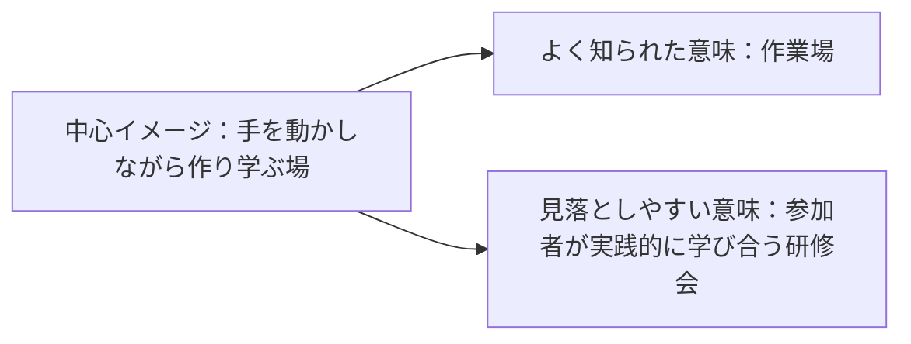

**重要語法**：a writing workshop（文章作成の実習講座）

<small>index: 3588 / candidate_id: ev-03588-noun-01</small>

---

### 2171. dot

品詞：verb　｜　発音：/dɑːt/

<small>よく知られている意味：点・小さな丸印</small>

**見落としやすい意味：（小さな物が地域・景色などに）点在する**

**例文**：Small villages dot the coastline.

**和訳**：海岸沿いには小さな村が点在している。

**コアイメージ**：名詞のdotは小さな点。動詞では、点のように見える物が広い場所のあちこちに存在する様子を表す。

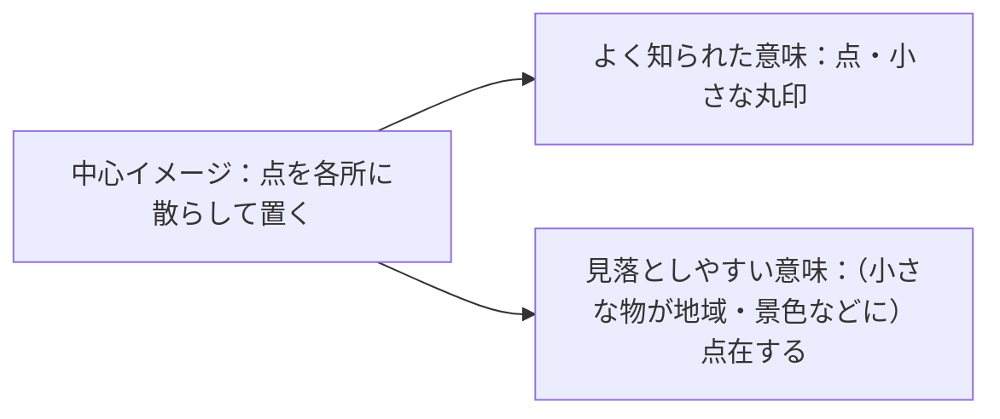

**重要語法**：dot the landscape（景色の中に点在する）

<small>index: 3590 / candidate_id: ev-03590-verb-01</small>

---

### 2172. blast

品詞：noun　｜　発音：/blæst/

<small>よく知られている意味：爆発・突風</small>

**見落としやすい意味：とても楽しい時間・経験（口語）**

**例文**：We had a blast at the school festival.

**和訳**：私たちは文化祭で最高に楽しい時間を過ごした。

**コアイメージ**：blastは爆発のような強い勢いを表す。口語のhave a blastでは、気分が大いに盛り上がる、とても楽しい体験を指す。

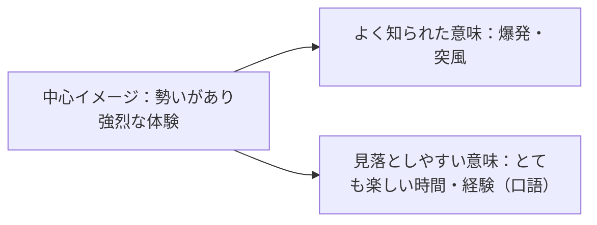

**重要語法**：have a blast（大いに楽しむ、口語）

<small>index: 3591 / candidate_id: ev-03591-noun-01</small>

---

### 2173. blast

品詞：verb　｜　発音：/blæst/

<small>よく知られている意味：爆破する</small>

**見落としやすい意味：人・政策などを激しく非難する**

**例文**：The newspaper blasted the mayor's decision.

**和訳**：その新聞は市長の決定を激しく非難した。

**コアイメージ**：爆風を浴びせるほどの強い作用が出発点。言葉による攻撃に使うと、対象を容赦なく批判することを表す。

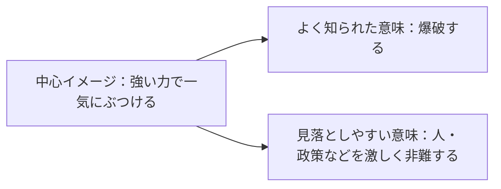

**重要語法**：blast a proposal（提案を痛烈に批判する）

<small>index: 3591 / candidate_id: ev-03591-verb-01</small>

---

### 2174. indulge

品詞：verb　｜　発音：/ɪnˈdʌldʒ/

<small>よく知られている意味：甘やかす・ぜいたくをする</small>

**見落としやすい意味：人の希望にしばらく付き合う、聞き入れる**

**例文**：Please indulge me while I explain one more point.

**和訳**：もう一点説明する間、少しお付き合いください。

**コアイメージ**：indulgeには、欲求を満たすことを認めるという面がある。indulge meでは、話や希望に少し付き合ってほしいという丁寧な依頼になる。

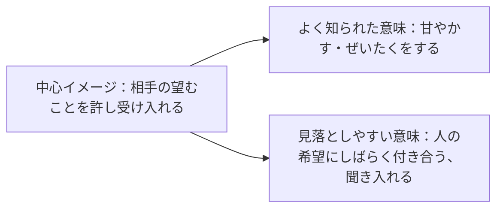

**重要語法**：Indulge me for a moment.（少しお付き合いください）

<small>index: 3595 / candidate_id: ev-03595-verb-01</small>

---

### 2175. arena

品詞：noun　｜　発音：/əˈriːnə/

<small>よく知られている意味：競技場</small>

**見落としやすい意味：競争・議論・活動が行われる領域・舞台**

**例文**：The issue has become central in the political arena.

**和訳**：その問題は政治の世界で中心的な争点になった。

**コアイメージ**：競技場は選手が互いに競う場所。議論や競争が行われる社会的・専門的な分野にも、この舞台のイメージを広げて使う。

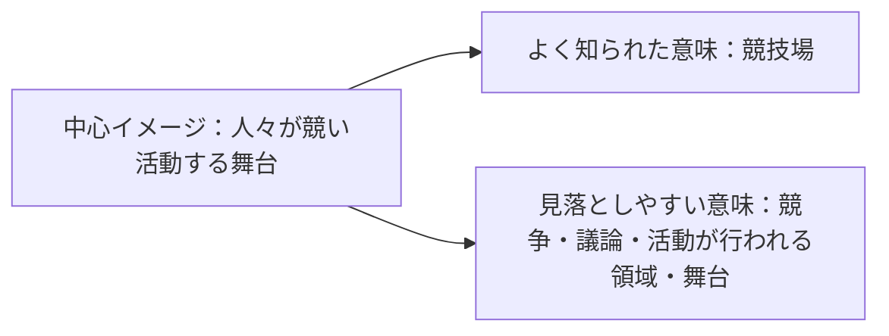

**重要語法**：the political arena（政治の世界）

<small>index: 3596 / candidate_id: ev-03596-noun-01</small>

---

### 2176. bite

品詞：idiom　｜　発音：/baɪt/

<small>よく知られている意味：かみつく</small>

**見落としやすい意味：（bite the bullet）嫌なことを覚悟して実行する**

**例文**：I finally bit the bullet and apologized to her.

**和訳**：私はついに覚悟を決めて彼女に謝った。

**コアイメージ**：biteには歯で強くかむ動作がある。bite the bulletは、避けたい難しいことを覚悟して実行するという慣用表現。

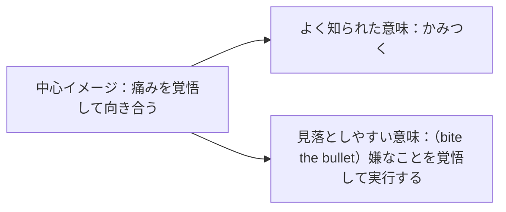

**重要語法**：bite the bullet（覚悟を決めて嫌なことをする）

<small>index: 3606 / candidate_id: ev-03606-idiom-01</small>

---

### 2177. bite

品詞：phrasal verb　｜　発音：/baɪt/

<small>よく知られている意味：かみつく</small>

**見落としやすい意味：（bite into ～）利益・収入などを食い込んで減らす**

**例文**：Higher fuel prices are biting into the company's profits.

**和訳**：燃料価格の上昇が、その会社の利益を圧迫している。

**コアイメージ**：歯が物に食い込むイメージが中心。bite intoは、費用や損失が利益や収入の一部を削り取る意味に広がる。

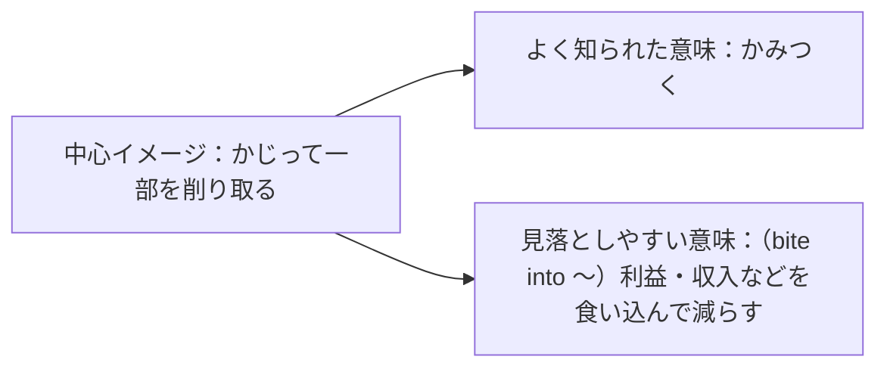

**重要語法**：bite into profits（利益を圧迫する）

<small>index: 3606 / candidate_id: ev-03606-phrasal-verb-01</small>

---

### 2178. pit

品詞：verb　｜　発音：/pɪt/

<small>よく知られている意味：穴・くぼみ</small>

**見落としやすい意味：人・組織を互いに戦わせたり競争させたりする**

**例文**：The final round will pit two experienced teams against each other.

**和訳**：決勝戦では経験豊富な二つのチームが対戦することになる。

**コアイメージ**：pit A against Bは、二者を向かい合わせて争わせる構文。穴という名詞の意味から無理に直訳せず、対戦の場に置く動詞として理解する。

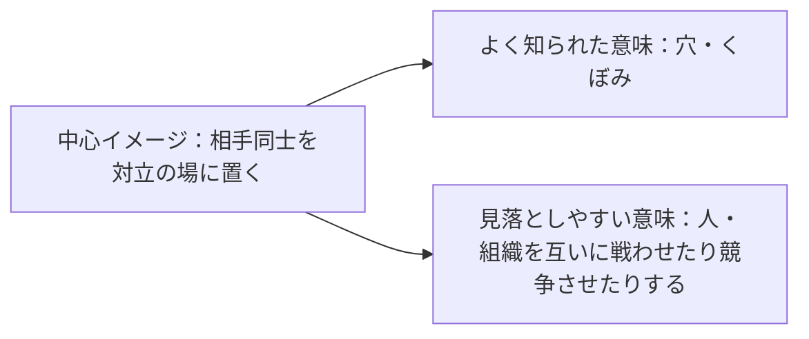

**重要語法**：pit A against B（AをBと競わせる）

<small>index: 3608 / candidate_id: ev-03608-verb-01</small>

---

### 2179. fighting

品詞：adjective　｜　発音：/ˈfaɪtɪŋ/

<small>よく知られている意味：戦っている</small>

**見落としやすい意味：（a fighting chance）わずかでも現実的な成功の見込みがある**

**例文**：Our team still has a fighting chance of reaching the final.

**和訳**：私たちのチームにはまだ決勝に進む見込みがある。

**コアイメージ**：fightingは戦い続ける様子を示す。a fighting chanceは、可能性が大きくなくても成功を争える程度の現実的な望みを表す。

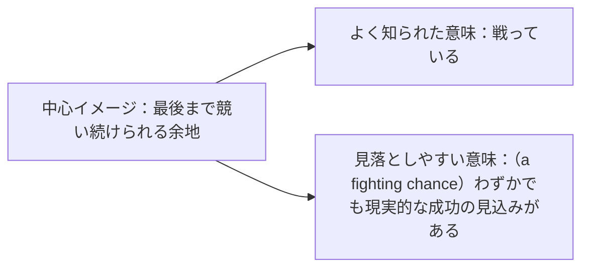

**重要語法**：a fighting chance（十分に挑戦する余地のある見込み）

<small>index: 3614 / candidate_id: ev-03614-adjective-01</small>

---

### 2180. proposition

品詞：noun　｜　発音：/ˌprɑːpəˈzɪʃən/

<small>よく知られている意味：提案・申し出</small>

**見落としやすい意味：真偽を検討する命題・主張**

**例文**：We must test the proposition that exercise improves concentration.

**和訳**：運動が集中力を高めるという命題を検証しなければならない。

**コアイメージ**：提案とは誰かの前に考えを差し出すこと。論理や議論では、真か偽かを確かめられる主張そのものを指す。

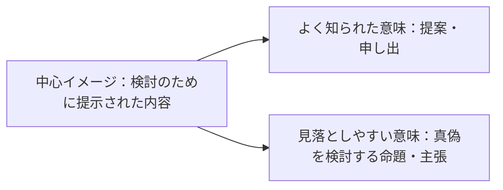

**重要語法**：the proposition that ...（…という命題）

<small>index: 3615 / candidate_id: ev-03615-noun-01</small>

---

### 2181. marginal

品詞：adjective　｜　発音：/ˈmɑːrdʒɪnəl/

<small>よく知られている意味：余白の・周辺の</small>

**見落としやすい意味：ごくわずかな、限定的な**

**例文**：The change led to only a marginal improvement in accuracy.

**和訳**：その変更によって精度はほんのわずかしか改善しなかった。

**コアイメージ**：marginは端や余白。数量・効果については、全体から見ると端にあるほど小さく、重要度が限定的だという意味になる。

```mermaid
flowchart LR
    A["中心イメージ：中心や大部分から離れた端"]
    B["よく知られた意味：余白の・周辺の"]
    C["見落としやすい意味：ごくわずかな、限定的な"]
    A --> B
    A --> C
```

**重要語法**：marginal improvement（わずかな改善）

<small>index: 3619 / candidate_id: ev-03619-adjective-01</small>

---

### 2182. crazy

品詞：idiom　｜　発音：/ˈkreɪzi/

<small>よく知られている意味：正気でない・風変わりな</small>

**見落としやすい意味：（be crazy about ～）～に夢中である、大好きである**

**例文**：My sister is crazy about astronomy.

**和訳**：姉は天文学に夢中だ。

**コアイメージ**：crazyは通常の範囲を外れるほど強い状態を表す。be crazy aboutは、何かを非常に好きで熱中しているという口語的表現。

```mermaid
flowchart LR
    A["中心イメージ：普通の程度を超えて心を奪われる"]
    B["よく知られた意味：正気でない・風変わりな"]
    C["見落としやすい意味：（be crazy about ～）～に夢中である、大好きである"]
    A --> B
    A --> C
```

**重要語法**：be crazy about ～（～に夢中だ）

<small>index: 3622 / candidate_id: ev-03622-idiom-01</small>

---

### 2183. deposit

品詞：noun　｜　発音：/dɪˈpɑːzɪt/

<small>よく知られている意味：預金・保証金</small>

**見落としやすい意味：自然の作用によって堆積した物質・堆積物**

**例文**：The river left thick deposits of sand after the flood.

**和訳**：洪水の後、川は厚い砂の堆積物を残した。

**コアイメージ**：預金はお金を預けて置くこと。地学では水や風が運んだ物質がその場所に残り、積もったものをdepositと呼ぶ。

```mermaid
flowchart LR
    A["中心イメージ：ある場所に置かれ残るもの"]
    B["よく知られた意味：預金・保証金"]
    C["見落としやすい意味：自然の作用によって堆積した物質・堆積物"]
    A --> B
    A --> C
```

**重要語法**：mineral deposits（鉱床・鉱物の堆積物）

<small>index: 3623 / candidate_id: ev-03623-noun-01</small>

---

### 2184. dutch

品詞：idiom　｜　発音：/dʌtʃ/

<small>よく知られている意味：オランダの</small>

**見落としやすい意味：（go Dutch）各自が自分の飲食代などを払う、割り勘にする**

**例文**：We decided to go Dutch at lunch.

**和訳**：私たちは昼食代をそれぞれ自分で払うことにした。

**コアイメージ**：go Dutchは国名そのものの説明ではなく、食事などの支払いを各自で受け持つ決まった表現。単語ごとの直訳を避けて一つの熟語として覚える。

```mermaid
flowchart LR
    A["中心イメージ：費用を各人が個別に負担する"]
    B["よく知られた意味：オランダの"]
    C["見落としやすい意味：（go Dutch）各自が自分の飲食代などを払う、割り勘にする"]
    A --> B
    A --> C
```

**重要語法**：go Dutch（割り勘にする）

<small>index: 3625 / candidate_id: ev-03625-idiom-01</small>

---

### 2185. mess

品詞：phrasal verb　｜　発音：/mes/

<small>よく知られている意味：散らかり・混乱</small>

**見落としやすい意味：（mess with ～）人にちょっかいを出す、物を勝手にいじる**

**例文**：Please don't mess with the camera settings.

**和訳**：カメラの設定を勝手にいじらないでください。

**コアイメージ**：messは物事が乱れた状態。mess withは、人や物事に余計な手を出して干渉したり、いじったりすることを表す。

```mermaid
flowchart LR
    A["中心イメージ：秩序を乱すように手を出す"]
    B["よく知られた意味：散らかり・混乱"]
    C["見落としやすい意味：（mess with ～）人にちょっかいを出す、物を勝手にいじる"]
    A --> B
    A --> C
```

**重要語法**：mess with ～（～を勝手にいじる・～にちょっかいを出す）

<small>index: 3628 / candidate_id: ev-03628-phrasal-verb-01</small>

---

### 2186. pink

品詞：idiom　｜　発音：/pɪŋk/

<small>よく知られている意味：ピンク色</small>

**見落としやすい意味：（pink slip）解雇通知（主に米語）**

**例文**：He received a pink slip when the factory closed.

**和訳**：工場が閉鎖されたとき、彼は解雇通知を受け取った。

**コアイメージ**：pink slipは米語で解雇通知を指す慣用的な名詞句。色の意味だけを組み合わせて訳さず、表現全体で覚える。

```mermaid
flowchart LR
    A["中心イメージ：決まった名称が別の意味を担う"]
    B["よく知られた意味：ピンク色"]
    C["見落としやすい意味：（pink slip）解雇通知（主に米語）"]
    A --> B
    A --> C
```

**重要語法**：get a pink slip（解雇通知を受け取る、主に米語）

<small>index: 3631 / candidate_id: ev-03631-idiom-01</small>

---

### 2187. cup

品詞：verb　｜　発音：/kʌp/

<small>よく知られている意味：カップ・茶わん</small>

**見落としやすい意味：両手などをカップ状に丸めて包む**

**例文**：She cupped her hands to catch the rainwater.

**和訳**：彼女は雨水を受けるため両手を丸くした。

**コアイメージ**：名詞のcupは液体を受ける容器。動詞では手を器のように丸め、何かを受けたり包んだりする動作を表す。

```mermaid
flowchart LR
    A["中心イメージ：器のような丸みを作る"]
    B["よく知られた意味：カップ・茶わん"]
    C["見落としやすい意味：両手などをカップ状に丸めて包む"]
    A --> B
    A --> C
```

**重要語法**：cup one's hands（両手を丸くする）

<small>index: 3634 / candidate_id: ev-03634-verb-01</small>

---

### 2188. clause

品詞：noun　｜　発音：/klɔːz/

<small>よく知られている意味：文法上の節</small>

**見落としやすい意味：契約書・法律などの条項**

**例文**：The contract contains a clause about late payments.

**和訳**：その契約書には支払い遅延についての条項がある。

**コアイメージ**：文法の節は文の一部分としてまとまった構造を持つ。法律や契約でも、一つの条件・規定を記したまとまりをclauseと呼ぶ。

```mermaid
flowchart LR
    A["中心イメージ：大きな文書を構成する一つのまとまり"]
    B["よく知られた意味：文法上の節"]
    C["見落としやすい意味：契約書・法律などの条項"]
    A --> B
    A --> C
```

**重要語法**：a contract clause（契約条項）

<small>index: 3641 / candidate_id: ev-03641-noun-01</small>

---

### 2189. stack

品詞：idiom　｜　発音：/stæk/

<small>よく知られている意味：積み重ねる</small>

**見落としやすい意味：（stack the deck）結果が特定の側に有利になるよう仕組む**

**例文**：The rules were changed to stack the deck against smaller teams.

**和訳**：小規模なチームが不利になるよう、規則が変更された。

**コアイメージ**：deckはトランプの一組で、札の順を仕込めば勝敗に影響する。stack the deckは結果が一方に有利になるよう不公平な条件を整えることを表す。

```mermaid
flowchart LR
    A["中心イメージ：札の並べ方を操作して結果を偏らせる"]
    B["よく知られた意味：積み重ねる"]
    C["見落としやすい意味：（stack the deck）結果が特定の側に有利になるよう仕組む"]
    A --> B
    A --> C
```

**重要語法**：stack the deck against ～（～に不利な仕組みにする）

<small>index: 3643 / candidate_id: ev-03643-idiom-01</small>

---

### 2190. depression

品詞：noun　｜　発音：/dɪˈpreʃən/

<small>よく知られている意味：気分の落ち込み</small>

**見落としやすい意味：経済の不況・長期的な景気低迷**

**例文**：The country fell into a deep economic depression.

**和訳**：その国は深刻な経済不況に陥った。

**コアイメージ**：depressionは状態が押し下げられるイメージを持つ。気分だけでなく、経済活動が長期にわたり大幅に低迷することにも用いる。

```mermaid
flowchart LR
    A["中心イメージ：通常の水準より大きく落ち込む"]
    B["よく知られた意味：気分の落ち込み"]
    C["見落としやすい意味：経済の不況・長期的な景気低迷"]
    A --> B
    A --> C
```

**重要語法**：economic depression（深刻な不況）

<small>index: 3651 / candidate_id: ev-03651-noun-01</small>

---

### 2191. liability

品詞：noun　｜　発音：/ˌlaɪəˈbɪləti/

<small>よく知られている意味：負債</small>

**見落としやすい意味：法的な責任・賠償義務**

**例文**：The company may face legal liability for the damage.

**和訳**：その会社は損害について法的責任を負う可能性がある。

**コアイメージ**：負債は返済の義務を伴うもの。法的な文脈では、損害や違反について責任を負うことをliabilityと呼ぶ。

```mermaid
flowchart LR
    A["中心イメージ：負わなければならないもの"]
    B["よく知られた意味：負債"]
    C["見落としやすい意味：法的な責任・賠償義務"]
    A --> B
    A --> C
```

**重要語法**：legal liability（法的責任）

<small>index: 3653 / candidate_id: ev-03653-noun-01</small>

---

### 2192. liability

品詞：noun　｜　発音：/ˌlaɪəˈbɪləti/

<small>よく知られている意味：負債・法的責任</small>

**見落としやすい意味：成功の妨げになる人・物、足手まとい**

**例文**：His constant delays became a liability to the team.

**和訳**：彼がいつも遅刻することはチームの足手まといになった。

**コアイメージ**：liabilityは負担となる義務や負債を指す。比喩的には、成果を妨げたり周囲に迷惑をかけたりする人や物事を意味する。

```mermaid
flowchart LR
    A["中心イメージ：抱えることで不利益が生じるもの"]
    B["よく知られた意味：負債・法的責任"]
    C["見落としやすい意味：成功の妨げになる人・物、足手まとい"]
    A --> B
    A --> C
```

**重要語法**：be a liability to ～（～にとって足手まといだ）

<small>index: 3653 / candidate_id: ev-03653-noun-02</small>

---

### 2193. riot

品詞：noun　｜　発音：/ˈraɪət/

<small>よく知られている意味：暴動</small>

**見落としやすい意味：とてもおかしい人・出来事（口語）**

**例文**：Her stories are a riot; everyone ends up laughing.

**和訳**：彼女の話はとても面白く、最後にはみんな笑ってしまう。

**コアイメージ**：riotは騒ぎが激しく広がること。口語では、周囲が笑いで大騒ぎするほど面白い人や経験を指すことがある。

```mermaid
flowchart LR
    A["中心イメージ：にぎやかで抑えきれない盛り上がり"]
    B["よく知られた意味：暴動"]
    C["見落としやすい意味：とてもおかしい人・出来事（口語）"]
    A --> B
    A --> C
```

**重要語法**：be a riot（とても面白い、口語）

<small>index: 3655 / candidate_id: ev-03655-noun-01</small>

---

### 2194. virtual

品詞：adjective　｜　発音：/ˈvɝːtʃuəl/

<small>よく知られている意味：仮想の・オンラインの</small>

**見落としやすい意味：事実上の、実質的な**

**例文**：With no objections, the plan was a virtual certainty.

**和訳**：反対がなかったので、その計画の実現は事実上確実だった。

**コアイメージ**：virtualは見かけや形式と実態の関係に注目する語。virtual certaintyでは完全な断言ではないものの、実際にはほぼ確実だという意味になる。

```mermaid
flowchart LR
    A["中心イメージ：形式上の違いがあっても実質はそうである"]
    B["よく知られた意味：仮想の・オンラインの"]
    C["見落としやすい意味：事実上の、実質的な"]
    A --> B
    A --> C
```

**重要語法**：a virtual certainty（事実上確実なこと）

<small>index: 3657 / candidate_id: ev-03657-adjective-01</small>

---

### 2195. afraid

品詞：phrase　｜　発音：/əˈfreɪd/

<small>よく知られている意味：恐れている</small>

**見落としやすい意味：（I'm afraid ...）残念ながら・申し訳ないが、と断りを入れる**

**例文**：I'm afraid the last train has already left.

**和訳**：残念ですが、終電はもう出てしまいました。

**コアイメージ**：afraidは不安や恐れを表す。I'm afraid ...は、相手に残念な知らせや断りを伝える前のやわらげた言い方として使われる。

```mermaid
flowchart LR
    A["中心イメージ：言いにくい内容への気遣いを示す"]
    B["よく知られた意味：恐れている"]
    C["見落としやすい意味：（I'm afraid ...）残念ながら・申し訳ないが、と断りを入れる"]
    A --> B
    A --> C
```

**重要語法**：I'm afraid (that) ...（残念ですが…）

<small>index: 3659 / candidate_id: ev-03659-phrase-01</small>

---

### 2196. brave

品詞：verb　｜　発音：/breɪv/

<small>よく知られている意味：勇敢な</small>

**見落としやすい意味：困難や危険に勇敢に立ち向かい、耐える**

**例文**：The hikers braved the cold wind to reach the shelter.

**和訳**：登山者たちは冷たい風に耐えながら避難小屋へ向かった。

**コアイメージ**：形容詞のbraveは困難を恐れない様子。動詞では、危険や不快な状況を勇気を出して引き受け、乗り越えようとすることを表す。

```mermaid
flowchart LR
    A["中心イメージ：恐れがあっても前に進む"]
    B["よく知られた意味：勇敢な"]
    C["見落としやすい意味：困難や危険に勇敢に立ち向かい、耐える"]
    A --> B
    A --> C
```

**重要語法**：brave the elements（悪天候に立ち向かう）

<small>index: 3663 / candidate_id: ev-03663-verb-01</small>

---

### 2197. leading

品詞：phrase　｜　発音：/ˈliːdɪŋ/

<small>よく知られている意味：先頭に立つ・主要な</small>

**見落としやすい意味：（leading question）答えを誘導する質問**

**例文**：The lawyer asked a leading question that suggested the answer.

**和訳**：その弁護士は答えを誘導する質問をした。

**コアイメージ**：leadは進む方向を示して導くこと。leading questionは質問のしかたで望む答えへ相手を導く質問を指す。

```mermaid
flowchart LR
    A["中心イメージ：相手を特定の方向へ導く"]
    B["よく知られた意味：先頭に立つ・主要な"]
    C["見落としやすい意味：（leading question）答えを誘導する質問"]
    A --> B
    A --> C
```

**重要語法**：leading question（誘導尋問・誘導質問）

<small>index: 3666 / candidate_id: ev-03666-phrase-01</small>

---

### 2198. absent

品詞：preposition　｜　発音：/ˈæbsənt/

<small>よく知られている意味：欠席の・不在の</small>

**見落としやすい意味：（改まった米語で）～がなければ、～なしでは**

**例文**：Absent clear evidence, we should avoid drawing conclusions.

**和訳**：明確な証拠がなければ、結論を出すのは避けるべきだ。

**コアイメージ**：形容詞のabsentは存在しない状態を表す。前置詞として文頭に置くと「～がない場合には」という条件を示す。

```mermaid
flowchart LR
    A["中心イメージ：あるべきものがそこにない"]
    B["よく知られた意味：欠席の・不在の"]
    C["見落としやすい意味：（改まった米語で）～がなければ、～なしでは"]
    A --> B
    A --> C
```

**重要語法**：Absent ～, ...（～がなければ…、改まった米語）

<small>index: 3667 / candidate_id: ev-03667-preposition-02</small>

---

### 2199. absent

品詞：verb　｜　発音：/æbˈsent/

<small>よく知られている意味：欠席の・不在の</small>

**見落としやすい意味：（absent oneself from ～）自ら～を欠席する**

**例文**：He absented himself from the meeting without explanation.

**和訳**：彼は理由を説明せずにその会議を欠席した。

**コアイメージ**：形容詞では人がいない状態を表す。動詞のabsent oneself fromでは、自分自身をその場所や活動から遠ざけるという構文になる。

```mermaid
flowchart LR
    A["中心イメージ：自分をその場から不在にする"]
    B["よく知られた意味：欠席の・不在の"]
    C["見落としやすい意味：（absent oneself from ～）自ら～を欠席する"]
    A --> B
    A --> C
```

**重要語法**：absent oneself from ～（～を欠席する、改まった表現）

<small>index: 3667 / candidate_id: ev-03667-verb-01</small>

---

### 2200. dawn

品詞：phrasal verb　｜　発音：/dɔːn/

<small>よく知られている意味：夜明け</small>

**見落としやすい意味：（dawn on ～）物事が初めて分かる、ふと気づく**

**例文**：It finally dawned on me why she had been silent.

**和訳**：彼女が黙っていた理由に私はようやく気づいた。

**コアイメージ**：夜明けには暗さが去り、周囲が見えるようになる。dawn on 人では、今まで分からなかったことがその人に理解され始める。

```mermaid
flowchart LR
    A["中心イメージ：暗かったものが明るく見えるようになる"]
    B["よく知られた意味：夜明け"]
    C["見落としやすい意味：（dawn on ～）物事が初めて分かる、ふと気づく"]
    A --> B
    A --> C
```

**重要語法**：It dawned on me that ...（…ということに気づいた）

<small>index: 3669 / candidate_id: ev-03669-phrasal-verb-01</small>

