# EasyVoca 完成教材 — バッチ029

採用済み候補の全体順位2241〜2320（80件）。語義の順序は`index`、同一index内は`candidate_id`昇順。

## 2241. tide

**品詞：** idiom　**発音：** /taɪd/

<sub>よく知られている意味：潮の満ち引き</sub>

**見落としやすい意味：（turn the tide）状況・形勢を逆転させる**

**例文：** A late goal turned the tide of the match.

**和訳：** 終盤の得点が試合の流れを逆転させた。

**コアイメージ：** 潮の流れは向きや勢いを変える。そこから、出来事の優劣や形勢の流れが変わることを表す。

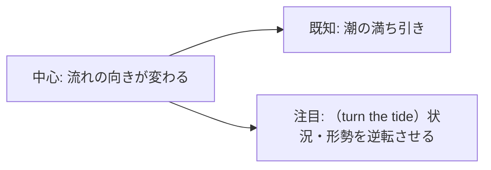

**重要語法：** turn the tide (of ～)：（～の）形勢を逆転させる

<sub>元データ：index 3771 / ev-03771-idiom-01</sub>

## 2242. straw

**品詞：** idiom　**発音：** /strɔː/

<sub>よく知られている意味：わら、ストロー</sub>

**見落としやすい意味：（the last straw）我慢の限界を超えさせる最後の一因**

**例文：** The third delay was the last straw for the customers.

**和訳：** 三度目の遅延で、客たちはとうとう我慢の限界に達した。

**コアイメージ：** わら一本は軽くても、負担が積み重なれば限界を超える。最後に加わるわずかな負担が決定打になる、という比喩。

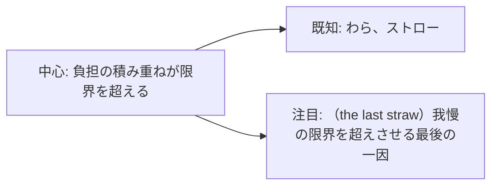

**重要語法：** the last straw：我慢の限界を超えさせる出来事

<sub>元データ：index 3773 / ev-03773-idiom-01</sub>

## 2243. means

**品詞：** noun　**発音：** /miːnz/

<sub>よく知られている意味：手段、方法</sub>

**見落としやすい意味：財力・資力・生活費に使える財産**

**例文：** She lacks the means to pay for private lessons.

**和訳：** 彼女には個人授業の費用を払うだけの資力がない。

**コアイメージ：** 目的を実現するために使えるものが means。方法だけでなく、実現のために使える金銭や財産も指す。

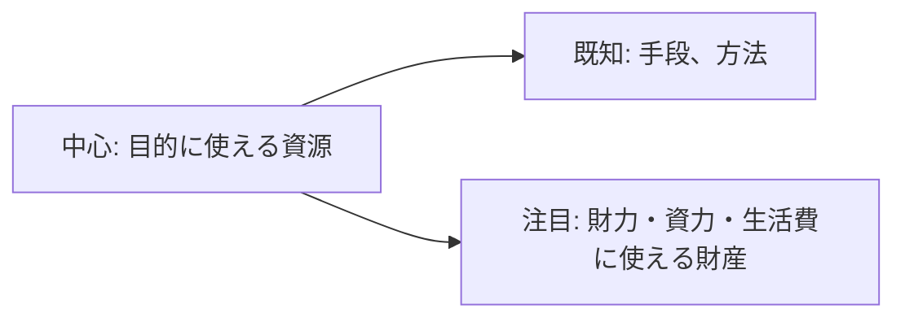

**重要語法：** the means to do：～するだけの資力・手段

<sub>元データ：index 3774 / ev-03774-noun-01</sub>

## 2244. swing

**品詞：** adjective　**発音：** /swɪŋ/

<sub>よく知られている意味：揺れる、振れる</sub>

**見落としやすい意味：（swing voter）支持する候補や政党が固定していない**

**例文：** The result may depend on swing voters.

**和訳：** 結果は支持先を決めていない有権者に左右されるかもしれない。

**コアイメージ：** swing は一方から他方へ揺れ動くこと。政治では、どちらを支持するか固定していない状態を表す。

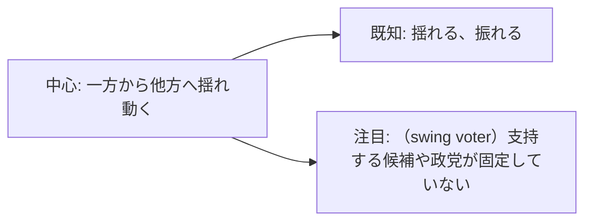

**重要語法：** swing voter：支持先が固定していない有権者

<sub>元データ：index 3775 / ev-03775-adjective-01</sub>

## 2245. mate

**品詞：** noun　**発音：** /meɪt/

<sub>よく知られている意味：つがいの相手、仲間</sub>

**見落としやすい意味：友人・仲間（特に英国・豪州英語の口語）**

**例文：** I'm meeting a mate from school this weekend.

**和訳：** 今週末、学校時代の友人と会うんだ。

**コアイメージ：** mate は同じ側にいる相手や対になる相手。親しい仲間を指し、特に英国やオーストラリアの口語では「友達」に使う。

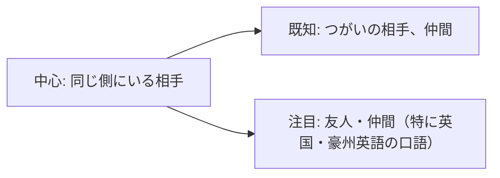

**重要語法：** a mate of mine：私の友人の一人

<sub>元データ：index 3777 / ev-03777-noun-01</sub>

## 2246. economically

**品詞：** adverb　**発音：** /ˌiːkəˈnɒmɪkli/

<sub>よく知られている意味：経済の面で</sub>

**見落としやすい意味：無駄な費用や資源を使わずに、節約して**

**例文：** They traveled economically by sharing a room.

**和訳：** 彼らは部屋を相部屋にして、費用を抑えて旅行した。

**コアイメージ：** economy には社会の経済だけでなく、資源の節約という発想がある。economically は費用や資源を無駄にしないやり方にも使える。

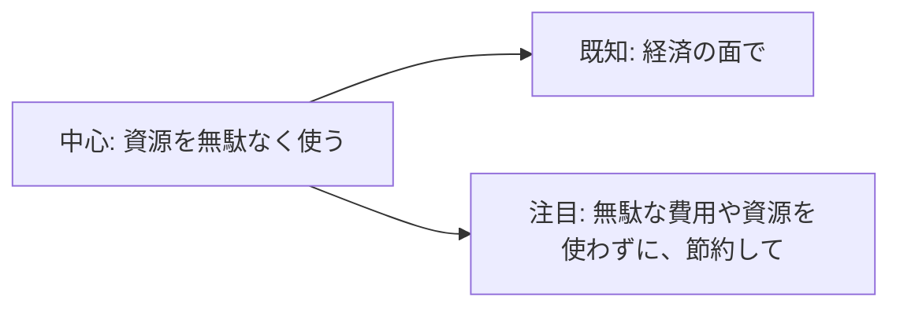

**重要語法：** travel economically：節約して旅行する

<sub>元データ：index 3780 / ev-03780-adverb-01</sub>

## 2247. loom

**品詞：** verb　**発音：** /luːm/

<sub>よく知られている意味：織機、織る</sub>

**見落としやすい意味：好ましくない出来事が不気味に迫る、起こりそうになる**

**例文：** A serious water shortage looms next summer.

**和訳：** 来年の夏には深刻な水不足が迫っている。

**コアイメージ：** 遠くに大きなものが現れ、次第に存在感を強める感覚。悪い出来事が間近に感じられるときに使う。

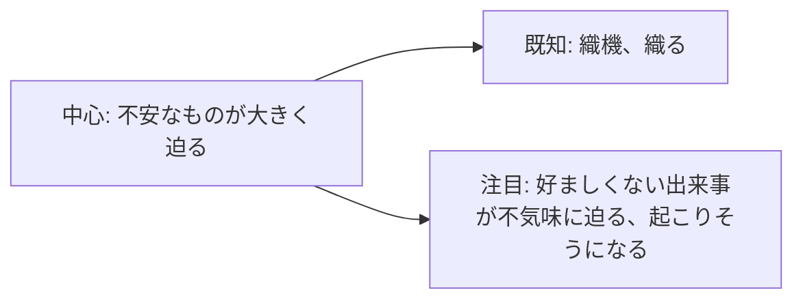

**重要語法：** loom large：大きな懸念として迫る

<sub>元データ：index 3781 / ev-03781-verb-01</sub>

## 2248. fool

**品詞：** verb　**発音：** /fuːl/

<sub>よく知られている意味：愚か者</sub>

**見落としやすい意味：人をだます、誤信させる**

**例文：** The fake website fooled many visitors.

**和訳：** その偽サイトは多くの訪問者をだました。

**コアイメージ：** fool は判断を誤る愚かな状態と関係する。動詞では、相手に誤ったことを信じさせる行為を表す。

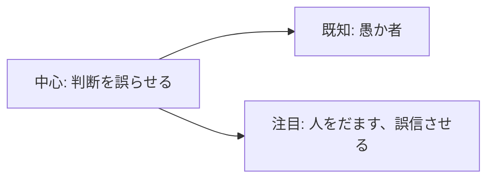

**重要語法：** fool A into doing：Aをだまして～させる

<sub>元データ：index 3783 / ev-03783-verb-01</sub>

## 2249. interim

**品詞：** noun　**発音：** /ˈɪntərɪm/

<sub>よく知られている意味：暫定の、一時的な</sub>

**見落としやすい意味：（in the interim）それまでの間、当面**

**例文：** The new library opens in June; in the interim, use the old one.

**和訳：** 新しい図書館は6月に開館する。それまでは旧館を使ってください。

**コアイメージ：** interim は本来の状態へ移るまでの途中の期間を示す。in the interim はその期間中、つまり「それまでの間」を表す。

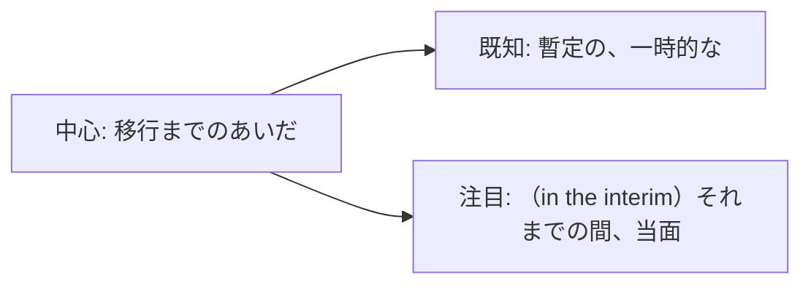

**重要語法：** in the interim：それまでの間

<sub>元データ：index 3785 / ev-03785-noun-01</sub>

## 2250. organic

**品詞：** adjective　**発音：** /ɔːˈɡænɪk/

<sub>よく知られている意味：有機の、有機栽培の</sub>

**見落としやすい意味：変化・成長などが外部から強制されず自然に生じる**

**例文：** The club grew organically as friends invited friends.

**和訳：** 友人が友人を誘う形で、そのクラブは自然に大きくなった。

**コアイメージ：** organic は生き物の成長のように内部から発展するイメージ。組織や変化が人為的な強制なしに育つ場合にも使う。

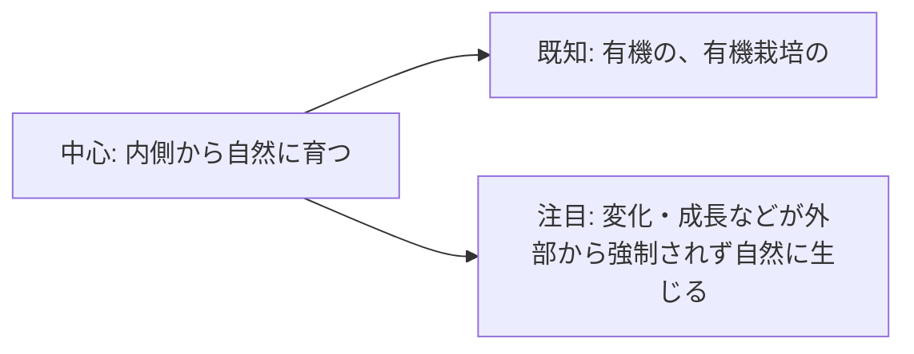

**重要語法：** organic growth：自然発生的な成長

<sub>元データ：index 3786 / ev-03786-adjective-01</sub>

## 2251. pen

**品詞：** verb　**発音：** /pen/

<sub>よく知られている意味：ペン、筆記具</sub>

**見落としやすい意味：柵や囲いに閉じ込める、囲い込む**

**例文：** The farmer penned the sheep before dark.

**和訳：** 農家の人は暗くなる前に羊を囲いへ入れた。

**コアイメージ：** pen には家畜を入れる囲いという名詞もある。動詞では、その囲いの中に入れて外へ出られないようにする。

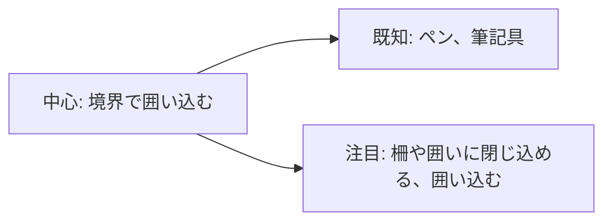

**重要語法：** pen A in：Aを囲いに閉じ込める

<sub>元データ：index 3789 / ev-03789-verb-01</sub>

## 2252. lion

**品詞：** idiom　**発音：** /ˈlaɪən/

<sub>よく知られている意味：ライオン</sub>

**見落としやすい意味：（the lion's share）全体の大部分**

**例文：** Online orders make up the lion's share of our sales.

**和訳：** 売上の大部分をオンライン注文が占めている。

**コアイメージ：** ライオンは強さや優位さを象徴する動物として扱われる。the lion's share は取り分の中でも特に大きな部分を指す慣用句。

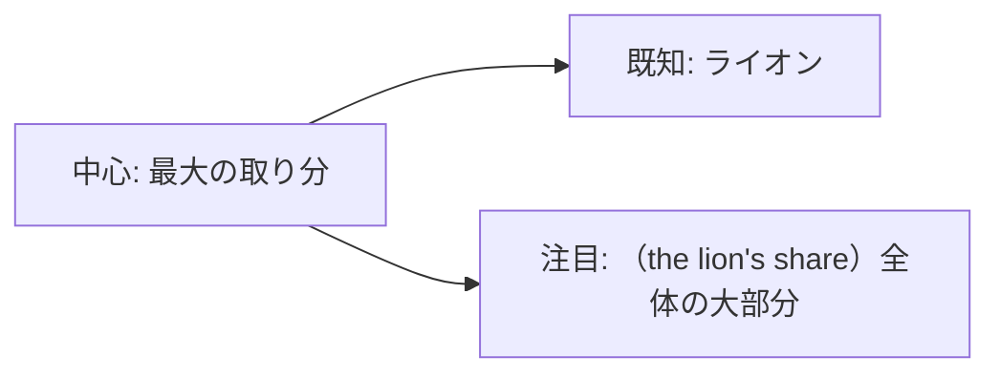

**重要語法：** the lion's share of ～：～の大部分

<sub>元データ：index 3791 / ev-03791-idiom-01</sub>

## 2253. banana

**品詞：** idiom　**発音：** /bəˈnɑːnə/

<sub>よく知られている意味：バナナ</sub>

**見落としやすい意味：（go bananas）興奮して大騒ぎする、取り乱す（口語）**

**例文：** The fans went bananas when the singer appeared.

**和訳：** 歌手が姿を見せると、ファンは大興奮した。

**コアイメージ：** go bananas は普通の落ち着いた状態から外れる、くだけた慣用表現。喜びでも怒りでも、激しく興奮する場面に使える。

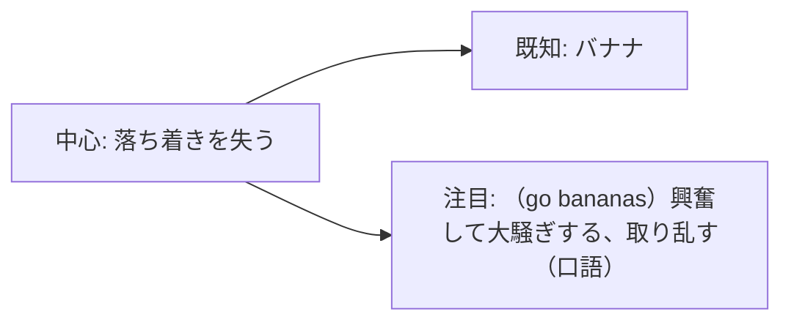

**重要語法：** go bananas over ～：～に夢中になって大騒ぎする

<sub>元データ：index 3792 / ev-03792-idiom-01</sub>

## 2254. pale

**品詞：** idiom　**発音：** /peɪl/

<sub>よく知られている意味：青白い、薄い</sub>

**見落としやすい意味：（beyond the pale）社会的に許される限度を超えて**

**例文：** That cruel joke was beyond the pale.

**和訳：** その残酷な冗談は許される一線を越えていた。

**コアイメージ：** pale はこの慣用句では「境界・囲い」を表す古い語義に由来する。境界の外に出ることから、許容範囲を超えるという意味になる。

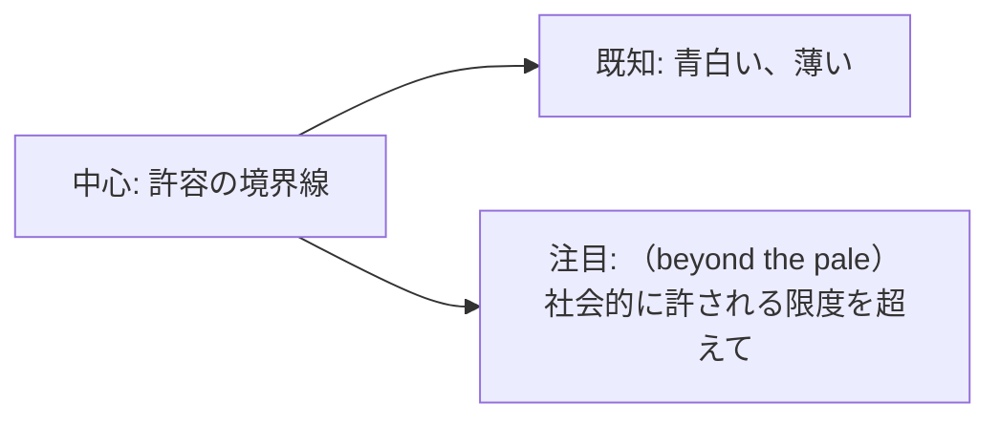

**重要語法：** beyond the pale：社会的に許されない

<sub>元データ：index 3798 / ev-03798-idiom-01</sub>

## 2255. servant

**品詞：** phrase　**発音：** /ˈsɜːvənt/

<sub>よく知られている意味：使用人</sub>

**見落としやすい意味：（civil servant）公務員**

**例文：** Her father is a civil servant.

**和訳：** 彼女の父親は公務員だ。

**コアイメージ：** servant は誰かのために働き、奉仕する人。civil が付くと個人の主人ではなく公共のために働く人を指す。

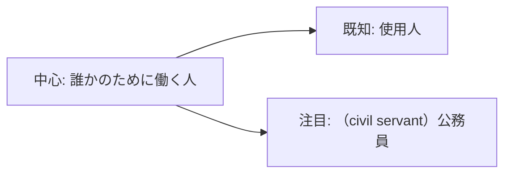

**重要語法：** civil servant：公務員

<sub>元データ：index 3804 / ev-03804-phrase-01</sub>

## 2256. neat

**品詞：** adjective　**発音：** /niːt/

<sub>よく知られている意味：整った、きちんとした</sub>

**見落としやすい意味：（工夫・解決法が）巧みでうまい、気の利いた**

**例文：** She found a neat solution to the scheduling problem.

**和訳：** 彼女は日程調整の問題にうまい解決策を見つけた。

**コアイメージ：** neat は余計な乱れや無駄がない状態を表す。方法や発想では、簡潔で気の利いた巧みさを評価する。

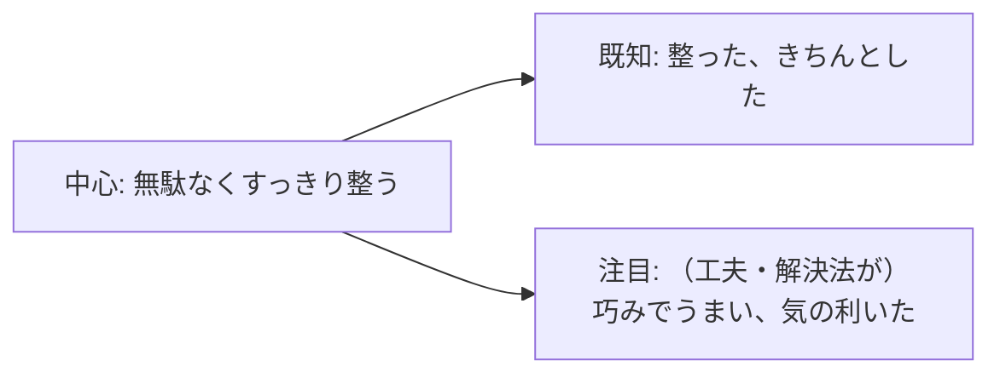

**重要語法：** a neat trick：巧みな工夫

<sub>元データ：index 3806 / ev-03806-adjective-01</sub>

## 2257. oath

**品詞：** idiom　**発音：** /əʊθ/

<sub>よく知られている意味：誓い、宣誓</sub>

**見落としやすい意味：（under oath）宣誓の上で、法的に真実を述べる義務を負って**

**例文：** The witness gave her statement under oath.

**和訳：** 証人は宣誓の上で証言した。

**コアイメージ：** oath は言葉の真実性を正式に誓うこと。under oath はその誓いに拘束された状態で述べることを示す。

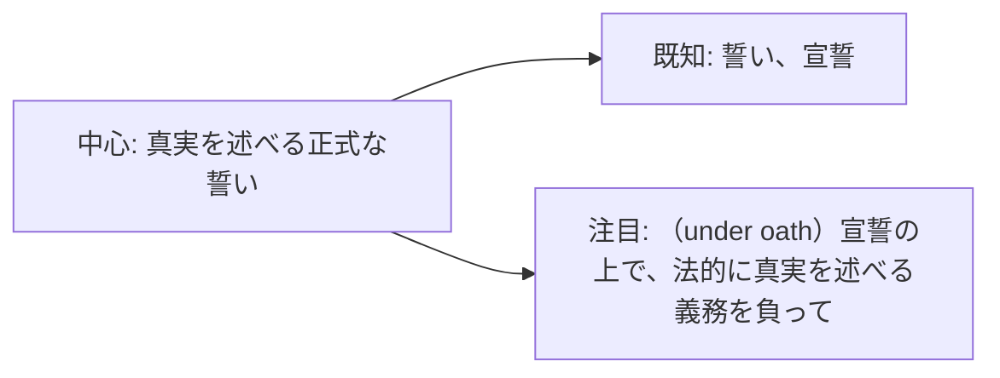

**重要語法：** testify under oath：宣誓して証言する

<sub>元データ：index 3807 / ev-03807-idiom-01</sub>

## 2258. query

**品詞：** verb　**発音：** /ˈkwɪəri/

<sub>よく知られている意味：質問、問い合わせ</sub>

**見落としやすい意味：主張・数値などの正しさに疑問を呈する**

**例文：** Several experts queried the accuracy of the figures.

**和訳：** 複数の専門家がその数字の正確性に疑問を呈した。

**コアイメージ：** query は答えを求めて問いを向けること。単なる質問にとどまらず、主張が正しいのか異議を示す動詞にもなる。

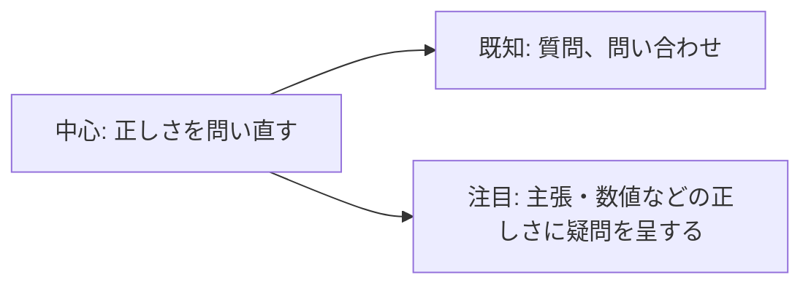

**重要語法：** query a claim：主張に疑問を呈する

<sub>元データ：index 3810 / ev-03810-verb-01</sub>

## 2259. circular

**品詞：** noun　**発音：** /ˈsɜːkjələr/

<sub>よく知られている意味：円形の、循環する</sub>

**見落としやすい意味：複数の人に配布する通知文・回覧文書**

**例文：** The office sent a circular to every employee.

**和訳：** 事務局は全職員に回覧通知を送った。

**コアイメージ：** circular は円を描くように広く巡ること。名詞では、複数の人の間に配って知らせる文書を表す。

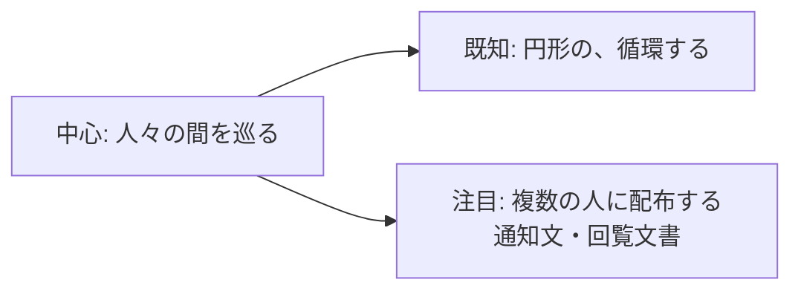

**重要語法：** issue a circular：回覧通知を出す

<sub>元データ：index 3812 / ev-03812-noun-01</sub>

## 2260. dump

**品詞：** verb　**発音：** /dʌmp/

<sub>よく知られている意味：投げ捨てる、ごみを捨てる</sub>

**見落としやすい意味：輸出先の市場で商品を不当に安く売る、ダンピングする**

**例文：** The firm was accused of dumping steel at unfairly low prices.

**和訳：** その企業は鋼材を不当に安く売るダンピングをしたとして非難された。

**コアイメージ：** dump は物をまとめて投げ出すように手放す感覚。貿易では輸出市場に商品を不当に低い価格で売る行為を指す。

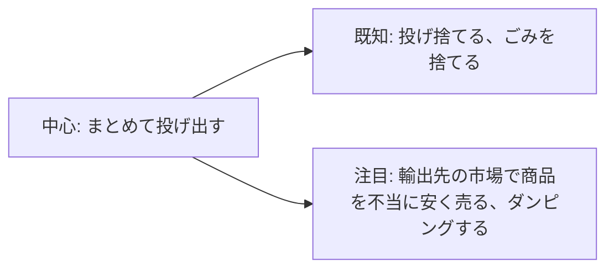

**重要語法：** dump goods on a market：市場に商品を安値で大量に売る

<sub>元データ：index 3813 / ev-03813-verb-01</sub>

## 2261. landmark

**品詞：** adjective　**発音：** /ˈlændmɑːrk/

<sub>よく知られている意味：目印となる建物、史跡</sub>

**見落としやすい意味：歴史的・画期的に重要な**

**例文：** The court issued a landmark ruling on privacy.

**和訳：** 裁判所はプライバシーに関する画期的な判決を下した。

**コアイメージ：** landmark は道筋を示す際立った目印。歴史や制度の進路を変えるほど重要な出来事にも使う。

```mermaid
flowchart LR
    A["中心: 進路を示す大きな目印"]
    B["既知: 目印となる建物、史跡"]
    C["注目: 歴史的・画期的に重要な"]
    A --> B
    A --> C
```

**重要語法：** a landmark decision / ruling：画期的な決定・判決

<sub>元データ：index 3816 / ev-03816-adjective-01</sub>

## 2262. soar

**品詞：** verb　**発音：** /sɔːr/

<sub>よく知られている意味：空高く舞い上がる</sub>

**見落としやすい意味：価格・費用・数値などが急激に増える**

**例文：** Housing costs soared after the new station opened.

**和訳：** 新しい駅の開業後、住宅費が急上昇した。

**コアイメージ：** 鳥や物体が上へ勢いよく昇る動きが中心。価格や数値が短期間で大きく上がる様子にも当てはまる。

```mermaid
flowchart LR
    A["中心: 勢いよく上昇する"]
    B["既知: 空高く舞い上がる"]
    C["注目: 価格・費用・数値などが急激に増える"]
    A --> B
    A --> C
```

**重要語法：** prices soar：物価が急騰する

<sub>元データ：index 3822 / ev-03822-verb-01</sub>

## 2263. soil

**品詞：** verb　**発音：** /sɔɪl/

<sub>よく知られている意味：土、土壌</sub>

**見落としやすい意味：名誉・評判などを傷つけ、汚す**

**例文：** The false accusation soiled his reputation.

**和訳：** その虚偽の非難は彼の評判を傷つけた。

**コアイメージ：** soil は汚れと結びつく語。物理的に汚すだけでなく、名誉や評判の清らかさを損なうことも表す。

```mermaid
flowchart LR
    A["中心: 汚れを付ける"]
    B["既知: 土、土壌"]
    C["注目: 名誉・評判などを傷つけ、汚す"]
    A --> B
    A --> C
```

**重要語法：** soil someone's reputation：人の評判を汚す

<sub>元データ：index 3823 / ev-03823-verb-01</sub>

## 2264. tempt

**品詞：** idiom　**発音：** /tempt/

<sub>よく知られている意味：誘惑する、そそのかす</sub>

**見落としやすい意味：（tempt fate）危険を承知で不運を招くような行動をする**

**例文：** I won't tempt fate by assuming the deal is certain.

**和訳：** 取引が確実だと決めつけて、わざわざ不運を招くようなことはしない。

**コアイメージ：** tempt は何かを引き寄せるように誘うこと。tempt fate は運命を挑発するかのように不用意な行動を取る、という慣用句。

```mermaid
flowchart LR
    A["中心: 危うい結果を招き寄せる"]
    B["既知: 誘惑する、そそのかす"]
    C["注目: （tempt fate）危険を承知で不運を招くような行動をする"]
    A --> B
    A --> C
```

**重要語法：** tempt fate：不運を招くようなことをする

<sub>元データ：index 3824 / ev-03824-idiom-01</sub>

## 2265. abstract

**品詞：** noun　**発音：** /ˈæbstrækt/

<sub>よく知られている意味：抽象的な</sub>

**見落としやすい意味：（学術論文や発表の）要旨、概要**

**例文：** Read the abstract before deciding whether to read the whole paper.

**和訳：** 論文を全文読むか決める前に要旨を読んでください。

**コアイメージ：** abstract には細部から重要部分を取り出す発想がある。名詞では、論文全体から目的や結果などの要点を抜き出した要旨を指す。

```mermaid
flowchart LR
    A["中心: 細部から要点を取り出す"]
    B["既知: 抽象的な"]
    C["注目: （学術論文や発表の）要旨、概要"]
    A --> B
    A --> C
```

**重要語法：** an abstract of a paper：論文の要旨

<sub>元データ：index 3826 / ev-03826-noun-01</sub>

## 2266. abstract

**品詞：** verb　**発音：** /æbˈstrækt/

<sub>よく知られている意味：抽象的な、要旨</sub>

**見落としやすい意味：資料などから情報を抽出する、取り出す**

**例文：** The team abstracted key facts from the interview records.

**和訳：** チームは面談記録から重要な事実を抽出した。

**コアイメージ：** 全体から必要な部分だけを取り出す動きが中心。動詞 abstract は記録や資料から情報を抜き出す意味で使う。

```mermaid
flowchart LR
    A["中心: 必要な部分を抽出する"]
    B["既知: 抽象的な、要旨"]
    C["注目: 資料などから情報を抽出する、取り出す"]
    A --> B
    A --> C
```

**重要語法：** abstract A from B：BからAを抽出する

<sub>元データ：index 3826 / ev-03826-verb-02</sub>

## 2267. affected

**品詞：** adjective　**発音：** /əˈfektɪd/

<sub>よく知られている意味：影響を受けた</sub>

**見落としやすい意味：（態度・話し方などが）気取った、わざとらしい**

**例文：** His affected way of speaking sounded unnatural.

**和訳：** 彼の気取った話し方は不自然に聞こえた。

**コアイメージ：** 自然に生じた姿ではなく、意識して作った振る舞いを表す。話し方や態度では、わざとらしく気取った印象になる。

```mermaid
flowchart LR
    A["中心: 自然さのない作り物の態度"]
    B["既知: 影響を受けた"]
    C["注目: （態度・話し方などが）気取った、わざとらしい"]
    A --> B
    A --> C
```

**重要語法：** affected manners：気取った態度

<sub>元データ：index 3827 / ev-03827-adjective-01</sub>

## 2268. deploy

**品詞：** verb　**発音：** /dɪˈplɔɪ/

<sub>よく知られている意味：部隊を配置する</sub>

**見落としやすい意味：資金・手法・議論などを目的のために投入・活用する**

**例文：** The city deployed extra funds to repair its roads.

**和訳：** 市は道路の修繕のために追加資金を投入した。

**コアイメージ：** deploy は使える戦力を目的に合わせて配置すること。人員だけでなく、資金や技術を効果的に使うことにも広がる。

```mermaid
flowchart LR
    A["中心: 目的に合わせて資源を配置する"]
    B["既知: 部隊を配置する"]
    C["注目: 資金・手法・議論などを目的のために投入・活用する"]
    A --> B
    A --> C
```

**重要語法：** deploy resources：資源を投入・活用する

<sub>元データ：index 3830 / ev-03830-verb-01</sub>

## 2269. echo

**品詞：** verb　**発音：** /ˈekoʊ/

<sub>よく知られている意味：音が反響する</sub>

**見落としやすい意味：他者の意見や発言と同じ趣旨を繰り返して支持する**

**例文：** The committee echoed the students' concerns.

**和訳：** 委員会は生徒たちの懸念に同調した。

**コアイメージ：** 反響した音は元の音を繰り返す。発言や意見を echo する場合は、同じ考えを繰り返して賛同を示す。

```mermaid
flowchart LR
    A["中心: 同じ声が返ってくる"]
    B["既知: 音が反響する"]
    C["注目: 他者の意見や発言と同じ趣旨を繰り返して支持する"]
    A --> B
    A --> C
```

**重要語法：** echo someone's views：人の意見に同調する

<sub>元データ：index 3831 / ev-03831-verb-01</sub>

## 2270. monumental

**品詞：** adjective　**発音：** /ˌmɒnjʊˈmentəl/

<sub>よく知られている意味：記念碑の</sub>

**見落としやすい意味：非常に大きな、途方もない**

**例文：** Restoring the archive was a monumental task.

**和訳：** その資料館の記録を復元するのは途方もない大仕事だった。

**コアイメージ：** monument は目立つ大きな記念物。monumental はその規模や重要さを連想させ、仕事の大きさを強調する。

```mermaid
flowchart LR
    A["中心: 記念碑ほど大きく目立つ"]
    B["既知: 記念碑の"]
    C["注目: 非常に大きな、途方もない"]
    A --> B
    A --> C
```

**重要語法：** a monumental effort：並外れた努力

<sub>元データ：index 3836 / ev-03836-adjective-01</sub>

## 2271. opt

**品詞：** phrasal verb　**発音：** /ɒpt/

<sub>よく知られている意味：選ぶ、選択する</sub>

**見落としやすい意味：（opt out）参加・対象から自分の意思で抜ける**

**例文：** Students may opt out of the optional workshop.

**和訳：** 生徒は希望すれば、その自由参加の講習を辞退できる。

**コアイメージ：** opt は自分で選ぶという意味。out が加わると、参加しない側を自分の意思で選ぶことになる。

```mermaid
flowchart LR
    A["中心: 選択して外へ出る"]
    B["既知: 選ぶ、選択する"]
    C["注目: （opt out）参加・対象から自分の意思で抜ける"]
    A --> B
    A --> C
```

**重要語法：** opt out of ～：～への参加を辞退する

<sub>元データ：index 3838 / ev-03838-phrasal-verb-01</sub>

## 2272. solicit

**品詞：** verb　**発音：** /səˈlɪsɪt/

<sub>よく知られている意味：勧誘する</sub>

**見落としやすい意味：意見・支援・寄付などを積極的に求める**

**例文：** The school solicited feedback from parents.

**和訳：** 学校は保護者に積極的に意見を求めた。

**コアイメージ：** solicit は受け身で待たず、相手に働きかけて何かを求めること。意見や寄付などを正式に募る場面でも使う。

```mermaid
flowchart LR
    A["中心: 相手に働きかけて求める"]
    B["既知: 勧誘する"]
    C["注目: 意見・支援・寄付などを積極的に求める"]
    A --> B
    A --> C
```

**重要語法：** solicit feedback / donations：意見・寄付を募る

<sub>元データ：index 3841 / ev-03841-verb-01</sub>

## 2273. snow

**品詞：** idiom　**発音：** /snəʊ/

<sub>よく知られている意味：雪</sub>

**見落としやすい意味：（be snowed under）仕事などに忙殺される**

**例文：** Our team is snowed under with emails.

**和訳：** 私たちのチームは大量のメールの対応に追われている。

**コアイメージ：** 降り積もる雪に埋もれる様子が比喩の出発点。仕事や用件が大量に重なり、処理しきれない状態を示す。

```mermaid
flowchart LR
    A["中心: 大量に積もって埋もれる"]
    B["既知: 雪"]
    C["注目: （be snowed under）仕事などに忙殺される"]
    A --> B
    A --> C
```

**重要語法：** be snowed under with ～：～に忙殺される

<sub>元データ：index 3845 / ev-03845-idiom-01</sub>

## 2274. drum

**品詞：** phrasal verb　**発音：** /drʌm/

<sub>よく知られている意味：太鼓</sub>

**見落としやすい意味：（drum up）支援・注文・関心などを集める**

**例文：** Local volunteers drummed up support for the festival.

**和訳：** 地元のボランティアは祭りへの支援を集めた。

**コアイメージ：** 太鼓を鳴らして人の注意を引くイメージ。drum up は宣伝や呼びかけを重ねて支援や関心を集めること。

```mermaid
flowchart LR
    A["中心: 呼びかけて人を集める"]
    B["既知: 太鼓"]
    C["注目: （drum up）支援・注文・関心などを集める"]
    A --> B
    A --> C
```

**重要語法：** drum up support / business：支援・注文を集める

<sub>元データ：index 3846 / ev-03846-phrasal-verb-01</sub>

## 2275. shelf

**品詞：** idiom　**発音：** /ʃelf/

<sub>よく知られている意味：棚</sub>

**見落としやすい意味：（put on the shelf）計画・問題などを棚上げする**

**例文：** The company put its expansion plan on the shelf.

**和訳：** その会社は事業拡大計画を棚上げした。

**コアイメージ：** 棚に置いた物は今すぐ使わず、そこに取っておく。計画を棚に上げる比喩で、実施を先送りする意味になる。

```mermaid
flowchart LR
    A["中心: 今は手を付けず脇へ置く"]
    B["既知: 棚"]
    C["注目: （put on the shelf）計画・問題などを棚上げする"]
    A --> B
    A --> C
```

**重要語法：** put a plan on the shelf：計画を棚上げする

<sub>元データ：index 3847 / ev-03847-idiom-01</sub>

## 2276. flock

**品詞：** verb　**発音：** /flɒk/

<sub>よく知られている意味：鳥や羊の群れ</sub>

**見落としやすい意味：人々が大勢、ある場所へ次々と集まる**

**例文：** Tourists flock to the town every autumn.

**和訳：** 毎年秋になると観光客がその町に大勢集まる。

**コアイメージ：** flock はまとまって動く群れを表す。動詞では、多くの人が一か所へ次々に集まる様子を表す。

```mermaid
flowchart LR
    A["中心: 群れになって集まる"]
    B["既知: 鳥や羊の群れ"]
    C["注目: 人々が大勢、ある場所へ次々と集まる"]
    A --> B
    A --> C
```

**重要語法：** flock to ～：～へ大勢押し寄せる

<sub>元データ：index 3850 / ev-03850-verb-01</sub>

## 2277. outfit

**品詞：** noun　**発音：** /ˈaʊtfɪt/

<sub>よく知られている意味：衣服一式、服装</sub>

**見落としやすい意味：会社・組織・一団（くだけた言い方）**

**例文：** She works for a small design outfit.

**和訳：** 彼女は小さなデザイン会社で働いている。

**コアイメージ：** outfit は必要な物をひとそろいにしたもの。そこから、ある仕事を行うための人や組織のまとまりも指す。

```mermaid
flowchart LR
    A["中心: 活動のためのひとまとまり"]
    B["既知: 衣服一式、服装"]
    C["注目: 会社・組織・一団（くだけた言い方）"]
    A --> B
    A --> C
```

**重要語法：** a small outfit：小規模な会社・団体

<sub>元データ：index 3853 / ev-03853-noun-01</sub>

## 2278. tailor

**品詞：** verb　**発音：** /ˈteɪlər/

<sub>よく知られている意味：仕立て屋</sub>

**見落としやすい意味：特定の人・目的・状況に合うように内容を調整する**

**例文：** The teacher tailored the lesson to younger students.

**和訳：** 先生は年少の生徒に合わせて授業を調整した。

**コアイメージ：** 仕立て屋が服を着る人にぴったり合わせることが元のイメージ。説明やサービスを相手の必要に合わせて作り替える場合にも使う。

```mermaid
flowchart LR
    A["中心: 相手にぴったり合わせる"]
    B["既知: 仕立て屋"]
    C["注目: 特定の人・目的・状況に合うように内容を調整する"]
    A --> B
    A --> C
```

**重要語法：** tailor A to B：AをBに合わせて調整する

<sub>元データ：index 3857 / ev-03857-verb-01</sub>

## 2279. corps

**品詞：** noun　**発音：** /kɔːr/

<sub>よく知られている意味：軍団、部隊</sub>

**見落としやすい意味：特定の仕事・目的を持つ集団・部隊（語末の ps は発音しない）**

**例文：** A corps of volunteers helped run the festival.

**和訳：** ボランティアの一団が祭りの運営を支えた。

**コアイメージ：** corps は同じ役割や目的のために組織された人々を指す。軍隊に限らず、専門職やボランティアの集団にも使う。

```mermaid
flowchart LR
    A["中心: 共通の任務を持つ集団"]
    B["既知: 軍団、部隊"]
    C["注目: 特定の仕事・目的を持つ集団・部隊（語末の ps は発音しない）"]
    A --> B
    A --> C
```

**重要語法：** the press corps：記者団。語末のpsは発音しない

<sub>元データ：index 3859 / ev-03859-noun-01</sub>

## 2280. custody

**品詞：** noun　**発音：** /ˈkʌstədi/

<sub>よく知られている意味：拘留、身柄の保護</sub>

**見落としやすい意味：離婚・別居後の子の監護権・養育上の保護**

**例文：** Both parents agreed to share custody of their child.

**和訳：** 両親は子どもの監護を共同で担うことで合意した。

**コアイメージ：** custody は誰かを自分の管理・保護の下に置くこと。子どもについては、世話や養育をする権限・責任を表す。

```mermaid
flowchart LR
    A["中心: 人を保護・管理する"]
    B["既知: 拘留、身柄の保護"]
    C["注目: 離婚・別居後の子の監護権・養育上の保護"]
    A --> B
    A --> C
```

**重要語法：** child custody：子の監護・監護権

<sub>元データ：index 3862 / ev-03862-noun-01</sub>
