# EasyVoca 完成教材 — バッチ029

採用済み候補の全体順位2241〜2320（80件）。語義の順序は`index`、同一index内は`candidate_id`昇順。

## 2241. tide

**品詞：** idiom　**発音：** /taɪd/

よく知られている意味：潮の満ち引き

**見落としやすい意味：（turn the tide）状況・形勢を逆転させる**

**例文：** A late goal turned the tide of the match.

**和訳：** 終盤の得点が試合の流れを逆転させた。

**コアイメージ：** 潮の流れは向きや勢いを変える。そこから、出来事の優劣や形勢の流れが変わることを表す。

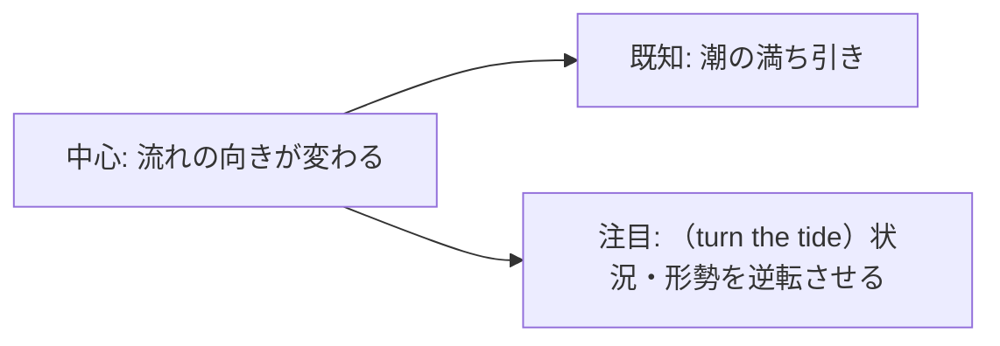

**重要語法：** turn the tide (of ～)：（～の）形勢を逆転させる

元データ：index 3771 / ev-03771-idiom-01

## 2242. straw

**品詞：** idiom　**発音：** /strɔː/

よく知られている意味：わら、ストロー

**見落としやすい意味：（the last straw）我慢の限界を超えさせる最後の一因**

**例文：** The third delay was the last straw for the customers.

**和訳：** 三度目の遅延で、客たちはとうとう我慢の限界に達した。

**コアイメージ：** わら一本は軽くても、負担が積み重なれば限界を超える。最後に加わるわずかな負担が決定打になる、という比喩。

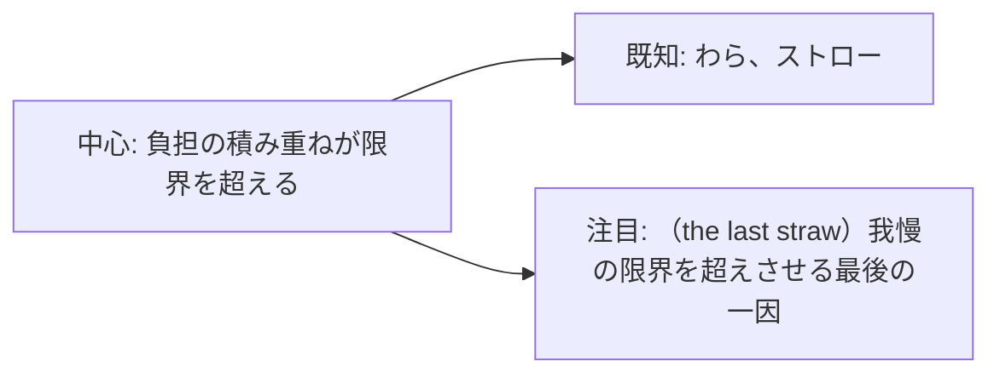

**重要語法：** the last straw：我慢の限界を超えさせる出来事

元データ：index 3773 / ev-03773-idiom-01

## 2243. means

**品詞：** noun　**発音：** /miːnz/

よく知られている意味：手段、方法

**見落としやすい意味：財力・資力・生活費に使える財産**

**例文：** She lacks the means to pay for private lessons.

**和訳：** 彼女には個人授業の費用を払うだけの資力がない。

**コアイメージ：** 目的を実現するために使えるものが means。方法だけでなく、実現のために使える金銭や財産も指す。

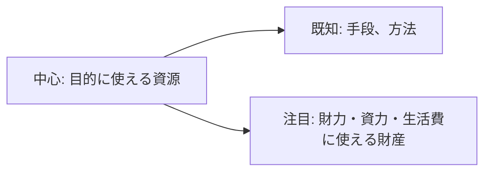

**重要語法：** the means to do：～するだけの資力・手段

元データ：index 3774 / ev-03774-noun-01

## 2244. swing

**品詞：** adjective　**発音：** /swɪŋ/

よく知られている意味：揺れる、振れる

**見落としやすい意味：（swing voter）支持する候補や政党が固定していない**

**例文：** The result may depend on swing voters.

**和訳：** 結果は支持先を決めていない有権者に左右されるかもしれない。

**コアイメージ：** swing は一方から他方へ揺れ動くこと。政治では、どちらを支持するか固定していない状態を表す。

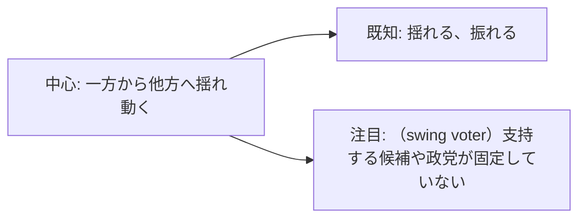

**重要語法：** swing voter：支持先が固定していない有権者

元データ：index 3775 / ev-03775-adjective-01

## 2245. mate

**品詞：** noun　**発音：** /meɪt/

よく知られている意味：つがいの相手、仲間

**見落としやすい意味：友人・仲間（特に英国・豪州英語の口語）**

**例文：** I'm meeting a mate from school this weekend.

**和訳：** 今週末、学校時代の友人と会うんだ。

**コアイメージ：** mate は同じ側にいる相手や対になる相手。親しい仲間を指し、特に英国やオーストラリアの口語では「友達」に使う。

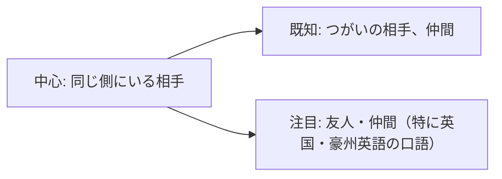

**重要語法：** a mate of mine：私の友人の一人

元データ：index 3777 / ev-03777-noun-01

## 2246. economically

**品詞：** adverb　**発音：** /ˌiːkəˈnɒmɪkli/

よく知られている意味：経済の面で

**見落としやすい意味：無駄な費用や資源を使わずに、節約して**

**例文：** They traveled economically by sharing a room.

**和訳：** 彼らは部屋を相部屋にして、費用を抑えて旅行した。

**コアイメージ：** economy には社会の経済だけでなく、資源の節約という発想がある。economically は費用や資源を無駄にしないやり方にも使える。

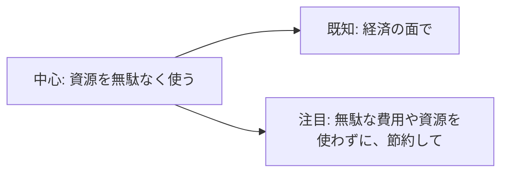

**重要語法：** travel economically：節約して旅行する

元データ：index 3780 / ev-03780-adverb-01

## 2247. loom

**品詞：** verb　**発音：** /luːm/

よく知られている意味：織機、織る

**見落としやすい意味：好ましくない出来事が不気味に迫る、起こりそうになる**

**例文：** A serious water shortage looms next summer.

**和訳：** 来年の夏には深刻な水不足が迫っている。

**コアイメージ：** 遠くに大きなものが現れ、次第に存在感を強める感覚。悪い出来事が間近に感じられるときに使う。

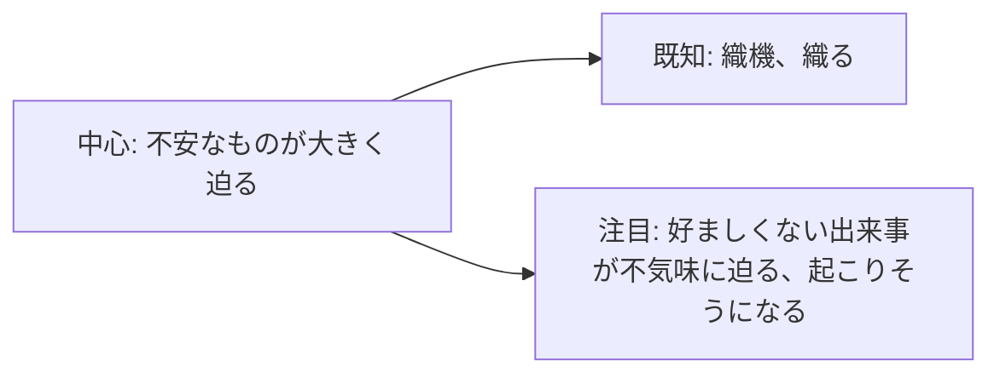

**重要語法：** loom large：大きな懸念として迫る

元データ：index 3781 / ev-03781-verb-01

## 2248. fool

**品詞：** verb　**発音：** /fuːl/

よく知られている意味：愚か者

**見落としやすい意味：人をだます、誤信させる**

**例文：** The fake website fooled many visitors.

**和訳：** その偽サイトは多くの訪問者をだました。

**コアイメージ：** fool は判断を誤る愚かな状態と関係する。動詞では、相手に誤ったことを信じさせる行為を表す。

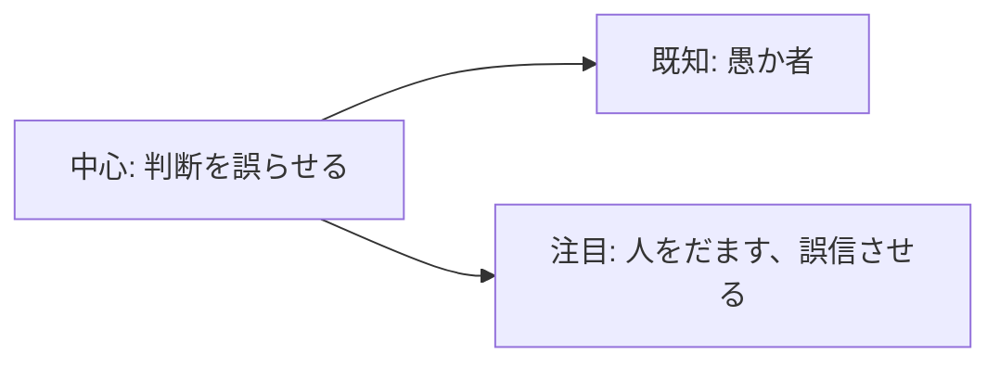

**重要語法：** fool A into doing：Aをだまして～させる

元データ：index 3783 / ev-03783-verb-01

## 2249. interim

**品詞：** noun　**発音：** /ˈɪntərɪm/

よく知られている意味：暫定の、一時的な

**見落としやすい意味：（in the interim）それまでの間、当面**

**例文：** The new library opens in June; in the interim, use the old one.

**和訳：** 新しい図書館は6月に開館する。それまでは旧館を使ってください。

**コアイメージ：** interim は本来の状態へ移るまでの途中の期間を示す。in the interim はその期間中、つまり「それまでの間」を表す。

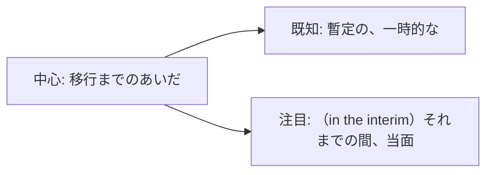

**重要語法：** in the interim：それまでの間

元データ：index 3785 / ev-03785-noun-01

## 2250. organic

**品詞：** adjective　**発音：** /ɔːˈɡænɪk/

よく知られている意味：有機の、有機栽培の

**見落としやすい意味：変化・成長などが外部から強制されず自然に生じる**

**例文：** The club grew organically as friends invited friends.

**和訳：** 友人が友人を誘う形で、そのクラブは自然に大きくなった。

**コアイメージ：** organic は生き物の成長のように内部から発展するイメージ。組織や変化が人為的な強制なしに育つ場合にも使う。

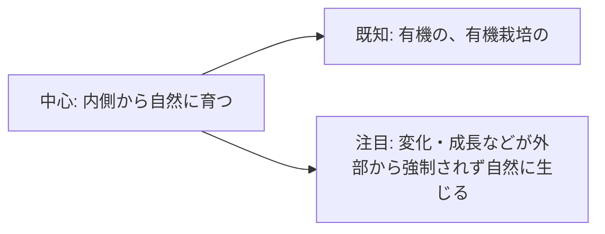

**重要語法：** organic growth：自然発生的な成長

元データ：index 3786 / ev-03786-adjective-01

## 2251. pen

**品詞：** verb　**発音：** /pen/

よく知られている意味：ペン、筆記具

**見落としやすい意味：柵や囲いに閉じ込める、囲い込む**

**例文：** The farmer penned the sheep before dark.

**和訳：** 農家の人は暗くなる前に羊を囲いへ入れた。

**コアイメージ：** pen には家畜を入れる囲いという名詞もある。動詞では、その囲いの中に入れて外へ出られないようにする。

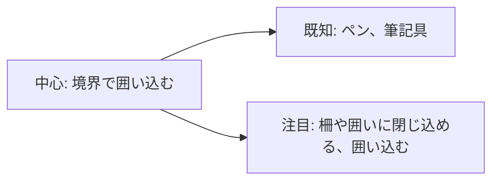

**重要語法：** pen A in：Aを囲いに閉じ込める

元データ：index 3789 / ev-03789-verb-01

## 2252. lion

**品詞：** idiom　**発音：** /ˈlaɪən/

よく知られている意味：ライオン

**見落としやすい意味：（the lion's share）全体の大部分**

**例文：** Online orders make up the lion's share of our sales.

**和訳：** 売上の大部分をオンライン注文が占めている。

**コアイメージ：** ライオンは強さや優位さを象徴する動物として扱われる。the lion's share は取り分の中でも特に大きな部分を指す慣用句。

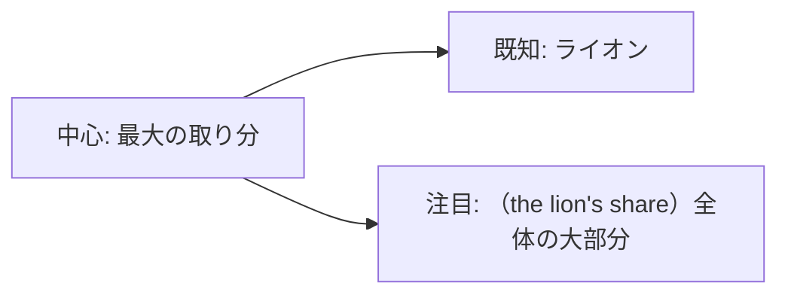

**重要語法：** the lion's share of ～：～の大部分

元データ：index 3791 / ev-03791-idiom-01

## 2253. banana

**品詞：** idiom　**発音：** /bəˈnɑːnə/

よく知られている意味：バナナ

**見落としやすい意味：（go bananas）興奮して大騒ぎする、取り乱す（口語）**

**例文：** The fans went bananas when the singer appeared.

**和訳：** 歌手が姿を見せると、ファンは大興奮した。

**コアイメージ：** go bananas は普通の落ち着いた状態から外れる、くだけた慣用表現。喜びでも怒りでも、激しく興奮する場面に使える。

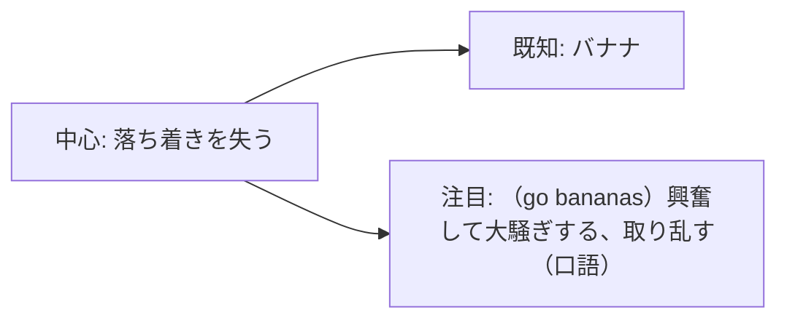

**重要語法：** go bananas over ～：～に夢中になって大騒ぎする

元データ：index 3792 / ev-03792-idiom-01

## 2254. pale

**品詞：** idiom　**発音：** /peɪl/

よく知られている意味：青白い、薄い

**見落としやすい意味：（beyond the pale）社会的に許される限度を超えて**

**例文：** That cruel joke was beyond the pale.

**和訳：** その残酷な冗談は許される一線を越えていた。

**コアイメージ：** pale はこの慣用句では「境界・囲い」を表す古い語義に由来する。境界の外に出ることから、許容範囲を超えるという意味になる。

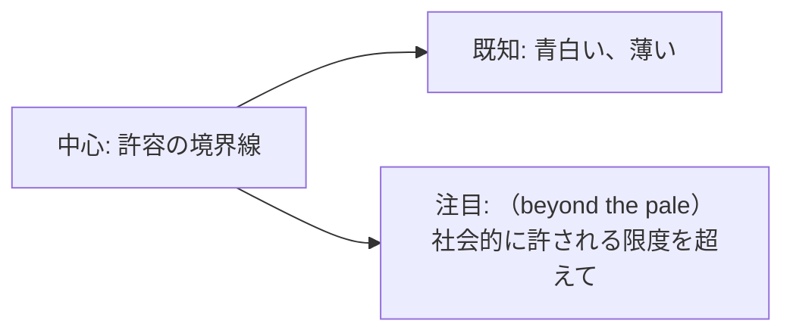

**重要語法：** beyond the pale：社会的に許されない

元データ：index 3798 / ev-03798-idiom-01

## 2255. servant

**品詞：** phrase　**発音：** /ˈsɜːvənt/

よく知られている意味：使用人

**見落としやすい意味：（civil servant）公務員**

**例文：** Her father is a civil servant.

**和訳：** 彼女の父親は公務員だ。

**コアイメージ：** servant は誰かのために働き、奉仕する人。civil が付くと個人の主人ではなく公共のために働く人を指す。

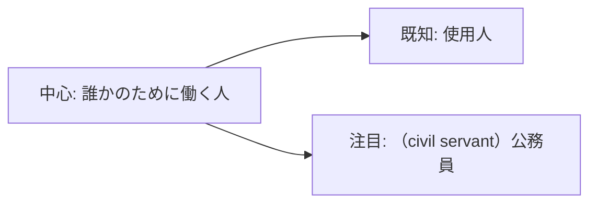

**重要語法：** civil servant：公務員

元データ：index 3804 / ev-03804-phrase-01

## 2256. neat

**品詞：** adjective　**発音：** /niːt/

よく知られている意味：整った、きちんとした

**見落としやすい意味：（工夫・解決法が）巧みでうまい、気の利いた**

**例文：** She found a neat solution to the scheduling problem.

**和訳：** 彼女は日程調整の問題にうまい解決策を見つけた。

**コアイメージ：** neat は余計な乱れや無駄がない状態を表す。方法や発想では、簡潔で気の利いた巧みさを評価する。

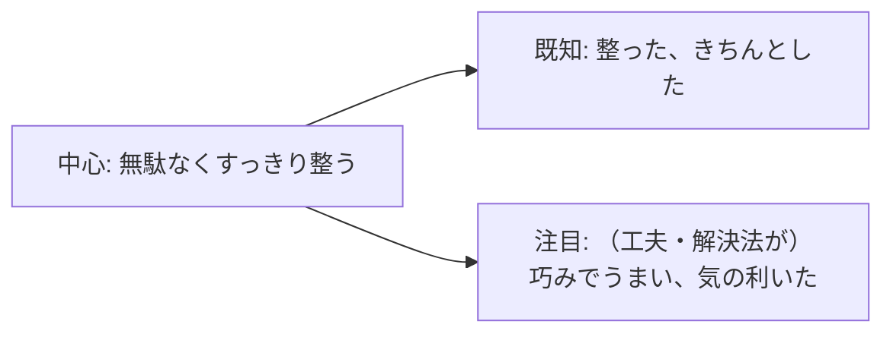

**重要語法：** a neat trick：巧みな工夫

元データ：index 3806 / ev-03806-adjective-01

## 2257. oath

**品詞：** idiom　**発音：** /əʊθ/

よく知られている意味：誓い、宣誓

**見落としやすい意味：（under oath）宣誓の上で、法的に真実を述べる義務を負って**

**例文：** The witness gave her statement under oath.

**和訳：** 証人は宣誓の上で証言した。

**コアイメージ：** oath は言葉の真実性を正式に誓うこと。under oath はその誓いに拘束された状態で述べることを示す。

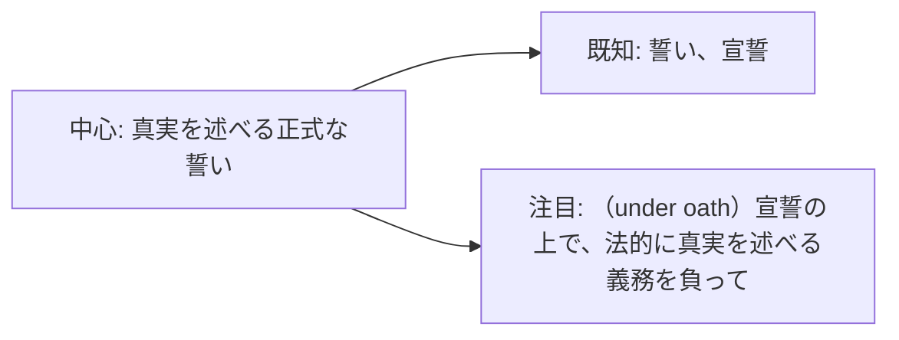

**重要語法：** testify under oath：宣誓して証言する

元データ：index 3807 / ev-03807-idiom-01

## 2258. query

**品詞：** verb　**発音：** /ˈkwɪəri/

よく知られている意味：質問、問い合わせ

**見落としやすい意味：主張・数値などの正しさに疑問を呈する**

**例文：** Several experts queried the accuracy of the figures.

**和訳：** 複数の専門家がその数字の正確性に疑問を呈した。

**コアイメージ：** query は答えを求めて問いを向けること。単なる質問にとどまらず、主張が正しいのか異議を示す動詞にもなる。

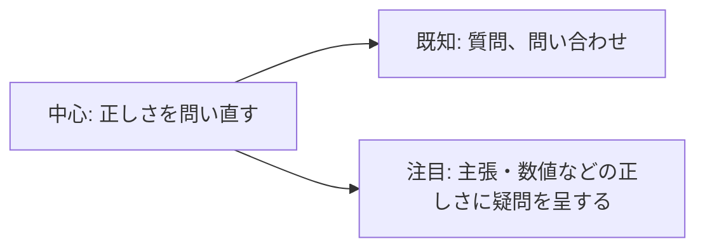

**重要語法：** query a claim：主張に疑問を呈する

元データ：index 3810 / ev-03810-verb-01

## 2259. circular

**品詞：** noun　**発音：** /ˈsɜːkjələr/

よく知られている意味：円形の、循環する

**見落としやすい意味：複数の人に配布する通知文・回覧文書**

**例文：** The office sent a circular to every employee.

**和訳：** 事務局は全職員に回覧通知を送った。

**コアイメージ：** circular は円を描くように広く巡ること。名詞では、複数の人の間に配って知らせる文書を表す。

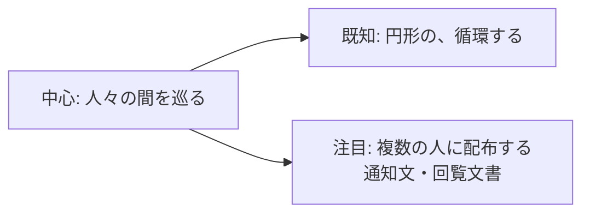

**重要語法：** issue a circular：回覧通知を出す

元データ：index 3812 / ev-03812-noun-01

## 2260. dump

**品詞：** verb　**発音：** /dʌmp/

よく知られている意味：投げ捨てる、ごみを捨てる

**見落としやすい意味：輸出先の市場で商品を不当に安く売る、ダンピングする**

**例文：** The firm was accused of dumping steel at unfairly low prices.

**和訳：** その企業は鋼材を不当に安く売るダンピングをしたとして非難された。

**コアイメージ：** dump は物をまとめて投げ出すように手放す感覚。貿易では輸出市場に商品を不当に低い価格で売る行為を指す。

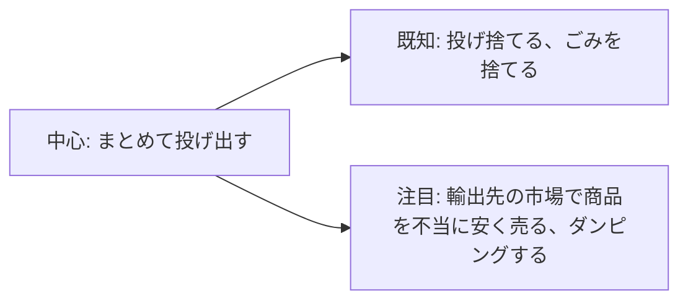

**重要語法：** dump goods on a market：市場に商品を安値で大量に売る

元データ：index 3813 / ev-03813-verb-01
