# EasyVoca 完成教材｜Batch 030

- 担当：30 / 64
- global_order：2321–2400（80件）
- 出典：main の `data/candidates/` 内 `decision=accepted`、`index`・`candidate_id` 昇順
- 全80件の完成教材カード

## 01. trademark

**品詞**：verb　**発音**：/ˈtreɪdmɑːrk/

<small>よく知られている意味：商標</small>

### 見落としやすい意味

**名称や標識を商標登録する**

**例文**：The company decided to trademark its new logo.

**和訳**：その会社は新しいロゴを商標登録することにした。

**コアイメージ**：trademark は商品や会社を見分けるための印を指す。動詞になると、その印や名称を法的に保護するため商標登録する行為を表す。

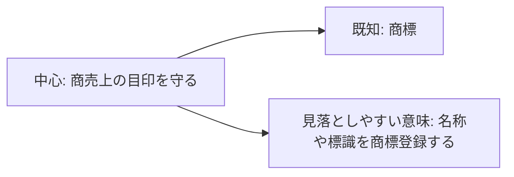

**重要語法**：`trademark a name / logo`


## 02. tube

**品詞**：noun　**発音**：/tuːb/

<small>よく知られている意味：管・筒</small>

### 見落としやすい意味

**ロンドンの地下鉄（the Tube）**

**例文**：We took the Tube across London.

**和訳**：私たちはロンドン市内を地下鉄で移動した。

**コアイメージ**：tube の基本は細長く中が空いた管。地下のトンネルを走るロンドンの地下鉄を、the Tube と呼ぶ。

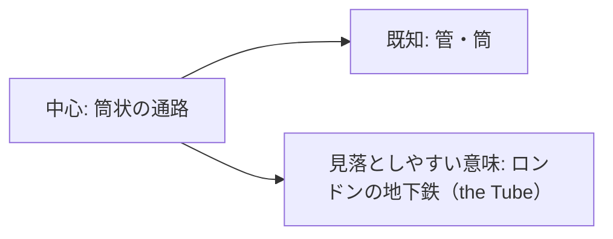

**重要語法**：`the Tube（ロンドンの地下鉄）`


## 03. spill

**品詞**：verb　**発音**：/spɪl/

<small>よく知られている意味：液体をこぼす</small>

### 見落としやすい意味

**秘密・情報を不用意に漏らす、口外する**

**例文**：She accidentally spilled the details of the plan.

**和訳**：彼女はうっかり計画の詳細を漏らしてしまった。

**コアイメージ**：容器から液体がこぼれるように、内にとどめるべき情報が外へ出るイメージ。秘密を思わず口にしてしまう場合にも使う。

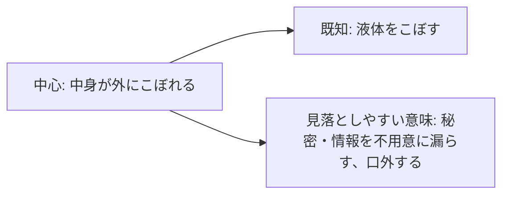

**重要語法**：`spill a secret / spill the beans`


## 04. spill

**品詞**：verb　**発音**：/spɪl/

<small>よく知られている意味：液体をこぼす</small>

### 見落としやすい意味

**（人々が）あふれ出て広がる**

**例文**：Fans spilled out of the stadium after the game.

**和訳**：試合後、ファンたちがスタジアムからあふれ出た。

**コアイメージ**：spill は中に収まりきらず外へ流れ出る動きを表す。液体だけでなく、大勢の人が出口などから広がっていく様子にも使える。

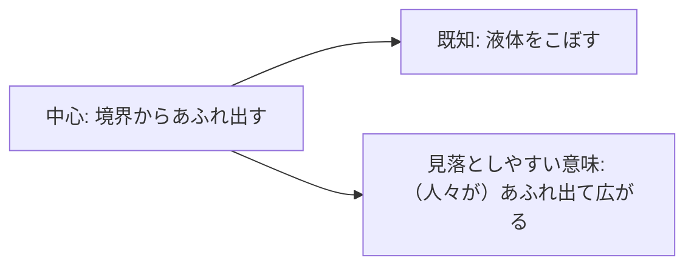

**重要語法**：`spill out of a place`


## 05. screw

**品詞**：phrasal verb　**発音**：/skruː/

<small>よく知られている意味：ねじ・ねじで締める</small>

### 見落としやすい意味

**（screw up）大失敗する、事態を台無しにする（口語）**

**例文**：I screwed up the directions and got us lost.

**和訳**：私は道順を間違えて、みんなを迷わせてしまった。

**コアイメージ**：ねじを扱う動きから、物事を乱したり台無しにしたりする口語表現へ広がる。screw up は失敗や取り違えをはっきり示す。

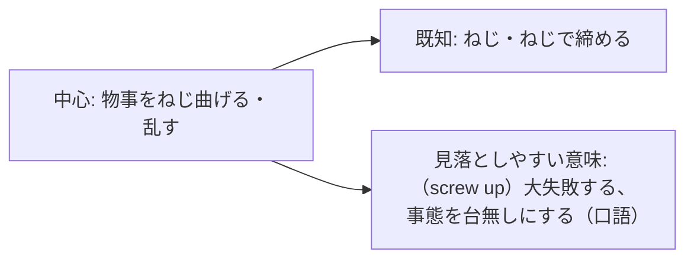

**重要語法**：`screw up（口語）`


## 06. promotion

**品詞**：noun　**発音**：/prəˈmoʊʃən/

<small>よく知られている意味：宣伝・販売促進</small>

### 見落としやすい意味

**職位・地位が上がること、昇進**

**例文**：She received a promotion after leading the project.

**和訳**：彼女はそのプロジェクトを率いたあと、昇進した。

**コアイメージ**：promote の中心には、今より上の段階へ進めるという発想がある。商品なら販売を促進し、人ならより高い職位へ進める。

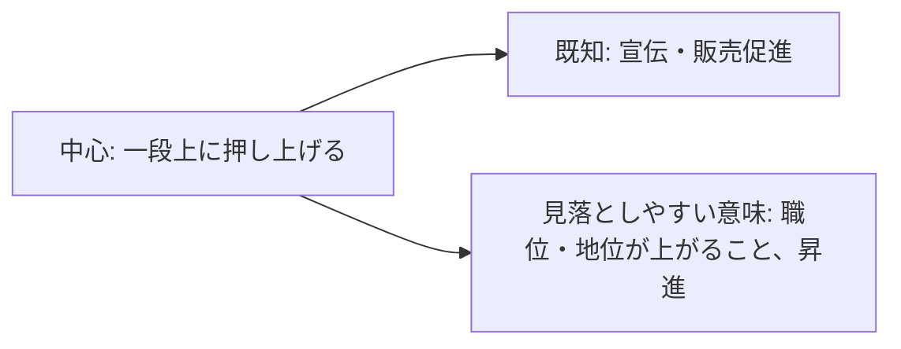

**重要語法**：`get a promotion`


## 07. interval

**品詞**：noun　**発音**：/ˈɪntərvəl/

<small>よく知られている意味：間隔</small>

### 見落としやすい意味

**演劇・演奏などの幕間の休憩（主に英国英語）**

**例文**：We bought drinks during the interval at the theatre.

**和訳**：私たちは劇場の幕間の休憩中に飲み物を買った。

**コアイメージ**：interval は時間や出来事のあいだの区切りを表す。舞台や演奏の前半と後半のあいだに設ける休憩も interval と呼ぶ。

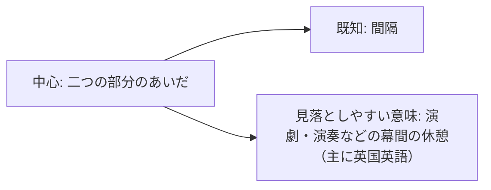

**重要語法**：`during the interval（主に英国英語）`


## 08. transmission

**品詞**：noun　**発音**：/trænzˈmɪʃən/

<small>よく知られている意味：伝達・送信</small>

### 見落としやすい意味

**車などの動力を車輪に伝える変速装置・変速機**

**例文**：This car has an automatic transmission.

**和訳**：この車にはオートマチック変速機が付いている。

**コアイメージ**：transmission は何かを一方から他方へ伝えること。車ではエンジンの力を車輪に伝える機構、特に変速機を指す。

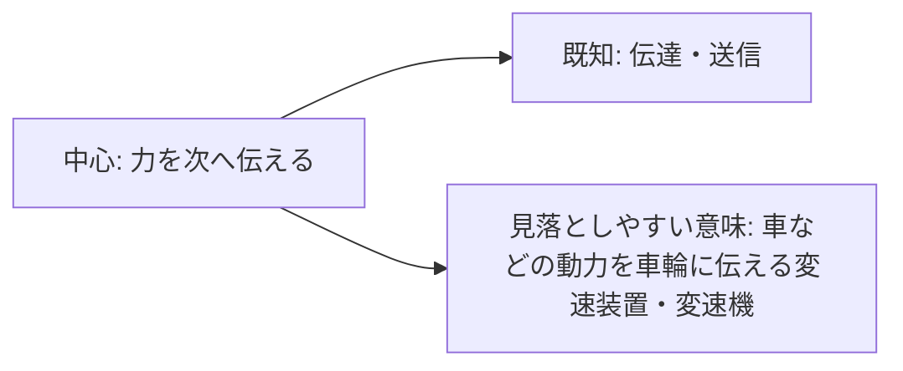

**重要語法**：`automatic / manual transmission`


## 09. dock

**品詞**：verb　**発音**：/dɑːk/

<small>よく知られている意味：波止場・船着き場</small>

### 見落としやすい意味

**賃金・手当などから金額を差し引く**

**例文**：The manager docked fifty dollars from his pay.

**和訳**：上司は彼の給料から50ドルを差し引いた。

**コアイメージ**：dock には船着き場という名詞のほか、金額を減額する動詞用法がある。給与などから一部を取り去る意味で、波止場との無理な関連づけは不要。

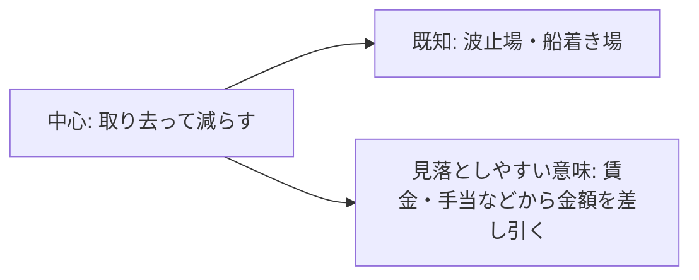

**重要語法**：`dock money from someone's pay`


## 10. attendance

**品詞**：noun　**発音**：/əˈtendəns/

<small>よく知られている意味：出席すること</small>

### 見落としやすい意味

**催しなどへの出席者数・入場者数**

**例文**：The festival recorded its highest attendance last year.

**和訳**：その祭りは昨年、過去最多の来場者数を記録した。

**コアイメージ**：attendance は集まりへの出席という事実を表す。集まった人数を数える文脈では、出席者数・来場者数そのものを意味する。

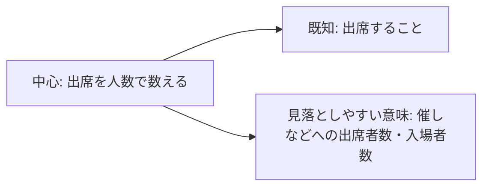

**重要語法**：`record attendance`


## 11. defect

**品詞**：verb　**発音**：/dɪˈfekt/

<small>よく知られている意味：欠陥（名詞）</small>

### 見落としやすい意味

**組織・国家などから離反して相手側へ移る（名詞と強勢が異なる）**

**例文**：Several soldiers defected to the other side.

**和訳**：数人の兵士が離反して敵側に移った。

**コアイメージ**：動詞 defect は、自分が属していた国家や組織から離れ、別の側につくことを表す。名詞 defect「欠陥」とは意味も強勢も異なるので、同じ発想で解釈しない。

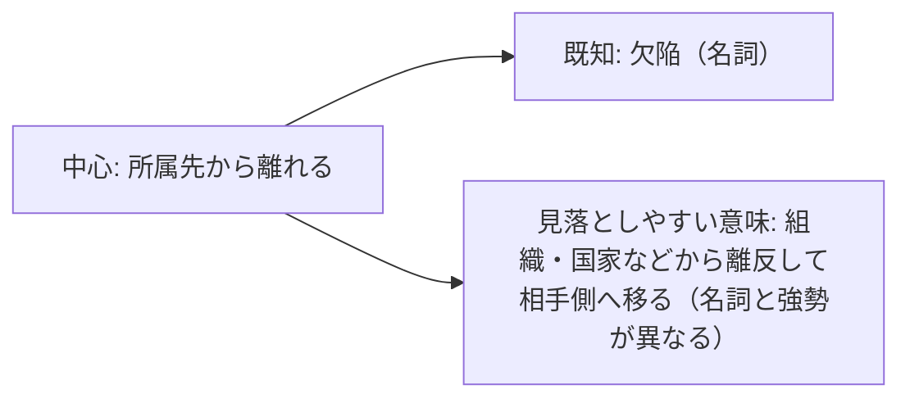

**重要語法**：`defect to ～；名詞は /ˈdiːfekt/`


## 12. nerve

**品詞**：noun　**発音**：/nɜːrv/

<small>よく知られている意味：神経</small>

### 見落としやすい意味

**厚かましさ、図太さ**

**例文**：He had the nerve to blame me for his mistake.

**和訳**：彼は厚かましくも自分のミスを私のせいにした。

**コアイメージ**：nerve は神経だけでなく、行動を起こす精神的な強さも指す。have the nerve to do は、非難すべき図々しい度胸があるという評価になる。

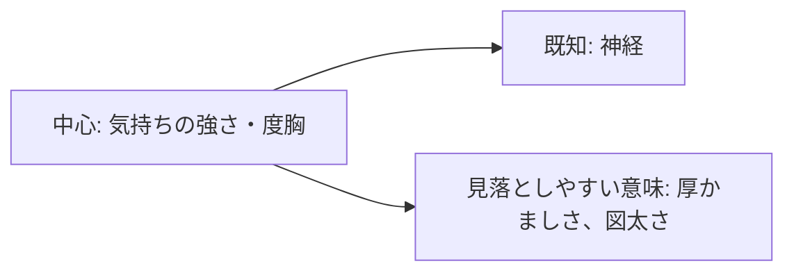

**重要語法**：`have the nerve to do`


## 13. nerve

**品詞**：verb　**発音**：/nɜːrv/

<small>よく知られている意味：神経</small>

### 見落としやすい意味

**勇気を奮い立たせる、気力を与える**

**例文**：She nerved herself for the difficult conversation.

**和訳**：彼女は難しい話し合いに向けて勇気を奮い立たせた。

**コアイメージ**：神経が緊張を支えることから、nerve には勇気や気力という意味もある。動詞では自分の気持ちを奮い立たせ、覚悟を固めることを表す。

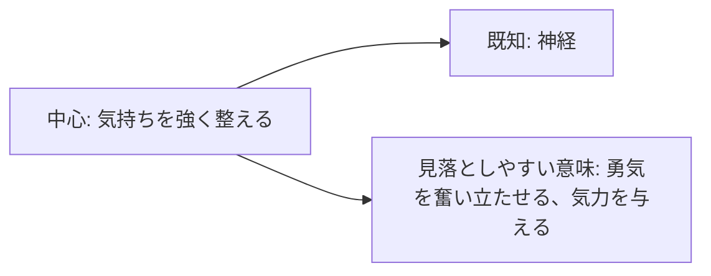

**重要語法**：`nerve oneself for / to do`


## 14. stiff

**品詞**：adjective　**発音**：/stɪf/

<small>よく知られている意味：硬い・こわばった</small>

### 見落としやすい意味

**（価格・費用が）法外に高い**

**例文**：The hotel charged a stiff fee for parking.

**和訳**：そのホテルは駐車料金を法外に高く設定していた。

**コアイメージ**：stiff は曲がりにくい硬さに加え、程度が厳しく負担が重い様子を表せる。料金については支払う側にとって高すぎるという評価になる。

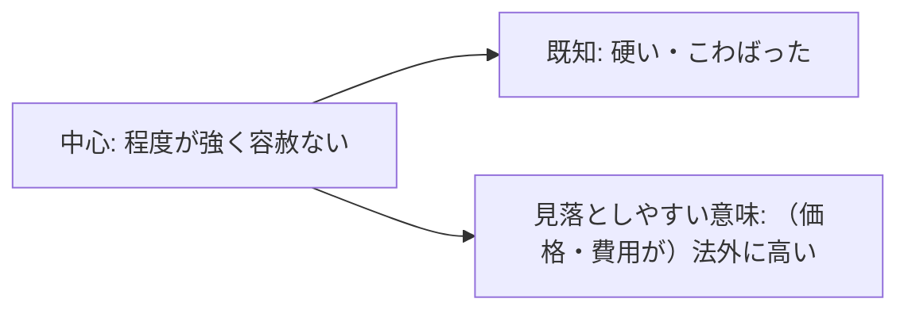

**重要語法**：`a stiff fee / price`


## 15. stiff

**品詞**：adjective　**発音**：/stɪf/

<small>よく知られている意味：硬い・こわばった</small>

### 見落としやすい意味

**（罰金・罰則が）厳しい、重い**

**例文**：The company faced a stiff penalty for breaking the rules.

**和訳**：その会社は規則違反で重い罰則を受けることになった。

**コアイメージ**：stiff の硬さが、融通のきかない厳しさの評価につながる。罰や制裁に使うと、軽くは済まされないほど重いことを表す。

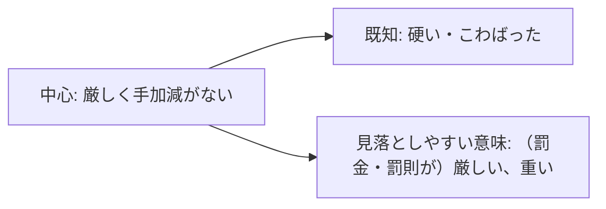

**重要語法**：`a stiff penalty / fine`


## 16. likelihood

**品詞**：idiom　**発音**：/ˈlaɪklihʊd/

<small>よく知られている意味：起こる見込み・可能性</small>

### 見落としやすい意味

**（in all likelihood）十中八九、おそらく間違いなく**

**例文**：In all likelihood, the train will be delayed.

**和訳**：十中八九、その列車は遅れるだろう。

**コアイメージ**：likelihood はあることが起こりそうな度合い。in all likelihood は可能性を強く見積もる慣用句で、「おそらく間違いなく」に近い。

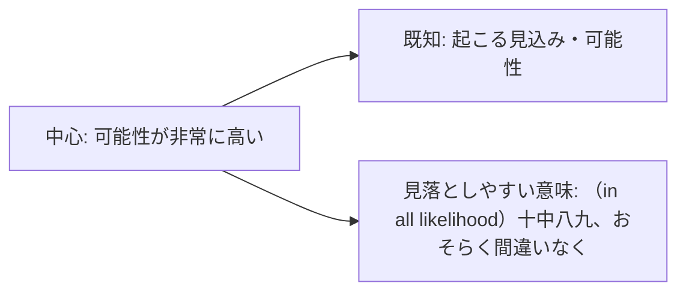

**重要語法**：`in all likelihood`


## 17. omit

**品詞**：verb　**発音**：/əˈmɪt/

<small>よく知られている意味：省く・除外する</small>

### 見落としやすい意味

**（omit to do）～し忘れる、うっかりしない**

**例文**：I omitted to tell her about the schedule change.

**和訳**：私は彼女に予定の変更を伝え忘れた。

**コアイメージ**：omit は何かを抜かすことで、必ずしも意図的とは限らない。omit to do はするべき行動が抜け落ちたことから、「し忘れる」の意味になる。

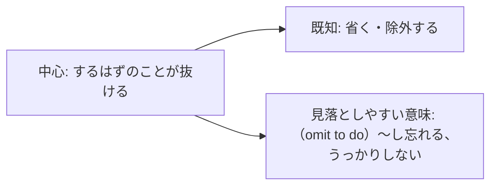

**重要語法**：`omit to do`


## 18. articulate

**品詞**：adjective　**発音**：/ɑːrˈtɪkjələt/

<small>よく知られている意味：（動詞）明確に述べる</small>

### 見落としやすい意味

**考えを明晰に表現できる（同綴りの動詞と発音が異なる）**

**例文**：She is an articulate speaker who explains complex ideas simply.

**和訳**：彼女は複雑な考えを分かりやすく説明できる、話の明晰な人だ。

**コアイメージ**：articulate は考えを言葉としてはっきり形にすることと関係する。形容詞では、その力を備えて表現が明晰な人を表す。

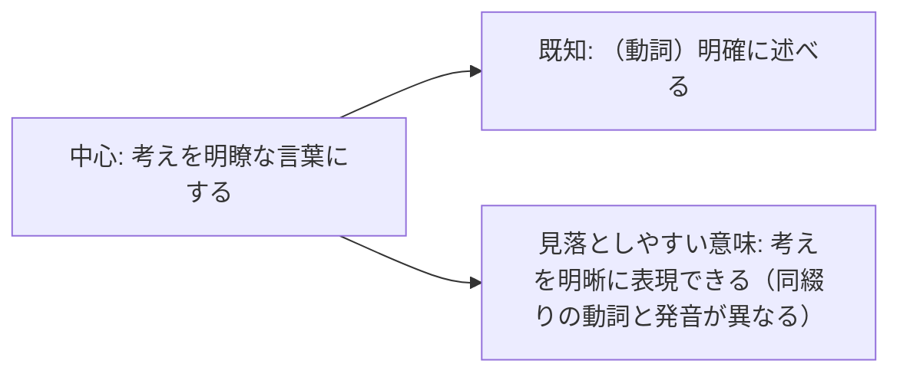

**重要語法**：`形容詞の語尾は /lət/、動詞は /leɪt/`


## 19. articulate

**品詞**：verb　**発音**：/ɑːrˈtɪkjəleɪt/

<small>よく知られている意味：（形容詞）話の明晰な</small>

### 見落としやすい意味

**考え・感情・意見を言葉ではっきり表現する**

**例文**：He struggled to articulate his feelings.

**和訳**：彼は自分の気持ちを言葉ではっきり表そうと苦労した。

**コアイメージ**：頭の中にある考えを、相手に伝わる言葉として区切り明確にするイメージ。動詞 articulate はその表現する行為を指す。

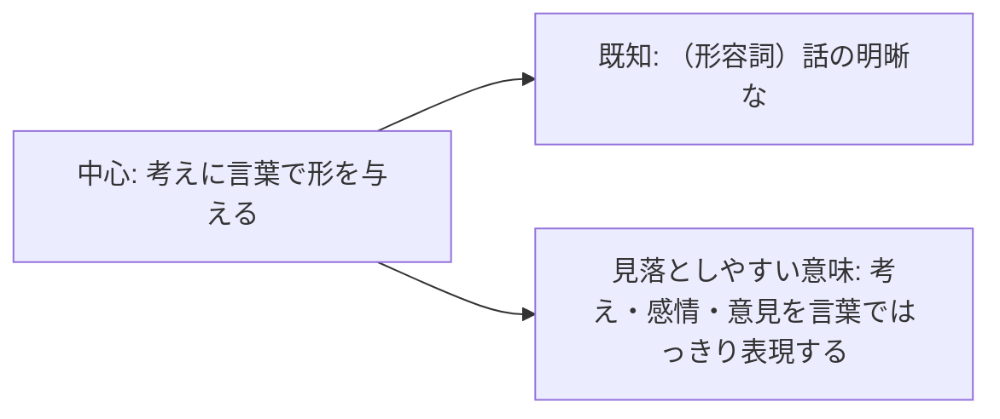

**重要語法**：`articulate an idea / feelings；形容詞は /lət/`


## 20. cancel

**品詞**：phrasal verb　**発音**：/ˈkænsəl/

<small>よく知られている意味：中止する・取り消す</small>

### 見落としやすい意味

**（cancel out）双方の効果を相殺して帳消しにする**

**例文**：The two forces cancel each other out.

**和訳**：二つの力は互いに打ち消し合う。

**コアイメージ**：cancel は予定を取り消すだけでなく、存在する効果を打ち消す意味にも広がる。cancel out は反対向きの力や影響などが相殺されることを表す。

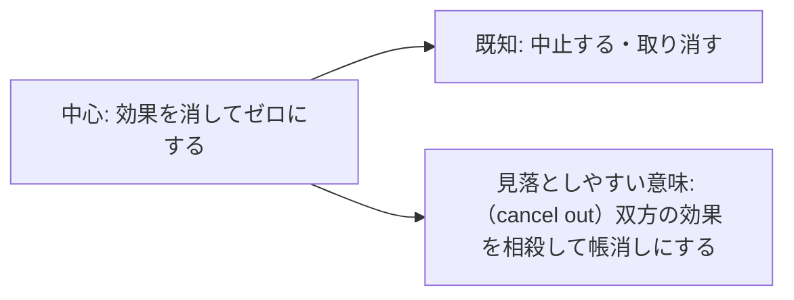

**重要語法**：`cancel out；cancel each other out`


## 21. correspondent

**品詞**：noun　**発音**：/ˌkɔːrəˈspɑːndənt/

<small>よく知られている意味：文通相手</small>

### 見落としやすい意味

**新聞・放送局の通信員・特派員**

**例文**：She works as a foreign correspondent in Nairobi.

**和訳**：彼女はナイロビで海外特派員として働いている。

**コアイメージ**：correspondent は遠く離れた相手と情報をやり取りする人。私信の文通相手だけでなく、報道機関へ現地のニュースを送る通信員も指す。

```mermaid
flowchart LR
    A["中心: 離れた相手に情報を伝える"]
    B["既知: 文通相手"]
    C["見落としやすい意味: 新聞・放送局の通信員・特派員"]
    A --> B
    A --> C
```

**重要語法**：`foreign correspondent`


## 22. filter

**品詞**：phrasal verb　**発音**：/ˈfɪltər/

<small>よく知られている意味：液体などをろ過する</small>

### 見落としやすい意味

**（filter out）不必要な情報や候補などを取り除く**

**例文**：The app filters out unwanted notifications.

**和訳**：そのアプリは不要な通知を取り除く。

**コアイメージ**：filter は網目を通して必要なものと不要なものを分ける働き。情報や候補にも使い、filter out で不要なものを除去する意味になる。

```mermaid
flowchart LR
    A["中心: 必要なものだけ通す"]
    B["既知: 液体などをろ過する"]
    C["見落としやすい意味: （filter out）不必要な情報や候補などを取り除く"]
    A --> B
    A --> C
```

**重要語法**：`filter out noise / unwanted items`


## 23. filter

**品詞**：phrasal verb　**発音**：/ˈfɪltər/

<small>よく知られている意味：液体などをろ過する</small>

### 見落としやすい意味

**（filter through）情報などが少しずつ伝わる**

**例文**：News of the decision slowly filtered through the town.

**和訳**：その決定の知らせは町じゅうに少しずつ伝わった。

**コアイメージ**：filter には何かが細かな隙間を通ってゆっくり進むイメージがある。情報が人から人へ徐々に広がるときにも filter through を使う。

```mermaid
flowchart LR
    A["中心: 少しずつ通り抜ける"]
    B["既知: 液体などをろ過する"]
    C["見落としやすい意味: （filter through）情報などが少しずつ伝わる"]
    A --> B
    A --> C
```

**重要語法**：`news filters through`


## 24. pillar

**品詞**：noun　**発音**：/ˈpɪlər/

<small>よく知られている意味：柱</small>

### 見落としやすい意味

**組織・思想などを支える中心人物・柱**

**例文**：She has been a pillar of the community for decades.

**和訳**：彼女は何十年も地域社会の中心的な支えとなってきた。

**コアイメージ**：建物の重みを支える柱が基本イメージ。そこから組織や地域の存続を支える重要人物にも pillar を使う。

```mermaid
flowchart LR
    A["中心: 全体を支える柱"]
    B["既知: 柱"]
    C["見落としやすい意味: 組織・思想などを支える中心人物・柱"]
    A --> B
    A --> C
```

**重要語法**：`a pillar of the community`


## 25. revolt

**品詞**：verb　**発音**：/rɪˈvoʊlt/

<small>よく知られている意味：反乱する</small>

### 見落としやすい意味

**むかつかせる；強い嫌悪感を起こさせる**

**例文**：The smell of spoiled food revolted the guests.

**和訳**：傷んだ食べ物のにおいは客たちに強い嫌悪感を抱かせた。

**コアイメージ**：revolt は支配や現状に強く反発することを表す。人の感覚や気持ちが何かを強く拒絶する場合には「むかつかせる」という他動詞になる。

```mermaid
flowchart LR
    A["中心: 強く反発して退ける"]
    B["既知: 反乱する"]
    C["見落としやすい意味: むかつかせる；強い嫌悪感を起こさせる"]
    A --> B
    A --> C
```

**重要語法**：`be revolted by ～`


## 26. neck

**品詞**：noun　**発音**：/nek/

<small>よく知られている意味：首</small>

### 見落としやすい意味

**接戦；互角の状態**

**例文**：The two runners were neck and neck near the finish line.

**和訳**：二人の走者はゴール間際まで接戦だった。

**コアイメージ**：首は体の前後関係が分かる部分。neck and neck は競走する者の首が同じ位置にあるように、ほぼ互角で並んでいる状態を表す。

```mermaid
flowchart LR
    A["中心: 首の位置まで並ぶ"]
    B["既知: 首"]
    C["見落としやすい意味: 接戦；互角の状態"]
    A --> B
    A --> C
```

**重要語法**：`neck and neck`


## 27. snake

**品詞**：verb　**発音**：/sneɪk/

<small>よく知られている意味：蛇</small>

### 見落としやすい意味

**蛇行する；曲がりくねって進む**

**例文**：A narrow road snakes through the hills.

**和訳**：細い道が丘の間を曲がりくねって続いている。

**コアイメージ**：snake は蛇の曲がりくねった姿や進み方が中心のイメージ。道や川を主語にすると、その形で伸びていく動詞になる。

```mermaid
flowchart LR
    A["中心: 蛇のようにくねる"]
    B["既知: 蛇"]
    C["見落としやすい意味: 蛇行する；曲がりくねって進む"]
    A --> B
    A --> C
```

**重要語法**：`snake through / across`


## 28. bench

**品詞**：noun　**発音**：/bentʃ/

<small>よく知られている意味：公園などのベンチ</small>

### 見落としやすい意味

**裁判官；裁判官席**

**例文**：The judge has served on the bench for twenty years.

**和訳**：その裁判官は20年間裁判官を務めてきた。

**コアイメージ**：bench は人が座る長い台を表す。裁判官が職務を行う席から転じ、裁判官の地位や裁判官たちそのものも意味する。

```mermaid
flowchart LR
    A["中心: 職務を行う席"]
    B["既知: 公園などのベンチ"]
    C["見落としやすい意味: 裁判官；裁判官席"]
    A --> B
    A --> C
```

**重要語法**：`on the bench`


## 29. rubber

**品詞**：noun　**発音**：/ˈrʌbər/

<small>よく知られている意味：ゴム</small>

### 見落としやすい意味

**消しゴム（主にイギリス英語）**

**例文**：May I borrow your rubber to erase this pencil mark?

**和訳**：この鉛筆の跡を消すために、消しゴムを借りてもいいですか。

**コアイメージ**：rub はこする動きを表し、rubber はこすって消すものを指せる。英国英語では消しゴムの意味で一般的だが、米国英語では eraser を使うのが無難。

```mermaid
flowchart LR
    A["中心: こすって消す道具"]
    B["既知: ゴム"]
    C["見落としやすい意味: 消しゴム（主にイギリス英語）"]
    A --> B
    A --> C
```

**重要語法**：`rubber＝eraser（主に英国英語）`


## 30. threshold

**品詞**：noun　**発音**：/ˈθreʃhoʊld/

<small>よく知られている意味：戸口・しきい値</small>

### 見落としやすい意味

**～の直前・入り口**

**例文**：The team is on the threshold of a major discovery.

**和訳**：そのチームは大発見を目前にしている。

**コアイメージ**：threshold は部屋の入口にある敷居や、何かが変わる境目を指す。on the threshold of はその境目のすぐ手前にいるイメージから「目前」を表す。

```mermaid
flowchart LR
    A["中心: 境界を越える直前"]
    B["既知: 戸口・しきい値"]
    C["見落としやすい意味: ～の直前・入り口"]
    A --> B
    A --> C
```

**重要語法**：`on the threshold of ～`


## 31. appreciation

**品詞**：noun　**発音**：/əˌpriːʃiˈeɪʃən/

<small>よく知られている意味：感謝・鑑賞</small>

### 見落としやすい意味

**資産・通貨などの価値上昇**

**例文**：The appreciation of the currency made imports cheaper.

**和訳**：その通貨の価値上昇によって、輸入品が安くなった。

**コアイメージ**：appreciation は価値を認めることから、価値自体が高まることも表す。経済では通貨や資産の価格・価値の上昇を指す。

```mermaid
flowchart LR
    A["中心: 価値を高く評価する"]
    B["既知: 感謝・鑑賞"]
    C["見落としやすい意味: 資産・通貨などの価値上昇"]
    A --> B
    A --> C
```

**重要語法**：`currency appreciation`


## 32. mill

**品詞**：verb　**発音**：/mɪl/

<small>よく知られている意味：製粉所</small>

### 見落としやすい意味

**（人々が）あてもなく歩き回る**

**例文**：Visitors milled around the entrance before the show.

**和訳**：開演前、来場者たちは入口付近をあてもなく歩き回っていた。

**コアイメージ**：mill には製粉する動きから、人が一定の場所をあちこち動く意味がある。mill around は特に目的なく群れて歩き回る様子を表す。

```mermaid
flowchart LR
    A["中心: 同じ場所を動き回る"]
    B["既知: 製粉所"]
    C["見落としやすい意味: （人々が）あてもなく歩き回る"]
    A --> B
    A --> C
```

**重要語法**：`mill around / about`


## 33. illustration

**品詞**：noun　**発音**：/ˌɪləˈstreɪʃən/

<small>よく知られている意味：挿絵・イラスト</small>

### 見落としやすい意味

**具体例；説明のための事例**

**例文**：Let me give you a simple illustration of the problem.

**和訳**：この問題について簡単な具体例を挙げましょう。

**コアイメージ**：illustration は内容を理解しやすくするための示し方。絵による説明だけでなく、論点を明らかにする具体的な事例にも使う。

```mermaid
flowchart LR
    A["中心: 分かるように示す"]
    B["既知: 挿絵・イラスト"]
    C["見落としやすい意味: 具体例；説明のための事例"]
    A --> B
    A --> C
```

**重要語法**：`by way of illustration`


## 34. cheat

**品詞**：verb　**発音**：/tʃiːt/

<small>よく知られている意味：カンニングする・ずるをする</small>

### 見落としやすい意味

**（人を）だまして～を奪う**

**例文**：The agent cheated the family out of their savings.

**和訳**：その代理人は家族をだまして貯金を奪った。

**コアイメージ**：cheat は正当なルールや信頼を裏切って利益を得ること。cheat 人 out of 物 の形では、人をだまして本来持っているものを失わせる。

```mermaid
flowchart LR
    A["中心: 不正に利益を得る"]
    B["既知: カンニングする・ずるをする"]
    C["見落としやすい意味: （人を）だまして～を奪う"]
    A --> B
    A --> C
```

**重要語法**：`cheat someone out of something`


## 35. coup

**品詞**：noun　**発音**：/kuː/

<small>よく知られている意味：クーデター・政変</small>

### 見落としやすい意味

**鮮やかな成功；巧みな一手**

**例文**：Securing the agreement was a major diplomatic coup.

**和訳**：その合意を取り付けたことは、外交上の鮮やかな成功だった。

**コアイメージ**：coup は突然の大胆な行動が成功をもたらすことに関係する。政変に限らず、難しい目標を達成した巧みな一手にも使う。

```mermaid
flowchart LR
    A["中心: 大胆な一手で成果を奪う"]
    B["既知: クーデター・政変"]
    C["見落としやすい意味: 鮮やかな成功；巧みな一手"]
    A --> B
    A --> C
```

**重要語法**：`a diplomatic coup`


## 36. incumbent

**品詞**：adjective　**発音**：/ɪnˈkʌmbənt/

<small>よく知られている意味：現職者</small>

### 見落としやすい意味

**（人にとって）義務となる**

**例文**：It is incumbent on us to protect the river.

**和訳**：その川を守ることは私たちの義務だ。

**コアイメージ**：incumbent はある地位を担う人を指す一方、責務が人に課される意味も持つ。be incumbent on 人 to do で、その人がすべき義務を表す。

```mermaid
flowchart LR
    A["中心: 立場に伴う責任"]
    B["既知: 現職者"]
    C["見落としやすい意味: （人にとって）義務となる"]
    A --> B
    A --> C
```

**重要語法**：`be incumbent on/upon someone to do`


## 37. belt

**品詞**：verb　**発音**：/belt/

<small>よく知られている意味：ベルト</small>

### 見落としやすい意味

**（歌などを）大声で歌う**

**例文**：She belted out the final song.

**和訳**：彼女は最後の曲を大声で力強く歌った。

**コアイメージ**：belt は強く打つ・勢いよく行う動詞としても使われる。belt out は歌や言葉を力いっぱい外へ出すイメージ。

```mermaid
flowchart LR
    A["中心: 力を込めて勢いよく放つ"]
    B["既知: ベルト"]
    C["見落としやすい意味: （歌などを）大声で歌う"]
    A --> B
    A --> C
```

**重要語法**：`belt out a song`


## 38. trash

**品詞**：verb　**発音**：/træʃ/

<small>よく知られている意味：ごみ</small>

### 見落としやすい意味

**酷評する；けなす**

**例文**：Reviewers trashed the sequel for its weak plot.

**和訳**：批評家たちは続編の筋書きが弱いと酷評した。

**コアイメージ**：trash は捨てるべきごみを表す。動詞では作品や意見を価値が低いもののように扱い、激しくけなす意味になる。

```mermaid
flowchart LR
    A["中心: 価値のないものとして扱う"]
    B["既知: ごみ"]
    C["見落としやすい意味: 酷評する；けなす"]
    A --> B
    A --> C
```

**重要語法**：`trash a proposal / film`


## 39. curiosity

**品詞**：noun　**発音**：/ˌkjʊriˈɑːsəti/

<small>よく知られている意味：好奇心</small>

### 見落としやすい意味

**珍しい物；珍品**

**例文**：The old clock is a curiosity that attracts visitors.

**和訳**：その古い時計は訪問者の興味を引く珍品だ。

**コアイメージ**：curiosity は何かを知りたい気持ちを表す。そこから、その気持ちを起こさせる珍しい物そのものも意味する。

```mermaid
flowchart LR
    A["中心: 好奇心を引く対象"]
    B["既知: 好奇心"]
    C["見落としやすい意味: 珍しい物；珍品"]
    A --> B
    A --> C
```

**重要語法**：`a curiosity`


## 40. clip

**品詞**：noun　**発音**：/klɪp/

<small>よく知られている意味：留め具・短い映像</small>

### 見落としやすい意味

**速さ；ペース**

**例文**：The factory is expanding at a good clip.

**和訳**：その工場はかなり速いペースで拡張している。

**コアイメージ**：clip には一定の歩調や進み方を表す用法がある。at a good clip は物事が勢いよく、かなりの速度で進む意味になる。

```mermaid
flowchart LR
    A["中心: きびきび進む速さ"]
    B["既知: 留め具・短い映像"]
    C["見落としやすい意味: 速さ；ペース"]
    A --> B
    A --> C
```

**重要語法**：`at a good clip`


## 41. buzz

**品詞**：noun　**発音**：/bʌz/

<small>よく知られている意味：羽音・ブーンという音</small>

### 見落としやすい意味

**世間の話題・評判・期待感**

**例文**：The new game created a buzz online.

**和訳**：その新作ゲームはインターネット上で話題を呼んだ。

**コアイメージ**：buzz は多くの小さな音が重なるようなざわめきを表す。人々が口々に話す状況から、世間の話題や期待の高まりにも使う。

```mermaid
flowchart LR
    A["中心: 周囲に広がるざわめき"]
    B["既知: 羽音・ブーンという音"]
    C["見落としやすい意味: 世間の話題・評判・期待感"]
    A --> B
    A --> C
```

**重要語法**：`create a buzz`


## 42. alternate

**品詞**：adjective　**発音**：/ˈɔːltərnət/

<small>よく知られている意味：代わりの・交互の</small>

### 見落としやすい意味

**一日おきの；一つおきの**

**例文**：The club meets on alternate Saturdays.

**和訳**：そのクラブは土曜日に一週おきに集まる。

**コアイメージ**：alternate には二つのものが交代で現れる発想がある。形容詞の on alternate days などでは、一日おき・一つおきを表す。

```mermaid
flowchart LR
    A["中心: 一つ置きに入れ替わる"]
    B["既知: 代わりの・交互の"]
    C["見落としやすい意味: 一日おきの；一つおきの"]
    A --> B
    A --> C
```

**重要語法**：`on alternate days / Saturdays`


## 43. alternate

**品詞**：verb　**発音**：/ˈɔːltərneɪt/

<small>よく知られている意味：代わりの・交互の</small>

### 見落としやすい意味

**交互に起こる；交替する**

**例文**：The weather alternated between sunshine and rain.

**和訳**：天気は晴れと雨が交互に入れ替わった。

**コアイメージ**：alternate は片方の次にもう片方が現れることを表す。動詞では A と B の状態や行動が交互に続く意味になる。

```mermaid
flowchart LR
    A["中心: 二つの状態が入れ替わる"]
    B["既知: 代わりの・交互の"]
    C["見落としやすい意味: 交互に起こる；交替する"]
    A --> B
    A --> C
```

**重要語法**：`alternate between A and B；動詞の語尾は /neɪt/`


## 44. anxiety

**品詞**：noun　**発音**：/æŋˈzaɪəti/

<small>よく知られている意味：不安・心配</small>

### 見落としやすい意味

**強い願望；切望**

**例文**：His anxiety to prove himself made him work harder.

**和訳**：実力を証明したいという強い思いが、彼をさらに努力させた。

**コアイメージ**：anxiety は心がある事柄に強く向かって落ち着かない状態。悪い結果への不安だけでなく、何かを実現したい強い願いにも使われる。

```mermaid
flowchart LR
    A["中心: 強く心を向ける"]
    B["既知: 不安・心配"]
    C["見落としやすい意味: 強い願望；切望"]
    A --> B
    A --> C
```

**重要語法**：`anxiety to do（文脈に注意）`


## 45. knock

**品詞**：verb　**発音**：/nɑːk/

<small>よく知られている意味：ノックする・たたく</small>

### 見落としやすい意味

**人や考えをけなす；批判する**

**例文**：Don't knock the idea before you try it.

**和訳**：試す前からその考えをけなさないで。

**コアイメージ**：knock は物をたたく動きを表す。口語では人の考えや作品などを言葉でたたくように批判する意味になる。

```mermaid
flowchart LR
    A["中心: 言葉で打ちつける"]
    B["既知: ノックする・たたく"]
    C["見落としやすい意味: 人や考えをけなす；批判する"]
    A --> B
    A --> C
```

**重要語法**：`knock an idea / person（口語）`


## 46. recount

**品詞**：verb　**発音**：/rɪˈkaʊnt/

<small>よく知られている意味：数え直す</small>

### 見落としやすい意味

**（出来事などを）詳しく語る**

**例文**：She recounted the events of that night in detail.

**和訳**：彼女はその夜の出来事を詳しく語った。

**コアイメージ**：recount は出来事を順を追って説明する動詞として使われる。同じ綴りでも「再集計する」という用法があり、文脈で区別する。

```mermaid
flowchart LR
    A["中心: 出来事を順に語り直す"]
    B["既知: 数え直す"]
    C["見落としやすい意味: （出来事などを）詳しく語る"]
    A --> B
    A --> C
```

**重要語法**：`recount an event / story`


## 47. shower

**品詞**：verb　**発音**：/ˈʃaʊər/

<small>よく知られている意味：シャワーを浴びる</small>

### 見落としやすい意味

**称賛や贈り物などを大量に浴びせる**

**例文**：The audience showered the actor with praise.

**和訳**：観客はその俳優に惜しみない称賛を浴びせた。

**コアイメージ**：shower は水が一度に降り注ぐイメージ。褒め言葉や贈り物などが人に大量に与えられる場合にも使う。

```mermaid
flowchart LR
    A["中心: 上から大量に降り注ぐ"]
    B["既知: シャワーを浴びる"]
    C["見落としやすい意味: 称賛や贈り物などを大量に浴びせる"]
    A --> B
    A --> C
```

**重要語法**：`shower somebody with praise / gifts`


## 48. blank

**品詞**：verb　**発音**：/blæŋk/

<small>よく知られている意味：空白の</small>

### 見落としやすい意味

**（知っていることを）一時的にど忘れする**

**例文**：I blanked on her name during the introduction.

**和訳**：紹介している最中に、彼女の名前をど忘れした。

**コアイメージ**：blank は書かれていない空白を表す。blank on は知っていることが急に頭に浮かばなくなる口語表現。

```mermaid
flowchart LR
    A["中心: 頭の中が一時的に空白になる"]
    B["既知: 空白の"]
    C["見落としやすい意味: （知っていることを）一時的にど忘れする"]
    A --> B
    A --> C
```

**重要語法**：`blank on something（主に米国英語）`


## 49. bow

**品詞**：noun　**発音**：/baʊ/

<small>よく知られている意味：蝶結び・お辞儀</small>

### 見落としやすい意味

**船首**

**例文**：The sailors stood at the bow of the ship.

**和訳**：船員たちは船首に立っていた。

**コアイメージ**：bow は同じ綴りで複数の意味と発音を持つ。船に関する文脈の /baʊ/ は船の前方部分、つまり船首を表す。

```mermaid
flowchart LR
    A["中心: 船の最前部"]
    B["既知: 蝶結び・お辞儀"]
    C["見落としやすい意味: 船首"]
    A --> B
    A --> C
```

**重要語法**：`船首 /baʊ/；蝶結びは米 /boʊ/・英 /bəʊ/`


## 50. drift

**品詞**：noun　**発音**：/drɪft/

<small>よく知られている意味：漂流・流されること</small>

### 見落としやすい意味

**話の大意・意図**

**例文**：I didn't catch every word, but I got the drift of his argument.

**和訳**：一語一句は聞き取れなかったが、彼の議論の大意はつかめた。

**コアイメージ**：drift は流れていく方向や全体の流れを表す。その流れを議論に当てはめると、細部ではなく言おうとしている趣旨を意味する。

```mermaid
flowchart LR
    A["中心: 話が向かう大きな流れ"]
    B["既知: 漂流・流されること"]
    C["見落としやすい意味: 話の大意・意図"]
    A --> B
    A --> C
```

**重要語法**：`get the drift (of something)`


## 51. flesh

**品詞**：verb　**発音**：/fleʃ/

<small>よく知られている意味：肉・肉体</small>

### 見落としやすい意味

**内容を肉付けする；詳しくする**

**例文**：We need to flesh out the proposal before presenting it.

**和訳**：提案を提示する前に、内容をさらに肉付けする必要がある。

**コアイメージ**：flesh は骨を覆う肉を指す。flesh out は案の骨組みに情報や具体例を加え、内容を充実させるイメージ。

```mermaid
flowchart LR
    A["中心: 骨組みに肉をつける"]
    B["既知: 肉・肉体"]
    C["見落としやすい意味: 内容を肉付けする；詳しくする"]
    A --> B
    A --> C
```

**重要語法**：`flesh out an idea / plan`


## 52. steer

**品詞**：verb　**発音**：/stɪr/

<small>よく知られている意味：操縦する・かじを取る</small>

### 見落としやすい意味

**～を避ける**

**例文**：We should steer clear of unreliable information.

**和訳**：私たちは信頼できない情報を避けるべきだ。

**コアイメージ**：steer は進む方向を調整すること。steer clear of は危険なものから進路を外し、近づかないようにする意味になる。

```mermaid
flowchart LR
    A["中心: 進路を危険から離す"]
    B["既知: 操縦する・かじを取る"]
    C["見落としやすい意味: ～を避ける"]
    A --> B
    A --> C
```

**重要語法**：`steer clear of ～`


## 53. closure

**品詞**：noun　**発音**：/ˈkloʊʒər/

<small>よく知られている意味：閉鎖・終了</small>

### 見落としやすい意味

**心理的な決着；気持ちの整理**

**例文**：An apology finally gave her a sense of closure.

**和訳**：謝罪によって、彼女はようやく気持ちに区切りをつけられた。

**コアイメージ**：closure は何かが閉じて終わることを表す。出来事への感情が整理され、心理的に一区切りつく場合にも使われる。

```mermaid
flowchart LR
    A["中心: 気持ちに区切りをつける"]
    B["既知: 閉鎖・終了"]
    C["見落としやすい意味: 心理的な決着；気持ちの整理"]
    A --> B
    A --> C
```

**重要語法**：`find closure / a sense of closure`


## 54. juvenile

**品詞**：adjective　**発音**：/ˈdʒuːvənaɪl/

<small>よく知られている意味：若年の・未成年の</small>

### 見落としやすい意味

**子どもじみた；未熟な**

**例文**：His juvenile jokes distracted the class.

**和訳**：彼の子どもじみた冗談が授業の妨げになった。

**コアイメージ**：juvenile は年齢が若いことを示す中立的な語にもなる。行動を評するときには、年齢に関係なく幼稚で未熟という批判的な意味になる。

```mermaid
flowchart LR
    A["中心: 若さに伴う未熟さ"]
    B["既知: 若年の・未成年の"]
    C["見落としやすい意味: 子どもじみた；未熟な"]
    A --> B
    A --> C
```

**重要語法**：`juvenile behavior`


## 55. reap

**品詞**：verb　**発音**：/riːp/

<small>よく知られている意味：作物を刈り取る</small>

### 見落としやすい意味

**成果・利益・報酬を得る**

**例文**：The town reaped the benefits of the new railway.

**和訳**：その町は新しい鉄道の恩恵を受けた。

**コアイメージ**：reap は育った作物を刈り取ること。努力や投資が実った結果として、利益や成果を得ることにも使う。

```mermaid
flowchart LR
    A["中心: 育てたものを収穫する"]
    B["既知: 作物を刈り取る"]
    C["見落としやすい意味: 成果・利益・報酬を得る"]
    A --> B
    A --> C
```

**重要語法**：`reap the benefits / rewards`


## 56. descent

**品詞**：noun　**発音**：/dɪˈsent/

<small>よく知られている意味：下降・降下</small>

### 見落としやすい意味

**家系；血統；出自**

**例文**：He is of Scottish descent.

**和訳**：彼はスコットランド系の家柄の出身だ。

**コアイメージ**：descent は上から下へ続く流れを表す。血筋が祖先から子孫へ受け継がれることから、家系や出自を意味する。

```mermaid
flowchart LR
    A["中心: 祖先から下の世代へつながる"]
    B["既知: 下降・降下"]
    C["見落としやすい意味: 家系；血統；出自"]
    A --> B
    A --> C
```

**重要語法**：`be of ～ descent`


## 57. flavor

**品詞**：noun　**発音**：/ˈfleɪvər/

<small>よく知られている意味：味・風味</small>

### 見落としやすい意味

**独特の雰囲気・趣**

**例文**：The narrow streets give the city a unique flavor.

**和訳**：細い路地がその街に独特の趣を与えている。

**コアイメージ**：flavor は食べ物の味を特徴づける性質を表す。街や文化について使うと、その場に独特の雰囲気や趣を意味する。

```mermaid
flowchart LR
    A["中心: 全体に感じられる特色"]
    B["既知: 味・風味"]
    C["見落としやすい意味: 独特の雰囲気・趣"]
    A --> B
    A --> C
```

**重要語法**：`the flavor of a place`


## 58. sometime

**品詞**：adjective　**発音**：/ˈsʌmtaɪm/

<small>よく知られている意味：いつか・あるとき</small>

### 見落としやすい意味

**かつての；以前の**

**例文**：The book was written by a sometime professor at the university.

**和訳**：その本は、かつてその大学で教授を務めた人が書いた。

**コアイメージ**：副詞 sometime は時点が特定されていないことを表す。名詞の前に置く形容詞用法では、以前その立場にいた人を指す。

```mermaid
flowchart LR
    A["中心: 過去のある時点に属する"]
    B["既知: いつか・あるとき"]
    C["見落としやすい意味: かつての；以前の"]
    A --> B
    A --> C
```

**重要語法**：`a sometime colleague / professor（やや文語的）`


## 59. brush

**品詞**：verb　**発音**：/brʌʃ/

<small>よく知られている意味：ブラシをかける</small>

### 見落としやすい意味

**～を軽く退ける；無視する**

**例文**：The official brushed aside concerns about safety.

**和訳**：その役人は安全性への懸念を軽く退けた。

**コアイメージ**：brush は表面に軽く触れながら動かすこと。brush aside は障害物を脇へ払うように、反対意見や懸念を深く扱わず退ける意味になる。

```mermaid
flowchart LR
    A["中心: 手でさっと払いのける"]
    B["既知: ブラシをかける"]
    C["見落としやすい意味: ～を軽く退ける；無視する"]
    A --> B
    A --> C
```

**重要語法**：`brush aside objections / concerns`


## 60. poster

**品詞**：noun　**発音**：/ˈpoʊstər/

<small>よく知られている意味：ポスター</small>

### 見落としやすい意味

**ある特徴を象徴する典型的人物**

**例文**：The failing project became the poster child for poor planning.

**和訳**：失敗したその事業は、計画のずさんさを示す典型例となった。

**コアイメージ**：poster はあるものを目立たせる掲示物。poster child は性質や問題点を象徴的に示す人物・事例を指し、必ずしも肯定的ではない。

```mermaid
flowchart LR
    A["中心: 特徴を人目につく形で象徴する"]
    B["既知: ポスター"]
    C["見落としやすい意味: ある特徴を象徴する典型的人物"]
    A --> B
    A --> C
```

**重要語法**：`poster child for ～`


## 61. theatre

**品詞**：noun　**発音**：/ˈθɪətər/

<small>よく知られている意味：劇場</small>

### 見落としやすい意味

**手術室（イギリス英語）**

**例文**：The patient was taken to the operating theatre.

**和訳**：その患者は手術室に運ばれた。

**コアイメージ**：theatre は演劇などの行為が行われる場所を指す。英国英語では医療で手術が行われる部屋を operating theatre と呼ぶ。

```mermaid
flowchart LR
    A["中心: 重要な作業が行われる場所"]
    B["既知: 劇場"]
    C["見落としやすい意味: 手術室（イギリス英語）"]
    A --> B
    A --> C
```

**重要語法**：`operating theatre（英国英語）`


## 62. lonely

**品詞**：adjective　**発音**：/ˈloʊnli/

<small>よく知られている意味：孤独な・寂しい</small>

### 見落としやすい意味

**人里離れた；寂しい場所の**

**例文**：They drove along a lonely road at night.

**和訳**：彼らは夜、人里離れた道を車で走った。

**コアイメージ**：lonely は一人でいる人の心細さを表すことが多い。場所に使うと人がほとんどいない、寂しく人里離れた様子を表す。

```mermaid
flowchart LR
    A["中心: 人の気配が少ない"]
    B["既知: 孤独な・寂しい"]
    C["見落としやすい意味: 人里離れた；寂しい場所の"]
    A --> B
    A --> C
```

**重要語法**：`a lonely road / place`


## 63. leisure

**品詞**：noun　**発音**：/ˈliːʒər/

<small>よく知られている意味：余暇</small>

### 見落としやすい意味

**自分の都合のよい時間；余裕**

**例文**：Please read the report at your leisure.

**和訳**：その報告書は都合のよいときに読んでください。

**コアイメージ**：leisure は義務や仕事から離れて自由に使える時間。at your leisure は相手の時間的な都合を優先し、急がず行うように伝える表現。

```mermaid
flowchart LR
    A["中心: 急がず自由に使える時間"]
    B["既知: 余暇"]
    C["見落としやすい意味: 自分の都合のよい時間；余裕"]
    A --> B
    A --> C
```

**重要語法**：`at your leisure`


## 64. loop

**品詞**：noun　**発音**：/luːp/

<small>よく知られている意味：輪・循環</small>

### 見落としやすい意味

**情報が共有されている状態**

**例文**：Keep me in the loop about any changes.

**和訳**：変更があったら、私にも随時知らせてください。

**コアイメージ**：loop はつながった輪や循環を表す。情報が共有される輪の中に入っていることから、in the loop は事情を把握している状態を指す。

```mermaid
flowchart LR
    A["中心: 情報が回る輪の内側"]
    B["既知: 輪・循環"]
    C["見落としやすい意味: 情報が共有されている状態"]
    A --> B
    A --> C
```

**重要語法**：`keep somebody in the loop`


## 65. conception

**品詞**：noun　**発音**：/kənˈsepʃən/

<small>よく知られている意味：考え・構想</small>

### 見落としやすい意味

**受胎；妊娠の成立**

**例文**：The study examines development from conception to birth.

**和訳**：その研究は受胎から出生までの発達を調べている。

**コアイメージ**：conception は考えが生まれることや、その考えを指す。生物学では新しい生命の始まりとして受胎・妊娠の成立を意味する。

```mermaid
flowchart LR
    A["中心: 新しいものが生じる始まり"]
    B["既知: 考え・構想"]
    C["見落としやすい意味: 受胎；妊娠の成立"]
    A --> B
    A --> C
```

**重要語法**：`from conception to birth`


## 66. grid

**品詞**：noun　**発音**：/ɡrɪd/

<small>よく知られている意味：格子・方眼</small>

### 見落としやすい意味

**送電網・電力網**

**例文**：The storm damaged the region's power grid.

**和訳**：嵐はその地域の送電網に被害を与えた。

**コアイメージ**：grid は線が縦横につながる構造。送電線や施設が広い範囲で結ばれている電力インフラも grid と呼ぶ。

```mermaid
flowchart LR
    A["中心: 線が結びつく網目"]
    B["既知: 格子・方眼"]
    C["見落としやすい意味: 送電網・電力網"]
    A --> B
    A --> C
```

**重要語法**：`power grid`


## 67. scramble

**品詞**：verb　**発音**：/ˈskræmbəl/

<small>よく知られている意味：かき混ぜる</small>

### 見落としやすい意味

**～を奪い合う；先を争って手に入れようとする**

**例文**：Several companies scrambled for the contract.

**和訳**：複数の企業がその契約を獲得しようと先を争った。

**コアイメージ**：scramble は整然とせず慌ただしく動く様子を表す。限られたものを求めて複数の人や団体が先を争う場合にも使う。

```mermaid
flowchart LR
    A["中心: 入り乱れながら急ぐ"]
    B["既知: かき混ぜる"]
    C["見落としやすい意味: ～を奪い合う；先を争って手に入れようとする"]
    A --> B
    A --> C
```

**重要語法**：`scramble for ～`


## 68. advisory

**品詞**：noun　**発音**：/ədˈvaɪzəri/

<small>よく知られている意味：助言の・勧告の</small>

### 見落としやすい意味

**注意報；勧告**

**例文**：The agency issued a heat advisory.

**和訳**：その機関は高温への注意報を発表した。

**コアイメージ**：advisory は助言や注意喚起に関係する語。名詞では行政機関などが危険や状況について発表する注意報・勧告を指す。

```mermaid
flowchart LR
    A["中心: 注意を促す正式な知らせ"]
    B["既知: 助言の・勧告の"]
    C["見落としやすい意味: 注意報；勧告"]
    A --> B
    A --> C
```

**重要語法**：`issue an advisory / weather advisory`


## 69. hail

**品詞**：verb　**発音**：/heɪl/

<small>よく知られている意味：あられ・呼びかける</small>

### 見落としやすい意味

**～の出身である**

**例文**：She hails from a small town in northern Japan.

**和訳**：彼女は日本北部の小さな町の出身だ。

**コアイメージ**：hail from は人や物がどこに由来するかを示す決まった表現。気象の「あられ」や呼びかける意味に引きずられず、出身・出所を読む。

```mermaid
flowchart LR
    A["中心: 出どころを示す"]
    B["既知: あられ・呼びかける"]
    C["見落としやすい意味: ～の出身である"]
    A --> B
    A --> C
```

**重要語法**：`hail from ～`


## 70. hail

**品詞**：verb　**発音**：/heɪl/

<small>よく知られている意味：あられ・呼びかける</small>

### 見落としやすい意味

**～を称賛する；歓迎して高く評価する**

**例文**：Critics hailed the book as a breakthrough.

**和訳**：批評家たちはその本を画期的な成果だと称賛した。

**コアイメージ**：hail には人を呼びかけたり迎えたりする意味がある。そこから業績や人物を声高に歓迎し、高く評価する意味につながる。

```mermaid
flowchart LR
    A["中心: 声を上げて迎え認める"]
    B["既知: あられ・呼びかける"]
    C["見落としやすい意味: ～を称賛する；歓迎して高く評価する"]
    A --> B
    A --> C
```

**重要語法**：`hail A as B`


## 71. reproduce

**品詞**：verb　**発音**：/ˌriːprəˈduːs/

<small>よく知られている意味：複製する・再現する</small>

### 見落としやすい意味

**繁殖する；子をもうける**

**例文**：Many fish reproduce in shallow water.

**和訳**：多くの魚は浅い水域で繁殖する。

**コアイメージ**：reproduce は何かを再び生み出すこと。資料なら複製、生物なら子孫を生み出して繁殖することを指す。

```mermaid
flowchart LR
    A["中心: 同じものを新たに生み出す"]
    B["既知: 複製する・再現する"]
    C["見落としやすい意味: 繁殖する；子をもうける"]
    A --> B
    A --> C
```

**重要語法**：`reproduce in ～`


## 72. rug

**品詞**：noun　**発音**：/rʌɡ/

<small>よく知られている意味：敷物・ラグ</small>

### 見落としやすい意味

**頼りにしていた支え**

**例文**：The sponsor pulled the rug out from under the team by withdrawing funding.

**和訳**：スポンサーは資金提供を打ち切り、チームの頼りにしていた支えを突然奪った。

**コアイメージ**：rug は足元に敷く敷物。pull the rug out from under 人 は、足元の敷物を急に引くように、頼っていた支援や前提を突然失わせる慣用表現。

```mermaid
flowchart LR
    A["中心: 足元の支えを取り去る"]
    B["既知: 敷物・ラグ"]
    C["見落としやすい意味: 頼りにしていた支え"]
    A --> B
    A --> C
```

**重要語法**：`pull the rug out from under somebody`


## 73. wrap

**品詞**：verb　**発音**：/ræp/

<small>よく知られている意味：包む</small>

### 見落としやすい意味

**～をまとめる；終える**

**例文**：Let's wrap up the meeting by noon.

**和訳**：正午までに会議を終わらせましょう。

**コアイメージ**：wrap は物を包み込む動作。wrap up は残った部分をまとめて、一つの仕事や話を締めくくる意味になる。

```mermaid
flowchart LR
    A["中心: 全体を包んで終わりにする"]
    B["既知: 包む"]
    C["見落としやすい意味: ～をまとめる；終える"]
    A --> B
    A --> C
```

**重要語法**：`wrap up a meeting / discussion`


## 74. resume

**品詞**：noun　**発音**：/ˈrezəmeɪ/

<small>よく知られている意味：再開する（動詞）</small>

### 見落としやすい意味

**履歴書；概略**

**例文**：She updated her resume before applying for the job.

**和訳**：彼女はその仕事に応募する前に履歴書を更新した。

**コアイメージ**：名詞 resume（résumé とも綴る）は経歴や内容を簡潔にまとめた文書。動詞 resume「再開する」とは語源や発音が異なり、同じ意味から派生したと考えない。

```mermaid
flowchart LR
    A["中心: 経験を短くまとめる"]
    B["既知: 再開する（動詞）"]
    C["見落としやすい意味: 履歴書；概略"]
    A --> B
    A --> C
```

**重要語法**：`résumé / resume（名詞）；動詞は /rɪˈzuːm/`


## 75. rat

**品詞**：noun　**発音**：/ræt/

<small>よく知られている意味：ネズミ</small>

### 見落としやすい意味

**裏切り者；密告者**

**例文**：He was called a rat for betraying his friends.

**和訳**：彼は友人を裏切ったことで、裏切り者呼ばわりされた。

**コアイメージ**：rat は動物のネズミを指す。人物に使うと、他人を裏切る卑劣な人物への強い非難になる。

```mermaid
flowchart LR
    A["中心: 信頼できない者への蔑称"]
    B["既知: ネズミ"]
    C["見落としやすい意味: 裏切り者；密告者"]
    A --> B
    A --> C
```

**重要語法**：`a rat（口語・侮蔑的）`


## 76. pan

**品詞**：verb　**発音**：/pæn/

<small>よく知られている意味：鍋</small>

### 見落としやすい意味

**（作品などを）酷評する**

**例文**：Critics panned the film for its confusing ending.

**和訳**：批評家たちは結末が分かりにくいとして、その映画を酷評した。

**コアイメージ**：pan は鍋という名詞のほか、作品をひどく批判する動詞でもある。鍋に関する意味を無理に当てはめず、評論の動詞として覚える。

```mermaid
flowchart LR
    A["中心: 厳しい評価を与える"]
    B["既知: 鍋"]
    C["見落としやすい意味: （作品などを）酷評する"]
    A --> B
    A --> C
```

**重要語法**：`pan a film / performance`


## 77. rap

**品詞**：noun　**発音**：/ræp/

<small>よく知られている意味：音楽のラップ</small>

### 見落としやすい意味

**悪評；非難；責任**

**例文**：The coach took the rap for the team's poor result.

**和訳**：監督はチームの不振の責任をかぶった。

**コアイメージ**：rap は音楽のジャンル以外に、非難や責任を表す口語用法がある。take the rap は責任を負わされる、または引き受ける意味で使う。

```mermaid
flowchart LR
    A["中心: 向けられる非難を引き受ける"]
    B["既知: 音楽のラップ"]
    C["見落としやすい意味: 悪評；非難；責任"]
    A --> B
    A --> C
```

**重要語法**：`take the rap / get a bad rap`


## 78. rope

**品詞**：verb　**発音**：/roʊp/

<small>よく知られている意味：縄・ロープ</small>

### 見落としやすい意味

**人を説得して巻き込む**

**例文**：They roped me into helping organize the event.

**和訳**：私はそのイベントの運営を手伝うよう、うまく説得されて巻き込まれた。

**コアイメージ**：rope は縄でつなぎ留めることをイメージさせる。rope someone into は人を説得して活動や仕事に引き込む口語表現。

```mermaid
flowchart LR
    A["中心: 縄で引き寄せる"]
    B["既知: 縄・ロープ"]
    C["見落としやすい意味: 人を説得して巻き込む"]
    A --> B
    A --> C
```

**重要語法**：`rope somebody into doing`


## 79. partial

**品詞**：adjective　**発音**：/ˈpɑːrʃəl/

<small>よく知られている意味：部分的な</small>

### 見落としやすい意味

**（特定のものを）好む**

**例文**：My grandfather is partial to strong tea.

**和訳**：私の祖父は濃い紅茶が好きだ。

**コアイメージ**：partial には全体の一部分に偏るという発想がある。be partial to は特定のものに好みが偏ることから、「好む」という意味になる。

```mermaid
flowchart LR
    A["中心: ある一方へ気持ちが傾く"]
    B["既知: 部分的な"]
    C["見落としやすい意味: （特定のものを）好む"]
    A --> B
    A --> C
```

**重要語法**：`be partial to ～`


## 80. snap

**品詞**：verb　**発音**：/snæp/

<small>よく知られている意味：パチンと折れる</small>

### 見落としやすい意味

**突然きつく言い返す；どなる**

**例文**：He snapped at his brother when he was interrupted.

**和訳**：話を遮られたとき、彼は弟に突然きつく言い返した。

**コアイメージ**：snap は突然パチンと起こる動きや音を表す。感情が急に爆発するように、相手へきつい言葉を投げる場合にも使う。

```mermaid
flowchart LR
    A["中心: 緊張が急に弾ける"]
    B["既知: パチンと折れる"]
    C["見落としやすい意味: 突然きつく言い返す；どなる"]
    A --> B
    A --> C
```

**重要語法**：`snap at somebody`

