# EasyVoca 完成教材｜Batch 030

- 担当：30 / 64
- global_order：2321–2400（80件）
- 出典：main の `data/candidates/` 内 `decision=accepted`、`index`・`candidate_id` 昇順
- 以下は前半40件（後半は続けて追記）

## 01. trademark

**品詞**：verb　**発音**：/ˈtreɪdmɑːrk/

<small>よく知られている意味：商標</small>

### 見落としやすい意味

**名称や標識を商標登録する**

**例文**：The company decided to trademark its new logo.

**和訳**：その会社は新しいロゴを商標登録することにした。

**コアイメージ**：trademark は商品や会社を見分けるための印を指す。動詞になると、その印や名称を法的に保護するため商標登録する行為を表す。

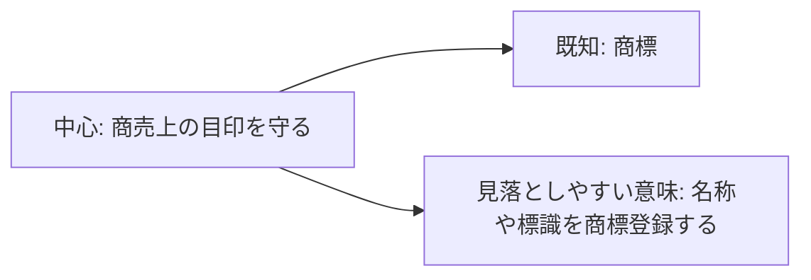

**重要語法**：`trademark a name / logo`


## 02. tube

**品詞**：noun　**発音**：/tuːb/

<small>よく知られている意味：管・筒</small>

### 見落としやすい意味

**ロンドンの地下鉄（the Tube）**

**例文**：We took the Tube across London.

**和訳**：私たちはロンドン市内を地下鉄で移動した。

**コアイメージ**：tube の基本は細長く中が空いた管。地下のトンネルを走るロンドンの地下鉄を、the Tube と呼ぶ。

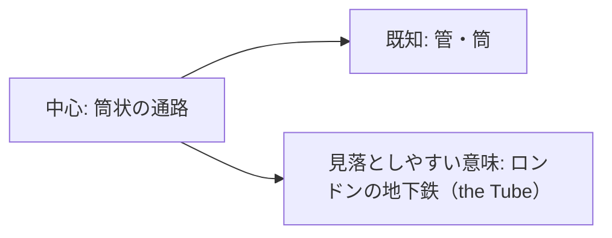

**重要語法**：`the Tube（ロンドンの地下鉄）`


## 03. spill

**品詞**：verb　**発音**：/spɪl/

<small>よく知られている意味：液体をこぼす</small>

### 見落としやすい意味

**秘密・情報を不用意に漏らす、口外する**

**例文**：She accidentally spilled the details of the plan.

**和訳**：彼女はうっかり計画の詳細を漏らしてしまった。

**コアイメージ**：容器から液体がこぼれるように、内にとどめるべき情報が外へ出るイメージ。秘密を思わず口にしてしまう場合にも使う。

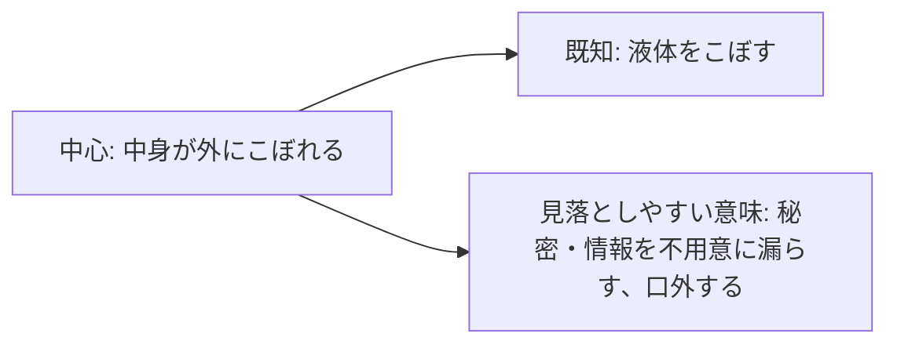

**重要語法**：`spill a secret / spill the beans`


## 04. spill

**品詞**：verb　**発音**：/spɪl/

<small>よく知られている意味：液体をこぼす</small>

### 見落としやすい意味

**（人々が）あふれ出て広がる**

**例文**：Fans spilled out of the stadium after the game.

**和訳**：試合後、ファンたちがスタジアムからあふれ出た。

**コアイメージ**：spill は中に収まりきらず外へ流れ出る動きを表す。液体だけでなく、大勢の人が出口などから広がっていく様子にも使える。

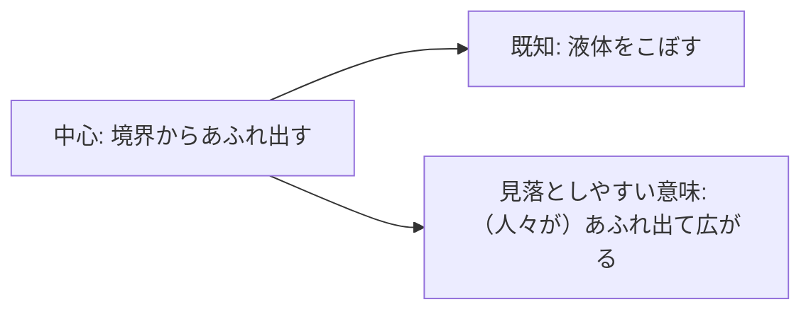

**重要語法**：`spill out of a place`


## 05. screw

**品詞**：phrasal verb　**発音**：/skruː/

<small>よく知られている意味：ねじ・ねじで締める</small>

### 見落としやすい意味

**（screw up）大失敗する、事態を台無しにする（口語）**

**例文**：I screwed up the directions and got us lost.

**和訳**：私は道順を間違えて、みんなを迷わせてしまった。

**コアイメージ**：ねじを扱う動きから、物事を乱したり台無しにしたりする口語表現へ広がる。screw up は失敗や取り違えをはっきり示す。

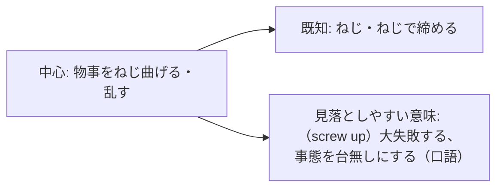

**重要語法**：`screw up（口語）`


## 06. promotion

**品詞**：noun　**発音**：/prəˈmoʊʃən/

<small>よく知られている意味：宣伝・販売促進</small>

### 見落としやすい意味

**職位・地位が上がること、昇進**

**例文**：She received a promotion after leading the project.

**和訳**：彼女はそのプロジェクトを率いたあと、昇進した。

**コアイメージ**：promote の中心には、今より上の段階へ進めるという発想がある。商品なら販売を促進し、人ならより高い職位へ進める。

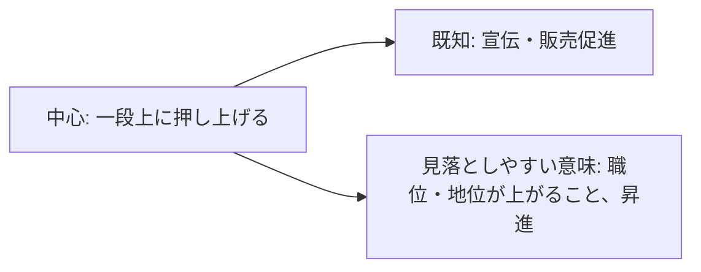

**重要語法**：`get a promotion`


## 07. interval

**品詞**：noun　**発音**：/ˈɪntərvəl/

<small>よく知られている意味：間隔</small>

### 見落としやすい意味

**演劇・演奏などの幕間の休憩（主に英国英語）**

**例文**：We bought drinks during the interval at the theatre.

**和訳**：私たちは劇場の幕間の休憩中に飲み物を買った。

**コアイメージ**：interval は時間や出来事のあいだの区切りを表す。舞台や演奏の前半と後半のあいだに設ける休憩も interval と呼ぶ。

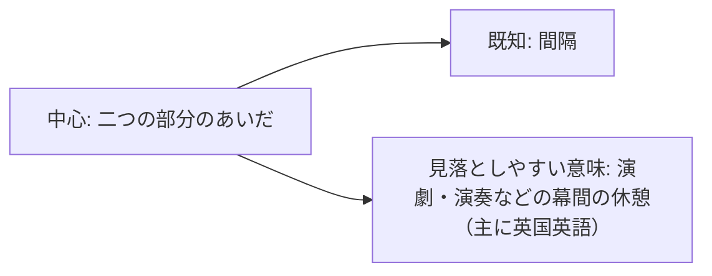

**重要語法**：`during the interval（主に英国英語）`


## 08. transmission

**品詞**：noun　**発音**：/trænzˈmɪʃən/

<small>よく知られている意味：伝達・送信</small>

### 見落としやすい意味

**車などの動力を車輪に伝える変速装置・変速機**

**例文**：This car has an automatic transmission.

**和訳**：この車にはオートマチック変速機が付いている。

**コアイメージ**：transmission は何かを一方から他方へ伝えること。車ではエンジンの力を車輪に伝える機構、特に変速機を指す。

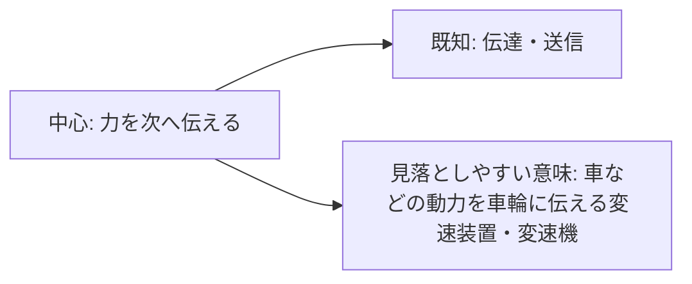

**重要語法**：`automatic / manual transmission`


## 09. dock

**品詞**：verb　**発音**：/dɑːk/

<small>よく知られている意味：波止場・船着き場</small>

### 見落としやすい意味

**賃金・手当などから金額を差し引く**

**例文**：The manager docked fifty dollars from his pay.

**和訳**：上司は彼の給料から50ドルを差し引いた。

**コアイメージ**：dock には船着き場という名詞のほか、金額を減額する動詞用法がある。給与などから一部を取り去る意味で、波止場との無理な関連づけは不要。

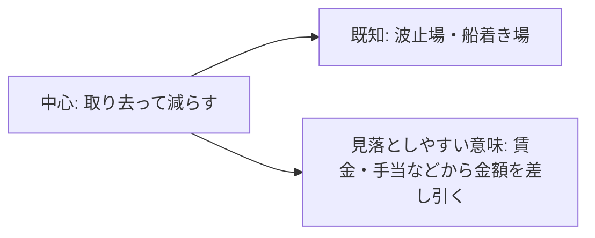

**重要語法**：`dock money from someone's pay`


## 10. attendance

**品詞**：noun　**発音**：/əˈtendəns/

<small>よく知られている意味：出席すること</small>

### 見落としやすい意味

**催しなどへの出席者数・入場者数**

**例文**：The festival recorded its highest attendance last year.

**和訳**：その祭りは昨年、過去最多の来場者数を記録した。

**コアイメージ**：attendance は集まりへの出席という事実を表す。集まった人数を数える文脈では、出席者数・来場者数そのものを意味する。

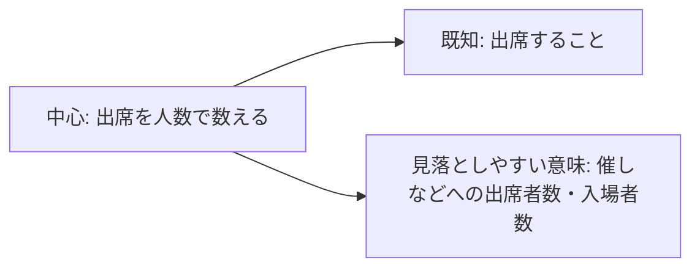

**重要語法**：`record attendance`


## 11. defect

**品詞**：verb　**発音**：/dɪˈfekt/

<small>よく知られている意味：欠陥（名詞）</small>

### 見落としやすい意味

**組織・国家などから離反して相手側へ移る（名詞と強勢が異なる）**

**例文**：Several soldiers defected to the other side.

**和訳**：数人の兵士が離反して敵側に移った。

**コアイメージ**：動詞 defect は、自分が属していた国家や組織から離れ、別の側につくことを表す。名詞 defect「欠陥」とは意味も強勢も異なるので、同じ発想で解釈しない。

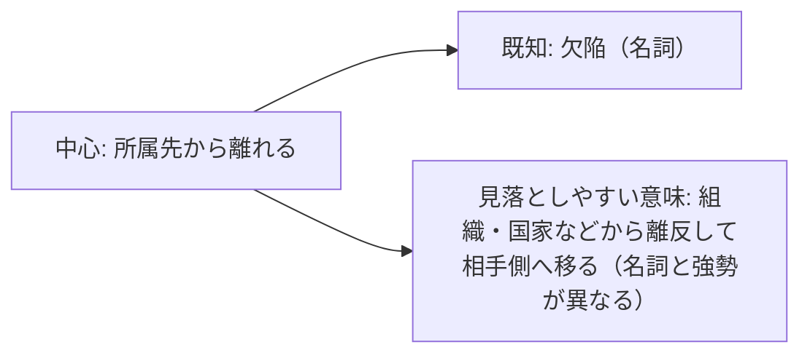

**重要語法**：`defect to ～；名詞は /ˈdiːfekt/`


## 12. nerve

**品詞**：noun　**発音**：/nɜːrv/

<small>よく知られている意味：神経</small>

### 見落としやすい意味

**厚かましさ、図太さ**

**例文**：He had the nerve to blame me for his mistake.

**和訳**：彼は厚かましくも自分のミスを私のせいにした。

**コアイメージ**：nerve は神経だけでなく、行動を起こす精神的な強さも指す。have the nerve to do は、非難すべき図々しい度胸があるという評価になる。

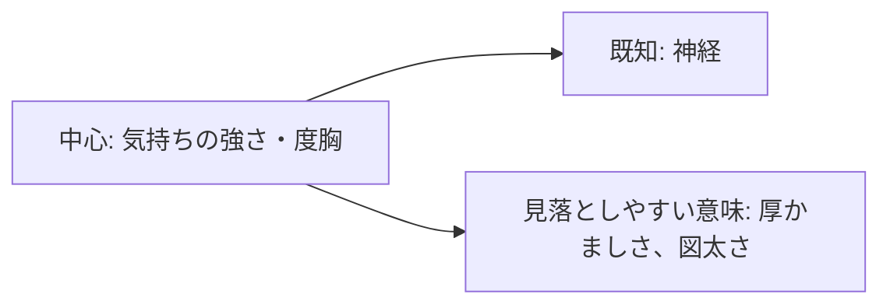

**重要語法**：`have the nerve to do`


## 13. nerve

**品詞**：verb　**発音**：/nɜːrv/

<small>よく知られている意味：神経</small>

### 見落としやすい意味

**勇気を奮い立たせる、気力を与える**

**例文**：She nerved herself for the difficult conversation.

**和訳**：彼女は難しい話し合いに向けて勇気を奮い立たせた。

**コアイメージ**：神経が緊張を支えることから、nerve には勇気や気力という意味もある。動詞では自分の気持ちを奮い立たせ、覚悟を固めることを表す。

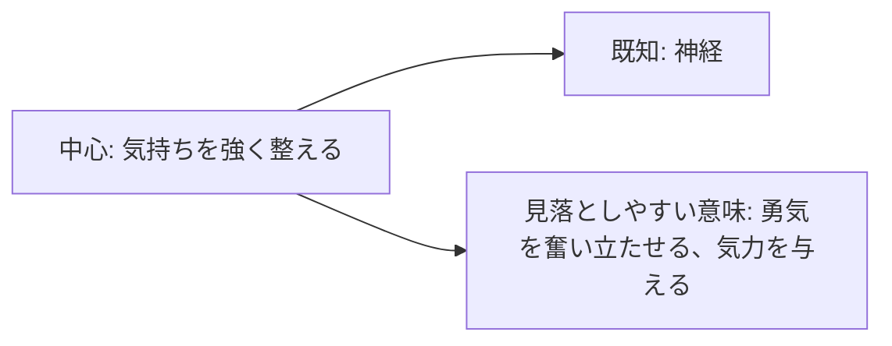

**重要語法**：`nerve oneself for / to do`


## 14. stiff

**品詞**：adjective　**発音**：/stɪf/

<small>よく知られている意味：硬い・こわばった</small>

### 見落としやすい意味

**（価格・費用が）法外に高い**

**例文**：The hotel charged a stiff fee for parking.

**和訳**：そのホテルは駐車料金を法外に高く設定していた。

**コアイメージ**：stiff は曲がりにくい硬さに加え、程度が厳しく負担が重い様子を表せる。料金については支払う側にとって高すぎるという評価になる。

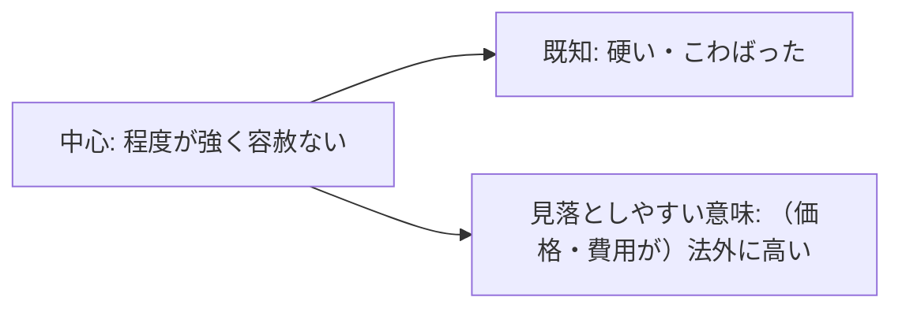

**重要語法**：`a stiff fee / price`


## 15. stiff

**品詞**：adjective　**発音**：/stɪf/

<small>よく知られている意味：硬い・こわばった</small>

### 見落としやすい意味

**（罰金・罰則が）厳しい、重い**

**例文**：The company faced a stiff penalty for breaking the rules.

**和訳**：その会社は規則違反で重い罰則を受けることになった。

**コアイメージ**：stiff の硬さが、融通のきかない厳しさの評価につながる。罰や制裁に使うと、軽くは済まされないほど重いことを表す。

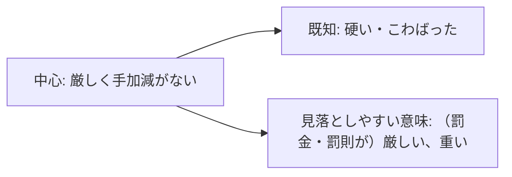

**重要語法**：`a stiff penalty / fine`


## 16. likelihood

**品詞**：idiom　**発音**：/ˈlaɪklihʊd/

<small>よく知られている意味：起こる見込み・可能性</small>

### 見落としやすい意味

**（in all likelihood）十中八九、おそらく間違いなく**

**例文**：In all likelihood, the train will be delayed.

**和訳**：十中八九、その列車は遅れるだろう。

**コアイメージ**：likelihood はあることが起こりそうな度合い。in all likelihood は可能性を強く見積もる慣用句で、「おそらく間違いなく」に近い。

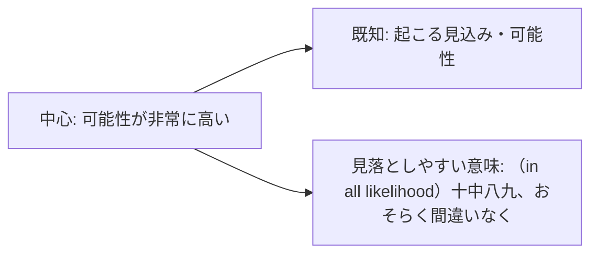

**重要語法**：`in all likelihood`


## 17. omit

**品詞**：verb　**発音**：/əˈmɪt/

<small>よく知られている意味：省く・除外する</small>

### 見落としやすい意味

**（omit to do）～し忘れる、うっかりしない**

**例文**：I omitted to tell her about the schedule change.

**和訳**：私は彼女に予定の変更を伝え忘れた。

**コアイメージ**：omit は何かを抜かすことで、必ずしも意図的とは限らない。omit to do はするべき行動が抜け落ちたことから、「し忘れる」の意味になる。

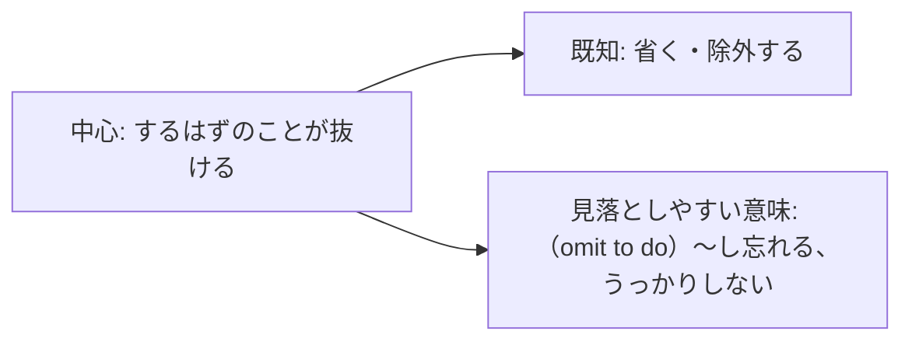

**重要語法**：`omit to do`


## 18. articulate

**品詞**：adjective　**発音**：/ɑːrˈtɪkjələt/

<small>よく知られている意味：（動詞）明確に述べる</small>

### 見落としやすい意味

**考えを明晰に表現できる（同綴りの動詞と発音が異なる）**

**例文**：She is an articulate speaker who explains complex ideas simply.

**和訳**：彼女は複雑な考えを分かりやすく説明できる、話の明晰な人だ。

**コアイメージ**：articulate は考えを言葉としてはっきり形にすることと関係する。形容詞では、その力を備えて表現が明晰な人を表す。

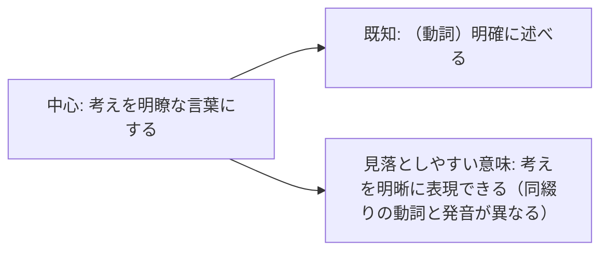

**重要語法**：`形容詞の語尾は /lət/、動詞は /leɪt/`


## 19. articulate

**品詞**：verb　**発音**：/ɑːrˈtɪkjəleɪt/

<small>よく知られている意味：（形容詞）話の明晰な</small>

### 見落としやすい意味

**考え・感情・意見を言葉ではっきり表現する**

**例文**：He struggled to articulate his feelings.

**和訳**：彼は自分の気持ちを言葉ではっきり表そうと苦労した。

**コアイメージ**：頭の中にある考えを、相手に伝わる言葉として区切り明確にするイメージ。動詞 articulate はその表現する行為を指す。

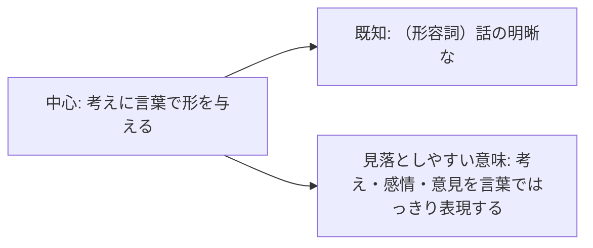

**重要語法**：`articulate an idea / feelings；形容詞は /lət/`


## 20. cancel

**品詞**：phrasal verb　**発音**：/ˈkænsəl/

<small>よく知られている意味：中止する・取り消す</small>

### 見落としやすい意味

**（cancel out）双方の効果を相殺して帳消しにする**

**例文**：The two forces cancel each other out.

**和訳**：二つの力は互いに打ち消し合う。

**コアイメージ**：cancel は予定を取り消すだけでなく、存在する効果を打ち消す意味にも広がる。cancel out は反対向きの力や影響などが相殺されることを表す。

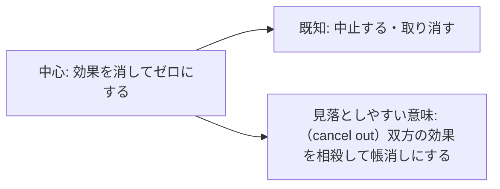

**重要語法**：`cancel out；cancel each other out`


## 21. correspondent

**品詞**：noun　**発音**：/ˌkɔːrəˈspɑːndənt/

<small>よく知られている意味：文通相手</small>

### 見落としやすい意味

**新聞・放送局の通信員・特派員**

**例文**：She works as a foreign correspondent in Nairobi.

**和訳**：彼女はナイロビで海外特派員として働いている。

**コアイメージ**：correspondent は遠く離れた相手と情報をやり取りする人。私信の文通相手だけでなく、報道機関へ現地のニュースを送る通信員も指す。

```mermaid
flowchart LR
    A["中心: 離れた相手に情報を伝える"]
    B["既知: 文通相手"]
    C["見落としやすい意味: 新聞・放送局の通信員・特派員"]
    A --> B
    A --> C
```

**重要語法**：`foreign correspondent`


## 22. filter

**品詞**：phrasal verb　**発音**：/ˈfɪltər/

<small>よく知られている意味：液体などをろ過する</small>

### 見落としやすい意味

**（filter out）不必要な情報や候補などを取り除く**

**例文**：The app filters out unwanted notifications.

**和訳**：そのアプリは不要な通知を取り除く。

**コアイメージ**：filter は網目を通して必要なものと不要なものを分ける働き。情報や候補にも使い、filter out で不要なものを除去する意味になる。

```mermaid
flowchart LR
    A["中心: 必要なものだけ通す"]
    B["既知: 液体などをろ過する"]
    C["見落としやすい意味: （filter out）不必要な情報や候補などを取り除く"]
    A --> B
    A --> C
```

**重要語法**：`filter out noise / unwanted items`


## 23. filter

**品詞**：phrasal verb　**発音**：/ˈfɪltər/

<small>よく知られている意味：液体などをろ過する</small>

### 見落としやすい意味

**（filter through）情報などが少しずつ伝わる**

**例文**：News of the decision slowly filtered through the town.

**和訳**：その決定の知らせは町じゅうに少しずつ伝わった。

**コアイメージ**：filter には何かが細かな隙間を通ってゆっくり進むイメージがある。情報が人から人へ徐々に広がるときにも filter through を使う。

```mermaid
flowchart LR
    A["中心: 少しずつ通り抜ける"]
    B["既知: 液体などをろ過する"]
    C["見落としやすい意味: （filter through）情報などが少しずつ伝わる"]
    A --> B
    A --> C
```

**重要語法**：`news filters through`


## 24. pillar

**品詞**：noun　**発音**：/ˈpɪlər/

<small>よく知られている意味：柱</small>

### 見落としやすい意味

**組織・思想などを支える中心人物・柱**

**例文**：She has been a pillar of the community for decades.

**和訳**：彼女は何十年も地域社会の中心的な支えとなってきた。

**コアイメージ**：建物の重みを支える柱が基本イメージ。そこから組織や地域の存続を支える重要人物にも pillar を使う。

```mermaid
flowchart LR
    A["中心: 全体を支える柱"]
    B["既知: 柱"]
    C["見落としやすい意味: 組織・思想などを支える中心人物・柱"]
    A --> B
    A --> C
```

**重要語法**：`a pillar of the community`


## 25. revolt

**品詞**：verb　**発音**：/rɪˈvoʊlt/

<small>よく知られている意味：反乱する</small>

### 見落としやすい意味

**むかつかせる；強い嫌悪感を起こさせる**

**例文**：The smell of spoiled food revolted the guests.

**和訳**：傷んだ食べ物のにおいは客たちに強い嫌悪感を抱かせた。

**コアイメージ**：revolt は支配や現状に強く反発することを表す。人の感覚や気持ちが何かを強く拒絶する場合には「むかつかせる」という他動詞になる。

```mermaid
flowchart LR
    A["中心: 強く反発して退ける"]
    B["既知: 反乱する"]
    C["見落としやすい意味: むかつかせる；強い嫌悪感を起こさせる"]
    A --> B
    A --> C
```

**重要語法**：`be revolted by ～`


## 26. neck

**品詞**：noun　**発音**：/nek/

<small>よく知られている意味：首</small>

### 見落としやすい意味

**接戦；互角の状態**

**例文**：The two runners were neck and neck near the finish line.

**和訳**：二人の走者はゴール間際まで接戦だった。

**コアイメージ**：首は体の前後関係が分かる部分。neck and neck は競走する者の首が同じ位置にあるように、ほぼ互角で並んでいる状態を表す。

```mermaid
flowchart LR
    A["中心: 首の位置まで並ぶ"]
    B["既知: 首"]
    C["見落としやすい意味: 接戦；互角の状態"]
    A --> B
    A --> C
```

**重要語法**：`neck and neck`


## 27. snake

**品詞**：verb　**発音**：/sneɪk/

<small>よく知られている意味：蛇</small>

### 見落としやすい意味

**蛇行する；曲がりくねって進む**

**例文**：A narrow road snakes through the hills.

**和訳**：細い道が丘の間を曲がりくねって続いている。

**コアイメージ**：snake は蛇の曲がりくねった姿や進み方が中心のイメージ。道や川を主語にすると、その形で伸びていく動詞になる。

```mermaid
flowchart LR
    A["中心: 蛇のようにくねる"]
    B["既知: 蛇"]
    C["見落としやすい意味: 蛇行する；曲がりくねって進む"]
    A --> B
    A --> C
```

**重要語法**：`snake through / across`


## 28. bench

**品詞**：noun　**発音**：/bentʃ/

<small>よく知られている意味：公園などのベンチ</small>

### 見落としやすい意味

**裁判官；裁判官席**

**例文**：The judge has served on the bench for twenty years.

**和訳**：その裁判官は20年間裁判官を務めてきた。

**コアイメージ**：bench は人が座る長い台を表す。裁判官が職務を行う席から転じ、裁判官の地位や裁判官たちそのものも意味する。

```mermaid
flowchart LR
    A["中心: 職務を行う席"]
    B["既知: 公園などのベンチ"]
    C["見落としやすい意味: 裁判官；裁判官席"]
    A --> B
    A --> C
```

**重要語法**：`on the bench`


## 29. rubber

**品詞**：noun　**発音**：/ˈrʌbər/

<small>よく知られている意味：ゴム</small>

### 見落としやすい意味

**消しゴム（主にイギリス英語）**

**例文**：May I borrow your rubber to erase this pencil mark?

**和訳**：この鉛筆の跡を消すために、消しゴムを借りてもいいですか。

**コアイメージ**：rub はこする動きを表し、rubber はこすって消すものを指せる。英国英語では消しゴムの意味で一般的だが、米国英語では eraser を使うのが無難。

```mermaid
flowchart LR
    A["中心: こすって消す道具"]
    B["既知: ゴム"]
    C["見落としやすい意味: 消しゴム（主にイギリス英語）"]
    A --> B
    A --> C
```

**重要語法**：`rubber＝eraser（主に英国英語）`


## 30. threshold

**品詞**：noun　**発音**：/ˈθreʃhoʊld/

<small>よく知られている意味：戸口・しきい値</small>

### 見落としやすい意味

**～の直前・入り口**

**例文**：The team is on the threshold of a major discovery.

**和訳**：そのチームは大発見を目前にしている。

**コアイメージ**：threshold は部屋の入口にある敷居や、何かが変わる境目を指す。on the threshold of はその境目のすぐ手前にいるイメージから「目前」を表す。

```mermaid
flowchart LR
    A["中心: 境界を越える直前"]
    B["既知: 戸口・しきい値"]
    C["見落としやすい意味: ～の直前・入り口"]
    A --> B
    A --> C
```

**重要語法**：`on the threshold of ～`


## 31. appreciation

**品詞**：noun　**発音**：/əˌpriːʃiˈeɪʃən/

<small>よく知られている意味：感謝・鑑賞</small>

### 見落としやすい意味

**資産・通貨などの価値上昇**

**例文**：The appreciation of the currency made imports cheaper.

**和訳**：その通貨の価値上昇によって、輸入品が安くなった。

**コアイメージ**：appreciation は価値を認めることから、価値自体が高まることも表す。経済では通貨や資産の価格・価値の上昇を指す。

```mermaid
flowchart LR
    A["中心: 価値を高く評価する"]
    B["既知: 感謝・鑑賞"]
    C["見落としやすい意味: 資産・通貨などの価値上昇"]
    A --> B
    A --> C
```

**重要語法**：`currency appreciation`


## 32. mill

**品詞**：verb　**発音**：/mɪl/

<small>よく知られている意味：製粉所</small>

### 見落としやすい意味

**（人々が）あてもなく歩き回る**

**例文**：Visitors milled around the entrance before the show.

**和訳**：開演前、来場者たちは入口付近をあてもなく歩き回っていた。

**コアイメージ**：mill には製粉する動きから、人が一定の場所をあちこち動く意味がある。mill around は特に目的なく群れて歩き回る様子を表す。

```mermaid
flowchart LR
    A["中心: 同じ場所を動き回る"]
    B["既知: 製粉所"]
    C["見落としやすい意味: （人々が）あてもなく歩き回る"]
    A --> B
    A --> C
```

**重要語法**：`mill around / about`


## 33. illustration

**品詞**：noun　**発音**：/ˌɪləˈstreɪʃən/

<small>よく知られている意味：挿絵・イラスト</small>

### 見落としやすい意味

**具体例；説明のための事例**

**例文**：Let me give you a simple illustration of the problem.

**和訳**：この問題について簡単な具体例を挙げましょう。

**コアイメージ**：illustration は内容を理解しやすくするための示し方。絵による説明だけでなく、論点を明らかにする具体的な事例にも使う。

```mermaid
flowchart LR
    A["中心: 分かるように示す"]
    B["既知: 挿絵・イラスト"]
    C["見落としやすい意味: 具体例；説明のための事例"]
    A --> B
    A --> C
```

**重要語法**：`by way of illustration`


## 34. cheat

**品詞**：verb　**発音**：/tʃiːt/

<small>よく知られている意味：カンニングする・ずるをする</small>

### 見落としやすい意味

**（人を）だまして～を奪う**

**例文**：The agent cheated the family out of their savings.

**和訳**：その代理人は家族をだまして貯金を奪った。

**コアイメージ**：cheat は正当なルールや信頼を裏切って利益を得ること。cheat 人 out of 物 の形では、人をだまして本来持っているものを失わせる。

```mermaid
flowchart LR
    A["中心: 不正に利益を得る"]
    B["既知: カンニングする・ずるをする"]
    C["見落としやすい意味: （人を）だまして～を奪う"]
    A --> B
    A --> C
```

**重要語法**：`cheat someone out of something`


## 35. coup

**品詞**：noun　**発音**：/kuː/

<small>よく知られている意味：クーデター・政変</small>

### 見落としやすい意味

**鮮やかな成功；巧みな一手**

**例文**：Securing the agreement was a major diplomatic coup.

**和訳**：その合意を取り付けたことは、外交上の鮮やかな成功だった。

**コアイメージ**：coup は突然の大胆な行動が成功をもたらすことに関係する。政変に限らず、難しい目標を達成した巧みな一手にも使う。

```mermaid
flowchart LR
    A["中心: 大胆な一手で成果を奪う"]
    B["既知: クーデター・政変"]
    C["見落としやすい意味: 鮮やかな成功；巧みな一手"]
    A --> B
    A --> C
```

**重要語法**：`a diplomatic coup`


## 36. incumbent

**品詞**：adjective　**発音**：/ɪnˈkʌmbənt/

<small>よく知られている意味：現職者</small>

### 見落としやすい意味

**（人にとって）義務となる**

**例文**：It is incumbent on us to protect the river.

**和訳**：その川を守ることは私たちの義務だ。

**コアイメージ**：incumbent はある地位を担う人を指す一方、責務が人に課される意味も持つ。be incumbent on 人 to do で、その人がすべき義務を表す。

```mermaid
flowchart LR
    A["中心: 立場に伴う責任"]
    B["既知: 現職者"]
    C["見落としやすい意味: （人にとって）義務となる"]
    A --> B
    A --> C
```

**重要語法**：`be incumbent on/upon someone to do`


## 37. belt

**品詞**：verb　**発音**：/belt/

<small>よく知られている意味：ベルト</small>

### 見落としやすい意味

**（歌などを）大声で歌う**

**例文**：She belted out the final song.

**和訳**：彼女は最後の曲を大声で力強く歌った。

**コアイメージ**：belt は強く打つ・勢いよく行う動詞としても使われる。belt out は歌や言葉を力いっぱい外へ出すイメージ。

```mermaid
flowchart LR
    A["中心: 力を込めて勢いよく放つ"]
    B["既知: ベルト"]
    C["見落としやすい意味: （歌などを）大声で歌う"]
    A --> B
    A --> C
```

**重要語法**：`belt out a song`


## 38. trash

**品詞**：verb　**発音**：/træʃ/

<small>よく知られている意味：ごみ</small>

### 見落としやすい意味

**酷評する；けなす**

**例文**：Reviewers trashed the sequel for its weak plot.

**和訳**：批評家たちは続編の筋書きが弱いと酷評した。

**コアイメージ**：trash は捨てるべきごみを表す。動詞では作品や意見を価値が低いもののように扱い、激しくけなす意味になる。

```mermaid
flowchart LR
    A["中心: 価値のないものとして扱う"]
    B["既知: ごみ"]
    C["見落としやすい意味: 酷評する；けなす"]
    A --> B
    A --> C
```

**重要語法**：`trash a proposal / film`


## 39. curiosity

**品詞**：noun　**発音**：/ˌkjʊriˈɑːsəti/

<small>よく知られている意味：好奇心</small>

### 見落としやすい意味

**珍しい物；珍品**

**例文**：The old clock is a curiosity that attracts visitors.

**和訳**：その古い時計は訪問者の興味を引く珍品だ。

**コアイメージ**：curiosity は何かを知りたい気持ちを表す。そこから、その気持ちを起こさせる珍しい物そのものも意味する。

```mermaid
flowchart LR
    A["中心: 好奇心を引く対象"]
    B["既知: 好奇心"]
    C["見落としやすい意味: 珍しい物；珍品"]
    A --> B
    A --> C
```

**重要語法**：`a curiosity`


## 40. clip

**品詞**：noun　**発音**：/klɪp/

<small>よく知られている意味：留め具・短い映像</small>

### 見落としやすい意味

**速さ；ペース**

**例文**：The factory is expanding at a good clip.

**和訳**：その工場はかなり速いペースで拡張している。

**コアイメージ**：clip には一定の歩調や進み方を表す用法がある。at a good clip は物事が勢いよく、かなりの速度で進む意味になる。

```mermaid
flowchart LR
    A["中心: きびきび進む速さ"]
    B["既知: 留め具・短い映像"]
    C["見落としやすい意味: 速さ；ペース"]
    A --> B
    A --> C
```

**重要語法**：`at a good clip`

