# EasyVoca｜完成教材カード 第031バッチ

採用済み語義のglobal_order 2401〜2480。見落としやすい意味を中心に、オリジナル例文・コアイメージ・Mermaid模式図で学ぶ。

### 01. dip

**品詞：** 動詞　 **発音：** /dɪp/

<small>よく知られている意味：少し浸す</small>

**見落としやすい意味：貯金・資源などを取り崩す**

**例文：** To pay for the repairs, we had to dip into our savings.

**和訳：** 修理代を払うために、私たちは貯金を取り崩さなければならなかった。

**コアイメージ：** dipは何かの中へ少し入る動き。水の中に物を入れるだけでなく、蓄えの中に手を入れて一部を使う場面にも広がる。

**図：**

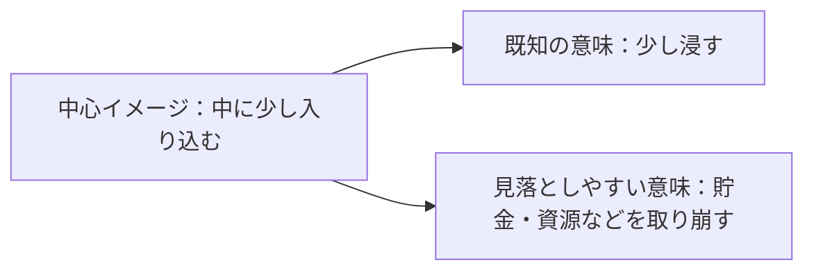

**重要語法：** dip into savings

<small>candidate_id: `ev-04183-verb-01` / index: 4183 / global_order: 2401</small>

---

### 02. pad

**品詞：** 動詞　 **発音：** /pæd/

<small>よく知られている意味：詰め物をする</small>

**見落としやすい意味：数値・経費などを不正に水増しする**

**例文：** The contractor padded the bill with charges for work that was never done.

**和訳：** その業者は、実施していない作業の料金を加えて請求額を水増しした。

**コアイメージ：** padには、詰め物を加えて厚くするイメージがある。数字や請求額に余分なものを付け足すと、不正な水増しという意味になる。

**図：**

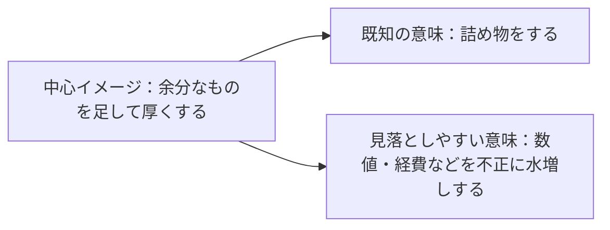

**重要語法：** pad the figures

<small>candidate_id: `ev-04187-verb-01` / index: 4187 / global_order: 2402</small>

---

### 03. exploitation

**品詞：** 名詞　 **発音：** /ˌeksplɔɪˈteɪʃən/

<small>よく知られている意味：搾取</small>

**見落としやすい意味：資源や機会の有効利用・開発**

**例文：** The sustainable exploitation of wind resources could reduce fuel imports.

**和訳：** 風力資源の持続可能な利用は、燃料の輸入を減らす可能性がある。

**コアイメージ：** exploitationの中心は、何かを活用して利益や成果を得ること。人に向けば搾取という否定的な意味になり、資源に向けば開発・利用という中立的な意味にもなる。

**図：**

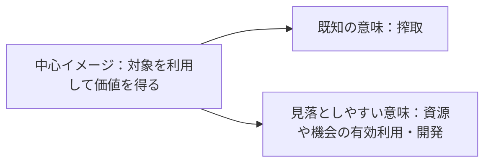

**重要語法：** exploitation of natural resources

<small>candidate_id: `ev-04190-noun-01` / index: 4190 / global_order: 2403</small>

---

### 04. intrigue

**品詞：** 動詞　 **発音：** /ɪnˈtriːɡ/

<small>よく知られている意味：陰謀（名詞）</small>

**見落としやすい意味：興味・好奇心をかき立てる**

**例文：** The unusual results intrigued the researchers.

**和訳：** その異例の結果は研究者たちの好奇心をかき立てた。

**コアイメージ：** intrigueには、人の目を引く複雑さや謎めいた感じがある。秘密の策略という名詞だけでなく、謎によって人を引きつける動詞にもなる。

**図：**

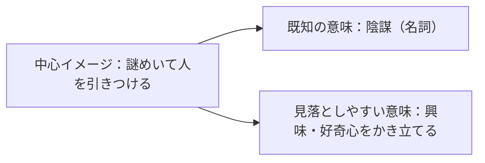

<small>candidate_id: `ev-04191-verb-01` / index: 4191 / global_order: 2404</small>

---

### 05. consolidate

**品詞：** 動詞　 **発音：** /kənˈsɑːlɪdeɪt/

<small>よく知られている意味：統合する</small>

**見落としやすい意味：権力・立場・成果などを強固にする**

**例文：** The victory helped the leader consolidate her position.

**和訳：** その勝利は、指導者が自分の立場を固める助けになった。

**コアイメージ：** consolidateは、ばらついたものを一つにまとめて強くすること。組織の統合だけでなく、すでに持つ権力や成果を確かなものにする場合にも使う。

**図：**

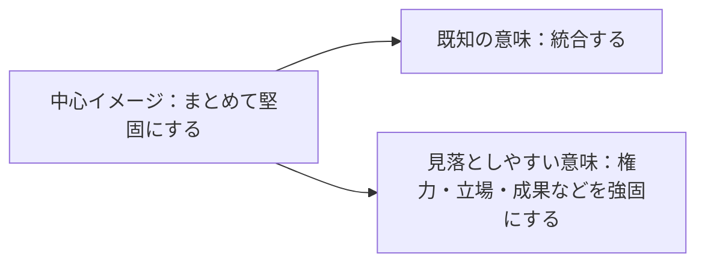

**重要語法：** consolidate power

<small>candidate_id: `ev-04192-verb-01` / index: 4192 / global_order: 2405</small>

---

### 06. bullet

**品詞：** 名詞　 **発音：** /ˈbʊlɪt/

<small>よく知られている意味：弾丸</small>

**見落としやすい意味：箇条書きの記号；箇条書き項目**

**例文：** List the main reasons as three bullet points.

**和訳：** 主な理由を三つの箇条書き項目にして示しなさい。

**コアイメージ：** bulletはもともと小さな弾丸を指す。文書では、それに似た小さな記号や、その記号を使った箇条書き項目を表す。

**図：**

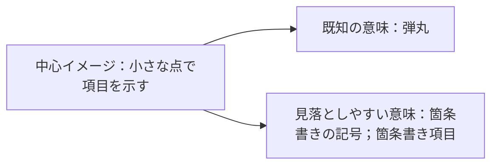

**重要語法：** bullet points

<small>candidate_id: `ev-04195-noun-01` / index: 4195 / global_order: 2406</small>

---

### 07. linguist

**品詞：** 名詞　 **発音：** /ˈlɪŋɡwɪst/

<small>よく知られている意味：言語学者</small>

**見落としやすい意味：複数言語に堪能な人**

**例文：** As a skilled linguist, she can communicate in five languages.

**和訳：** 彼女は語学に堪能で、五つの言語で意思疎通できる。

**コアイメージ：** linguistの中心にあるのは言語に詳しい人ということ。言語を研究する専門家を指すほか、複数の言葉を上手に使える人も指す。

**図：**

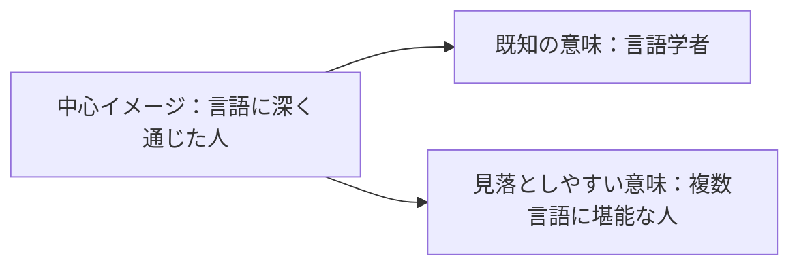

**重要語法：** a gifted linguist

<small>candidate_id: `ev-04201-noun-01` / index: 4201 / global_order: 2407</small>

---

### 08. making

**品詞：** 名詞　 **発音：** /ˈmeɪkɪŋ/

<small>よく知られている意味：製作・作ること</small>

**見落としやすい意味：～になる過程；形成途上**

**例文：** The documentary follows a young artist in the making.

**和訳：** そのドキュメンタリーは、成長途中の若い芸術家を追っている。

**コアイメージ：** makingは、何かが形づくられていく過程を表す。in the makingでは完成品ではなく、今まさにその状態へ近づいていることに注目する。

**図：**

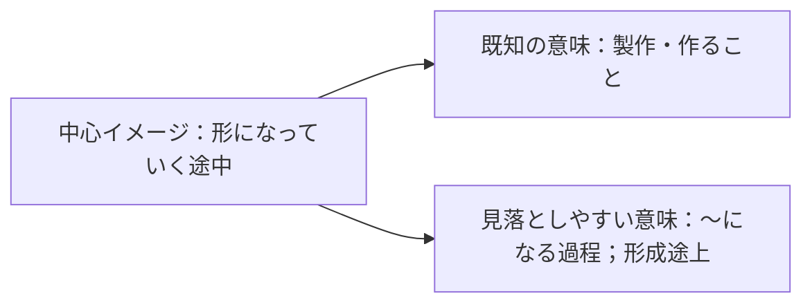

**重要語法：** in the making

<small>candidate_id: `ev-04202-noun-01` / index: 4202 / global_order: 2408</small>

---

### 09. oblige

**品詞：** 動詞　 **発音：** /əˈblaɪdʒ/

<small>よく知られている意味：義務づける</small>

**見落としやすい意味：人の頼みに応じて便宜を図る**

**例文：** She asked us to move the meeting, and we were happy to oblige.

**和訳：** 彼女が会議の時間変更を頼んだので、私たちは快く応じた。

**コアイメージ：** obligeは、相手の求めに応じるという関係を表す。命令や義務によって従わせる場合もあれば、親切心から頼みをかなえる場合もある。

**図：**

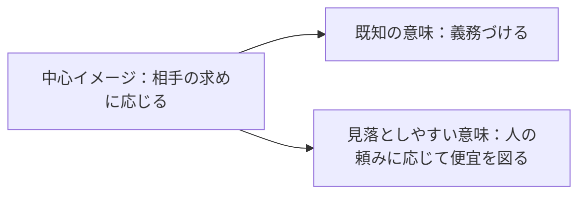

<small>candidate_id: `ev-04203-verb-01` / index: 4203 / global_order: 2409</small>

---

### 10. peculiar

**品詞：** 形容詞　 **発音：** /pɪˈkjuːliər/

<small>よく知られている意味：奇妙な</small>

**見落としやすい意味：～に固有の；特有の**

**例文：** This custom is peculiar to the island.

**和訳：** この習慣はその島に特有のものだ。

**コアイメージ：** peculiarは、ほかとは異なる性質があることに注目する。違いを奇妙だと評価する場合も、ある場所だけに固有だと述べる場合もある。

**図：**

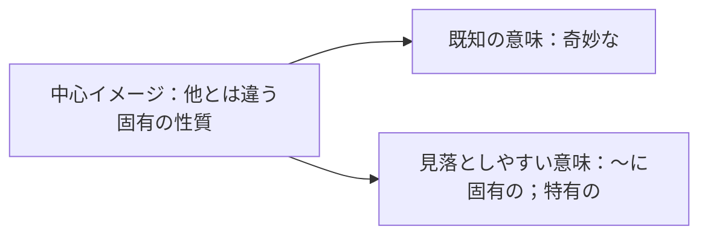

**重要語法：** peculiar to

<small>candidate_id: `ev-04204-adjective-01` / index: 4204 / global_order: 2410</small>

---

### 11. tout

**品詞：** 動詞　 **発音：** /taʊt/

<small>よく知られている意味：しつこく売り込む</small>

**見落としやすい意味：～と高く評価して宣伝する**

**例文：** The device is being touted as a major breakthrough.

**和訳：** その装置は大きな技術革新だと盛んに宣伝されている。

**コアイメージ：** toutには、何かの価値を強く訴えて人に知らせる感じがある。be touted asでは、ある評価や肩書きで広く売り込まれていることを示す。

**図：**

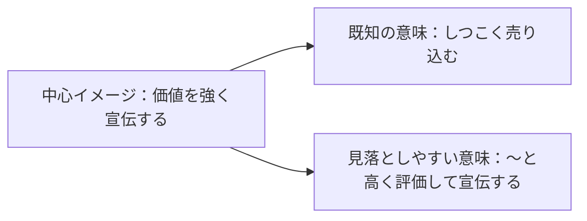

**重要語法：** be touted as

<small>candidate_id: `ev-04209-verb-01` / index: 4209 / global_order: 2411</small>

---

### 12. cookie

**品詞：** 名詞　 **発音：** /ˈkʊki/

<small>よく知られている意味：クッキー（菓子）</small>

**見落としやすい意味：ウェブサイトが保存する小さなデータ**

**例文：** The website uses cookies to remember your language settings.

**和訳：** そのウェブサイトは、言語設定を記憶するためにクッキーを使っている。

**コアイメージ：** ITでのcookieは、ブラウザーに保存される小さな情報のこと。菓子の意味から動作を推測するより、分野ごとの同じ呼び名として区別すると分かりやすい。

**図：**

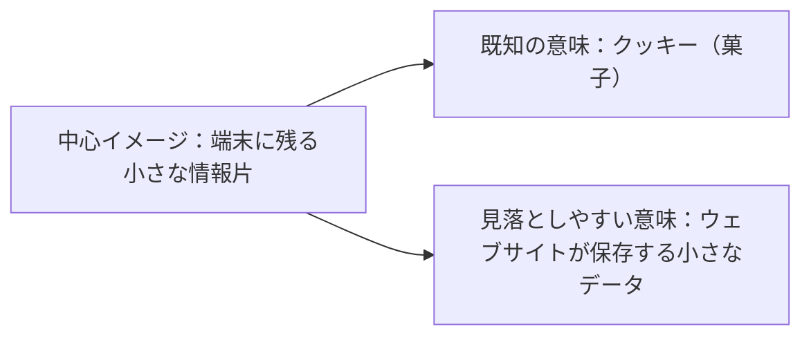

**重要語法：** browser cookie

<small>candidate_id: `ev-04211-noun-01` / index: 4211 / global_order: 2412</small>

---

### 13. deadly

**品詞：** 副詞　 **発音：** /ˈdedli/

<small>よく知られている意味：致命的な</small>

**見落としやすい意味：極めて；ひどく**

**例文：** The team was deadly serious about meeting the safety standards.

**和訳：** そのチームは安全基準を満たすことに極めて真剣だった。

**コアイメージ：** deadlyは、命に関わるほど強いという印象を持つ。副詞として程度を強く言うと、非常に・極めての意味になる。

**図：**

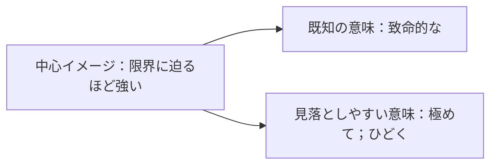

**重要語法：** deadly serious

<small>candidate_id: `ev-04214-adverb-01` / index: 4214 / global_order: 2413</small>

---

### 14. brass

**品詞：** 名詞　 **発音：** /bræs/

<small>よく知られている意味：真ちゅう</small>

**見落としやすい意味：組織の上層部・幹部**

**例文：** The top brass approved the new plan.

**和訳：** 組織の幹部たちが新しい計画を承認した。

**コアイメージ：** brassは真ちゅうという金属の名。top brassは軍や組織の上層部を指す慣用的な表現なので、金属の話として直訳しない。

**図：**

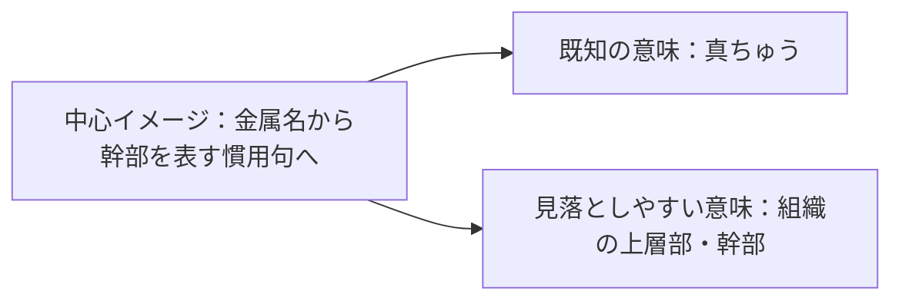

**重要語法：** the top brass

<small>candidate_id: `ev-04216-noun-01` / index: 4216 / global_order: 2414</small>

---

### 15. heel

**品詞：** 名詞　 **発音：** /hiːl/

<small>よく知られている意味：かかと</small>

**見落としやすい意味：～のすぐ後に続いて**

**例文：** The policy change came on the heels of a public debate.

**和訳：** その方針変更は、公開討論のすぐ後に行われた。

**コアイメージ：** heelは足のかかとを指す。on the heels ofは前を行くもののかかとに続くような近さから、出来事が直後に起こることを表す。

**図：**

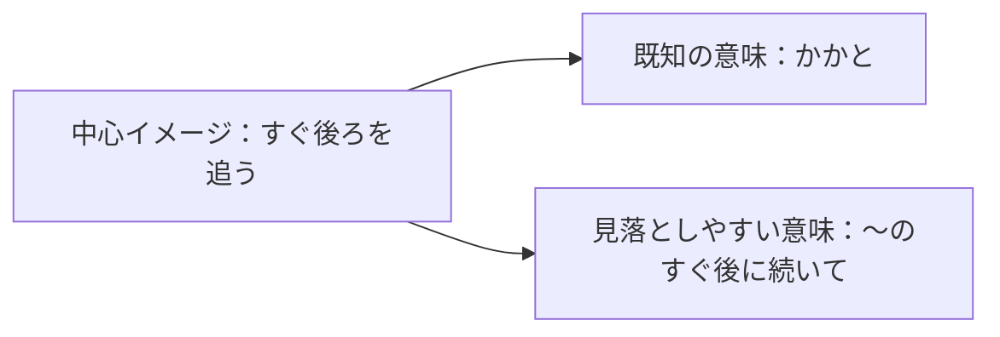

**重要語法：** on the heels of

<small>candidate_id: `ev-04217-noun-01` / index: 4217 / global_order: 2415</small>

---

### 16. rocket

**品詞：** 動詞　 **発音：** /ˈrɑːkɪt/

<small>よく知られている意味：ロケット</small>

**見落としやすい意味：急増・急上昇する**

**例文：** Housing prices rocketed in the city last year.

**和訳：** 昨年、その都市では住宅価格が急騰した。

**コアイメージ：** ロケットが勢いよく上がる動きが出発点。数値や価格が短期間で大きく上がることにも動詞rocketを使う。

**図：**

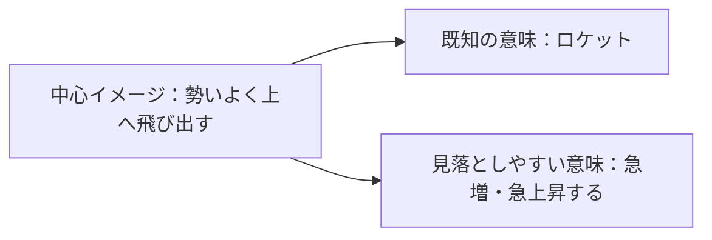

**重要語法：** prices rocket

<small>candidate_id: `ev-04219-verb-01` / index: 4219 / global_order: 2416</small>

---

### 17. backward

**品詞：** 形容詞　 **発音：** /ˈbækwərd/

<small>よく知られている意味：後ろ向きの</small>

**見落としやすい意味：時代遅れの；発展の遅れた**

**例文：** The factory still relies on backward technology.

**和訳：** その工場はいまだに時代遅れの技術に頼っている。

**コアイメージ：** backwardは前へ進む方向と逆という感覚を持つ。技術や制度の発展について言えば、進歩から取り残された状態を示す。

**図：**

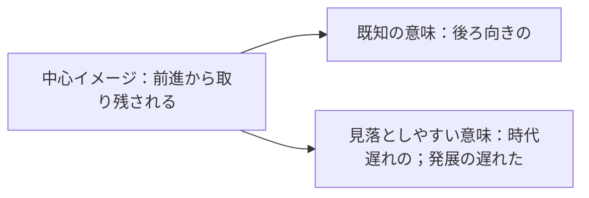

**重要語法：** backward technology

<small>candidate_id: `ev-04221-adjective-01` / index: 4221 / global_order: 2417</small>

---

### 18. equity

**品詞：** 名詞　 **発音：** /ˈekwəti/

<small>よく知られている意味：公平・公正</small>

**見落としやすい意味：株主資本；持分**

**例文：** The company strengthened its equity by retaining profits.

**和訳：** その会社は利益を内部に留保することで自己資本を増やした。

**コアイメージ：** equityは、公正な持分や権利に関わる語でもある。財務では資産から負債を差し引いた持分の価値を指し、公平という抽象義とは使う分野が異なる。

**図：**

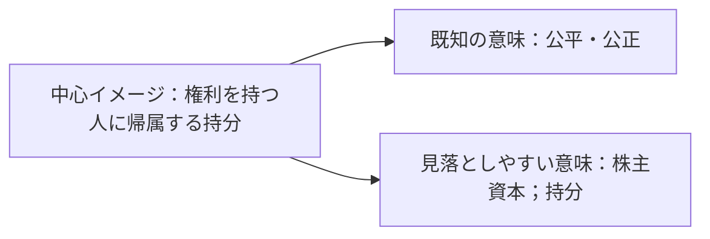

**重要語法：** shareholder equity

<small>candidate_id: `ev-04224-noun-01` / index: 4224 / global_order: 2418</small>

---

### 19. humble

**品詞：** 動詞　 **発音：** /ˈhʌmbəl/

<small>よく知られている意味：謙虚な</small>

**見落としやすい意味：屈服させる；自尊心をくじく**

**例文：** The unexpected defeat humbled the champions.

**和訳：** 予想外の敗北は、王者たちの自信をくじいた。

**コアイメージ：** humbleには、自分を高く置かないという感覚がある。動詞になると、他人の思い上がりや優越感を下げる行為を表す。

**図：**

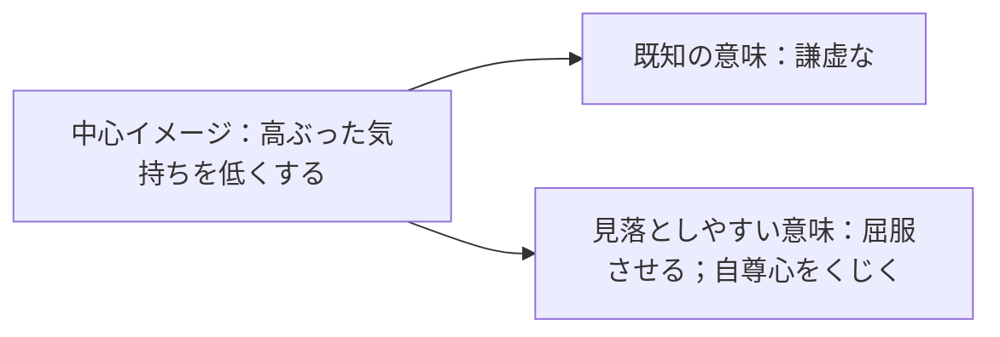

<small>candidate_id: `ev-04225-verb-01` / index: 4225 / global_order: 2419</small>

---

### 20. succession

**品詞：** 名詞　 **発音：** /səkˈseʃən/

<small>よく知られている意味：連続</small>

**見落としやすい意味：地位・王位などの継承**

**例文：** The law sets clear rules for succession to the throne.

**和訳：** その法律は王位継承について明確な規則を定めている。

**コアイメージ：** successionは、前のもののあとに別のものが続くこと。出来事の連続にも、地位や役割を次の人が引き継ぐことにも使う。

**図：**

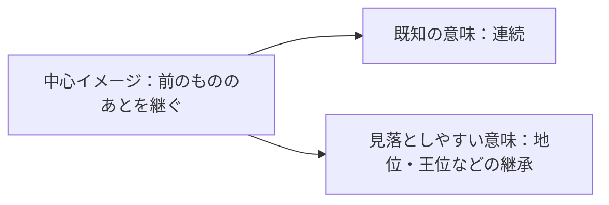

**重要語法：** succession to the throne

<small>candidate_id: `ev-04227-noun-01` / index: 4227 / global_order: 2420</small>

---

### 21. haunt

**品詞：** 動詞　 **発音：** /hɔːnt/

<small>よく知られている意味：幽霊が出る</small>

**見落としやすい意味：記憶や不安などが頭から離れない**

**例文：** The memory of that failure still haunts him.

**和訳：** その失敗の記憶はいまだに彼の頭から離れない。

**コアイメージ：** hauntは、ある場所に何度も現れて離れない感じを表す。幽霊だけでなく、つらい記憶や不安が心につきまとう場合にも用いる。

**図：**

```mermaid
flowchart LR
    A["中心イメージ：何度も現れて離れない"]
    B["既知の意味：幽霊が出る"]
    C["見落としやすい意味：記憶や不安などが頭から離れない"]
    A --> B
    A --> C
```

**重要語法：** be haunted by memories

<small>candidate_id: `ev-04232-verb-01` / index: 4232 / global_order: 2421</small>

---

### 22. payroll

**品詞：** 名詞　 **発音：** /ˈpeɪroʊl/

<small>よく知られている意味：給与総額</small>

**見落としやすい意味：会社などの雇用者名簿**

**例文：** Only registered staff members are listed on the payroll.

**和訳：** 給与支払い名簿には登録された職員だけが載っている。

**コアイメージ：** payrollは、給与を支払うための名簿や記録が原点。そこで、給与額の合計だけでなく、その組織に雇われている人の一覧も表す。

**図：**

```mermaid
flowchart LR
    A["中心イメージ：給与を払う対象の一覧"]
    B["既知の意味：給与総額"]
    C["見落としやすい意味：会社などの雇用者名簿"]
    A --> B
    A --> C
```

**重要語法：** be on the payroll

<small>candidate_id: `ev-04236-noun-01` / index: 4236 / global_order: 2422</small>

---

### 23. slot

**品詞：** 名詞　 **発音：** /slɑːt/

<small>よく知られている意味：細長い溝</small>

**見落としやすい意味：予定表・放送枠などの時間帯**

**例文：** We reserved a thirty-minute time slot for the interview.

**和訳：** 私たちは面接用に30分間の時間枠を確保した。

**コアイメージ：** slotは、何かをはめるために設けられた細い空間を表す。予定では、ある仕事をはめ込むために区切られた時間の位置になる。

**図：**

```mermaid
flowchart LR
    A["中心イメージ：決められた場所に収まる枠"]
    B["既知の意味：細長い溝"]
    C["見落としやすい意味：予定表・放送枠などの時間帯"]
    A --> B
    A --> C
```

**重要語法：** a time slot

<small>candidate_id: `ev-04239-noun-01` / index: 4239 / global_order: 2423</small>

---

### 24. frontier

**品詞：** 名詞　 **発音：** /frʌnˈtɪr/

<small>よく知られている意味：国境・辺境</small>

**見落としやすい意味：科学・知識などの最先端領域**

**例文：** Scientists are exploring new frontiers in medicine.

**和訳：** 科学者たちは医学の新しい最先端領域を開拓している。

**コアイメージ：** frontierは、人が知っている領域と未知の領域の境目。地理的な境界だけでなく、研究がこれから切り開く知識の境界にも使える。

**図：**

```mermaid
flowchart LR
    A["中心イメージ：既知と未知の境界"]
    B["既知の意味：国境・辺境"]
    C["見落としやすい意味：科学・知識などの最先端領域"]
    A --> B
    A --> C
```

**重要語法：** frontiers of science

<small>candidate_id: `ev-04247-noun-01` / index: 4247 / global_order: 2424</small>

---

### 25. thoughtful

**品詞：** 形容詞　 **発音：** /ˈθɔːtfəl/

<small>よく知られている意味：思慮深い</small>

**見落としやすい意味：気配りがある；思いやりのある**

**例文：** It was thoughtful of you to bring an extra umbrella.

**和訳：** 予備の傘まで持ってきてくれるなんて、気が利いているね。

**コアイメージ：** thoughtfulは、よく考えて行動すること。自分の考察の深さだけでなく、相手の必要を考えて行動する思いやりも示す。

**図：**

```mermaid
flowchart LR
    A["中心イメージ：相手のことまで考える"]
    B["既知の意味：思慮深い"]
    C["見落としやすい意味：気配りがある；思いやりのある"]
    A --> B
    A --> C
```

**重要語法：** a thoughtful gesture

<small>candidate_id: `ev-04248-adjective-01` / index: 4248 / global_order: 2425</small>

---

### 26. showcase

**品詞：** 動詞　 **発音：** /ˈʃoʊkeɪs/

<small>よく知られている意味：展示ケース</small>

**見落としやすい意味：長所や成果を効果的に披露する**

**例文：** The exhibition will showcase the work of local artists.

**和訳：** その展覧会では地元の芸術家の作品を魅力的に紹介する予定だ。

**コアイメージ：** showcaseは、見せたいものを目立つように置く場所を指す。動詞では作品や能力の良さが見えるように披露することを表す。

**図：**

```mermaid
flowchart LR
    A["中心イメージ：長所が見えるように展示する"]
    B["既知の意味：展示ケース"]
    C["見落としやすい意味：長所や成果を効果的に披露する"]
    A --> B
    A --> C
```

**重要語法：** showcase skills

<small>candidate_id: `ev-04254-verb-01` / index: 4254 / global_order: 2426</small>

---

### 27. circulate

**品詞：** 動詞　 **発音：** /ˈsɜːrkjəleɪt/

<small>よく知られている意味：循環する</small>

**見落としやすい意味：うわさや情報が広く伝わる**

**例文：** False rumors circulated widely after the announcement.

**和訳：** 発表のあと、根拠のないうわさが広く出回った。

**コアイメージ：** circulateは、ものが人や場所の間を巡る動き。血液や空気だけでなく、話や情報が次々に伝わることにも使う。

**図：**

```mermaid
flowchart LR
    A["中心イメージ：あちこちを巡って広がる"]
    B["既知の意味：循環する"]
    C["見落としやすい意味：うわさや情報が広く伝わる"]
    A --> B
    A --> C
```

**重要語法：** rumors circulate

<small>candidate_id: `ev-04256-verb-01` / index: 4256 / global_order: 2427</small>

---

### 28. cater

**品詞：** 動詞　 **発音：** /ˈkeɪtər/

<small>よく知られている意味：食事を提供する</small>

**見落としやすい意味：（特定の客層・要求に）応じる**

**例文：** The course caters to students with different skill levels.

**和訳：** その講座はさまざまな習熟度の生徒に対応している。

**コアイメージ：** caterは相手に必要なものを用意するという感覚を持つ。食事を提供するだけでなく、特定の人の希望や需要に合わせる意味にもなる。

**図：**

```mermaid
flowchart LR
    A["中心イメージ：相手の必要に合わせて用意する"]
    B["既知の意味：食事を提供する"]
    C["見落としやすい意味：（特定の客層・要求に）応じる"]
    A --> B
    A --> C
```

**重要語法：** cater to + 人／需要（米国中心）；英国では cater for も一般的

<small>candidate_id: `ev-04262-verb-01` / index: 4262 / global_order: 2428</small>

---

### 29. dumb

**品詞：** 動詞　 **発音：** /dʌm/

<small>よく知られている意味：ばかな・口がきけない</small>

**見落としやすい意味：内容を過度に単純化する**

**例文：** Please do not dumb down the explanation; we can follow the details.

**和訳：** 説明を過度に単純化しないでください。私たちは詳しい内容も理解できます。

**コアイメージ：** dumb downは、内容の難しさを大幅に下げる句動詞。分かりやすくする行為が行き過ぎて、本来の大事な内容まで薄くなる響きがある。

**図：**

```mermaid
flowchart LR
    A["中心イメージ：水準を下げて単純化する"]
    B["既知の意味：ばかな・口がきけない"]
    C["見落としやすい意味：内容を過度に単純化する"]
    A --> B
    A --> C
```

**重要語法：** dumb down an explanation

<small>candidate_id: `ev-04265-verb-01` / index: 4265 / global_order: 2429</small>

---

### 30. spur

**品詞：** 動詞　 **発音：** /spɜːr/

<small>よく知られている意味：拍車</small>

**見落としやすい意味：（行動・変化を）促す**

**例文：** The discovery spurred further research.

**和訳：** その発見はさらなる研究を促した。

**コアイメージ：** spurは馬を前へ進ませる拍車を指す。動詞では、人や活動を前へ進めるきっかけを与えるという意味になる。

**図：**

```mermaid
flowchart LR
    A["中心イメージ：前へ進む力を与える"]
    B["既知の意味：拍車"]
    C["見落としやすい意味：（行動・変化を）促す"]
    A --> B
    A --> C
```

<small>candidate_id: `ev-04273-verb-01` / index: 4273 / global_order: 2430</small>

---

### 31. bowl

**品詞：** 動詞　 **発音：** /boʊl/

<small>よく知られている意味：ボウル・鉢</small>

**見落としやすい意味：圧倒する；非常に驚かせる**

**例文：** Her unexpected kindness bowled me over.

**和訳：** 彼女の思いがけない親切に、私は圧倒された。

**コアイメージ：** bowl overは、ボウリングの球がピンを倒すような勢いがもとになった句動詞。器を表す名詞bowlとは区別し、強い驚きで気持ちが倒されるような感覚をつかむ。

**図：**

```mermaid
flowchart LR
    A["中心イメージ：勢いよく倒す"]
    B["既知の意味：ボウル・鉢"]
    C["見落としやすい意味：圧倒する；非常に驚かせる"]
    A --> B
    A --> C
```

**重要語法：** be bowled over by

<small>candidate_id: `ev-04278-verb-01` / index: 4278 / global_order: 2431</small>

---

### 32. beef

**品詞：** 名詞　 **発音：** /biːf/

<small>よく知られている意味：牛肉</small>

**見落としやすい意味：不満；文句；もめごと**

**例文：** I have no beef with your plan, but I have one question.

**和訳：** 君の計画に文句はないけれど、一つ質問がある。

**コアイメージ：** beefには牛肉のほかに、不満やもめごとを表すくだけた名詞用法がある。決まった言い回しとして覚え、食べ物の話と混同しない。

**図：**

```mermaid
flowchart LR
    A["中心イメージ：人への不満・もめごと"]
    B["既知の意味：牛肉"]
    C["見落としやすい意味：不満；文句；もめごと"]
    A --> B
    A --> C
```

**重要語法：** have a beef with somebody

<small>candidate_id: `ev-04279-noun-01` / index: 4279 / global_order: 2432</small>

---

### 33. jam

**品詞：** 名詞　 **発音：** /dʒæm/

<small>よく知られている意味：果物のジャム</small>

**見落としやすい意味：困った状況；窮地**

**例文：** We got into a jam when our train was canceled.

**和訳：** 列車が運休になり、私たちは困った状況に陥った。

**コアイメージ：** jamは、物が詰まって動けなくなる状態も表す。そこから、行動しようにも身動きが取りにくい窮地をいう。

**図：**

```mermaid
flowchart LR
    A["中心イメージ：詰まって身動きできない"]
    B["既知の意味：果物のジャム"]
    C["見落としやすい意味：困った状況；窮地"]
    A --> B
    A --> C
```

**重要語法：** be/get in a jam（主にくだけた米国英語）

<small>candidate_id: `ev-04281-noun-01` / index: 4281 / global_order: 2433</small>

---

### 34. junior

**品詞：** 形容詞　 **発音：** /ˈdʒuːniər/

<small>よく知られている意味：年下の</small>

**見落としやすい意味：（人・職位より）地位が低い**

**例文：** She is junior to him in the department.

**和訳：** 彼女はその部署では彼より役職が下だ。

**コアイメージ：** juniorは、ある序列で下に位置すること。年齢の上下に限らず、仕事の役職や経験の序列にも使われる。

**図：**

```mermaid
flowchart LR
    A["中心イメージ：序列の中で下に位置する"]
    B["既知の意味：年下の"]
    C["見落としやすい意味：（人・職位より）地位が低い"]
    A --> B
    A --> C
```

**重要語法：** be junior to + 人

<small>candidate_id: `ev-04283-adjective-01` / index: 4283 / global_order: 2434</small>

---

### 35. technically

**品詞：** 副詞　 **発音：** /ˈteknɪkli/

<small>よく知られている意味：技術的に</small>

**見落としやすい意味：厳密に言えば；定義上は**

**例文：** Technically, the deadline is tomorrow, not today.

**和訳：** 厳密に言えば、締め切りは今日ではなく明日だ。

**コアイメージ：** technicallyは、専門的な仕組みや規則に照らして考えること。日常の大まかな言い方と区別し、定義上はどうかを述べるときにも使う。

**図：**

```mermaid
flowchart LR
    A["中心イメージ：定義・規則に厳密に照らす"]
    B["既知の意味：技術的に"]
    C["見落としやすい意味：厳密に言えば；定義上は"]
    A --> B
    A --> C
```

**重要語法：** technically speaking

<small>candidate_id: `ev-04287-adverb-01` / index: 4287 / global_order: 2435</small>

---

### 36. spite

**品詞：** 名詞　 **発音：** /spaɪt/

<small>よく知られている意味：悪意</small>

**見落としやすい意味：～にもかかわらず**

**例文：** In spite of the rain, the event went ahead.

**和訳：** 雨にもかかわらず、その行事は予定どおり行われた。

**コアイメージ：** spiteはもともと悪意などを表す名詞。in spite ofは全体で「～にもかかわらず」を表す固定表現で、名詞一語の意味をそのまま当てはめない。

**図：**

```mermaid
flowchart LR
    A["中心イメージ：妨げに逆らって進む"]
    B["既知の意味：悪意"]
    C["見落としやすい意味：～にもかかわらず"]
    A --> B
    A --> C
```

**重要語法：** in spite of

<small>candidate_id: `ev-04288-noun-01` / index: 4288 / global_order: 2436</small>

---

### 37. refrain

**品詞：** 名詞　 **発音：** /rɪˈfreɪn/

<small>よく知られている意味：（動詞）控える</small>

**見落としやすい意味：歌や詩で反復される一節；リフレイン**

**例文：** The refrain returns at the end of every verse.

**和訳：** その繰り返しの一節は、どの節の終わりにも現れる。

**コアイメージ：** 名詞refrainは、歌や詩で繰り返し登場する言葉のまとまり。動詞refrain「控える」とは意味を無理につなげず、品詞ごとの用法として区別する。

**図：**

```mermaid
flowchart LR
    A["中心イメージ：同じ一節が繰り返し現れる"]
    B["既知の意味：（動詞）控える"]
    C["見落としやすい意味：歌や詩で反復される一節；リフレイン"]
    A --> B
    A --> C
```

<small>candidate_id: `ev-04289-noun-01` / index: 4289 / global_order: 2437</small>

---

### 38. drill

**品詞：** 動詞　 **発音：** /drɪl/

<small>よく知られている意味：穴をあける</small>

**見落としやすい意味：繰り返し教え込む；徹底して練習させる**

**例文：** The instructor drilled the students on the safety procedures.

**和訳：** 指導者は生徒たちに安全手順を繰り返し練習させた。

**コアイメージ：** drillは一定の動作を繰り返して働きかけることを連想させる。学習では同じ内容を何度も練習し、確実に身につけさせる。

**図：**

```mermaid
flowchart LR
    A["中心イメージ：同じ動きを繰り返す"]
    B["既知の意味：穴をあける"]
    C["見落としやすい意味：繰り返し教え込む；徹底して練習させる"]
    A --> B
    A --> C
```

**重要語法：** drill a rule into somebody

<small>candidate_id: `ev-04292-verb-01` / index: 4292 / global_order: 2438</small>

---

### 39. robust

**品詞：** 形容詞　 **発音：** /roʊˈbʌst/

<small>よく知られている意味：頑丈な</small>

**見落としやすい意味：（証拠・推定・手法などが）条件が変わっても信頼できる**

**例文：** The findings remained robust across several different samples.

**和訳：** その研究結果は、複数の異なる標本でも信頼性を保った。

**コアイメージ：** robustは、力や負荷を受けても簡単には崩れないこと。人の体だけでなく、条件を変えても成り立つ研究結果や方法にも用いる。

**図：**

```mermaid
flowchart LR
    A["中心イメージ：条件が変わっても崩れない"]
    B["既知の意味：頑丈な"]
    C["見落としやすい意味：（証拠・推定・手法などが）条件が変わっても信頼できる"]
    A --> B
    A --> C
```

**重要語法：** robust evidence

<small>candidate_id: `ev-04295-adjective-01` / index: 4295 / global_order: 2439</small>

---

### 40. migrate

**品詞：** 動詞　 **発音：** /ˈmaɪɡreɪt/

<small>よく知られている意味：移住する・渡りをする</small>

**見落としやすい意味：システムやデータを別環境へ移行する**

**例文：** We migrated our data to a new server last weekend.

**和訳：** 私たちは先週末、データを新しいサーバーへ移行した。

**コアイメージ：** migrateは、もとの場所から別の場所へ移ること。人や鳥の移動だけでなく、データやシステムを別の環境へ移す操作も表す。

**図：**

```mermaid
flowchart LR
    A["中心イメージ：別の場所・環境へ移る"]
    B["既知の意味：移住する・渡りをする"]
    C["見落としやすい意味：システムやデータを別環境へ移行する"]
    A --> B
    A --> C
```

**重要語法：** migrate data to a new system

<small>candidate_id: `ev-04299-verb-01` / index: 4299 / global_order: 2440</small>

---

### 41. archive

**品詞：** 動詞　 **発音：** /ˈɑːrkaɪv/

<small>よく知られている意味：記録保管所・資料集</small>

**見落としやすい意味：記録を長期保存・保管する**

**例文：** We archived the old project files for future reference.

**和訳：** 私たちは後で参照できるように、古いプロジェクトのファイルを長期保存した。

**コアイメージ：** archiveは後世に残すために記録を集めて保管する場所を表す。動詞になると、資料を整理して長く保存する行為になる。

**図：**

```mermaid
flowchart LR
    A["中心イメージ：記録を長く残す"]
    B["既知の意味：記録保管所・資料集"]
    C["見落としやすい意味：記録を長期保存・保管する"]
    A --> B
    A --> C
```

**重要語法：** archive documents

<small>candidate_id: `ev-04305-verb-01` / index: 4305 / global_order: 2441</small>

---

### 42. discriminate

**品詞：** 動詞　 **発音：** /dɪˈskrɪmɪneɪt/

<small>よく知られている意味：差別する</small>

**見落としやすい意味：（複数のものを）区別する**

**例文：** The test can discriminate between two very similar materials.

**和訳：** その試験では、よく似た二つの材料を区別できる。

**コアイメージ：** discriminateの根本には、違いを見分けるという働きがある。人を不当に扱う場合には差別という意味になり、ものを識別する場合には中立的な意味になる。

**図：**

```mermaid
flowchart LR
    A["中心イメージ：違いを見分けて区別する"]
    B["既知の意味：差別する"]
    C["見落としやすい意味：（複数のものを）区別する"]
    A --> B
    A --> C
```

**重要語法：** discriminate between A and B / discriminate A from B；中立義は改まった文脈が中心

<small>candidate_id: `ev-04309-verb-01` / index: 4309 / global_order: 2442</small>

---

### 43. rail

**品詞：** 動詞　 **発音：** /reɪl/

<small>よく知られている意味：レール・手すり</small>

**見落としやすい意味：激しく非難する**

**例文：** Residents railed against the sudden price increase.

**和訳：** 住民たちは突然の値上げを激しく非難した。

**コアイメージ：** rail againstは、ある対象に向かって強い批判を浴びせる言い方。レールという名詞の意味で無理に説明せず、動詞の決まった用法として押さえる。

**図：**

```mermaid
flowchart LR
    A["中心イメージ：対象に向けて強く非難する"]
    B["既知の意味：レール・手すり"]
    C["見落としやすい意味：激しく非難する"]
    A --> B
    A --> C
```

**重要語法：** rail against injustice

<small>candidate_id: `ev-04318-verb-01` / index: 4318 / global_order: 2443</small>

---

### 44. utter

**品詞：** 形容詞　 **発音：** /ˈʌtər/

<small>よく知られている意味：口にする・発する（動詞）</small>

**見落としやすい意味：まったくの；完全な**

**例文：** The project ended in utter confusion.

**和訳：** その事業は完全な混乱の中で終わった。

**コアイメージ：** 形容詞utterは、中途半端な部分を残さない完全さを強調する。発言するという動詞utterとは品詞も使い方も異なり、特に好ましくない状態を表す名詞を強めやすい。

**図：**

```mermaid
flowchart LR
    A["中心イメージ：例外なくすべてに及ぶ"]
    B["既知の意味：口にする・発する（動詞）"]
    C["見落としやすい意味：まったくの；完全な"]
    A --> B
    A --> C
```

**重要語法：** utter + 名詞（utter confusion など）；否定的名詞と多く共起

<small>candidate_id: `ev-04324-adjective-01` / index: 4324 / global_order: 2444</small>

---

### 45. betray

**品詞：** 動詞　 **発音：** /bɪˈtreɪ/

<small>よく知られている意味：裏切る</small>

**見落としやすい意味：感情・秘密を思わず表に出す**

**例文：** Her voice betrayed her nervousness.

**和訳：** 彼女の声には緊張が思わず表れていた。

**コアイメージ：** betrayは、隠れているものを外に知らせてしまうことも表す。秘密を裏切って漏らす場合だけでなく、声や表情が隠したい感情を示す場合にも使う。

**図：**

```mermaid
flowchart LR
    A["中心イメージ：隠したものを外に漏らす"]
    B["既知の意味：裏切る"]
    C["見落としやすい意味：感情・秘密を思わず表に出す"]
    A --> B
    A --> C
```

**重要語法：** her voice betrayed her fear

<small>candidate_id: `ev-04328-verb-01` / index: 4328 / global_order: 2445</small>

---

### 46. disabled

**品詞：** 形容詞　 **発音：** /dɪsˈeɪbəld/

<small>よく知られている意味：障害のある（人について）</small>

**見落としやすい意味：（機能・設定などが）無効化された**

**例文：** The payment button is disabled until you complete the form.

**和訳：** フォームへの入力を終えるまで、支払いボタンは無効になっている。

**コアイメージ：** disabledは機能が働かない状態にされたという意味でも使う。ソフトウェアでは、ボタンなどが操作できない設定になっていることを示す。

**図：**

```mermaid
flowchart LR
    A["中心イメージ：機能が働かない状態"]
    B["既知の意味：障害のある（人について）"]
    C["見落としやすい意味：（機能・設定などが）無効化された"]
    A --> B
    A --> C
```

**重要語法：** a disabled feature

<small>candidate_id: `ev-04332-adjective-01` / index: 4332 / global_order: 2446</small>

---

### 47. divert

**品詞：** 動詞　 **発音：** /daɪˈvɜːrt/

<small>よく知られている意味：進路をそらす</small>

**見落としやすい意味：予算・資金を別用途に振り向ける**

**例文：** The council diverted money from advertising to public transport.

**和訳：** 議会は広告費を公共交通機関のために振り向けた。

**コアイメージ：** divertの中心は、進んでいた方向や行き先を変えること。人や車の経路だけでなく、予算の使い道を別の目的へ変える場合にも用いる。

**図：**

```mermaid
flowchart LR
    A["中心イメージ：行き先を別の方向へ変える"]
    B["既知の意味：進路をそらす"]
    C["見落としやすい意味：予算・資金を別用途に振り向ける"]
    A --> B
    A --> C
```

**重要語法：** divert funds

<small>candidate_id: `ev-04334-verb-01` / index: 4334 / global_order: 2447</small>

---

### 48. enclosed

**品詞：** 形容詞　 **発音：** /ɪnˈkloʊzd/

<small>よく知られている意味：囲まれた</small>

**見落としやすい意味：同封の；同封された**

**例文：** Please read the enclosed document before the meeting.

**和訳：** 会議の前に同封の書類を読んでください。

**コアイメージ：** enclosedは、何かの内側に入れられている状態を表す。書類や手紙の文脈では、封筒などの中に一緒に入っている添付物を意味する。

**図：**

```mermaid
flowchart LR
    A["中心イメージ：中に入れて包み込む"]
    B["既知の意味：囲まれた"]
    C["見落としやすい意味：同封の；同封された"]
    A --> B
    A --> C
```

**重要語法：** the enclosed document

<small>candidate_id: `ev-04335-adjective-01` / index: 4335 / global_order: 2448</small>

---

### 49. forge

**品詞：** 動詞　 **発音：** /fɔːrdʒ/

<small>よく知られている意味：金属を鍛える</small>

**見落としやすい意味：（署名・文書などを）偽造する**

**例文：** Someone forged the manager's signature on the contract.

**和訳：** 誰かがその契約書に管理者の署名を偽造した。

**コアイメージ：** forgeには、金属を加工して形を作る意味がある。一方で、文書や署名を本物らしく作り上げると偽造するという意味になる。

**図：**

```mermaid
flowchart LR
    A["中心イメージ：形を作り上げる"]
    B["既知の意味：金属を鍛える"]
    C["見落としやすい意味：（署名・文書などを）偽造する"]
    A --> B
    A --> C
```

<small>candidate_id: `ev-04336-verb-01` / index: 4336 / global_order: 2449</small>

---

### 50. immunity

**品詞：** 名詞　 **発音：** /ɪˈmjuːnəti/

<small>よく知られている意味：免疫</small>

**見落としやすい意味：法的な責任・訴追などからの免除**

**例文：** The witness was granted immunity from prosecution.

**和訳：** その証人には訴追を免れる法的な免除が認められた。

**コアイメージ：** immunityは、ある影響や処分を受けなくてよい保護された状態。病気への免疫だけでなく、法的な訴追や責任からの免除にも用いられる。

**図：**

```mermaid
flowchart LR
    A["中心イメージ：外からの作用を受けない保護"]
    B["既知の意味：免疫"]
    C["見落としやすい意味：法的な責任・訴追などからの免除"]
    A --> B
    A --> C
```

**重要語法：** immunity from prosecution

<small>candidate_id: `ev-04341-noun-01` / index: 4341 / global_order: 2450</small>

---

### 51. moor

**品詞：** 動詞　 **発音：** /mʊr/

<small>よく知られている意味：荒野・湿原（名詞）</small>

**見落としやすい意味：船を係留する**

**例文：** The crew moored the boat beside the pier.

**和訳：** 乗組員は桟橋のそばに船を係留した。

**コアイメージ：** 動詞moorは、船をロープなどで固定して動かないようにすること。荒野を表す名詞moorとは語源や意味を無理につなげず、同じつづりの別用法として覚える。

**図：**

```mermaid
flowchart LR
    A["中心イメージ：船をその場につなぎ留める"]
    B["既知の意味：荒野・湿原（名詞）"]
    C["見落としやすい意味：船を係留する"]
    A --> B
    A --> C
```

**重要語法：** moor a boat

<small>candidate_id: `ev-04343-verb-01` / index: 4343 / global_order: 2451</small>

---

### 52. reflection

**品詞：** 名詞　 **発音：** /rɪˈflekʃən/

<small>よく知られている意味：反射・映像</small>

**見落としやすい意味：熟考；振り返って考えること**

**例文：** On reflection, I think we should change the schedule.

**和訳：** よく考え直してみると、予定を変えるべきだと思う。

**コアイメージ：** reflectionは、何かを映し返すことを表す。考えの中で出来事をもう一度振り返って見直すと、熟考・再考の意味になる。

**図：**

```mermaid
flowchart LR
    A["中心イメージ：もう一度振り返って見る"]
    B["既知の意味：反射・映像"]
    C["見落としやすい意味：熟考；振り返って考えること"]
    A --> B
    A --> C
```

**重要語法：** on reflection

<small>candidate_id: `ev-04347-noun-01` / index: 4347 / global_order: 2452</small>

---

### 53. sake

**品詞：** 名詞　 **発音：** /seɪk/

<small>よく知られている意味：日本酒</small>

**見落としやすい意味：目的・利益・理由**

**例文：** We postponed the event for the sake of safety.

**和訳：** 私たちは安全のためにその行事を延期した。

**コアイメージ：** for the sake ofは、ある目的や利益を重視する固定表現。日本酒を表す借用語sakeとは由来も発音も違うため、語の形だけで結び付けない。

**図：**

```mermaid
flowchart LR
    A["中心イメージ：目的や利益のために"]
    B["既知の意味：日本酒"]
    C["見落としやすい意味：目的・利益・理由"]
    A --> B
    A --> C
```

**重要語法：** for the sake of

<small>candidate_id: `ev-04349-noun-01` / index: 4349 / global_order: 2453</small>

---

### 54. stir

**品詞：** 動詞　 **発音：** /stɜːr/

<small>よく知られている意味：かき混ぜる</small>

**見落としやすい意味：（感情が）芽生える；湧き起こる**

**例文：** As the announcement approached, hope began to stir among the crowd.

**和訳：** 発表が近づくにつれ、群衆の間に希望が芽生え始めた。

**コアイメージ：** stirは、静止していたものが動き始めることも表す。液体をかき混ぜる動きから、眠っていた感情が内側で動き出すイメージにも広がる。

**図：**

```mermaid
flowchart LR
    A["中心イメージ：止まっていたものが動き出す"]
    B["既知の意味：かき混ぜる"]
    C["見落としやすい意味：（感情が）芽生える；湧き起こる"]
    A --> B
    A --> C
```

**重要語法：** 感情を主語とする自動詞用法

<small>candidate_id: `ev-04350-verb-01` / index: 4350 / global_order: 2454</small>

---

### 55. ghost

**品詞：** 動詞　 **発音：** /ɡoʊst/

<small>よく知られている意味：幽霊</small>

**見落としやすい意味：突然連絡を絶つ**

**例文：** After months of friendly messages, he suddenly ghosted his classmates.

**和訳：** 何か月も親しくやり取りしていたのに、彼は突然クラスメートへの連絡を絶った。

**コアイメージ：** ghostは、幽霊のように姿を消すという比喩でも使われる。口語の動詞では、説明もなく人との連絡を突然やめることを指す。

**図：**

```mermaid
flowchart LR
    A["中心イメージ：姿を消して連絡を断つ"]
    B["既知の意味：幽霊"]
    C["見落としやすい意味：突然連絡を絶つ"]
    A --> B
    A --> C
```

**重要語法：** 主に informal；人への連絡を説明なしにやめる

<small>candidate_id: `ev-04353-verb-01` / index: 4353 / global_order: 2455</small>

---

### 56. fantastic

**品詞：** 形容詞　 **発音：** /fænˈtæstɪk/

<small>よく知られている意味：空想的な</small>

**見落としやすい意味：とてもすばらしい；最高の**

**例文：** The volunteers did a fantastic job organizing the event.

**和訳：** ボランティアたちはその行事の運営で本当にすばらしい働きをした。

**コアイメージ：** fantasticには空想に関わるという意味がある。一方、日常の会話では現実離れしているほどよいという強い称賛にもなる。

**図：**

```mermaid
flowchart LR
    A["中心イメージ：普通を超えるほどすごい"]
    B["既知の意味：空想的な"]
    C["見落としやすい意味：とてもすばらしい；最高の"]
    A --> B
    A --> C
```

**重要語法：** a fantastic achievement

<small>candidate_id: `ev-04354-adjective-01` / index: 4354 / global_order: 2456</small>

---

### 57. rob

**品詞：** 動詞　 **発音：** /rɑːb/

<small>よく知られている意味：金品を奪う</small>

**見落としやすい意味：人から権利・機会などを奪う**

**例文：** The injury robbed her of the chance to compete.

**和訳：** そのけがによって彼女は競技に出る機会を奪われた。

**コアイメージ：** robは、人から大切なものを奪う働きを表す。現金や品物だけでなく、機会や自由といった形のないものにも使う。

**図：**

```mermaid
flowchart LR
    A["中心イメージ：人から大切なものを奪う"]
    B["既知の意味：金品を奪う"]
    C["見落としやすい意味：人から権利・機会などを奪う"]
    A --> B
    A --> C
```

**重要語法：** rob somebody of an opportunity

<small>candidate_id: `ev-04356-verb-01` / index: 4356 / global_order: 2457</small>

---

### 58. junk

**品詞：** 動詞　 **発音：** /dʒʌŋk/

<small>よく知られている意味：がらくた</small>

**見落としやすい意味：捨てる；不要として廃止する**

**例文：** The company junked its original expansion plan.

**和訳：** その会社は当初の拡大計画を取りやめた。

**コアイメージ：** junkは、不要になったものという名詞でもある。動詞では、物を捨てるだけでなく、採用しない計画を破棄することも表す。

**図：**

```mermaid
flowchart LR
    A["中心イメージ：不要と判断して捨てる"]
    B["既知の意味：がらくた"]
    C["見落としやすい意味：捨てる；不要として廃止する"]
    A --> B
    A --> C
```

**重要語法：** junk a plan

<small>candidate_id: `ev-04357-verb-01` / index: 4357 / global_order: 2458</small>

---

### 59. haven

**品詞：** 名詞　 **発音：** /ˈheɪvən/

<small>よく知られている意味：避難場所・安息の地</small>

**見落としやすい意味：課税が非常に低い国・地域**

**例文：** The report criticized the island as a tax haven.

**和訳：** その報告書は、その島を租税回避地として批判した。

**コアイメージ：** havenは、安全に守られる場所という意味。tax havenは税負担を抑えるために資金や企業が集まる場所を指す固定表現で、普通の避難所とは使う場面が違う。

**図：**

```mermaid
flowchart LR
    A["中心イメージ：負担を避けられる場所"]
    B["既知の意味：避難場所・安息の地"]
    C["見落としやすい意味：課税が非常に低い国・地域"]
    A --> B
    A --> C
```

**重要語法：** tax haven

<small>candidate_id: `ev-04359-noun-01` / index: 4359 / global_order: 2459</small>

---

### 60. qualified

**品詞：** 動詞　 **発音：** /ˈkwɑːlɪfaɪd/

<small>よく知られている意味：資格のある（形容詞）</small>

**見落としやすい意味：（主張に）条件を付けて限定する**

**例文：** The editor qualified the claim by adding an important condition.

**和訳：** 編集者は重要な条件を付け加えて、その主張の適用範囲を限定した。

**コアイメージ：** qualifyには、条件を満たして適格になるという使い方がある。一方、主張に条件を付けると、その主張がどこまで当てはまるかを限定する意味になる。

**図：**

```mermaid
flowchart LR
    A["中心イメージ：条件を付けて範囲を決める"]
    B["既知の意味：資格のある（形容詞）"]
    C["見落としやすい意味：（主張に）条件を付けて限定する"]
    A --> B
    A --> C
```

**重要語法：** qualify a statement/claim

<small>candidate_id: `ev-04361-verb-01` / index: 4361 / global_order: 2460</small>

---

### 61. flame

**品詞：** 動詞　 **発音：** /fleɪm/

<small>よく知られている意味：炎</small>

**見落としやすい意味：ネット上などで激しく非難・罵倒する**

**例文：** The athlete was flamed online after the interview.

**和訳：** その選手はインタビューのあと、ネット上で激しく非難された。

**コアイメージ：** flameは、激しい炎の勢いを連想させる。オンラインの口語では、その激しさを人に向けた攻撃的な批判や罵倒にたとえる。

**図：**

```mermaid
flowchart LR
    A["中心イメージ：激しい炎のように攻撃する"]
    B["既知の意味：炎"]
    C["見落としやすい意味：ネット上などで激しく非難・罵倒する"]
    A --> B
    A --> C
```

**重要語法：** flame somebody online

<small>candidate_id: `ev-04363-verb-01` / index: 4363 / global_order: 2461</small>

---

### 62. correspondence

**品詞：** 名詞　 **発音：** /ˌkɔːrəˈspɑːndəns/

<small>よく知られている意味：文通・手紙のやり取り</small>

**見落としやすい意味：一致；対応関係**

**例文：** There is a clear correspondence between the two sets of results.

**和訳：** 二組の結果の間には明確な対応関係がある。

**コアイメージ：** correspondenceには、もの同士が合っているという関係がある。連絡のやり取りという意味のほかに、二つの数値や事柄が対応することも指す。

**図：**

```mermaid
flowchart LR
    A["中心イメージ：二つのものが対応して合う"]
    B["既知の意味：文通・手紙のやり取り"]
    C["見落としやすい意味：一致；対応関係"]
    A --> B
    A --> C
```

**重要語法：** correspondence between A and B

<small>candidate_id: `ev-04364-noun-01` / index: 4364 / global_order: 2462</small>

---

### 63. staple

**品詞：** 形容詞　 **発音：** /ˈsteɪpəl/

<small>よく知られている意味：ホチキスの針（名詞）</small>

**見落としやすい意味：主要な；定番の**

**例文：** Rice is a staple food in many parts of Asia.

**和訳：** 米はアジアの多くの地域で主食となっている。

**コアイメージ：** stapleは、ある物事を支える基本的で欠かせないものを表すことがある。形容詞では食品や製品などの主要な・定番のという意味になる。

**図：**

```mermaid
flowchart LR
    A["中心イメージ：欠かせない基本のもの"]
    B["既知の意味：ホチキスの針（名詞）"]
    C["見落としやすい意味：主要な；定番の"]
    A --> B
    A --> C
```

**重要語法：** staple food/diet/product

<small>candidate_id: `ev-04371-adjective-02` / index: 4371 / global_order: 2463</small>

---

### 64. staple

**品詞：** 名詞　 **発音：** /ˈsteɪpəl/

<small>よく知られている意味：ホチキスの針</small>

**見落としやすい意味：生活・産業・文化などに欠かせない定番のもの**

**例文：** Bread has long been a staple of the local diet.

**和訳：** パンは長年、その地域の食生活に欠かせない定番の食品だ。

**コアイメージ：** stapleは、生活や産業の基礎をなす定番品を表す名詞にもなる。文房具の針の話とは区別し、a staple ofで何に欠かせないかを読む。

**図：**

```mermaid
flowchart LR
    A["中心イメージ：生活を支える定番のもの"]
    B["既知の意味：ホチキスの針"]
    C["見落としやすい意味：生活・産業・文化などに欠かせない定番のもの"]
    A --> B
    A --> C
```

<small>candidate_id: `ev-04371-noun-01` / index: 4371 / global_order: 2464</small>

---

### 65. reconstruct

**品詞：** 動詞　 **発音：** /ˌriːkənˈstrʌkt/

<small>よく知られている意味：建物を再建する</small>

**見落としやすい意味：事件の経過などを資料から再現する**

**例文：** Investigators reconstructed the sequence of events from the recordings.

**和訳：** 調査担当者たちは録音記録から出来事の順序を再現した。

**コアイメージ：** reconstructは、一度失われたり分解されたりしたものを組み立て直すこと。建物に限らず、断片的な記録から過去の経過を再現する場合にも使う。

**図：**

```mermaid
flowchart LR
    A["中心イメージ：断片から全体を組み直す"]
    B["既知の意味：建物を再建する"]
    C["見落としやすい意味：事件の経過などを資料から再現する"]
    A --> B
    A --> C
```

**重要語法：** reconstruct events

<small>candidate_id: `ev-04372-verb-01` / index: 4372 / global_order: 2465</small>

---

### 66. viable

**品詞：** 形容詞　 **発音：** /ˈvaɪəbəl/

<small>よく知られている意味：生存可能な</small>

**見落としやすい意味：現実に実行できる；実行可能な**

**例文：** The committee proposed a viable alternative to the costly plan.

**和訳：** 委員会は費用のかかる計画に代わる実行可能な案を提案した。

**コアイメージ：** viableは、実際に生き延びたり成り立ったりできること。計画や選択肢なら、単なる空想ではなく現実に実施できるという意味になる。

**図：**

```mermaid
flowchart LR
    A["中心イメージ：現実の条件で成り立つ"]
    B["既知の意味：生存可能な"]
    C["見落としやすい意味：現実に実行できる；実行可能な"]
    A --> B
    A --> C
```

**重要語法：** a viable option

<small>candidate_id: `ev-04373-adjective-01` / index: 4373 / global_order: 2466</small>

---

### 67. abound

**品詞：** 動詞　 **発音：** /əˈbaʊnd/

<small>よく知られている意味：豊富にある</small>

**見落としやすい意味：（ある場所に）豊富に存在する**

**例文：** Wildflowers abound in this valley in spring.

**和訳：** 春にはこの谷に野生の花が豊富に咲く。

**コアイメージ：** aboundは、あるものがたくさん存在する様子を表す。何が豊富かを表すときは、場所を主語にしてabound inやabound withを使うこともある。

**図：**

```mermaid
flowchart LR
    A["中心イメージ：ある場所にたくさん存在する"]
    B["既知の意味：豊富にある"]
    C["見落としやすい意味：（ある場所に）豊富に存在する"]
    A --> B
    A --> C
```

**重要語法：** A abounds in/with B = AにはBが豊富にある

<small>candidate_id: `ev-04376-verb-01` / index: 4376 / global_order: 2467</small>

---

### 68. delegate

**品詞：** 動詞　 **発音：** /ˈdelɪɡeɪt/

<small>よく知られている意味：代表者（名詞）</small>

**見落としやすい意味：権限や仕事を委ねる；委任する**

**例文：** The manager delegated the task to a junior colleague.

**和訳：** 管理者はその仕事を後輩の同僚に任せた。

**コアイメージ：** delegateは、人に代表としての役目を与える関係に結び付く語。動詞では仕事や権限を別の人に任せ、名詞では選ばれた代表者を指す。

**図：**

```mermaid
flowchart LR
    A["中心イメージ：仕事や権限をほかの人に託す"]
    B["既知の意味：代表者（名詞）"]
    C["見落としやすい意味：権限や仕事を委ねる；委任する"]
    A --> B
    A --> C
```

**重要語法：** delegate a task to someone；名詞 /ˈdɛlɪɡət/・動詞 /ˈdɛlɪɡeɪt/

<small>candidate_id: `ev-04381-verb-01` / index: 4381 / global_order: 2468</small>

---

### 69. mild

**品詞：** 形容詞　 **発音：** /maɪld/

<small>よく知られている意味：穏やかな</small>

**見落としやすい意味：（症状・病気などが）軽度の**

**例文：** Most patients experienced only mild symptoms.

**和訳：** ほとんどの患者には軽い症状しか見られなかった。

**コアイメージ：** mildは、強さや刺激が弱いことを表す。気候や味の穏やかさだけでなく、病気や症状の程度が重くないことにも使う。

**図：**

```mermaid
flowchart LR
    A["中心イメージ：強さや刺激が小さい"]
    B["既知の意味：穏やかな"]
    C["見落としやすい意味：（症状・病気などが）軽度の"]
    A --> B
    A --> C
```

**重要語法：** mild symptoms

<small>candidate_id: `ev-04384-adjective-01` / index: 4384 / global_order: 2469</small>

---

### 70. prescribe

**品詞：** 動詞　 **発音：** /prɪˈskraɪb/

<small>よく知られている意味：薬を処方する</small>

**見落としやすい意味：（規則・権威が）定める；指示する**

**例文：** The regulations prescribe a minimum safety standard.

**和訳：** その規則は最低限の安全基準を定めている。

**コアイメージ：** prescribeは、何をすべきかを権威のある立場から指示すること。医師が薬を決めるだけでなく、法律や規則が行動や基準を定める場合にも使う。

**図：**

```mermaid
flowchart LR
    A["中心イメージ：権威に基づき内容を定める"]
    B["既知の意味：薬を処方する"]
    C["見落としやすい意味：（規則・権威が）定める；指示する"]
    A --> B
    A --> C
```

<small>candidate_id: `ev-04386-verb-01` / index: 4386 / global_order: 2470</small>

---

### 71. reside

**品詞：** 動詞　 **発音：** /rɪˈzaɪd/

<small>よく知られている意味：住む・居住する</small>

**見落としやすい意味：（権限・原因・本質などが）～に存在する**

**例文：** The final authority resides in the director.

**和訳：** 最終的な権限はその責任者にある。

**コアイメージ：** resideは、何かが一定の場所に存在することを表す。人が住む場合だけでなく、権限や原因などの抽象的なものの所在を述べるときにも用いる。

**図：**

```mermaid
flowchart LR
    A["中心イメージ：ある場所・人に所在する"]
    B["既知の意味：住む・居住する"]
    C["見落としやすい意味：（権限・原因・本質などが）～に存在する"]
    A --> B
    A --> C
```

**重要語法：** authority resides in

<small>candidate_id: `ev-04389-verb-01` / index: 4389 / global_order: 2471</small>

---

### 72. meter

**品詞：** 名詞　 **発音：** /ˈmiːtər/

<small>よく知られている意味：メートル（長さの単位）</small>

**見落としやすい意味：測定器；計量装置**

**例文：** The technician checked the water meter.

**和訳：** 技術者は水道メーターを点検した。

**コアイメージ：** meterには長さの単位とは別に、量を測る器具という名詞用法がある。水や電気などの使用量を測る装置を指す場合は、単位のメートルと区別する。

**図：**

```mermaid
flowchart LR
    A["中心イメージ：量を測って数字で示す装置"]
    B["既知の意味：メートル（長さの単位）"]
    C["見落としやすい意味：測定器；計量装置"]
    A --> B
    A --> C
```

**重要語法：** a water meter

<small>candidate_id: `ev-04398-noun-01` / index: 4398 / global_order: 2472</small>

---

### 73. wool

**品詞：** 名詞　 **発音：** /wʊl/

<small>よく知られている意味：羊毛</small>

**見落としやすい意味：人をだます；真実を隠す**

**例文：** The false advertisement tried to pull the wool over customers' eyes.

**和訳：** その虚偽広告は顧客の目を欺こうとした。

**コアイメージ：** pull the wool over someone's eyesは、相手の目を覆って真実を見えなくするという慣用句。一語のwoolだけが「だます」という意味になるわけではない。

**図：**

```mermaid
flowchart LR
    A["中心イメージ：目を覆って真実を隠す"]
    B["既知の意味：羊毛"]
    C["見落としやすい意味：人をだます；真実を隠す"]
    A --> B
    A --> C
```

**重要語法：** pull the wool over someone's eyes

<small>candidate_id: `ev-04399-noun-01` / index: 4399 / global_order: 2473</small>

---

### 74. ink

**品詞：** 動詞　 **発音：** /ɪŋk/

<small>よく知られている意味：インク（名詞）</small>

**見落としやすい意味：契約などに署名する**

**例文：** The two companies inked a new supply agreement.

**和訳：** 二社は新たな供給契約に署名した。

**コアイメージ：** inkは文字を書くための液体を指す。動詞ではインクで署名する行為から、契約を正式に結ぶという意味になる。

**図：**

```mermaid
flowchart LR
    A["中心イメージ：文字を書いて正式に決める"]
    B["既知の意味：インク（名詞）"]
    C["見落としやすい意味：契約などに署名する"]
    A --> B
    A --> C
```

**重要語法：** ink a deal

<small>candidate_id: `ev-04404-verb-01` / index: 4404 / global_order: 2474</small>

---

### 75. breakdown

**品詞：** 名詞　 **発音：** /ˈbreɪkdaʊn/

<small>よく知られている意味：故障・崩壊</small>

**見落としやすい意味：（数値・費用などの）詳細な内訳**

**例文：** Could you send me a breakdown of the costs?

**和訳：** 費用の詳しい内訳を送ってもらえますか。

**コアイメージ：** breakdownは、まとまったものが分かれることにも関係する。費用などを項目ごとに分けて見せると、詳細な内訳という意味になる。

**図：**

```mermaid
flowchart LR
    A["中心イメージ：全体を項目ごとに分ける"]
    B["既知の意味：故障・崩壊"]
    C["見落としやすい意味：（数値・費用などの）詳細な内訳"]
    A --> B
    A --> C
```

**重要語法：** a breakdown of costs/figures

<small>candidate_id: `ev-04408-noun-01` / index: 4408 / global_order: 2475</small>

---

### 76. grim

**品詞：** 形容詞　 **発音：** /ɡrɪm/

<small>よく知られている意味：恐ろしい・厳しい</small>

**見落としやすい意味：（状況・見通しが）非常に厳しい；暗い**

**例文：** The forecast offers a grim outlook for the local economy.

**和訳：** その予測は地域経済に厳しい見通しを示している。

**コアイメージ：** grimは、表情や状況の暗さ・厳しさを表す。将来の見通しについて使うと、よい展開を期待しにくい深刻な状態を意味する。

**図：**

```mermaid
flowchart LR
    A["中心イメージ：明るい希望が乏しく厳しい"]
    B["既知の意味：恐ろしい・厳しい"]
    C["見落としやすい意味：（状況・見通しが）非常に厳しい；暗い"]
    A --> B
    A --> C
```

**重要語法：** a grim outlook

<small>candidate_id: `ev-04410-adjective-01` / index: 4410 / global_order: 2476</small>

---

### 77. privately

**品詞：** 副詞　 **発音：** /ˈpraɪvətli/

<small>よく知られている意味：私的に・非公開で</small>

**見落としやすい意味：内心では；個人的な考えとしては**

**例文：** Privately, several members doubted the proposal.

**和訳：** 何人かの委員は内心ではその提案を疑っていた。

**コアイメージ：** privatelyは、公の場に出さない個人的な領域を示す。秘密の行動だけでなく、心の中に抱いている個人的な考えを述べる際にも使う。

**図：**

```mermaid
flowchart LR
    A["中心イメージ：外には出さない個人の考え"]
    B["既知の意味：私的に・非公開で"]
    C["見落としやすい意味：内心では；個人的な考えとしては"]
    A --> B
    A --> C
```

**重要語法：** privately think

<small>candidate_id: `ev-04411-adverb-01` / index: 4411 / global_order: 2477</small>

---

### 78. circulation

**品詞：** 名詞　 **発音：** /ˌsɜːrkjəˈleɪʃən/

<small>よく知られている意味：循環</small>

**見落としやすい意味：新聞・雑誌などの発行部数**

**例文：** The newspaper's circulation fell during the summer.

**和訳：** その新聞の発行部数は夏の間に減少した。

**コアイメージ：** circulationは、ものがあちこちへ回って届くことを表す。新聞や雑誌では、どれだけの部数が読者へ行き渡るかを指す。

**図：**

```mermaid
flowchart LR
    A["中心イメージ：人々の間へ広く行き渡る"]
    B["既知の意味：循環"]
    C["見落としやすい意味：新聞・雑誌などの発行部数"]
    A --> B
    A --> C
```

**重要語法：** newspaper circulation

<small>candidate_id: `ev-04414-noun-01` / index: 4414 / global_order: 2478</small>

---

### 79. confer

**品詞：** 動詞　 **発音：** /kənˈfɜːr/

<small>よく知られている意味：相談する</small>

**見落としやすい意味：（授与・権限などを）正式に与える**

**例文：** The university conferred an honorary degree on the scientist.

**和訳：** その大学はその科学者に名誉学位を授与した。

**コアイメージ：** conferは、正式な立場から何かを相手に与える動詞としても使う。相談するという用法とは構文が違い、confer A on Bで授与する内容と相手を示す。

**図：**

```mermaid
flowchart LR
    A["中心イメージ：正式に権利・称号を与える"]
    B["既知の意味：相談する"]
    C["見落としやすい意味：（授与・権限などを）正式に与える"]
    A --> B
    A --> C
```

**重要語法：** confer something on/upon someone

<small>candidate_id: `ev-04418-verb-01` / index: 4418 / global_order: 2479</small>

---

### 80. confer

**品詞：** 動詞　 **発音：** /kənˈfɜːr/

<small>よく知られている意味：正式に授与する</small>

**見落としやすい意味：協議する；意見を交換する**

**例文：** The doctors conferred with one another before making a decision.

**和訳：** 医師たちは決定を下す前に互いに協議した。

**コアイメージ：** confer withは、複数の人が情報や意見を持ち寄って話し合うこと。授与するという他動詞用法とは区別し、withで相談相手を示す。

**図：**

```mermaid
flowchart LR
    A["中心イメージ：意見を持ち寄って相談する"]
    B["既知の意味：正式に授与する"]
    C["見落としやすい意味：協議する；意見を交換する"]
    A --> B
    A --> C
```

**重要語法：** confer with someone (about something)

<small>candidate_id: `ev-04418-verb-02` / index: 4418 / global_order: 2480</small>

