# EasyVoca｜完成教材カード 第031バッチ

採用済み語義のglobal_order 2401〜2480。見落としやすい意味を中心に、オリジナル例文・コアイメージ・Mermaid模式図で学ぶ。

### 01. dip

**品詞：** 動詞　 **発音：** /dɪp/

<small>よく知られている意味：少し浸す</small>

**見落としやすい意味：貯金・資源などを取り崩す**

**例文：** To pay for the repairs, we had to dip into our savings.

**和訳：** 修理代を払うために、私たちは貯金を取り崩さなければならなかった。

**コアイメージ：** dipは何かの中へ少し入る動き。水の中に物を入れるだけでなく、蓄えの中に手を入れて一部を使う場面にも広がる。

**図：**

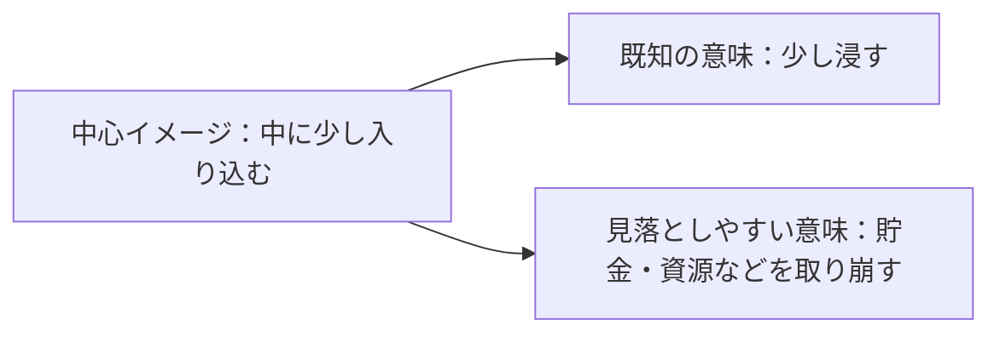

**重要語法：** dip into savings

<small>candidate_id: `ev-04183-verb-01` / index: 4183 / global_order: 2401</small>

---

### 02. pad

**品詞：** 動詞　 **発音：** /pæd/

<small>よく知られている意味：詰め物をする</small>

**見落としやすい意味：数値・経費などを不正に水増しする**

**例文：** The contractor padded the bill with charges for work that was never done.

**和訳：** その業者は、実施していない作業の料金を加えて請求額を水増しした。

**コアイメージ：** padには、詰め物を加えて厚くするイメージがある。数字や請求額に余分なものを付け足すと、不正な水増しという意味になる。

**図：**

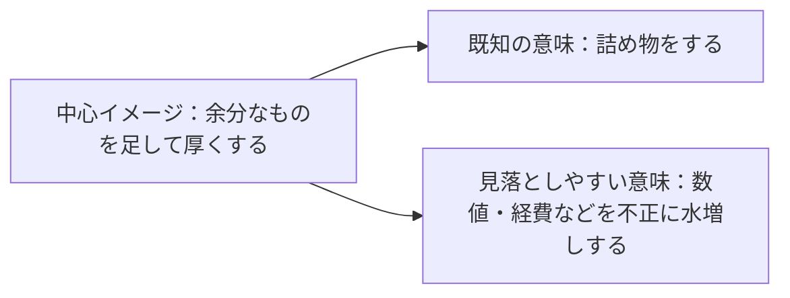

**重要語法：** pad the figures

<small>candidate_id: `ev-04187-verb-01` / index: 4187 / global_order: 2402</small>

---

### 03. exploitation

**品詞：** 名詞　 **発音：** /ˌeksplɔɪˈteɪʃən/

<small>よく知られている意味：搾取</small>

**見落としやすい意味：資源や機会の有効利用・開発**

**例文：** The sustainable exploitation of wind resources could reduce fuel imports.

**和訳：** 風力資源の持続可能な利用は、燃料の輸入を減らす可能性がある。

**コアイメージ：** exploitationの中心は、何かを活用して利益や成果を得ること。人に向けば搾取という否定的な意味になり、資源に向けば開発・利用という中立的な意味にもなる。

**図：**

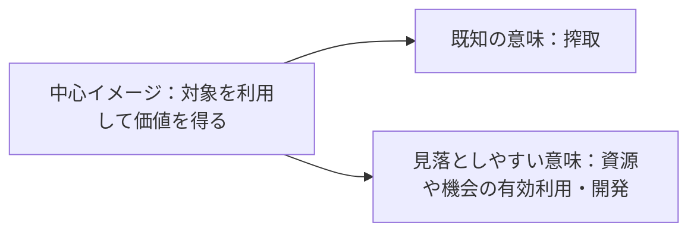

**重要語法：** exploitation of natural resources

<small>candidate_id: `ev-04190-noun-01` / index: 4190 / global_order: 2403</small>

---

### 04. intrigue

**品詞：** 動詞　 **発音：** /ɪnˈtriːɡ/

<small>よく知られている意味：陰謀（名詞）</small>

**見落としやすい意味：興味・好奇心をかき立てる**

**例文：** The unusual results intrigued the researchers.

**和訳：** その異例の結果は研究者たちの好奇心をかき立てた。

**コアイメージ：** intrigueには、人の目を引く複雑さや謎めいた感じがある。秘密の策略という名詞だけでなく、謎によって人を引きつける動詞にもなる。

**図：**

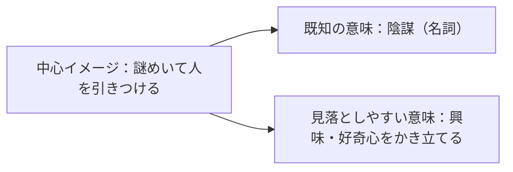

<small>candidate_id: `ev-04191-verb-01` / index: 4191 / global_order: 2404</small>

---

### 05. consolidate

**品詞：** 動詞　 **発音：** /kənˈsɑːlɪdeɪt/

<small>よく知られている意味：統合する</small>

**見落としやすい意味：権力・立場・成果などを強固にする**

**例文：** The victory helped the leader consolidate her position.

**和訳：** その勝利は、指導者が自分の立場を固める助けになった。

**コアイメージ：** consolidateは、ばらついたものを一つにまとめて強くすること。組織の統合だけでなく、すでに持つ権力や成果を確かなものにする場合にも使う。

**図：**

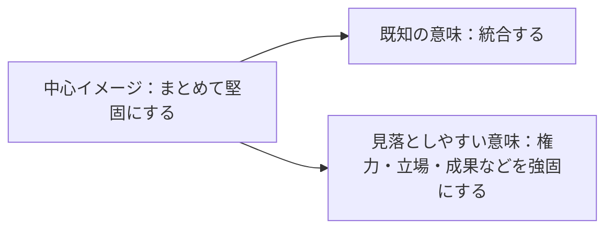

**重要語法：** consolidate power

<small>candidate_id: `ev-04192-verb-01` / index: 4192 / global_order: 2405</small>

---

### 06. bullet

**品詞：** 名詞　 **発音：** /ˈbʊlɪt/

<small>よく知られている意味：弾丸</small>

**見落としやすい意味：箇条書きの記号；箇条書き項目**

**例文：** List the main reasons as three bullet points.

**和訳：** 主な理由を三つの箇条書き項目にして示しなさい。

**コアイメージ：** bulletはもともと小さな弾丸を指す。文書では、それに似た小さな記号や、その記号を使った箇条書き項目を表す。

**図：**

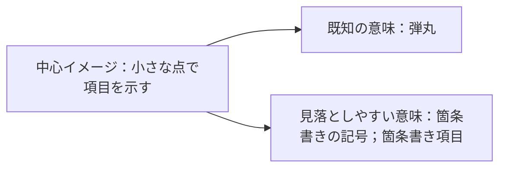

**重要語法：** bullet points

<small>candidate_id: `ev-04195-noun-01` / index: 4195 / global_order: 2406</small>

---

### 07. linguist

**品詞：** 名詞　 **発音：** /ˈlɪŋɡwɪst/

<small>よく知られている意味：言語学者</small>

**見落としやすい意味：複数言語に堪能な人**

**例文：** As a skilled linguist, she can communicate in five languages.

**和訳：** 彼女は語学に堪能で、五つの言語で意思疎通できる。

**コアイメージ：** linguistの中心にあるのは言語に詳しい人ということ。言語を研究する専門家を指すほか、複数の言葉を上手に使える人も指す。

**図：**

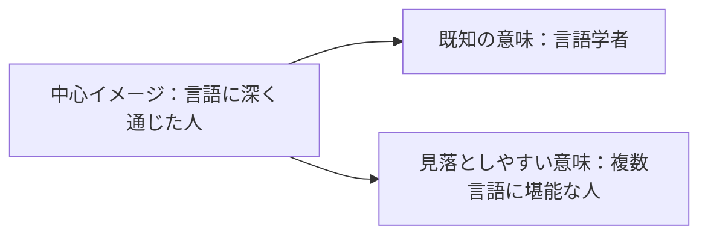

**重要語法：** a gifted linguist

<small>candidate_id: `ev-04201-noun-01` / index: 4201 / global_order: 2407</small>

---

### 08. making

**品詞：** 名詞　 **発音：** /ˈmeɪkɪŋ/

<small>よく知られている意味：製作・作ること</small>

**見落としやすい意味：～になる過程；形成途上**

**例文：** The documentary follows a young artist in the making.

**和訳：** そのドキュメンタリーは、成長途中の若い芸術家を追っている。

**コアイメージ：** makingは、何かが形づくられていく過程を表す。in the makingでは完成品ではなく、今まさにその状態へ近づいていることに注目する。

**図：**

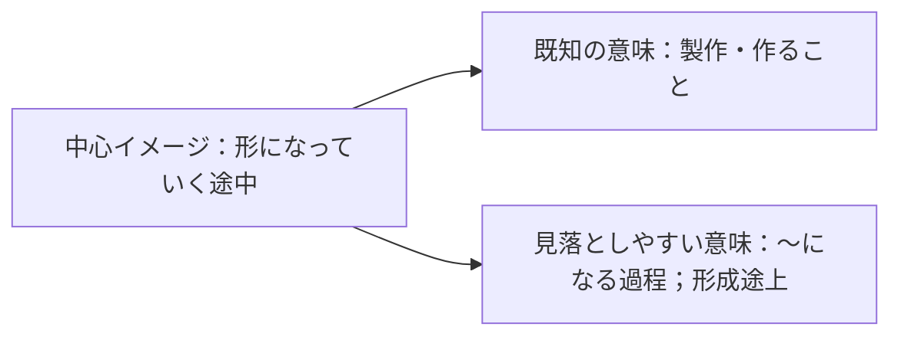

**重要語法：** in the making

<small>candidate_id: `ev-04202-noun-01` / index: 4202 / global_order: 2408</small>

---

### 09. oblige

**品詞：** 動詞　 **発音：** /əˈblaɪdʒ/

<small>よく知られている意味：義務づける</small>

**見落としやすい意味：人の頼みに応じて便宜を図る**

**例文：** She asked us to move the meeting, and we were happy to oblige.

**和訳：** 彼女が会議の時間変更を頼んだので、私たちは快く応じた。

**コアイメージ：** obligeは、相手の求めに応じるという関係を表す。命令や義務によって従わせる場合もあれば、親切心から頼みをかなえる場合もある。

**図：**

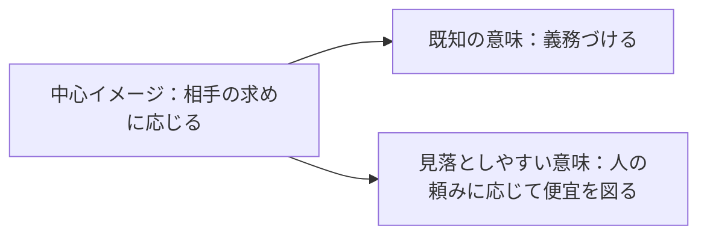

<small>candidate_id: `ev-04203-verb-01` / index: 4203 / global_order: 2409</small>

---

### 10. peculiar

**品詞：** 形容詞　 **発音：** /pɪˈkjuːliər/

<small>よく知られている意味：奇妙な</small>

**見落としやすい意味：～に固有の；特有の**

**例文：** This custom is peculiar to the island.

**和訳：** この習慣はその島に特有のものだ。

**コアイメージ：** peculiarは、ほかとは異なる性質があることに注目する。違いを奇妙だと評価する場合も、ある場所だけに固有だと述べる場合もある。

**図：**

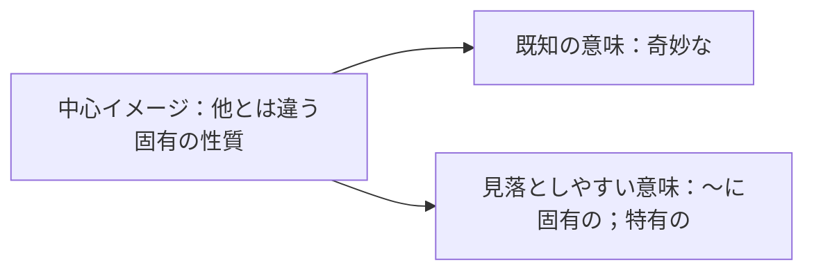

**重要語法：** peculiar to

<small>candidate_id: `ev-04204-adjective-01` / index: 4204 / global_order: 2410</small>

---

### 11. tout

**品詞：** 動詞　 **発音：** /taʊt/

<small>よく知られている意味：しつこく売り込む</small>

**見落としやすい意味：～と高く評価して宣伝する**

**例文：** The device is being touted as a major breakthrough.

**和訳：** その装置は大きな技術革新だと盛んに宣伝されている。

**コアイメージ：** toutには、何かの価値を強く訴えて人に知らせる感じがある。be touted asでは、ある評価や肩書きで広く売り込まれていることを示す。

**図：**

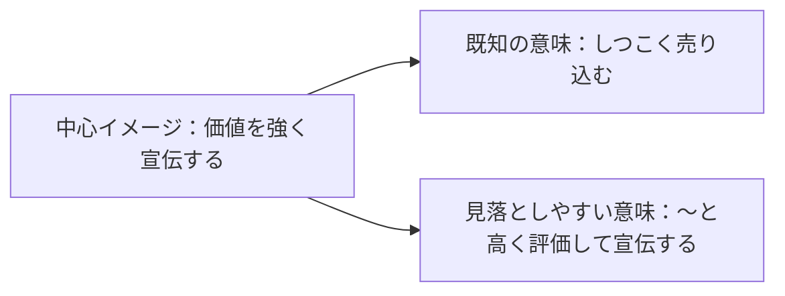

**重要語法：** be touted as

<small>candidate_id: `ev-04209-verb-01` / index: 4209 / global_order: 2411</small>

---

### 12. cookie

**品詞：** 名詞　 **発音：** /ˈkʊki/

<small>よく知られている意味：クッキー（菓子）</small>

**見落としやすい意味：ウェブサイトが保存する小さなデータ**

**例文：** The website uses cookies to remember your language settings.

**和訳：** そのウェブサイトは、言語設定を記憶するためにクッキーを使っている。

**コアイメージ：** ITでのcookieは、ブラウザーに保存される小さな情報のこと。菓子の意味から動作を推測するより、分野ごとの同じ呼び名として区別すると分かりやすい。

**図：**

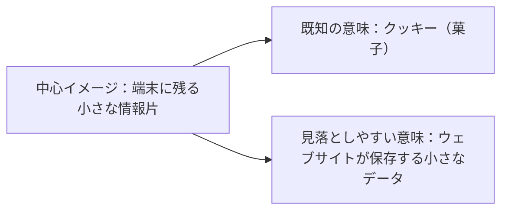

**重要語法：** browser cookie

<small>candidate_id: `ev-04211-noun-01` / index: 4211 / global_order: 2412</small>

---

### 13. deadly

**品詞：** 副詞　 **発音：** /ˈdedli/

<small>よく知られている意味：致命的な</small>

**見落としやすい意味：極めて；ひどく**

**例文：** The team was deadly serious about meeting the safety standards.

**和訳：** そのチームは安全基準を満たすことに極めて真剣だった。

**コアイメージ：** deadlyは、命に関わるほど強いという印象を持つ。副詞として程度を強く言うと、非常に・極めての意味になる。

**図：**

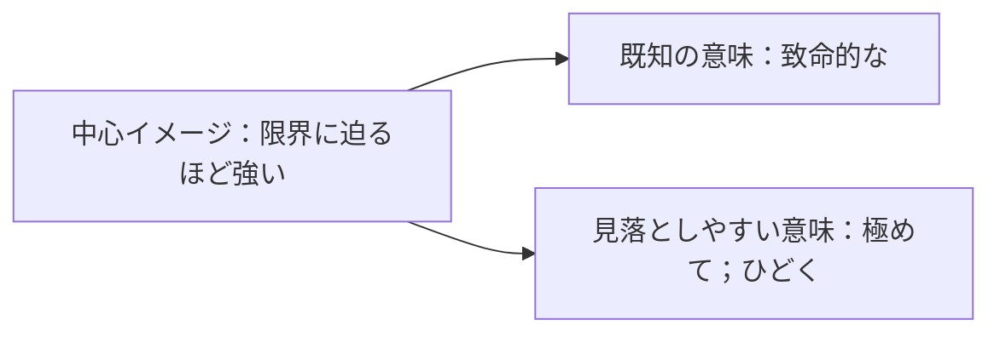

**重要語法：** deadly serious

<small>candidate_id: `ev-04214-adverb-01` / index: 4214 / global_order: 2413</small>

---

### 14. brass

**品詞：** 名詞　 **発音：** /bræs/

<small>よく知られている意味：真ちゅう</small>

**見落としやすい意味：組織の上層部・幹部**

**例文：** The top brass approved the new plan.

**和訳：** 組織の幹部たちが新しい計画を承認した。

**コアイメージ：** brassは真ちゅうという金属の名。top brassは軍や組織の上層部を指す慣用的な表現なので、金属の話として直訳しない。

**図：**

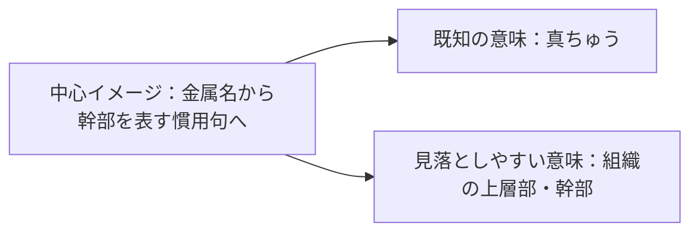

**重要語法：** the top brass

<small>candidate_id: `ev-04216-noun-01` / index: 4216 / global_order: 2414</small>

---

### 15. heel

**品詞：** 名詞　 **発音：** /hiːl/

<small>よく知られている意味：かかと</small>

**見落としやすい意味：～のすぐ後に続いて**

**例文：** The policy change came on the heels of a public debate.

**和訳：** その方針変更は、公開討論のすぐ後に行われた。

**コアイメージ：** heelは足のかかとを指す。on the heels ofは前を行くもののかかとに続くような近さから、出来事が直後に起こることを表す。

**図：**

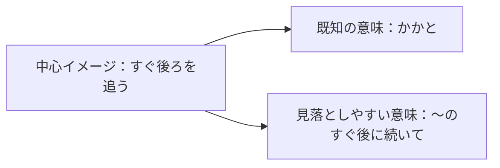

**重要語法：** on the heels of

<small>candidate_id: `ev-04217-noun-01` / index: 4217 / global_order: 2415</small>

---

### 16. rocket

**品詞：** 動詞　 **発音：** /ˈrɑːkɪt/

<small>よく知られている意味：ロケット</small>

**見落としやすい意味：急増・急上昇する**

**例文：** Housing prices rocketed in the city last year.

**和訳：** 昨年、その都市では住宅価格が急騰した。

**コアイメージ：** ロケットが勢いよく上がる動きが出発点。数値や価格が短期間で大きく上がることにも動詞rocketを使う。

**図：**

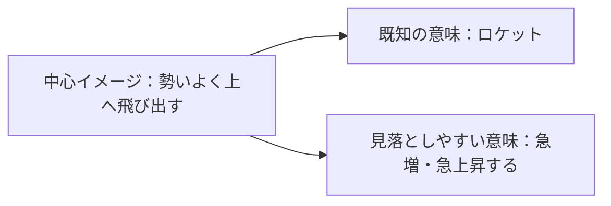

**重要語法：** prices rocket

<small>candidate_id: `ev-04219-verb-01` / index: 4219 / global_order: 2416</small>

---

### 17. backward

**品詞：** 形容詞　 **発音：** /ˈbækwərd/

<small>よく知られている意味：後ろ向きの</small>

**見落としやすい意味：時代遅れの；発展の遅れた**

**例文：** The factory still relies on backward technology.

**和訳：** その工場はいまだに時代遅れの技術に頼っている。

**コアイメージ：** backwardは前へ進む方向と逆という感覚を持つ。技術や制度の発展について言えば、進歩から取り残された状態を示す。

**図：**

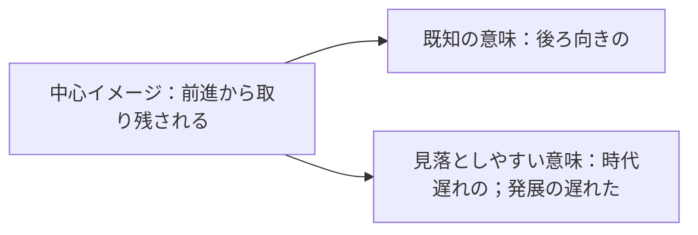

**重要語法：** backward technology

<small>candidate_id: `ev-04221-adjective-01` / index: 4221 / global_order: 2417</small>

---

### 18. equity

**品詞：** 名詞　 **発音：** /ˈekwəti/

<small>よく知られている意味：公平・公正</small>

**見落としやすい意味：株主資本；持分**

**例文：** The company strengthened its equity by retaining profits.

**和訳：** その会社は利益を内部に留保することで自己資本を増やした。

**コアイメージ：** equityは、公正な持分や権利に関わる語でもある。財務では資産から負債を差し引いた持分の価値を指し、公平という抽象義とは使う分野が異なる。

**図：**

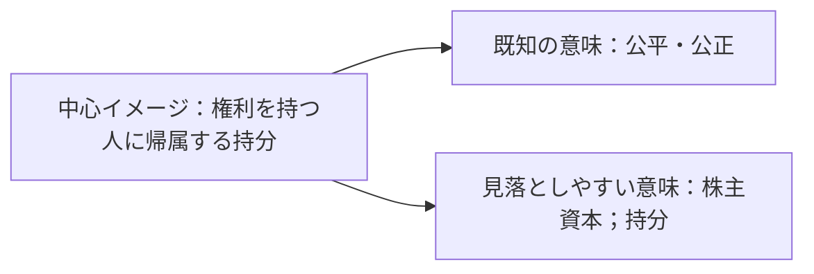

**重要語法：** shareholder equity

<small>candidate_id: `ev-04224-noun-01` / index: 4224 / global_order: 2418</small>

---

### 19. humble

**品詞：** 動詞　 **発音：** /ˈhʌmbəl/

<small>よく知られている意味：謙虚な</small>

**見落としやすい意味：屈服させる；自尊心をくじく**

**例文：** The unexpected defeat humbled the champions.

**和訳：** 予想外の敗北は、王者たちの自信をくじいた。

**コアイメージ：** humbleには、自分を高く置かないという感覚がある。動詞になると、他人の思い上がりや優越感を下げる行為を表す。

**図：**

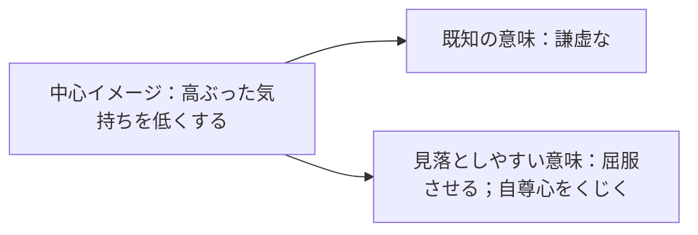

<small>candidate_id: `ev-04225-verb-01` / index: 4225 / global_order: 2419</small>

---

### 20. succession

**品詞：** 名詞　 **発音：** /səkˈseʃən/

<small>よく知られている意味：連続</small>

**見落としやすい意味：地位・王位などの継承**

**例文：** The law sets clear rules for succession to the throne.

**和訳：** その法律は王位継承について明確な規則を定めている。

**コアイメージ：** successionは、前のもののあとに別のものが続くこと。出来事の連続にも、地位や役割を次の人が引き継ぐことにも使う。

**図：**

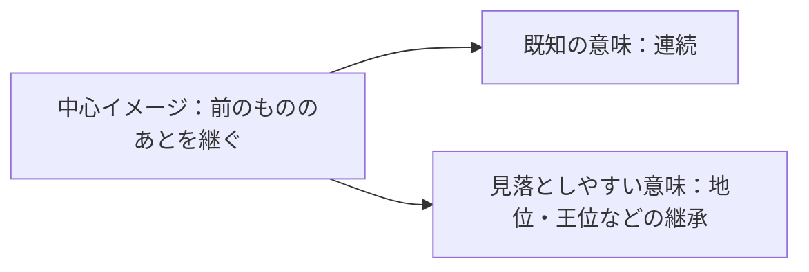

**重要語法：** succession to the throne

<small>candidate_id: `ev-04227-noun-01` / index: 4227 / global_order: 2420</small>

---

### 21. haunt

**品詞：** 動詞　 **発音：** /hɔːnt/

<small>よく知られている意味：幽霊が出る</small>

**見落としやすい意味：記憶や不安などが頭から離れない**

**例文：** The memory of that failure still haunts him.

**和訳：** その失敗の記憶はいまだに彼の頭から離れない。

**コアイメージ：** hauntは、ある場所に何度も現れて離れない感じを表す。幽霊だけでなく、つらい記憶や不安が心につきまとう場合にも用いる。

**図：**

```mermaid
flowchart LR
    A["中心イメージ：何度も現れて離れない"]
    B["既知の意味：幽霊が出る"]
    C["見落としやすい意味：記憶や不安などが頭から離れない"]
    A --> B
    A --> C
```

**重要語法：** be haunted by memories

<small>candidate_id: `ev-04232-verb-01` / index: 4232 / global_order: 2421</small>

---

### 22. payroll

**品詞：** 名詞　 **発音：** /ˈpeɪroʊl/

<small>よく知られている意味：給与総額</small>

**見落としやすい意味：会社などの雇用者名簿**

**例文：** Only registered staff members are listed on the payroll.

**和訳：** 給与支払い名簿には登録された職員だけが載っている。

**コアイメージ：** payrollは、給与を支払うための名簿や記録が原点。そこで、給与額の合計だけでなく、その組織に雇われている人の一覧も表す。

**図：**

```mermaid
flowchart LR
    A["中心イメージ：給与を払う対象の一覧"]
    B["既知の意味：給与総額"]
    C["見落としやすい意味：会社などの雇用者名簿"]
    A --> B
    A --> C
```

**重要語法：** be on the payroll

<small>candidate_id: `ev-04236-noun-01` / index: 4236 / global_order: 2422</small>

---

### 23. slot

**品詞：** 名詞　 **発音：** /slɑːt/

<small>よく知られている意味：細長い溝</small>

**見落としやすい意味：予定表・放送枠などの時間帯**

**例文：** We reserved a thirty-minute time slot for the interview.

**和訳：** 私たちは面接用に30分間の時間枠を確保した。

**コアイメージ：** slotは、何かをはめるために設けられた細い空間を表す。予定では、ある仕事をはめ込むために区切られた時間の位置になる。

**図：**

```mermaid
flowchart LR
    A["中心イメージ：決められた場所に収まる枠"]
    B["既知の意味：細長い溝"]
    C["見落としやすい意味：予定表・放送枠などの時間帯"]
    A --> B
    A --> C
```

**重要語法：** a time slot

<small>candidate_id: `ev-04239-noun-01` / index: 4239 / global_order: 2423</small>

---

### 24. frontier

**品詞：** 名詞　 **発音：** /frʌnˈtɪr/

<small>よく知られている意味：国境・辺境</small>

**見落としやすい意味：科学・知識などの最先端領域**

**例文：** Scientists are exploring new frontiers in medicine.

**和訳：** 科学者たちは医学の新しい最先端領域を開拓している。

**コアイメージ：** frontierは、人が知っている領域と未知の領域の境目。地理的な境界だけでなく、研究がこれから切り開く知識の境界にも使える。

**図：**

```mermaid
flowchart LR
    A["中心イメージ：既知と未知の境界"]
    B["既知の意味：国境・辺境"]
    C["見落としやすい意味：科学・知識などの最先端領域"]
    A --> B
    A --> C
```

**重要語法：** frontiers of science

<small>candidate_id: `ev-04247-noun-01` / index: 4247 / global_order: 2424</small>

---

### 25. thoughtful

**品詞：** 形容詞　 **発音：** /ˈθɔːtfəl/

<small>よく知られている意味：思慮深い</small>

**見落としやすい意味：気配りがある；思いやりのある**

**例文：** It was thoughtful of you to bring an extra umbrella.

**和訳：** 予備の傘まで持ってきてくれるなんて、気が利いているね。

**コアイメージ：** thoughtfulは、よく考えて行動すること。自分の考察の深さだけでなく、相手の必要を考えて行動する思いやりも示す。

**図：**

```mermaid
flowchart LR
    A["中心イメージ：相手のことまで考える"]
    B["既知の意味：思慮深い"]
    C["見落としやすい意味：気配りがある；思いやりのある"]
    A --> B
    A --> C
```

**重要語法：** a thoughtful gesture

<small>candidate_id: `ev-04248-adjective-01` / index: 4248 / global_order: 2425</small>

---

### 26. showcase

**品詞：** 動詞　 **発音：** /ˈʃoʊkeɪs/

<small>よく知られている意味：展示ケース</small>

**見落としやすい意味：長所や成果を効果的に披露する**

**例文：** The exhibition will showcase the work of local artists.

**和訳：** その展覧会では地元の芸術家の作品を魅力的に紹介する予定だ。

**コアイメージ：** showcaseは、見せたいものを目立つように置く場所を指す。動詞では作品や能力の良さが見えるように披露することを表す。

**図：**

```mermaid
flowchart LR
    A["中心イメージ：長所が見えるように展示する"]
    B["既知の意味：展示ケース"]
    C["見落としやすい意味：長所や成果を効果的に披露する"]
    A --> B
    A --> C
```

**重要語法：** showcase skills

<small>candidate_id: `ev-04254-verb-01` / index: 4254 / global_order: 2426</small>

---

### 27. circulate

**品詞：** 動詞　 **発音：** /ˈsɜːrkjəleɪt/

<small>よく知られている意味：循環する</small>

**見落としやすい意味：うわさや情報が広く伝わる**

**例文：** False rumors circulated widely after the announcement.

**和訳：** 発表のあと、根拠のないうわさが広く出回った。

**コアイメージ：** circulateは、ものが人や場所の間を巡る動き。血液や空気だけでなく、話や情報が次々に伝わることにも使う。

**図：**

```mermaid
flowchart LR
    A["中心イメージ：あちこちを巡って広がる"]
    B["既知の意味：循環する"]
    C["見落としやすい意味：うわさや情報が広く伝わる"]
    A --> B
    A --> C
```

**重要語法：** rumors circulate

<small>candidate_id: `ev-04256-verb-01` / index: 4256 / global_order: 2427</small>

---

### 28. cater

**品詞：** 動詞　 **発音：** /ˈkeɪtər/

<small>よく知られている意味：食事を提供する</small>

**見落としやすい意味：（特定の客層・要求に）応じる**

**例文：** The course caters to students with different skill levels.

**和訳：** その講座はさまざまな習熟度の生徒に対応している。

**コアイメージ：** caterは相手に必要なものを用意するという感覚を持つ。食事を提供するだけでなく、特定の人の希望や需要に合わせる意味にもなる。

**図：**

```mermaid
flowchart LR
    A["中心イメージ：相手の必要に合わせて用意する"]
    B["既知の意味：食事を提供する"]
    C["見落としやすい意味：（特定の客層・要求に）応じる"]
    A --> B
    A --> C
```

**重要語法：** cater to + 人／需要（米国中心）；英国では cater for も一般的

<small>candidate_id: `ev-04262-verb-01` / index: 4262 / global_order: 2428</small>

---

### 29. dumb

**品詞：** 動詞　 **発音：** /dʌm/

<small>よく知られている意味：ばかな・口がきけない</small>

**見落としやすい意味：内容を過度に単純化する**

**例文：** Please do not dumb down the explanation; we can follow the details.

**和訳：** 説明を過度に単純化しないでください。私たちは詳しい内容も理解できます。

**コアイメージ：** dumb downは、内容の難しさを大幅に下げる句動詞。分かりやすくする行為が行き過ぎて、本来の大事な内容まで薄くなる響きがある。

**図：**

```mermaid
flowchart LR
    A["中心イメージ：水準を下げて単純化する"]
    B["既知の意味：ばかな・口がきけない"]
    C["見落としやすい意味：内容を過度に単純化する"]
    A --> B
    A --> C
```

**重要語法：** dumb down an explanation

<small>candidate_id: `ev-04265-verb-01` / index: 4265 / global_order: 2429</small>

---

### 30. spur

**品詞：** 動詞　 **発音：** /spɜːr/

<small>よく知られている意味：拍車</small>

**見落としやすい意味：（行動・変化を）促す**

**例文：** The discovery spurred further research.

**和訳：** その発見はさらなる研究を促した。

**コアイメージ：** spurは馬を前へ進ませる拍車を指す。動詞では、人や活動を前へ進めるきっかけを与えるという意味になる。

**図：**

```mermaid
flowchart LR
    A["中心イメージ：前へ進む力を与える"]
    B["既知の意味：拍車"]
    C["見落としやすい意味：（行動・変化を）促す"]
    A --> B
    A --> C
```

<small>candidate_id: `ev-04273-verb-01` / index: 4273 / global_order: 2430</small>

---

### 31. bowl

**品詞：** 動詞　 **発音：** /boʊl/

<small>よく知られている意味：ボウル・鉢</small>

**見落としやすい意味：圧倒する；非常に驚かせる**

**例文：** Her unexpected kindness bowled me over.

**和訳：** 彼女の思いがけない親切に、私は圧倒された。

**コアイメージ：** bowl overは、ボウリングの球がピンを倒すような勢いがもとになった句動詞。器を表す名詞bowlとは区別し、強い驚きで気持ちが倒されるような感覚をつかむ。

**図：**

```mermaid
flowchart LR
    A["中心イメージ：勢いよく倒す"]
    B["既知の意味：ボウル・鉢"]
    C["見落としやすい意味：圧倒する；非常に驚かせる"]
    A --> B
    A --> C
```

**重要語法：** be bowled over by

<small>candidate_id: `ev-04278-verb-01` / index: 4278 / global_order: 2431</small>

---

### 32. beef

**品詞：** 名詞　 **発音：** /biːf/

<small>よく知られている意味：牛肉</small>

**見落としやすい意味：不満；文句；もめごと**

**例文：** I have no beef with your plan, but I have one question.

**和訳：** 君の計画に文句はないけれど、一つ質問がある。

**コアイメージ：** beefには牛肉のほかに、不満やもめごとを表すくだけた名詞用法がある。決まった言い回しとして覚え、食べ物の話と混同しない。

**図：**

```mermaid
flowchart LR
    A["中心イメージ：人への不満・もめごと"]
    B["既知の意味：牛肉"]
    C["見落としやすい意味：不満；文句；もめごと"]
    A --> B
    A --> C
```

**重要語法：** have a beef with somebody

<small>candidate_id: `ev-04279-noun-01` / index: 4279 / global_order: 2432</small>

---

### 33. jam

**品詞：** 名詞　 **発音：** /dʒæm/

<small>よく知られている意味：果物のジャム</small>

**見落としやすい意味：困った状況；窮地**

**例文：** We got into a jam when our train was canceled.

**和訳：** 列車が運休になり、私たちは困った状況に陥った。

**コアイメージ：** jamは、物が詰まって動けなくなる状態も表す。そこから、行動しようにも身動きが取りにくい窮地をいう。

**図：**

```mermaid
flowchart LR
    A["中心イメージ：詰まって身動きできない"]
    B["既知の意味：果物のジャム"]
    C["見落としやすい意味：困った状況；窮地"]
    A --> B
    A --> C
```

**重要語法：** be/get in a jam（主にくだけた米国英語）

<small>candidate_id: `ev-04281-noun-01` / index: 4281 / global_order: 2433</small>

---

### 34. junior

**品詞：** 形容詞　 **発音：** /ˈdʒuːniər/

<small>よく知られている意味：年下の</small>

**見落としやすい意味：（人・職位より）地位が低い**

**例文：** She is junior to him in the department.

**和訳：** 彼女はその部署では彼より役職が下だ。

**コアイメージ：** juniorは、ある序列で下に位置すること。年齢の上下に限らず、仕事の役職や経験の序列にも使われる。

**図：**

```mermaid
flowchart LR
    A["中心イメージ：序列の中で下に位置する"]
    B["既知の意味：年下の"]
    C["見落としやすい意味：（人・職位より）地位が低い"]
    A --> B
    A --> C
```

**重要語法：** be junior to + 人

<small>candidate_id: `ev-04283-adjective-01` / index: 4283 / global_order: 2434</small>

---

### 35. technically

**品詞：** 副詞　 **発音：** /ˈteknɪkli/

<small>よく知られている意味：技術的に</small>

**見落としやすい意味：厳密に言えば；定義上は**

**例文：** Technically, the deadline is tomorrow, not today.

**和訳：** 厳密に言えば、締め切りは今日ではなく明日だ。

**コアイメージ：** technicallyは、専門的な仕組みや規則に照らして考えること。日常の大まかな言い方と区別し、定義上はどうかを述べるときにも使う。

**図：**

```mermaid
flowchart LR
    A["中心イメージ：定義・規則に厳密に照らす"]
    B["既知の意味：技術的に"]
    C["見落としやすい意味：厳密に言えば；定義上は"]
    A --> B
    A --> C
```

**重要語法：** technically speaking

<small>candidate_id: `ev-04287-adverb-01` / index: 4287 / global_order: 2435</small>

---

### 36. spite

**品詞：** 名詞　 **発音：** /spaɪt/

<small>よく知られている意味：悪意</small>

**見落としやすい意味：～にもかかわらず**

**例文：** In spite of the rain, the event went ahead.

**和訳：** 雨にもかかわらず、その行事は予定どおり行われた。

**コアイメージ：** spiteはもともと悪意などを表す名詞。in spite ofは全体で「～にもかかわらず」を表す固定表現で、名詞一語の意味をそのまま当てはめない。

**図：**

```mermaid
flowchart LR
    A["中心イメージ：妨げに逆らって進む"]
    B["既知の意味：悪意"]
    C["見落としやすい意味：～にもかかわらず"]
    A --> B
    A --> C
```

**重要語法：** in spite of

<small>candidate_id: `ev-04288-noun-01` / index: 4288 / global_order: 2436</small>

---

### 37. refrain

**品詞：** 名詞　 **発音：** /rɪˈfreɪn/

<small>よく知られている意味：（動詞）控える</small>

**見落としやすい意味：歌や詩で反復される一節；リフレイン**

**例文：** The refrain returns at the end of every verse.

**和訳：** その繰り返しの一節は、どの節の終わりにも現れる。

**コアイメージ：** 名詞refrainは、歌や詩で繰り返し登場する言葉のまとまり。動詞refrain「控える」とは意味を無理につなげず、品詞ごとの用法として区別する。

**図：**

```mermaid
flowchart LR
    A["中心イメージ：同じ一節が繰り返し現れる"]
    B["既知の意味：（動詞）控える"]
    C["見落としやすい意味：歌や詩で反復される一節；リフレイン"]
    A --> B
    A --> C
```

<small>candidate_id: `ev-04289-noun-01` / index: 4289 / global_order: 2437</small>

---

### 38. drill

**品詞：** 動詞　 **発音：** /drɪl/

<small>よく知られている意味：穴をあける</small>

**見落としやすい意味：繰り返し教え込む；徹底して練習させる**

**例文：** The instructor drilled the students on the safety procedures.

**和訳：** 指導者は生徒たちに安全手順を繰り返し練習させた。

**コアイメージ：** drillは一定の動作を繰り返して働きかけることを連想させる。学習では同じ内容を何度も練習し、確実に身につけさせる。

**図：**

```mermaid
flowchart LR
    A["中心イメージ：同じ動きを繰り返す"]
    B["既知の意味：穴をあける"]
    C["見落としやすい意味：繰り返し教え込む；徹底して練習させる"]
    A --> B
    A --> C
```

**重要語法：** drill a rule into somebody

<small>candidate_id: `ev-04292-verb-01` / index: 4292 / global_order: 2438</small>

---

### 39. robust

**品詞：** 形容詞　 **発音：** /roʊˈbʌst/

<small>よく知られている意味：頑丈な</small>

**見落としやすい意味：（証拠・推定・手法などが）条件が変わっても信頼できる**

**例文：** The findings remained robust across several different samples.

**和訳：** その研究結果は、複数の異なる標本でも信頼性を保った。

**コアイメージ：** robustは、力や負荷を受けても簡単には崩れないこと。人の体だけでなく、条件を変えても成り立つ研究結果や方法にも用いる。

**図：**

```mermaid
flowchart LR
    A["中心イメージ：条件が変わっても崩れない"]
    B["既知の意味：頑丈な"]
    C["見落としやすい意味：（証拠・推定・手法などが）条件が変わっても信頼できる"]
    A --> B
    A --> C
```

**重要語法：** robust evidence

<small>candidate_id: `ev-04295-adjective-01` / index: 4295 / global_order: 2439</small>

---

### 40. migrate

**品詞：** 動詞　 **発音：** /ˈmaɪɡreɪt/

<small>よく知られている意味：移住する・渡りをする</small>

**見落としやすい意味：システムやデータを別環境へ移行する**

**例文：** We migrated our data to a new server last weekend.

**和訳：** 私たちは先週末、データを新しいサーバーへ移行した。

**コアイメージ：** migrateは、もとの場所から別の場所へ移ること。人や鳥の移動だけでなく、データやシステムを別の環境へ移す操作も表す。

**図：**

```mermaid
flowchart LR
    A["中心イメージ：別の場所・環境へ移る"]
    B["既知の意味：移住する・渡りをする"]
    C["見落としやすい意味：システムやデータを別環境へ移行する"]
    A --> B
    A --> C
```

**重要語法：** migrate data to a new system

<small>candidate_id: `ev-04299-verb-01` / index: 4299 / global_order: 2440</small>

