# EasyVoca 完成教材｜バッチ032

対象 global_order: 2481〜2560（本ファイルは途中まで）

## 2481. sprawl
品詞：verb　｜　発音：/sprɔːl/

<sub>よく知られている意味：（都市などが）無秩序に広がる</sub>

### 見落としやすい意味
**手足を投げ出して広がるように座る・横たわる**

**例文**　He sprawled across the sofa after dinner.

**和訳**　夕食後、彼はソファに手足を投げ出して横たわった。

**コアイメージ**　sprawl はまとまりなく広がる様子を表す。都市については無秩序な拡大、人については手足を伸ばした無造作な姿勢となる。

**図**
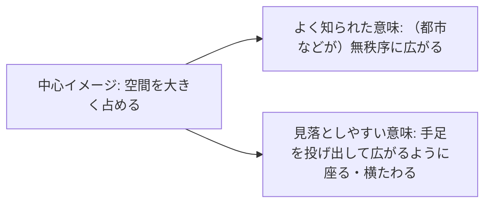
**重要語法**　sprawl on / across

---

## 2482. cult
品詞：adjective　｜　発音：/kʌlt/

<sub>よく知られている意味：熱狂的な信奉者の集団</sub>

### 見落としやすい意味
**一部の人々に熱狂的に支持される**

**例文**　The film became a cult classic among students.

**和訳**　その映画は学生たちの間で熱狂的な支持を集める名作となった。

**コアイメージ**　cult は一般的な人気とは異なる濃い支持の集まりを指す。形容詞的には、一部の人々に強く愛される作品などを修飾する。

**図**
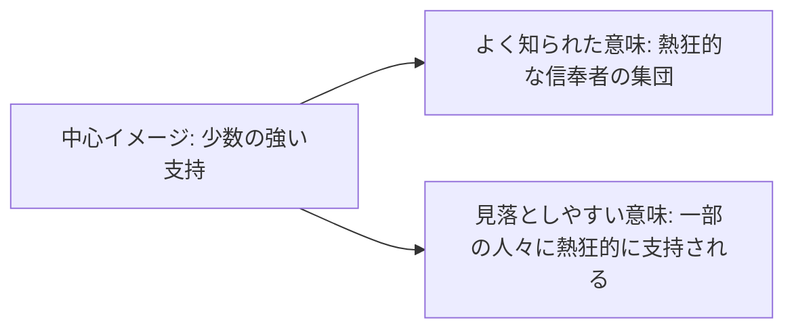
**重要語法**　cult classic / cult following

---

## 2483. pending
品詞：preposition　｜　発音：/ˈpendɪŋ/

<sub>よく知られている意味：（形容詞）未決の</sub>

### 見落としやすい意味
**～の結果を待つ間；～まで**

**例文**　The opening date is uncertain pending approval from the council.

**和訳**　議会の承認が得られるまで、開業日は未定だ。

**コアイメージ**　pending は決定や結果が出る前の状態を表す。前置詞としては、その出来事が起こるまでの期間や条件を導く。

**図**
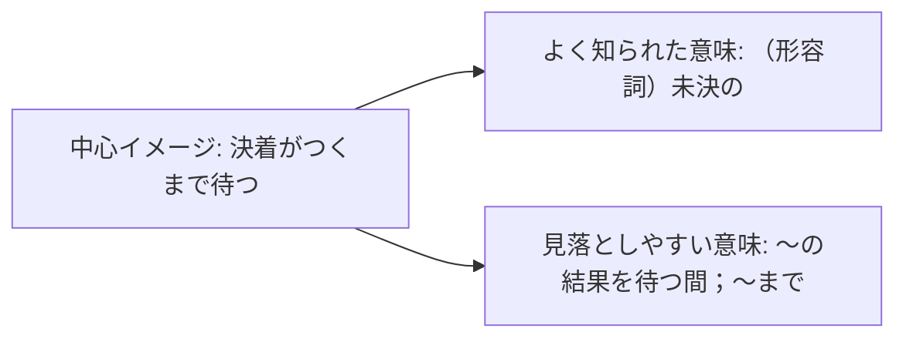
**重要語法**　pending approval / pending investigation

---

## 2484. regulator
品詞：noun　｜　発音：/ˈreɡjəleɪtər/

<sub>よく知られている意味：規制担当者、規制機関</sub>

### 見落としやすい意味
**圧力・流量などを調節する装置**

**例文**　A faulty regulator caused the pressure to rise.

**和訳**　故障した調整装置のせいで圧力が上がった。

**コアイメージ**　regulate は一定の基準に合わせて制御すること。人や機関なら規制者、機械なら圧力などを調節する装置を指す。

**図**
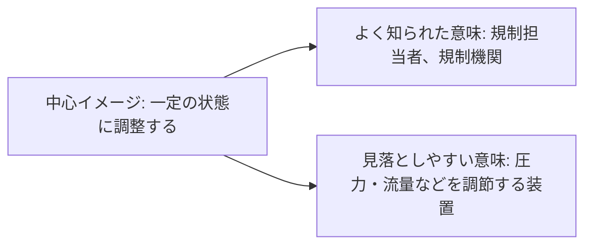
**重要語法**　pressure regulator

---

## 2485. speaking
品詞：verb　｜　発音：/ˈspiːkɪŋ/

<sub>よく知られている意味：話すこと</sub>

### 見落としやすい意味
**～と言えば；～について言うと**

**例文**　Speaking of music, have you heard her new song?

**和訳**　音楽といえば、彼女の新曲を聴いた？

**コアイメージ**　speaking of は話す行為より会話の話題を示す決まり文句。直前に関連することを「～といえば」と持ち出す。

**図**
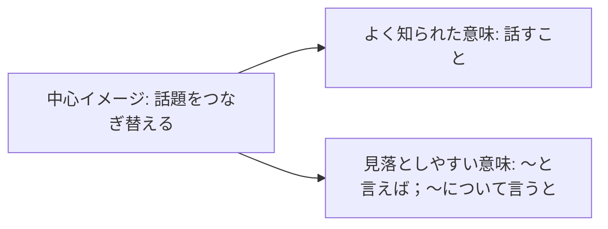
**重要語法**　speaking of ...

---

## 2486. whip
品詞：verb　｜　発音：/wɪp/

<sub>よく知られている意味：むちで打つ</sub>

### 見落としやすい意味
**（感情や熱狂を）あおる；短時間で作る**

**例文**　The coach whipped up excitement before the final.

**和訳**　監督は決勝前に熱気を盛り上げた。

**コアイメージ**　whip には素早く激しく動かす感覚がある。whip up は熱狂を高めたり、料理を手早く作ったりすることにも使う。

**図**
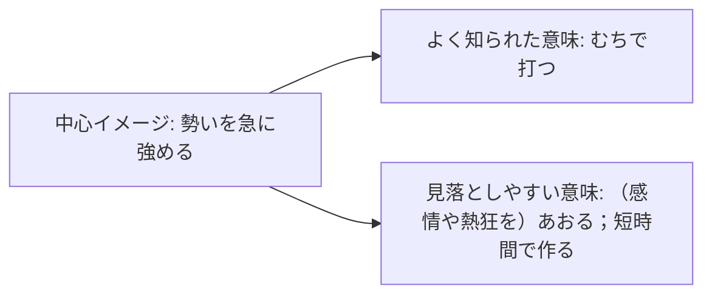
**重要語法**　whip up excitement / a meal

---

## 2487. wildly
品詞：adverb　｜　発音：/ˈwaɪldli/

<sub>よく知られている意味：野性的に、荒々しく</sub>

### 見落としやすい意味
**非常に；途方もなく**

**例文**　The two estimates differ wildly.

**和訳**　その二つの推計値は大きく異なっている。

**コアイメージ**　wildly は制御のきかない動きにも使われる。その広がりから、数値や程度が普通の範囲を大きく外れることを示す。

**図**
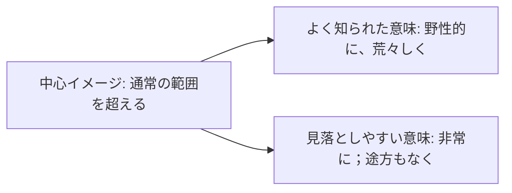
**重要語法**　vary wildly / differ wildly

---

## 2488. shine
品詞：verb　｜　発音：/ʃaɪn/

<sub>よく知られている意味：光る、輝く</sub>

### 見落としやすい意味
**（能力・人格などが）際立つ；秀でる**

**例文**　Her talent shines in difficult situations.

**和訳**　難しい状況でこそ彼女の才能は際立つ。

**コアイメージ**　光が周囲より目立つように、才能や長所も際立って見える。shine が人や能力を主語に取るときは「秀でる」と読む。

**図**
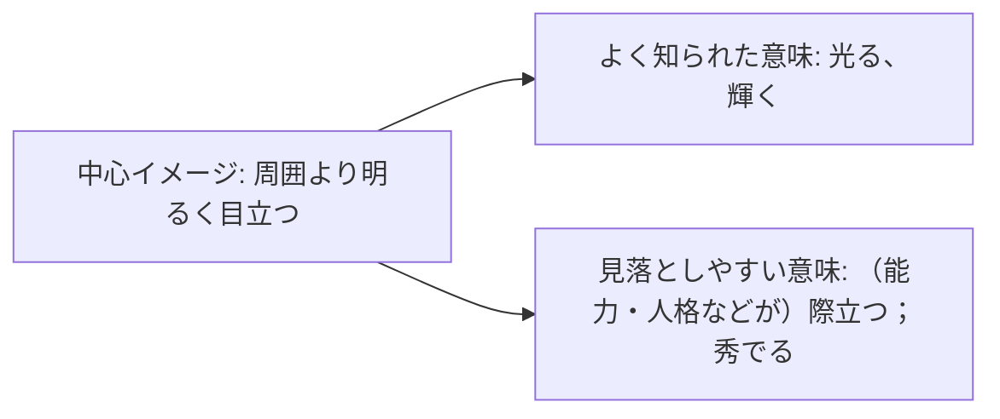
**重要語法**　shine in / shine through

---

## 2489. boil
品詞：verb　｜　発音：/bɔɪl/

<sub>よく知られている意味：沸騰する</sub>

### 見落としやすい意味
**結局～ということになる；要点は～だ**

**例文**　The dispute boils down to a lack of trust.

**和訳**　その争いは結局、信頼の欠如に行き着く。

**コアイメージ**　煮詰めると中身が凝縮されるイメージがある。boil down to は複雑な事柄を整理した結果の核心を示す。

**図**
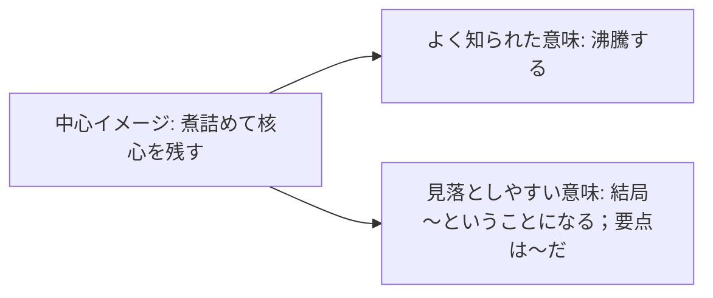
**重要語法**　boil down to ...

---

## 2490. bent
品詞：adjective　｜　発音：/bent/

<sub>よく知られている意味：曲がった</sub>

### 見落としやすい意味
**～しようと固く決心している**

**例文**　She is bent on becoming a doctor.

**和訳**　彼女は医師になると固く決心している。

**コアイメージ**　bent は形の向きだけでなく、心が目標に向かい続ける状態も表す。be bent on doing は強い決意を表す。

**図**
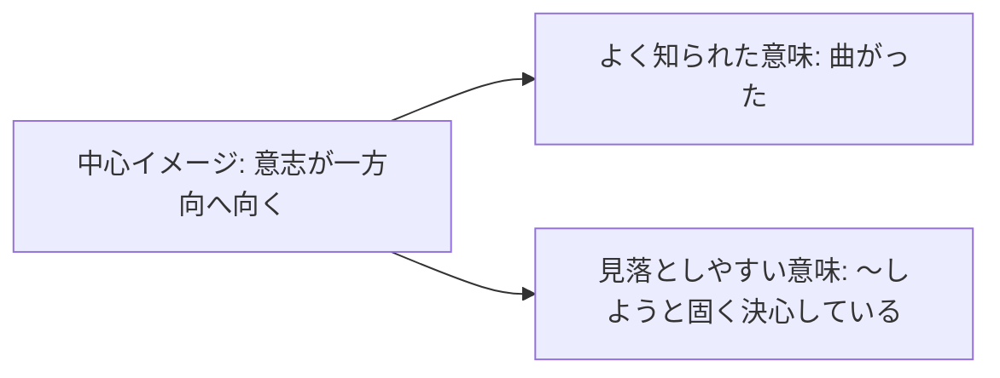
**重要語法**　be bent on doing

---

## 2491. bent
品詞：noun　｜　発音：/bent/

<sub>よく知られている意味：（形容詞）曲がった</sub>

### 見落としやすい意味
**素質；傾向；好み**

**例文**　He has a natural bent for languages.

**和訳**　彼には語学の生まれつきの素質がある。

**コアイメージ**　人の関心や適性が自然とある方向へ向かう感覚を表す。名詞 bent はその方向性を「素質・好み」として捉える。

**図**
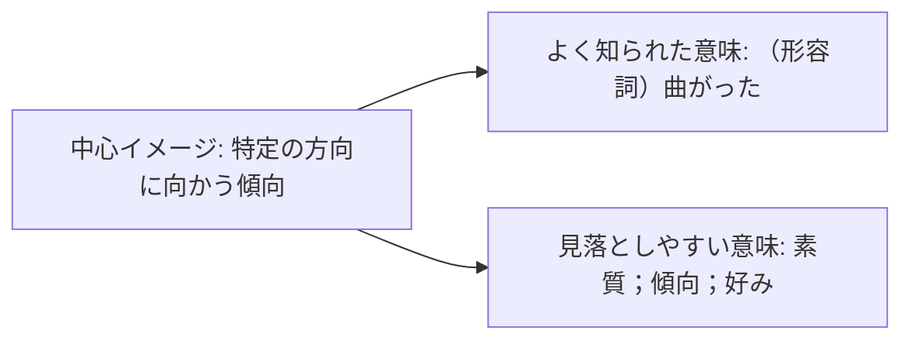
**重要語法**　a bent for ...

---

## 2492. hammer
品詞：verb　｜　発音：/ˈhæmər/

<sub>よく知られている意味：金づちで打つ</sub>

### 見落としやすい意味
**話し合いを重ねて合意・解決策を作る**

**例文**　After hours of talks, they hammered out an agreement.

**和訳**　何時間も話し合った末、彼らは合意をまとめ上げた。

**コアイメージ**　金属を繰り返し打って望む形にする作業が出発点。hammer out は意見をすり合わせて合意や解決策を練り上げることをいう。

**図**
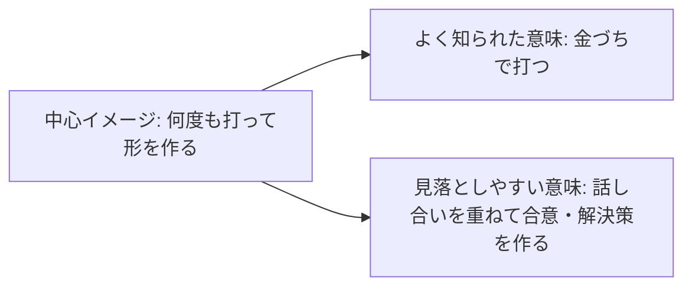
**重要語法**　hammer out a deal / solution

---

## 2493. hammer
品詞：verb　｜　発音：/ˈhæmər/

<sub>よく知られている意味：金づちで打つ</sub>

### 見落としやすい意味
**厳しく批判する**

**例文**　Critics hammered the company over its safety record.

**和訳**　批評家たちはその会社の安全管理の実績を厳しく批判した。

**コアイメージ**　ハンマーで繰り返し叩く強さが、言葉による攻撃に移る。人や組織を hammer する場合は激しく批判する意味になる。

**図**
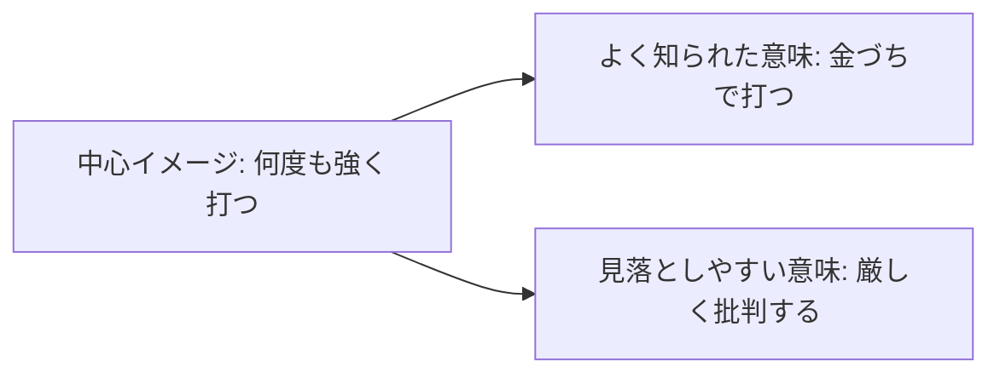
**重要語法**　hammer someone over / for ...

---

## 2494. tag
品詞：verb　｜　発音：/tæɡ/

<sub>よく知られている意味：札・タグを付ける</sub>

### 見落としやすい意味
**一緒について行く**

**例文**　Can I tag along on your trip to the museum?

**和訳**　博物館に行くとき、私も一緒について行っていい？

**コアイメージ**　tag along は誰かの行動にくっつくように同行する句動詞。荷札を付ける意味とは異なるので、句全体で覚える。

**図**
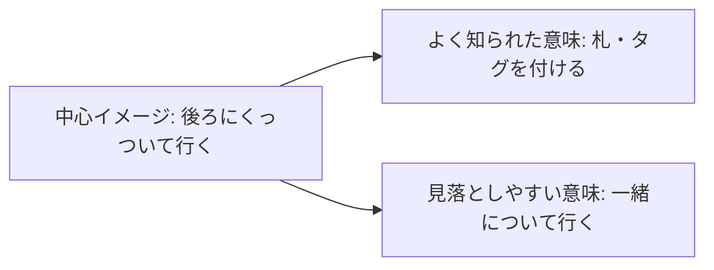
**重要語法**　tag along (with someone)

---

## 2495. wipe
品詞：verb　｜　発音：/waɪp/

<sub>よく知られている意味：拭く、拭き取る</sub>

### 見落としやすい意味
**完全に一掃する；全滅させる**

**例文**　The flood wiped out several small bridges.

**和訳**　洪水でいくつかの小さな橋が完全に流された。

**コアイメージ**　布で拭いて汚れを消す動作が基本にある。wipe out は物事がほとんど残らないほど消し去られることを表す。

**図**
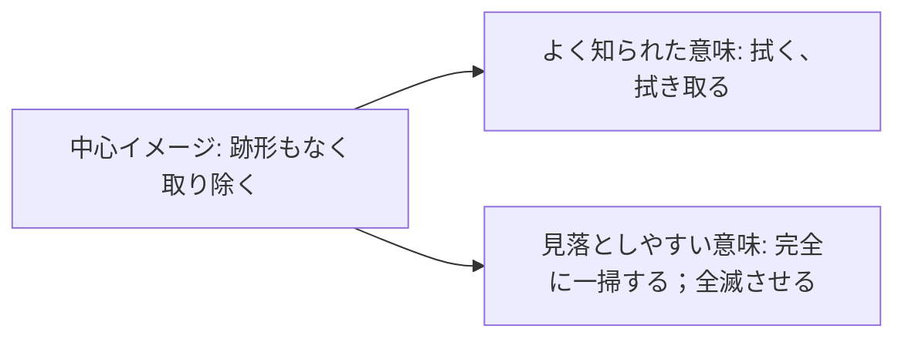
**重要語法**　wipe out ...

---

## 2496. tariff
品詞：noun　｜　発音：/ˈtærɪf/

<sub>よく知られている意味：関税</sub>

### 見落としやすい意味
**電気・交通・通信などの料金体系・料金表**

**例文**　The electricity tariff will rise next month.

**和訳**　電気料金は来月値上げされる。

**コアイメージ**　tariff は取引に適用する料金・税の決まりを表す。国境で課す関税だけでなく、電気や交通などの料金体系にも使う。

**図**
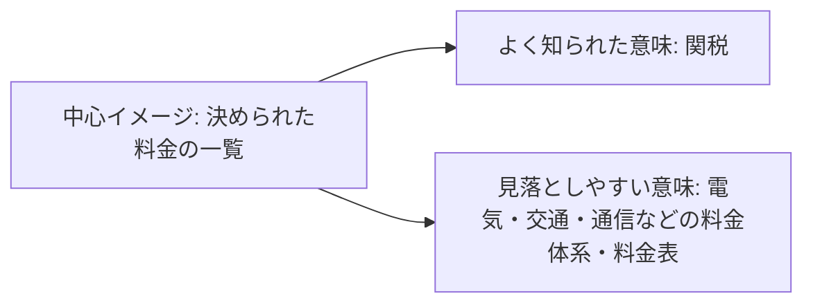
**重要語法**　electricity tariff / tariff plan

---

## 2497. buck
品詞：verb　｜　発音：/bʌk/

<sub>よく知られている意味：雄鹿、ドル</sub>

### 見落としやすい意味
**慣行・傾向に逆らう；逆行する**

**例文**　The small business bucked the trend and increased sales.

**和訳**　その小企業は全体の傾向に逆らって売上げを伸ばした。

**コアイメージ**　buck には勢いよく跳ねて抵抗する動きがある。比喩的には世間の傾向や慣行に逆らうことを表す。

**図**
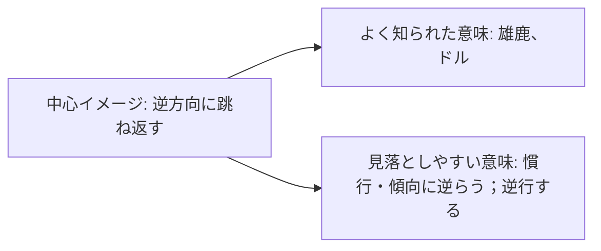
**重要語法**　buck the trend

---

## 2498. herd
品詞：verb　｜　発音：/hɜːrd/

<sub>よく知られている意味：家畜の群れ</sub>

### 見落としやすい意味
**人々を一か所に誘導する；まとめて移動させる**

**例文**　Staff herded the visitors toward the exit.

**和訳**　係員は来場者たちを出口の方へまとめて誘導した。

**コアイメージ**　牧畜で群れをまとめて動かすことから、herd は人の集団にも使われる。多数の人を同じ方向へ誘導する様子を描く。

**図**
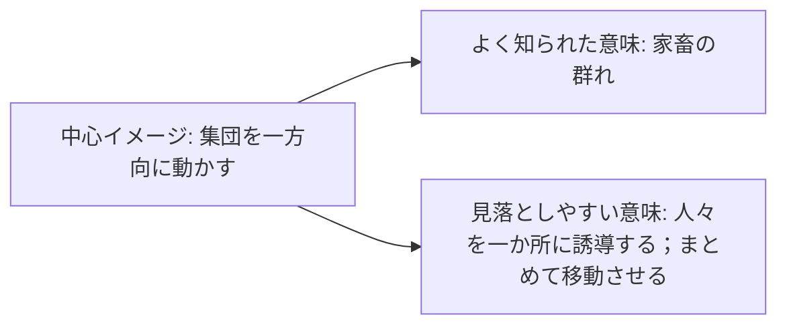
**重要語法**　herd people toward ...

---

## 2499. railroad
品詞：verb　｜　発音：/ˈreɪlroʊd/

<sub>よく知られている意味：鉄道</sub>

### 見落としやすい意味
**強引に物事を押し通す；不当に追い込む**

**例文**　The manager railroaded the team into accepting the proposal.

**和訳**　上司はチームにその提案を強引に受け入れさせた。

**コアイメージ**　railroad の動詞には、相手の意思を尊重せず結論へ押し進める意味がある。鉄道と直訳せず、強引な進行という比喩で捉える。

**図**
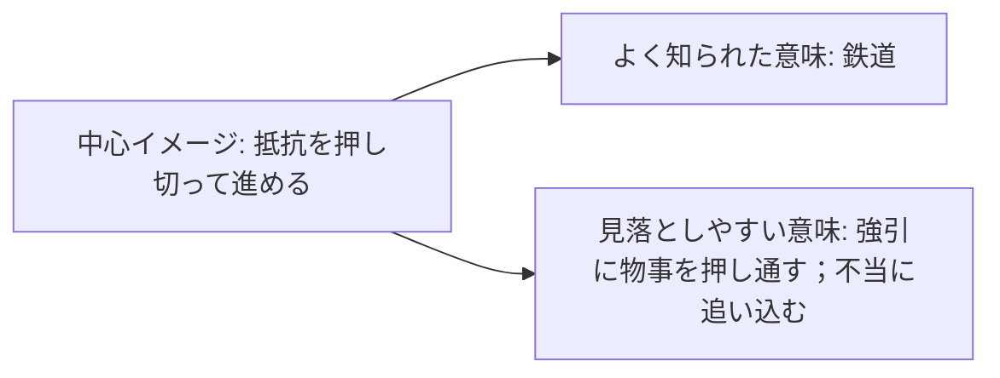
**重要語法**　railroad someone into doing

---

## 2500. dirt
品詞：noun　｜　発音：/dɜːrt/

<sub>よく知られている意味：土、汚れ</sub>

### 見落としやすい意味
**スキャンダルなどの醜聞情報**

**例文**　The reporter tried to dig up dirt on the candidate.

**和訳**　記者はその候補者の醜聞を掘り起こそうとした。

**コアイメージ**　dirt は目に見える汚れだけでなく、評判を汚す情報にも使われる。dig up dirt は人に不利な秘密や醜聞を探すこと。

**図**
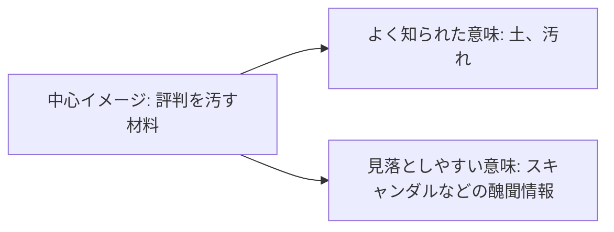
**重要語法**　dig up dirt on someone

---

## 2501. chemistry
品詞：noun　｜　発音：/ˈkemɪstri/

<sub>よく知られている意味：化学</sub>

### 見落としやすい意味
**人と人の相性；気持ちの通じ合い**

**例文**　The two actors had great chemistry on screen.

**和訳**　その二人の俳優は画面上で抜群の相性を見せた。

**コアイメージ**　化学では物質の組み合わせで反応が生じる。人同士の場合は、一緒にいると自然に生まれる相性や雰囲気を表す。

**図**
```mermaid
flowchart LR
    A["中心イメージ: 組み合わせから生まれる反応"]
    B["よく知られた意味: 化学"]
    C["見落としやすい意味: 人と人の相性；気持ちの通じ合い"]
    A --> B
    A --> C
```
**重要語法**　have chemistry (with someone)

---

## 2502. bang
品詞：noun　｜　発音：/bæŋ/

<sub>よく知られている意味：大きな音</sub>

### 見落としやすい意味
**費用に見合った効果・価値**

**例文**　This laptop gives you a lot of bang for your buck.

**和訳**　このノートパソコンは値段の割にとてもお得だ。

**コアイメージ**　bang for your buck は払ったお金に対して得られる成果の大きさを表す慣用句。bang 単独が「費用対効果」を意味するわけではない。

**図**
```mermaid
flowchart LR
    A["中心イメージ: 支出に対する大きな成果"]
    B["よく知られた意味: 大きな音"]
    C["見落としやすい意味: 費用に見合った効果・価値"]
    A --> B
    A --> C
```
**重要語法**　bang for your buck

---

## 2503. deed
品詞：noun　｜　発音：/diːd/

<sub>よく知られている意味：行為、行い</sub>

### 見落としやすい意味
**法的な権利証書；不動産の譲渡証書**

**例文**　The buyer signed the deed at the lawyer's office.

**和訳**　買い手は法律事務所で不動産の権利証書に署名した。

**コアイメージ**　deed は人が行った行為を表すだけでなく、法的に効力を持つ書類にも使う。不動産取引では権利の譲渡などを証明する文書になる。

**図**
```mermaid
flowchart LR
    A["中心イメージ: 行為を正式に記録する文書"]
    B["よく知られた意味: 行為、行い"]
    C["見落としやすい意味: 法的な権利証書；不動産の譲渡証書"]
    A --> B
    A --> C
```
**重要語法**　title deed / deed of transfer

---

## 2504. landing
品詞：noun　｜　発音：/ˈlændɪŋ/

<sub>よく知られている意味：着陸</sub>

### 見落としやすい意味
**階段の踊り場**

**例文**　We paused on the landing between the two floors.

**和訳**　私たちは二つの階の間にある踊り場で立ち止まった。

**コアイメージ**　landing は地面に着く場所という感覚を持つ。階段では上り下りの途中に設けられた平らな場所を指す。

**図**
```mermaid
flowchart LR
    A["中心イメージ: 途中で足を置く平らな場所"]
    B["よく知られた意味: 着陸"]
    C["見落としやすい意味: 階段の踊り場"]
    A --> B
    A --> C
```
**重要語法**　stair landing

---

## 2505. collector
品詞：noun　｜　発音：/kəˈlektər/

<sub>よく知られている意味：収集家</sub>

### 見落としやすい意味
**代金や税金などの集金担当者**

**例文**　A tax collector visited the shop.

**和訳**　税の徴収担当者がその店を訪れた。

**コアイメージ**　collect は趣味の品を集めることにも、支払うべき金銭を集めることにも使う。後者の担当者が collector である。

**図**
```mermaid
flowchart LR
    A["中心イメージ: 何かを集めて回収する人"]
    B["よく知られた意味: 収集家"]
    C["見落としやすい意味: 代金や税金などの集金担当者"]
    A --> B
    A --> C
```
**重要語法**　tax collector / debt collector

---

## 2506. orientation
品詞：noun　｜　発音：/ˌɔːriənˈteɪʃən/

<sub>よく知られている意味：方向、方位</sub>

### 見落としやすい意味
**新入生・新入社員の説明会／研修**

**例文**　New students will attend orientation on Monday.

**和訳**　新入生は月曜日にオリエンテーションに参加する。

**コアイメージ**　orientation には方向づけの感覚がある。学校や会社では、初めて来た人が仕組みを理解する説明会を指す。

**図**
```mermaid
flowchart LR
    A["中心イメージ: 新環境で方向をつかむ"]
    B["よく知られた意味: 方向、方位"]
    C["見落としやすい意味: 新入生・新入社員の説明会／研修"]
    A --> B
    A --> C
```
**重要語法**　student orientation

---

## 2507. programming
品詞：noun　｜　発音：/ˈproʊɡræmɪŋ/

<sub>よく知られている意味：プログラム作成</sub>

### 見落としやすい意味
**テレビ・ラジオなどの番組編成**

**例文**　The station changed its evening programming.

**和訳**　その放送局は夜の番組編成を変更した。

**コアイメージ**　programming は活動の内容と順序を決めること。放送ではコンピューターのコードではなく番組の編成を表す。

**図**
```mermaid
flowchart LR
    A["中心イメージ: 流れを計画して組み立てる"]
    B["よく知られた意味: プログラム作成"]
    C["見落としやすい意味: テレビ・ラジオなどの番組編成"]
    A --> B
    A --> C
```
**重要語法**　television programming

---

## 2508. forthcoming
品詞：adjective　｜　発音：/ˌfɔːrθˈkʌmɪŋ/

<sub>よく知られている意味：今後の、近く発表される</sub>

### 見落としやすい意味
**（質問に対して）情報を進んで提供する；率直な**

**例文**　The witness was not forthcoming with details.

**和訳**　その証人は詳しい情報を進んで話そうとはしなかった。

**コアイメージ**　forthcoming はこれから現れる物事を表す。一方、人が情報を惜しまず提供する態度を表す場合は「率直な・協力的な」となる。

**図**
```mermaid
flowchart LR
    A["中心イメージ: 情報が外へ出てくる"]
    B["よく知られた意味: 今後の、近く発表される"]
    C["見落としやすい意味: （質問に対して）情報を進んで提供する；率直な"]
    A --> B
    A --> C
```
**重要語法**　be forthcoming with information

---

## 2509. reconcile
品詞：verb　｜　発音：/ˈrekənsaɪl/

<sub>よく知られている意味：仲直りさせる</sub>

### 見落としやすい意味
**（食い違う事柄を）整合させる**

**例文**　We need to reconcile the two conflicting reports.

**和訳**　私たちは食い違う二つの報告を整合させる必要がある。

**コアイメージ**　reconcile は人の仲を修復するだけではない。数字や説明に食い違いがあるとき、それらが矛盾しない形に合わせる意味になる。

**図**
```mermaid
flowchart LR
    A["中心イメージ: 対立するものを一致させる"]
    B["よく知られた意味: 仲直りさせる"]
    C["見落としやすい意味: （食い違う事柄を）整合させる"]
    A --> B
    A --> C
```
**重要語法**　reconcile A with B

---

## 2510. arose
品詞：verb　｜　発音：/əˈroʊz/

<sub>よく知られている意味：（arise の過去形）起きた</sub>

### 見落としやすい意味
**（問題・事態が）～から生じた**

**例文**　The confusion arose from a simple mistake.

**和訳**　その混乱は単純なミスから生じた。

**コアイメージ**　arise は何かが生じて表面化すること。過去形 arose に from が続けば出来事の原因を示す。

**図**
```mermaid
flowchart LR
    A["中心イメージ: ある原因から立ち現れる"]
    B["よく知られた意味: （arise の過去形）起きた"]
    C["見落としやすい意味: （問題・事態が）～から生じた"]
    A --> B
    A --> C
```
**重要語法**　arose from ...

---

## 2511. awful
品詞：adjective　｜　発音：/ˈɔːfəl/

<sub>よく知られている意味：ひどい、恐ろしい</sub>

### 見落としやすい意味
**非常に多くの；ものすごい量の**

**例文**　We spent an awful lot of time on that task.

**和訳**　私たちはその作業にものすごく多くの時間を費やした。

**コアイメージ**　awful には強い評価を加える働きがある。an awful lot of では否定的な意味より量の大きさを強調する。

**図**
```mermaid
flowchart LR
    A["中心イメージ: 程度が普通を大きく超える"]
    B["よく知られた意味: ひどい、恐ろしい"]
    C["見落としやすい意味: 非常に多くの；ものすごい量の"]
    A --> B
    A --> C
```
**重要語法**　an awful lot of ...

---

