# EasyVoca 完成教材｜バッチ032

対象 global_order: 2481〜2560（全80件）

## 2481. sprawl
品詞：verb　｜　発音：/sprɔːl/

<sub>よく知られている意味：（都市などが）無秩序に広がる</sub>

### 見落としやすい意味
**手足を投げ出して広がるように座る・横たわる**

**例文**　He sprawled across the sofa after dinner.

**和訳**　夕食後、彼はソファに手足を投げ出して横たわった。

**コアイメージ**　sprawl はまとまりなく広がる様子を表す。都市については無秩序な拡大、人については手足を伸ばした無造作な姿勢となる。

**図**
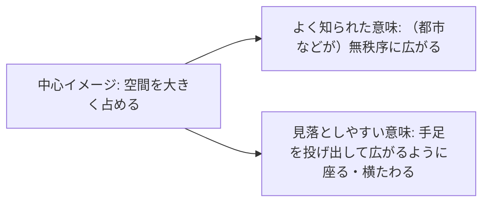
**重要語法**　sprawl on / across

---

## 2482. cult
品詞：adjective　｜　発音：/kʌlt/

<sub>よく知られている意味：熱狂的な信奉者の集団</sub>

### 見落としやすい意味
**一部の人々に熱狂的に支持される**

**例文**　The film became a cult classic among students.

**和訳**　その映画は学生たちの間で熱狂的な支持を集める名作となった。

**コアイメージ**　cult は一般的な人気とは異なる濃い支持の集まりを指す。形容詞的には、一部の人々に強く愛される作品などを修飾する。

**図**
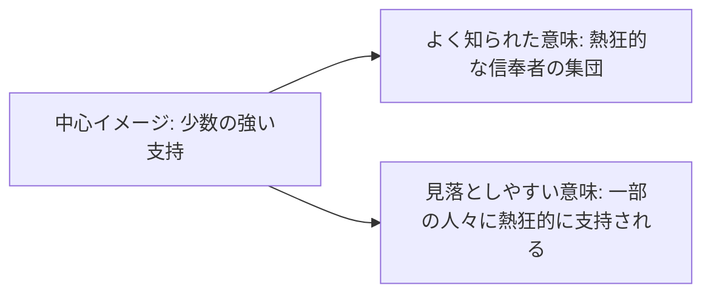
**重要語法**　cult classic / cult following

---

## 2483. pending
品詞：preposition　｜　発音：/ˈpendɪŋ/

<sub>よく知られている意味：（形容詞）未決の</sub>

### 見落としやすい意味
**～の結果を待つ間；～まで**

**例文**　The opening date is uncertain pending approval from the council.

**和訳**　議会の承認が得られるまで、開業日は未定だ。

**コアイメージ**　pending は決定や結果が出る前の状態を表す。前置詞としては、その出来事が起こるまでの期間や条件を導く。

**図**
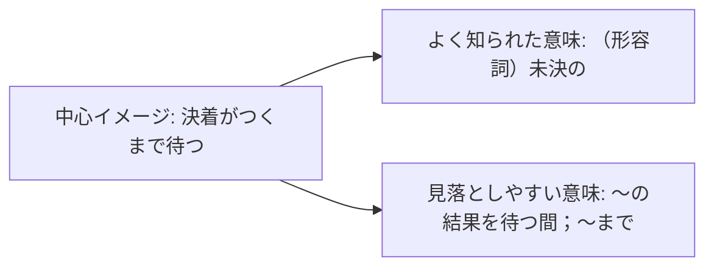
**重要語法**　pending approval / pending investigation

---

## 2484. regulator
品詞：noun　｜　発音：/ˈreɡjəleɪtər/

<sub>よく知られている意味：規制担当者、規制機関</sub>

### 見落としやすい意味
**圧力・流量などを調節する装置**

**例文**　A faulty regulator caused the pressure to rise.

**和訳**　故障した調整装置のせいで圧力が上がった。

**コアイメージ**　regulate は一定の基準に合わせて制御すること。人や機関なら規制者、機械なら圧力などを調節する装置を指す。

**図**
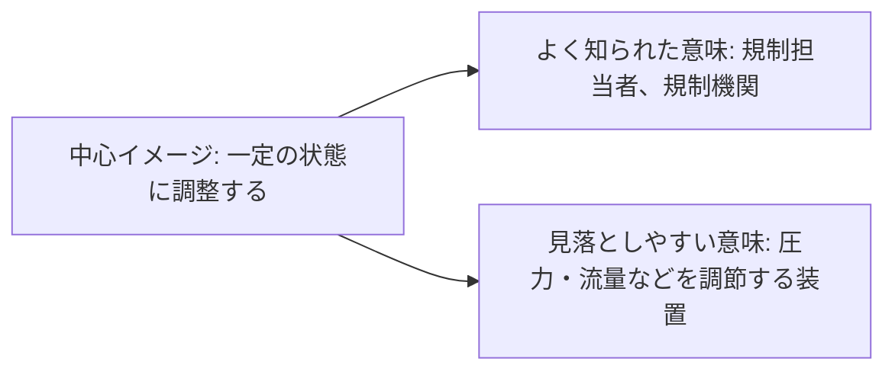
**重要語法**　pressure regulator

---

## 2485. speaking
品詞：verb　｜　発音：/ˈspiːkɪŋ/

<sub>よく知られている意味：話すこと</sub>

### 見落としやすい意味
**～と言えば；～について言うと**

**例文**　Speaking of music, have you heard her new song?

**和訳**　音楽といえば、彼女の新曲を聴いた？

**コアイメージ**　speaking of は話す行為より会話の話題を示す決まり文句。直前に関連することを「～といえば」と持ち出す。

**図**
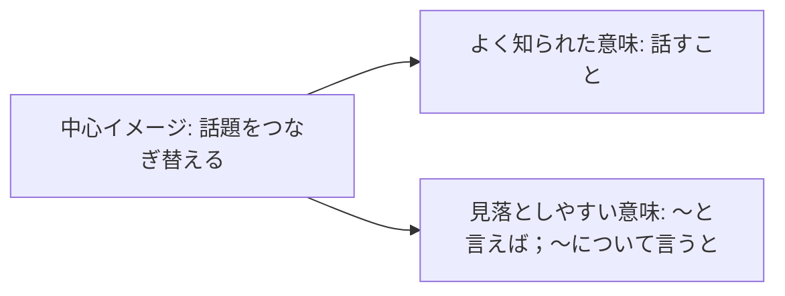
**重要語法**　speaking of ...

---

## 2486. whip
品詞：verb　｜　発音：/wɪp/

<sub>よく知られている意味：むちで打つ</sub>

### 見落としやすい意味
**（感情や熱狂を）あおる；短時間で作る**

**例文**　The coach whipped up excitement before the final.

**和訳**　監督は決勝前に熱気を盛り上げた。

**コアイメージ**　whip には素早く激しく動かす感覚がある。whip up は熱狂を高めたり、料理を手早く作ったりすることにも使う。

**図**
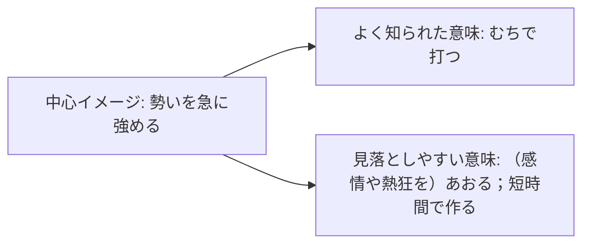
**重要語法**　whip up excitement / a meal

---

## 2487. wildly
品詞：adverb　｜　発音：/ˈwaɪldli/

<sub>よく知られている意味：野性的に、荒々しく</sub>

### 見落としやすい意味
**非常に；途方もなく**

**例文**　The two estimates differ wildly.

**和訳**　その二つの推計値は大きく異なっている。

**コアイメージ**　wildly は制御のきかない動きにも使われる。その広がりから、数値や程度が普通の範囲を大きく外れることを示す。

**図**
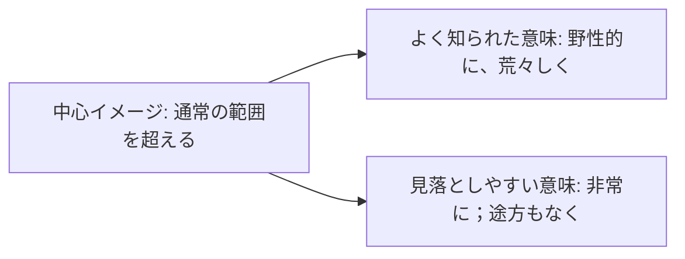
**重要語法**　vary wildly / differ wildly

---

## 2488. shine
品詞：verb　｜　発音：/ʃaɪn/

<sub>よく知られている意味：光る、輝く</sub>

### 見落としやすい意味
**（能力・人格などが）際立つ；秀でる**

**例文**　Her talent shines in difficult situations.

**和訳**　難しい状況でこそ彼女の才能は際立つ。

**コアイメージ**　光が周囲より目立つように、才能や長所も際立って見える。shine が人や能力を主語に取るときは「秀でる」と読む。

**図**
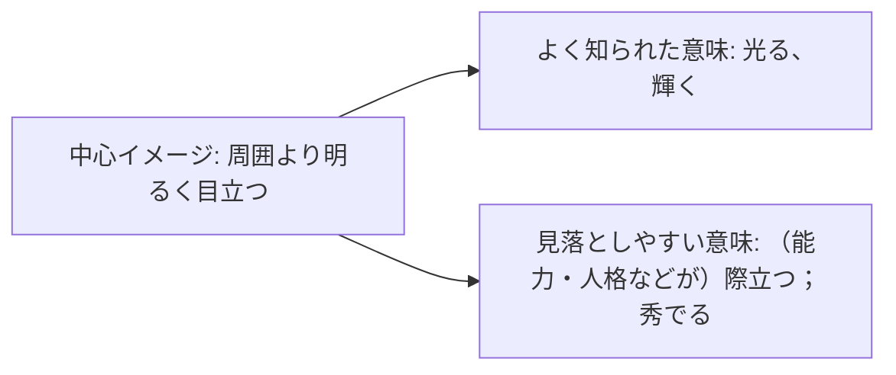
**重要語法**　shine in / shine through

---

## 2489. boil
品詞：verb　｜　発音：/bɔɪl/

<sub>よく知られている意味：沸騰する</sub>

### 見落としやすい意味
**結局～ということになる；要点は～だ**

**例文**　The dispute boils down to a lack of trust.

**和訳**　その争いは結局、信頼の欠如に行き着く。

**コアイメージ**　煮詰めると中身が凝縮されるイメージがある。boil down to は複雑な事柄を整理した結果の核心を示す。

**図**
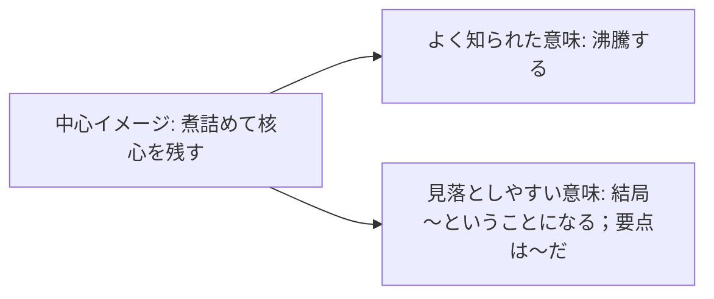
**重要語法**　boil down to ...

---

## 2490. bent
品詞：adjective　｜　発音：/bent/

<sub>よく知られている意味：曲がった</sub>

### 見落としやすい意味
**～しようと固く決心している**

**例文**　She is bent on becoming a doctor.

**和訳**　彼女は医師になると固く決心している。

**コアイメージ**　bent は形の向きだけでなく、心が目標に向かい続ける状態も表す。be bent on doing は強い決意を表す。

**図**
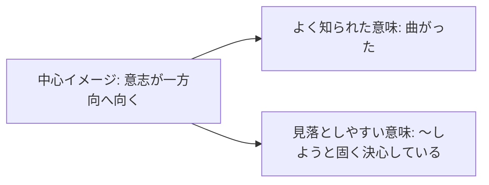
**重要語法**　be bent on doing

---

## 2491. bent
品詞：noun　｜　発音：/bent/

<sub>よく知られている意味：（形容詞）曲がった</sub>

### 見落としやすい意味
**素質；傾向；好み**

**例文**　He has a natural bent for languages.

**和訳**　彼には語学の生まれつきの素質がある。

**コアイメージ**　人の関心や適性が自然とある方向へ向かう感覚を表す。名詞 bent はその方向性を「素質・好み」として捉える。

**図**
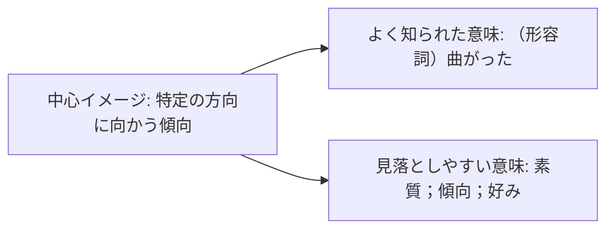
**重要語法**　a bent for ...

---

## 2492. hammer
品詞：verb　｜　発音：/ˈhæmər/

<sub>よく知られている意味：金づちで打つ</sub>

### 見落としやすい意味
**話し合いを重ねて合意・解決策を作る**

**例文**　After hours of talks, they hammered out an agreement.

**和訳**　何時間も話し合った末、彼らは合意をまとめ上げた。

**コアイメージ**　金属を繰り返し打って望む形にする作業が出発点。hammer out は意見をすり合わせて合意や解決策を練り上げることをいう。

**図**
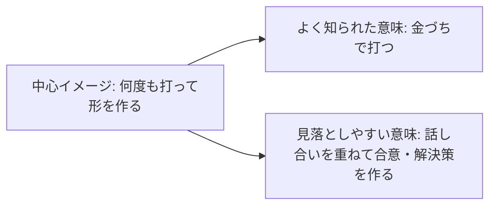
**重要語法**　hammer out a deal / solution

---

## 2493. hammer
品詞：verb　｜　発音：/ˈhæmər/

<sub>よく知られている意味：金づちで打つ</sub>

### 見落としやすい意味
**厳しく批判する**

**例文**　Critics hammered the company over its safety record.

**和訳**　批評家たちはその会社の安全管理の実績を厳しく批判した。

**コアイメージ**　ハンマーで繰り返し叩く強さが、言葉による攻撃に移る。人や組織を hammer する場合は激しく批判する意味になる。

**図**
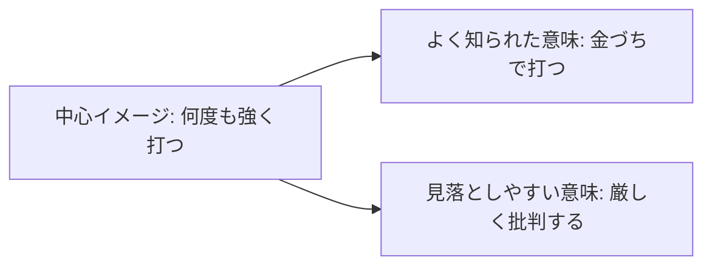
**重要語法**　hammer someone over / for ...

---

## 2494. tag
品詞：verb　｜　発音：/tæɡ/

<sub>よく知られている意味：札・タグを付ける</sub>

### 見落としやすい意味
**一緒について行く**

**例文**　Can I tag along on your trip to the museum?

**和訳**　博物館に行くとき、私も一緒について行っていい？

**コアイメージ**　tag along は誰かの行動にくっつくように同行する句動詞。荷札を付ける意味とは異なるので、句全体で覚える。

**図**
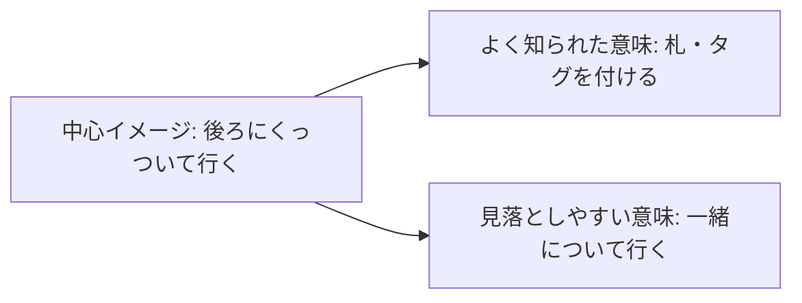
**重要語法**　tag along (with someone)

---

## 2495. wipe
品詞：verb　｜　発音：/waɪp/

<sub>よく知られている意味：拭く、拭き取る</sub>

### 見落としやすい意味
**完全に一掃する；全滅させる**

**例文**　The flood wiped out several small bridges.

**和訳**　洪水でいくつかの小さな橋が完全に流された。

**コアイメージ**　布で拭いて汚れを消す動作が基本にある。wipe out は物事がほとんど残らないほど消し去られることを表す。

**図**
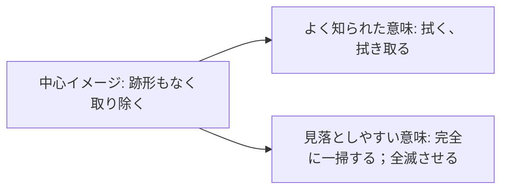
**重要語法**　wipe out ...

---

## 2496. tariff
品詞：noun　｜　発音：/ˈtærɪf/

<sub>よく知られている意味：関税</sub>

### 見落としやすい意味
**電気・交通・通信などの料金体系・料金表**

**例文**　The electricity tariff will rise next month.

**和訳**　電気料金は来月値上げされる。

**コアイメージ**　tariff は取引に適用する料金・税の決まりを表す。国境で課す関税だけでなく、電気や交通などの料金体系にも使う。

**図**
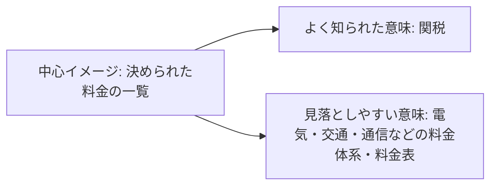
**重要語法**　electricity tariff / tariff plan

---

## 2497. buck
品詞：verb　｜　発音：/bʌk/

<sub>よく知られている意味：雄鹿、ドル</sub>

### 見落としやすい意味
**慣行・傾向に逆らう；逆行する**

**例文**　The small business bucked the trend and increased sales.

**和訳**　その小企業は全体の傾向に逆らって売上げを伸ばした。

**コアイメージ**　buck には勢いよく跳ねて抵抗する動きがある。比喩的には世間の傾向や慣行に逆らうことを表す。

**図**
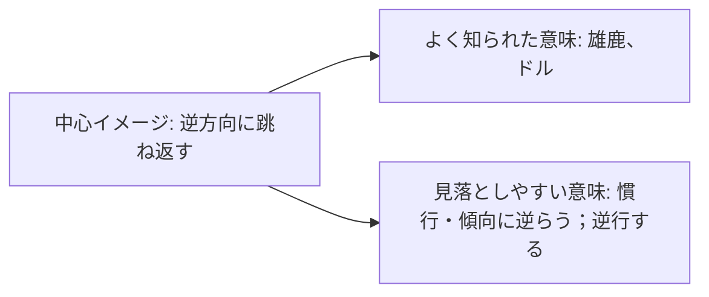
**重要語法**　buck the trend

---

## 2498. herd
品詞：verb　｜　発音：/hɜːrd/

<sub>よく知られている意味：家畜の群れ</sub>

### 見落としやすい意味
**人々を一か所に誘導する；まとめて移動させる**

**例文**　Staff herded the visitors toward the exit.

**和訳**　係員は来場者たちを出口の方へまとめて誘導した。

**コアイメージ**　牧畜で群れをまとめて動かすことから、herd は人の集団にも使われる。多数の人を同じ方向へ誘導する様子を描く。

**図**
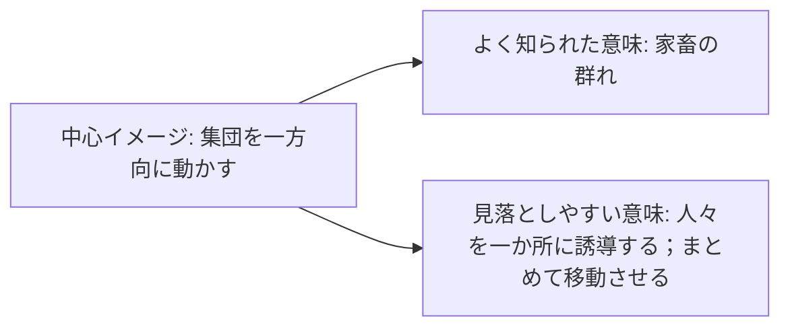
**重要語法**　herd people toward ...

---

## 2499. railroad
品詞：verb　｜　発音：/ˈreɪlroʊd/

<sub>よく知られている意味：鉄道</sub>

### 見落としやすい意味
**強引に物事を押し通す；不当に追い込む**

**例文**　The manager railroaded the team into accepting the proposal.

**和訳**　上司はチームにその提案を強引に受け入れさせた。

**コアイメージ**　railroad の動詞には、相手の意思を尊重せず結論へ押し進める意味がある。鉄道と直訳せず、強引な進行という比喩で捉える。

**図**
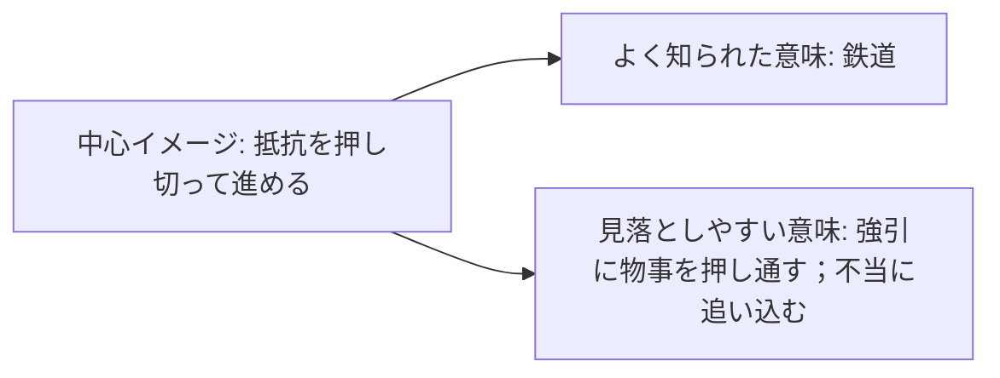
**重要語法**　railroad someone into doing

---

## 2500. dirt
品詞：noun　｜　発音：/dɜːrt/

<sub>よく知られている意味：土、汚れ</sub>

### 見落としやすい意味
**スキャンダルなどの醜聞情報**

**例文**　The reporter tried to dig up dirt on the candidate.

**和訳**　記者はその候補者の醜聞を掘り起こそうとした。

**コアイメージ**　dirt は目に見える汚れだけでなく、評判を汚す情報にも使われる。dig up dirt は人に不利な秘密や醜聞を探すこと。

**図**
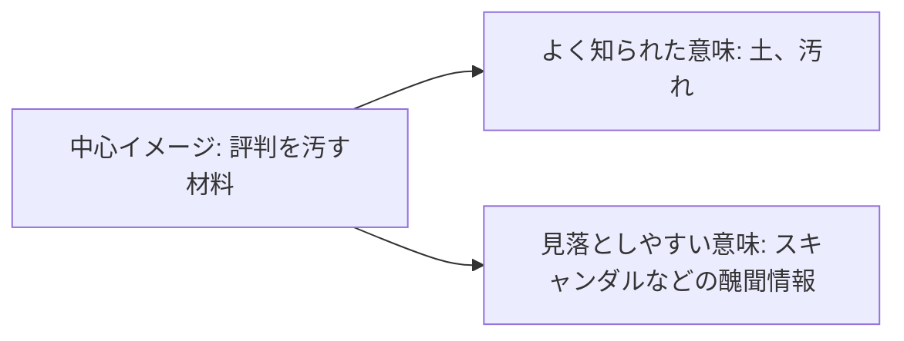
**重要語法**　dig up dirt on someone

---

## 2501. chemistry
品詞：noun　｜　発音：/ˈkemɪstri/

<sub>よく知られている意味：化学</sub>

### 見落としやすい意味
**人と人の相性；気持ちの通じ合い**

**例文**　The two actors had great chemistry on screen.

**和訳**　その二人の俳優は画面上で抜群の相性を見せた。

**コアイメージ**　化学では物質の組み合わせで反応が生じる。人同士の場合は、一緒にいると自然に生まれる相性や雰囲気を表す。

**図**
```mermaid
flowchart LR
    A["中心イメージ: 組み合わせから生まれる反応"]
    B["よく知られた意味: 化学"]
    C["見落としやすい意味: 人と人の相性；気持ちの通じ合い"]
    A --> B
    A --> C
```
**重要語法**　have chemistry (with someone)

---

## 2502. bang
品詞：noun　｜　発音：/bæŋ/

<sub>よく知られている意味：大きな音</sub>

### 見落としやすい意味
**費用に見合った効果・価値**

**例文**　This laptop gives you a lot of bang for your buck.

**和訳**　このノートパソコンは値段の割にとてもお得だ。

**コアイメージ**　bang for your buck は払ったお金に対して得られる成果の大きさを表す慣用句。bang 単独が「費用対効果」を意味するわけではない。

**図**
```mermaid
flowchart LR
    A["中心イメージ: 支出に対する大きな成果"]
    B["よく知られた意味: 大きな音"]
    C["見落としやすい意味: 費用に見合った効果・価値"]
    A --> B
    A --> C
```
**重要語法**　bang for your buck

---

## 2503. deed
品詞：noun　｜　発音：/diːd/

<sub>よく知られている意味：行為、行い</sub>

### 見落としやすい意味
**法的な権利証書；不動産の譲渡証書**

**例文**　The buyer signed the deed at the lawyer's office.

**和訳**　買い手は法律事務所で不動産の権利証書に署名した。

**コアイメージ**　deed は人が行った行為を表すだけでなく、法的に効力を持つ書類にも使う。不動産取引では権利の譲渡などを証明する文書になる。

**図**
```mermaid
flowchart LR
    A["中心イメージ: 行為を正式に記録する文書"]
    B["よく知られた意味: 行為、行い"]
    C["見落としやすい意味: 法的な権利証書；不動産の譲渡証書"]
    A --> B
    A --> C
```
**重要語法**　title deed / deed of transfer

---

## 2504. landing
品詞：noun　｜　発音：/ˈlændɪŋ/

<sub>よく知られている意味：着陸</sub>

### 見落としやすい意味
**階段の踊り場**

**例文**　We paused on the landing between the two floors.

**和訳**　私たちは二つの階の間にある踊り場で立ち止まった。

**コアイメージ**　landing は地面に着く場所という感覚を持つ。階段では上り下りの途中に設けられた平らな場所を指す。

**図**
```mermaid
flowchart LR
    A["中心イメージ: 途中で足を置く平らな場所"]
    B["よく知られた意味: 着陸"]
    C["見落としやすい意味: 階段の踊り場"]
    A --> B
    A --> C
```
**重要語法**　stair landing

---

## 2505. collector
品詞：noun　｜　発音：/kəˈlektər/

<sub>よく知られている意味：収集家</sub>

### 見落としやすい意味
**代金や税金などの集金担当者**

**例文**　A tax collector visited the shop.

**和訳**　税の徴収担当者がその店を訪れた。

**コアイメージ**　collect は趣味の品を集めることにも、支払うべき金銭を集めることにも使う。後者の担当者が collector である。

**図**
```mermaid
flowchart LR
    A["中心イメージ: 何かを集めて回収する人"]
    B["よく知られた意味: 収集家"]
    C["見落としやすい意味: 代金や税金などの集金担当者"]
    A --> B
    A --> C
```
**重要語法**　tax collector / debt collector

---

## 2506. orientation
品詞：noun　｜　発音：/ˌɔːriənˈteɪʃən/

<sub>よく知られている意味：方向、方位</sub>

### 見落としやすい意味
**新入生・新入社員の説明会／研修**

**例文**　New students will attend orientation on Monday.

**和訳**　新入生は月曜日にオリエンテーションに参加する。

**コアイメージ**　orientation には方向づけの感覚がある。学校や会社では、初めて来た人が仕組みを理解する説明会を指す。

**図**
```mermaid
flowchart LR
    A["中心イメージ: 新環境で方向をつかむ"]
    B["よく知られた意味: 方向、方位"]
    C["見落としやすい意味: 新入生・新入社員の説明会／研修"]
    A --> B
    A --> C
```
**重要語法**　student orientation

---

## 2507. programming
品詞：noun　｜　発音：/ˈproʊɡræmɪŋ/

<sub>よく知られている意味：プログラム作成</sub>

### 見落としやすい意味
**テレビ・ラジオなどの番組編成**

**例文**　The station changed its evening programming.

**和訳**　その放送局は夜の番組編成を変更した。

**コアイメージ**　programming は活動の内容と順序を決めること。放送ではコンピューターのコードではなく番組の編成を表す。

**図**
```mermaid
flowchart LR
    A["中心イメージ: 流れを計画して組み立てる"]
    B["よく知られた意味: プログラム作成"]
    C["見落としやすい意味: テレビ・ラジオなどの番組編成"]
    A --> B
    A --> C
```
**重要語法**　television programming

---

## 2508. forthcoming
品詞：adjective　｜　発音：/ˌfɔːrθˈkʌmɪŋ/

<sub>よく知られている意味：今後の、近く発表される</sub>

### 見落としやすい意味
**（質問に対して）情報を進んで提供する；率直な**

**例文**　The witness was not forthcoming with details.

**和訳**　その証人は詳しい情報を進んで話そうとはしなかった。

**コアイメージ**　forthcoming はこれから現れる物事を表す。一方、人が情報を惜しまず提供する態度を表す場合は「率直な・協力的な」となる。

**図**
```mermaid
flowchart LR
    A["中心イメージ: 情報が外へ出てくる"]
    B["よく知られた意味: 今後の、近く発表される"]
    C["見落としやすい意味: （質問に対して）情報を進んで提供する；率直な"]
    A --> B
    A --> C
```
**重要語法**　be forthcoming with information

---

## 2509. reconcile
品詞：verb　｜　発音：/ˈrekənsaɪl/

<sub>よく知られている意味：仲直りさせる</sub>

### 見落としやすい意味
**（食い違う事柄を）整合させる**

**例文**　We need to reconcile the two conflicting reports.

**和訳**　私たちは食い違う二つの報告を整合させる必要がある。

**コアイメージ**　reconcile は人の仲を修復するだけではない。数字や説明に食い違いがあるとき、それらが矛盾しない形に合わせる意味になる。

**図**
```mermaid
flowchart LR
    A["中心イメージ: 対立するものを一致させる"]
    B["よく知られた意味: 仲直りさせる"]
    C["見落としやすい意味: （食い違う事柄を）整合させる"]
    A --> B
    A --> C
```
**重要語法**　reconcile A with B

---

## 2510. arose
品詞：verb　｜　発音：/əˈroʊz/

<sub>よく知られている意味：（arise の過去形）起きた</sub>

### 見落としやすい意味
**（問題・事態が）～から生じた**

**例文**　The confusion arose from a simple mistake.

**和訳**　その混乱は単純なミスから生じた。

**コアイメージ**　arise は何かが生じて表面化すること。過去形 arose に from が続けば出来事の原因を示す。

**図**
```mermaid
flowchart LR
    A["中心イメージ: ある原因から立ち現れる"]
    B["よく知られた意味: （arise の過去形）起きた"]
    C["見落としやすい意味: （問題・事態が）～から生じた"]
    A --> B
    A --> C
```
**重要語法**　arose from ...

---

## 2511. awful
品詞：adjective　｜　発音：/ˈɔːfəl/

<sub>よく知られている意味：ひどい、恐ろしい</sub>

### 見落としやすい意味
**非常に多くの；ものすごい量の**

**例文**　We spent an awful lot of time on that task.

**和訳**　私たちはその作業にものすごく多くの時間を費やした。

**コアイメージ**　awful には強い評価を加える働きがある。an awful lot of では否定的な意味より量の大きさを強調する。

**図**
```mermaid
flowchart LR
    A["中心イメージ: 程度が普通を大きく超える"]
    B["よく知られた意味: ひどい、恐ろしい"]
    C["見落としやすい意味: 非常に多くの；ものすごい量の"]
    A --> B
    A --> C
```
**重要語法**　an awful lot of ...

---


## 2512. indictment
品詞：noun　｜　発音：/ɪnˈdaɪtmənt/

<sub>よく知られている意味：起訴、起訴状</sub>

### 見落としやすい意味
**（制度・行為への）厳しい非難、失敗を示す証拠**

**例文**　The report was an indictment of the education system.

**和訳**　その報告書は教育制度に対する厳しい批判だった。

**コアイメージ**　indictment は法的には起訴を表す。比喩的には制度や行動の問題を明らかにする厳しい批判を指す。

**図**
```mermaid
flowchart LR
    A["中心イメージ: 問題を証拠で突きつける"]
    B["よく知られた意味: 起訴、起訴状"]
    C["見落としやすい意味: （制度・行為への）厳しい非難、失敗を示す証拠"]
    A --> B
    A --> C
```
**重要語法**　an indictment of ...

---

## 2513. ply
品詞：verb　｜　発音：/plaɪ/

<sub>よく知られている意味：（名詞）層</sub>

### 見落としやすい意味
**（仕事・商売などに）精を出す**

**例文**　She has plied her trade as a carpenter for twenty years.

**和訳**　彼女は20年間、大工の仕事に精を出してきた。

**コアイメージ**　動詞 ply は仕事などを継続的に営む意味で使われる。名詞「層」と無理につなげず ply one's trade をひとまとまりで覚える。

**図**
```mermaid
flowchart LR
    A["中心イメージ: 仕事を繰り返し続ける"]
    B["よく知られた意味: （名詞）層"]
    C["見落としやすい意味: （仕事・商売などに）精を出す"]
    A --> B
    A --> C
```
**重要語法**　ply one's trade

---

## 2514. ply
品詞：verb　｜　発音：/plaɪ/

<sub>よく知られている意味：（名詞）層</sub>

### 見落としやすい意味
**（船や乗り物が）特定の経路を定期的に往復する**

**例文**　Ferries ply the route between the two islands.

**和訳**　フェリーが二つの島の間を定期的に往復している。

**コアイメージ**　乗り物が決まった区間を繰り返し行き来することを ply で表せる。特に船やバスの運行を説明するときに使う。

**図**
```mermaid
flowchart LR
    A["中心イメージ: 同じ道筋を行き来する"]
    B["よく知られた意味: （名詞）層"]
    C["見落としやすい意味: （船や乗り物が）特定の経路を定期的に往復する"]
    A --> B
    A --> C
```
**重要語法**　ply a route / ply between A and B

---

## 2515. stumble
品詞：verb　｜　発音：/ˈstʌmbəl/

<sub>よく知られている意味：つまずく</sub>

### 見落としやすい意味
**偶然出くわす、偶然見つける（stumble on/upon）**

**例文**　I stumbled upon an old photograph in the attic.

**和訳**　屋根裏で偶然古い写真を見つけた。

**コアイメージ**　つまずくときは意図せず何かにぶつかる。stumble upon はその偶然性を物や情報との出会いに広げた表現である。

**図**
```mermaid
flowchart LR
    A["中心イメージ: 思いがけず行き当たる"]
    B["よく知られた意味: つまずく"]
    C["見落としやすい意味: 偶然出くわす、偶然見つける（stumble on/upon）"]
    A --> B
    A --> C
```
**重要語法**　stumble on / upon ...

---

## 2516. biblical
品詞：adjective　｜　発音：/ˈbɪblɪkəl/

<sub>よく知られている意味：聖書の</sub>

### 見落としやすい意味
**（規模などが）非常に大きい、途方もない**

**例文**　The town suffered flooding on a biblical scale.

**和訳**　その町は途方もない規模の洪水に見舞われた。

**コアイメージ**　biblical は本来、聖書に関するという意味。聖書の壮大な出来事を連想させるほど規模が大きい、という強調にも用いられる。

**図**
```mermaid
flowchart LR
    A["中心イメージ: 聖書の壮大な出来事を思わせる"]
    B["よく知られた意味: 聖書の"]
    C["見落としやすい意味: （規模などが）非常に大きい、途方もない"]
    A --> B
    A --> C
```
**重要語法**　on a biblical scale

---

## 2517. consistency
品詞：noun　｜　発音：/kənˈsɪstənsi/

<sub>よく知られている意味：一貫性</sub>

### 見落としやすい意味
**（液体・物質の）粘り気、硬さ、濃度の具合**

**例文**　Add water until the mixture has a smooth consistency.

**和訳**　混合物がなめらかな状態になるまで水を加えなさい。

**コアイメージ**　consistency は全体がどれほど均一でまとまっているかという性質を示す。考えや行動なら一貫性、物質なら硬さや粘り気になる。

**図**
```mermaid
flowchart LR
    A["中心イメージ: 中身のまとまり方"]
    B["よく知られた意味: 一貫性"]
    C["見落としやすい意味: （液体・物質の）粘り気、硬さ、濃度の具合"]
    A --> B
    A --> C
```
**重要語法**　thick / smooth consistency

---

## 2518. dub
品詞：verb　｜　発音：/dʌb/

<sub>よく知られている意味：吹き替える</sub>

### 見落としやすい意味
**（人や物を）～と呼ぶ、名付ける**

**例文**　The press dubbed him the king of comedy.

**和訳**　報道陣は彼を「コメディーの王」と呼んだ。

**コアイメージ**　dub は相手に名前や称号を付ける動詞として使える。音声の吹き替えとは別に、dub A B の形を押さえる。

**図**
```mermaid
flowchart LR
    A["中心イメージ: 新しい呼び名を与える"]
    B["よく知られた意味: 吹き替える"]
    C["見落としやすい意味: （人や物を）～と呼ぶ、名付ける"]
    A --> B
    A --> C
```
**重要語法**　dub A B

---

## 2519. franchise
品詞：noun　｜　発音：/ˈfræntʃaɪz/

<sub>よく知られている意味：フランチャイズ営業権</sub>

### 見落としやすい意味
**選挙権、投票する権利**

**例文**　The reform extended the franchise to more citizens.

**和訳**　その改革によって、より多くの市民に選挙権が認められた。

**コアイメージ**　franchise は特定の権利を認められていることに関わる語。商業では営業権、政治では投票できる権利を指す。

**図**
```mermaid
flowchart LR
    A["中心イメージ: 公的に認められた権利"]
    B["よく知られた意味: フランチャイズ営業権"]
    C["見落としやすい意味: 選挙権、投票する権利"]
    A --> B
    A --> C
```
**重要語法**　extend the franchise

---

## 2520. franchise
品詞：noun　｜　発音：/ˈfræntʃaɪz/

<sub>よく知られている意味：フランチャイズ営業権</sub>

### 見落としやすい意味
**（映画・小説などの）シリーズ作品群**

**例文**　The studio plans another film in the franchise.

**和訳**　その映画会社は同じシリーズの新作を計画している。

**コアイメージ**　franchise は共通ブランドをさまざまな形で展開する仕組みにも使う。映画では共通の作品世界から生まれたシリーズ全体を指す。

**図**
```mermaid
flowchart LR
    A["中心イメージ: 同じ世界観を展開する事業"]
    B["よく知られた意味: フランチャイズ営業権"]
    C["見落としやすい意味: （映画・小説などの）シリーズ作品群"]
    A --> B
    A --> C
```
**重要語法**　film franchise

---

## 2521. par
品詞：noun　｜　発音：/pɑːr/

<sub>よく知られている意味：ゴルフの基準打数</sub>

### 見落としやすい意味
**同等の水準、同じ程度（on a par with）**

**例文**　Her skills are on a par with those of experienced players.

**和訳**　彼女の技量は経験豊富な選手たちと同水準だ。

**コアイメージ**　par はあるものを評価する基準の水準を表す。on a par with は二つが同じ程度にあるという意味になる。

**図**
```mermaid
flowchart LR
    A["中心イメージ: 比較の基準となる水準"]
    B["よく知られた意味: ゴルフの基準打数"]
    C["見落としやすい意味: 同等の水準、同じ程度（on a par with）"]
    A --> B
    A --> C
```
**重要語法**　on a par with ...

---

## 2522. reduced
品詞：adjective　｜　発音：/rɪˈduːst/

<sub>よく知られている意味：減少した</sub>

### 見落としやすい意味
**値下げされた、割引価格の**

**例文**　All winter coats are available at reduced prices.

**和訳**　冬物のコートはすべて割引価格で販売されている。

**コアイメージ**　reduce は数量や程度を下げること。価格に使う reduced は「元の値段より下がった」、つまり割引された状態を示す。

**図**
```mermaid
flowchart LR
    A["中心イメージ: 元の水準より下がる"]
    B["よく知られた意味: 減少した"]
    C["見落としやすい意味: 値下げされた、割引価格の"]
    A --> B
    A --> C
```
**重要語法**　at reduced prices

---

## 2523. upward
品詞：adverb　｜　発音：/ˈʌpwərd/

<sub>よく知られている意味：上方へ</sub>

### 見落としやすい意味
**（upward of＋数量で）～を超える、～以上の**

**例文**　The renovation will cost upward of two million yen.

**和訳**　改装には200万円を超える費用がかかるだろう。

**コアイメージ**　upward は上方向への広がりを示す。upward of に数字が続くと、その数字を超える数量を表す。

**図**
```mermaid
flowchart LR
    A["中心イメージ: 示した数値より上"]
    B["よく知られた意味: 上方へ"]
    C["見落としやすい意味: （upward of＋数量で）～を超える、～以上の"]
    A --> B
    A --> C
```
**重要語法**　upward of + 数量

---

## 2524. zoo
品詞：noun　｜　発音：/zuː/

<sub>よく知られている意味：動物園</sub>

### 見落としやすい意味
**（場所が）混雑して大混乱した状態**

**例文**　The office was a zoo during the product launch.

**和訳**　新製品発売中、オフィスは大混乱だった。

**コアイメージ**　zoo は動物が集まる場所のイメージから、非常に混雑し騒がしい状況を表す口語にもなる。実際の動物園の話とは限らない。

**図**
```mermaid
flowchart LR
    A["中心イメージ: 多くのものが入り乱れて騒がしい"]
    B["よく知られた意味: 動物園"]
    C["見落としやすい意味: （場所が）混雑して大混乱した状態"]
    A --> B
    A --> C
```
**重要語法**　It's a zoo.

---

## 2525. shy
品詞：adjective　｜　発音：/ʃaɪ/

<sub>よく知られている意味：内気な</sub>

### 見落としやすい意味
**（ある数値・時期などに）少し足りない（shy of）**

**例文**　The price was just shy of one thousand yen.

**和訳**　価格は1000円にわずかに届かなかった。

**コアイメージ**　shy of は数や時期などの基準に少し足りないことを示す。人の性格を表す「内気な」と切り分けて読む。

**図**
```mermaid
flowchart LR
    A["中心イメージ: 基準に少し届かない"]
    B["よく知られた意味: 内気な"]
    C["見落としやすい意味: （ある数値・時期などに）少し足りない（shy of）"]
    A --> B
    A --> C
```
**重要語法**　just shy of ...

---

## 2526. dust
品詞：verb　｜　発音：/dʌst/

<sub>よく知られている意味：ほこりを払う</sub>

### 見落としやすい意味
**粉末などを薄く振りかける（dust A with B）**

**例文**　Dust the cake with powdered sugar before serving.

**和訳**　出す前にケーキに粉砂糖を薄く振りかけて。

**コアイメージ**　dust は表面の粉を取り去る場合も、粉を薄く付ける場合もある。with が付いて粉の材料を示すときは「振りかける」に注意する。

**図**
```mermaid
flowchart LR
    A["中心イメージ: 表面の細かい粉に働きかける"]
    B["よく知られた意味: ほこりを払う"]
    C["見落としやすい意味: 粉末などを薄く振りかける（dust A with B）"]
    A --> B
    A --> C
```
**重要語法**　dust A with B

---

## 2527. relaxed
品詞：adjective　｜　発音：/rɪˈlækst/

<sub>よく知られている意味：くつろいだ</sub>

### 見落としやすい意味
**（規則・基準が）緩和された、厳しくない**

**例文**　The city introduced relaxed parking rules.

**和訳**　市は緩和された駐車規則を導入した。

**コアイメージ**　relaxed は人が緊張から解放された状態を示すことが多い。規則や基準なら厳しさが弱まった状態を表す。

**図**
```mermaid
flowchart LR
    A["中心イメージ: 緊張や制約が弱まる"]
    B["よく知られた意味: くつろいだ"]
    C["見落としやすい意味: （規則・基準が）緩和された、厳しくない"]
    A --> B
    A --> C
```
**重要語法**　relaxed rules / standards

---

## 2528. fare
品詞：noun　｜　発音：/fer/

<sub>よく知られている意味：運賃</sub>

### 見落としやすい意味
**食べ物、料理（提供される食事）**

**例文**　The cafe serves simple but delicious fare.

**和訳**　そのカフェでは素朴だがおいしい料理を出している。

**コアイメージ**　fare は運賃とは別に、提供される食べ物全般を表す名詞でもある。飲食店や地域の料理を述べる文脈で現れる。

**図**
```mermaid
flowchart LR
    A["中心イメージ: 提供される食事"]
    B["よく知られた意味: 運賃"]
    C["見落としやすい意味: 食べ物、料理（提供される食事）"]
    A --> B
    A --> C
```
**重要語法**　simple fare / local fare

---

## 2529. fare
品詞：verb　｜　発音：/fer/

<sub>よく知られている意味：（名詞）運賃</sub>

### 見落としやすい意味
**（人・事業などが）うまくいく、ある状況に置かれる**

**例文**　How did the team fare in the tournament?

**和訳**　そのチームは大会でどんな成績だった？

**コアイメージ**　動詞 fare は人や組織がどのような状況にあるかを示す。how や well、badly とともに結果や調子を述べる。

**図**
```mermaid
flowchart LR
    A["中心イメージ: 物事がある具合に進む"]
    B["よく知られた意味: （名詞）運賃"]
    C["見落としやすい意味: （人・事業などが）うまくいく、ある状況に置かれる"]
    A --> B
    A --> C
```
**重要語法**　fare well / badly

---

## 2530. cabinet
品詞：noun　｜　発音：/ˈkæbɪnət/

<sub>よく知られている意味：戸棚、収納棚</sub>

### 見落としやすい意味
**内閣、政府の主要閣僚の集団**

**例文**　The cabinet approved the proposal on Tuesday.

**和訳**　内閣は火曜日にその提案を承認した。

**コアイメージ**　cabinet には家具の戸棚のほか政府の閣僚集団という意味がある。政治の記事では行政の意思決定主体を指す。

**図**
```mermaid
flowchart LR
    A["中心イメージ: 重要事項を扱う集まり"]
    B["よく知られた意味: 戸棚、収納棚"]
    C["見落としやすい意味: 内閣、政府の主要閣僚の集団"]
    A --> B
    A --> C
```
**重要語法**　the cabinet approved ...

---

## 2531. deliberate
品詞：verb　｜　発音：/dɪˈlɪbəreɪt/

<sub>よく知られている意味：（形容詞）意図的な</sub>

### 見落としやすい意味
**慎重に検討する、熟議する**

**例文**　The committee deliberated for three hours before voting.

**和訳**　委員会は採決前に3時間にわたって熟議した。

**コアイメージ**　deliberate は慎重さを表す語でもある。動詞では複数の案をよく考え、議論して判断しようとすることを示す。

**図**
```mermaid
flowchart LR
    A["中心イメージ: 急がず注意深く考える"]
    B["よく知られた意味: （形容詞）意図的な"]
    C["見落としやすい意味: 慎重に検討する、熟議する"]
    A --> B
    A --> C
```
**重要語法**　deliberate on / over ...

---

## 2532. glow
品詞：verb　｜　発音：/ɡloʊ/

<sub>よく知られている意味：光を放つ</sub>

### 見落としやすい意味
**（喜び・誇りなどで）晴れやかな様子を見せる**

**例文**　She glowed with pride when her son graduated.

**和訳**　息子が卒業したとき、彼女は誇らしげに顔を輝かせた。

**コアイメージ**　glow は内側から明るく輝く様子を表す。人について使うと喜びや誇りが表情に現れることになる。

**図**
```mermaid
flowchart LR
    A["中心イメージ: 感情が明るく表に出る"]
    B["よく知られた意味: 光を放つ"]
    C["見落としやすい意味: （喜び・誇りなどで）晴れやかな様子を見せる"]
    A --> B
    A --> C
```
**重要語法**　glow with pride / happiness

---

## 2533. appendix
品詞：noun　｜　発音：/əˈpendɪks/

<sub>よく知られている意味：虫垂</sub>

### 見落としやすい意味
**（書籍・論文の）付録**

**例文**　The full survey results appear in the appendix.

**和訳**　調査の全結果は付録に載っている。

**コアイメージ**　appendix は主要なものに付属する部分を指す。人体では虫垂、書物では本文を補う資料をまとめた付録になる。

**図**
```mermaid
flowchart LR
    A["中心イメージ: 本体に付け加えた部分"]
    B["よく知られた意味: 虫垂"]
    C["見落としやすい意味: （書籍・論文の）付録"]
    A --> B
    A --> C
```
**重要語法**　in the appendix

---

## 2534. incidence
品詞：noun　｜　発音：/ˈɪnsɪdəns/

<sub>よく知られている意味：発生、出来事</sub>

### 見落としやすい意味
**（出来事・病気などの）発生率、起こる頻度**

**例文**　The incidence of the disease has declined.

**和訳**　その病気の発生率は低下している。

**コアイメージ**　incidence は出来事が発生すること、その頻度を表す。統計や医療の文章では、特定の集団や期間での発生率として使われる。

**図**
```mermaid
flowchart LR
    A["中心イメージ: ある集団で起こる頻度"]
    B["よく知られた意味: 発生、出来事"]
    C["見落としやすい意味: （出来事・病気などの）発生率、起こる頻度"]
    A --> B
    A --> C
```
**重要語法**　incidence of ...

---

## 2535. con
品詞：verb　｜　発音：/kɑːn/

<sub>よく知られている意味：（名詞）反対意見、欠点</sub>

### 見落としやすい意味
**人をだます、詐欺にかける**

**例文**　The fake website conned customers out of their money.

**和訳**　その偽サイトは客から金銭をだまし取った。

**コアイメージ**　動詞 con は相手を信用させてだますことを表す。pros and cons の con と混同せず、con someone out of ... の形で押さえる。

**図**
```mermaid
flowchart LR
    A["中心イメージ: 人を信用させて欺く"]
    B["よく知られた意味: （名詞）反対意見、欠点"]
    C["見落としやすい意味: 人をだます、詐欺にかける"]
    A --> B
    A --> C
```
**重要語法**　con someone out of ...

---

## 2536. restrain
品詞：verb　｜　発音：/rɪˈstreɪn/

<sub>よく知られている意味：抑制する</sub>

### 見落としやすい意味
**（人の行動や自由を）物理的に拘束する**

**例文**　Security staff restrained the intruder.

**和訳**　警備員が侵入者の身体の動きを押さえた。

**コアイメージ**　restrain は行動や感情を抑えることを指す。身体に使う場合は実際に動けないよう押さえたり拘束したりする意味になる。

**図**
```mermaid
flowchart LR
    A["中心イメージ: 動きを自由にさせない"]
    B["よく知られた意味: 抑制する"]
    C["見落としやすい意味: （人の行動や自由を）物理的に拘束する"]
    A --> B
    A --> C
```
**重要語法**　physically restrain someone

---

## 2537. empower
品詞：verb　｜　発音：/ɪmˈpaʊər/

<sub>よく知られている意味：権限を与える</sub>

### 見落としやすい意味
**（人に）自信や主体性を与える**

**例文**　The project empowered students to speak up.

**和訳**　その企画は生徒たちが自分の意見を言える自信を与えた。

**コアイメージ**　empower は権限の付与だけでなく主体的に動く力を高めることにも使う。自信や発言力を得る文脈で重要である。

**図**
```mermaid
flowchart LR
    A["中心イメージ: 自分で行動できる力を持たせる"]
    B["よく知られた意味: 権限を与える"]
    C["見落としやすい意味: （人に）自信や主体性を与える"]
    A --> B
    A --> C
```
**重要語法**　empower someone to do

---

## 2538. disrupt
品詞：verb　｜　発音：/dɪsˈrʌpt/

<sub>よく知られている意味：妨害する、混乱させる</sub>

### 見落としやすい意味
**（新しい商品や企業が）既存の市場構造を大きく変える**

**例文**　The new platform disrupted the taxi market.

**和訳**　新しいプラットフォームはタクシー市場の構造を大きく変えた。

**コアイメージ**　disrupt は既存の活動や秩序を中断させること。ビジネスでは新しい仕組みが市場の常識を変える意味でも使う。

**図**
```mermaid
flowchart LR
    A["中心イメージ: 従来の流れを断つ"]
    B["よく知られた意味: 妨害する、混乱させる"]
    C["見落としやすい意味: （新しい商品や企業が）既存の市場構造を大きく変える"]
    A --> B
    A --> C
```
**重要語法**　disrupt an industry / market

---

## 2539. epic
品詞：noun　｜　発音：/ˈepɪk/

<sub>よく知られている意味：（形容詞）壮大な</sub>

### 見落としやすい意味
**叙事詩、長編の英雄的な物語**

**例文**　The ancient epic tells the story of a long voyage.

**和訳**　その古代の叙事詩は長い航海の物語を語る。

**コアイメージ**　epic は規模の大きさを示す形容詞としても使われる。名詞では英雄の行動などを長く語る物語や叙事詩を指す。

**図**
```mermaid
flowchart LR
    A["中心イメージ: 大きな物語を描く"]
    B["よく知られた意味: （形容詞）壮大な"]
    C["見落としやすい意味: 叙事詩、長編の英雄的な物語"]
    A --> B
    A --> C
```
**重要語法**　an epic poem

---

## 2540. horn
品詞：noun　｜　発音：/hɔːrn/

<sub>よく知られている意味：角、角笛</sub>

### 見落としやすい意味
**（blow one's own hornで）自慢する、得意がる**

**例文**　He is always blowing his own horn at meetings.

**和訳**　彼は会議でいつも自慢ばかりしている。

**コアイメージ**　角笛を吹けば周囲の注意が集まる。blow one's own horn は自分の実績などを吹聴することを表す慣用句である。

**図**
```mermaid
flowchart LR
    A["中心イメージ: 自分の存在を大きな音で知らせる"]
    B["よく知られた意味: 角、角笛"]
    C["見落としやすい意味: （blow one's own hornで）自慢する、得意がる"]
    A --> B
    A --> C
```
**重要語法**　blow one's own horn

---

## 2541. presume
品詞：verb　｜　発音：/prɪˈzuːm/

<sub>よく知られている意味：推定する</sub>

### 見落としやすい意味
**人の好意などにつけ込む、厚かましく振る舞う（presume on/upon）**

**例文**　Do not presume on your friends' kindness.

**和訳**　友人の親切につけ込んではいけない。

**コアイメージ**　presume は十分な根拠なく当然と考えることにも関わる。presume on は他人の好意を当てにしすぎる、厚かましく利用する意味になる。

**図**
```mermaid
flowchart LR
    A["中心イメージ: 当然と思って踏み込みすぎる"]
    B["よく知られた意味: 推定する"]
    C["見落としやすい意味: 人の好意などにつけ込む、厚かましく振る舞う（presume on/upon）"]
    A --> B
    A --> C
```
**重要語法**　presume on / upon kindness

---

## 2542. revision
品詞：noun　｜　発音：/rɪˈvɪʒən/

<sub>よく知られている意味：改訂、修正</sub>

### 見落としやすい意味
**（特に英）試験前の復習、試験勉強**

**例文**　She spent the weekend doing revision for her exams.

**和訳**　彼女は週末を試験のための復習に費やした。

**コアイメージ**　revision はいったん作ったものを見直すこと。イギリス英語では学習内容を試験に向けて見直す「復習」を指す。

**図**
```mermaid
flowchart LR
    A["中心イメージ: もう一度見直して整える"]
    B["よく知られた意味: 改訂、修正"]
    C["見落としやすい意味: （特に英）試験前の復習、試験勉強"]
    A --> B
    A --> C
```
**重要語法**　do revision for exams (英)

---

## 2543. tuition
品詞：noun　｜　発音：/tuˈɪʃən/

<sub>よく知られている意味：授業料</sub>

### 見落としやすい意味
**授業、指導、教えること**

**例文**　The course offers individual tuition in mathematics.

**和訳**　その講座は数学の個別指導を提供している。

**コアイメージ**　tuition は教育に関わる語で、授業料を表すことが多い。一方、とくにイギリス英語では授業や指導そのものを指す。

**図**
```mermaid
flowchart LR
    A["中心イメージ: 教える行為そのもの"]
    B["よく知られた意味: 授業料"]
    C["見落としやすい意味: 授業、指導、教えること"]
    A --> B
    A --> C
```
**重要語法**　private tuition (英)

---

## 2544. bat
品詞：verb　｜　発音：/bæt/

<sub>よく知られている意味：バット、コウモリ</sub>

### 見落としやすい意味
**（not bat an eyeで）少しも動じない、驚くそぶりを見せない**

**例文**　She didn't bat an eye when the schedule changed.

**和訳**　予定が変わっても、彼女は少しも動じなかった。

**コアイメージ**　bat an eye はまばたきするという表現に由来する。否定文で使うと驚きや動揺を表情に出さないことを示す。

**図**
```mermaid
flowchart LR
    A["中心イメージ: まばたき一つしない"]
    B["よく知られた意味: バット、コウモリ"]
    C["見落としやすい意味: （not bat an eyeで）少しも動じない、驚くそぶりを見せない"]
    A --> B
    A --> C
```
**重要語法**　not bat an eye / eyelid

---

## 2545. cd
品詞：noun (abbreviation)　｜　発音：/ˌsiː ˈdiː/

<sub>よく知られている意味：コンパクトディスク</sub>

### 見落としやすい意味
**（金融）定期預金証書（certificate of deposit の略、通常 CD と大文字表記）**

**例文**　He put his savings in a CD at the bank.

**和訳**　彼は貯金を銀行の定期預金証書に預けた。

**コアイメージ**　CD は音楽の compact disc だけでなく金融では certificate of deposit の略にもなる。音楽媒体から派生した意味ではなく別の語句の頭文字が一致したもの。

**図**
```mermaid
flowchart LR
    A["中心イメージ: 略字の一致、別の正式名称"]
    B["よく知られた意味: コンパクトディスク"]
    C["見落としやすい意味: （金融）定期預金証書（certificate of deposit の略、通常 CD と大文字表記）"]
    A --> B
    A --> C
```
**重要語法**　CD = certificate of deposit

---

## 2546. lost
品詞：adjective　｜　発音：/lɔːst/

<sub>よく知られている意味：道に迷った、失われた</sub>

### 見落としやすい意味
**（思考や活動に）没頭した、周囲に気づかない（lost in）**

**例文**　He was so lost in thought that he missed his stop.

**和訳**　彼は考え事に夢中で降りる駅を逃した。

**コアイメージ**　lost は道が分からないだけでなく注意を何かに奪われた状態も表す。lost in thought のように対象に没頭し周囲が見えなくなる。

**図**
```mermaid
flowchart LR
    A["中心イメージ: 意識がほかへ入り込む"]
    B["よく知られた意味: 道に迷った、失われた"]
    C["見落としやすい意味: （思考や活動に）没頭した、周囲に気づかない（lost in）"]
    A --> B
    A --> C
```
**重要語法**　be lost in thought / a book

---

## 2547. purple
品詞：adjective　｜　発音：/ˈpɜːrpəl/

<sub>よく知られている意味：紫色の</sub>

### 見落としやすい意味
**（文章・表現が）凝りすぎた、修辞過剰な（purple prose）**

**例文**　The editor removed several examples of purple prose.

**和訳**　編集者は過度に飾り立てた文章をいくつか削った。

**コアイメージ**　purple は色の名称だが文体については大げさな装飾を連想させる。purple prose は修辞が過剰で不自然に華美な文章のこと。

**図**
```mermaid
flowchart LR
    A["中心イメージ: 目立つほど派手に飾る"]
    B["よく知られた意味: 紫色の"]
    C["見落としやすい意味: （文章・表現が）凝りすぎた、修辞過剰な（purple prose）"]
    A --> B
    A --> C
```
**重要語法**　purple prose

---

## 2548. singular
品詞：adjective　｜　発音：/ˈsɪŋɡjələr/

<sub>よく知られている意味：単数の</sub>

### 見落としやすい意味
**奇妙な、普通と異なる**

**例文**　It was a singular request, unlike anything I'd heard before.

**和訳**　それは、それまで聞いたことのない奇妙な依頼だった。

**コアイメージ**　singular は「単独の」という意味に関係する。そこから普通の例と違う、珍しい・奇妙なという評価を表すことがある。

**図**
```mermaid
flowchart LR
    A["中心イメージ: 一つだけで普通と異なる"]
    B["よく知られた意味: 単数の"]
    C["見落としやすい意味: 奇妙な、普通と異なる"]
    A --> B
    A --> C
```
**重要語法**　a singular event / request

---

## 2549. wilderness
品詞：noun　｜　発音：/ˈwɪldərnəs/

<sub>よく知られている意味：荒野、原野</sub>

### 見落としやすい意味
**（政治などで）影響力や支持を失った不遇の状態（in the wilderness）**

**例文**　The party spent years in the political wilderness.

**和訳**　その政党は何年もの間、政治的に不遇な立場に置かれた。

**コアイメージ**　wilderness は人の手が入らない荒野を指す。政治では権力や影響力の中心から遠ざけられた状況の比喩となる。

**図**
```mermaid
flowchart LR
    A["中心イメージ: 中心から離れ孤立する"]
    B["よく知られた意味: 荒野、原野"]
    C["見落としやすい意味: （政治などで）影響力や支持を失った不遇の状態（in the wilderness）"]
    A --> B
    A --> C
```
**重要語法**　in the political wilderness

---

## 2550. thesis
品詞：noun　｜　発音：/ˈθiːsɪs/

<sub>よく知られている意味：学位論文</sub>

### 見落としやすい意味
**議論の中心となる主張、論題**

**例文**　Her central thesis is that trust improves teamwork.

**和訳**　彼女の中心的な主張は、信頼がチームワークを高めるというものだ。

**コアイメージ**　thesis は学位論文だけに限らない。論説や議論の中で証明・説明しようとする中心の主張を指す。

**図**
```mermaid
flowchart LR
    A["中心イメージ: 議論を支える中心の主張"]
    B["よく知られた意味: 学位論文"]
    C["見落としやすい意味: 議論の中心となる主張、論題"]
    A --> B
    A --> C
```
**重要語法**　central thesis / thesis that ...

---

## 2551. diversion
品詞：noun　｜　発音：/daɪˈvɜːrʒən/

<sub>よく知られている意味：方向転換、流用</sub>

### 見落としやすい意味
**気晴らし、注意をそらす活動**

**例文**　Reading mystery novels is a pleasant diversion from work.

**和訳**　推理小説を読むことは仕事のよい気晴らしになる。

**コアイメージ**　diversion は進む方向を変えること。心の注意を仕事や悩みから別のことへ移す場合は「気晴らし」になる。

**図**
```mermaid
flowchart LR
    A["中心イメージ: 注意を別方向へ向ける"]
    B["よく知られた意味: 方向転換、流用"]
    C["見落としやすい意味: 気晴らし、注意をそらす活動"]
    A --> B
    A --> C
```
**重要語法**　a diversion from ...

---

## 2552. diversion
品詞：noun　｜　発音：/daɪˈvɜːrʒən/

<sub>よく知られている意味：方向転換、気晴らし</sub>

### 見落としやすい意味
**（道路などの）迂回路、迂回措置**

**例文**　Because of the roadworks, we followed a diversion through the village.

**和訳**　道路工事のため、私たちは村を通る迂回路を進んだ。

**コアイメージ**　diversion は予定の流れから外して別方向へ向けること。道路交通では工事などによる迂回路や迂回措置を指す。

**図**
```mermaid
flowchart LR
    A["中心イメージ: 進路を別の道に変える"]
    B["よく知られた意味: 方向転換、気晴らし"]
    C["見落としやすい意味: （道路などの）迂回路、迂回措置"]
    A --> B
    A --> C
```
**重要語法**　road diversion (英)

---

## 2553. refine
品詞：verb　｜　発音：/rɪˈfaɪn/

<sub>よく知られている意味：磨く、改善する</sub>

### 見落としやすい意味
**（石油・金属などを）精製する、不純物を取り除く**

**例文**　The factory refines crude oil into usable fuels.

**和訳**　その工場は原油を精製して使える燃料にする。

**コアイメージ**　refine の中心は不要なものを取り除き質を高めること。能力や文章なら磨き上げる、石油や金属なら精製するという意味になる。

**図**
```mermaid
flowchart LR
    A["中心イメージ: 不純物を除き質を高める"]
    B["よく知られた意味: 磨く、改善する"]
    C["見落としやすい意味: （石油・金属などを）精製する、不純物を取り除く"]
    A --> B
    A --> C
```
**重要語法**　refine crude oil

---

## 2554. clash
品詞：verb　｜　発音：/klæʃ/

<sub>よく知られている意味：衝突する、対立する</sub>

### 見落としやすい意味
**（行事・予定の時刻が）重なる、衝突する**

**例文**　Our meeting dates clash with the school festival.

**和訳**　私たちの会議の日程は学校祭と重なっている。

**コアイメージ**　clash は意見や人が衝突することを表す。予定では同じ時間に重なって両立できないことを指す。

**図**
```mermaid
flowchart LR
    A["中心イメージ: 同じ時間にぶつかる"]
    B["よく知られた意味: 衝突する、対立する"]
    C["見落としやすい意味: （行事・予定の時刻が）重なる、衝突する"]
    A --> B
    A --> C
```
**重要語法**　clash with ...

---

## 2555. flank
品詞：verb　｜　発音：/flæŋk/

<sub>よく知られている意味：側面</sub>

### 見落としやすい意味
**（建物・山などが）～の両側に並ぶ、両側から囲む**

**例文**　Tall trees flank the entrance to the library.

**和訳**　図書館の入口の両側には高い木が並んでいる。

**コアイメージ**　flank は中心の左右の側面を指す名詞でもある。動詞では何かの脇に位置して挟むように並ぶ状態を表す。

**図**
```mermaid
flowchart LR
    A["中心イメージ: 対象の両脇に位置する"]
    B["よく知られた意味: 側面"]
    C["見落としやすい意味: （建物・山などが）～の両側に並ぶ、両側から囲む"]
    A --> B
    A --> C
```
**重要語法**　be flanked by ...

---

## 2556. myriad
品詞：adjective　｜　発音：/ˈmɪriəd/

<sub>よく知られている意味：無数のもの</sub>

### 見落としやすい意味
**数多くの、無数の**

**例文**　The researcher faced myriad challenges.

**和訳**　その研究者は数多くの課題に直面した。

**コアイメージ**　myriad は非常に多い数に関わる語。名詞としても使うが形容詞ならそのまま名詞の前に置いて「無数の」と修飾する。

**図**
```mermaid
flowchart LR
    A["中心イメージ: 数えきれないほどの多さ"]
    B["よく知られた意味: 無数のもの"]
    C["見落としやすい意味: 数多くの、無数の"]
    A --> B
    A --> C
```
**重要語法**　myriad challenges / ways

---

## 2557. plaza
品詞：noun　｜　発音：/ˈplɑːzə/

<sub>よく知られている意味：広場</sub>

### 見落としやすい意味
**（北米で）ショッピングモール、商業施設**

**例文**　We stopped at a shopping plaza outside the city.

**和訳**　私たちは市郊外のショッピング施設に立ち寄った。

**コアイメージ**　plaza はもともと人が集まる広場を指す。北米では店が集まる商業施設にも使われるため買い物の文脈では広場とは訳さない。

**図**
```mermaid
flowchart LR
    A["中心イメージ: 人や店が集まる場所"]
    B["よく知られた意味: 広場"]
    C["見落としやすい意味: （北米で）ショッピングモール、商業施設"]
    A --> B
    A --> C
```
**重要語法**　shopping plaza

---

## 2558. poker
品詞：noun　｜　発音：/ˈpoʊkər/

<sub>よく知られている意味：カードゲームのポーカー</sub>

### 見落としやすい意味
**暖炉の火をかき混ぜるための金属製の火かき棒**

**例文**　He moved the logs with an iron poker.

**和訳**　彼は鉄製の火かき棒で薪を動かした。

**コアイメージ**　この poker は poke（突く）から連想できる道具の名前。カードゲームの poker と同じ綴りだが別の語義として捉える。

**図**
```mermaid
flowchart LR
    A["中心イメージ: 突いて火を整える道具"]
    B["よく知られた意味: カードゲームのポーカー"]
    C["見落としやすい意味: 暖炉の火をかき混ぜるための金属製の火かき棒"]
    A --> B
    A --> C
```
**重要語法**　fire poker / iron poker

---

## 2559. precedent
品詞：noun　｜　発音：/ˈpresɪdənt/

<sub>よく知られている意味：前例</sub>

### 見落としやすい意味
**確立した慣行、慣例**

**例文**　There is a long-standing precedent for consulting local residents.

**和訳**　地域住民に相談するのは長年の慣行となっている。

**コアイメージ**　precedent は過去にあった単発の例だけではない。繰り返し手本とされ今後の対応にも影響する慣行を表す。

**図**
```mermaid
flowchart LR
    A["中心イメージ: 先例が後の判断の基準になる"]
    B["よく知られた意味: 前例"]
    C["見落としやすい意味: 確立した慣行、慣例"]
    A --> B
    A --> C
```
**重要語法**　set a precedent / precedent for ...

---

## 2560. were
品詞：verb (subjunctive)　｜　発音：/wɜːr/

<sub>よく知られている意味：be の過去形（複数主語など）</sub>

### 見落としやすい意味
**仮定法で用いる be の形（単数の主語にも were）**

**例文**　If I were you, I would check the figures again.

**和訳**　もし私があなたなら、その数値をもう一度確かめる。

**コアイメージ**　were は通常の過去形として使うほか、仮定法で現実と異なる状況を示す。if I were のように単数主語でも現れる。

**図**
```mermaid
flowchart LR
    A["中心イメージ: 現実と異なる状況を仮定する"]
    B["よく知られた意味: be の過去形（複数主語など）"]
    C["見落としやすい意味: 仮定法で用いる be の形（単数の主語にも were）"]
    A --> B
    A --> C
```
**重要語法**　If I were you, ...

---

