# EasyVoca 完成教材｜Batch 033

対象: global_order 2561〜2640（本ファイルは担当範囲のカードを番号順に収録）

### 2561. walking

**単語**：walking　 **品詞**：adjective　 **発音**：/ˈwɔːkɪŋ/

<small>よく知られている意味：歩く</small>

**見落としやすい意味：（人が）ある特徴を体現した、生きた～（walking + 名詞）**

**例文**：My uncle is a walking encyclopedia of local history.

**和訳**：叔父は地元の歴史について生き字引のような人だ。

**コアイメージ**：人がある特徴を目に見える形で体現している、と誇張して表す。実際に歩く行為を説明しているわけではない。

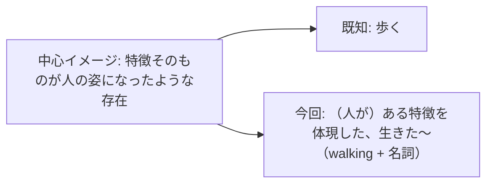

**重要語法**：walking encyclopedia（生き字引）

<!-- candidate_id: ev-04622-adjective-01; index: 4622 -->

### 2562. guilt

**単語**：guilt　 **品詞**：verb　 **発音**：/ɡɪlt/

<small>よく知られている意味：罪悪感</small>

**見落としやすい意味：（相手に）罪悪感を抱かせて行動を促す**

**例文**：They tried to guilt her into joining the event.

**和訳**：彼らは彼女に罪悪感を抱かせてイベントに参加させようとした。

**コアイメージ**：名詞の「罪悪感」を動詞として使い、相手にその感情を生じさせる。特に相手の行動を誘導する文脈で使われる。

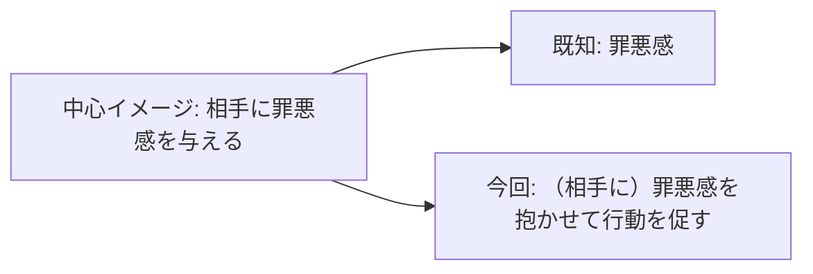

**重要語法**：guilt A into doing（Aに罪悪感を抱かせて～させる）

<!-- candidate_id: ev-04624-verb-01; index: 4624 -->

### 2563. hazard

**単語**：hazard　 **品詞**：verb　 **発音**：/ˈhæzərd/

<small>よく知られている意味：危険</small>

**見落としやすい意味：危険を承知で述べる、あえて推測する（hazard a guess）**

**例文**：I would hazard a guess that the project will take a month.

**和訳**：あえて推測するなら、その計画には1か月かかるだろう。

**コアイメージ**：確証がないことを言えば間違う危険がある。その危険を承知で推測を口にするところから、この用法になる。

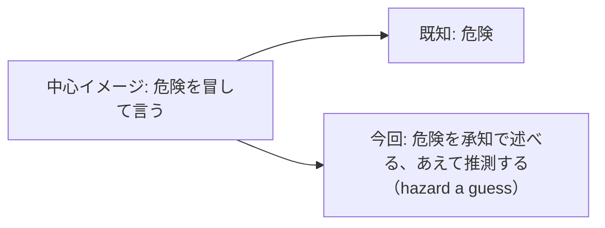

**重要語法**：hazard a guess（あえて推測する）

<!-- candidate_id: ev-04626-verb-01; index: 4626 -->

### 2564. flip

**単語**：flip　 **品詞**：verb　 **発音**：/flɪp/

<small>よく知られている意味：ひっくり返す</small>

**見落としやすい意味：（立場・判断などを）急に変える**

**例文**：The committee flipped its position after hearing the evidence.

**和訳**：委員会は証拠を聞いて立場を急に変えた。

**コアイメージ**：物の表裏が瞬時に入れ替わる動きを、意見や立場の逆転に重ねる。単に少し考えが変わるより、切り替わりの急さが感じられる。

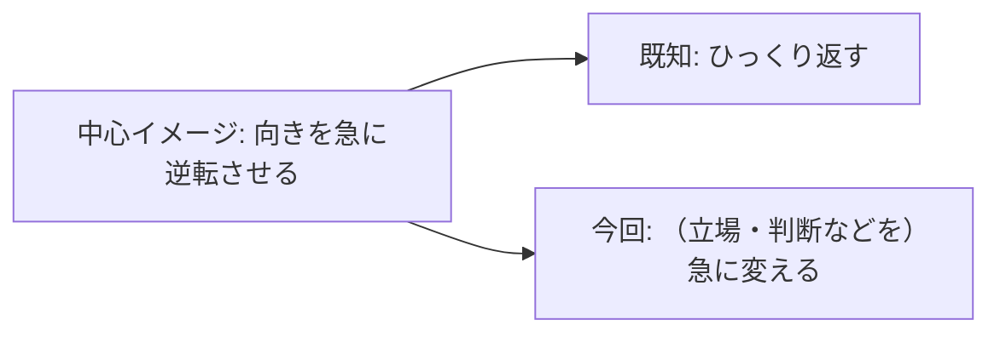

**重要語法**：flip one's position（立場を翻す）

<!-- candidate_id: ev-04627-verb-01; index: 4627 -->

### 2565. conversion

**単語**：conversion　 **品詞**：noun　 **発音**：/kənˈvɜːrʒən/

<small>よく知られている意味：変換・転換</small>

**見落としやすい意味：（宗教・信仰の）改宗**

**例文**：Her conversion to Buddhism changed the way she lived.

**和訳**：仏教への改宗によって、彼女の生き方は変わった。

**コアイメージ**：conversion はある状態から別の状態への転換を表す。宗教の文脈では、信仰の所属や信念の転換を指す。

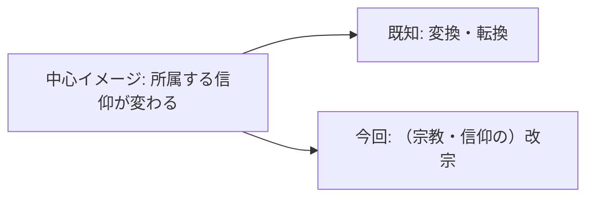

**重要語法**：conversion to a religion（～への改宗）

<!-- candidate_id: ev-04629-noun-01; index: 4629 -->

### 2566. nightmare

**単語**：nightmare　 **品詞**：noun　 **発音**：/ˈnaɪtmer/

<small>よく知られている意味：悪い夢</small>

**見落としやすい意味：悪夢のような体験、非常に困難な状況**

**例文**：Finding a place to live became a nightmare.

**和訳**：住む場所を探すことは悪夢のように大変だった。

**コアイメージ**：眠っているときの恐ろしい夢の印象を、現実の苦しい経験に重ねる。夢ではなく、実際の困難を強調する比喩である。

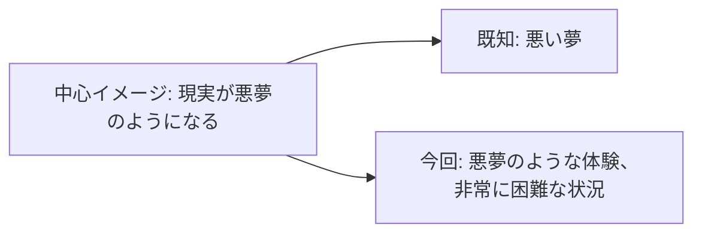

<!-- candidate_id: ev-04630-noun-01; index: 4630 -->

### 2567. conjunction

**単語**：conjunction　 **品詞**：noun　 **発音**：/kənˈdʒʌŋkʃən/

<small>よく知られている意味：接続詞</small>

**見落としやすい意味：同時発生、結びつき（in conjunction with ～と連携して）**

**例文**：The new software was developed in conjunction with local schools.

**和訳**：新しいソフトは地元の学校と協力して開発された。

**コアイメージ**：接続詞が言葉同士を結ぶように、conjunction には物事の結びつきという意味がある。in conjunction with では一緒に活動する関係を表す。

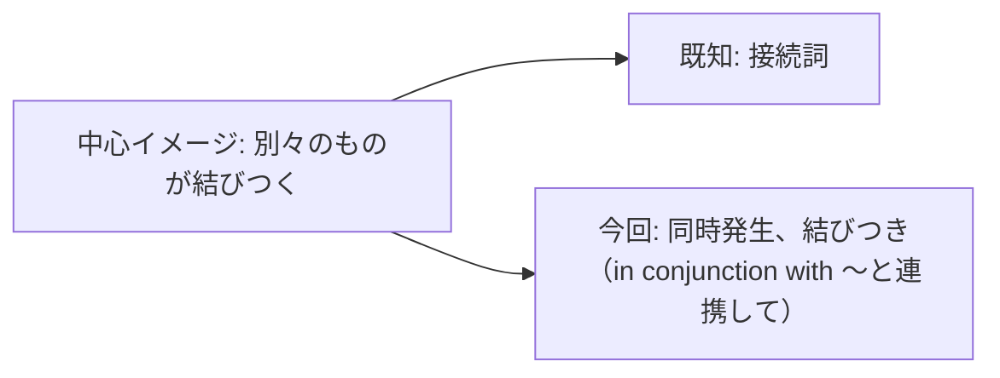

**重要語法**：in conjunction with（～と共同で）

<!-- candidate_id: ev-04631-noun-01; index: 4631 -->

### 2568. embed

**単語**：embed　 **品詞**：noun　 **発音**：/ɪmˈbed/

<small>よく知られている意味：埋め込む</small>

**見落としやすい意味：（記事などに）埋め込まれた要素、埋め込み資料**

**例文**：The article contains an embed of the interview video.

**和訳**：その記事にはインタビュー動画の埋め込みコンテンツが含まれている。

**コアイメージ**：動詞の「埋め込む」から、埋め込まれた動画や投稿そのものを指す名詞になる。技術文脈では表示要素を表す。

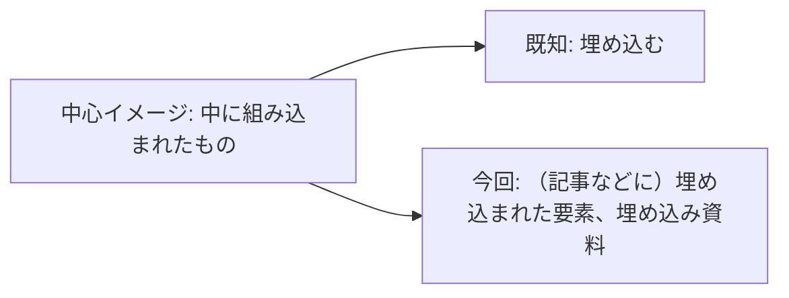

**重要語法**：an embed of a video（動画の埋め込み）

<!-- candidate_id: ev-04632-noun-01; index: 4632 -->

### 2569. embark

**単語**：embark　 **品詞**：verb　 **発音**：/ɪmˈbɑːrk/

<small>よく知られている意味：乗り物に乗る</small>

**見落としやすい意味：（計画・新事業などに）着手する（embark on/upon）**

**例文**：The town will embark on a plan to restore the river.

**和訳**：その町は川を再生する計画に着手する。

**コアイメージ**：船に乗って旅を始めるという出発の感覚がある。そこから、長く続く計画や事業を始めることにも使う。

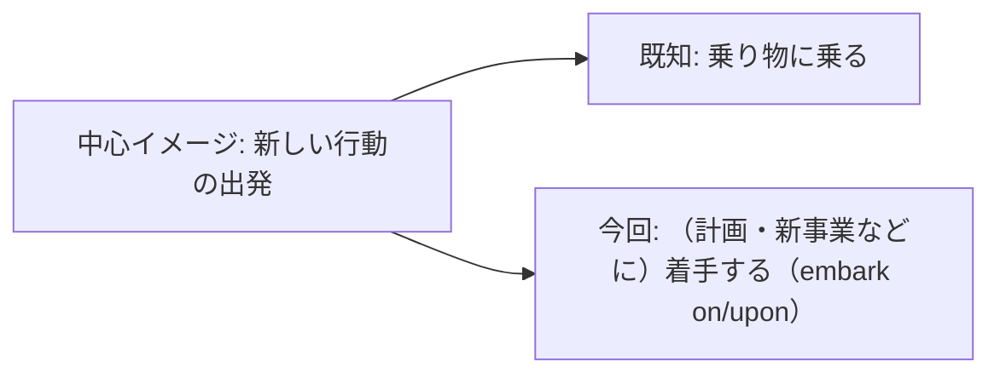

**重要語法**：embark on a project（事業に着手する）

<!-- candidate_id: ev-04634-verb-01; index: 4634 -->

### 2570. capitalize

**単語**：capitalize　 **品詞**：verb　 **発音**：/ˈkæpɪtəlaɪz/

<small>よく知られている意味：大文字にする</small>

**見落としやすい意味：機会を生かして利益・成果を得る（capitalize on）**

**例文**：The company capitalized on rising demand for bicycles.

**和訳**：その会社は自転車の需要増をうまく生かした。

**コアイメージ**：capitalize on は、手元にある機会や状況を利益や成果に変える言い方である。文字を大文字にするという意味とは別の用法として覚える。

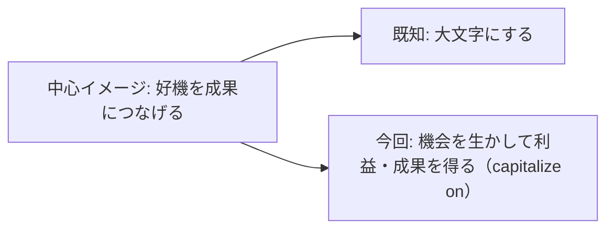

**重要語法**：capitalize on an opportunity（機会を生かす）

<!-- candidate_id: ev-04636-verb-01; index: 4636 -->

### 2571. capitalize

**単語**：capitalize　 **品詞**：verb　 **発音**：/ˈkæpɪtəlaɪz/

<small>よく知られている意味：大文字にする</small>

**見落としやすい意味：（会計上）費用ではなく資産として計上する**

**例文**：The firm capitalized the cost of the new equipment.

**和訳**：その会社は新しい設備の費用を資産として計上した。

**コアイメージ**：会計では支出をすぐ費用にせず、将来にわたり価値を持つ資産として記録する場合がある。その処理を capitalize と呼ぶ。

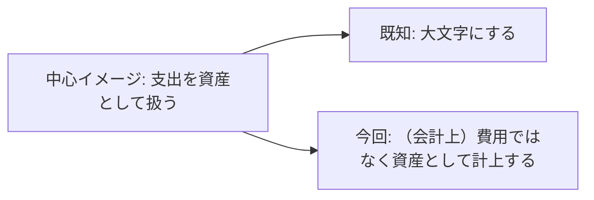

**重要語法**：capitalize a cost（費用を資産計上する）

<!-- candidate_id: ev-04636-verb-02; index: 4636 -->

### 2572. bust

**単語**：bust　 **品詞**：adjective　 **発音**：/bʌst/

<small>よく知られている意味：壊れる・破裂する</small>

**見落としやすい意味：（口語で）金欠の、破産した**

**例文**：After months without work, he was completely bust.

**和訳**：何か月も仕事がなく、彼はすっかり金欠だった。

**コアイメージ**：bust は何かが壊れたり行き詰まったりする響きを持つ。金銭面で使うと、財政的に立ち行かない状態を表す口語になる。

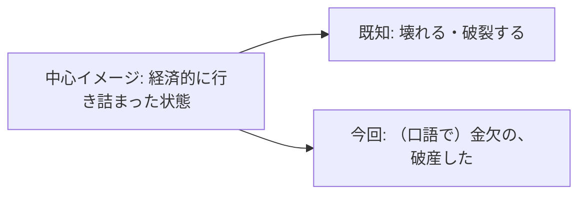

**重要語法**：go bust（破産する）

<!-- candidate_id: ev-04641-adjective-01; index: 4641 -->

### 2573. bust

**単語**：bust　 **品詞**：noun　 **発音**：/bʌst/

<small>よく知られている意味：壊れる・失敗する</small>

**見落としやすい意味：（景気の）不況、好況後の落ち込み**

**例文**：The region suffered a bust after the housing boom.

**和訳**：その地域は住宅景気の好況後に不況に陥った。

**コアイメージ**：急激に膨らんだものがはじけるように、好況が終わって経済が落ち込む局面を指す。boom と対にして用いられる。

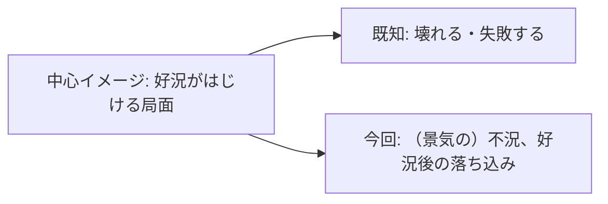

**重要語法**：boom and bust（好況と不況）

<!-- candidate_id: ev-04641-noun-01; index: 4641 -->

### 2574. bust

**単語**：bust　 **品詞**：noun　 **発音**：/bʌst/

<small>よく知られている意味：壊れる・失敗する</small>

**見落としやすい意味：胸から上の人物を表現した彫像、胸像**

**例文**：A marble bust of the poet stood in the library.

**和訳**：図書館にはその詩人の大理石の胸像が置かれていた。

**コアイメージ**：この bust は人物の頭から胸にかけての彫像を表す美術用語である。「壊れる」とは意味上のつながりを無理に作らず、別の語義として覚える。

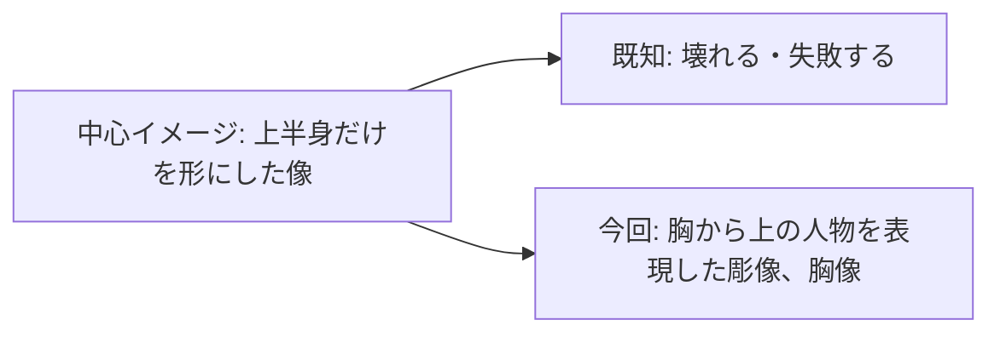

**重要語法**：a bust of a person（人物の胸像）

<!-- candidate_id: ev-04641-noun-02; index: 4641 -->

### 2575. dos

**単語**：dos　 **品詞**：noun (plural)　 **発音**：/duːz/

<small>よく知られている意味：する（do の形）</small>

**見落としやすい意味：（dos and don'tsで）すべきこと・守るべき行動**

**例文**：The guide lists the dos and don'ts of camping.

**和訳**：その手引きにはキャンプでの注意事項と、すべきこと・してはいけないことが載っている。

**コアイメージ**：do を名詞的に複数形にした dos は「してよいこと・すべきこと」を表す。don'ts と対で、行動上の決まりをまとめる。

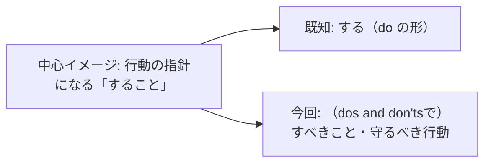

**重要語法**：dos and don'ts（すべきことと禁止事項）

<!-- candidate_id: ev-04644-nounplural-01; index: 4644 -->

### 2576. generic

**単語**：generic　 **品詞**：adjective　 **発音**：/dʒəˈnerɪk/

<small>よく知られている意味：一般的な</small>

**見落としやすい意味：（医薬品・商品が）商標を付けない一般名の**

**例文**：The pharmacy offered a generic version of the medicine.

**和訳**：薬局はその薬のジェネリック版を提供した。

**コアイメージ**：特定の商品名やブランドに属さない、一般名で扱われるという意味になる。医薬品では先発品と区別する表現としてよく使う。

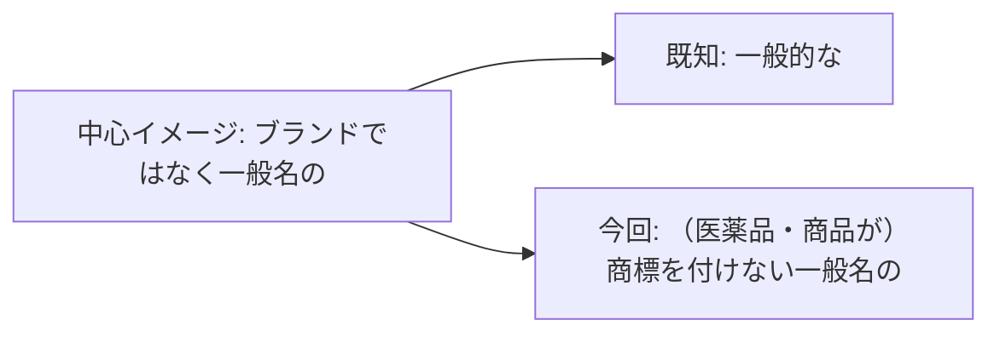

**重要語法**：generic drug（後発医薬品）

<!-- candidate_id: ev-04646-adjective-01; index: 4646 -->

### 2577. insert

**単語**：insert　 **品詞**：noun　 **発音**：/ˈɪnsɜːrt/

<small>よく知られている意味：挿入する</small>

**見落としやすい意味：（新聞・雑誌などの）折り込み広告、挿入物**

**例文**：A discount coupon came as an insert in the magazine.

**和訳**：雑誌には割引クーポンが折り込みとして入っていた。

**コアイメージ**：insert は差し込む動作を表し、その結果として差し込まれた紙や広告も名詞で指す。品詞の違いに注意する。

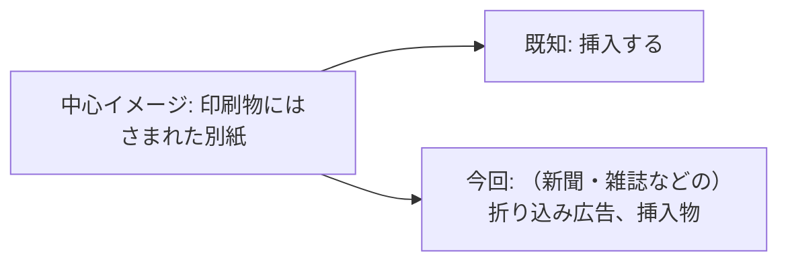

**重要語法**：magazine insert（雑誌の折り込み）

<!-- candidate_id: ev-04649-noun-01; index: 4649 -->

### 2578. magnitude

**単語**：magnitude　 **品詞**：noun　 **発音**：/ˈmæɡnɪtuːd/

<small>よく知られている意味：大きさ・規模</small>

**見落としやすい意味：規模の桁、数量のオーダー（order of magnitude）**

**例文**：A billion is three orders of magnitude greater than a million.

**和訳**：10億は100万より3桁大きい。

**コアイメージ**：数値を同じ基準で比べたときの桁の違いを表す。order of magnitude は、通常10倍を一段階として大まかな大きさを比較する。

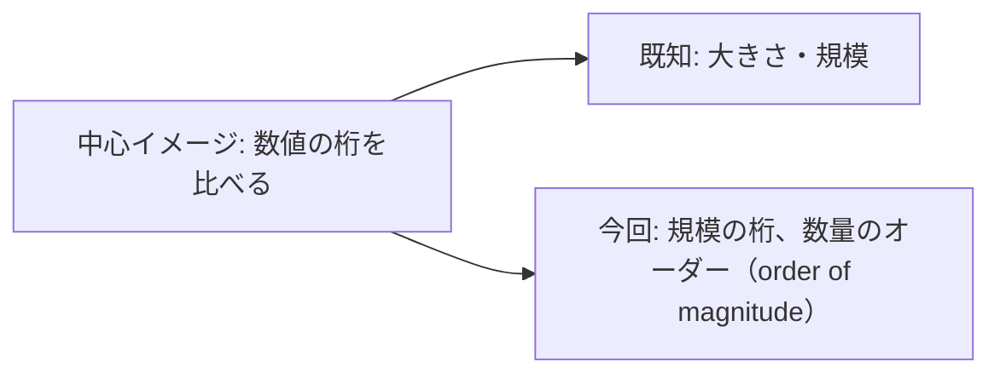

**重要語法**：an order of magnitude（およそ10倍の桁）

<!-- candidate_id: ev-04653-noun-01; index: 4653 -->

### 2579. plea

**単語**：plea　 **品詞**：noun　 **発音**：/pliː/

<small>よく知られている意味：嘆願</small>

**見落としやすい意味：（法廷で被告人が行う）有罪・無罪などの答弁**

**例文**：The defendant entered a plea of not guilty.

**和訳**：被告人は無罪を主張する答弁を行った。

**コアイメージ**：一般には切実な訴えだが、法廷では被告人が有罪か無罪かなどについて行う正式な意思表示を指す。日本語の「嘆願」とは訳し分ける。

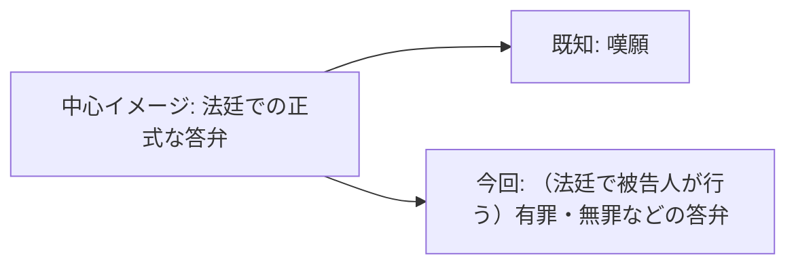

**重要語法**：enter a plea（答弁する）

<!-- candidate_id: ev-04655-noun-01; index: 4655 -->

### 2580. scarcely

**単語**：scarcely　 **品詞**：adverb　 **発音**：/ˈskersli/

<small>よく知られている意味：ほとんど～ない</small>

**見落としやすい意味：（scarcely ... when ～で）～するやいなや、～した途端に**

**例文**：She had scarcely sat down when the phone rang.

**和訳**：彼女が座るやいなや電話が鳴った。

**コアイメージ**：「まだほとんど～していない」という時間の近さが、直後に別の出来事が起こる構文になる。when 以下がすぐ続いた出来事を示す。

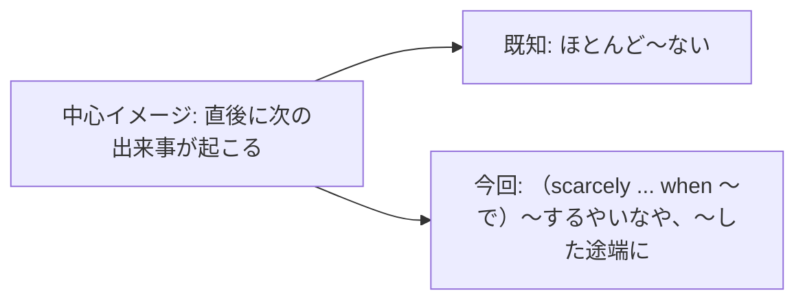

**重要語法**：scarcely ... when ～（～するやいなや）

<!-- candidate_id: ev-04658-adverb-01; index: 4658 -->

### 2581. butter

**単語**：butter　 **品詞**：verb　 **発音**：/ˈbʌtər/

<small>よく知られている意味：バター</small>

**見落としやすい意味：（butter someone upで）人にお世辞を言う、ごまをする**

**例文**：He buttered up the manager before asking for a favor.

**和訳**：彼は頼み事をする前に上司にお世辞を言った。

**コアイメージ**：バターを塗って滑らかにする行為を連想させる慣用表現で、相手の機嫌を取ることを指す。実際の食品を扱う文ではない。

```mermaid
flowchart LR
    A["中心イメージ: 言葉で相手を持ち上げる"]
    B["既知: バター"]
    C["今回: （butter someone upで）人にお世辞を言う、ごまをする"]
    A --> B
    A --> C
```

**重要語法**：butter someone up（人にお世辞を言う）

<!-- candidate_id: ev-04662-verb-01; index: 4662 -->

### 2582. standing

**単語**：standing　 **品詞**：adjective　 **発音**：/ˈstændɪŋ/

<small>よく知られている意味：立っている</small>

**見落としやすい意味：恒常的な、常設の（standing order 等）**

**例文**：A standing rule requires members to sign in.

**和訳**：常設の規則で、会員は入室時に署名することになっている。

**コアイメージ**：一度だけでなく、そのまま存続している状態を表す。命令・規則・委員会などに付くと「恒常的な」という意味になる。

```mermaid
flowchart LR
    A["中心イメージ: いつも効力を持つ"]
    B["既知: 立っている"]
    C["今回: 恒常的な、常設の（standing order 等）"]
    A --> B
    A --> C
```

**重要語法**：standing order（常設の指示・定期注文）

<!-- candidate_id: ev-04663-adjective-01; index: 4663 -->

### 2583. standing

**単語**：standing　 **品詞**：noun　 **発音**：/ˈstændɪŋ/

<small>よく知られている意味：立つこと</small>

**見落としやすい意味：（社会的）地位、評価、立場**

**例文**：She has high standing in the scientific community.

**和訳**：彼女は科学界で高い評価を得ている。

**コアイメージ**：人がどの位置に立つかという発想から、社会的な位置や評価に広がる。物理的に立つ動作ではない。

```mermaid
flowchart LR
    A["中心イメージ: 社会の中での位置"]
    B["既知: 立つこと"]
    C["今回: （社会的）地位、評価、立場"]
    A --> B
    A --> C
```

**重要語法**：high standing（高い地位・評判）

<!-- candidate_id: ev-04663-noun-01; index: 4663 -->

### 2584. chest

**単語**：chest　 **品詞**：noun　 **発音**：/tʃest/

<small>よく知られている意味：胸</small>

**見落としやすい意味：収納用の大きな箱、長持**

**例文**：They found old letters in a wooden chest.

**和訳**：彼らは木製の長持の中に古い手紙を見つけた。

**コアイメージ**：chest には胴の前部だけでなく、物を収納する大きな箱という独立した意味がある。語形が同じでも、文脈から具体物を判別する。

```mermaid
flowchart LR
    A["中心イメージ: ものを収める大きな箱"]
    B["既知: 胸"]
    C["今回: 収納用の大きな箱、長持"]
    A --> B
    A --> C
```

**重要語法**：treasure chest（宝箱）

<!-- candidate_id: ev-04664-noun-01; index: 4664 -->

### 2585. beam

**単語**：beam　 **品詞**：verb　 **発音**：/biːm/

<small>よく知られている意味：光線・梁</small>

**見落としやすい意味：にこやかに笑う、喜びで顔を輝かせる**

**例文**：Her face beamed with pride at the result.

**和訳**：結果を見て、彼女の顔は誇らしさで輝いた。

**コアイメージ**：光が明るく放たれる様子を、喜びに満ちた表情に重ねる。実際に光線を発するのではなく、満面の笑みを指す。

```mermaid
flowchart LR
    A["中心イメージ: 顔が輝くほど喜ぶ"]
    B["既知: 光線・梁"]
    C["今回: にこやかに笑う、喜びで顔を輝かせる"]
    A --> B
    A --> C
```

**重要語法**：beam with joy（喜びで顔を輝かせる）

<!-- candidate_id: ev-04668-verb-01; index: 4668 -->

### 2586. cooperative

**単語**：cooperative　 **品詞**：noun　 **発音**：/koʊˈɑːpərətɪv/

<small>よく知られている意味：協力的な</small>

**見落としやすい意味：組合員が共同で所有・運営する協同組合**

**例文**：The farmers formed a cooperative to sell their crops.

**和訳**：農家は農作物を販売するため協同組合を作った。

**コアイメージ**：協力して行うという性質が、共同で運営する組織の名称になる。名詞なので a cooperative のように冠詞を伴える。

```mermaid
flowchart LR
    A["中心イメージ: 共同所有・共同運営の組織"]
    B["既知: 協力的な"]
    C["今回: 組合員が共同で所有・運営する協同組合"]
    A --> B
    A --> C
```

**重要語法**：agricultural cooperative（農業協同組合）

<!-- candidate_id: ev-04669-noun-01; index: 4669 -->

### 2587. corridor

**単語**：corridor　 **品詞**：noun　 **発音**：/ˈkɔːrɪdər/

<small>よく知られている意味：廊下</small>

**見落としやすい意味：（交通・経済の）回廊、主要な経路に沿った帯状地域**

**例文**：The city plans a green corridor along the river.

**和訳**：市は川沿いに緑の回廊を整備する計画だ。

**コアイメージ**：廊下が二つの場所をつなぐように、地理的にも地域を結ぶ細長い区域を指す。交通・物流・環境などの文脈で使う。

```mermaid
flowchart LR
    A["中心イメージ: 地域を結ぶ帯状の経路"]
    B["既知: 廊下"]
    C["今回: （交通・経済の）回廊、主要な経路に沿った帯状地域"]
    A --> B
    A --> C
```

**重要語法**：transport corridor（交通回廊）

<!-- candidate_id: ev-04670-noun-02; index: 4670 -->

### 2588. patch

**単語**：patch　 **品詞**：noun　 **発音**：/pætʃ/

<small>よく知られている意味：当て布・つぎ</small>

**見落としやすい意味：（ソフトウェアの）不具合修正用の更新プログラム**

**例文**：The developer released a patch to fix the security flaw.

**和訳**：開発者はセキュリティ上の欠陥を修正するパッチを公開した。

**コアイメージ**：布の穴に当てるつぎのように、ソフトウェアの欠陥を局所的に直す更新を指す。必ずしも製品全体の入れ替えではない。

```mermaid
flowchart LR
    A["中心イメージ: 問題箇所を補修する更新"]
    B["既知: 当て布・つぎ"]
    C["今回: （ソフトウェアの）不具合修正用の更新プログラム"]
    A --> B
    A --> C
```

**重要語法**：security patch（セキュリティ修正）

<!-- candidate_id: ev-04672-noun-01; index: 4672 -->

### 2589. mortal

**単語**：mortal　 **品詞**：noun　 **発音**：/ˈmɔːrtəl/

<small>よく知られている意味：死を免れない</small>

**見落としやすい意味：（特に神と対比して）死すべき人間、人間という存在**

**例文**：In the myth, no mortal could enter the palace of the gods.

**和訳**：その神話では、どんな人間も神々の宮殿に入れなかった。

**コアイメージ**：永遠に生きる存在と対比し、いつか死ぬ存在を指す。形容詞が名詞化して「人間」を表す。

```mermaid
flowchart LR
    A["中心イメージ: 神ではない人間"]
    B["既知: 死を免れない"]
    C["今回: （特に神と対比して）死すべき人間、人間という存在"]
    A --> B
    A --> C
```

**重要語法**：mere mortals（ただの人間たち）

<!-- candidate_id: ev-04674-noun-01; index: 4674 -->

### 2590. pedestrian

**単語**：pedestrian　 **品詞**：adjective　 **発音**：/pəˈdestriən/

<small>よく知られている意味：歩行者</small>

**見落としやすい意味：平凡で退屈な、ありふれた**

**例文**：The story has an exciting plot but pedestrian dialogue.

**和訳**：その物語は筋は面白いが、せりふは平凡で退屈だ。

**コアイメージ**：日常的で特別さがないという評価の意味がある。文字どおり「歩行者の」と取ると、批評文を読み違える。

```mermaid
flowchart LR
    A["中心イメージ: ありきたりで面白みがない"]
    B["既知: 歩行者"]
    C["今回: 平凡で退屈な、ありふれた"]
    A --> B
    A --> C
```

**重要語法**：pedestrian prose（平凡な文章）

<!-- candidate_id: ev-04676-adjective-01; index: 4676 -->

### 2591. lapse

**単語**：lapse　 **品詞**：noun　 **発音**：/læps/

<small>よく知られている意味：時間の経過</small>

**見落としやすい意味：（注意・判断などの）一時的な失敗、過失、失念**

**例文**：The error came from a brief lapse in concentration.

**和訳**：そのミスは一瞬集中力が途切れたために起きた。

**コアイメージ**：普段保たれる注意や判断の状態が、一時的に途切れることを表す。長期的な能力不足ではなく、その場の失敗に焦点がある。

```mermaid
flowchart LR
    A["中心イメージ: 一時的な注意や判断の抜け"]
    B["既知: 時間の経過"]
    C["今回: （注意・判断などの）一時的な失敗、過失、失念"]
    A --> B
    A --> C
```

**重要語法**：a lapse in judgment（判断の誤り）

<!-- candidate_id: ev-04680-noun-01; index: 4680 -->

### 2592. lapse

**単語**：lapse　 **品詞**：verb　 **発音**：/læps/

<small>よく知られている意味：経過する・失敗</small>

**見落としやすい意味：（契約・保険などが）期限切れになる、効力を失う**

**例文**：The insurance policy will lapse unless you renew it.

**和訳**：更新しなければ、その保険契約は失効する。

**コアイメージ**：一定の期間が過ぎて、維持されていた効力が途切れることを表す。保険や許可など、期限があるものに使う。

```mermaid
flowchart LR
    A["中心イメージ: 有効期間が切れる"]
    B["既知: 経過する・失敗"]
    C["今回: （契約・保険などが）期限切れになる、効力を失う"]
    A --> B
    A --> C
```

**重要語法**：let a policy lapse（保険を失効させる）

<!-- candidate_id: ev-04680-verb-01; index: 4680 -->

### 2593. browse

**単語**：browse　 **品詞**：verb　 **発音**：/braʊz/

<small>よく知られている意味：ウェブを閲覧する</small>

**見落としやすい意味：（動物が）木の葉や若枝などを食べ歩く**

**例文**：Deer browse on leaves at the edge of the forest.

**和訳**：シカは森の端で木の葉を食べ歩く。

**コアイメージ**：browse はもともと動物が葉などを選んで食べることにも使う。ネットで項目を次々見る意味とは、対象が異なる用法である。

```mermaid
flowchart LR
    A["中心イメージ: 葉や若枝を食べ歩く"]
    B["既知: ウェブを閲覧する"]
    C["今回: （動物が）木の葉や若枝などを食べ歩く"]
    A --> B
    A --> C
```

**重要語法**：browse on leaves（葉を食べる）

<!-- candidate_id: ev-04683-verb-01; index: 4683 -->

### 2594. carbon

**単語**：carbon　 **品詞**：noun　 **発音**：/ˈkɑːrbən/

<small>よく知られている意味：炭素</small>

**見落としやすい意味：（温暖化の文脈で）二酸化炭素**

**例文**：The company aims to cut its carbon emissions this decade.

**和訳**：その会社は今後10年間で二酸化炭素排出量を削減することを目指している。

**コアイメージ**：環境記事では carbon が二酸化炭素やその排出を短く指すことがある。化学元素の炭素だけを意味すると考えない。

```mermaid
flowchart LR
    A["中心イメージ: 排出量として扱う二酸化炭素"]
    B["既知: 炭素"]
    C["今回: （温暖化の文脈で）二酸化炭素"]
    A --> B
    A --> C
```

**重要語法**：carbon emissions（二酸化炭素排出）

<!-- candidate_id: ev-04684-noun-01; index: 4684 -->

### 2595. dividend

**単語**：dividend　 **品詞**：noun　 **発音**：/ˈdɪvɪdend/

<small>よく知られている意味：配当金</small>

**見落としやすい意味：（投じた努力や時間の）成果、見返り**

**例文**：Daily practice eventually paid dividends in the competition.

**和訳**：毎日の練習は、ついに大会で成果を生んだ。

**コアイメージ**：投資に対する配当という発想を、努力に対する見返りへ広げた比喩である。金銭の支払いがなくても使える。

```mermaid
flowchart LR
    A["中心イメージ: 努力が生む成果"]
    B["既知: 配当金"]
    C["今回: （投じた努力や時間の）成果、見返り"]
    A --> B
    A --> C
```

**重要語法**：pay dividends（成果をもたらす）

<!-- candidate_id: ev-04689-noun-01; index: 4689 -->

### 2596. dividend

**単語**：dividend　 **品詞**：noun　 **発音**：/ˈdɪvɪdend/

<small>よく知られている意味：配当金</small>

**見落としやすい意味：（算数）割られる数、被除数**

**例文**：In twelve divided by three, twelve is the dividend.

**和訳**：12÷3では、12が被除数だ。

**コアイメージ**：数学では dividend は割り算の対象になる数を指す専門用語である。株式の配当とは分野が異なるので、計算式から判別する。

```mermaid
flowchart LR
    A["中心イメージ: 割り算で割られる側の数"]
    B["既知: 配当金"]
    C["今回: （算数）割られる数、被除数"]
    A --> B
    A --> C
```

**重要語法**：dividend ÷ divisor（被除数÷除数）

<!-- candidate_id: ev-04689-noun-02; index: 4689 -->

### 2597. footnote

**単語**：footnote　 **品詞**：noun　 **発音**：/ˈfʊtnoʊt/

<small>よく知られている意味：脚注</small>

**見落としやすい意味：（歴史・事件に対する）取るに足りない付随的な出来事**

**例文**：The incident became a footnote in the history of the city.

**和訳**：その事件は、市の歴史の中で取るに足りない出来事となった。

**コアイメージ**：脚注は本文を補う小さな情報である。そこから大きな物語の本筋ではない、目立たない事柄を指す。

```mermaid
flowchart LR
    A["中心イメージ: 本筋に対して小さな出来事"]
    B["既知: 脚注"]
    C["今回: （歴史・事件に対する）取るに足りない付随的な出来事"]
    A --> B
    A --> C
```

**重要語法**：a footnote to history（歴史上の些事）

<!-- candidate_id: ev-04691-noun-01; index: 4691 -->

### 2598. hone

**単語**：hone　 **品詞**：verb　 **発音**：/hoʊn/

<small>よく知られている意味：刃を研ぐ</small>

**見落としやすい意味：（能力・技術を）磨く、洗練させる**

**例文**：She honed her writing skills through regular feedback.

**和訳**：彼女は定期的な助言を通して文章を書く技能を磨いた。

**コアイメージ**：刃を研いで切れ味を上げるように、すでにある能力を訓練して向上させる。能力をゼロから得るというより、磨き上げることを表す。

```mermaid
flowchart LR
    A["中心イメージ: 技能をさらに磨く"]
    B["既知: 刃を研ぐ"]
    C["今回: （能力・技術を）磨く、洗練させる"]
    A --> B
    A --> C
```

**重要語法**：hone a skill（技能を磨く）

<!-- candidate_id: ev-04692-verb-01; index: 4692 -->

### 2599. lavish

**単語**：lavish　 **品詞**：verb　 **発音**：/ˈlævɪʃ/

<small>よく知られている意味：豪華な</small>

**見落としやすい意味：（賞賛・金銭などを）惜しみなく注ぐ（lavish A on B）**

**例文**：The audience lavished praise on the young pianist.

**和訳**：観客は若いピアニストを惜しみなく称賛した。

**コアイメージ**：量が豊富で惜しまれないという感覚を動詞で表す。賞賛や愛情、金銭などを相手に多く与える。

```mermaid
flowchart LR
    A["中心イメージ: 惜しみなく注ぎかける"]
    B["既知: 豪華な"]
    C["今回: （賞賛・金銭などを）惜しみなく注ぐ（lavish A on B）"]
    A --> B
    A --> C
```

**重要語法**：lavish praise on someone（人を大いに称賛する）

<!-- candidate_id: ev-04694-verb-01; index: 4694 -->

### 2600. passing

**単語**：passing　 **品詞**：adjective　 **発音**：/ˈpæsɪŋ/

<small>よく知られている意味：通り過ぎる</small>

**見落としやすい意味：一時的な、つかの間の**

**例文**：He showed only a passing interest in astronomy.

**和訳**：彼は天文学に一時的な興味を示しただけだった。

**コアイメージ**：通り過ぎて長くとどまらない感覚が、関心や感情などの短さを表す。継続的な関心ではない。

```mermaid
flowchart LR
    A["中心イメージ: 短い間だけ存在する"]
    B["既知: 通り過ぎる"]
    C["今回: 一時的な、つかの間の"]
    A --> B
    A --> C
```

**重要語法**：passing interest（一時的な興味）

<!-- candidate_id: ev-04696-adjective-01; index: 4696 -->

### 2601. passing

**単語**：passing　 **品詞**：noun　 **発音**：/ˈpæsɪŋ/

<small>よく知られている意味：通過すること</small>

**見落としやすい意味：（法案の）可決、成立**

**例文**：The passing of the bill brought relief to local families.

**和訳**：その法案の可決は地元の家族に安堵をもたらした。

**コアイメージ**：議案が議会の審議を通過するという動きから、可決・成立という結果を指す。passing of a bill は政治の文脈で用いられる。

```mermaid
flowchart LR
    A["中心イメージ: 審議を通過して成立する"]
    B["既知: 通過すること"]
    C["今回: （法案の）可決、成立"]
    A --> B
    A --> C
```

**重要語法**：the passing of a bill（法案の可決）

<!-- candidate_id: ev-04696-noun-01; index: 4696 -->

### 2602. rue

**単語**：rue　 **品詞**：verb　 **発音**：/ruː/

<small>よく知られている意味：（植物）ヘンルーダ</small>

**見落としやすい意味：過去の行為を後悔する、悔やむ**

**例文**：He would later rue his decision to ignore the warning.

**和訳**：彼は警告を無視した決断を後になって悔やむことになる。

**コアイメージ**：動詞 rue は過去の行為や判断を深く後悔する意味を持つ。植物を指す名詞の rue と無理につなげず、別の語義として覚える。

```mermaid
flowchart LR
    A["中心イメージ: 過去を悔やむ気持ち"]
    B["既知: （植物）ヘンルーダ"]
    C["今回: 過去の行為を後悔する、悔やむ"]
    A --> B
    A --> C
```

**重要語法**：rue the day（その日を後悔する）

<!-- candidate_id: ev-04698-verb-01; index: 4698 -->

### 2603. siege

**単語**：siege　 **品詞**：noun　 **発音**：/siːdʒ/

<small>よく知られている意味：軍事的な包囲</small>

**見落としやすい意味：（under siegeで）激しい非難・攻撃を受けている状態**

**例文**：The mayor was under siege over the housing policy.

**和訳**：市長は住宅政策をめぐって激しい批判にさらされていた。

**コアイメージ**：四方から攻撃を受けて身動きが取りにくい状況を、言論や政治上の激しい批判に重ねる。実際の軍隊がいなくても使う。

```mermaid
flowchart LR
    A["中心イメージ: 外から厳しい攻撃が集中する"]
    B["既知: 軍事的な包囲"]
    C["今回: （under siegeで）激しい非難・攻撃を受けている状態"]
    A --> B
    A --> C
```

**重要語法**：under siege（激しい攻撃・非難を受けて）

<!-- candidate_id: ev-04699-noun-01; index: 4699 -->

### 2604. spoil

**単語**：spoil　 **品詞**：verb　 **発音**：/spɔɪl/

<small>よく知られている意味：台無しにする</small>

**見落としやすい意味：（子供などを）甘やかしてわがままにする**

**例文**：His grandparents spoil him by giving him everything he asks for.

**和訳**：祖父母は彼の欲しがるものを何でも与えて甘やかしている。

**コアイメージ**：望みをすべてかなえることが、結果的に子どもの態度を損なうという発想である。物を傷める意味とは、対象が人に変わる。

```mermaid
flowchart LR
    A["中心イメージ: 甘やかして悪い影響を及ぼす"]
    B["既知: 台無しにする"]
    C["今回: （子供などを）甘やかしてわがままにする"]
    A --> B
    A --> C
```

**重要語法**：spoil a child（子どもを甘やかす）

<!-- candidate_id: ev-04700-verb-01; index: 4700 -->

### 2605. veto

**単語**：veto　 **品詞**：noun　 **発音**：/ˈviːtoʊ/

<small>よく知られている意味：拒否権</small>

**見落としやすい意味：公的な権限による禁止・拒否**

**例文**：The board has a veto over major changes to the building.

**和訳**：理事会には建物の大幅な変更を拒否する権限がある。

**コアイメージ**：veto は決定を正式に止める権限や、その行使を示す。大統領などの政治的拒否権だけでなく、組織の正式な拒否権にも用いる。

```mermaid
flowchart LR
    A["中心イメージ: 権限に基づく拒否・禁止"]
    B["既知: 拒否権"]
    C["今回: 公的な権限による禁止・拒否"]
    A --> B
    A --> C
```

**重要語法**：have a veto over（～について拒否権を持つ）

<!-- candidate_id: ev-04702-noun-01; index: 4702 -->

### 2606. arcade

**単語**：arcade　 **品詞**：noun　 **発音**：/ɑːrˈkeɪd/

<small>よく知られている意味：ゲームセンター</small>

**見落としやすい意味：屋根のある商店街・連続したアーチ状の通路**

**例文**：Small shops lined the covered arcade near the station.

**和訳**：駅近くの屋根付き商店街には小さな店が並んでいた。

**コアイメージ**：arcade はもともとアーチが連なる通路や商店街にも用いる。娯楽施設か建築上の通路かは、周囲の景色から区別する。

```mermaid
flowchart LR
    A["中心イメージ: アーチや屋根のある通路"]
    B["既知: ゲームセンター"]
    C["今回: 屋根のある商店街・連続したアーチ状の通路"]
    A --> B
    A --> C
```

**重要語法**：shopping arcade（アーケード商店街）

<!-- candidate_id: ev-04703-noun-01; index: 4703 -->

### 2607. broker

**単語**：broker　 **品詞**：verb　 **発音**：/ˈbroʊkər/

<small>よく知られている意味：仲介業者</small>

**見落としやすい意味：（取引や合意を）仲介して成立させる**

**例文**：The mediator brokered an agreement between the two groups.

**和訳**：仲介役は二つの団体の間で合意を取りまとめた。

**コアイメージ**：名詞の仲介人が行う働きを動詞にしたもの。関係者の間に入り、契約や合意の成立を助ける。

```mermaid
flowchart LR
    A["中心イメージ: 間に入って合意を成立させる"]
    B["既知: 仲介業者"]
    C["今回: （取引や合意を）仲介して成立させる"]
    A --> B
    A --> C
```

**重要語法**：broker a deal（取引を仲介してまとめる）

<!-- candidate_id: ev-04704-verb-01; index: 4704 -->

### 2608. canvas

**単語**：canvas　 **品詞**：noun　 **発音**：/ˈkænvəs/

<small>よく知られている意味：絵画用の布</small>

**見落としやすい意味：創作の基盤・自由に構想できる場**

**例文**：For the young designer, the blank wall was a canvas for new ideas.

**和訳**：その若いデザイナーにとって、何もない壁は新しい発想を形にできる場だった。

**コアイメージ**：画布が絵を描く余地を与えるように、比喩では新しいものを表現するための土台や場所を指す。実際の布である必要はない。

```mermaid
flowchart LR
    A["中心イメージ: 自由な創造のための土台"]
    B["既知: 絵画用の布"]
    C["今回: 創作の基盤・自由に構想できる場"]
    A --> B
    A --> C
```

**重要語法**：a canvas for ideas（発想を形にする場）

<!-- candidate_id: ev-04705-noun-01; index: 4705 -->

### 2609. canvas

**単語**：canvas　 **品詞**：noun　 **発音**：/ˈkænvəs/

<small>よく知られている意味：絵画用の布</small>

**見落としやすい意味：（コンピューター）グラフィック描画領域**

**例文**：Draw a circle in the canvas area of the app.

**和訳**：アプリの描画領域に円を描いてください。

**コアイメージ**：デジタル画面の中で、絵を描くために用意された領域を canvas と呼ぶ。画布の機能をコンピューター上に移した専門用法である。

```mermaid
flowchart LR
    A["中心イメージ: 画面上の描画スペース"]
    B["既知: 絵画用の布"]
    C["今回: （コンピューター）グラフィック描画領域"]
    A --> B
    A --> C
```

**重要語法**：HTML canvas（ウェブ画面の描画領域）

<!-- candidate_id: ev-04705-noun-02; index: 4705 -->

### 2610. closing

**単語**：closing　 **品詞**：noun　 **発音**：/ˈkloʊzɪŋ/

<small>よく知られている意味：閉店・終了</small>

**見落としやすい意味：（不動産売買の）正式な契約決済手続き**

**例文**：They signed the final documents at the house closing.

**和訳**：彼らは住宅売買の決済手続きで最終書類に署名した。

**コアイメージ**：取引が最終段階まで進み、代金・書類などをやり取りして正式に完了する場面を指す。単なる店の閉店とは区別する。

```mermaid
flowchart LR
    A["中心イメージ: 売買を正式に完了する手続き"]
    B["既知: 閉店・終了"]
    C["今回: （不動産売買の）正式な契約決済手続き"]
    A --> B
    A --> C
```

**重要語法**：real estate closing（不動産取引の決済）

<!-- candidate_id: ev-04707-noun-01; index: 4707 -->

### 2611. composition

**単語**：composition　 **品詞**：noun　 **発音**：/ˌkɑːmpəˈzɪʃən/

<small>よく知られている意味：作文・構成</small>

**見落としやすい意味：（音楽の）作曲作品、楽曲**

**例文**：The orchestra performed a new composition by a local musician.

**和訳**：オーケストラは地元の音楽家による新しい楽曲を演奏した。

**コアイメージ**：要素を組み合わせて一つの作品を作るという意味がある。音楽の文脈では「作曲する行為」だけでなく、完成した楽曲を指す。

```mermaid
flowchart LR
    A["中心イメージ: 作曲された一つの作品"]
    B["既知: 作文・構成"]
    C["今回: （音楽の）作曲作品、楽曲"]
    A --> B
    A --> C
```

**重要語法**：musical composition（楽曲・作曲作品）

<!-- candidate_id: ev-04708-noun-01; index: 4708 -->

### 2612. correction

**単語**：correction　 **品詞**：noun　 **発音**：/kəˈrekʃən/

<small>よく知られている意味：訂正</small>

**見落としやすい意味：（相場などが）上昇後に一時的に値下がりする調整局面**

**例文**：After months of rising prices, the market entered a correction.

**和訳**：数か月の値上がりの後、市場は調整局面に入った。

**コアイメージ**：価格が上がりすぎた後に下がって水準を調整する動きを、correction と呼ぶ。誤字を直すのではなく、市場の動きの名称である。

```mermaid
flowchart LR
    A["中心イメージ: 値上がり後の価格調整"]
    B["既知: 訂正"]
    C["今回: （相場などが）上昇後に一時的に値下がりする調整局面"]
    A --> B
    A --> C
```

**重要語法**：market correction（相場の調整）

<!-- candidate_id: ev-04710-noun-01; index: 4710 -->

### 2613. escalate

**単語**：escalate　 **品詞**：verb　 **発音**：/ˈeskəleɪt/

<small>よく知られている意味：激化する</small>

**見落としやすい意味：（対応が必要な問題を）上位の責任者・部署に引き継ぐ**

**例文**：Please escalate the complaint to the support manager.

**和訳**：その苦情をサポート部門の責任者に引き継いでください。

**コアイメージ**：物事が一段上に進むという感覚がある。業務では、解決が難しい問題を上位の担当者や部署へ引き上げる意味になる。

```mermaid
flowchart LR
    A["中心イメージ: 問題をより上位の担当者に回す"]
    B["既知: 激化する"]
    C["今回: （対応が必要な問題を）上位の責任者・部署に引き継ぐ"]
    A --> B
    A --> C
```

**重要語法**：escalate a ticket（問い合わせを上位に引き継ぐ）

<!-- candidate_id: ev-04712-verb-01; index: 4712 -->

### 2614. imagery

**単語**：imagery　 **品詞**：noun　 **発音**：/ˈɪmɪdʒəri/

<small>よく知られている意味：画像・映像</small>

**見落としやすい意味：（文学作品などの）感覚に訴える描写・比喩表現**

**例文**：The poem uses ocean imagery to convey loneliness.

**和訳**：その詩は海のイメージを用いて孤独を伝えている。

**コアイメージ**：頭の中に光景や感覚を呼び起こす表現を指す。実際の画像だけでなく、詩や物語で言葉が生み出す感覚的な描写も imagery である。

```mermaid
flowchart LR
    A["中心イメージ: 言葉で感覚的な場面を浮かべる"]
    B["既知: 画像・映像"]
    C["今回: （文学作品などの）感覚に訴える描写・比喩表現"]
    A --> B
    A --> C
```

**重要語法**：visual imagery（視覚的イメージ）

<!-- candidate_id: ev-04715-noun-01; index: 4715 -->

### 2615. lounge

**単語**：lounge　 **品詞**：noun　 **発音**：/laʊndʒ/

<small>よく知られている意味：空港などの待合室</small>

**見落としやすい意味：（英）家の居間・居室**

**例文**：We spent the evening talking in the lounge.

**和訳**：私たちは夜、居間で話して過ごした。

**コアイメージ**：lounge はくつろいで過ごす場所を表す。特にイギリス英語では、自宅の居間を指す場合がある。

```mermaid
flowchart LR
    A["中心イメージ: 家でくつろぐ部屋"]
    B["既知: 空港などの待合室"]
    C["今回: （英）家の居間・居室"]
    A --> B
    A --> C
```

**重要語法**：the lounge（英語圏の文脈で居間）

<!-- candidate_id: ev-04718-noun-01; index: 4718 -->

### 2616. spice

**単語**：spice　 **品詞**：noun　 **発音**：/spaɪs/

<small>よく知られている意味：香辛料</small>

**見落としやすい意味：面白み、刺激となる要素**

**例文**：A little humor added spice to the presentation.

**和訳**：少しのユーモアが発表に面白みを加えた。

**コアイメージ**：香辛料が料理に刺激や風味を添えるように、出来事や話にも活気・面白みを加える要素を指す。

```mermaid
flowchart LR
    A["中心イメージ: 単調さを変える刺激"]
    B["既知: 香辛料"]
    C["今回: 面白み、刺激となる要素"]
    A --> B
    A --> C
```

**重要語法**：add spice to（～に面白みを添える）

<!-- candidate_id: ev-04723-noun-01; index: 4723 -->

### 2617. substantive

**単語**：substantive　 **品詞**：adjective　 **発音**：/ˈsʌbstəntɪv/

<small>よく知られている意味：実体がある</small>

**見落としやすい意味：中身・実質に関わる、重要な（形式上だけではない）**

**例文**：The two sides held substantive talks about the budget.

**和訳**：双方は予算について実質的な協議を行った。

**コアイメージ**：表面だけの形式や名目ではなく、実際の内容に踏み込むことを表す。会議・変更・議論などが重要な中身を持つときに使う。

```mermaid
flowchart LR
    A["中心イメージ: 形式でなく中身に関わる"]
    B["既知: 実体がある"]
    C["今回: 中身・実質に関わる、重要な（形式上だけではない）"]
    A --> B
    A --> C
```

**重要語法**：substantive discussion（実質的な議論）

<!-- candidate_id: ev-04724-adjective-01; index: 4724 -->

### 2618. corn

**単語**：corn　 **品詞**：noun　 **発音**：/kɔːrn/

<small>よく知られている意味：トウモロコシ（米）</small>

**見落としやすい意味：（特に英）トウモロコシに限らない穀物・穀類**

**例文**：In older British texts, corn may refer to wheat rather than maize.

**和訳**：古いイギリスの文章では、corn はトウモロコシではなく小麦を指すことがある。

**コアイメージ**：corn は地域や時代によって指す作物が変わる。米語でのトウモロコシだけに限定せず、穀物を表す文脈を確認する。

```mermaid
flowchart LR
    A["中心イメージ: 地域により穀物全般"]
    B["既知: トウモロコシ（米）"]
    C["今回: （特に英）トウモロコシに限らない穀物・穀類"]
    A --> B
    A --> C
```

**重要語法**：British corn（文脈次第で穀類）

<!-- candidate_id: ev-04726-noun-01; index: 4726 -->

### 2619. juice

**単語**：juice　 **品詞**：noun　 **発音**：/dʒuːs/

<small>よく知られている意味：果汁</small>

**見落としやすい意味：（口語で）機器を動かす電力、バッテリーの残量**

**例文**：My laptop is low on juice, so I need the charger.

**和訳**：ノートパソコンの電池残量が少ないので、充電器が必要だ。

**コアイメージ**：果汁のように、装置を動かすための「中身のエネルギー」を口語的に表す。バッテリー残量などを指す言い方である。

```mermaid
flowchart LR
    A["中心イメージ: 動かすための電力"]
    B["既知: 果汁"]
    C["今回: （口語で）機器を動かす電力、バッテリーの残量"]
    A --> B
    A --> C
```

**重要語法**：be low on juice（電池残量が少ない）

<!-- candidate_id: ev-04727-noun-01; index: 4727 -->

### 2620. sailing

**単語**：sailing　 **品詞**：noun　 **発音**：/ˈseɪlɪŋ/

<small>よく知られている意味：帆走</small>

**見落としやすい意味：船・フェリーの定期便、運航予定の便**

**例文**：The last sailing to the island leaves at six.

**和訳**：その島へ向かう最終便は6時に出発する。

**コアイメージ**：船が航行する一回の機会を数えて、運航便を sailing と呼ぶ。帆船に限らずフェリーなどの時刻案内でも使われる。

```mermaid
flowchart LR
    A["中心イメージ: 出発する船の便"]
    B["既知: 帆走"]
    C["今回: 船・フェリーの定期便、運航予定の便"]
    A --> B
    A --> C
```

**重要語法**：the last sailing（最終便）

<!-- candidate_id: ev-04729-noun-01; index: 4729 -->

### 2621. curse

**単語**：curse　 **品詞**：noun　 **発音**：/kɜːrs/

<small>よく知られている意味：呪い</small>

**見落としやすい意味：ののしり言葉、悪態（curse word など）**

**例文**：He muttered a curse when he missed the train.

**和訳**：電車に乗り遅れたとき、彼は小声で悪態をついた。

**コアイメージ**：相手への強い否定的な言葉という共通点がある。超自然的な呪いだけでなく、日常の悪態やののしり言葉も指す。

```mermaid
flowchart LR
    A["中心イメージ: 怒りを表す悪態"]
    B["既知: 呪い"]
    C["今回: ののしり言葉、悪態（curse word など）"]
    A --> B
    A --> C
```

**重要語法**：curse word（ののしり言葉）

<!-- candidate_id: ev-04732-noun-01; index: 4732 -->

### 2622. barrel

**単語**：barrel　 **品詞**：verb　 **発音**：/ˈbærəl/

<small>よく知られている意味：樽</small>

**見落としやすい意味：勢いよく疾走する、制御しにくい速さで進む**

**例文**：The cyclist barreled down the hill at full speed.

**和訳**：自転車に乗った人は坂を猛スピードで駆け下りた。

**コアイメージ**：barrel を動詞で使うと、勢いを止めにくいほど速く動く様子を表す。樽という物の名前にこだわらず、動きの勢いを捉える。

```mermaid
flowchart LR
    A["中心イメージ: 勢いに任せて猛スピードで進む"]
    B["既知: 樽"]
    C["今回: 勢いよく疾走する、制御しにくい速さで進む"]
    A --> B
    A --> C
```

**重要語法**：barrel down the road（道路を猛スピードで進む）

<!-- candidate_id: ev-04733-verb-01; index: 4733 -->

### 2623. bearing

**単語**：bearing　 **品詞**：noun　 **発音**：/ˈberɪŋ/

<small>よく知られている意味：軸受け・方向</small>

**見落としやすい意味：関係、関連性（have a bearing on）**

**例文**：Your personal preference has no bearing on the result.

**和訳**：あなた個人の好みは結果とは関係がない。

**コアイメージ**：ある事柄が別の事柄にどう向いて関わるか、という関係性を表す。特に have a bearing on で「～に影響・関連がある」となる。

```mermaid
flowchart LR
    A["中心イメージ: 議論に直接関わること"]
    B["既知: 軸受け・方向"]
    C["今回: 関係、関連性（have a bearing on）"]
    A --> B
    A --> C
```

**重要語法**：have no bearing on（～と関係がない）

<!-- candidate_id: ev-04735-noun-01; index: 4735 -->

### 2624. dense

**単語**：dense　 **品詞**：adjective　 **発音**：/dens/

<small>よく知られている意味：密集した</small>

**見落としやすい意味：（人が）理解が鈍い、のみこみが悪い**

**例文**：I explained the rule three times, but he was being dense.

**和訳**：私はその規則を3回説明したが、彼はなかなか理解してくれなかった。

**コアイメージ**：物がぎっしり詰まって通りにくい感覚を、人の理解の鈍さにたとえた口語的表現である。人を評すると失礼な言い方にもなる。

```mermaid
flowchart LR
    A["中心イメージ: 考えが通じにくい"]
    B["既知: 密集した"]
    C["今回: （人が）理解が鈍い、のみこみが悪い"]
    A --> B
    A --> C
```

**重要語法**：Don't be dense.（鈍いことを言わないで）

<!-- candidate_id: ev-04737-adjective-01; index: 4737 -->

### 2625. fabulous

**単語**：fabulous　 **品詞**：adjective　 **発音**：/ˈfæbjələs/

<small>よく知られている意味：素晴らしい</small>

**見落としやすい意味：架空の、信じがたい**

**例文**：The explorer told fabulous stories of cities made of gold.

**和訳**：探検家は黄金でできた都市についての信じがたい話を語った。

**コアイメージ**：fable（寓話）と関わる語で、物語のように現実離れしたという意味を持つ。現代の「すばらしい」とは文脈で区別する。

```mermaid
flowchart LR
    A["中心イメージ: 物語めいた非現実性"]
    B["既知: 素晴らしい"]
    C["今回: 架空の、信じがたい"]
    A --> B
    A --> C
```

**重要語法**：fabulous tales（信じがたい物語）

<!-- candidate_id: ev-04738-adjective-01; index: 4738 -->

### 2626. strand

**単語**：strand　 **品詞**：noun　 **発音**：/strænd/

<small>よく知られている意味：糸・髪の一筋</small>

**見落としやすい意味：物語・議論の一筋の流れや要素**

**例文**：One strand of the argument focuses on education.

**和訳**：その議論の一つの流れは教育に焦点を当てている。

**コアイメージ**：一本の糸が織物の一部になるように、大きな議論や物語を形づくる個々の要素を指す。

```mermaid
flowchart LR
    A["中心イメージ: 複雑な全体を構成する一筋"]
    B["既知: 糸・髪の一筋"]
    C["今回: 物語・議論の一筋の流れや要素"]
    A --> B
    A --> C
```

**重要語法**：a strand of thought（一筋の考え）

<!-- candidate_id: ev-04739-noun-01; index: 4739 -->

### 2627. strand

**単語**：strand　 **品詞**：verb　 **発音**：/strænd/

<small>よく知られている意味：糸・髪の一筋</small>

**見落としやすい意味：（人を）取り残す、困った状況で動けなくする**

**例文**：The cancelled train stranded dozens of passengers overnight.

**和訳**：列車の運休によって数十人の乗客が一晩足止めされた。

**コアイメージ**：strand を動詞として使うと、人を移動できない状況に置き去りにする。名詞の「糸」とは別の用法として扱う。

```mermaid
flowchart LR
    A["中心イメージ: 人を行き詰まった場所に残す"]
    B["既知: 糸・髪の一筋"]
    C["今回: （人を）取り残す、困った状況で動けなくする"]
    A --> B
    A --> C
```

**重要語法**：be stranded（足止めされる）

<!-- candidate_id: ev-04739-verb-01; index: 4739 -->

### 2628. chill

**単語**：chill　 **品詞**：adjective　 **発音**：/tʃɪl/

<small>よく知られている意味：冷たい・寒気</small>

**見落としやすい意味：（口語）落ち着いた、気さくな**

**例文**：Our new teacher is pretty chill about minor mistakes.

**和訳**：新しい先生は小さな間違いにはかなりおおらかだ。

**コアイメージ**：緊張や熱気が高まらず、落ち着いている雰囲気を表す口語用法である。気温や体温の低さを述べるわけではない。

```mermaid
flowchart LR
    A["中心イメージ: 気負わず落ち着いている"]
    B["既知: 冷たい・寒気"]
    C["今回: （口語）落ち着いた、気さくな"]
    A --> B
    A --> C
```

**重要語法**：a chill person（気さくで落ち着いた人）

<!-- candidate_id: ev-04741-adjective-01; index: 4741 -->

### 2629. bypass

**単語**：bypass　 **品詞**：verb　 **発音**：/ˈbaɪpæs/

<small>よく知られている意味：迂回する</small>

**見落としやすい意味：通常の手続き・経路を無視して進める**

**例文**：The team bypassed the usual approval process.

**和訳**：そのチームは通常の承認手続きを飛ばした。

**コアイメージ**：道を迂回して目的地へ進むように、決められた手続きや担当者を通らず先へ進むことを表す。

```mermaid
flowchart LR
    A["中心イメージ: 正規の段階を飛ばす"]
    B["既知: 迂回する"]
    C["今回: 通常の手続き・経路を無視して進める"]
    A --> B
    A --> C
```

**重要語法**：bypass a procedure（手続きを飛ばす）

<!-- candidate_id: ev-04742-verb-01; index: 4742 -->

### 2630. prop

**単語**：prop　 **品詞**：noun　 **発音**：/prɑːp/

<small>よく知られている意味：支柱・支え</small>

**見落としやすい意味：演劇や映画の小道具**

**例文**：The actor picked up a prop sword during rehearsal.

**和訳**：俳優はリハーサル中に小道具の剣を手に取った。

**コアイメージ**：演劇や映画では、場面を作るために役者が使う物を prop と呼ぶ。物を支える「支柱」とは別の専門的な意味である。

```mermaid
flowchart LR
    A["中心イメージ: 舞台上で使う持ち物"]
    B["既知: 支柱・支え"]
    C["今回: 演劇や映画の小道具"]
    A --> B
    A --> C
```

**重要語法**：stage props（舞台小道具）

<!-- candidate_id: ev-04744-noun-01; index: 4744 -->

### 2631. parameter

**単語**：parameter　 **品詞**：noun　 **発音**：/pəˈræmɪtər/

<small>よく知られている意味：数学の媒介変数</small>

**見落としやすい意味：（通例複数形で）許容される範囲、制約・条件**

**例文**：We must work within the parameters of the agreement.

**和訳**：私たちは合意で定められた範囲内で行動しなければならない。

**コアイメージ**：ある対象を定める条件や数値の考え方から、実行できる範囲・制約を表す。特に複数形 parameters でよく使われる。

```mermaid
flowchart LR
    A["中心イメージ: 行動を定める許容範囲"]
    B["既知: 数学の媒介変数"]
    C["今回: （通例複数形で）許容される範囲、制約・条件"]
    A --> B
    A --> C
```

**重要語法**：within the parameters of（～の条件・範囲内で）

<!-- candidate_id: ev-04745-noun-01; index: 4745 -->

### 2632. disdain

**単語**：disdain　 **品詞**：verb　 **発音**：/dɪsˈdeɪn/

<small>よく知られている意味：軽蔑する</small>

**見落としやすい意味：（disdain to doで）軽蔑して～するのを拒む**

**例文**：She disdained to answer the rude question.

**和訳**：彼女はその無礼な質問に答えることを潔しとしなかった。

**コアイメージ**：単に相手を軽蔑するだけでなく、ある行為を自分にはふさわしくないとみなして拒む意味になる。to 不定詞を後ろに置く文語的な用法である。

```mermaid
flowchart LR
    A["中心イメージ: 軽蔑して行動を拒む"]
    B["既知: 軽蔑する"]
    C["今回: （disdain to doで）軽蔑して～するのを拒む"]
    A --> B
    A --> C
```

**重要語法**：disdain to do（～することを潔しとしない）

<!-- candidate_id: ev-04747-verb-01; index: 4747 -->

### 2633. pursuant

**単語**：pursuant　 **品詞**：adjective　 **発音**：/pərˈsuːənt/

<small>よく知られている意味：（関連語 pursue：追求する）</small>

**見落としやすい意味：～に従って、～に基づいて（pursuant to）**

**例文**：The payment was made pursuant to the contract.

**和訳**：その支払いは契約に基づいて行われた。

**コアイメージ**：pursuant は pursue と語形が似ていても「追求する」という動詞ではない。契約や規則に従って行われることを表す、法律文書などの硬い表現である。

```mermaid
flowchart LR
    A["中心イメージ: 規定や合意に従って進める"]
    B["既知: （関連語 pursue：追求する）"]
    C["今回: ～に従って、～に基づいて（pursuant to）"]
    A --> B
    A --> C
```

**重要語法**：pursuant to（～に従って・～に基づいて）

<!-- candidate_id: ev-04749-adjective-01; index: 4749 -->

### 2634. alley

**単語**：alley　 **品詞**：noun　 **発音**：/ˈæli/

<small>よく知られている意味：路地</small>

**見落としやすい意味：（bowling alleyで）ボウリング場・ボウリングのレーン**

**例文**：They met at the bowling alley after school.

**和訳**：彼らは放課後にボウリング場で会った。

**コアイメージ**：alley は細長い通路を指し、ボウリングで球が転がる細長いレーンの呼び名にもなる。bowling alley で施設全体を指す場合もある。

```mermaid
flowchart LR
    A["中心イメージ: ボウリングの設備や施設"]
    B["既知: 路地"]
    C["今回: （bowling alleyで）ボウリング場・ボウリングのレーン"]
    A --> B
    A --> C
```

**重要語法**：bowling alley（ボウリング場）

<!-- candidate_id: ev-04752-noun-01; index: 4752 -->

### 2635. cart

**単語**：cart　 **品詞**：verb　 **発音**：/kɑːrt/

<small>よく知られている意味：手押し車</small>

**見落としやすい意味：（人や物を）運び去る、撤去する**

**例文**：Workers carted away the broken furniture.

**和訳**：作業員は壊れた家具を運び去った。

**コアイメージ**：荷車で荷物を運ぶ行為を動詞にしたもの。実際に手押し車を使わなくても、重い物などを運び去る意味で使う。

```mermaid
flowchart LR
    A["中心イメージ: 手間をかけて運び出す"]
    B["既知: 手押し車"]
    C["今回: （人や物を）運び去る、撤去する"]
    A --> B
    A --> C
```

**重要語法**：cart away（運び去る）

<!-- candidate_id: ev-04757-verb-01; index: 4757 -->

### 2636. cloister

**単語**：cloister　 **品詞**：verb　 **発音**：/ˈklɔɪstər/

<small>よく知られている意味：修道院の回廊</small>

**見落としやすい意味：世間から隔離する、閉じこもらせる**

**例文**：The researcher cloistered herself in the library for a week.

**和訳**：研究者は1週間、図書館にこもって過ごした。

**コアイメージ**：外界から隔てられた修道院のような空間のイメージがある。そこから人を隔離する・自ら閉じこもる意味になる。

```mermaid
flowchart LR
    A["中心イメージ: 人を外の世界から遠ざける"]
    B["既知: 修道院の回廊"]
    C["今回: 世間から隔離する、閉じこもらせる"]
    A --> B
    A --> C
```

**重要語法**：be cloistered away（閉じこもっている）

<!-- candidate_id: ev-04760-verb-01; index: 4760 -->

### 2637. contingent

**単語**：contingent　 **品詞**：adjective　 **発音**：/kənˈtɪndʒənt/

<small>よく知られている意味：不確かな</small>

**見落としやすい意味：～次第である、～を条件とする（contingent on/upon）**

**例文**：The trip is contingent on good weather.

**和訳**：その旅行は天候が良いことを条件としている。

**コアイメージ**：あることが必ず起こるのではなく、別の条件が満たされるかにかかっていることを示す。不確実さより条件関係が読み取りの中心になる。

```mermaid
flowchart LR
    A["中心イメージ: 特定の条件に左右される"]
    B["既知: 不確かな"]
    C["今回: ～次第である、～を条件とする（contingent on/upon）"]
    A --> B
    A --> C
```

**重要語法**：be contingent on/upon（～次第である）

<!-- candidate_id: ev-04762-adjective-01; index: 4762 -->

### 2638. idiom

**単語**：idiom　 **品詞**：noun　 **発音**：/ˈɪdiəm/

<small>よく知られている意味：慣用句</small>

**見落としやすい意味：（音楽・美術などの）独特の表現様式、作風**

**例文**：The composer developed an idiom that blended jazz with folk music.

**和訳**：その作曲家はジャズと民俗音楽を融合した独自の作風を生み出した。

**コアイメージ**：言語で特有の言い回しを指すのと同様に、芸術分野では固有の表現の仕方を指す。単なる慣用句ではない。

```mermaid
flowchart LR
    A["中心イメージ: 芸術表現に固有の作風"]
    B["既知: 慣用句"]
    C["今回: （音楽・美術などの）独特の表現様式、作風"]
    A --> B
    A --> C
```

**重要語法**：musical idiom（音楽的な作風）

<!-- candidate_id: ev-04765-noun-01; index: 4765 -->

### 2639. jihad

**単語**：jihad　 **品詞**：noun　 **発音**：（確実な表記を省略）

<small>よく知られている意味：聖戦と訳されることがある</small>

**見落としやすい意味：（イスラム教で）自分や社会の悪に抗い善を実践するための宗教的な努力・奮闘**

**例文**：The essay discussed jihad as a personal struggle for moral improvement.

**和訳**：その論考はジハードを、道徳的向上を目指す個人の努力として論じていた。

**コアイメージ**：jihad はアラビア語に由来し、宗教的な努力や奮闘という広い意味を持つ。文脈によって解釈が異なるため、武力行為だけを意味すると決めつけない。

```mermaid
flowchart LR
    A["中心イメージ: 善を目指して努力し続ける"]
    B["既知: 聖戦と訳されることがある"]
    C["今回: （イスラム教で）自分や社会の悪に抗い善を実践するための宗教的な努力・奮闘"]
    A --> B
    A --> C
```

**重要語法**：spiritual jihad（精神的な努力という文脈）

<!-- candidate_id: ev-04768-noun-01; index: 4768 -->

### 2640. prescription

**単語**：prescription　 **品詞**：noun　 **発音**：/prɪˈskrɪpʃən/

<small>よく知られている意味：医師の処方箋</small>

**見落としやすい意味：（社会問題などへの）処方策、解決に向けた提案**

**例文**：The report offers a prescription for reducing urban poverty.

**和訳**：その報告書は都市部の貧困を減らすための対策を提案している。

**コアイメージ**：医師が病状に対して治療法を示すように、社会の問題にも改善策を示す比喩である。実際の薬の処方ではない。

```mermaid
flowchart LR
    A["中心イメージ: 問題を改善するための提案"]
    B["既知: 医師の処方箋"]
    C["今回: （社会問題などへの）処方策、解決に向けた提案"]
    A --> B
    A --> C
```

**重要語法**：a prescription for change（変革のための処方策）

<!-- candidate_id: ev-04770-noun-01; index: 4770 -->
