# EasyVoca 完成教材｜Batch 034

採用済み語義の全体順2641〜2720。各カードの「見落としやすい意味」はmainの候補データに準拠。発音はカタカナによる近似表記です。

## 2641｜reception

**品詞：** noun　**発音（目安）：** リセプション

<small>よく知られている意味：受付・歓迎</small>

### 見落としやすい意味

**（作品・提案などが）受けた反応・評価**

**例文：** The novel received a warm reception from young readers.

**和訳：** その小説は若い読者から好意的な評価を受けた。

**コアイメージ：** receptionは人や物事を「迎え入れる」ことを表す。作品や提案に対して人々がどう受け止めたかにも広がる。

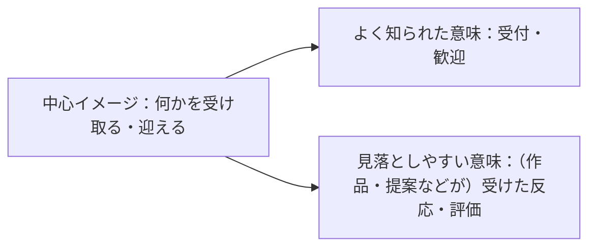

**重要語法：** a warm reception（好意的な反応）


---

## 2642｜revolve

**品詞：** verb　**発音（目安）：** リヴォルヴ

<small>よく知られている意味：回転する</small>

### 見落としやすい意味

**（revolve aroundで）～を中心に展開する、～が主題である**

**例文：** The debate revolved around the cost of the plan.

**和訳：** 議論はその計画の費用を中心に展開した。

**コアイメージ：** 回転では、ある中心の周りを動く。話題が特定の問題を軸に展開する場合にも同じ構図を使う。

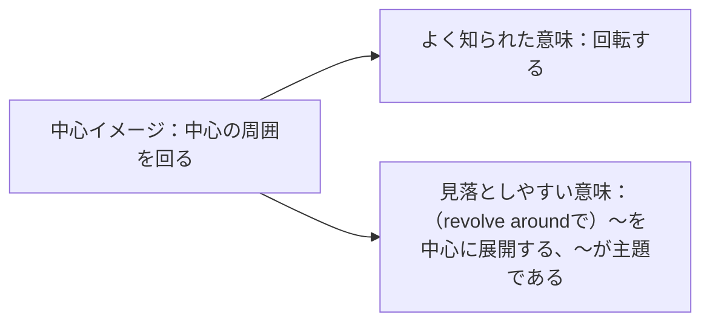

**重要語法：** revolve around ～（～を中心に展開する）


---

## 2643｜shark

**品詞：** noun　**発音（目安）：** シャーク

<small>よく知られている意味：サメ</small>

### 見落としやすい意味

**人を食い物にする悪徳な人物**

**例文：** The contract protected customers from dishonest sharks.

**和訳：** その契約は悪徳業者から顧客を守った。

**コアイメージ：** サメの獲物を狙う姿から、他人につけ込む人を批判的に呼ぶ。文字通りの魚の意味と比喩を区別する。

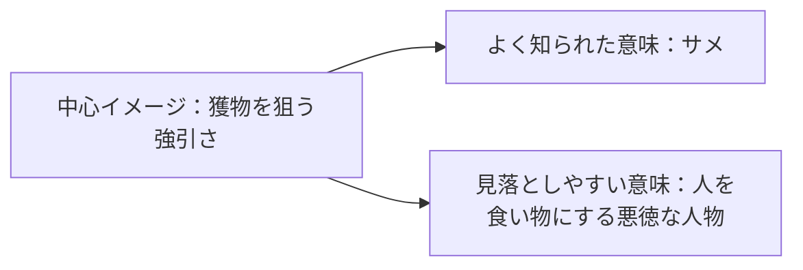

**重要語法：** loan shark（悪徳高利貸し）


---

## 2644｜swear

**品詞：** verb　**発音（目安）：** スウェア

<small>よく知られている意味：悪態をつく</small>

### 見落としやすい意味

**宣誓する、厳粛に誓う**

**例文：** The witness swore to tell the truth.

**和訳：** 証人は真実を述べると宣誓した。

**コアイメージ：** swearには強い言葉を口にする意味がある。公の場で言葉の真実性を保証する「宣誓する」にも用いる。

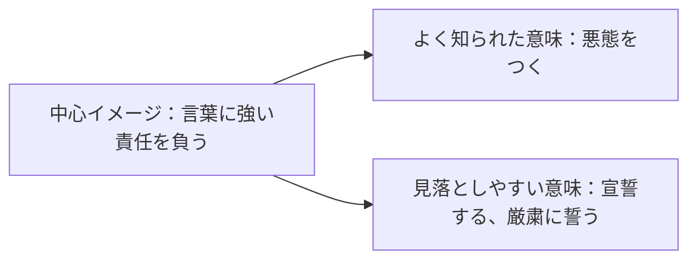

**重要語法：** swear to do（～すると誓う）


---

## 2645｜virgin

**品詞：** adjective　**発音（目安）：** ヴァージン

<small>よく知られている意味：純粋な・未使用の</small>

### 見落としやすい意味

**（森林・土地などが）まだ人の手の入っていない、未開拓の**

**例文：** The expedition passed through miles of virgin forest.

**和訳：** 探検隊は何マイルも続く手つかずの森林を通り抜けた。

**コアイメージ：** 何かが初めての状態にあるという感覚が根底にある。土地や森に使えば、開発や伐採が進んでいない状態を指す。

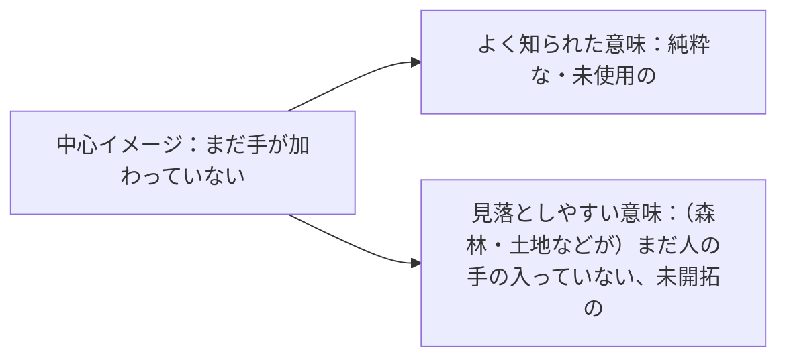

**重要語法：** virgin forest（原生林）


---

## 2646｜skate

**品詞：** verb　**発音（目安）：** スケイト

<small>よく知られている意味：スケートをする</small>

### 見落としやすい意味

**（skate overで）問題を軽く扱う、詳しく触れずに済ませる**

**例文：** The report skated over the serious safety concerns.

**和訳：** その報告書は重大な安全上の懸念を軽く扱って済ませた。

**コアイメージ：** 氷の表面を滑る動きから、話題の表面だけをなぞる比喩になる。問題の核心に踏み込まず通過するニュアンスがある。

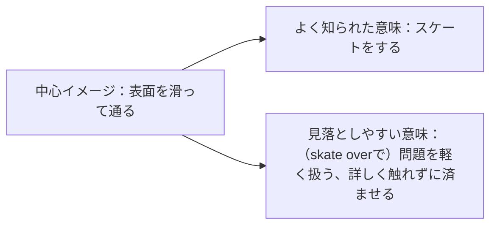

**重要語法：** skate over ～（～を軽く扱う）


---

## 2647｜wax

**品詞：** verb　**発音（目安）：** ワックス

<small>よく知られている意味：ろう・ワックス</small>

### 見落としやすい意味

**（月が）満ちていく、次第に大きくなる**

**例文：** The moon waxes after the new moon.

**和訳：** 新月の後、月は次第に満ちていく。

**コアイメージ：** 動詞のwaxには増大するという古い意味がある。月については、見える明るい部分が日ごとに増えることを表す。

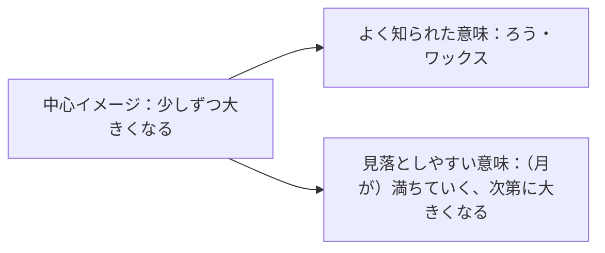

**重要語法：** wax and wane（月が満ち欠けする）


---

## 2648｜wax

**品詞：** verb　**発音（目安）：** ワックス

<small>よく知られている意味：ろうを塗る</small>

### 見落としやすい意味

**（勢いや影響などが）増す、強まる**

**例文：** Her confidence waxed as the presentation continued.

**和訳：** 発表が進むにつれて彼女の自信は強まった。

**コアイメージ：** waxを「増える」という動詞で読むと、月以外にも広がる。自信や力が徐々に強くなる様子に使われる文語寄りの表現。

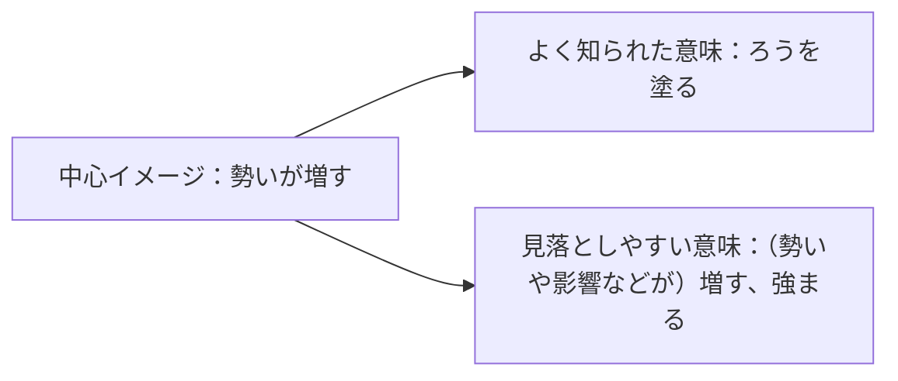

**重要語法：** wax stronger（いっそう強まる）


---

## 2649｜melt

**品詞：** verb　**発音（目安）：** メルト

<small>よく知られている意味：溶ける</small>

### 見落としやすい意味

**（心が）和らぐ、感情的に打ち解ける**

**例文：** His anger melted when he heard her apology.

**和訳：** 彼女の謝罪を聞いて、彼の怒りは和らいだ。

**コアイメージ：** 氷が溶けて形を保てなくなることから、硬い態度や強い感情がほぐれることを表す。物理的な変化が心の変化に重なる。

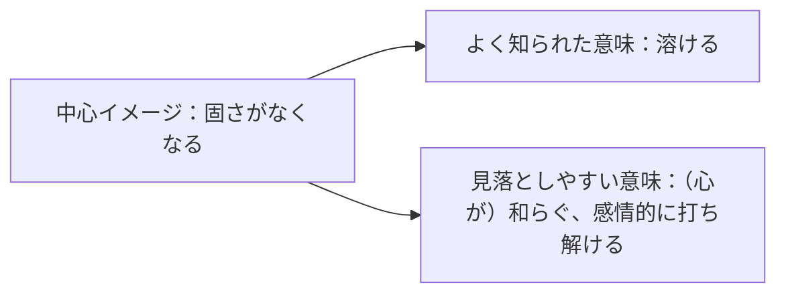

**重要語法：** melt away（次第に消える）


---

## 2650｜overhead

**品詞：** noun　**発音（目安）：** オーヴァーヘッド

<small>よく知られている意味：頭上の</small>

### 見落としやすい意味

**事業や運営にかかる間接経費**

**例文：** Rising rent has increased the shop's overhead.

**和訳：** 家賃の上昇で、その店の間接経費が増えた。

**コアイメージ：** 個々の商品に直接割り当てにくい、事業全体を維持する費用を指す。空間的な「頭上」からの単純な訳ではなく、会計上の語義として覚える。

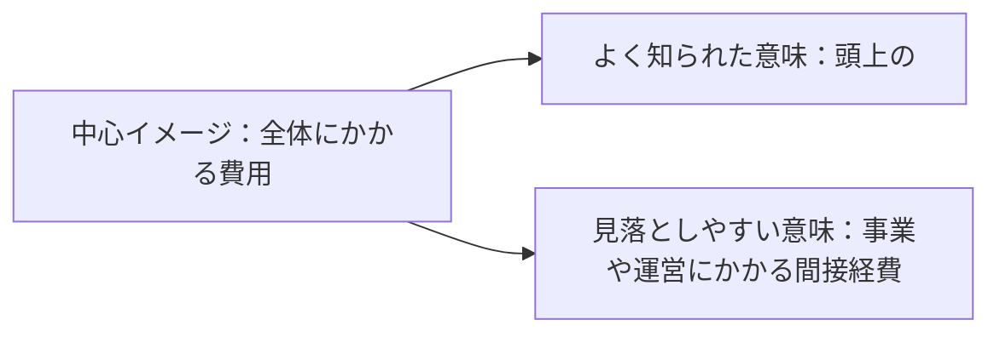

**重要語法：** overhead costs（間接経費）


---

## 2651｜gem

**品詞：** noun　**発音（目安）：** ジェム

<small>よく知られている意味：宝石</small>

### 見落としやすい意味

**（比喩）逸品、すばらしい人やもの**

**例文：** This little restaurant is a hidden gem.

**和訳：** この小さなレストランは知る人ぞ知る名店だ。

**コアイメージ：** 宝石は小さくても価値が高い。比喩では、人や作品や店などの特別な良さを評価するときに使う。

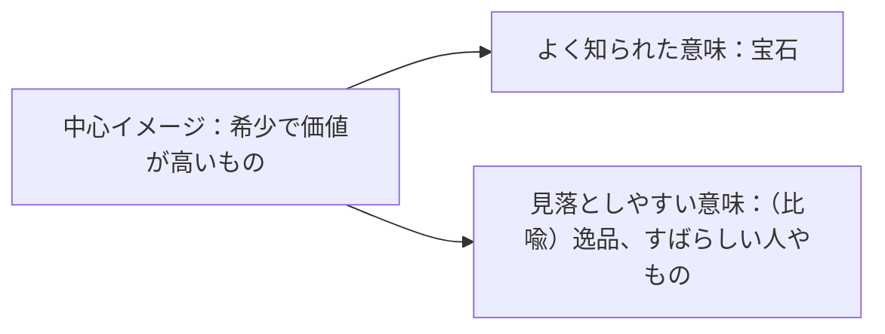

**重要語法：** a hidden gem（隠れた逸品）


---

## 2652｜benchmark

**品詞：** verb　**発音（目安）：** ベンチマーク

<small>よく知られている意味：基準・指標</small>

### 見落としやすい意味

**基準と比較して性能・品質を測定する**

**例文：** Engineers benchmarked the new chip against last year's model.

**和訳：** 技術者たちは新しいチップの性能を昨年のモデルと比較測定した。

**コアイメージ：** 名詞では比較の基準、動詞ではその基準を使う行為になる。性能差を数値などで確かめる場面で使われる。

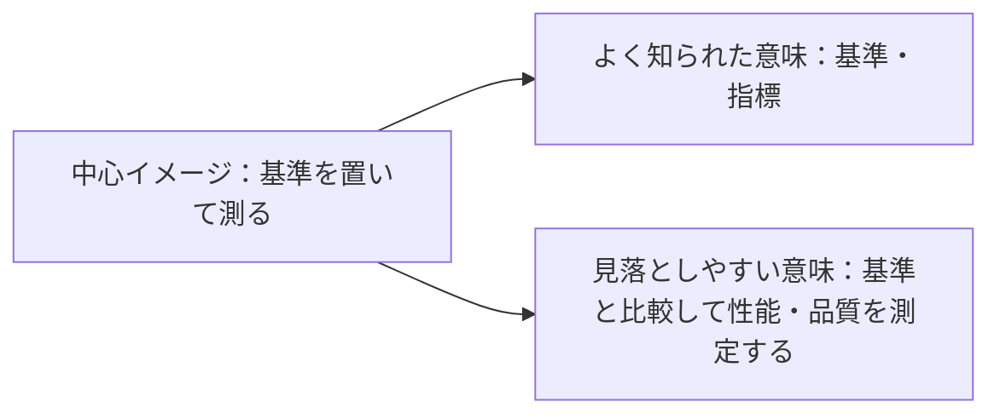

**重要語法：** benchmark A against B（AをBと比較評価する）


---

## 2653｜entitlement

**品詞：** noun　**発音（目安）：** エンタイトルメント

<small>よく知られている意味：権利があること</small>

### 見落としやすい意味

**（法律・制度に基づく）給付の受給権、受け取れる給付**

**例文：** The law gives workers an entitlement to paid leave.

**和訳：** その法律は労働者に有給休暇を受ける権利を与える。

**コアイメージ：** 単なる期待ではなく、法律や契約が認める受給資格をいう。給付そのものを指すこともある。

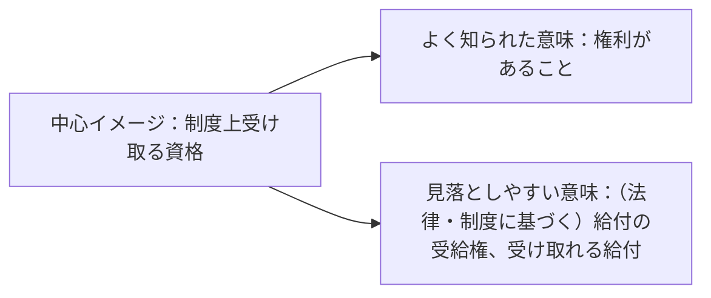

**重要語法：** entitlement to ～（～を受ける権利）


---

## 2654｜exempt

**品詞：** adjective　**発音（目安）：** イグゼンプト

<small>よく知られている意味：免除する（動詞）</small>

### 見落としやすい意味

**（be exempt fromで）～を免除されている**

**例文：** Children under six are exempt from the admission fee.

**和訳：** 6歳未満の子どもは入場料を免除される。

**コアイメージ：** 全員にかかる義務や費用から、特定の人を外すイメージ。be exempt fromの形で「免除されている」と表す。

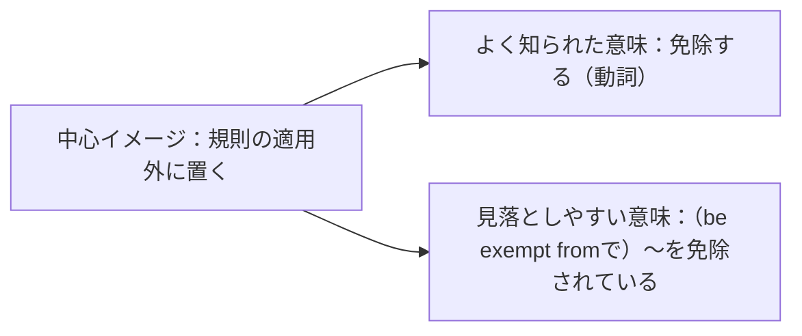

**重要語法：** be exempt from ～（～を免除されている）


---

## 2655｜frustrate

**品詞：** verb　**発音（目安）：** フラストレイト

<small>よく知られている意味：いら立たせる</small>

### 見落としやすい意味

**（計画・意図を）阻止する、実現を妨げる**

**例文：** A shortage of materials frustrated the team's plans.

**和訳：** 資材不足でチームの計画は実現を妨げられた。

**コアイメージ：** 期待通りに進めないため、人がいら立つという意味になる。目的や計画を目的語に取ると、実行を妨げる意味になる。

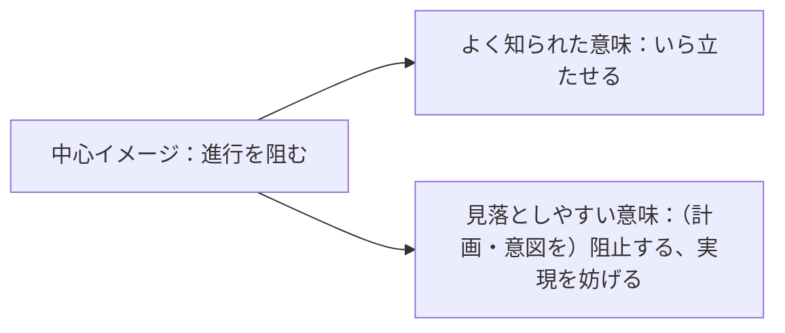

**重要語法：** frustrate a plan（計画を阻む）


---

## 2656｜illuminate

**品詞：** verb　**発音（目安）：** イルーミネイト

<small>よく知られている意味：照らす</small>

### 見落としやすい意味

**（事実や仕組みを）明らかにする、理解しやすくする**

**例文：** The experiment illuminates how birds find their way home.

**和訳：** その実験は鳥が帰巣する仕組みを明らかにする。

**コアイメージ：** 光で見えなかったものを照らす感覚を、理解にも使う。複雑な事実や仕組みを明確に示すという意味になる。

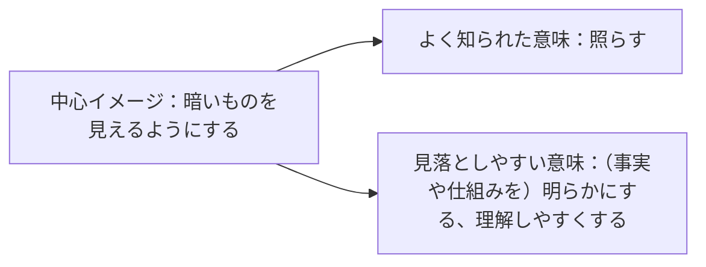

**重要語法：** illuminate a problem（問題を明らかにする）


---

## 2657｜omission

**品詞：** noun　**発音（目安）：** オミッション

<small>よく知られている意味：省略・抜け落ち</small>

### 見落としやすい意味

**（義務を）怠ること、不作為**

**例文：** The law treats a deliberate omission to act as a serious matter.

**和訳：** その法律は意図的に行動を怠ることを重大な問題として扱う。

**コアイメージ：** 文章の一部が抜ける「省略」だけではない。行うべき行為がなされない場合もomissionと呼び、法的な文脈では不作為を指す。

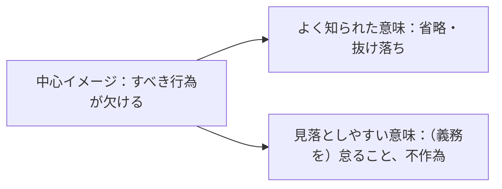

**重要語法：** an omission to act（行動を起こさないこと）


---

## 2658｜prostitute

**品詞：** verb　**発音（目安）：** プロスティテュート

<small>よく知られている意味：売春をする</small>

### 見落としやすい意味

**（名声・才能・信念などを）利益のために安売りする、品位を落とす**

**例文：** He refused to prostitute his talent for quick money.

**和訳：** 彼は目先の金のために才能を安売りすることを拒んだ。

**コアイメージ：** この比喩的な動詞は、才能や信念を利益のために不当に利用することを批判的に表す。強い否定的評価を含むため、普通の「活用」とは違う。

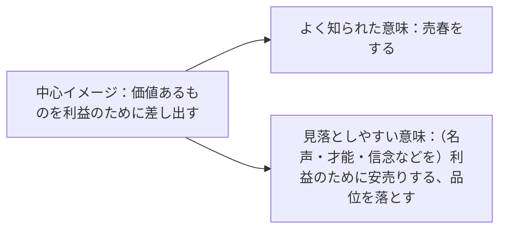

**重要語法：** prostitute one's principles（信念を売り渡す）


---

## 2659｜respectable

**品詞：** adjective　**発音（目安）：** リスペクタブル

<small>よく知られている意味：立派な・品位ある</small>

### 見落としやすい意味

**まずまずの、十分満足できる**

**例文：** The company made a respectable profit despite the slowdown.

**和訳：** 景気減速にもかかわらず、その会社はまずまずの利益を上げた。

**コアイメージ：** 人については「きちんとした」という評価になる。数字や成果については、非常に優秀でなくても十分満足できる水準を表す。

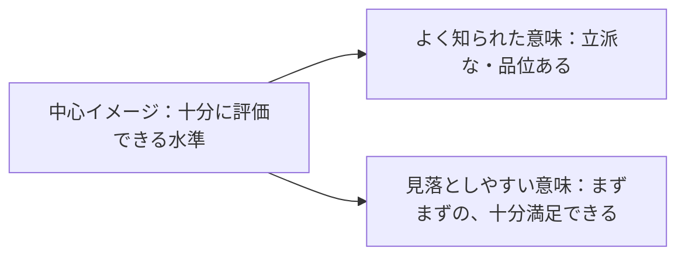

**重要語法：** a respectable score（まずまずの得点）


---

## 2660｜skip

**品詞：** noun　**発音（目安）：** スキップ

<small>よく知られている意味：飛び跳ねること</small>

### 見落としやすい意味

**（英・豪）大型の工事廃材・ごみ用コンテナ**

**例文：** The builders filled a skip with broken bricks.

**和訳：** 作業員たちは壊れたレンガで大型の廃材コンテナをいっぱいにした。

**コアイメージ：** この名詞は英国などで、工事廃材を一時的に集める大型コンテナを指す。動作のskipとは別の意味として文脈で見分ける。

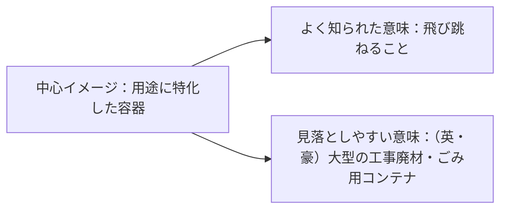

**重要語法：** put waste in a skip（廃材をコンテナに入れる）


---

## 2661｜suck

**品詞：** verb　**発音（目安）：** サック

<small>よく知られている意味：吸う</small>

### 見落としやすい意味

**（口語で）ひどい、最低だ、うんざりさせる**

**例文：** This weather sucks when you have to walk home.

**和訳：** 歩いて帰らなければならないときには、この天気は最悪だ。

**コアイメージ：** 吸い込むという基本義から直接訳すと不自然になる口語表現。物事の質がひどい、不快だという評価を表す。

```mermaid
flowchart LR
    A["中心イメージ：強く不満を示す口語"]
    B["よく知られた意味：吸う"]
    C["見落としやすい意味：（口語で）ひどい、最低だ、うんざりさせる"]
    A --> B
    A --> C
```

**重要語法：** That sucks.（それは最悪だ）


---

## 2662｜stomach

**品詞：** verb　**発音（目安）：** スタマック

<small>よく知られている意味：胃</small>

### 見落としやすい意味

**（嫌なことを）我慢する、受け入れる**

**例文：** I can't stomach the thought of cheating my friends.

**和訳：** 友人をだますことなど、私には到底受け入れられない。

**コアイメージ：** 胃で消化するイメージから、精神的につらい事柄を耐えて受け入れる意味になる。can’t stomachの形が特に多い。

```mermaid
flowchart LR
    A["中心イメージ：嫌なことを飲み込む"]
    B["よく知られた意味：胃"]
    C["見落としやすい意味：（嫌なことを）我慢する、受け入れる"]
    A --> B
    A --> C
```

**重要語法：** can't stomach ～（～には耐えられない）


---

## 2663｜hunger

**品詞：** verb　**発音（目安）：** ハンガー

<small>よく知られている意味：飢え・空腹</small>

### 見落としやすい意味

**（機会や愛情などを）強く渇望する（hunger for）**

**例文：** Many young writers hunger for recognition.

**和訳：** 多くの若い作家は認められることを強く望んでいる。

**コアイメージ：** 食べ物が足りず強く求める状態が出発点。名誉や愛情など、食べ物以外のものを切実に望む場合にも使う。

```mermaid
flowchart LR
    A["中心イメージ：満たされない強い欲求"]
    B["よく知られた意味：飢え・空腹"]
    C["見落としやすい意味：（機会や愛情などを）強く渇望する（hunger for）"]
    A --> B
    A --> C
```

**重要語法：** hunger for ～（～を渇望する）


---

## 2664｜needle

**品詞：** verb　**発音（目安）：** ニードル

<small>よく知られている意味：針</small>

### 見落としやすい意味

**（人を）からかい続ける、わざと刺激する**

**例文：** She kept needling her brother about his messy room.

**和訳：** 彼女は部屋の散らかり具合について弟をしつこくからかった。

**コアイメージ：** 針でちくちく刺す動作が比喩になった動詞。相手の気になるところを繰り返し突いて、いら立たせる意味になる。

```mermaid
flowchart LR
    A["中心イメージ：小さく何度も突く"]
    B["よく知られた意味：針"]
    C["見落としやすい意味：（人を）からかい続ける、わざと刺激する"]
    A --> B
    A --> C
```

**重要語法：** needle someone about ～（～について人をからかう）


---

## 2665｜peanut

**品詞：** noun　**発音（目安）：** ピーナッツ

<small>よく知られている意味：ピーナッツ</small>

### 見落としやすい意味

**（peanuts と複数形で）ごくわずかな金額、はした金**

**例文：** The job pays peanuts for such difficult work.

**和訳：** それほど大変な仕事なのに、給料ははした金だ。

**コアイメージ：** 小粒の豆にたとえて、金額がとても少ないことを表す。金銭の意味では通常peanutsと複数形にする。

```mermaid
flowchart LR
    A["中心イメージ：小さなもの・わずかな量"]
    B["よく知られた意味：ピーナッツ"]
    C["見落としやすい意味：（peanuts と複数形で）ごくわずかな金額、はした金"]
    A --> B
    A --> C
```

**重要語法：** pay peanuts（非常に安い賃金を払う）


---

## 2666｜conscious

**品詞：** adjective　**発音（目安）：** コンシャス

<small>よく知られている意味：意識がある</small>

### 見落としやすい意味

**意図的な、承知のうえで行う**

**例文：** Leaving the lights on was a conscious choice.

**和訳：** 明かりをつけたままにしたのは意図的な選択だった。

**コアイメージ：** 何が起きているかを認識していることから、意図をもって行うという意味になる。偶然か意図的かを区別する文脈で重要。

```mermaid
flowchart LR
    A["中心イメージ：自分で分かって行う"]
    B["よく知られた意味：意識がある"]
    C["見落としやすい意味：意図的な、承知のうえで行う"]
    A --> B
    A --> C
```

**重要語法：** a conscious decision（意図的な決定）


---

## 2667｜tail

**品詞：** verb　**発音（目安）：** テイル

<small>よく知られている意味：しっぽ</small>

### 見落としやすい意味

**（人などの）後をこっそりつける、尾行する**

**例文：** A detective tailed the suspect through the city.

**和訳：** 刑事は街中で容疑者を尾行した。

**コアイメージ：** 尻尾は本体の後ろについている。動詞のtailは、人の後ろをついて行き動きを追うことを表す。

```mermaid
flowchart LR
    A["中心イメージ：後ろに付いて進む"]
    B["よく知られた意味：しっぽ"]
    C["見落としやすい意味：（人などの）後をこっそりつける、尾行する"]
    A --> B
    A --> C
```

**重要語法：** tail a suspect（容疑者を尾行する）


---

## 2668｜drain

**品詞：** noun　**発音（目安）：** ドレイン

<small>よく知られている意味：排水口・下水管</small>

### 見落としやすい意味

**（時間・資金などの）消耗要因、負担となるもの**

**例文：** Repairs became a major drain on the school's budget.

**和訳：** 修理費が学校の予算を大きく圧迫するようになった。

**コアイメージ：** drainは水が抜けるところや抜く行為を表す。お金や時間が継続的に失われる原因にも使われる。

```mermaid
flowchart LR
    A["中心イメージ：少しずつ外へ流れ出る"]
    B["よく知られた意味：排水口・下水管"]
    C["見落としやすい意味：（時間・資金などの）消耗要因、負担となるもの"]
    A --> B
    A --> C
```

**重要語法：** a drain on ～（～の負担・消耗要因）


---

## 2669｜drain

**品詞：** verb　**発音（目安）：** ドレイン

<small>よく知られている意味：水を抜く</small>

### 見落としやすい意味

**（人の体力・資源などを）使い果たす**

**例文：** Handling complaints all day drained her energy.

**和訳：** 一日中苦情に対応したことで、彼女はすっかり疲れ果てた。

**コアイメージ：** 容器から液体が抜けるように、体力や資源が減っていく感覚。目的語を取れば、何かのエネルギーを奪い尽くす意味になる。

```mermaid
flowchart LR
    A["中心イメージ：中身が抜けて空に近づく"]
    B["よく知られた意味：水を抜く"]
    C["見落としやすい意味：（人の体力・資源などを）使い果たす"]
    A --> B
    A --> C
```

**重要語法：** drain someone's energy（人の気力を消耗させる）


---

## 2670｜eccentric

**品詞：** adjective　**発音（目安）：** エクセントリック

<small>よく知られている意味：風変わりな</small>

### 見落としやすい意味

**中心から外れた、偏心した**

**例文：** The device uses an eccentric wheel to produce motion.

**和訳：** その装置は中心のずれた車輪を使って動きを生み出す。

**コアイメージ：** eccentricの語源的な中心は「中心から外れた」。性格なら常識から外れたこと、機械なら回転の中心がずれたことを表す。

```mermaid
flowchart LR
    A["中心イメージ：中心からずれる"]
    B["よく知られた意味：風変わりな"]
    C["見落としやすい意味：中心から外れた、偏心した"]
    A --> B
    A --> C
```

**重要語法：** eccentric wheel（偏心輪）


---

## 2671｜atmospheric

**品詞：** adjective　**発音（目安）：** アトモスフェリック

<small>よく知られている意味：大気の</small>

### 見落としやすい意味

**独特の雰囲気や情緒を醸し出す**

**例文：** The old library is quiet and wonderfully atmospheric.

**和訳：** その古い図書館は静かで、独特の情緒がある。

**コアイメージ：** atmosphereは物理的な大気だけでなく、その場所を包む空気感も表す。atmosphericは心に残る雰囲気を醸し出す様子にも使える。

```mermaid
flowchart LR
    A["中心イメージ：周囲を包む雰囲気"]
    B["よく知られた意味：大気の"]
    C["見落としやすい意味：独特の雰囲気や情緒を醸し出す"]
    A --> B
    A --> C
```

**重要語法：** an atmospheric setting（雰囲気のある舞台）


---

## 2672｜borrowing

**品詞：** noun　**発音（目安）：** ボロウイング

<small>よく知られている意味：借り入れ</small>

### 見落としやすい意味

**（言語学）他言語から取り入れた借用語**

**例文：** The word karaoke is a borrowing from Japanese.

**和訳：** karaokeという語は日本語からの借用語だ。

**コアイメージ：** お金や物を借りる行為から、言語同士の語の取り入れにも広がる。言語学では借り入れた単語自体を指す。

```mermaid
flowchart LR
    A["中心イメージ：ほかから取り入れる"]
    B["よく知られた意味：借り入れ"]
    C["見落としやすい意味：（言語学）他言語から取り入れた借用語"]
    A --> B
    A --> C
```

**重要語法：** a borrowing from ～（～からの借用語）


---

## 2673｜geometry

**品詞：** noun　**発音（目安）：** ジオメトリー

<small>よく知られている意味：幾何学</small>

### 見落としやすい意味

**物体や構造の形状・空間的配置**

**例文：** The building's unusual geometry makes it stand out.

**和訳：** その建物は独特な形状のおかげで目を引く。

**コアイメージ：** 幾何学は形や空間的な関係を扱う学問。そこから対象物の形状や部品の配置そのものをgeometryと呼ぶ。

```mermaid
flowchart LR
    A["中心イメージ：形と位置の関係"]
    B["よく知られた意味：幾何学"]
    C["見落としやすい意味：物体や構造の形状・空間的配置"]
    A --> B
    A --> C
```

**重要語法：** the geometry of a structure（構造物の形状）


---

## 2674｜leverage

**品詞：** noun　**発音（目安）：** レヴァリッジ

<small>よく知られている意味：てこの作用</small>

### 見落としやすい意味

**影響力・交渉上の優位性、交渉力**

**例文：** Their market share gives them leverage in negotiations.

**和訳：** 高い市場占有率は交渉で彼らに有利な立場を与える。

**コアイメージ：** てこを使うと小さな力で大きな効果が出る。交渉では、自分に有利な条件を動かす影響力をleverageと呼ぶ。

```mermaid
flowchart LR
    A["中心イメージ：小さな力で大きく動かす"]
    B["よく知られた意味：てこの作用"]
    C["見落としやすい意味：影響力・交渉上の優位性、交渉力"]
    A --> B
    A --> C
```

**重要語法：** have leverage over ～（～に対する交渉力がある）


---

## 2675｜leverage

**品詞：** verb　**発音（目安）：** レヴァリッジ

<small>よく知られている意味：てこを利用する</small>

### 見落としやすい意味

**手持ちの資源・強みを最大限に活用する**

**例文：** The charity leveraged social media to reach more people.

**和訳：** その慈善団体はSNSを活用して、より多くの人に情報を届けた。

**コアイメージ：** てこの働きから、持っている資源の効果をさらに大きくする意味になる。人材や技術などを「単に使う」以上の活用を指す。

```mermaid
flowchart LR
    A["中心イメージ：手持ちの強みをてこにする"]
    B["よく知られた意味：てこを利用する"]
    C["見落としやすい意味：手持ちの資源・強みを最大限に活用する"]
    A --> B
    A --> C
```

**重要語法：** leverage technology（技術を有効活用する）


---

## 2676｜restraint

**品詞：** noun　**発音（目安）：** リストレイント

<small>よく知られている意味：自制・抑制</small>

### 見落としやすい意味

**（物理的な）拘束具、動きを制限する器具・手段**

**例文：** Each seat has a safety restraint for passengers.

**和訳：** 各座席には乗客用の安全拘束具が付いている。

**コアイメージ：** 感情や行動を抑える抽象的な意味だけではない。人や物が動きすぎないよう固定する具体的な器具もrestraintという。

```mermaid
flowchart LR
    A["中心イメージ：動きを制限する"]
    B["よく知られた意味：自制・抑制"]
    C["見落としやすい意味：（物理的な）拘束具、動きを制限する器具・手段"]
    A --> B
    A --> C
```

**重要語法：** safety restraint（安全拘束具）


---

## 2677｜safeguard

**品詞：** verb　**発音（目安）：** セイフガード

<small>よく知られている意味：安全策・保護手段</small>

### 見落としやすい意味

**（事故や損失などから）保護する、守る**

**例文：** The new rules safeguard users' personal data.

**和訳：** 新しい規則は利用者の個人データを保護する。

**コアイメージ：** 名詞では被害を防ぐ安全策を指す。動詞になると、それを使って権利や情報などを守る行為を表す。

```mermaid
flowchart LR
    A["中心イメージ：危険から守る仕組み"]
    B["よく知られた意味：安全策・保護手段"]
    C["見落としやすい意味：（事故や損失などから）保護する、守る"]
    A --> B
    A --> C
```

**重要語法：** safeguard A against B（BからAを守る）


---

## 2678｜scoop

**品詞：** noun　**発音（目安）：** スクープ

<small>よく知られている意味：すくう道具・ひとすくい</small>

### 見落としやすい意味

**他社より先に報じた特ダネ、独占ニュース**

**例文：** The journalist got a scoop about the planned merger.

**和訳：** その記者は予定されている合併について特ダネをつかんだ。

**コアイメージ：** すくって取り出す意味から、他社に先んじて情報を手に入れる比喩になる。報道の文脈では独占的なニュースのこと。

```mermaid
flowchart LR
    A["中心イメージ：ほかより先にすくい上げる"]
    B["よく知られた意味：すくう道具・ひとすくい"]
    C["見落としやすい意味：他社より先に報じた特ダネ、独占ニュース"]
    A --> B
    A --> C
```

**重要語法：** get a scoop（特ダネを得る）


---

## 2679｜stun

**品詞：** verb　**発音（目安）：** スタン

<small>よく知られている意味：気絶させる</small>

### 見落としやすい意味

**（知らせ・光景などが）人を驚愕させる、あっけにとらせる**

**例文：** The unexpected result stunned the researchers.

**和訳：** 予想外の結果に研究者たちはあっけにとられた。

**コアイメージ：** 身体の動きを止めるほどの衝撃から、心が強く揺さぶられることへ広がる。驚きの大きさを表す動詞として使う。

```mermaid
flowchart LR
    A["中心イメージ：反応できなくするほどの衝撃"]
    B["よく知られた意味：気絶させる"]
    C["見落としやすい意味：（知らせ・光景などが）人を驚愕させる、あっけにとらせる"]
    A --> B
    A --> C
```

**重要語法：** be stunned by ～（～に驚愕する）


---

## 2680｜wreck

**品詞：** verb　**発音（目安）：** レック

<small>よく知られている意味：難破船・残骸</small>

### 見落としやすい意味

**（計画・人間関係などを）台無しにする、破壊する**

**例文：** A single error wrecked the entire plan.

**和訳：** たった一つのミスが計画全体を台無しにした。

**コアイメージ：** 乗り物などが大きく壊れることから、計画や関係が成立しなくなることを表す。単に少し悪くするより強い意味。

```mermaid
flowchart LR
    A["中心イメージ：形や機能を壊す"]
    B["よく知られた意味：難破船・残骸"]
    C["見落としやすい意味：（計画・人間関係などを）台無しにする、破壊する"]
    A --> B
    A --> C
```

**重要語法：** wreck a plan（計画を台無しにする）

