# EasyVoca 完成教材｜バッチ035

採用済み語義を使用。担当範囲：global_order 2721〜2800（全80件）。

## 2721. tender

**単語：tender** ／ **品詞：noun** ／ **発音：/ˈtendər/**

<small>よく知られている意味：柔らかい・優しい（形容詞）</small>

### 見落としやすい意味：入札、正式な申し出

**例文：** The city invited tenders for the bridge repair project.

**和訳：** 市は橋の修繕工事について入札を募集した。

**コアイメージ：** 条件を示し、相手に正式な申し出を差し出すことが中心です。そこから契約を得ようとする入札の意味になります。

**図：**

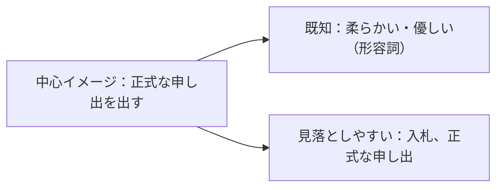

**重要語法：** invite tenders / submit a tender


---

## 2722. tender

**単語：tender** ／ **品詞：verb** ／ **発音：/ˈtendər/**

<small>よく知られている意味：柔らかい・優しい</small>

### 見落としやすい意味：（支払い・申し出などを）正式に差し出す

**例文：** The company tendered an apology to its customers.

**和訳：** 会社は顧客に正式に謝罪を申し入れた。

**コアイメージ：** 相手に向けて何かを差し出す動作が中心です。金銭だけでなく謝罪や辞表などを正式に提出するときにも使います。

**図：**

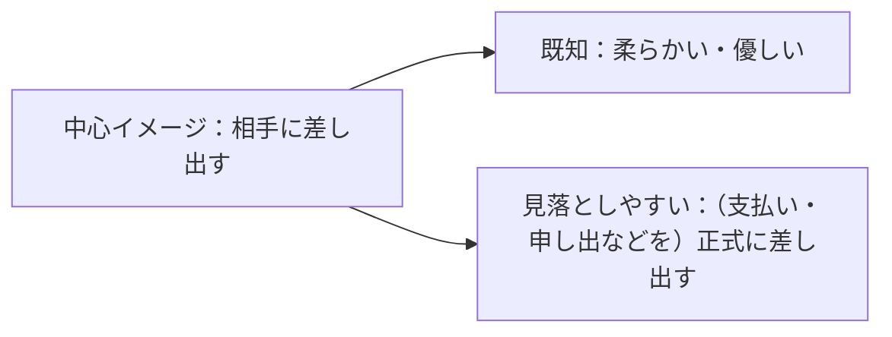

**重要語法：** tender an apology / tender one's resignation


---

## 2723. dash

**単語：dash** ／ **品詞：noun** ／ **発音：/dæʃ/**

<small>よく知られている意味：勢いよく走る・突進する</small>

### 見落としやすい意味：（飲み物・料理への）少量の添加物

**例文：** Add a dash of cinnamon to the hot milk.

**和訳：** 温かい牛乳にシナモンを少々加えてください。

**コアイメージ：** さっと加える小さな動きを思い浮かべます。そこから料理や飲み物に加えるほんの少量を表します。

**図：**

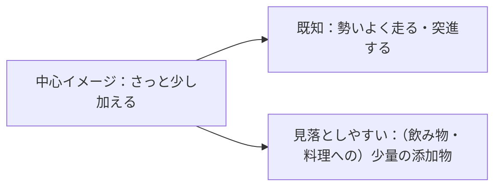

**重要語法：** a dash of salt / a dash of humor


---

## 2724. dash

**単語：dash** ／ **品詞：verb** ／ **発音：/dæʃ/**

<small>よく知られている意味：勢いよく走る・突進する</small>

### 見落としやすい意味：希望・計画などを打ち砕く、失望させる

**例文：** The sudden storm dashed our hopes of reaching the summit.

**和訳：** 突然の嵐で、頂上に到達するという私たちの望みは打ち砕かれた。

**コアイメージ：** 勢いよく何かがぶつかって壊れる感覚があります。そこから希望や計画が一気に壊されるという比喩的な用法になります。

**図：**

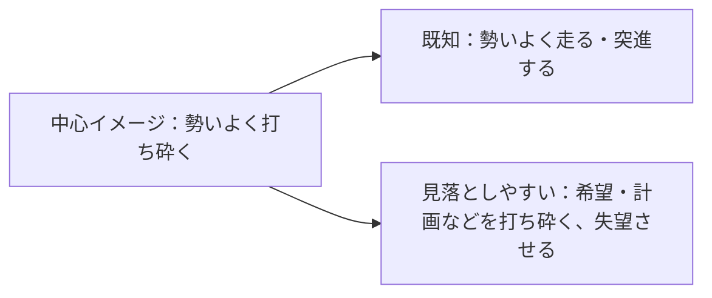

**重要語法：** dash someone's hopes


---

## 2725. stain

**単語：stain** ／ **品詞：noun** ／ **発音：/steɪn/**

<small>よく知られている意味：染み・汚れ</small>

### 見落としやすい意味：（名声・評判などに残る）汚点、不名誉

**例文：** The scandal left a stain on the organization's reputation.

**和訳：** その不祥事は組織の評判に汚点を残した。

**コアイメージ：** いったん付くとなかなか消えない汚れが中心です。物理的な染みだけでなく、名声に長く残る悪い印象も指します。

**図：**

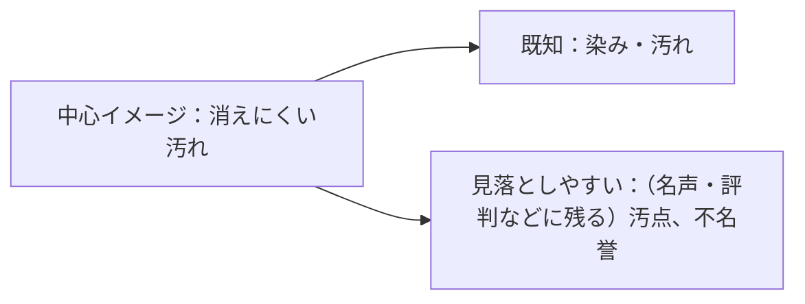

**重要語法：** a stain on one's reputation


---

## 2726. hedge

**単語：hedge** ／ **品詞：verb** ／ **発音：/hedʒ/**

<small>よく知られている意味：生け垣</small>

### 見落としやすい意味：断言・言質を避ける、言葉を濁す

**例文：** When asked about the cost, the minister hedged instead of giving a figure.

**和訳：** 費用を尋ねられると、大臣は金額を示さず言葉を濁した。

**コアイメージ：** 生け垣は境界を作り、外からの影響を避けるものです。発言でも断定を避けて自分を守る態度を表します。

**図：**

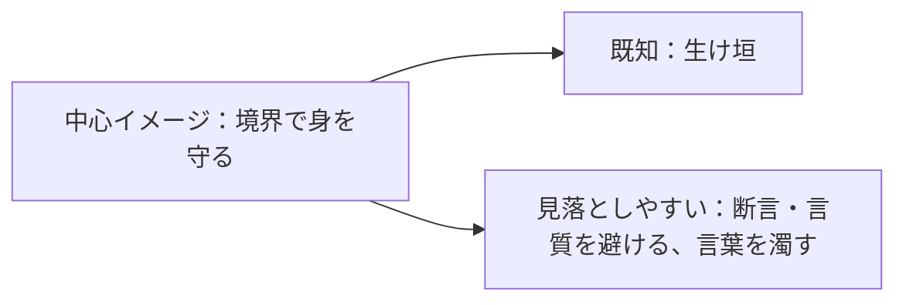

**重要語法：** hedge one's answer / hedge about a question


---

## 2727. hedge

**単語：hedge** ／ **品詞：verb** ／ **発音：/hedʒ/**

<small>よく知られている意味：生け垣</small>

### 見落としやすい意味：（相場変動などの）損失リスクを軽減する

**例文：** The farmer hedged against falling crop prices by signing a contract early.

**和訳：** 農家は早めに契約を結び、作物価格の下落リスクを抑えた。

**コアイメージ：** 外からの危険を防ぐ囲いのイメージです。経済活動では損失を小さくするために別の取引で備えることを意味します。

**図：**

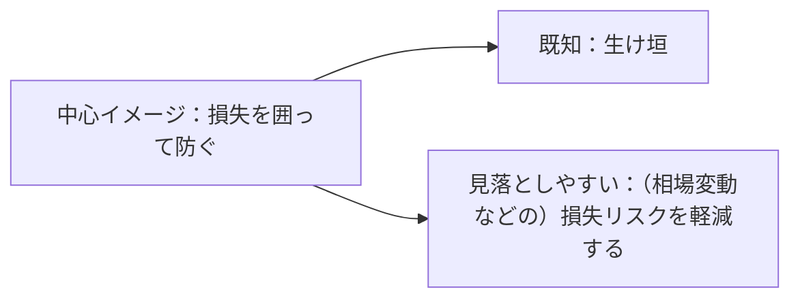

**重要語法：** hedge against losses / hedge one's bets


---

## 2728. weave

**単語：weave** ／ **品詞：verb** ／ **発音：/wiːv/**

<small>よく知られている意味：布を織る</small>

### 見落としやすい意味：左右に曲がりながら進む、縫うように移動する

**例文：** The cyclist weaved through the slow-moving traffic.

**和訳：** その自転車の人は、ゆっくり流れる車の間を縫うように進んだ。

**コアイメージ：** 糸が左右に行き来しながら交差する動きが中心です。そこから障害物の間を左右に曲がって進む様子を表します。

**図：**

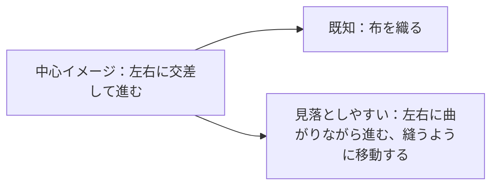

**重要語法：** weave through traffic


---

## 2729. weave

**単語：weave** ／ **品詞：verb** ／ **発音：/wiːv/**

<small>よく知られている意味：布を織る</small>

### 見落としやすい意味：（物語・理屈などを）巧みに織り交ぜて作る

**例文：** The writer weaved historical facts into a fictional story.

**和訳：** 作家は歴史的事実を架空の物語に巧みに織り込んだ。

**コアイメージ：** 別々の糸を組み合わせ、一つの布にする動きです。情報や出来事を組み合わせて一つの話を作るときにも使います。

**図：**

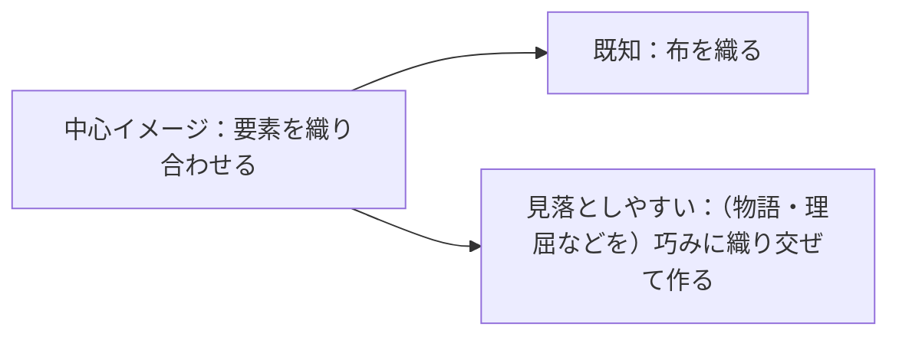

**重要語法：** weave A into B


---

## 2730. petty

**単語：petty** ／ **品詞：adjective** ／ **発音：/ˈpeti/**

<small>よく知られている意味：小さい・ささいな</small>

### 見落としやすい意味：つまらない、度量の狭い（petty jealousy など）

**例文：** She refused to argue over such a petty complaint.

**和訳：** 彼女はそのようなつまらない苦情をめぐって口論することを拒んだ。

**コアイメージ：** 重要性が小さいという感覚が基本です。物事だけでなく、小さなことに執着する人の心の狭さも表します。

**図：**

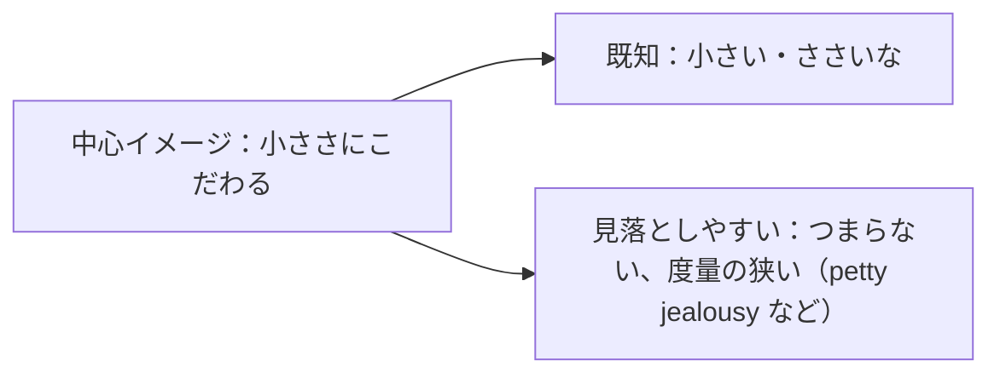

**重要語法：** petty jealousy / petty argument


---

## 2731. integral

**単語：integral** ／ **品詞：adjective** ／ **発音：/ˈɪntəɡrəl/**

<small>よく知られている意味：整数の・積分の（専門用法）</small>

### 見落としやすい意味：不可欠な、全体を成すうえで欠かせない

**例文：** Trust is an integral part of any lasting friendship.

**和訳：** 信頼は長続きする友情に欠かせない要素だ。

**コアイメージ：** 部分が全体にしっかり組み込まれている状態です。その部分を欠くと全体が成り立たないことから、不可欠という意味になります。

**図：**

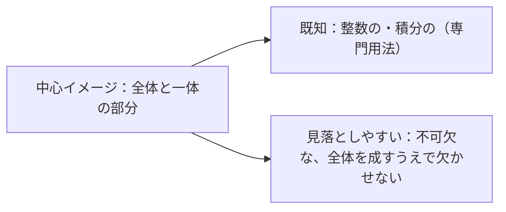

**重要語法：** an integral part of


---

## 2732. notwithstanding

**単語：notwithstanding** ／ **品詞：adverb**

<small>よく知られている意味：～にもかかわらず（前置詞）</small>

### 見落としやすい意味：それにもかかわらず、なお

**例文：** The road was icy; notwithstanding, the buses ran on schedule.

**和訳：** 道路は凍結していた。それにもかかわらず、バスは予定どおり運行した。

**コアイメージ：** 妨げとなる事情があっても、結果が変わらないという対比です。副詞として単独で置かれ、前の内容を受けて『それでも』と続けます。

**図：**

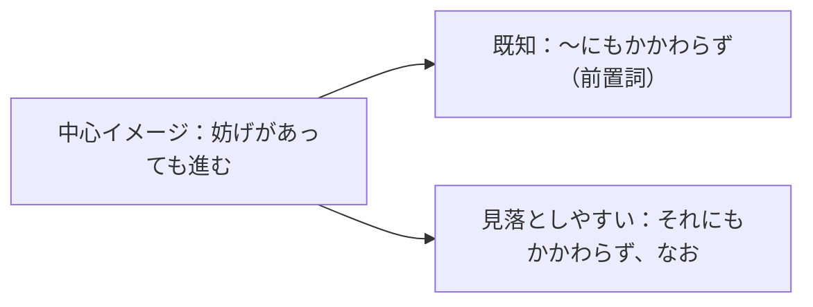

**重要語法：** 文語的な副詞。文末にも置ける


---

## 2733. notwithstanding

**単語：notwithstanding** ／ **品詞：preposition**

<small>よく知られている意味：それにもかかわらず（副詞）</small>

### 見落としやすい意味：～にもかかわらず（notwithstanding + 名詞句）

**例文：** Notwithstanding the heavy rain, the match went ahead.

**和訳：** 大雨にもかかわらず、試合は予定どおり行われた。

**コアイメージ：** 予想に反する結果を示す対比が中心です。前置詞として後ろに名詞句を取り、その条件を乗り越えて成立する事柄を続けます。

**図：**

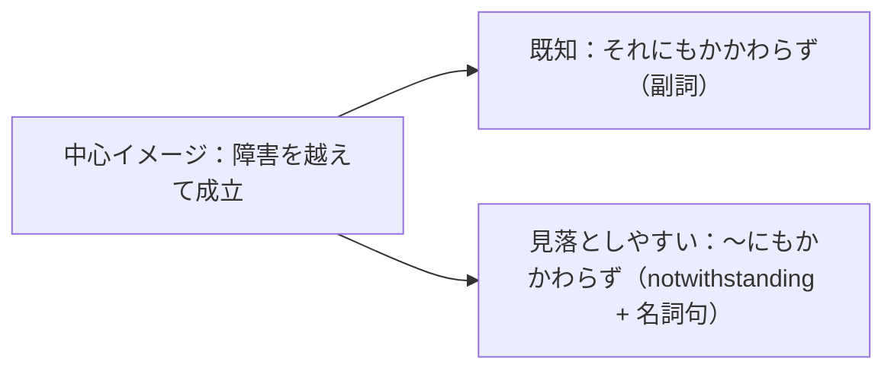

**重要語法：** notwithstanding + 名詞句（文語的）


---

## 2734. withhold

**単語：withhold** ／ **品詞：verb** ／ **発音：/wɪðˈhoʊld/**

<small>よく知られている意味：与えない・差し控える</small>

### 見落としやすい意味：（賃金・支払金から税金などを）源泉徴収する、天引きする

**例文：** The employer must withhold income tax from each paycheck.

**和訳：** 雇用主は毎回の給与から所得税を源泉徴収しなければならない。

**コアイメージ：** 本来渡すものの一部を手元にとどめる意味です。給与の一部を受取人に渡さず、税金として差し引くことを表します。

**図：**

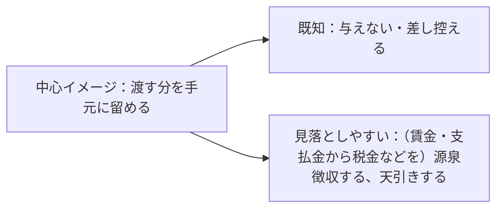

**重要語法：** withhold tax from pay


---

## 2735. slump

**単語：slump** ／ **品詞：verb** ／ **発音：/slʌmp/**

<small>よく知られている意味：どさっと倒れる</small>

### 見落としやすい意味：（業績・価格・活動などが）急激に落ち込む

**例文：** Sales slumped after the company raised its prices.

**和訳：** 会社が値上げした後、売上げは急落した。

**コアイメージ：** 力が抜けて下へ崩れ落ちる感覚です。数字や景気が短期間に大きく落ちることにも使います。

**図：**

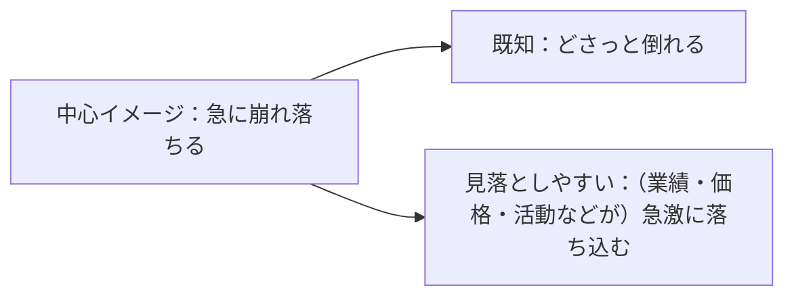

**重要語法：** sales slump / slump sharply


---

## 2736. backdrop

**単語：backdrop** ／ **品詞：noun** ／ **発音：/ˈbækdrɑːp/**

<small>よく知られている意味：舞台の背景幕</small>

### 見落としやすい意味：（事件・物語の）背景事情、社会的状況

**例文：** The debate took place against a backdrop of rising unemployment.

**和訳：** その討論は失業率が上昇する社会状況の中で行われた。

**コアイメージ：** 舞台で背後に見える背景が中心です。出来事を理解するために必要な社会的事情や時代状況にも広がります。

**図：**

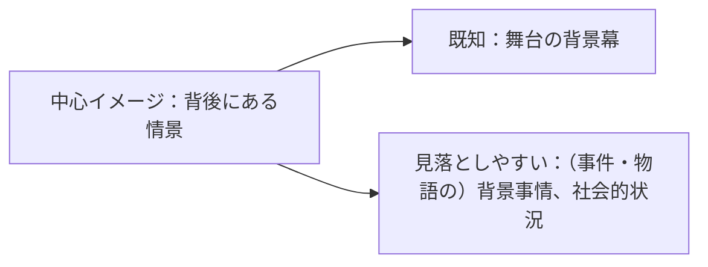

**重要語法：** against a backdrop of


---

## 2737. beg

**単語：beg** ／ **品詞：verb** ／ **発音：/beɡ/**

<small>よく知られている意味：頼む・懇願する</small>

### 見落としやすい意味：論点を先取りして前提にする（beg the question）

**例文：** His argument begs the question of whether the policy works at all.

**和訳：** 彼の議論は、その政策がそもそも有効なのかという点を当然のこととして前提にしている。

**コアイメージ：** これは語の基本義から機械的に作れない定型表現です。論証すべき点を証明せず、すでに正しいものとして扱う誤りを指します。

**図：**

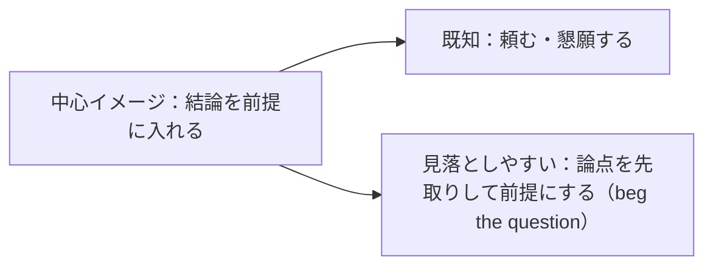

**重要語法：** beg the question：本来は論点先取。口語の『疑問を生む』との混同に注意


---

## 2738. cowboy

**単語：cowboy** ／ **品詞：noun** ／ **発音：/ˈkaʊbɔɪ/**

<small>よく知られている意味：カウボーイ・牧童</small>

### 見落としやすい意味：（英・口語）仕事が粗雑な、信用できない業者

**例文：** We hired a cowboy builder who left the roof leaking.

**和訳：** 私たちはいい加減な施工業者を雇ってしまい、屋根は雨漏りするままだった。

**コアイメージ：** 無法者のように規則や責任を軽視する人という比喩です。英国の口語では、粗雑な仕事をする信用できない業者を指します。

**図：**

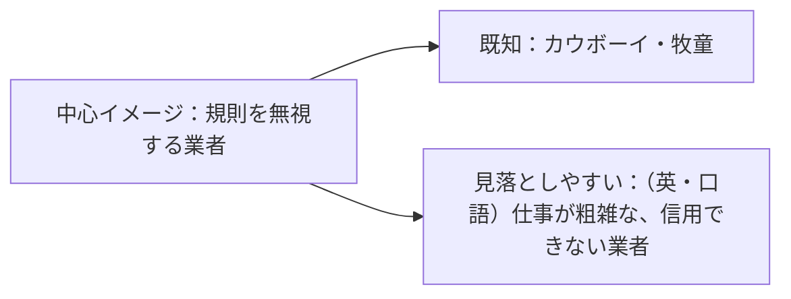

**重要語法：** 英国口語：cowboy builder


---

## 2739. deplore

**単語：deplore** ／ **品詞：verb** ／ **発音：/dɪˈplɔːr/**

<small>よく知られている意味：嘆き悲しむ</small>

### 見落としやすい意味：強く非難する、遺憾の意を示す

**例文：** The committee deplored the use of misleading data.

**和訳：** 委員会は誤解を招くデータの使用を強く非難した。

**コアイメージ：** 望ましくない事態を深く嘆く気持ちが中心です。その強い否定的評価から、公に非難する意味になります。

**図：**

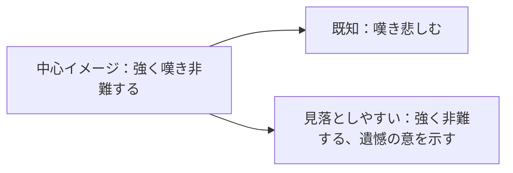

**重要語法：** deplore violence / deplore the decision


---

## 2740. endpoint

**単語：endpoint** ／ **品詞：noun** ／ **発音：/ˈendpɔɪnt/**

<small>よく知られている意味：終点・端点</small>

### 見落としやすい意味：（研究・実験の）結果を判定する評価項目・観察指標

**例文：** The trial's main endpoint was improvement in sleep quality.

**和訳：** その試験の主な評価項目は睡眠の質の改善だった。

**コアイメージ：** どこを到達点として測るかという考え方です。研究では効果を判定するためにあらかじめ決めた観察指標を指します。

**図：**

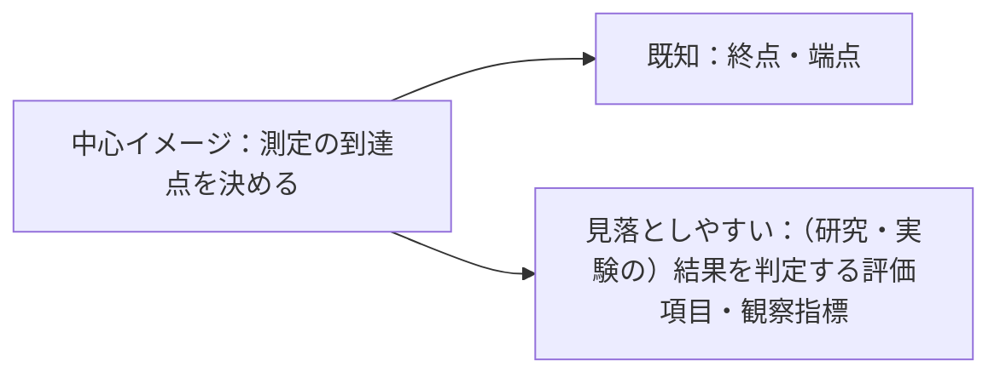

**重要語法：** primary endpoint / study endpoint


---

## 2741. gorge

**単語：gorge** ／ **品詞：noun** ／ **発音：/ɡɔːrdʒ/**

<small>よく知られている意味：がつがつ食べる（動詞）</small>

### 見落としやすい意味：深く切り立った谷、峡谷

**例文：** A narrow trail led into a deep gorge between the cliffs.

**和訳：** 細い小道は断崖の間の深い峡谷へと続いていた。

**コアイメージ：** 地面が深く切り込まれた形を表します。食べる動詞とは語義が異なるため、名詞では谷の地形に注目して覚えます。

**図：**

```mermaid
flowchart LR
    A["中心イメージ：深く切り込んだ谷"]
    B["既知：がつがつ食べる（動詞）"]
    C["見落としやすい：深く切り立った谷、峡谷"]
    A --> B
    A --> C
```

**重要語法：** a steep gorge


---

## 2742. iranian

**単語：iranian** ／ **品詞：adjective** ／ **発音：/ɪˈreɪniən/**

<small>よく知られている意味：イランの・イラン人の</small>

### 見落としやすい意味：（言語学）ペルシア語・クルド語などを含むイラン語群に関する

**例文：** Persian is one of the Iranian languages.

**和訳：** ペルシア語はイラン語群に属する言語の一つだ。

**コアイメージ：** 国名に由来する言葉ですが、言語分類では国境と一致しません。イラン語群にはペルシア語やクルド語などが含まれます。

**図：**

```mermaid
flowchart LR
    A["中心イメージ：イランに由来する言語群"]
    B["既知：イランの・イラン人の"]
    C["見落としやすい：（言語学）ペルシア語・クルド語などを含むイラン語群に関する"]
    A --> B
    A --> C
```

**重要語法：** Iranian languages は言語学上の分類


---

## 2743. nominal

**単語：nominal** ／ **品詞：adjective** ／ **発音：/ˈnɑːmɪnəl/**

<small>よく知られている意味：名目上の・名前だけの</small>

### 見落としやすい意味：名目上だけの、実質を伴わない

**例文：** He was the nominal head of the club, but others made the decisions.

**和訳：** 彼は名目上の部長だったが、決定を下していたのは別の人々だった。

**コアイメージ：** 名前や肩書が先に立ち、実態が伴わない状態です。権限を持つように見えても実際にはそうでないことを示します。

**図：**

```mermaid
flowchart LR
    A["中心イメージ：名と実がずれる"]
    B["既知：名目上の・名前だけの"]
    C["見落としやすい：名目上だけの、実質を伴わない"]
    A --> B
    A --> C
```

**重要語法：** nominal leader / nominal authority


---

## 2744. nominal

**単語：nominal** ／ **品詞：adjective** ／ **発音：/ˈnɑːmɪnəl/**

<small>よく知られている意味：名目上の</small>

### 見落としやすい意味：ごく少額の、名ばかりの金額の

**例文：** Visitors pay only a nominal fee to enter the museum.

**和訳：** 来館者は博物館に入るのにごく少額の料金を払うだけだ。

**コアイメージ：** 名前だけの費用に近いほど金額が小さいという感覚です。実費や通常の料金に比べてごくわずかだと表します。

**図：**

```mermaid
flowchart LR
    A["中心イメージ：形だけの小さな金額"]
    B["既知：名目上の"]
    C["見落としやすい：ごく少額の、名ばかりの金額の"]
    A --> B
    A --> C
```

**重要語法：** a nominal fee / nominal charge


---

## 2745. nominal

**単語：nominal** ／ **品詞：adjective** ／ **発音：/ˈnɑːmɪnəl/**

<small>よく知られている意味：名目上の</small>

### 見落としやすい意味：（経済）物価変動などを調整していない名目上の金額

**例文：** Nominal wages rose, but inflation reduced their buying power.

**和訳：** 名目賃金は上がったが、物価上昇によってその購買力は下がった。

**コアイメージ：** 額面に書かれた数字をそのまま見ることが中心です。経済では物価変動を差し引かない金額を名目値と呼びます。

**図：**

```mermaid
flowchart LR
    A["中心イメージ：額面の数字をそのまま見る"]
    B["既知：名目上の"]
    C["見落としやすい：（経済）物価変動などを調整していない名目上の金額"]
    A --> B
    A --> C
```

**重要語法：** nominal wages / nominal GDP（対：real）


---

## 2746. probe

**単語：probe** ／ **品詞：noun** ／ **発音：/proʊb/**

<small>よく知られている意味：探針・探査機</small>

### 見落としやすい意味：詳しい調査・追及

**例文：** The newspaper launched a probe into the misuse of public funds.

**和訳：** 新聞社は公金の不正使用について徹底調査を始めた。

**コアイメージ：** 探針を奥へ入れて内部を調べるイメージです。見えない事情を深く掘り下げる調査という意味に広がります。

**図：**

```mermaid
flowchart LR
    A["中心イメージ：奥を探って調べる"]
    B["既知：探針・探査機"]
    C["見落としやすい：詳しい調査・追及"]
    A --> B
    A --> C
```

**重要語法：** launch a probe into


---

## 2747. probe

**単語：probe** ／ **品詞：verb** ／ **発音：/proʊb/**

<small>よく知られている意味：探る・探査する</small>

### 見落としやすい意味：詳しく調べる、問いただす

**例文：** The interviewer probed the witness about the missing documents.

**和訳：** 聞き手は行方不明の書類について証人に詳しく問いただした。

**コアイメージ：** 表面で止まらず奥へ探り入れる動作です。質問を重ねて隠れた情報を明らかにしようとする場合にも使います。

**図：**

```mermaid
flowchart LR
    A["中心イメージ：奥へ踏み込んで探る"]
    B["既知：探る・探査する"]
    C["見落としやすい：詳しく調べる、問いただす"]
    A --> B
    A --> C
```

**重要語法：** probe into / probe someone about


---

## 2748. saying

**単語：saying** ／ **品詞：noun** ／ **発音：/ˈseɪɪŋ/**

<small>よく知られている意味：言うこと・発言</small>

### 見落としやすい意味：ことわざ・格言

**例文：** As the saying goes, practice makes perfect.

**和訳：** ことわざにもあるように、練習を重ねれば上達する。

**コアイメージ：** 繰り返し言われ、広く共有される言葉を指します。単発の発言ではなく、教訓を短く表す格言になります。

**図：**

```mermaid
flowchart LR
    A["中心イメージ：繰り返し伝わる言葉"]
    B["既知：言うこと・発言"]
    C["見落としやすい：ことわざ・格言"]
    A --> B
    A --> C
```

**重要語法：** as the saying goes


---

## 2749. tissue

**単語：tissue** ／ **品詞：noun** ／ **発音：/ˈtɪʃuː/**

<small>よく知られている意味：ティッシュペーパー</small>

### 見落としやすい意味：（人体・動植物の）組織

**例文：** The injury damaged the tissue around his knee.

**和訳：** そのけがは彼の膝の周囲の組織を傷つけた。

**コアイメージ：** 細かなものが集まって一つのまとまりを作る感覚です。生物では似た細胞が集まって働く部分を『組織』と呼びます。

**図：**

```mermaid
flowchart LR
    A["中心イメージ：細かな要素のまとまり"]
    B["既知：ティッシュペーパー"]
    C["見落としやすい：（人体・動植物の）組織"]
    A --> B
    A --> C
```

**重要語法：** muscle tissue / plant tissue


---

## 2750. visionary

**単語：visionary** ／ **品詞：adj** ／ **発音：/ˈvɪʒəneri/**

<small>よく知られている意味：先見の明のある</small>

### 見落としやすい意味：非現実的で空想に偏った

**例文：** The board rejected the visionary proposal as unrealistic.

**和訳：** 理事会はその空想的な提案を非現実的だとして退けた。

**コアイメージ：** 現実にない未来像を思い描くことが中心です。創造的な先見性にも、実現性の低い空想にも評価が分かれます。

**図：**

```mermaid
flowchart LR
    A["中心イメージ：未来像を思い描く"]
    B["既知：先見の明のある"]
    C["見落としやすい：非現実的で空想に偏った"]
    A --> B
    A --> C
```

**重要語法：** 文脈によって肯定的・否定的に変化


---

## 2751. soup

**単語：soup** ／ **品詞：noun** ／ **発音：/suːp/**

<small>よく知られている意味：スープ</small>

### 見落としやすい意味：窮地・厄介な状況

**例文：** Without enough money for repairs, the team was in the soup.

**和訳：** 修理代が足りず、そのチームは困った状況に陥っていた。

**コアイメージ：** 『スープの中』に入り込んで自由に動けないという慣用的な比喩です。in the soup は厄介な状況にあるという古めの口語表現です。

**図：**

```mermaid
flowchart LR
    A["中心イメージ：抜け出しにくい状況"]
    B["既知：スープ"]
    C["見落としやすい：窮地・厄介な状況"]
    A --> B
    A --> C
```

**重要語法：** in the soup（やや古風な口語）


---

## 2752. pardon

**単語：pardon** ／ **品詞：noun** ／ **発音：/ˈpɑːrdən/**

<small>よく知られている意味：許し・容赦</small>

### 見落としやすい意味：恩赦・刑罰の免除

**例文：** The governor granted a pardon to the prisoner.

**和訳：** 知事はその受刑者に恩赦を与えた。

**コアイメージ：** 過ちに対する責めを免れさせることが中心です。日常の『許し』より制度的に刑罰を免除する意味になります。

**図：**

```mermaid
flowchart LR
    A["中心イメージ：責任や処罰を免れさせる"]
    B["既知：許し・容赦"]
    C["見落としやすい：恩赦・刑罰の免除"]
    A --> B
    A --> C
```

**重要語法：** grant a pardon


---

## 2753. feast

**単語：feast** ／ **品詞：noun** ／ **発音：/fiːst/**

<small>よく知られている意味：ごちそう・宴会</small>

### 見落としやすい意味：見聞きして大いに楽しめるもの

**例文：** The exhibition was a feast for the eyes.

**和訳：** その展覧会は目を大いに楽しませるものだった。

**コアイメージ：** 豊富なごちそうを味わう満足感が中心です。見る・聞く楽しみがいっぱいあることにも比喩的に使います。

**図：**

```mermaid
flowchart LR
    A["中心イメージ：豊かな楽しみを味わう"]
    B["既知：ごちそう・宴会"]
    C["見落としやすい：見聞きして大いに楽しめるもの"]
    A --> B
    A --> C
```

**重要語法：** a feast for the eyes / ears


---

## 2754. sensation

**単語：sensation** ／ **品詞：noun** ／ **発音：/senˈseɪʃən/**

<small>よく知られている意味：感覚・感触</small>

### 見落としやすい意味：大評判となる人物・注目の的

**例文：** The young pianist became an overnight sensation.

**和訳：** その若いピアニストは一夜にして大評判の人物となった。

**コアイメージ：** 強い感覚や興奮が人々に広がることが中心です。大勢の注目を集める人や作品そのものも指します。

**図：**

```mermaid
flowchart LR
    A["中心イメージ：強い反響を起こす"]
    B["既知：感覚・感触"]
    C["見落としやすい：大評判となる人物・注目の的"]
    A --> B
    A --> C
```

**重要語法：** an overnight sensation


---

## 2755. splash

**単語：splash** ／ **品詞：noun** ／ **発音：/splæʃ/**

<small>よく知られている意味：水しぶき</small>

### 見落としやすい意味：注目・世間の大きな反響

**例文：** The new product made a big splash at the trade show.

**和訳：** その新製品は展示会で大きな注目を集めた。

**コアイメージ：** 水に飛び込んで派手にしぶきが広がる様子です。新しい活動が世間に強い印象を与えることを表します。

**図：**

```mermaid
flowchart LR
    A["中心イメージ：派手に反響が広がる"]
    B["既知：水しぶき"]
    C["見落としやすい：注目・世間の大きな反響"]
    A --> B
    A --> C
```

**重要語法：** make a splash


---

## 2756. furious

**単語：furious** ／ **品詞：adj** ／ **発音：/ˈfjʊriəs/**

<small>よく知られている意味：激怒した</small>

### 見落としやすい意味：猛烈な・激しい（勢いなど）

**例文：** A furious debate broke out over the proposed law.

**和訳：** その法案をめぐって激しい議論が巻き起こった。

**コアイメージ：** 感情の激しさから、勢いや活動の猛烈さへ広がる意味です。人が怒っていなくても議論や速度の強さを表せます。

**図：**

```mermaid
flowchart LR
    A["中心イメージ：抑えられない激しさ"]
    B["既知：激怒した"]
    C["見落としやすい：猛烈な・激しい（勢いなど）"]
    A --> B
    A --> C
```

**重要語法：** furious debate / furious pace


---

## 2757. liaison

**単語：liaison** ／ **品詞：noun** ／ **発音：/liˈeɪzɑːn/**

<small>よく知られている意味：連絡・調整</small>

### 見落としやすい意味：秘密の恋愛関係・情事

**例文：** The novel hints at a secret liaison between two officials.

**和訳：** その小説は二人の役人の秘密の恋愛関係をほのめかしている。

**コアイメージ：** 人と人が接触し、つながることが中心です。単なる連絡関係ではなく、秘密にしたい恋愛関係を指すことがあります。

**図：**

```mermaid
flowchart LR
    A["中心イメージ：人と人の密かなつながり"]
    B["既知：連絡・調整"]
    C["見落としやすい：秘密の恋愛関係・情事"]
    A --> B
    A --> C
```

**重要語法：** a secret liaison / liaison with


---

## 2758. acquaintance

**単語：acquaintance** ／ **品詞：noun** ／ **発音：/əˈkweɪntəns/**

<small>よく知られている意味：知り合い・面識</small>

### 見落としやすい意味：（ある物事についての）知識・面識

**例文：** She has only a passing acquaintance with classical music.

**和訳：** 彼女にはクラシック音楽についてほんの少し知識があるだけだ。

**コアイメージ：** 何かを多少知っている状態が中心です。人との面識だけでなく、ある分野に関する浅い知識にも使います。

**図：**

```mermaid
flowchart LR
    A["中心イメージ：触れて知っている"]
    B["既知：知り合い・面識"]
    C["見落としやすい：（ある物事についての）知識・面識"]
    A --> B
    A --> C
```

**重要語法：** a passing acquaintance with


---

## 2759. cripple

**単語：cripple** ／ **品詞：verb** ／ **発音：/ˈkrɪpəl/**

<small>よく知られている意味：身体の自由を奪う</small>

### 見落としやすい意味：組織・経済などを機能不全にする

**例文：** The cyberattack crippled the hospital's computer network.

**和訳：** そのサイバー攻撃は病院のコンピューターネットワークを機能不全にした。

**コアイメージ：** 正常に動く能力を失わせることが中心です。人の身体だけでなく、経済や組織の機能を止める場合に使います。

**図：**

```mermaid
flowchart LR
    A["中心イメージ：働く力を奪う"]
    B["既知：身体の自由を奪う"]
    C["見落としやすい：組織・経済などを機能不全にする"]
    A --> B
    A --> C
```

**重要語法：** cripple an economy / cripple a system


---

## 2760. incidentally

**単語：incidentally** ／ **品詞：adv** ／ **発音：/ˌɪnsɪˈdentəli/**

<small>よく知られている意味：偶然に・付随して</small>

### 見落としやすい意味：ところで・話は変わるが

**例文：** Incidentally, have you received my message?

**和訳：** ところで、私のメッセージは届きましたか。

**コアイメージ：** 本筋の脇にある事柄に触れる感覚です。会話で話題を少し変えたり、ついでに情報を添えたりするときに使います。

**図：**

```mermaid
flowchart LR
    A["中心イメージ：本筋の脇に触れる"]
    B["既知：偶然に・付随して"]
    C["見落としやすい：ところで・話は変わるが"]
    A --> B
    A --> C
```

**重要語法：** 文頭の Incidentally, は話題転換

---

## 2761. populate

**単語：populate** ／ **品詞：verb** ／ **発音：/ˈpɑːpjəleɪt/**

<small>よく知られている意味：人が住む・居住させる</small>

### 見落としやすい意味：データや内容を入れて満たす

**例文：** Please populate the database with the latest survey results.

**和訳：** データベースに最新の調査結果を入力してください。

**コアイメージ：** 場所を人や物で満たすという考え方が中心です。コンピューター上では、空の表や欄をデータで埋める操作を指します。

**図：**

```mermaid
flowchart LR
    A["中心イメージ：空間や欄を埋める"]
    B["既知：人が住む・居住させる"]
    C["見落としやすい：データや内容を入れて満たす"]
    A --> B
    A --> C
```

**重要語法：** populate a database / populate fields


---

## 2762. rugged

**単語：rugged** ／ **品詞：adj** ／ **発音：/ˈrʌɡɪd/**

<small>よく知られている意味：でこぼこした・険しい</small>

### 見落としやすい意味：頑丈で耐久性がある

**例文：** The engineers designed a rugged laptop for outdoor work.

**和訳：** 技術者たちは屋外作業向けの頑丈なノートパソコンを設計した。

**コアイメージ：** 厳しい環境にも耐える強さが中心です。険しい地形の荒々しさから、機器などの耐久性の高さを表す意味にもつながります。

**図：**

```mermaid
flowchart LR
    A["中心イメージ：厳しい環境に耐える"]
    B["既知：でこぼこした・険しい"]
    C["見落としやすい：頑丈で耐久性がある"]
    A --> B
    A --> C
```

**重要語法：** rugged equipment / rugged design


---

## 2763. submission

**単語：submission** ／ **品詞：noun** ／ **発音：/səbˈmɪʃən/**

<small>よく知られている意味：提出・服従</small>

### 見落としやすい意味：提出する原稿・作品など

**例文：** The magazine received hundreds of submissions from young writers.

**和訳：** その雑誌には若い作家たちから数百の投稿作品が届いた。

**コアイメージ：** 何かを相手のもとに差し出す行為が基本です。提出という動作だけでなく、差し出された原稿や作品そのものも表します。

**図：**

```mermaid
flowchart LR
    A["中心イメージ：提出したものが残る"]
    B["既知：提出・服従"]
    C["見落としやすい：提出する原稿・作品など"]
    A --> B
    A --> C
```

**重要語法：** a submission to a journal / contest submissions


---

## 2764. sway

**単語：sway** ／ **品詞：verb** ／ **発音：/sweɪ/**

<small>よく知られている意味：揺れる・揺らす</small>

### 見落としやすい意味：人の判断や意見を動かす

**例文：** The new evidence swayed several members of the committee.

**和訳：** 新しい証拠が委員会の数人の判断を動かした。

**コアイメージ：** 左右に揺れ、位置が変わる動きが中心です。気持ちや意見の向きが変わることにも比喩的に使います。

**図：**

```mermaid
flowchart LR
    A["中心イメージ：意見の向きが揺れ動く"]
    B["既知：揺れる・揺らす"]
    C["見落としやすい：人の判断や意見を動かす"]
    A --> B
    A --> C
```

**重要語法：** sway public opinion / sway someone's decision


---

## 2765. gut

**単語：gut** ／ **品詞：noun** ／ **発音：/ɡʌt/**

<small>よく知られている意味：腸・腹</small>

### 見落としやすい意味：勘・直感

**例文：** My gut tells me that we have missed an important detail.

**和訳：** 何か大事な点を見落としていると直感している。

**コアイメージ：** 腹の奥で感じる反応を判断の手掛かりにするイメージです。言葉で説明しにくい直感や勘を表します。

**図：**

```mermaid
flowchart LR
    A["中心イメージ：腹の奥で感じる"]
    B["既知：腸・腹"]
    C["見落としやすい：勘・直感"]
    A --> B
    A --> C
```

**重要語法：** gut feeling / trust your gut


---

## 2766. gut

**単語：gut** ／ **品詞：verb** ／ **発音：/ɡʌt/**

<small>よく知られている意味：腸・内臓</small>

### 見落としやすい意味：内部を壊して空っぽにする

**例文：** The fire gutted the old theater, leaving only its outer walls.

**和訳：** 火事で古い劇場の内部が焼け落ち、外壁だけが残った。

**コアイメージ：** 中身を取り出して空にする動作が中心です。火事などで建物の内部が大きく破壊されることを表します。

**図：**

```mermaid
flowchart LR
    A["中心イメージ：内部を抜き取る"]
    B["既知：腸・内臓"]
    C["見落としやすい：内部を壊して空っぽにする"]
    A --> B
    A --> C
```

**重要語法：** be gutted by fire


---

## 2767. running

**単語：running** ／ **品詞：noun** ／ **発音：/ˈrʌnɪŋ/**

<small>よく知られている意味：走ること</small>

### 見落としやすい意味：事業・組織の運営

**例文：** The day-to-day running of the library requires careful planning.

**和訳：** 図書館の日々の運営には慎重な計画が必要だ。

**コアイメージ：** 動き続ける状態を保つことが中心です。人が走ることから、組織や施設を継続して動かす運営の意味にも広がります。

**図：**

```mermaid
flowchart LR
    A["中心イメージ：仕組みを動かし続ける"]
    B["既知：走ること"]
    C["見落としやすい：事業・組織の運営"]
    A --> B
    A --> C
```

**重要語法：** the running of a business


---

## 2768. collar

**単語：collar** ／ **品詞：verb** ／ **発音：/ˈkɑːlər/**

<small>よく知られている意味：襟・首輪</small>

### 見落としやすい意味：身柄を確保する

**例文：** Police collared the suspect near the station.

**和訳：** 警察は駅の近くで容疑者の身柄を確保した。

**コアイメージ：** 首元をつかんで動きを止めるイメージです。口語では人を捕まえることを表します。

**図：**

```mermaid
flowchart LR
    A["中心イメージ：首元をつかんで捕える"]
    B["既知：襟・首輪"]
    C["見落としやすい：身柄を確保する"]
    A --> B
    A --> C
```

**重要語法：** collar a suspect（口語）


---

## 2769. hollow

**単語：hollow** ／ **品詞：adj** ／ **発音：/ˈhɑːloʊ/**

<small>よく知られている意味：中が空洞の</small>

### 見落としやすい意味：中身・実質がない

**例文：** The promise sounded hollow because no action followed.

**和訳：** その約束は、行動が伴わなかったため空々しく聞こえた。

**コアイメージ：** 外側は形を保っていても中身が空である状態です。言葉や態度に実質や誠意がないことを表します。

**図：**

```mermaid
flowchart LR
    A["中心イメージ：外形だけで中身がない"]
    B["既知：中が空洞の"]
    C["見落としやすい：中身・実質がない"]
    A --> B
    A --> C
```

**重要語法：** a hollow promise / hollow victory


---

## 2770. scent

**単語：scent** ／ **品詞：verb** ／ **発音：/sent/**

<small>よく知られている意味：香り・匂い</small>

### 見落としやすい意味：気配や情報を嗅ぎつける

**例文：** The reporter scented trouble when the figures suddenly changed.

**和訳：** 数字が突然変わったとき、記者は問題の気配を察知した。

**コアイメージ：** 匂いを手掛かりに見えないものの存在を知る動きです。情報や兆候から問題の気配をつかむという比喩になります。

**図：**

```mermaid
flowchart LR
    A["中心イメージ：気配を嗅ぎ取る"]
    B["既知：香り・匂い"]
    C["見落としやすい：気配や情報を嗅ぎつける"]
    A --> B
    A --> C
```

**重要語法：** scent danger / scent trouble


---

## 2771. serial

**単語：serial** ／ **品詞：noun** ／ **発音：/ˈsɪriəl/**

<small>よく知られている意味：連続した（形容詞）</small>

### 見落としやすい意味：連続放送番組・連載作品

**例文：** The drama was released as a six-part television serial.

**和訳：** そのドラマは全6回の連続テレビ番組として公開された。

**コアイメージ：** 出来事が順番につながっていくことが中心です。回を重ねて展開する放送番組や連載作品を名詞で指します。

**図：**

```mermaid
flowchart LR
    A["中心イメージ：続き物として連なる"]
    B["既知：連続した（形容詞）"]
    C["見落としやすい：連続放送番組・連載作品"]
    A --> B
    A --> C
```

**重要語法：** television serial / serial story


---

## 2772. stride

**単語：stride** ／ **品詞：noun** ／ **発音：/straɪd/**

<small>よく知られている意味：大股の一歩</small>

### 見落としやすい意味：著しい進歩

**例文：** Scientists have made great strides in battery technology.

**和訳：** 科学者たちは電池技術で大きな進歩を遂げた。

**コアイメージ：** 大きく踏み出す一歩が中心です。目標に向けて前進することから、研究や活動の目覚ましい進歩を表します。

**図：**

```mermaid
flowchart LR
    A["中心イメージ：大きく前へ踏み出す"]
    B["既知：大股の一歩"]
    C["見落としやすい：著しい進歩"]
    A --> B
    A --> C
```

**重要語法：** make great strides in


---

## 2773. imperative

**単語：imperative** ／ **品詞：adj** ／ **発音：/ɪmˈperətɪv/**

<small>よく知られている意味：命令形の（文法）</small>

### 見落としやすい意味：不可欠な・絶対に必要な

**例文：** It is imperative to verify the data before publishing the report.

**和訳：** 報告書を公表する前にデータを検証することは絶対に必要だ。

**コアイメージ：** 命令のように強く求められる必要性が中心です。文法上の命令形だけでなく、避けて通れない重要性を表します。

**図：**

```mermaid
flowchart LR
    A["中心イメージ：必ず行うべきこと"]
    B["既知：命令形の（文法）"]
    C["見落としやすい：不可欠な・絶対に必要な"]
    A --> B
    A --> C
```

**重要語法：** It is imperative to do / that ...


---

## 2774. imperative

**単語：imperative** ／ **品詞：noun** ／ **発音：/ɪmˈperətɪv/**

<small>よく知られている意味：命令形の（文法）</small>

### 見落としやすい意味：最優先の課題・急務

**例文：** Improving access to clean water is a public health imperative.

**和訳：** 安全な水を利用しやすくすることは公衆衛生上の急務だ。

**コアイメージ：** 強く求められる命令や必要性が中心です。名詞では、他に優先して対処しなければならない課題を意味します。

**図：**

```mermaid
flowchart LR
    A["中心イメージ：最優先で果たす必要"]
    B["既知：命令形の（文法）"]
    C["見落としやすい：最優先の課題・急務"]
    A --> B
    A --> C
```

**重要語法：** a moral imperative / an economic imperative


---

## 2775. complication

**単語：complication** ／ **品詞：noun** ／ **発音：/ˌkɑːmplɪˈkeɪʃən/**

<small>よく知られている意味：物事を複雑にする要因</small>

### 見落としやすい意味：合併症

**例文：** Doctors watched carefully for complications after the operation.

**和訳：** 医師たちは手術後の合併症が起きないか慎重に観察した。

**コアイメージ：** 本来の経過に別の問題が重なって難しくなることが中心です。医療では病気や治療に伴って生じる別の症状・病気を指します。

**図：**

```mermaid
flowchart LR
    A["中心イメージ：問題が重なって複雑になる"]
    B["既知：物事を複雑にする要因"]
    C["見落としやすい：合併症"]
    A --> B
    A --> C
```

**重要語法：** postoperative complications


---

## 2776. dispense

**単語：dispense** ／ **品詞：verb** ／ **発音：/dɪˈspens/**

<small>よく知られている意味：分配する・薬を調剤する</small>

### 見落としやすい意味：なしで済ます・不要にする

**例文：** We can dispense with the formal introduction and begin the discussion.

**和訳：** 形式的な紹介は省いて、議論を始められる。

**コアイメージ：** 必要なものを扱って配るという基本義とは別に、慣用句では必要性を取り去る方向に意味が変わります。dispense with で『なしで済ます』と覚えます。

**図：**

```mermaid
flowchart LR
    A["中心イメージ：必要なものを外す"]
    B["既知：分配する・薬を調剤する"]
    C["見落としやすい：なしで済ます・不要にする"]
    A --> B
    A --> C
```

**重要語法：** dispense with + 名詞


---

## 2777. depiction

**単語：depiction** ／ **品詞：noun** ／ **発音：/dɪˈpɪkʃən/**

<small>よく知られている意味：絵や画像での表現</small>

### 見落としやすい意味：言葉による具体的な描写

**例文：** Her vivid depiction of village life filled several pages.

**和訳：** 彼女の村の暮らしについての生き生きとした描写は数ページにわたった。

**コアイメージ：** 対象をありありと表現して伝えることが中心です。絵だけでなく言葉で場面を具体的に描写する場合にも使います。

**図：**

```mermaid
flowchart LR
    A["中心イメージ：ありありと描き出す"]
    B["既知：絵や画像での表現"]
    C["見落としやすい：言葉による具体的な描写"]
    A --> B
    A --> C
```

**重要語法：** a depiction of daily life


---

## 2778. antiquity

**単語：antiquity** ／ **品詞：noun** ／ **発音：/ænˈtɪkwəti/**

<small>よく知られている意味：古代・大昔</small>

### 見落としやすい意味：古代から伝わる遺物

**例文：** The museum displays antiquities from several ancient cultures.

**和訳：** その博物館は複数の古代文化の遺物を展示している。

**コアイメージ：** 古い時代に属することが中心です。時代そのものを表すだけでなく、そこから伝わった物品にも意味が広がります。

**図：**

```mermaid
flowchart LR
    A["中心イメージ：古い時代から伝わる"]
    B["既知：古代・大昔"]
    C["見落としやすい：古代から伝わる遺物"]
    A --> B
    A --> C
```

**重要語法：** antiquities（遺物）は複数形が一般的


---

## 2779. alphabet

**単語：alphabet** ／ **品詞：noun** ／ **発音：/ˈælfəbet/**

<small>よく知られている意味：アルファベット・文字体系</small>

### 見落としやすい意味：分野の初歩・基礎

**例文：** The opening lesson teaches the alphabet of logic before harder topics.

**和訳：** 最初の授業では、難しい内容に入る前に論理学の初歩を教える。

**コアイメージ：** 文字を学ぶときの最初の一歩が中心です。そこから、ある分野を学び始めるための基礎事項を比喩的に表します。

**図：**

```mermaid
flowchart LR
    A["中心イメージ：学習の最初の文字"]
    B["既知：アルファベット・文字体系"]
    C["見落としやすい：分野の初歩・基礎"]
    A --> B
    A --> C
```

**重要語法：** the alphabet of ...（比喩的・やや文語的）


---

## 2780. celebrated

**単語：celebrated** ／ **品詞：adj** ／ **発音：/ˈseləbreɪtɪd/**

<small>よく知られている意味：祝われた</small>

### 見落としやすい意味：著名な・高名な

**例文：** The city honored a celebrated scientist at the ceremony.

**和訳：** 市は式典で著名な科学者をたたえた。

**コアイメージ：** 多くの人に取り上げられ、称賛されることが中心です。過去分詞が形容詞化し、広く知られている人や作品を表します。

**図：**

```mermaid
flowchart LR
    A["中心イメージ：多くの人が称える"]
    B["既知：祝われた"]
    C["見落としやすい：著名な・高名な"]
    A --> B
    A --> C
```

**重要語法：** a celebrated author / artist


---

## 2781. complement

**単語：complement** ／ **品詞：noun** ／ **発音：/ˈkɑːmpləmənt/**

<small>よく知られている意味：補足するもの</small>

### 見落としやすい意味：文の意味や構造を完成させる補語

**例文：** In the sentence 'She became a doctor,' 'a doctor' is a complement.

**和訳：** 『She became a doctor.』という文では、a doctor は補語だ。

**コアイメージ：** 欠けている情報を補って全体を完成させることが中心です。文法では主語や目的語の意味を完成させる語句を指します。

**図：**

```mermaid
flowchart LR
    A["中心イメージ：欠けた意味を完成する"]
    B["既知：補足するもの"]
    C["見落としやすい：文の意味や構造を完成させる補語"]
    A --> B
    A --> C
```

**重要語法：** subject complement / object complement


---

## 2782. complement

**単語：complement** ／ **品詞：verb** ／ **発音：/ˈkɑːmpləmənt/**

<small>よく知られている意味：補足するもの（名詞）</small>

### 見落としやすい意味：補完する・不足を補う

**例文：** The fresh herbs complement the rich flavor of the soup.

**和訳：** 新鮮なハーブがスープの濃厚な風味を引き立てる。

**コアイメージ：** 別の要素を加えて全体をよりよく完成させる動きです。二つがうまく合い、互いの良さを引き立てることも意味します。

**図：**

```mermaid
flowchart LR
    A["中心イメージ：互いを補って完成する"]
    B["既知：補足するもの（名詞）"]
    C["見落としやすい：補完する・不足を補う"]
    A --> B
    A --> C
```

**重要語法：** A complements B


---

## 2783. defy

**単語：defy** ／ **品詞：verb** ／ **発音：/dɪˈfaɪ/**

<small>よく知られている意味：反抗する・逆らう</small>

### 見落としやすい意味：説明や理解などを寄せ付けない

**例文：** The beauty of the scene defies description.

**和訳：** その景色の美しさは言葉では表しきれない。

**コアイメージ：** 相手の働きかけを受け付けず、はね返す感覚が中心です。説明や理解を試みても追いつかないほどであることを表します。

**図：**

```mermaid
flowchart LR
    A["中心イメージ：説明の力をはね返す"]
    B["既知：反抗する・逆らう"]
    C["見落としやすい：説明や理解などを寄せ付けない"]
    A --> B
    A --> C
```

**重要語法：** defy description / defy explanation


---

## 2784. defy

**単語：defy** ／ **品詞：verb** ／ **発音：/dɪˈfaɪ/**

<small>よく知られている意味：説明を寄せ付けない</small>

### 見落としやすい意味：命令や慣習に公然と逆らう

**例文：** He openly defied the school's rule about phone use.

**和訳：** 彼は学校の携帯電話使用に関する規則に公然と逆らった。

**コアイメージ：** 外からの命令や制限をはね返すことが中心です。権威や慣習に従わず、自分の行動を貫く意味になります。

**図：**

```mermaid
flowchart LR
    A["中心イメージ：命令をはね返す"]
    B["既知：説明を寄せ付けない"]
    C["見落としやすい：命令や慣習に公然と逆らう"]
    A --> B
    A --> C
```

**重要語法：** defy orders / defy convention


---

## 2785. diplomacy

**単語：diplomacy** ／ **品詞：noun** ／ **発音：/dɪˈploʊməsi/**

<small>よく知られている意味：外交</small>

### 見落としやすい意味：人間関係などを巧みに扱う手腕

**例文：** The two leaders resolved the disagreement with patience and diplomacy.

**和訳：** 二人の指導者は忍耐と巧みな交渉術で意見の対立を解決した。

**コアイメージ：** 国同士で対立を調整する外交の技能が中心です。人間関係でも、相手を立てながら問題をまとめる手腕を指します。

**図：**

```mermaid
flowchart LR
    A["中心イメージ：対立を巧みに調整する"]
    B["既知：外交"]
    C["見落としやすい：人間関係などを巧みに扱う手腕"]
    A --> B
    A --> C
```

**重要語法：** handle a situation with diplomacy


---

## 2786. ecosystem

**単語：ecosystem** ／ **品詞：noun** ／ **発音：/ˈiːkoʊsɪstəm/**

<small>よく知られている意味：生態系</small>

### 見落としやすい意味：企業や製品が連携する事業環境

**例文：** Universities and investors help support the local startup ecosystem.

**和訳：** 大学や投資家は地域の新興企業を支える事業環境づくりに貢献している。

**コアイメージ：** 多くの要素が互いに影響し合い、一つの環境を作ることが中心です。企業や技術が支え合う事業ネットワークにも使います。

**図：**

```mermaid
flowchart LR
    A["中心イメージ：相互につながる環境"]
    B["既知：生態系"]
    C["見落としやすい：企業や製品が連携する事業環境"]
    A --> B
    A --> C
```

**重要語法：** startup ecosystem / business ecosystem


---

## 2787. furnish

**単語：furnish** ／ **品詞：verb** ／ **発音：/ˈfɝːnɪʃ/**

<small>よく知られている意味：家具を備え付ける</small>

### 見落としやすい意味：情報・資料・必要物を提供する

**例文：** The office furnished the researchers with the necessary documents.

**和訳：** その事務局は研究者たちに必要な資料を提供した。

**コアイメージ：** 必要なものをそろえて使える状態にすることが中心です。家具に限らず、資料や情報を相手に提供することを表します。

**図：**

```mermaid
flowchart LR
    A["中心イメージ：必要なものをそろえる"]
    B["既知：家具を備え付ける"]
    C["見落としやすい：情報・資料・必要物を提供する"]
    A --> B
    A --> C
```

**重要語法：** furnish A with B / furnish B to A


---

## 2788. generator

**単語：generator** ／ **品詞：noun** ／ **発音：/ˈdʒenəreɪtər/**

<small>よく知られている意味：発電機</small>

### 見落としやすい意味：何かを生み出す人・起因者

**例文：** Small firms are major generators of new jobs in the region.

**和訳：** 小規模企業はその地域で新しい雇用を生み出す主な担い手だ。

**コアイメージ：** 何かを生み出す源が中心です。電気を発生させる機械だけでなく、雇用や成長をもたらす人・組織・要因にも使います。

**図：**

```mermaid
flowchart LR
    A["中心イメージ：何かを生み出す源"]
    B["既知：発電機"]
    C["見落としやすい：何かを生み出す人・起因者"]
    A --> B
    A --> C
```

**重要語法：** a generator of growth / jobs


---

## 2789. implant

**単語：implant** ／ **品詞：verb** ／ **発音：/ɪmˈplænt/**

<small>よく知られている意味：移植する・埋め込む</small>

### 見落としやすい意味：考え・信念を心に植え付ける

**例文：** The story implanted a strong sense of hope in the children.

**和訳：** その物語は子どもたちの心に強い希望を植え付けた。

**コアイメージ：** ものを深く入れ、そこに定着させる動きです。物理的な埋め込みから、考えや感情を心に根付かせる意味に広がります。

**図：**

```mermaid
flowchart LR
    A["中心イメージ：奥に入れて根付かせる"]
    B["既知：移植する・埋め込む"]
    C["見落としやすい：考え・信念を心に植え付ける"]
    A --> B
    A --> C
```

**重要語法：** implant an idea in someone's mind


---

## 2790. liberate

**単語：liberate** ／ **品詞：verb** ／ **発音：/ˈlɪbəreɪt/**

<small>よく知られている意味：人を解放する</small>

### 見落としやすい意味：ガスやエネルギーを放出する

**例文：** The reaction liberates a small amount of heat.

**和訳：** その反応では少量の熱が放出される。

**コアイメージ：** 閉じ込められていたものを外へ自由に出すことが中心です。人だけでなく、化学反応で熱や気体が放出される場合にも使います。

**図：**

```mermaid
flowchart LR
    A["中心イメージ：内から外へ解き放つ"]
    B["既知：人を解放する"]
    C["見落としやすい：ガスやエネルギーを放出する"]
    A --> B
    A --> C
```

**重要語法：** liberate heat / gas


---

## 2791. outrageous

**単語：outrageous** ／ **品詞：adj** ／ **発音：/aʊtˈreɪdʒəs/**

<small>よく知られている意味：非常識な・ひどい</small>

### 見落としやすい意味：法外な・常識外れの（値段や要求）

**例文：** The hotel charged an outrageous price for a simple breakfast.

**和訳：** そのホテルは簡単な朝食に法外な料金を請求した。

**コアイメージ：** 社会的に許される範囲を大きく超える感覚です。怒りを誘う行動だけでなく、価格や要求の異常な大きさを表します。

**図：**

```mermaid
flowchart LR
    A["中心イメージ：許容範囲を大きく超える"]
    B["既知：非常識な・ひどい"]
    C["見落としやすい：法外な・常識外れの（値段や要求）"]
    A --> B
    A --> C
```

**重要語法：** an outrageous price / demand


---

## 2792. savage

**単語：savage** ／ **品詞：verb** ／ **発音：/ˈsævɪdʒ/**

<small>よく知られている意味：獰猛な・残酷な</small>

### 見落としやすい意味：厳しく酷評する

**例文：** The critics savaged the film for its weak ending.

**和訳：** 批評家たちはその映画の弱い結末を厳しく酷評した。

**コアイメージ：** 激しく攻撃することが中心です。実際の攻撃ではなく、作品や発言を容赦なく批判する場合にも使います。

**図：**

```mermaid
flowchart LR
    A["中心イメージ：容赦なく攻撃する"]
    B["既知：獰猛な・残酷な"]
    C["見落としやすい：厳しく酷評する"]
    A --> B
    A --> C
```

**重要語法：** be savaged by critics


---

## 2793. stark

**単語：stark** ／ **品詞：adj** ／ **発音：/stɑːrk/**

<small>よく知られている意味：荒涼とした・厳しい</small>

### 見落としやすい意味：程度が極端な・全くの

**例文：** The new report reveals a stark contrast between the two regions.

**和訳：** 新しい報告書は二つの地域の間に極めて鮮明な違いがあることを示している。

**コアイメージ：** 飾りや和らげるものがなく、違いがむき出しになる感覚です。差や現実が極端にはっきりしていることを表します。

**図：**

```mermaid
flowchart LR
    A["中心イメージ：差がむき出しになる"]
    B["既知：荒涼とした・厳しい"]
    C["見落としやすい：程度が極端な・全くの"]
    A --> B
    A --> C
```

**重要語法：** stark contrast / stark reality


---

## 2794. crowded

**単語：crowded** ／ **品詞：adj** ／ **発音：/ˈkraʊdɪd/**

<small>よく知られている意味：人でいっぱいの</small>

### 見落としやすい意味：予定がぎっしり詰まった

**例文：** I have a crowded schedule this week, so Friday is difficult.

**和訳：** 今週は予定がぎっしり詰まっているので、金曜日は難しい。

**コアイメージ：** 空間にものが多く入り、余裕がない状態です。場所だけでなく予定の枠が埋まっていることにも使います。

**図：**

```mermaid
flowchart LR
    A["中心イメージ：余白が残らない"]
    B["既知：人でいっぱいの"]
    C["見落としやすい：予定がぎっしり詰まった"]
    A --> B
    A --> C
```

**重要語法：** a crowded schedule / calendar


---

## 2795. breeze

**単語：breeze** ／ **品詞：noun** ／ **発音：/briːz/**

<small>よく知られている意味：そよ風</small>

### 見落としやすい意味：楽にできること

**例文：** The science quiz was a breeze after yesterday's lesson.

**和訳：** 昨日の授業の後だったので、その科学の小テストは楽勝だった。

**コアイメージ：** 軽やかに進む風のような感覚が中心です。大変な努力をせずに済む簡単な仕事を比喩的に表します。

**図：**

```mermaid
flowchart LR
    A["中心イメージ：軽々と進める"]
    B["既知：そよ風"]
    C["見落としやすい：楽にできること"]
    A --> B
    A --> C
```

**重要語法：** be a breeze


---

## 2796. breeze

**単語：breeze** ／ **品詞：verb** ／ **発音：/briːz/**

<small>よく知られている意味：そよ風が吹く</small>

### 見落としやすい意味：難なくこなす・通り抜ける

**例文：** She breezed through the final interview without difficulty.

**和訳：** 彼女は最終面接を難なく通過した。

**コアイメージ：** 風がすっと通るように、軽々と進む動きが中心です。難しいはずの作業を苦労せずこなすことを表します。

**図：**

```mermaid
flowchart LR
    A["中心イメージ：すっと通り抜ける"]
    B["既知：そよ風が吹く"]
    C["見落としやすい：難なくこなす・通り抜ける"]
    A --> B
    A --> C
```

**重要語法：** breeze through an exam / interview


---

## 2797. accidental

**単語：accidental** ／ **品詞：adj** ／ **発音：/ˌæksɪˈdentəl/**

<small>よく知られている意味：偶然の・思いがけない</small>

### 見落としやすい意味：本質的でない・付随的な

**例文：** In philosophy, color may be treated as an accidental property of an object.

**和訳：** 哲学では、色は物体の本質的ではない性質として扱われることがある。

**コアイメージ：** 物の本質ではなく、たまたま付いている性質という考え方です。哲学などでは偶然起きた事故ではなく、本質に属さないという意味になります。

**図：**

```mermaid
flowchart LR
    A["中心イメージ：本質とは別に付く"]
    B["既知：偶然の・思いがけない"]
    C["見落としやすい：本質的でない・付随的な"]
    A --> B
    A --> C
```

**重要語法：** accidental property（哲学）／対：essential


---

## 2798. underneath

**単語：underneath** ／ **品詞：adv** ／ **発音：/ˌʌndərˈniːθ/**

<small>よく知られている意味：下に・下側で</small>

### 見落としやすい意味：内心では・本質的には

**例文：** He looked calm, but underneath he was deeply anxious.

**和訳：** 彼は落ち着いて見えたが、内心ではひどく不安だった。

**コアイメージ：** 表面の下に別の状態が隠れているイメージです。外から見える様子と異なる内心や本質を表します。

**図：**

```mermaid
flowchart LR
    A["中心イメージ：表面の下の本音"]
    B["既知：下に・下側で"]
    C["見落としやすい：内心では・本質的には"]
    A --> B
    A --> C
```

**重要語法：** underneath, ...（副詞）


---

## 2799. royalty

**単語：royalty** ／ **品詞：noun** ／ **発音：/ˈrɔɪəlti/**

<small>よく知られている意味：王族・王権</small>

### 見落としやすい意味：著作権料・印税・特許使用料

**例文：** The songwriter earns royalties whenever the song is used commercially.

**和訳：** その作詞作曲家は曲が商業利用されるたびに著作権使用料を受け取る。

**コアイメージ：** 権利を持つ人が、その権利の利用から得る収入という考え方です。王族とは別の文脈で、著作物や特許の使用対価を表します。

**図：**

```mermaid
flowchart LR
    A["中心イメージ：権利の利用への対価"]
    B["既知：王族・王権"]
    C["見落としやすい：著作権料・印税・特許使用料"]
    A --> B
    A --> C
```

**重要語法：** royalties（複数形が一般的）


---

## 2800. packet

**単語：packet** ／ **品詞：noun** ／ **発音：/ˈpækɪt/**

<small>よく知られている意味：小包・ひと包み</small>

### 見落としやすい意味：通信で分割して送るデータ単位

**例文：** The computer divided the message into packets before sending it.

**和訳：** コンピューターはメッセージを送る前にデータの小さな単位に分割した。

**コアイメージ：** 大きなものを扱いやすい小さなまとまりに分ける感覚です。通信ではデータを分割して送る単位を指します。

**図：**

```mermaid
flowchart LR
    A["中心イメージ：分割した小さなまとまり"]
    B["既知：小包・ひと包み"]
    C["見落としやすい：通信で分割して送るデータ単位"]
    A --> B
    A --> C
```

**重要語法：** data packet / packet loss

