# EasyVoca 完成教材｜バッチ035

採用済み語義を使用。担当範囲：global_order 2721〜2800（全80件）。

## 2721. tender

**単語：tender** ／ **品詞：noun** ／ **発音：/ˈtendər/**

<small>よく知られている意味：柔らかい・優しい（形容詞）</small>

### 見落としやすい意味：入札、正式な申し出

**例文：** The city invited tenders for the bridge repair project.

**和訳：** 市は橋の修繕工事について入札を募集した。

**コアイメージ：** 条件を示し、相手に正式な申し出を差し出すことが中心です。そこから契約を得ようとする入札の意味になります。

**図：**

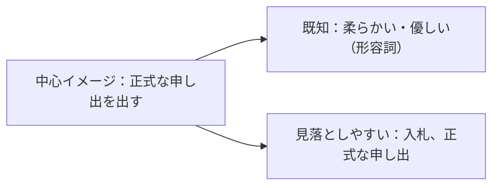

**重要語法：** invite tenders / submit a tender


---

## 2722. tender

**単語：tender** ／ **品詞：verb** ／ **発音：/ˈtendər/**

<small>よく知られている意味：柔らかい・優しい</small>

### 見落としやすい意味：（支払い・申し出などを）正式に差し出す

**例文：** The company tendered an apology to its customers.

**和訳：** 会社は顧客に正式に謝罪を申し入れた。

**コアイメージ：** 相手に向けて何かを差し出す動作が中心です。金銭だけでなく謝罪や辞表などを正式に提出するときにも使います。

**図：**

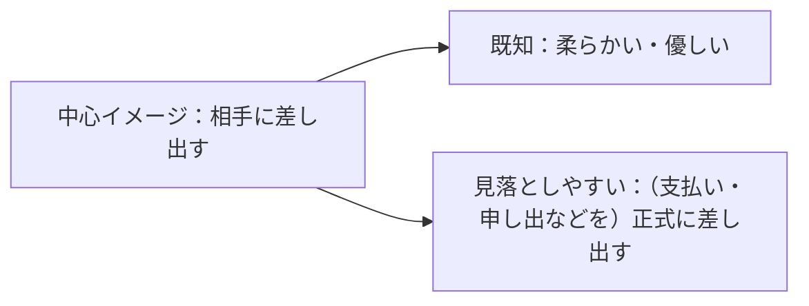

**重要語法：** tender an apology / tender one's resignation


---

## 2723. dash

**単語：dash** ／ **品詞：noun** ／ **発音：/dæʃ/**

<small>よく知られている意味：勢いよく走る・突進する</small>

### 見落としやすい意味：（飲み物・料理への）少量の添加物

**例文：** Add a dash of cinnamon to the hot milk.

**和訳：** 温かい牛乳にシナモンを少々加えてください。

**コアイメージ：** さっと加える小さな動きを思い浮かべます。そこから料理や飲み物に加えるほんの少量を表します。

**図：**

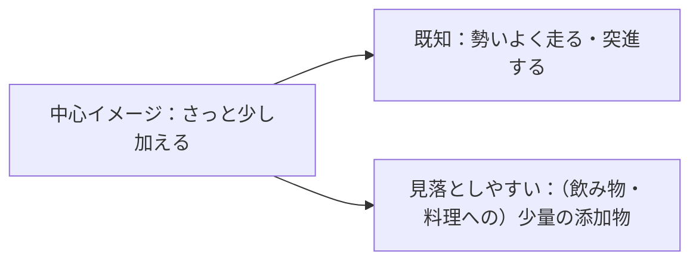

**重要語法：** a dash of salt / a dash of humor


---

## 2724. dash

**単語：dash** ／ **品詞：verb** ／ **発音：/dæʃ/**

<small>よく知られている意味：勢いよく走る・突進する</small>

### 見落としやすい意味：希望・計画などを打ち砕く、失望させる

**例文：** The sudden storm dashed our hopes of reaching the summit.

**和訳：** 突然の嵐で、頂上に到達するという私たちの望みは打ち砕かれた。

**コアイメージ：** 勢いよく何かがぶつかって壊れる感覚があります。そこから希望や計画が一気に壊されるという比喩的な用法になります。

**図：**

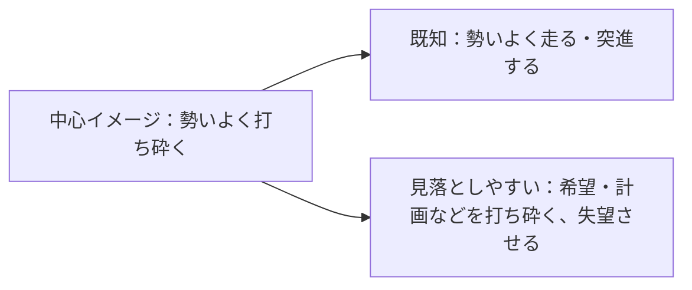

**重要語法：** dash someone's hopes


---

## 2725. stain

**単語：stain** ／ **品詞：noun** ／ **発音：/steɪn/**

<small>よく知られている意味：染み・汚れ</small>

### 見落としやすい意味：（名声・評判などに残る）汚点、不名誉

**例文：** The scandal left a stain on the organization's reputation.

**和訳：** その不祥事は組織の評判に汚点を残した。

**コアイメージ：** いったん付くとなかなか消えない汚れが中心です。物理的な染みだけでなく、名声に長く残る悪い印象も指します。

**図：**

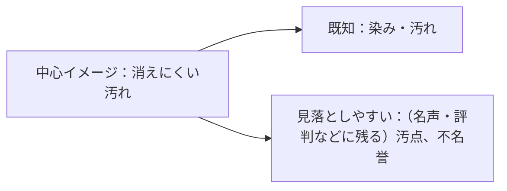

**重要語法：** a stain on one's reputation


---

## 2726. hedge

**単語：hedge** ／ **品詞：verb** ／ **発音：/hedʒ/**

<small>よく知られている意味：生け垣</small>

### 見落としやすい意味：断言・言質を避ける、言葉を濁す

**例文：** When asked about the cost, the minister hedged instead of giving a figure.

**和訳：** 費用を尋ねられると、大臣は金額を示さず言葉を濁した。

**コアイメージ：** 生け垣は境界を作り、外からの影響を避けるものです。発言でも断定を避けて自分を守る態度を表します。

**図：**

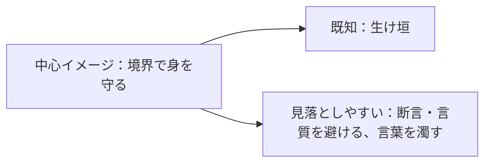

**重要語法：** hedge one's answer / hedge about a question


---

## 2727. hedge

**単語：hedge** ／ **品詞：verb** ／ **発音：/hedʒ/**

<small>よく知られている意味：生け垣</small>

### 見落としやすい意味：（相場変動などの）損失リスクを軽減する

**例文：** The farmer hedged against falling crop prices by signing a contract early.

**和訳：** 農家は早めに契約を結び、作物価格の下落リスクを抑えた。

**コアイメージ：** 外からの危険を防ぐ囲いのイメージです。経済活動では損失を小さくするために別の取引で備えることを意味します。

**図：**

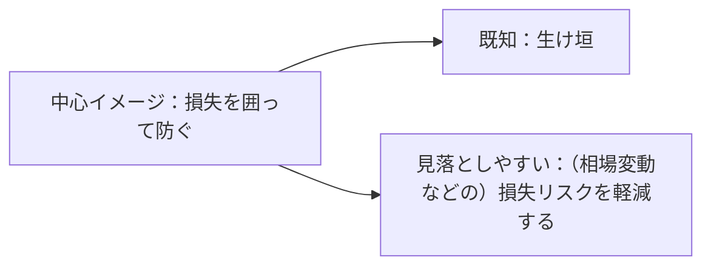

**重要語法：** hedge against losses / hedge one's bets


---

## 2728. weave

**単語：weave** ／ **品詞：verb** ／ **発音：/wiːv/**

<small>よく知られている意味：布を織る</small>

### 見落としやすい意味：左右に曲がりながら進む、縫うように移動する

**例文：** The cyclist weaved through the slow-moving traffic.

**和訳：** その自転車の人は、ゆっくり流れる車の間を縫うように進んだ。

**コアイメージ：** 糸が左右に行き来しながら交差する動きが中心です。そこから障害物の間を左右に曲がって進む様子を表します。

**図：**

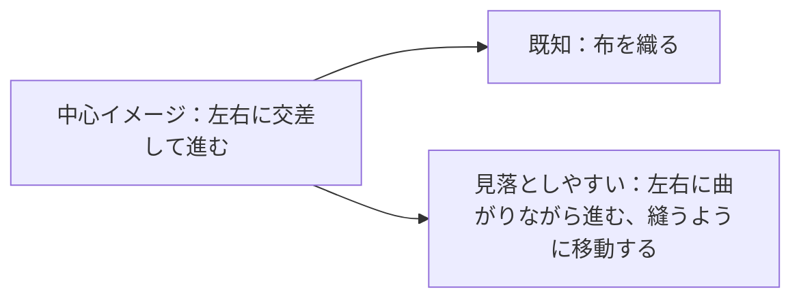

**重要語法：** weave through traffic


---

## 2729. weave

**単語：weave** ／ **品詞：verb** ／ **発音：/wiːv/**

<small>よく知られている意味：布を織る</small>

### 見落としやすい意味：（物語・理屈などを）巧みに織り交ぜて作る

**例文：** The writer weaved historical facts into a fictional story.

**和訳：** 作家は歴史的事実を架空の物語に巧みに織り込んだ。

**コアイメージ：** 別々の糸を組み合わせ、一つの布にする動きです。情報や出来事を組み合わせて一つの話を作るときにも使います。

**図：**

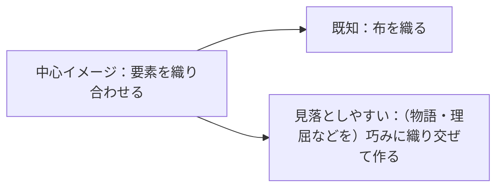

**重要語法：** weave A into B


---

## 2730. petty

**単語：petty** ／ **品詞：adjective** ／ **発音：/ˈpeti/**

<small>よく知られている意味：小さい・ささいな</small>

### 見落としやすい意味：つまらない、度量の狭い（petty jealousy など）

**例文：** She refused to argue over such a petty complaint.

**和訳：** 彼女はそのようなつまらない苦情をめぐって口論することを拒んだ。

**コアイメージ：** 重要性が小さいという感覚が基本です。物事だけでなく、小さなことに執着する人の心の狭さも表します。

**図：**

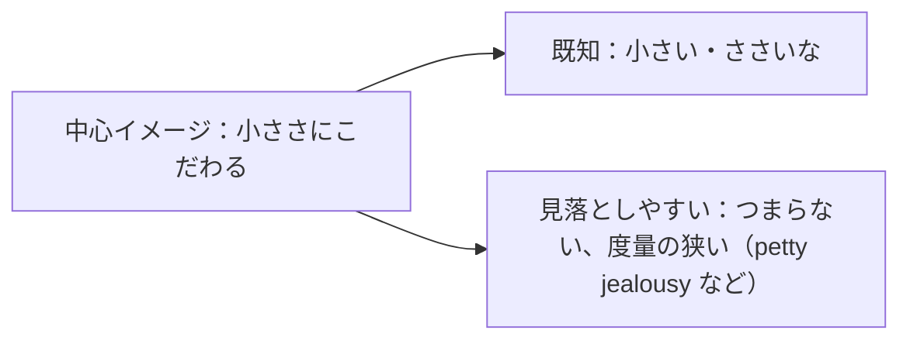

**重要語法：** petty jealousy / petty argument


---

## 2731. integral

**単語：integral** ／ **品詞：adjective** ／ **発音：/ˈɪntəɡrəl/**

<small>よく知られている意味：整数の・積分の（専門用法）</small>

### 見落としやすい意味：不可欠な、全体を成すうえで欠かせない

**例文：** Trust is an integral part of any lasting friendship.

**和訳：** 信頼は長続きする友情に欠かせない要素だ。

**コアイメージ：** 部分が全体にしっかり組み込まれている状態です。その部分を欠くと全体が成り立たないことから、不可欠という意味になります。

**図：**

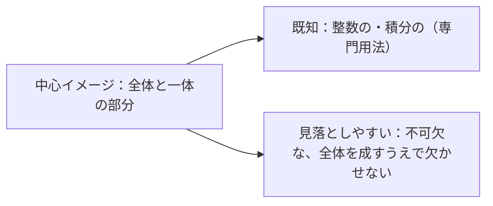

**重要語法：** an integral part of


---

## 2732. notwithstanding

**単語：notwithstanding** ／ **品詞：adverb**

<small>よく知られている意味：～にもかかわらず（前置詞）</small>

### 見落としやすい意味：それにもかかわらず、なお

**例文：** The road was icy; notwithstanding, the buses ran on schedule.

**和訳：** 道路は凍結していた。それにもかかわらず、バスは予定どおり運行した。

**コアイメージ：** 妨げとなる事情があっても、結果が変わらないという対比です。副詞として単独で置かれ、前の内容を受けて『それでも』と続けます。

**図：**

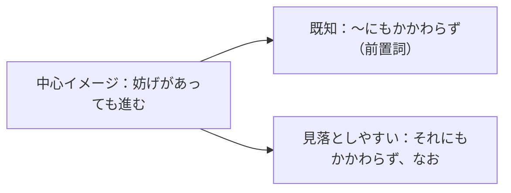

**重要語法：** 文語的な副詞。文末にも置ける


---

## 2733. notwithstanding

**単語：notwithstanding** ／ **品詞：preposition**

<small>よく知られている意味：それにもかかわらず（副詞）</small>

### 見落としやすい意味：～にもかかわらず（notwithstanding + 名詞句）

**例文：** Notwithstanding the heavy rain, the match went ahead.

**和訳：** 大雨にもかかわらず、試合は予定どおり行われた。

**コアイメージ：** 予想に反する結果を示す対比が中心です。前置詞として後ろに名詞句を取り、その条件を乗り越えて成立する事柄を続けます。

**図：**

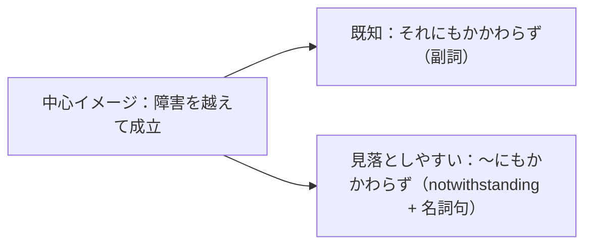

**重要語法：** notwithstanding + 名詞句（文語的）


---

## 2734. withhold

**単語：withhold** ／ **品詞：verb** ／ **発音：/wɪðˈhoʊld/**

<small>よく知られている意味：与えない・差し控える</small>

### 見落としやすい意味：（賃金・支払金から税金などを）源泉徴収する、天引きする

**例文：** The employer must withhold income tax from each paycheck.

**和訳：** 雇用主は毎回の給与から所得税を源泉徴収しなければならない。

**コアイメージ：** 本来渡すものの一部を手元にとどめる意味です。給与の一部を受取人に渡さず、税金として差し引くことを表します。

**図：**

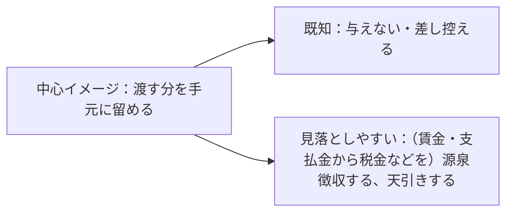

**重要語法：** withhold tax from pay


---

## 2735. slump

**単語：slump** ／ **品詞：verb** ／ **発音：/slʌmp/**

<small>よく知られている意味：どさっと倒れる</small>

### 見落としやすい意味：（業績・価格・活動などが）急激に落ち込む

**例文：** Sales slumped after the company raised its prices.

**和訳：** 会社が値上げした後、売上げは急落した。

**コアイメージ：** 力が抜けて下へ崩れ落ちる感覚です。数字や景気が短期間に大きく落ちることにも使います。

**図：**

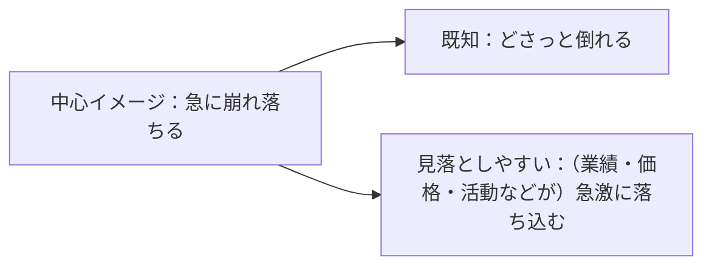

**重要語法：** sales slump / slump sharply


---

## 2736. backdrop

**単語：backdrop** ／ **品詞：noun** ／ **発音：/ˈbækdrɑːp/**

<small>よく知られている意味：舞台の背景幕</small>

### 見落としやすい意味：（事件・物語の）背景事情、社会的状況

**例文：** The debate took place against a backdrop of rising unemployment.

**和訳：** その討論は失業率が上昇する社会状況の中で行われた。

**コアイメージ：** 舞台で背後に見える背景が中心です。出来事を理解するために必要な社会的事情や時代状況にも広がります。

**図：**

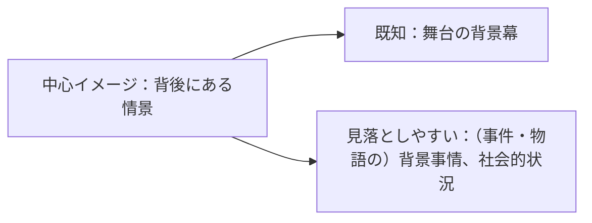

**重要語法：** against a backdrop of


---

## 2737. beg

**単語：beg** ／ **品詞：verb** ／ **発音：/beɡ/**

<small>よく知られている意味：頼む・懇願する</small>

### 見落としやすい意味：論点を先取りして前提にする（beg the question）

**例文：** His argument begs the question of whether the policy works at all.

**和訳：** 彼の議論は、その政策がそもそも有効なのかという点を当然のこととして前提にしている。

**コアイメージ：** これは語の基本義から機械的に作れない定型表現です。論証すべき点を証明せず、すでに正しいものとして扱う誤りを指します。

**図：**

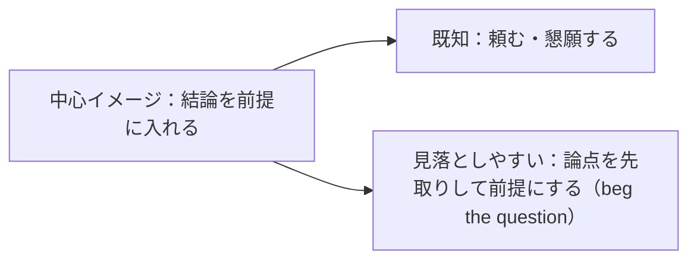

**重要語法：** beg the question：本来は論点先取。口語の『疑問を生む』との混同に注意


---

## 2738. cowboy

**単語：cowboy** ／ **品詞：noun** ／ **発音：/ˈkaʊbɔɪ/**

<small>よく知られている意味：カウボーイ・牧童</small>

### 見落としやすい意味：（英・口語）仕事が粗雑な、信用できない業者

**例文：** We hired a cowboy builder who left the roof leaking.

**和訳：** 私たちはいい加減な施工業者を雇ってしまい、屋根は雨漏りするままだった。

**コアイメージ：** 無法者のように規則や責任を軽視する人という比喩です。英国の口語では、粗雑な仕事をする信用できない業者を指します。

**図：**

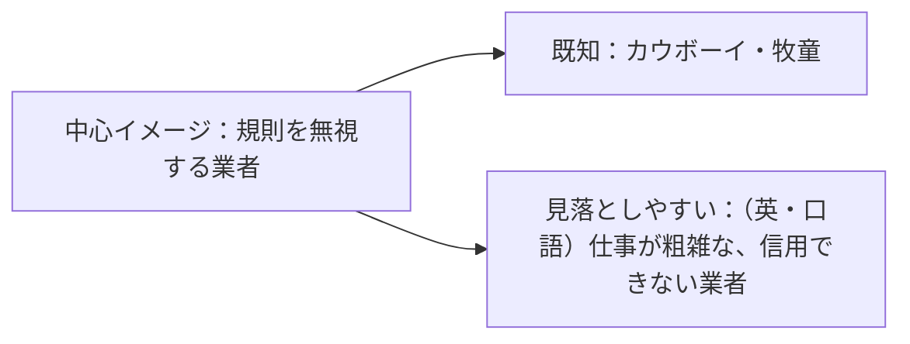

**重要語法：** 英国口語：cowboy builder


---

## 2739. deplore

**単語：deplore** ／ **品詞：verb** ／ **発音：/dɪˈplɔːr/**

<small>よく知られている意味：嘆き悲しむ</small>

### 見落としやすい意味：強く非難する、遺憾の意を示す

**例文：** The committee deplored the use of misleading data.

**和訳：** 委員会は誤解を招くデータの使用を強く非難した。

**コアイメージ：** 望ましくない事態を深く嘆く気持ちが中心です。その強い否定的評価から、公に非難する意味になります。

**図：**

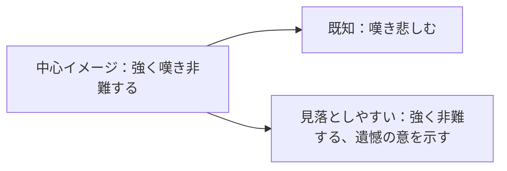

**重要語法：** deplore violence / deplore the decision


---

## 2740. endpoint

**単語：endpoint** ／ **品詞：noun** ／ **発音：/ˈendpɔɪnt/**

<small>よく知られている意味：終点・端点</small>

### 見落としやすい意味：（研究・実験の）結果を判定する評価項目・観察指標

**例文：** The trial's main endpoint was improvement in sleep quality.

**和訳：** その試験の主な評価項目は睡眠の質の改善だった。

**コアイメージ：** どこを到達点として測るかという考え方です。研究では効果を判定するためにあらかじめ決めた観察指標を指します。

**図：**

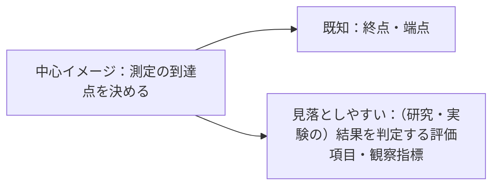

**重要語法：** primary endpoint / study endpoint


---

## 2741. gorge

**単語：gorge** ／ **品詞：noun** ／ **発音：/ɡɔːrdʒ/**

<small>よく知られている意味：がつがつ食べる（動詞）</small>

### 見落としやすい意味：深く切り立った谷、峡谷

**例文：** A narrow trail led into a deep gorge between the cliffs.

**和訳：** 細い小道は断崖の間の深い峡谷へと続いていた。

**コアイメージ：** 地面が深く切り込まれた形を表します。食べる動詞とは語義が異なるため、名詞では谷の地形に注目して覚えます。

**図：**

```mermaid
flowchart LR
    A["中心イメージ：深く切り込んだ谷"]
    B["既知：がつがつ食べる（動詞）"]
    C["見落としやすい：深く切り立った谷、峡谷"]
    A --> B
    A --> C
```

**重要語法：** a steep gorge


---

## 2742. iranian

**単語：iranian** ／ **品詞：adjective** ／ **発音：/ɪˈreɪniən/**

<small>よく知られている意味：イランの・イラン人の</small>

### 見落としやすい意味：（言語学）ペルシア語・クルド語などを含むイラン語群に関する

**例文：** Persian is one of the Iranian languages.

**和訳：** ペルシア語はイラン語群に属する言語の一つだ。

**コアイメージ：** 国名に由来する言葉ですが、言語分類では国境と一致しません。イラン語群にはペルシア語やクルド語などが含まれます。

**図：**

```mermaid
flowchart LR
    A["中心イメージ：イランに由来する言語群"]
    B["既知：イランの・イラン人の"]
    C["見落としやすい：（言語学）ペルシア語・クルド語などを含むイラン語群に関する"]
    A --> B
    A --> C
```

**重要語法：** Iranian languages は言語学上の分類


---

## 2743. nominal

**単語：nominal** ／ **品詞：adjective** ／ **発音：/ˈnɑːmɪnəl/**

<small>よく知られている意味：名目上の・名前だけの</small>

### 見落としやすい意味：名目上だけの、実質を伴わない

**例文：** He was the nominal head of the club, but others made the decisions.

**和訳：** 彼は名目上の部長だったが、決定を下していたのは別の人々だった。

**コアイメージ：** 名前や肩書が先に立ち、実態が伴わない状態です。権限を持つように見えても実際にはそうでないことを示します。

**図：**

```mermaid
flowchart LR
    A["中心イメージ：名と実がずれる"]
    B["既知：名目上の・名前だけの"]
    C["見落としやすい：名目上だけの、実質を伴わない"]
    A --> B
    A --> C
```

**重要語法：** nominal leader / nominal authority


---

## 2744. nominal

**単語：nominal** ／ **品詞：adjective** ／ **発音：/ˈnɑːmɪnəl/**

<small>よく知られている意味：名目上の</small>

### 見落としやすい意味：ごく少額の、名ばかりの金額の

**例文：** Visitors pay only a nominal fee to enter the museum.

**和訳：** 来館者は博物館に入るのにごく少額の料金を払うだけだ。

**コアイメージ：** 名前だけの費用に近いほど金額が小さいという感覚です。実費や通常の料金に比べてごくわずかだと表します。

**図：**

```mermaid
flowchart LR
    A["中心イメージ：形だけの小さな金額"]
    B["既知：名目上の"]
    C["見落としやすい：ごく少額の、名ばかりの金額の"]
    A --> B
    A --> C
```

**重要語法：** a nominal fee / nominal charge


---

## 2745. nominal

**単語：nominal** ／ **品詞：adjective** ／ **発音：/ˈnɑːmɪnəl/**

<small>よく知られている意味：名目上の</small>

### 見落としやすい意味：（経済）物価変動などを調整していない名目上の金額

**例文：** Nominal wages rose, but inflation reduced their buying power.

**和訳：** 名目賃金は上がったが、物価上昇によってその購買力は下がった。

**コアイメージ：** 額面に書かれた数字をそのまま見ることが中心です。経済では物価変動を差し引かない金額を名目値と呼びます。

**図：**

```mermaid
flowchart LR
    A["中心イメージ：額面の数字をそのまま見る"]
    B["既知：名目上の"]
    C["見落としやすい：（経済）物価変動などを調整していない名目上の金額"]
    A --> B
    A --> C
```

**重要語法：** nominal wages / nominal GDP（対：real）


---

## 2746. probe

**単語：probe** ／ **品詞：noun** ／ **発音：/proʊb/**

<small>よく知られている意味：探針・探査機</small>

### 見落としやすい意味：詳しい調査・追及

**例文：** The newspaper launched a probe into the misuse of public funds.

**和訳：** 新聞社は公金の不正使用について徹底調査を始めた。

**コアイメージ：** 探針を奥へ入れて内部を調べるイメージです。見えない事情を深く掘り下げる調査という意味に広がります。

**図：**

```mermaid
flowchart LR
    A["中心イメージ：奥を探って調べる"]
    B["既知：探針・探査機"]
    C["見落としやすい：詳しい調査・追及"]
    A --> B
    A --> C
```

**重要語法：** launch a probe into


---

## 2747. probe

**単語：probe** ／ **品詞：verb** ／ **発音：/proʊb/**

<small>よく知られている意味：探る・探査する</small>

### 見落としやすい意味：詳しく調べる、問いただす

**例文：** The interviewer probed the witness about the missing documents.

**和訳：** 聞き手は行方不明の書類について証人に詳しく問いただした。

**コアイメージ：** 表面で止まらず奥へ探り入れる動作です。質問を重ねて隠れた情報を明らかにしようとする場合にも使います。

**図：**

```mermaid
flowchart LR
    A["中心イメージ：奥へ踏み込んで探る"]
    B["既知：探る・探査する"]
    C["見落としやすい：詳しく調べる、問いただす"]
    A --> B
    A --> C
```

**重要語法：** probe into / probe someone about


---

## 2748. saying

**単語：saying** ／ **品詞：noun** ／ **発音：/ˈseɪɪŋ/**

<small>よく知られている意味：言うこと・発言</small>

### 見落としやすい意味：ことわざ・格言

**例文：** As the saying goes, practice makes perfect.

**和訳：** ことわざにもあるように、練習を重ねれば上達する。

**コアイメージ：** 繰り返し言われ、広く共有される言葉を指します。単発の発言ではなく、教訓を短く表す格言になります。

**図：**

```mermaid
flowchart LR
    A["中心イメージ：繰り返し伝わる言葉"]
    B["既知：言うこと・発言"]
    C["見落としやすい：ことわざ・格言"]
    A --> B
    A --> C
```

**重要語法：** as the saying goes


---

## 2749. tissue

**単語：tissue** ／ **品詞：noun** ／ **発音：/ˈtɪʃuː/**

<small>よく知られている意味：ティッシュペーパー</small>

### 見落としやすい意味：（人体・動植物の）組織

**例文：** The injury damaged the tissue around his knee.

**和訳：** そのけがは彼の膝の周囲の組織を傷つけた。

**コアイメージ：** 細かなものが集まって一つのまとまりを作る感覚です。生物では似た細胞が集まって働く部分を『組織』と呼びます。

**図：**

```mermaid
flowchart LR
    A["中心イメージ：細かな要素のまとまり"]
    B["既知：ティッシュペーパー"]
    C["見落としやすい：（人体・動植物の）組織"]
    A --> B
    A --> C
```

**重要語法：** muscle tissue / plant tissue


---

## 2750. visionary

**単語：visionary** ／ **品詞：adj** ／ **発音：/ˈvɪʒəneri/**

<small>よく知られている意味：先見の明のある</small>

### 見落としやすい意味：非現実的で空想に偏った

**例文：** The board rejected the visionary proposal as unrealistic.

**和訳：** 理事会はその空想的な提案を非現実的だとして退けた。

**コアイメージ：** 現実にない未来像を思い描くことが中心です。創造的な先見性にも、実現性の低い空想にも評価が分かれます。

**図：**

```mermaid
flowchart LR
    A["中心イメージ：未来像を思い描く"]
    B["既知：先見の明のある"]
    C["見落としやすい：非現実的で空想に偏った"]
    A --> B
    A --> C
```

**重要語法：** 文脈によって肯定的・否定的に変化


---

## 2751. soup

**単語：soup** ／ **品詞：noun** ／ **発音：/suːp/**

<small>よく知られている意味：スープ</small>

### 見落としやすい意味：窮地・厄介な状況

**例文：** Without enough money for repairs, the team was in the soup.

**和訳：** 修理代が足りず、そのチームは困った状況に陥っていた。

**コアイメージ：** 『スープの中』に入り込んで自由に動けないという慣用的な比喩です。in the soup は厄介な状況にあるという古めの口語表現です。

**図：**

```mermaid
flowchart LR
    A["中心イメージ：抜け出しにくい状況"]
    B["既知：スープ"]
    C["見落としやすい：窮地・厄介な状況"]
    A --> B
    A --> C
```

**重要語法：** in the soup（やや古風な口語）


---

## 2752. pardon

**単語：pardon** ／ **品詞：noun** ／ **発音：/ˈpɑːrdən/**

<small>よく知られている意味：許し・容赦</small>

### 見落としやすい意味：恩赦・刑罰の免除

**例文：** The governor granted a pardon to the prisoner.

**和訳：** 知事はその受刑者に恩赦を与えた。

**コアイメージ：** 過ちに対する責めを免れさせることが中心です。日常の『許し』より制度的に刑罰を免除する意味になります。

**図：**

```mermaid
flowchart LR
    A["中心イメージ：責任や処罰を免れさせる"]
    B["既知：許し・容赦"]
    C["見落としやすい：恩赦・刑罰の免除"]
    A --> B
    A --> C
```

**重要語法：** grant a pardon


---

## 2753. feast

**単語：feast** ／ **品詞：noun** ／ **発音：/fiːst/**

<small>よく知られている意味：ごちそう・宴会</small>

### 見落としやすい意味：見聞きして大いに楽しめるもの

**例文：** The exhibition was a feast for the eyes.

**和訳：** その展覧会は目を大いに楽しませるものだった。

**コアイメージ：** 豊富なごちそうを味わう満足感が中心です。見る・聞く楽しみがいっぱいあることにも比喩的に使います。

**図：**

```mermaid
flowchart LR
    A["中心イメージ：豊かな楽しみを味わう"]
    B["既知：ごちそう・宴会"]
    C["見落としやすい：見聞きして大いに楽しめるもの"]
    A --> B
    A --> C
```

**重要語法：** a feast for the eyes / ears


---

## 2754. sensation

**単語：sensation** ／ **品詞：noun** ／ **発音：/senˈseɪʃən/**

<small>よく知られている意味：感覚・感触</small>

### 見落としやすい意味：大評判となる人物・注目の的

**例文：** The young pianist became an overnight sensation.

**和訳：** その若いピアニストは一夜にして大評判の人物となった。

**コアイメージ：** 強い感覚や興奮が人々に広がることが中心です。大勢の注目を集める人や作品そのものも指します。

**図：**

```mermaid
flowchart LR
    A["中心イメージ：強い反響を起こす"]
    B["既知：感覚・感触"]
    C["見落としやすい：大評判となる人物・注目の的"]
    A --> B
    A --> C
```

**重要語法：** an overnight sensation


---

## 2755. splash

**単語：splash** ／ **品詞：noun** ／ **発音：/splæʃ/**

<small>よく知られている意味：水しぶき</small>

### 見落としやすい意味：注目・世間の大きな反響

**例文：** The new product made a big splash at the trade show.

**和訳：** その新製品は展示会で大きな注目を集めた。

**コアイメージ：** 水に飛び込んで派手にしぶきが広がる様子です。新しい活動が世間に強い印象を与えることを表します。

**図：**

```mermaid
flowchart LR
    A["中心イメージ：派手に反響が広がる"]
    B["既知：水しぶき"]
    C["見落としやすい：注目・世間の大きな反響"]
    A --> B
    A --> C
```

**重要語法：** make a splash


---

## 2756. furious

**単語：furious** ／ **品詞：adj** ／ **発音：/ˈfjʊriəs/**

<small>よく知られている意味：激怒した</small>

### 見落としやすい意味：猛烈な・激しい（勢いなど）

**例文：** A furious debate broke out over the proposed law.

**和訳：** その法案をめぐって激しい議論が巻き起こった。

**コアイメージ：** 感情の激しさから、勢いや活動の猛烈さへ広がる意味です。人が怒っていなくても議論や速度の強さを表せます。

**図：**

```mermaid
flowchart LR
    A["中心イメージ：抑えられない激しさ"]
    B["既知：激怒した"]
    C["見落としやすい：猛烈な・激しい（勢いなど）"]
    A --> B
    A --> C
```

**重要語法：** furious debate / furious pace


---

## 2757. liaison

**単語：liaison** ／ **品詞：noun** ／ **発音：/liˈeɪzɑːn/**

<small>よく知られている意味：連絡・調整</small>

### 見落としやすい意味：秘密の恋愛関係・情事

**例文：** The novel hints at a secret liaison between two officials.

**和訳：** その小説は二人の役人の秘密の恋愛関係をほのめかしている。

**コアイメージ：** 人と人が接触し、つながることが中心です。単なる連絡関係ではなく、秘密にしたい恋愛関係を指すことがあります。

**図：**

```mermaid
flowchart LR
    A["中心イメージ：人と人の密かなつながり"]
    B["既知：連絡・調整"]
    C["見落としやすい：秘密の恋愛関係・情事"]
    A --> B
    A --> C
```

**重要語法：** a secret liaison / liaison with


---

## 2758. acquaintance

**単語：acquaintance** ／ **品詞：noun** ／ **発音：/əˈkweɪntəns/**

<small>よく知られている意味：知り合い・面識</small>

### 見落としやすい意味：（ある物事についての）知識・面識

**例文：** She has only a passing acquaintance with classical music.

**和訳：** 彼女にはクラシック音楽についてほんの少し知識があるだけだ。

**コアイメージ：** 何かを多少知っている状態が中心です。人との面識だけでなく、ある分野に関する浅い知識にも使います。

**図：**

```mermaid
flowchart LR
    A["中心イメージ：触れて知っている"]
    B["既知：知り合い・面識"]
    C["見落としやすい：（ある物事についての）知識・面識"]
    A --> B
    A --> C
```

**重要語法：** a passing acquaintance with


---

## 2759. cripple

**単語：cripple** ／ **品詞：verb** ／ **発音：/ˈkrɪpəl/**

<small>よく知られている意味：身体の自由を奪う</small>

### 見落としやすい意味：組織・経済などを機能不全にする

**例文：** The cyberattack crippled the hospital's computer network.

**和訳：** そのサイバー攻撃は病院のコンピューターネットワークを機能不全にした。

**コアイメージ：** 正常に動く能力を失わせることが中心です。人の身体だけでなく、経済や組織の機能を止める場合に使います。

**図：**

```mermaid
flowchart LR
    A["中心イメージ：働く力を奪う"]
    B["既知：身体の自由を奪う"]
    C["見落としやすい：組織・経済などを機能不全にする"]
    A --> B
    A --> C
```

**重要語法：** cripple an economy / cripple a system


---

## 2760. incidentally

**単語：incidentally** ／ **品詞：adv** ／ **発音：/ˌɪnsɪˈdentəli/**

<small>よく知られている意味：偶然に・付随して</small>

### 見落としやすい意味：ところで・話は変わるが

**例文：** Incidentally, have you received my message?

**和訳：** ところで、私のメッセージは届きましたか。

**コアイメージ：** 本筋の脇にある事柄に触れる感覚です。会話で話題を少し変えたり、ついでに情報を添えたりするときに使います。

**図：**

```mermaid
flowchart LR
    A["中心イメージ：本筋の脇に触れる"]
    B["既知：偶然に・付随して"]
    C["見落としやすい：ところで・話は変わるが"]
    A --> B
    A --> C
```

**重要語法：** 文頭の Incidentally, は話題転換

