# EasyVoca｜完成教材バッチ036

- 担当：global_order 2801〜2880（全80カード）
- 原典：main / data/candidates/batch_05001_05500.jsonl の accepted 80件
- 並び順：index 昇順、同一 index 内は candidate_id 昇順
- 「よく知られている意味」は補足、「見落としやすい意味」が学習の主役です。

## 2801｜synthetic

**品詞**：形容詞

**発音**：/sɪnˈθetɪk/

<small>よく知られている意味：人工の・合成の</small>

**見落としやすい意味：複数の要素を統合する・総合的な**

**例文**：The study offers a synthetic account of several competing theories.

**和訳**：その研究は、いくつかの競合する理論を統合した説明を示している。

**コアイメージの説明**：synthetic の核には、別々の要素を組み合わせて一つにする発想がある。物質なら「合成の」、議論や研究なら「諸要素を統合した」という意味になる。

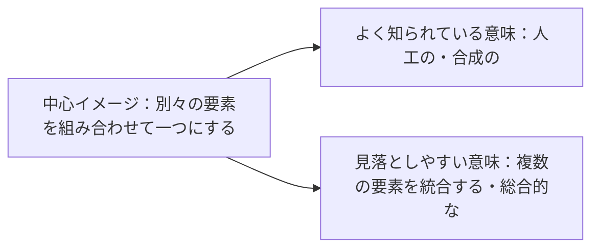

**重要語法**：a synthetic account（総合的な説明）

<small>出典候補 ID：ev-05127-adj-01｜index：5127</small>

---

## 2802｜collaborate

**品詞**：動詞

**発音**：/kəˈlæbəreɪt/

<small>よく知られている意味：共同作業をする</small>

**見落としやすい意味：敵側に協力・内通する**

**例文**：During the occupation, some local leaders collaborated with the occupying forces.

**和訳**：占領期間中、地元の指導者の中には占領軍に協力した者もいた。

**コアイメージの説明**：collaborate は「一緒に働く」ことを表す。相手が敵対勢力なら、同じ協力が否定的に「敵に内通する」という意味になる。

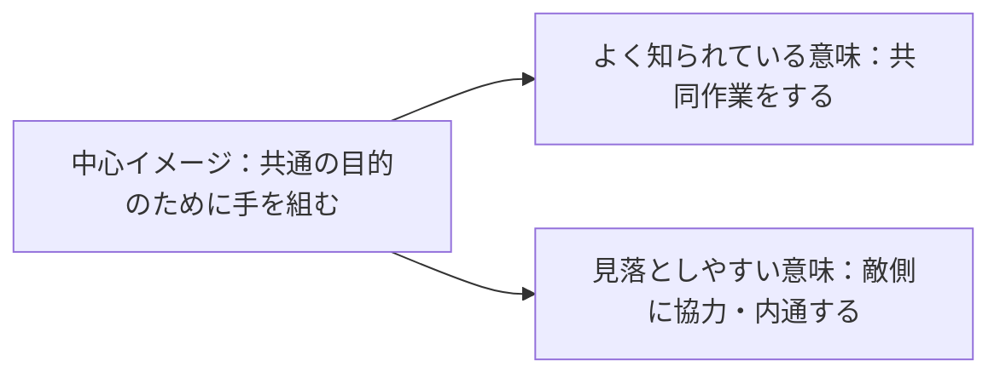

**重要語法**：collaborate with the enemy

<small>出典候補 ID：ev-05128-verb-01｜index：5128</small>

---

## 2803｜expire

**品詞**：動詞

**発音**：/ɪkˈspaɪər/

<small>よく知られている意味：期限が切れる（食品など）</small>

**見落としやすい意味：契約・期限・効力などが切れる**

**例文**：The agreement expires at midnight on Friday.

**和訳**：その協定は金曜日の深夜0時に効力が切れる。

**コアイメージの説明**：expire は定められた期間が終わることを表す。食品の使用期限だけでなく、契約や権利などの効力がなくなる場合にも使う。

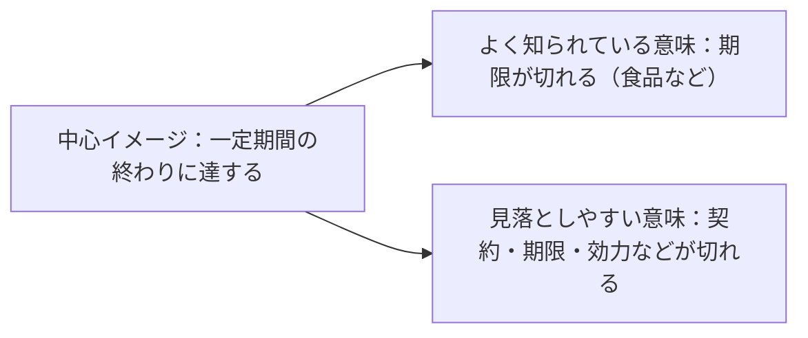

**重要語法**：a contract expires; expire on a date

<small>出典候補 ID：ev-05129-verb-01｜index：5129</small>

---

## 2804｜fatigue

**品詞**：名詞

**発音**：/fəˈtiːɡ/

<small>よく知られている意味：疲労</small>

**見落としやすい意味：情報などに触れすぎて生じる倦怠感**

**例文**：Many readers felt news fatigue after weeks of constant updates.

**和訳**：何週間も絶え間ない更新を見続け、多くの読者はニュース疲れを感じた。

**コアイメージの説明**：fatigue は体の疲れだけでなく、同じ情報や刺激に繰り返し触れたときの心理的な消耗も指す。情報そのものへの関心が薄れる状態を表せる。

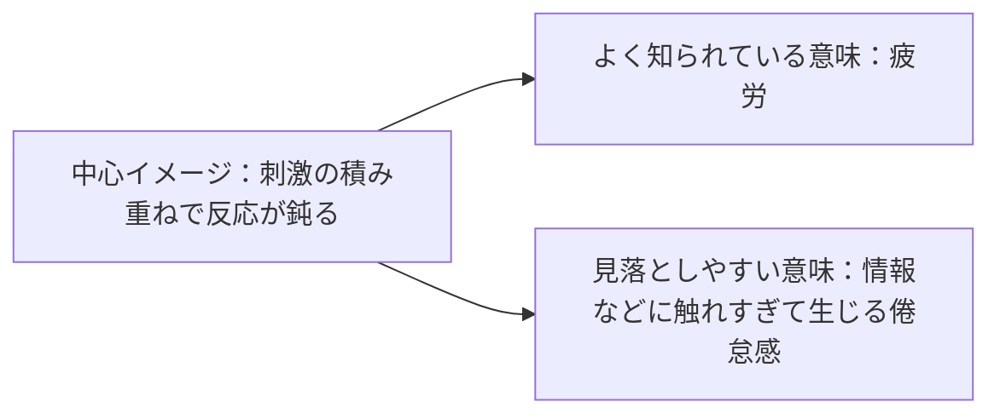

**重要語法**：news fatigue; compassion fatigue

<small>出典候補 ID：ev-05131-noun-01｜index：5131</small>

---

## 2805｜coherent

**品詞**：形容詞

**発音**：/koʊˈhɪrənt/

<small>よく知られている意味：首尾一貫した</small>

**見落としやすい意味：筋の通った考えを明瞭に述べられる**

**例文**：Despite the pressure, she gave a coherent explanation of her decision.

**和訳**：プレッシャーの中でも、彼女は自分の決定を筋道立てて説明した。

**コアイメージの説明**：coherent は部分どうしがきちんと結び付いている状態。文章だけでなく、人の話し方についても、考えが整理され分かりやすいことを表す。

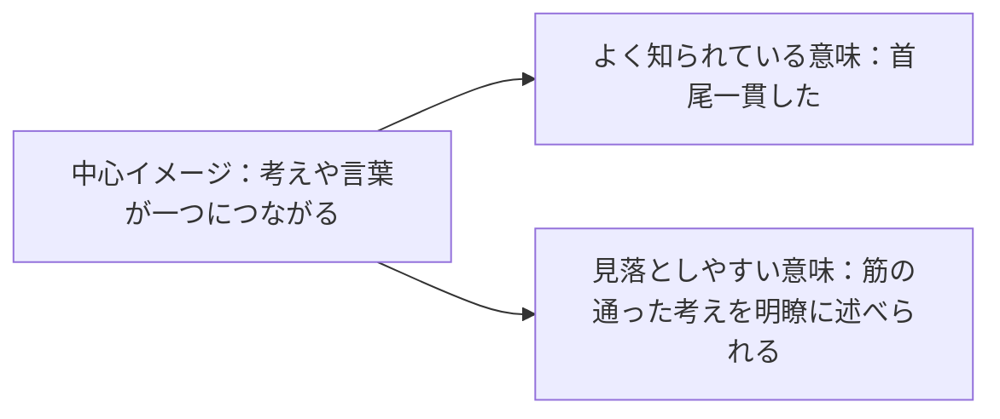

**重要語法**：a coherent argument/explanation

<small>出典候補 ID：ev-05137-adj-01｜index：5137</small>

---

## 2806｜decree

**品詞**：動詞

**発音**：/dɪˈkriː/

<small>よく知られている意味：法令・命令（名詞）</small>

**見落としやすい意味：命令・法令として定める**

**例文**：The court decreed that the land should be returned to its owners.

**和訳**：裁判所は、その土地を所有者に返還すべきだと命じた。

**コアイメージの説明**：decree は権限を持つ者が正式に決定することを指す。名詞の「法令・命令」が動詞になると、「命令として定める」という行為を表す。

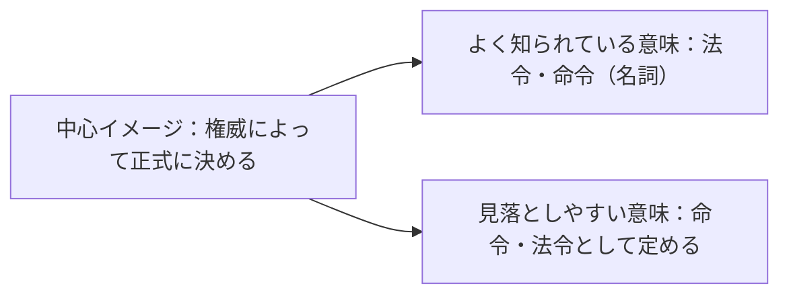

**重要語法**：decree that ...

<small>出典候補 ID：ev-05138-verb-01｜index：5138</small>

---

## 2807｜dissolve

**品詞**：動詞

**発音**：/dɪˈzɑːlv/

<small>よく知られている意味：溶かす</small>

**見落としやすい意味：組織・議会などを解散させる**

**例文**：The president dissolved parliament and called an election.

**和訳**：大統領は議会を解散し、選挙の実施を決めた。

**コアイメージの説明**：dissolve の中心は、ひとまとまりになっているものが形を失うこと。固体なら液体に溶け、組織なら結び付きが解かれて解散する。

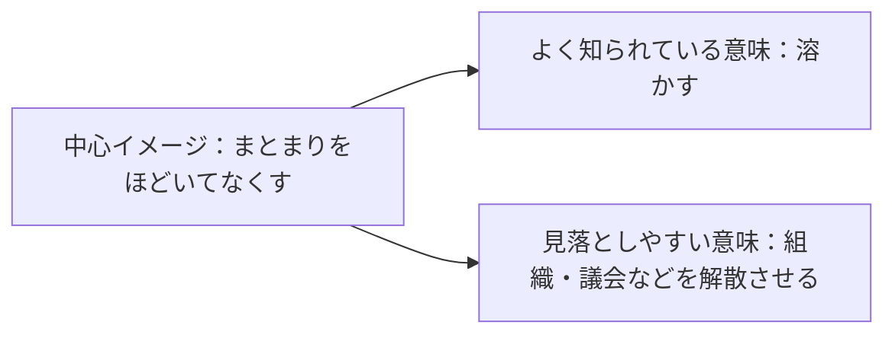

**重要語法**：dissolve parliament; dissolve a committee

<small>出典候補 ID：ev-05142-verb-01｜index：5142</small>

---

## 2808｜embarrassment

**品詞**：名詞

**発音**：/ɪmˈbærəsmənt/

<small>よく知られている意味：恥ずかしさ・困惑</small>

**見落としやすい意味：あり余るほどの多さ**

**例文**：The coach has an embarrassment of riches when choosing the starting team.

**和訳**：監督は先発選手を選ぶ際、優秀な選択肢が多すぎるほどある。

**コアイメージの説明**：embarrassment は普通「恥ずかしさ・困惑」。an embarrassment of riches では、選択肢が豊富すぎて迷うことから「あり余るほどの豊かさ」を表す。単独で「豊富さ」とは通常訳さない。

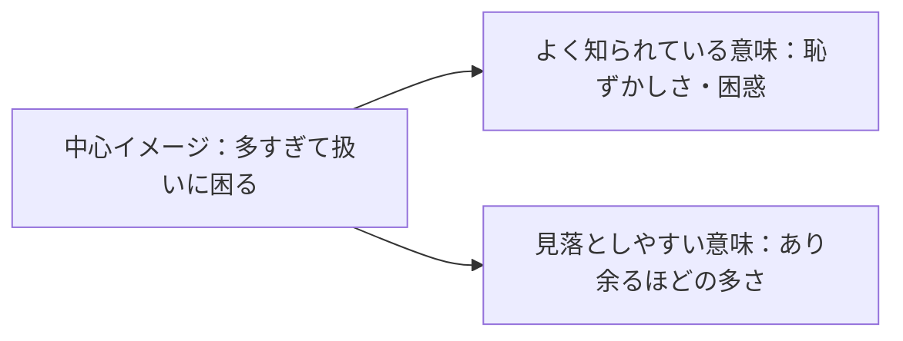

**重要語法**：an embarrassment of riches（豊富すぎる選択肢）

<small>出典候補 ID：ev-05144-noun-01｜index：5144</small>

---

## 2809｜excerpt

**品詞**：動詞

**発音**：/ɪkˈsɝːpt/

<small>よく知られている意味：抜粋（名詞）</small>

**見落としやすい意味：文章の一部を引用用に抜粋する**

**例文**：The editor excerpted two paragraphs from the interview.

**和訳**：編集者はインタビューから2段落を抜粋した。

**コアイメージの説明**：excerpt は長い文章から必要な部分を取り出すこと。名詞では取り出した「抜粋」、動詞では抜き出す行為を表す。

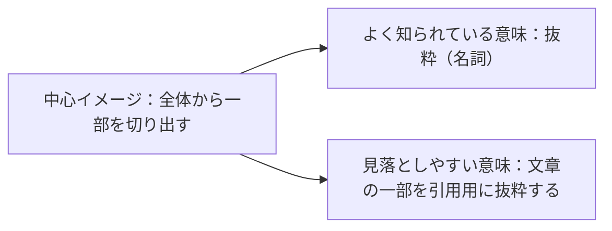

**重要語法**：excerpt A from B

<small>出典候補 ID：ev-05148-verb-01｜index：5148</small>

---

## 2810｜hug

**品詞**：動詞

**発音**：/hʌɡ/

<small>よく知られている意味：抱きしめる</small>

**見落としやすい意味：地形や曲線などにぴったり沿う**

**例文**：The narrow road hugs the coastline for several miles.

**和訳**：その狭い道は数マイルにわたり海岸線にぴったり沿っている。

**コアイメージの説明**：hug は腕で抱き付くときの密着感が中心。道路や経路が地形に沿って続くときにも使う。

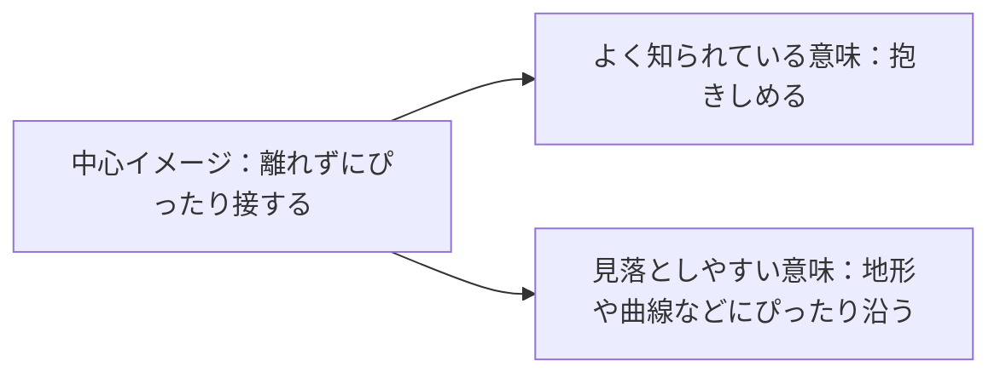

**重要語法**：hug the coast/shoreline

<small>出典候補 ID：ev-05152-verb-01｜index：5152</small>

---

## 2811｜outlaw

**品詞**：名詞

**発音**：/ˈaʊtlɔː/

<small>よく知られている意味：法律で禁止する（動詞）</small>

**見落としやすい意味：無法者・法を犯した者**

**例文**：In the story, an outlaw hides in the hills.

**和訳**：その物語では、無法者が丘陵地帯に身を隠している。

**コアイメージの説明**：outlaw は「法の外」という発想に由来する。動詞なら「違法にする」、名詞なら「法律からはみ出した者」を指す。

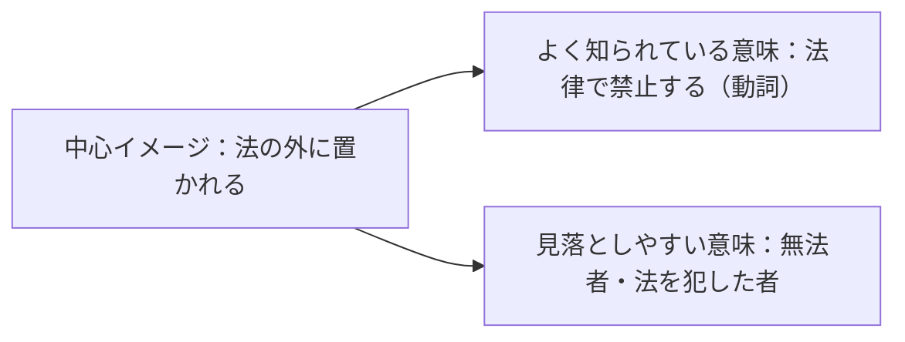

**重要語法**：an outlaw（無法者）

<small>出典候補 ID：ev-05161-noun-01｜index：5161</small>

---

## 2812｜outlaw

**品詞**：動詞

**発音**：/ˈaʊtlɔː/

<small>よく知られている意味：無法者（名詞）</small>

**見落としやすい意味：違法と定める**

**例文**：The city outlawed the use of fireworks in public parks.

**和訳**：市は公共の公園で花火を使用することを禁止した。

**コアイメージの説明**：outlaw はもともと法の保護や許容の外に置くイメージ。名詞の「無法者」から、動詞では行為を「法律で禁止する」意味になる。

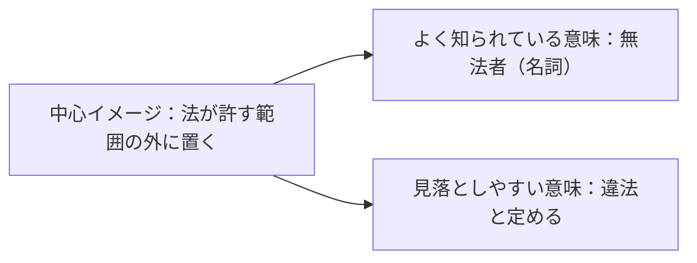

**重要語法**：outlaw the sale/use of ...

<small>出典候補 ID：ev-05161-verb-01｜index：5161</small>

---

## 2813｜quaint

**品詞**：形容詞

**発音**：/kweɪnt/

<small>よく知られている意味：珍しい・風変わりな</small>

**見落としやすい意味：古風で趣がある**

**例文**：We stayed in a quaint cottage with wooden beams.

**和訳**：私たちは木の梁が見える、古風で趣のある小さな家に泊まった。

**コアイメージの説明**：quaint は、現代的ではない独特さが魅力に感じられること。単に「奇妙な」と否定的に読むのではなく、懐かしく趣のある評価を含むことが多い。

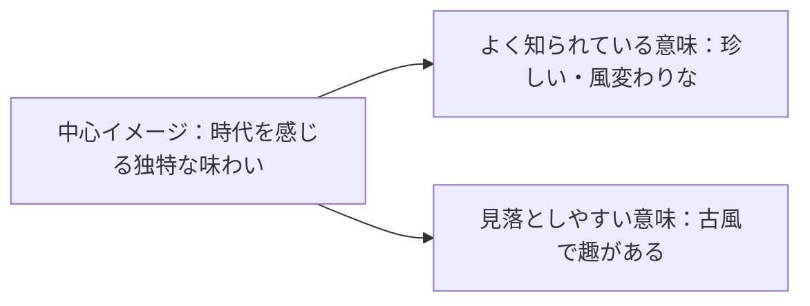

**重要語法**：a quaint village/cottage

<small>出典候補 ID：ev-05162-adj-01｜index：5162</small>

---

## 2814｜scrap

**品詞**：動詞

**発音**：/skræp/

<small>よく知られている意味：くず・廃品</small>

**見落としやすい意味：計画や制度などを廃止する**

**例文**：The company scrapped its plan to open another store.

**和訳**：その会社は新店舗を開く計画を取りやめた。

**コアイメージの説明**：scrap は使えない切れ端や廃品を指す。その発想が計画にも広がり、「もう使わないものとして捨てる・中止する」という動詞になる。

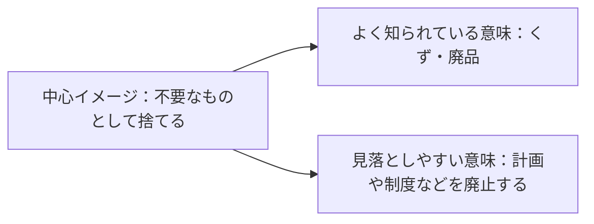

**重要語法**：scrap a plan/proposal

<small>出典候補 ID：ev-05168-verb-01｜index：5168</small>

---

## 2815｜sober

**品詞**：動詞

**発音**：/ˈsoʊbər/

<small>よく知られている意味：しらふの・まじめな（形容詞）</small>

**見落としやすい意味：現実的に考える・冷静になる**

**例文**：The unexpected costs sobered the team and forced a rethink.

**和訳**：予想外の費用にチームは現実を直視し、計画を考え直さざるを得なくなった。

**コアイメージの説明**：sober は酔っていない、落ち着いた状態を表す。動詞としては、知らせや経験が人を浮かれた状態から現実的な判断へ引き戻す。

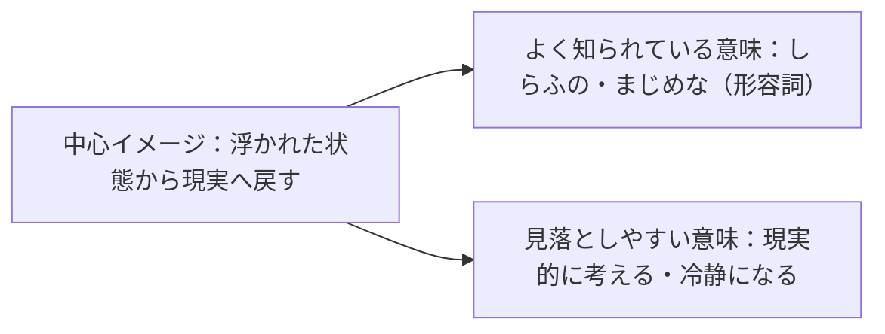

**重要語法**：be sobered by ...; sober up

<small>出典候補 ID：ev-05170-verb-01｜index：5170</small>

---

## 2816｜swell

**品詞**：動詞

**発音**：/swel/

<small>よく知られている意味：（身体などが）腫れる</small>

**見落としやすい意味：数・勢力・感情などが膨れ上がる**

**例文**：Support for the campaign swelled after the debate.

**和訳**：討論のあと、その運動への支持が大きく膨らんだ。

**コアイメージの説明**：swell は内側からふくらむことが中心。体の腫れだけでなく、人数、声、感情などが大きく増す場面にも使われる。

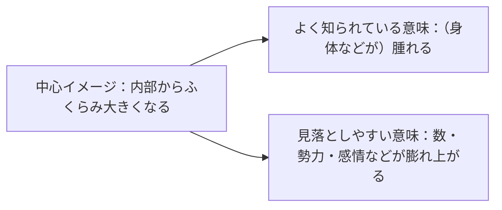

**重要語法**：the crowd swelled; swell with pride

<small>出典候補 ID：ev-05172-verb-01｜index：5172</small>

---

## 2817｜tenure

**品詞**：名詞

**発音**：/ˈtenjər/

<small>よく知られている意味：在職期間</small>

**見落としやすい意味：大学教員などの終身在職資格**

**例文**：She was granted tenure after years of teaching and research.

**和訳**：彼女は長年の教育と研究を経て、終身在職資格を与えられた。

**コアイメージの説明**：tenure は地位を保持することや、その期間を指す。大学では一定の審査を経て得られる継続的な雇用保障を表すことがある。

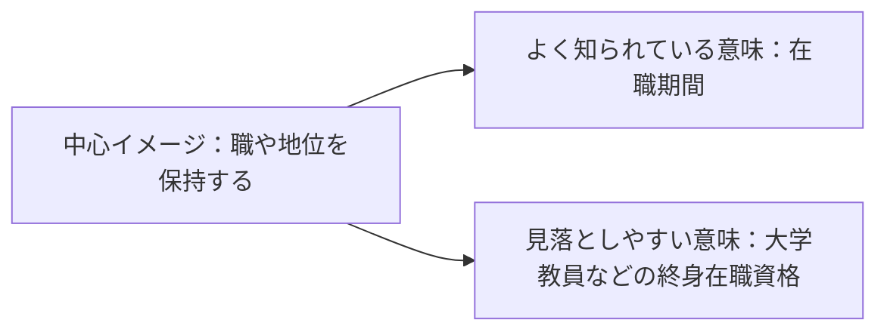

**重要語法**：gain/be granted tenure

<small>出典候補 ID：ev-05174-noun-01｜index：5174</small>

---

## 2818｜trim

**品詞**：動詞

**発音**：/trɪm/

<small>よく知られている意味：端を切りそろえる</small>

**見落としやすい意味：予算や人員などを削減する**

**例文**：The school trimmed its budget without cutting essential programs.

**和訳**：学校は重要なプログラムを削らずに予算を縮小した。

**コアイメージの説明**：trim は元来、形を整えるために端を切りそろえること。予算や人員では余分とみなした部分を削減して規模を抑える意味になる。

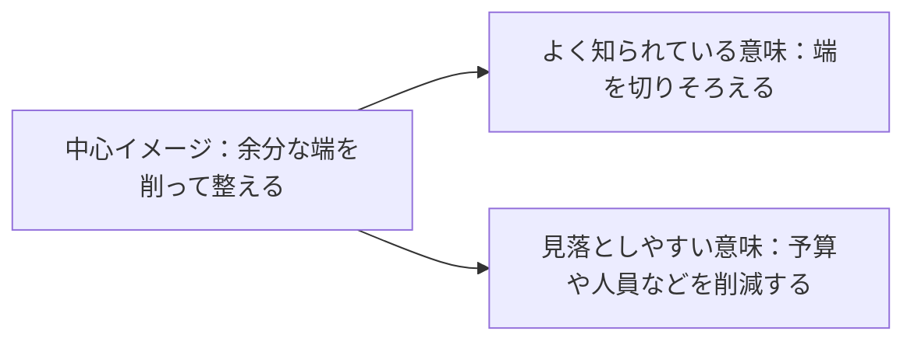

**重要語法**：trim costs/the budget

<small>出典候補 ID：ev-05175-verb-01｜index：5175</small>

---

## 2819｜admittedly

**品詞**：副詞

**発音**：/ədˈmɪtɪdli/

<small>よく知られている意味：確かに・認められるように</small>

**見落としやすい意味：確かにそうだが（譲歩を表す）**

**例文**：Admittedly, the plan is expensive, but it could save time.

**和訳**：確かにその計画は費用がかかるが、時間は節約できるかもしれない。

**コアイメージの説明**：admittedly は不利な事実をいったん認めるときに使う副詞。後ろに but などが続けば、譲歩した上で別の主張に移る。

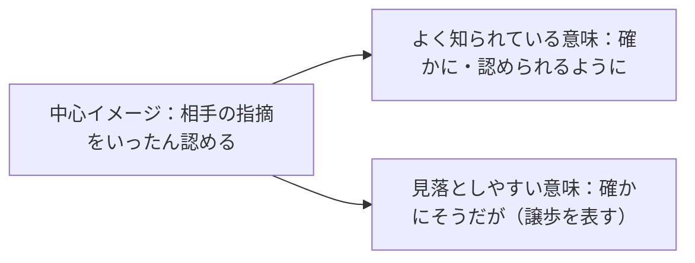

**重要語法**：Admittedly, ..., but ...

<small>出典候補 ID：ev-05179-adv-01｜index：5179</small>

---

## 2820｜breach

**品詞**：動詞

**発音**：/briːtʃ/

<small>よく知られている意味：違反・裂け目（名詞）</small>

**見落としやすい意味：契約・規則を破る**

**例文**：Sharing the files without permission would breach the agreement.

**和訳**：許可なくそのファイルを共有すれば、契約に違反することになる。

**コアイメージの説明**：breach は壁や防御の「破れ」を表す。契約や規則を守る境界が破られることから、動詞では「違反する」となる。

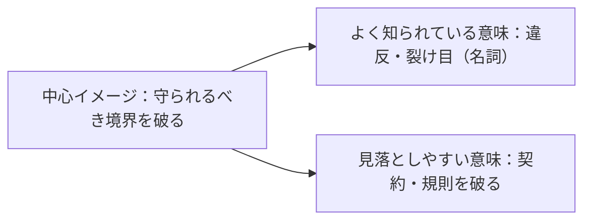

**重要語法**：breach a contract/regulation

<small>出典候補 ID：ev-05182-verb-01｜index：5182</small>

---

## 2821｜caricature

**品詞**：動詞

**発音**：/ˈkærɪkətʃər/

<small>よく知られている意味：風刺画（名詞）</small>

**見落としやすい意味：特徴を誇張して戯画化する**

**例文**：The article caricatured the mayor as a selfish ruler.

**和訳**：その記事は市長を身勝手な支配者として誇張して描いた。

**コアイメージの説明**：caricature は人物の特徴を誇張して描く風刺画を指す。動詞では見た目だけでなく言動や人物像を一面的に誇張して示すことにも使う。

```mermaid
flowchart LR
    A["中心イメージ：目立つ特徴だけを大きくする"]
    B["よく知られている意味：風刺画（名詞）"]
    C["見落としやすい意味：特徴を誇張して戯画化する"]
    A --> B
    A --> C
```

**重要語法**：caricature someone as ...

<small>出典候補 ID：ev-05183-verb-01｜index：5183</small>

---

## 2822｜contradict

**品詞**：動詞

**発音**：/ˌkɑːntrəˈdɪkt/

<small>よく知られている意味：人の発言に反論する</small>

**見落としやすい意味：（証拠・事実などが）主張と食い違う**

**例文**：The new evidence contradicts his earlier statement.

**和訳**：新しい証拠は彼の以前の供述と食い違っている。

**コアイメージの説明**：contradict は二つの言明が同時に成り立たないことを表す。人が反論するだけでなく、証拠や数字が主張を否定する場面にも使う。

```mermaid
flowchart LR
    A["中心イメージ：二つの内容が両立しない"]
    B["よく知られている意味：人の発言に反論する"]
    C["見落としやすい意味：（証拠・事実などが）主張と食い違う"]
    A --> B
    A --> C
```

**重要語法**：evidence contradicts a claim

<small>出典候補 ID：ev-05186-verb-01｜index：5186</small>

---

## 2823｜dwell

**品詞**：動詞

**発音**：/dwel/

<small>よく知られている意味：住む（文語）</small>

**見落としやすい意味：嫌なことをいつまでもくよくよ考える**

**例文**：Try not to dwell on mistakes you can no longer change.

**和訳**：もう変えられない失敗をいつまでもくよくよ考えないようにしよう。

**コアイメージの説明**：dwell は同じ場所に居続けること。考えがある出来事に居続けるイメージから、dwell on ... で「いつまでも思い続ける」となる。

```mermaid
flowchart LR
    A["中心イメージ：一か所に長くとどまる"]
    B["よく知られている意味：住む（文語）"]
    C["見落としやすい意味：嫌なことをいつまでもくよくよ考える"]
    A --> B
    A --> C
```

**重要語法**：dwell on the past/a mistake

<small>出典候補 ID：ev-05190-verb-01｜index：5190</small>

---

## 2824｜haul

**品詞**：名詞

**発音**：/hɔːl/

<small>よく知られている意味：引っ張る・運ぶ</small>

**見落としやすい意味：捕獲物や獲得物の総量**

**例文**：The fishermen brought in a large haul before sunrise.

**和訳**：漁師たちは日の出前に大量の漁獲を持ち帰った。

**コアイメージの説明**：haul は引っ張って運ぶ行為から、運んできたもののまとまりも指す。漁獲量や一度に得た品物の総量を表せる。

```mermaid
flowchart LR
    A["中心イメージ：引き上げて手に入れたもの"]
    B["よく知られている意味：引っ張る・運ぶ"]
    C["見落としやすい意味：捕獲物や獲得物の総量"]
    A --> B
    A --> C
```

**重要語法**：a large haul; a haul of fish

<small>出典候補 ID：ev-05195-noun-01｜index：5195</small>

---

## 2825｜immune

**品詞**：形容詞

**発音**：/ɪˈmjuːn/

<small>よく知られている意味：免疫がある</small>

**見落としやすい意味：病気以外の影響も受け付けない**

**例文**：No organization is immune to criticism.

**和訳**：批判を免れる組織など存在しない。

**コアイメージの説明**：immune の核は有害なものの影響を受けないこと。病気への免疫だけでなく、批判・変化・不況などへの「耐性」に広がる。

```mermaid
flowchart LR
    A["中心イメージ：外からの作用を受け付けない"]
    B["よく知られている意味：免疫がある"]
    C["見落としやすい意味：病気以外の影響も受け付けない"]
    A --> B
    A --> C
```

**重要語法**：be immune to ...

<small>出典候補 ID：ev-05197-adj-01｜index：5197</small>

---

## 2826｜intern

**品詞**：名詞

**発音**：/ˈɪntɝːn/

<small>よく知られている意味：インターンとして働く（動詞）</small>

**見落としやすい意味：研修生・実習生**

**例文**：The hospital welcomed three new interns this summer.

**和訳**：その病院はこの夏、新たに3人の研修生を迎えた。

**コアイメージの説明**：intern は組織の内部で実務を経験しながら学ぶ人を指す。医療機関では研修医、企業では実習生など、文脈で訳し分ける。

```mermaid
flowchart LR
    A["中心イメージ：組織の中で実務を学ぶ"]
    B["よく知られている意味：インターンとして働く（動詞）"]
    C["見落としやすい意味：研修生・実習生"]
    A --> B
    A --> C
```

**重要語法**：a medical intern; an intern at ...

<small>出典候補 ID：ev-05199-noun-01｜index：5199</small>

---

## 2827｜intern

**品詞**：動詞

**発音**：/ɪnˈtɝːn/

<small>よく知られている意味：研修生（名詞）</small>

**見落としやすい意味：抑留する**

**例文**：During the conflict, many civilians were interned in guarded camps.

**和訳**：紛争中、多くの民間人が警備された収容施設に抑留された。

**コアイメージの説明**：intern には人を一定の場所に留め置く動詞の意味がある。研修生を意味する名詞とは異なり、この用法では自由に移動できない状態を表す。

```mermaid
flowchart LR
    A["中心イメージ：ある場所の内側にとどめる"]
    B["よく知られている意味：研修生（名詞）"]
    C["見落としやすい意味：抑留する"]
    A --> B
    A --> C
```

**重要語法**：be interned in a camp

<small>出典候補 ID：ev-05199-verb-01｜index：5199</small>

---

## 2828｜lace

**品詞**：動詞

**発音**：/leɪs/

<small>よく知られている意味：靴ひも・レース（名詞）</small>

**見落としやすい意味：（言葉などに）皮肉や感情を織り交ぜる**

**例文**：Her speech was laced with quiet sarcasm.

**和訳**：彼女の演説には控えめな皮肉が織り交ぜられていた。

**コアイメージの説明**：lace はひもを通したり、編み込んだりすること。言葉や文章に感情や皮肉が散りばめられる様子も表す。

```mermaid
flowchart LR
    A["中心イメージ：細いものを通して編み込む"]
    B["よく知られている意味：靴ひも・レース（名詞）"]
    C["見落としやすい意味：（言葉などに）皮肉や感情を織り交ぜる"]
    A --> B
    A --> C
```

**重要語法**：be laced with irony/anger

<small>出典候補 ID：ev-05200-verb-01｜index：5200</small>

---

## 2829｜maze

**品詞**：名詞

**発音**：/meɪz/

<small>よく知られている意味：迷路</small>

**見落としやすい意味：複雑で混乱した状態**

**例文**：Students must navigate a maze of application rules.

**和訳**：学生たちは複雑に入り組んだ出願規則を理解して進めなければならない。

**コアイメージの説明**：maze は複雑に枝分かれする迷路。規則や手続きが入り組み、進む道が分かりにくい状態にも使う。

```mermaid
flowchart LR
    A["中心イメージ：道が入り組んで出口が見えにくい"]
    B["よく知られている意味：迷路"]
    C["見落としやすい意味：複雑で混乱した状態"]
    A --> B
    A --> C
```

**重要語法**：a maze of regulations

<small>出典候補 ID：ev-05202-noun-01｜index：5202</small>

---

## 2830｜militant

**品詞**：形容詞

**発音**：/ˈmɪlɪtənt/

<small>よく知られている意味：戦闘的な（武力を連想）</small>

**見落としやすい意味：闘争的で強硬な**

**例文**：Militant campaigners refused to compromise on the issue.

**和訳**：強硬な活動家たちはその問題で妥協を拒んだ。

**コアイメージの説明**：militant は対立を恐れず積極的に主張を進める態度を表す。実際の武力行使を意味するとは限らず、政治・労働運動などの強硬姿勢にも使う。

```mermaid
flowchart LR
    A["中心イメージ：自分の主張を強く押し出す"]
    B["よく知られている意味：戦闘的な（武力を連想）"]
    C["見落としやすい意味：闘争的で強硬な"]
    A --> B
    A --> C
```

**重要語法**：militant activists/unions

<small>出典候補 ID：ev-05203-adj-01｜index：5203</small>

---

## 2831｜ordered

**品詞**：形容詞

**発音**：/ˈɔːrdərd/

<small>よく知られている意味：注文された・命じられた</small>

**見落としやすい意味：整然とした・秩序立った**

**例文**：The museum keeps its records in an ordered system.

**和訳**：その博物館は記録を秩序立った体系で管理している。

**コアイメージの説明**：order は順序や秩序。ordered は「命じられた」だけでなく、要素が一定の規則で並ぶ「整然とした」状態を表す。

```mermaid
flowchart LR
    A["中心イメージ：一定の順序に並べる"]
    B["よく知られている意味：注文された・命じられた"]
    C["見落としやすい意味：整然とした・秩序立った"]
    A --> B
    A --> C
```

**重要語法**：an ordered sequence/system

<small>出典候補 ID：ev-05205-adj-01｜index：5205</small>

---

## 2832｜sensibility

**品詞**：名詞

**発音**：/ˌsensəˈbɪləti/

<small>よく知られている意味：感受性</small>

**見落としやすい意味：分別・良識・繊細な倫理観**

**例文**：The decision offended her sense of fairness and moral sensibility.

**和訳**：その決定は彼女の公平感覚と倫理的な良識に反した。

**コアイメージの説明**：sensibility は何かを感じ取り、判断する感覚を指す。芸術的感受性だけでなく、道徳的な良識や価値判断への繊細さも含む。

```mermaid
flowchart LR
    A["中心イメージ：物事の違いを敏感に感じ取る力"]
    B["よく知られている意味：感受性"]
    C["見落としやすい意味：分別・良識・繊細な倫理観"]
    A --> B
    A --> C
```

**重要語法**：moral sensibility; offend someone's sensibilities

<small>出典候補 ID：ev-05210-noun-01｜index：5210</small>

---

## 2833｜involved

**品詞**：形容詞

**発音**：/ɪnˈvɑːlvd/

<small>よく知られている意味：関与している</small>

**見落としやすい意味：複雑に入り組んだ**

**例文**：The instructions were too involved for beginners to follow.

**和訳**：その説明は入り組みすぎていて、初心者には理解しにくかった。

**コアイメージの説明**：involve は中に巻き込み、関わらせること。多くの要素が巻き込まれて絡み合えば、説明や手順が「複雑な」という意味になる。

```mermaid
flowchart LR
    A["中心イメージ：いくつもの要素が絡み合う"]
    B["よく知られている意味：関与している"]
    C["見落としやすい意味：複雑に入り組んだ"]
    A --> B
    A --> C
```

**重要語法**：an involved explanation/procedure

<small>出典候補 ID：ev-05218-adj-01｜index：5218</small>

---

## 2834｜eternal

**品詞**：形容詞

**発音**：/ɪˈtɝːnəl/

<small>よく知られている意味：永遠の</small>

**見落としやすい意味：うんざりするほど長く感じられる**

**例文**：We grew tired of the eternal arguments over small details.

**和訳**：私たちは細部をめぐる、いつまでも続く議論にうんざりした。

**コアイメージの説明**：eternal は終わりがないほど長く続くこと。日常会話では誇張して、同じ話や待ち時間が延々と続く不満も表す。

```mermaid
flowchart LR
    A["中心イメージ：終わりが見えないほど続く"]
    B["よく知られている意味：永遠の"]
    C["見落としやすい意味：うんざりするほど長く感じられる"]
    A --> B
    A --> C
```

**重要語法**：eternal complaints/arguments

<small>出典候補 ID：ev-05220-adj-01｜index：5220</small>

---

## 2835｜ladder

**品詞**：名詞

**発音**：/ˈlædər/

<small>よく知られている意味：はしご</small>

**見落としやすい意味：昇進・成長の段階**

**例文**：She worked her way up the career ladder.

**和訳**：彼女は出世の階段を一段ずつ上っていった。

**コアイメージの説明**：ladder は段を踏んで上に登る道具。仕事や社会的地位が段階的に上がる様子にも使う。

```mermaid
flowchart LR
    A["中心イメージ：段を一つずつ上がる"]
    B["よく知られている意味：はしご"]
    C["見落としやすい意味：昇進・成長の段階"]
    A --> B
    A --> C
```

**重要語法**：the career ladder; climb the ladder

<small>出典候補 ID：ev-05222-noun-01｜index：5222</small>

---

## 2836｜bounce

**品詞**：動詞

**発音**：/baʊns/

<small>よく知られている意味：跳ね返る</small>

**見落としやすい意味：人を建物や場所から追い出す**

**例文**：The club bounced him for breaking its rules.

**和訳**：そのクラブは規則違反を理由に彼を追い出した。

**コアイメージの説明**：bounce は跳ね返る・跳ね返す動きが中心。口語では人を入口や施設から「はねつける・追い出す」意味にもなる。

```mermaid
flowchart LR
    A["中心イメージ：跳ね返して外に出す"]
    B["よく知られている意味：跳ね返る"]
    C["見落としやすい意味：人を建物や場所から追い出す"]
    A --> B
    A --> C
```

**重要語法**：bounce someone from a club（口語）

<small>出典候補 ID：ev-05225-verb-01｜index：5225</small>

---

## 2837｜bounce

**品詞**：動詞

**発音**：/baʊns/

<small>よく知られている意味：跳ね返る</small>

**見落としやすい意味：失敗・苦境から立ち直る**

**例文**：The small business bounced back after a difficult year.

**和訳**：その小さな会社は厳しい一年を経て立ち直った。

**コアイメージの説明**：bounce は一度落ちてもまた跳ね上がる動き。bounce back で、失敗や不況から回復する様子を表す。

```mermaid
flowchart LR
    A["中心イメージ：下がっても再び跳ね上がる"]
    B["よく知られている意味：跳ね返る"]
    C["見落としやすい意味：失敗・苦境から立ち直る"]
    A --> B
    A --> C
```

**重要語法**：bounce back from a setback

<small>出典候補 ID：ev-05225-verb-02｜index：5225</small>

---

## 2838｜fluid

**品詞**：形容詞

**発音**：/ˈfluːɪd/

<small>よく知られている意味：流体の・液体の</small>

**見落としやすい意味：状況が流動的で変わりやすい**

**例文**：The schedule is still fluid, so the meeting time may change.

**和訳**：予定はまだ流動的なので、会議の時間が変わる可能性がある。

**コアイメージの説明**：fluid は液体のように決まった形を持たないこと。計画や情勢に使うと、まだ固定されず変わりやすい状態を意味する。

```mermaid
flowchart LR
    A["中心イメージ：定まった形を持たず流れる"]
    B["よく知られている意味：流体の・液体の"]
    C["見落としやすい意味：状況が流動的で変わりやすい"]
    A --> B
    A --> C
```

**重要語法**：a fluid situation/schedule

<small>出典候補 ID：ev-05226-adj-01｜index：5226</small>

---

## 2839｜cue

**品詞**：名詞

**発音**：/kjuː/

<small>よく知られている意味：ビリヤードのキュー</small>

**見落としやすい意味：次の行動を促す合図・きっかけ**

**例文**：The lights dimming were our cue to enter the stage.

**和訳**：照明が暗くなるのが、私たちが舞台に出る合図だった。

**コアイメージの説明**：cue は「次に何をするか」を知らせる信号。演劇の登場の合図や会話でのきっかけを表す。

```mermaid
flowchart LR
    A["中心イメージ：次の動作が始まるきっかけ"]
    B["よく知られている意味：ビリヤードのキュー"]
    C["見落としやすい意味：次の行動を促す合図・きっかけ"]
    A --> B
    A --> C
```

**重要語法**：take one's cue from ...; on cue

<small>出典候補 ID：ev-05227-noun-01｜index：5227</small>

---

## 2840｜cue

**品詞**：動詞

**発音**：/kjuː/

<small>よく知られている意味：合図（名詞）</small>

**見落としやすい意味：合図を出して促す**

**例文**：The director cued the musicians to begin.

**和訳**：指揮者は演奏者たちに開始の合図を出した。

**コアイメージの説明**：cue は行動のきっかけとなる合図。動詞では人や機器に「今、始めて」と知らせる行為になる。

```mermaid
flowchart LR
    A["中心イメージ：次の動作を知らせる"]
    B["よく知られている意味：合図（名詞）"]
    C["見落としやすい意味：合図を出して促す"]
    A --> B
    A --> C
```

**重要語法**：cue someone to do ...; cue the music

<small>出典候補 ID：ev-05227-verb-01｜index：5227</small>

---

## 2841｜chew

**品詞**：動詞

**発音**：/tʃuː/

<small>よく知られている意味：噛む</small>

**見落としやすい意味：じっくり考える・熟慮する**

**例文**：We need time to chew over the proposal before deciding.

**和訳**：決める前に、その提案をじっくり検討する時間が必要だ。

**コアイメージの説明**：chew は食べ物を何度も噛み砕くこと。考えを少しずつ咀嚼する比喩で chew over を「よく検討する」という意味に使う。

```mermaid
flowchart LR
    A["中心イメージ：少しずつ噛み砕いて処理する"]
    B["よく知られている意味：噛む"]
    C["見落としやすい意味：じっくり考える・熟慮する"]
    A --> B
    A --> C
```

**重要語法**：chew over a problem/idea

<small>出典候補 ID：ev-05228-verb-01｜index：5228</small>

---

## 2842｜ego

**品詞**：名詞

**発音**：/ˈiːɡoʊ/

<small>よく知られている意味：自我</small>

**見落としやすい意味：うぬぼれ・過大な自尊心**

**例文**：His huge ego made it hard for him to accept advice.

**和訳**：彼は自尊心が過大で、助言を受け入れるのが難しかった。

**コアイメージの説明**：ego は自分自身をどう捉えるかという意識を指す。その自己評価が大きくなりすぎると、うぬぼれや過大な自尊心という意味になる。

```mermaid
flowchart LR
    A["中心イメージ：自分自身についての意識"]
    B["よく知られている意味：自我"]
    C["見落としやすい意味：うぬぼれ・過大な自尊心"]
    A --> B
    A --> C
```

**重要語法**：a big/huge ego; hurt someone's ego

<small>出典候補 ID：ev-05230-noun-01｜index：5230</small>

---

## 2843｜posture

**品詞**：動詞

**発音**：/ˈpɑːstʃər/

<small>よく知られている意味：姿勢（名詞）</small>

**見落としやすい意味：人に良く見せるため不自然に振る舞う**

**例文**：The politician was posturing for the cameras instead of answering the question.

**和訳**：その政治家は質問に答える代わりに、カメラの前で見せかけの態度を取っていた。

**コアイメージの説明**：posture は体の姿勢・構えを意味する。動詞では周囲に特定の印象を与えるため、実際の考え以上に強そう・立派そうに振る舞うことを表す。

```mermaid
flowchart LR
    A["中心イメージ：外からどう見えるかを意識して構える"]
    B["よく知られている意味：姿勢（名詞）"]
    C["見落としやすい意味：人に良く見せるため不自然に振る舞う"]
    A --> B
    A --> C
```

**重要語法**：political posturing; posture for the cameras

<small>出典候補 ID：ev-05239-verb-01｜index：5239</small>

---

## 2844｜contingency

**品詞**：名詞

**発音**：/kənˈtɪndʒənsi/

<small>よく知られている意味：偶然性・依存性</small>

**見落としやすい意味：起こり得る不測の事態**

**例文**：The team prepared for every possible contingency.

**和訳**：チームは起こり得るあらゆる不測の事態に備えた。

**コアイメージの説明**：contingency は物事が条件によって変わり得ることを示す。将来何が起こるか確定しないため、備えるべき「不測の事態」を意味する。

```mermaid
flowchart LR
    A["中心イメージ：条件しだいで起こる可能性"]
    B["よく知られている意味：偶然性・依存性"]
    C["見落としやすい意味：起こり得る不測の事態"]
    A --> B
    A --> C
```

**重要語法**：a contingency plan

<small>出典候補 ID：ev-05241-noun-01｜index：5241</small>

---

## 2845｜affiliate

**品詞**：名詞

**発音**：/əˈfɪliət/

<small>よく知られている意味：提携する（動詞）</small>

**見落としやすい意味：系列組織・関連会社**

**例文**：The radio station is a local affiliate of a national network.

**和訳**：そのラジオ局は全国ネットワークの地方系列局だ。

**コアイメージの説明**：affiliate の中心は組織同士がつながること。動詞なら提携する、名詞ならつながりを持つ支部・系列企業を指す。

```mermaid
flowchart LR
    A["中心イメージ：大きな組織と結び付く"]
    B["よく知られている意味：提携する（動詞）"]
    C["見落としやすい意味：系列組織・関連会社"]
    A --> B
    A --> C
```

**重要語法**：an affiliate of ...

<small>出典候補 ID：ev-05244-noun-01｜index：5244</small>

---

## 2846｜affiliate

**品詞**：動詞

**発音**：/əˈfɪlieɪt/

<small>よく知られている意味：系列会社（名詞）</small>

**見落としやすい意味：組織などと提携する・所属させる**

**例文**：The research center affiliated itself with the university.

**和訳**：その研究センターは大学と提携した。

**コアイメージの説明**：affiliate は独立した組織が別の組織と関係を結ぶこと。動詞では所属させる・提携させるという動きを表す。

```mermaid
flowchart LR
    A["中心イメージ：別の組織とつながる"]
    B["よく知られている意味：系列会社（名詞）"]
    C["見落としやすい意味：組織などと提携する・所属させる"]
    A --> B
    A --> C
```

**重要語法**：be affiliated with ...; affiliate oneself with ...

<small>出典候補 ID：ev-05244-verb-01｜index：5244</small>

---

## 2847｜crusade

**品詞**：名詞

**発音**：/kruːˈseɪd/

<small>よく知られている意味：十字軍</small>

**見落としやすい意味：大義や主張を推進する運動**

**例文**：She launched a crusade against food waste in schools.

**和訳**：彼女は学校での食品廃棄を減らすための熱心な運動を始めた。

**コアイメージの説明**：crusade は歴史上の十字軍を指す語。現代では比喩的に、強い信念を持って社会問題などの改善に取り組む運動を表す。

```mermaid
flowchart LR
    A["中心イメージ：信念を掲げて進む集団行動"]
    B["よく知られている意味：十字軍"]
    C["見落としやすい意味：大義や主張を推進する運動"]
    A --> B
    A --> C
```

**重要語法**：a crusade against/for ...

<small>出典候補 ID：ev-05247-noun-01｜index：5247</small>

---

## 2848｜crusade

**品詞**：動詞

**発音**：/kruːˈseɪd/

<small>よく知られている意味：十字軍・運動（名詞）</small>

**見落としやすい意味：信念のため熱心に運動する**

**例文**：They crusaded for safer roads in their town.

**和訳**：彼らは町の道路の安全向上を求めて熱心に運動した。

**コアイメージの説明**：crusade には大きな目的に向けて活動するイメージがある。名詞の「運動」が動詞になると、その信念のため積極的に働きかけることを表す。

```mermaid
flowchart LR
    A["中心イメージ：信念のために粘り強く働きかける"]
    B["よく知られている意味：十字軍・運動（名詞）"]
    C["見落としやすい意味：信念のため熱心に運動する"]
    A --> B
    A --> C
```

**重要語法**：crusade for/against ...

<small>出典候補 ID：ev-05247-verb-01｜index：5247</small>

---

## 2849｜implicate

**品詞**：動詞

**発音**：/ˈɪmplɪkeɪt/

<small>よく知られている意味：不正への関与を示唆する</small>

**見落としやすい意味：当然の付随結果として含意する**

**例文**：The proposal implicates serious questions about privacy.

**和訳**：その提案はプライバシーに関する重大な問題を伴う。

**コアイメージの説明**：implicate は一つの事柄が別の事柄を関係の中に巻き込むこと。犯罪との関係だけでなく、議論や選択が必然的に含む問題や結果にも使う。

```mermaid
flowchart LR
    A["中心イメージ：ある事柄を別の事柄に結び付ける"]
    B["よく知られている意味：不正への関与を示唆する"]
    C["見落としやすい意味：当然の付随結果として含意する"]
    A --> B
    A --> C
```

**重要語法**：implicate questions/issues of ...

<small>出典候補 ID：ev-05250-verb-01｜index：5250</small>

---

## 2850｜implicate

**品詞**：動詞

**発音**：/ˈɪmplɪkeɪt/

<small>よく知られている意味：意味に含む・関係させる</small>

**見落としやすい意味：犯罪・不正への関与を示唆する**

**例文**：The emails implicated two officials in the fraud.

**和訳**：そのメールは、2人の職員がその詐欺に関与していたことを示唆した。

**コアイメージの説明**：implicate は誰か・何かをある事柄と結び付けること。証拠が人物を不正と結び付ければ、関与を示唆する意味になる。

```mermaid
flowchart LR
    A["中心イメージ：証拠で人物を出来事に結び付ける"]
    B["よく知られている意味：意味に含む・関係させる"]
    C["見落としやすい意味：犯罪・不正への関与を示唆する"]
    A --> B
    A --> C
```

**重要語法**：implicate someone in a crime/scandal

<small>出典候補 ID：ev-05250-verb-02｜index：5250</small>

---

## 2851｜infection

**品詞**：名詞

**発音**：/ɪnˈfekʃən/

<small>よく知られている意味：感染・伝染病</small>

**見落としやすい意味：気分や感情が人々に伝染すること**

**例文**：An infection of excitement spread through the audience.

**和訳**：興奮が伝染するように観客の間へ広がった。

**コアイメージの説明**：infection は何かが接触などを通じて広がること。比喩的に、熱意や不安などの感情が周囲に伝わっていく様子を表すことがある。

```mermaid
flowchart LR
    A["中心イメージ：一人から周囲へ広がる"]
    B["よく知られている意味：感染・伝染病"]
    C["見落としやすい意味：気分や感情が人々に伝染すること"]
    A --> B
    A --> C
```

**重要語法**：an infection of excitement（比喩的な文語表現）

<small>出典候補 ID：ev-05251-noun-01｜index：5251</small>

---

## 2852｜informed

**品詞**：形容詞

**発音**：/ɪnˈfɔːrmd/

<small>よく知られている意味：知らせを受けた</small>

**見落としやすい意味：十分な情報を踏まえた・事情に通じた**

**例文**：Voters need reliable facts to make an informed choice.

**和訳**：有権者が十分な情報に基づいて判断するには、信頼できる事実が必要だ。

**コアイメージの説明**：informed は情報が与えられている状態。選択や判断について使うと、事情をよく知ったうえで行われることを表す。

```mermaid
flowchart LR
    A["中心イメージ：情報を持ったうえで判断する"]
    B["よく知られている意味：知らせを受けた"]
    C["見落としやすい意味：十分な情報を踏まえた・事情に通じた"]
    A --> B
    A --> C
```

**重要語法**：an informed decision/choice; informed consent

<small>出典候補 ID：ev-05253-adj-01｜index：5253</small>

---

## 2853｜installment

**品詞**：名詞

**発音**：/ɪnˈstɔːlmənt/

<small>よく知られている意味：分割払いの一回分</small>

**見落としやすい意味：連載作品の一回分**

**例文**：The magazine published the third installment of the story.

**和訳**：その雑誌は物語の第3回を掲載した。

**コアイメージの説明**：installment は全体をいくつかの回に分けた、その一回分。お金なら分割払い、物語なら連載の一回分を指す。

```mermaid
flowchart LR
    A["中心イメージ：大きな全体を何回かに分けた一回"]
    B["よく知られている意味：分割払いの一回分"]
    C["見落としやすい意味：連載作品の一回分"]
    A --> B
    A --> C
```

**重要語法**：the next installment of a series

<small>出典候補 ID：ev-05254-noun-01｜index：5254</small>

---

## 2854｜installment

**品詞**：名詞

**発音**：/ɪnˈstɔːlmənt/

<small>よく知られている意味：連載の一回分</small>

**見落としやすい意味：分割払いの一回分**

**例文**：He pays for the laptop in twelve monthly installments.

**和訳**：彼はそのノートパソコンの代金を12回の月払いで支払っている。

**コアイメージの説明**：installment は全体を複数回に分けた一部分。支払いの文脈では、総額を何回かに分けて払う各回の金額を指す。

```mermaid
flowchart LR
    A["中心イメージ：大きな額を分けて払う一回"]
    B["よく知られている意味：連載の一回分"]
    C["見落としやすい意味：分割払いの一回分"]
    A --> B
    A --> C
```

**重要語法**：pay in installments; monthly installment

<small>出典候補 ID：ev-05254-noun-02｜index：5254</small>

---

## 2855｜prehistoric

**品詞**：形容詞

**発音**：/ˌpriːhɪˈstɔːrɪk/

<small>よく知られている意味：先史時代の</small>

**見落としやすい意味：古くさい・時代遅れの**

**例文**：That printer is practically prehistoric compared with modern models.

**和訳**：そのプリンターは最近の機種と比べると、ほとんど時代遅れだ。

**コアイメージの説明**：prehistoric は歴史記録より前の時代に属すること。比喩的には古さを大げさに表し、技術や考えが「時代遅れだ」という批判にもなる。

```mermaid
flowchart LR
    A["中心イメージ：はるか昔のものという印象"]
    B["よく知られている意味：先史時代の"]
    C["見落としやすい意味：古くさい・時代遅れの"]
    A --> B
    A --> C
```

**重要語法**：a prehistoric computer（比喩）

<small>出典候補 ID：ev-05258-adj-01｜index：5258</small>

---

## 2856｜redemption

**品詞**：名詞

**発音**：/rɪˈdempʃən/

<small>よく知られている意味：救済・贖罪</small>

**見落としやすい意味：債券などの元本償還**

**例文**：The bond's redemption is scheduled for next June.

**和訳**：その債券の償還は来年6月に予定されている。

**コアイメージの説明**：redemption は失ったものを取り戻す、または約束に基づき引き換えること。金融では債券などを償還して元本を払い戻すことを指す。

```mermaid
flowchart LR
    A["中心イメージ：価値や権利を取り戻す"]
    B["よく知られている意味：救済・贖罪"]
    C["見落としやすい意味：債券などの元本償還"]
    A --> B
    A --> C
```

**重要語法**：bond redemption; redemption at maturity

<small>出典候補 ID：ev-05261-noun-01｜index：5261</small>

---

## 2857｜redemption

**品詞**：名詞

**発音**：/rɪˈdempʃən/

<small>よく知られている意味：金銭の償還・救済</small>

**見落としやすい意味：汚名返上・名誉回復・救済**

**例文**：Winning the final gave the team a chance at redemption.

**和訳**：決勝での勝利は、チームに汚名返上の機会を与えた。

**コアイメージの説明**：redemption は過去の過ちや損失から回復すること。宗教的な救済に限らず、失敗後に名誉や信頼を取り戻す場面にも使う。

```mermaid
flowchart LR
    A["中心イメージ：失った価値・信頼を取り戻す"]
    B["よく知られている意味：金銭の償還・救済"]
    C["見落としやすい意味：汚名返上・名誉回復・救済"]
    A --> B
    A --> C
```

**重要語法**：a chance at redemption

<small>出典候補 ID：ev-05261-noun-02｜index：5261</small>

---

## 2858｜rogue

**品詞**：形容詞

**発音**：/roʊɡ/

<small>よく知られている意味：ならず者（名詞）</small>

**見落としやすい意味：組織から離れ独断で行動する**

**例文**：A rogue employee leaked the confidential report.

**和訳**：組織の方針に背いた一人の従業員が機密報告書を漏らした。

**コアイメージの説明**：rogue は集団の規則に従わず独自に動く人物のイメージ。形容詞では、組織の一員でありながら統制を外れた行動を指す。

```mermaid
flowchart LR
    A["中心イメージ：仲間から外れて勝手に動く"]
    B["よく知られている意味：ならず者（名詞）"]
    C["見落としやすい意味：組織から離れ独断で行動する"]
    A --> B
    A --> C
```

**重要語法**：a rogue employee/agent

<small>出典候補 ID：ev-05263-adj-01｜index：5263</small>

---

## 2859｜blessing

**品詞**：名詞

**発音**：/ˈblesɪŋ/

<small>よく知られている意味：祝福</small>

**見落としやすい意味：正式な承認・賛意**

**例文**：The proposal went ahead with the board's blessing.

**和訳**：その提案は取締役会の承認を得て進められた。

**コアイメージの説明**：blessing は本来よいことを願う祝福。人の計画や行動に同意し、後押しする「承認・賛意」の意味にもなる。

```mermaid
flowchart LR
    A["中心イメージ：相手の行動をよいと認める"]
    B["よく知られている意味：祝福"]
    C["見落としやすい意味：正式な承認・賛意"]
    A --> B
    A --> C
```

**重要語法**：with someone's blessing

<small>出典候補 ID：ev-05273-noun-01｜index：5273</small>

---

## 2860｜exceptional

**品詞**：形容詞

**発音**：/ɪkˈsepʃənəl/

<small>よく知られている意味：例外的な</small>

**見落としやすい意味：並外れて優秀な**

**例文**：Her exceptional skill impressed the judges.

**和訳**：彼女の並外れた技量は審査員を感心させた。

**コアイメージの説明**：exceptional は普通の基準から外れること。好ましい資質について使うと、一般より際立って優秀だという高い評価になる。

```mermaid
flowchart LR
    A["中心イメージ：通常の水準から大きく外れる"]
    B["よく知られている意味：例外的な"]
    C["見落としやすい意味：並外れて優秀な"]
    A --> B
    A --> C
```

**重要語法**：exceptional ability/talent

<small>出典候補 ID：ev-05276-adj-01｜index：5276</small>

---

## 2861｜dedication

**品詞**：名詞

**発音**：/ˌdedɪˈkeɪʃən/

<small>よく知られている意味：献身・熱心さ</small>

**見落としやすい意味：著書などに記す献辞**

**例文**：She wrote a short dedication to her parents at the front of the book.

**和訳**：彼女は本の冒頭に両親への短い献辞を書いた。

**コアイメージの説明**：dedication は時間や努力を何かに捧げること。本では著者が作品を誰かに捧げる言葉、すなわち「献辞」を指す。

```mermaid
flowchart LR
    A["中心イメージ：大切な相手に向けて捧げる"]
    B["よく知られている意味：献身・熱心さ"]
    C["見落としやすい意味：著書などに記す献辞"]
    A --> B
    A --> C
```

**重要語法**：a dedication to ...

<small>出典候補 ID：ev-05279-noun-01｜index：5279</small>

---

## 2862｜gum

**品詞**：動詞

**発音**：/ɡʌm/

<small>よく知られている意味：ガム・歯茎（名詞）</small>

**見落としやすい意味：機械や仕組みの動きを妨げる**

**例文**：Too many approval steps are gumming up the process.

**和訳**：承認の段階が多すぎて、その手続きは滞っている。

**コアイメージの説明**：gum は粘り気のあるものというイメージ。gum up は機械を詰まらせるほか、手続きや計画の進行を妨げる意味にもなる。

```mermaid
flowchart LR
    A["中心イメージ：ねばつくものが詰まり動きを止める"]
    B["よく知られている意味：ガム・歯茎（名詞）"]
    C["見落としやすい意味：機械や仕組みの動きを妨げる"]
    A --> B
    A --> C
```

**重要語法**：gum up the works/process

<small>出典候補 ID：ev-05281-verb-01｜index：5281</small>

---

## 2863｜battery

**品詞**：名詞

**発音**：/ˈbætəri/

<small>よく知られている意味：電池</small>

**見落としやすい意味：目的に応じた一式・ひとそろい**

**例文**：The doctor ordered a battery of tests to find the cause.

**和訳**：医師は原因を突き止めるために一連の検査を指示した。

**コアイメージの説明**：battery には同じ目的のためにまとまって用意されたものの集合という意味がある。電池に限らず、検査や質問などの一式を指す。

```mermaid
flowchart LR
    A["中心イメージ：一つの目的に向けてまとめた集まり"]
    B["よく知られている意味：電池"]
    C["見落としやすい意味：目的に応じた一式・ひとそろい"]
    A --> B
    A --> C
```

**重要語法**：a battery of tests/questions

<small>出典候補 ID：ev-05283-noun-01｜index：5283</small>

---

## 2864｜battery

**品詞**：名詞

**発音**：/ˈbætəri/

<small>よく知られている意味：電池</small>

**見落としやすい意味：暴行（法律上の用語）**

**例文**：The defendant was charged with battery under state law.

**和訳**：被告は州法に基づき暴行罪で起訴された。

**コアイメージの説明**：法律英語の battery は、他人への不法な身体的接触を指す。日常語の「電池」とは別の専門的な意味なので、法的文脈で見分ける。

```mermaid
flowchart LR
    A["中心イメージ：人に対する不法な身体的接触"]
    B["よく知られている意味：電池"]
    C["見落としやすい意味：暴行（法律上の用語）"]
    A --> B
    A --> C
```

**重要語法**：be charged with battery（米国法など）

<small>出典候補 ID：ev-05283-noun-02｜index：5283</small>

---

## 2865｜estimation

**品詞**：名詞

**発音**：/ˌestɪˈmeɪʃən/

<small>よく知られている意味：見積もり・推定</small>

**見落としやすい意味：人が受けている評価・尊敬**

**例文**：Her honesty raised her in the estimation of her colleagues.

**和訳**：彼女の誠実さによって、同僚たちからの評価が高まった。

**コアイメージの説明**：estimation は数値を見積もることだけでなく、価値をどう評価するかも意味する。人に対して使うと、評判や尊敬の度合いを表す。

```mermaid
flowchart LR
    A["中心イメージ：人や物の価値を判断する"]
    B["よく知られている意味：見積もり・推定"]
    C["見落としやすい意味：人が受けている評価・尊敬"]
    A --> B
    A --> C
```

**重要語法**：in someone's estimation; rise in the estimation of ...

<small>出典候補 ID：ev-05287-noun-01｜index：5287</small>

---

## 2866｜estimation

**品詞**：名詞

**発音**：/ˌestɪˈmeɪʃən/

<small>よく知られている意味：人からの評価</small>

**見落としやすい意味：考え・判断・見積もり**

**例文**：In my estimation, the repairs will take three days.

**和訳**：私の見積もりでは、修理には3日かかる。

**コアイメージの説明**：estimation は手元の情報から見当を付けること。数や費用の推定にも、「私の判断では」と意見を述べる場合にも使う。

```mermaid
flowchart LR
    A["中心イメージ：分かる情報から価値や量を見定める"]
    B["よく知られている意味：人からの評価"]
    C["見落としやすい意味：考え・判断・見積もり"]
    A --> B
    A --> C
```

**重要語法**：in my estimation; cost estimation

<small>出典候補 ID：ev-05287-noun-02｜index：5287</small>

---

## 2867｜elusive

**品詞**：形容詞

**発音**：/ɪˈluːsɪv/

<small>よく知られている意味：捕まえにくい</small>

**見落としやすい意味：言葉では捉えにくい・説明しづらい**

**例文**：The idea is appealing, but its exact meaning remains elusive.

**和訳**：その考えは魅力的だが、正確な意味はなお捉えにくい。

**コアイメージの説明**：elusive は追いかけても捉えられないこと。物理的に捕まえにくいものから、言葉で定義しにくい意味や感覚にも広がる。

```mermaid
flowchart LR
    A["中心イメージ：手を伸ばしてもつかめない"]
    B["よく知られている意味：捕まえにくい"]
    C["見落としやすい意味：言葉では捉えにくい・説明しづらい"]
    A --> B
    A --> C
```

**重要語法**：an elusive concept/meaning

<small>出典候補 ID：ev-05288-adj-01｜index：5288</small>

---

## 2868｜poise

**品詞**：名詞

**発音**：/pɔɪz/

<small>よく知られている意味：姿勢・構え</small>

**見落としやすい意味：落ち着き・平静さ・身のこなし**

**例文**：She answered the difficult question with poise.

**和訳**：彼女は難しい質問にも落ち着いて答えた。

**コアイメージの説明**：poise は姿勢や均衡が保たれている状態。気持ちに使うと、緊張下でも動揺せず落ち着いていることを表す。

```mermaid
flowchart LR
    A["中心イメージ：揺れずにバランスを保つ"]
    B["よく知られている意味：姿勢・構え"]
    C["見落としやすい意味：落ち着き・平静さ・身のこなし"]
    A --> B
    A --> C
```

**重要語法**：with poise; maintain one's poise

<small>出典候補 ID：ev-05297-noun-01｜index：5297</small>

---

## 2869｜poise

**品詞**：動詞

**発音**：/pɔɪz/

<small>よく知られている意味：落ち着き（名詞）</small>

**見落としやすい意味：困難に備えて身構える**

**例文**：The team was poised to respond if the situation worsened.

**和訳**：状況が悪化した場合に対応できるよう、チームは身構えていた。

**コアイメージの説明**：poise は姿勢や均衡を整えるイメージ。be poised to do では、次の行動を起こせる準備が整っている状態を表す。

```mermaid
flowchart LR
    A["中心イメージ：すぐ動けるよう姿勢を整える"]
    B["よく知られている意味：落ち着き（名詞）"]
    C["見落としやすい意味：困難に備えて身構える"]
    A --> B
    A --> C
```

**重要語法**：be poised to do ...

<small>出典候補 ID：ev-05297-verb-01｜index：5297</small>

---

## 2870｜assassinate

**品詞**：動詞

**発音**：/əˈsæsəneɪt/

<small>よく知られている意味：暗殺する</small>

**見落としやすい意味：名誉・評判を著しく傷つける**

**例文**：The false article tried to assassinate her character.

**和訳**：その虚偽の記事は彼女の人格や評判をひどく傷つけようとした。

**コアイメージの説明**：assassinate は通常、人物の暗殺を意味する。比喩的な character assassination では、他人の評判や人格を意図的に攻撃することを表す。

```mermaid
flowchart LR
    A["中心イメージ：標的を狙って大きな損害を与える"]
    B["よく知られている意味：暗殺する"]
    C["見落としやすい意味：名誉・評判を著しく傷つける"]
    A --> B
    A --> C
```

**重要語法**：assassinate someone's character; character assassination

<small>出典候補 ID：ev-05301-verb-01｜index：5301</small>

---

## 2871｜banner

**品詞**：形容詞

**発音**：/ˈbænər/

<small>よく知られている意味：旗・横断幕</small>

**見落としやすい意味：際立って好調な・特に成功した**

**例文**：The restaurant had a banner year, serving more customers than ever.

**和訳**：その飲食店は過去最多の客を迎え、特に好調な一年を過ごした。

**コアイメージの説明**：banner は人目を引く旗や見出しを指す。a banner year では際立って成果の大きい年を表す定着した言い方になる。

```mermaid
flowchart LR
    A["中心イメージ：目印になるほど目立つ"]
    B["よく知られている意味：旗・横断幕"]
    C["見落としやすい意味：際立って好調な・特に成功した"]
    A --> B
    A --> C
```

**重要語法**：a banner year/day

<small>出典候補 ID：ev-05302-adj-01｜index：5302</small>

---

## 2872｜cosmetic

**品詞**：形容詞

**発音**：/kɑːzˈmetɪk/

<small>よく知られている意味：化粧の</small>

**見落としやすい意味：表面的なだけで実質的効果がない**

**例文**：The company made only cosmetic changes to its policy.

**和訳**：その会社は方針に表面的な変更しか加えなかった。

**コアイメージの説明**：cosmetic は化粧のように外見を整えることに関わる。制度や改革について使うと、見た目だけが変わり、本質はほとんど変わらないことを表す。

```mermaid
flowchart LR
    A["中心イメージ：外側の見栄えだけを整える"]
    B["よく知られている意味：化粧の"]
    C["見落としやすい意味：表面的なだけで実質的効果がない"]
    A --> B
    A --> C
```

**重要語法**：cosmetic changes/reforms

<small>出典候補 ID：ev-05306-adj-01｜index：5306</small>

---

## 2873｜cosmetic

**品詞**：名詞

**発音**：/kɑːzˈmetɪk/

<small>よく知られている意味：化粧の（形容詞）</small>

**見落としやすい意味：化粧品**

**例文**：This shop sells cosmetics made from plant-based ingredients.

**和訳**：この店は植物由来の原料で作られた化粧品を販売している。

**コアイメージの説明**：cosmetic は見た目を整えることに関わる語。名詞として使えば、肌や顔などに用いる化粧品を指す。

```mermaid
flowchart LR
    A["中心イメージ：見た目を整えるためのもの"]
    B["よく知られている意味：化粧の（形容詞）"]
    C["見落としやすい意味：化粧品"]
    A --> B
    A --> C
```

**重要語法**：cosmetics（化粧品類、複数形が一般的）

<small>出典候補 ID：ev-05306-noun-01｜index：5306</small>

---

## 2874｜creep

**品詞**：動詞

**発音**：/kriːp/

<small>よく知られている意味：はう・こっそり動く</small>

**見落としやすい意味：ゆっくり広がる・忍び寄る**

**例文**：Doubt began to creep into her mind.

**和訳**：彼女の心に疑いがじわじわと忍び込み始めた。

**コアイメージの説明**：creep はそっと、ゆっくり動くこと。物理的な動きだけでなく、不安や疑念が知らないうちに心へ入り込む様子にも使う。

```mermaid
flowchart LR
    A["中心イメージ：気付かれないほどゆっくり進む"]
    B["よく知られている意味：はう・こっそり動く"]
    C["見落としやすい意味：ゆっくり広がる・忍び寄る"]
    A --> B
    A --> C
```

**重要語法**：creep into ...; creep up on ...

<small>出典候補 ID：ev-05307-verb-01｜index：5307</small>

---

## 2875｜creep

**品詞**：動詞

**発音**：/kriːp/

<small>よく知られている意味：はう・忍び寄る</small>

**見落としやすい意味：人をぞっとさせる・気味悪がらせる**

**例文**：That empty hallway creeps me out at night.

**和訳**：夜になると、あの誰もいない廊下は私をぞっとさせる。

**コアイメージの説明**：creep は何かが気付かないうちに近づくイメージ。creep someone out では、不気味さが忍び寄るように人をぞっとさせる。

```mermaid
flowchart LR
    A["中心イメージ：不快な感覚がそっと迫ってくる"]
    B["よく知られている意味：はう・忍び寄る"]
    C["見落としやすい意味：人をぞっとさせる・気味悪がらせる"]
    A --> B
    A --> C
```

**重要語法**：creep someone out（口語）

<small>出典候補 ID：ev-05307-verb-02｜index：5307</small>

---

## 2876｜deduction

**品詞**：名詞

**発音**：/dɪˈdʌkʃən/

<small>よく知られている意味：推論</small>

**見落としやすい意味：所得などから差し引く控除額**

**例文**：The tax form lists a deduction for education expenses.

**和訳**：その税務書類には教育費の控除が記載されている。

**コアイメージの説明**：deduction の中心は何かを引き去ること。税金や給与では差し引く額を意味し、思考では前提から結論を導き出すことを意味する。

```mermaid
flowchart LR
    A["中心イメージ：全体から一部を差し引く"]
    B["よく知られている意味：推論"]
    C["見落としやすい意味：所得などから差し引く控除額"]
    A --> B
    A --> C
```

**重要語法**：a tax deduction; deductions from salary

<small>出典候補 ID：ev-05310-noun-01｜index：5310</small>

---

## 2877｜deduction

**品詞**：名詞

**発音**：/dɪˈdʌkʃən/

<small>よく知られている意味：差し引き・控除</small>

**見落としやすい意味：推論・演繹**

**例文**：Her deduction followed logically from the evidence.

**和訳**：彼女の推論は、その証拠から論理的に導かれた。

**コアイメージの説明**：deduction は既にあるものから何かを導き出すこと。論理では、前提や証拠に基づいて結論を得る過程を指す。

```mermaid
flowchart LR
    A["中心イメージ：与えられた前提から結論を取り出す"]
    B["よく知られている意味：差し引き・控除"]
    C["見落としやすい意味：推論・演繹"]
    A --> B
    A --> C
```

**重要語法**：logical deduction; deduction from evidence

<small>出典候補 ID：ev-05310-noun-02｜index：5310</small>

---

## 2878｜driving

**品詞**：形容詞

**発音**：/ˈdraɪvɪŋ/

<small>よく知られている意味：運転の</small>

**見落としやすい意味：物事を前進させる原動力となる**

**例文**：Curiosity was the driving force behind her research.

**和訳**：好奇心が彼女の研究を進める原動力だった。

**コアイメージの説明**：drive は車などを進ませること。比喩的には物事を押し進める力を表し、driving はその中心的な推進力になるという意味になる。

```mermaid
flowchart LR
    A["中心イメージ：何かを前へ動かす力"]
    B["よく知られている意味：運転の"]
    C["見落としやすい意味：物事を前進させる原動力となる"]
    A --> B
    A --> C
```

**重要語法**：a driving force behind ...

<small>出典候補 ID：ev-05313-adj-01｜index：5313</small>

---

## 2879｜gag

**品詞**：動詞

**発音**：/ɡæɡ/

<small>よく知られている意味：口をふさぐ・さるぐつわ</small>

**見落としやすい意味：発言・報道を封じる**

**例文**：The order gagged employees from discussing the investigation.

**和訳**：その命令によって、従業員は調査について話すことを禁じられた。

**コアイメージの説明**：gag は口をふさいで声を出せなくすること。比喩的に、命令や規則で人の発言・報道を封じることも表す。

```mermaid
flowchart LR
    A["中心イメージ：声を出せないようにする"]
    B["よく知られている意味：口をふさぐ・さるぐつわ"]
    C["見落としやすい意味：発言・報道を封じる"]
    A --> B
    A --> C
```

**重要語法**：gag the press; a gag order

<small>出典候補 ID：ev-05321-verb-01｜index：5321</small>

---

## 2880｜momentum

**品詞**：名詞

**発音**：/moʊˈmentəm/

<small>よく知られている意味：運動量（物理）</small>

**見落としやすい意味：物事の勢い・推進力**

**例文**：The reform campaign gained momentum after the public meeting.

**和訳**：その改革運動は公開集会のあと勢いを増した。

**コアイメージの説明**：momentum は物理学では物体の運動量を指す。運動や事業にも比喩的に使い、進展する勢いや、それがさらに続く力を表す。

```mermaid
flowchart LR
    A["中心イメージ：動きが続き前へ進む力"]
    B["よく知られている意味：運動量（物理）"]
    C["見落としやすい意味：物事の勢い・推進力"]
    A --> B
    A --> C
```

**重要語法**：gain/lose momentum

<small>出典候補 ID：ev-05327-noun-01｜index：5327</small>
