# EasyVoca｜完成教材カード Batch 037

採用済み語義の global_order 2881〜2960 を収録。既知の意味は補足、見落としやすい意味が学習の中心です。

## 2881. momentum

**品詞**：noun　**発音**：/moʊˈmɛntəm/

<small>よく知られている意味：勢い・弾み</small>

### 見落としやすい意味

**運動量（物理学）**

**例文**：In a closed system, total momentum remains constant.

**和訳**：閉じた系では、運動量の合計は一定に保たれる。

**コアイメージ**：もともとは物体の運動に関係する概念で、物理学では質量と速度を掛けた量を指す。そこから、物事が進み続ける「勢い」という比喩的な意味も生まれる。

**図**

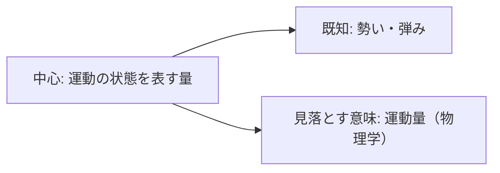

**重要語法**：`conservation of momentum（運動量保存）`

---

## 2882. placement

**品詞**：noun　**発音**：/ˈpleɪsmənt/

<small>よく知られている意味：配置・置くこと</small>

### 見落としやすい意味

**職業紹介・就職先への配属**

**例文**：The college offers job placement support to its graduates.

**和訳**：その大学は卒業生に就職先の紹介支援を提供している。

**コアイメージ**：placement の中心は、人や物を適切な位置に置くこと。人を仕事の場に置くことから、職業紹介や配属という意味になる。

**図**

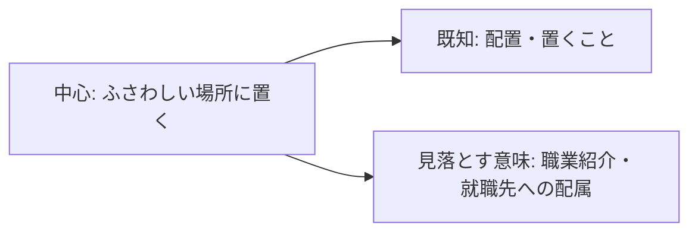

**重要語法**：`job placement（就職あっせん）`

---

## 2883. proxy

**品詞**：noun　**発音**：/ˈprɑksi/

<small>よく知られている意味：代理・代用</small>

### 見落としやすい意味

**代理人・代理権・代行手段**

**例文**：She voted by proxy because she could not attend the meeting.

**和訳**：彼女は会議に出席できなかったため、代理人を通して投票した。

**コアイメージ**：proxy は、本人が直接行わず、別の人やものが代わりに役割を担う考え方。人を指せば代理人、権限を指せば代理権になる。

**図**

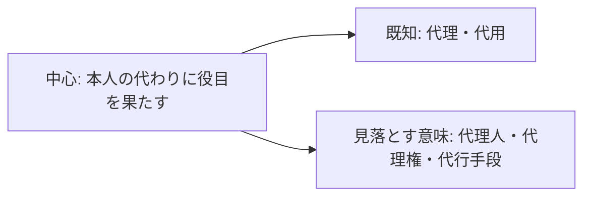

**重要語法**：`by proxy（代理で）`、`proxy vote（代理投票）`

---

## 2884. sweeping

**品詞**：adj　**発音**：/ˈswiːpɪŋ/

<small>よく知られている意味：広範囲に及ぶ</small>

### 見落としやすい意味

**細かい区別を無視した大ざっぱな**

**例文**：The report made sweeping claims without enough evidence.

**和訳**：その報告書は十分な証拠もないまま大ざっぱな主張をした。

**コアイメージ**：sweep は広い範囲をさっと通過する動きを表す。sweeping が主張や一般化に使われると、個々の違いを飛ばして広く言い切るニュアンスになる。

**図**

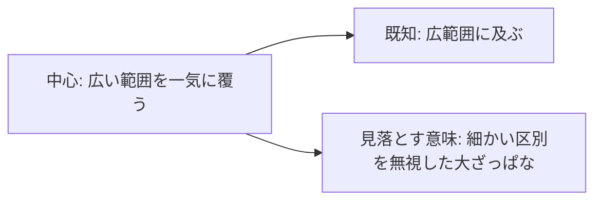

**重要語法**：`sweeping generalization（乱暴な一般化）`

---

## 2885. rude

**品詞**：adj　**発音**：/ruːd/

<small>よく知られている意味：失礼な</small>

### 見落としやすい意味

**未熟で粗末な・原始的な**

**例文**：They lived in a rude shelter built from branches.

**和訳**：彼らは枝で組み立てた粗末な小屋に暮らしていた。

**コアイメージ**：rude の核には、整えられず洗練されていないという感覚がある。人の態度なら「無礼な」、建物や道具なら「粗末な・原始的な」となる。

**図**

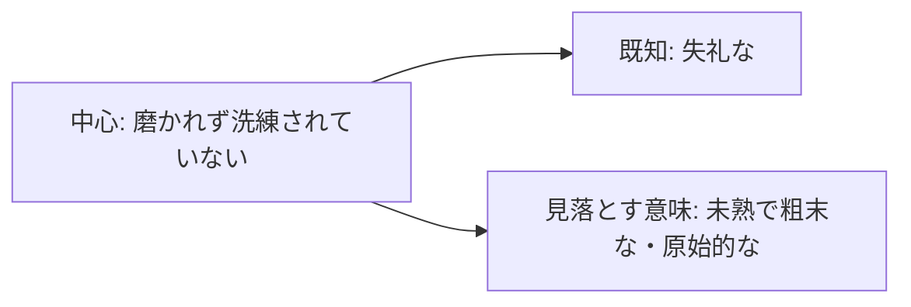

**重要語法**：`a rude shelter（粗末な避難小屋）`

---

## 2886. tackle

**品詞**：noun　**発音**：/ˈtækəl/

<small>よく知られている意味：取り組む・タックルする</small>

### 見落としやすい意味

**釣りなどの用具一式**

**例文**：He packed his fishing tackle before sunrise.

**和訳**：彼は日の出前に釣り道具一式を荷造りした。

**コアイメージ**：tackle は問題に取り組む動詞としてよく使われる。一方、名詞では釣りなどで何かを扱うための用具一式を指す。

**図**

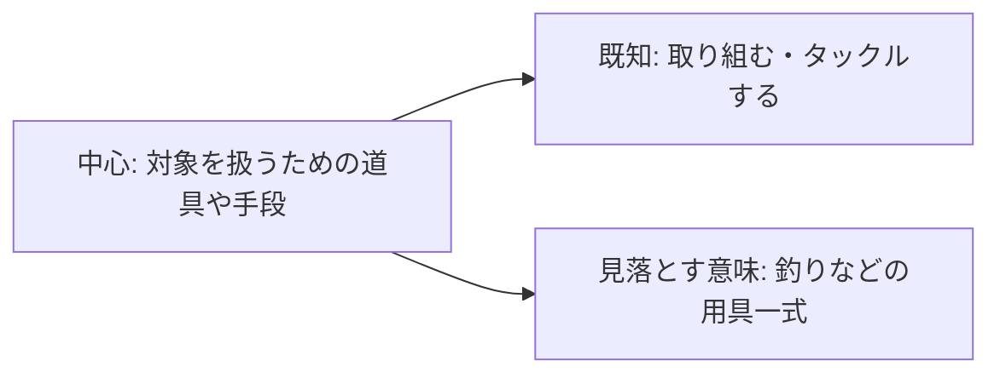

**重要語法**：`fishing tackle（釣り道具一式）`

---

## 2887. suspension

**品詞**：noun　**発音**：/səˈspɛnʃən/

<small>よく知られている意味：つるすこと・一時停止</small>

### 見落としやすい意味

**停学・停職などの処分**

**例文**：The student received a three-day suspension for breaking the rules.

**和訳**：その生徒は規則違反で3日間の停学処分を受けた。

**コアイメージ**：suspend は「つるす」ほか、活動や資格を一時的に止めることを表す。学校や職場での suspension は、通学・勤務を一時的に認めない処分を意味する。

**図**

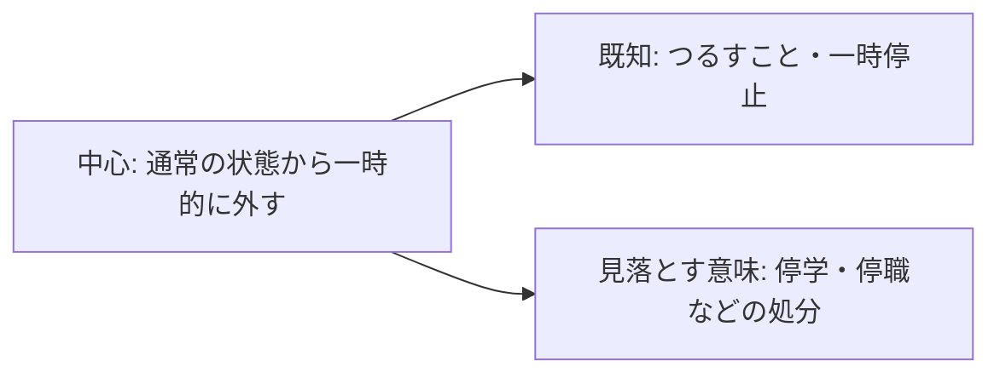

**重要語法**：`suspension from school（停学）`

---

## 2888. offspring

**品詞**：noun　**発音**：/ˈɔːfˌsprɪŋ/

<small>よく知られている意味：子孫・子ども</small>

### 見落としやすい意味

**結果として生まれた産物**

**例文**：The invention was an offspring of years of patient research.

**和訳**：その発明は、何年にもわたる地道な研究から生まれた成果だった。

**コアイメージ**：offspring は親から生まれた子を指すのが基本。比喩的には、研究や発想などから生まれた成果・産物にも使う。

**図**

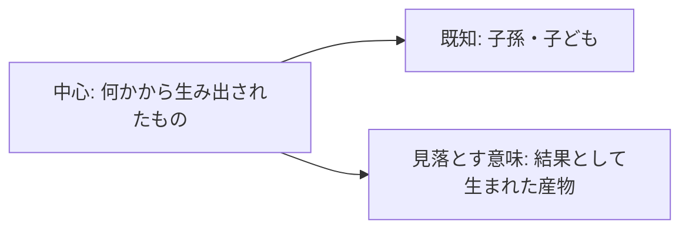

**重要語法**：`the offspring of ...（…から生まれたもの）`

---

## 2889. displacement

**品詞**：noun　**発音**：/dɪsˈpleɪsmənt/

<small>よく知られている意味：移動・置き換え</small>

### 見落としやすい意味

**人々の強制的な移住・立ち退き**

**例文**：The flood caused the displacement of thousands of residents.

**和訳**：洪水によって何千人もの住民が住まいを追われた。

**コアイメージ**：displace は人や物を元の位置から移すこと。人について使われると、災害や紛争などで住み慣れた土地を離れざるを得ない状況を表す。

**図**

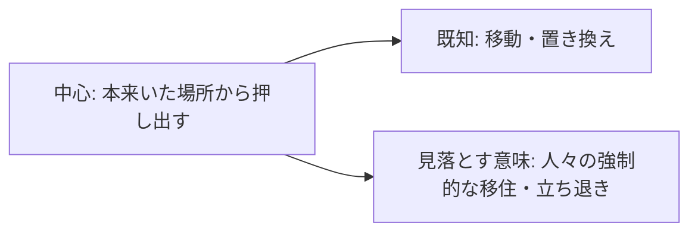

**重要語法**：`forced displacement（強制移住）`

---

## 2890. finite

**品詞**：adj　**発音**：/ˈfaɪnaɪt/

<small>よく知られている意味：有限の</small>

### 見落としやすい意味

**動詞の時制・人称などを示す定形の**

**例文**：In the sentence, 'walked' is a finite verb.

**和訳**：その文では、walked は定形動詞だ。

**コアイメージ**：finite は一般には「限りがある」という意味。文法では、時制や人称などに応じて形が定まる動詞形を finite と呼び、不定詞などと区別する。

**図**

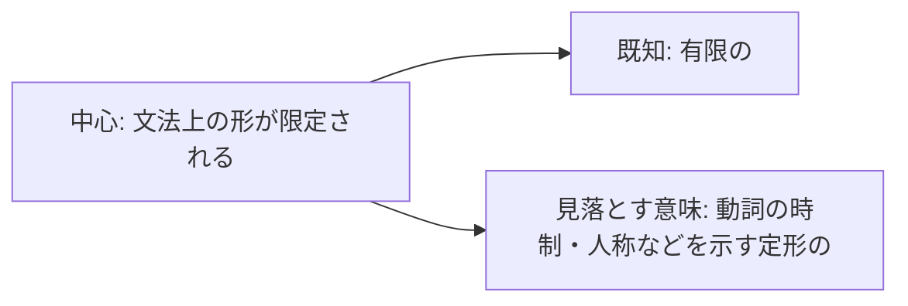

**重要語法**：`finite verb（定形動詞）`、`non-finite verb（非定形動詞）`

---

## 2891. affirm

**品詞**：verb　**発音**：/əˈfɝːm/

<small>よく知られている意味：肯定する・断言する</small>

### 見落としやすい意味

**新たな証拠で裏付ける**

**例文**：The new evidence affirmed the witness's account.

**和訳**：新たな証拠は目撃者の証言を裏付けた。

**コアイメージ**：affirm はある主張や判断を正しいものとして認め、支持すること。証拠が主語になると、その主張を裏付けて確かなものにする意味になる。

**図**

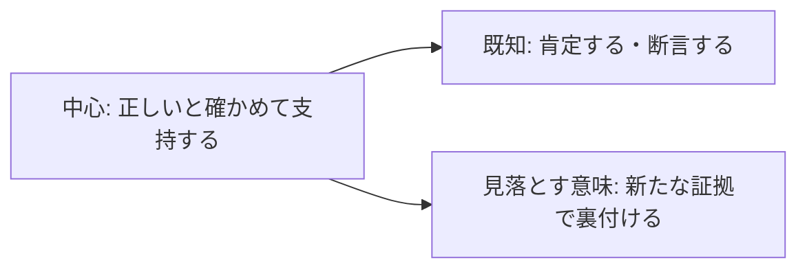

**重要語法**：`affirm a finding（判断を裏付ける）`

---

## 2892. benign

**品詞**：adj　**発音**：/bɪˈnaɪn/

<small>よく知られている意味：穏やかな・親切な</small>

### 見落としやすい意味

**良性の・悪性でない**

**例文**：The tests showed that the tumor was benign.

**和訳**：検査の結果、その腫瘍は良性だと分かった。

**コアイメージ**：benign の中心は、人や物が有害ではなく穏やかなこと。医療では、悪性ではない状態を指して「良性の」と訳す。

**図**

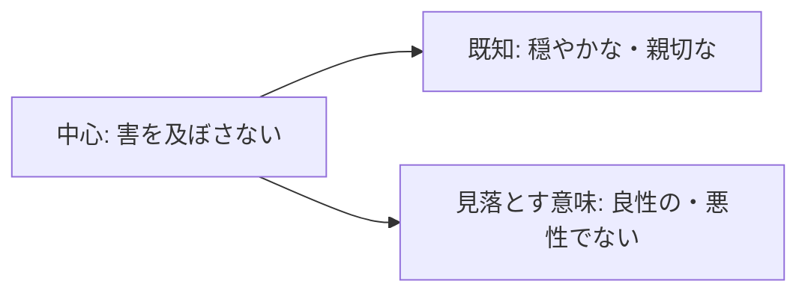

**重要語法**：`benign tumor（良性腫瘍）`

---

## 2893. subordinate

**品詞**：noun　**発音**：/səˈbɔːrdɪnət/

<small>よく知られている意味：従属的な・下位の</small>

### 見落としやすい意味

**部下・従属する人**

**例文**：The manager asked a subordinate to prepare the report.

**和訳**：部長は部下にその報告書を準備するよう頼んだ。

**コアイメージ**：subordinate は上位のものに従う立場を表す。形容詞では「下位の」だが、名詞ではその立場にいる人、つまり部下を指す。

**図**

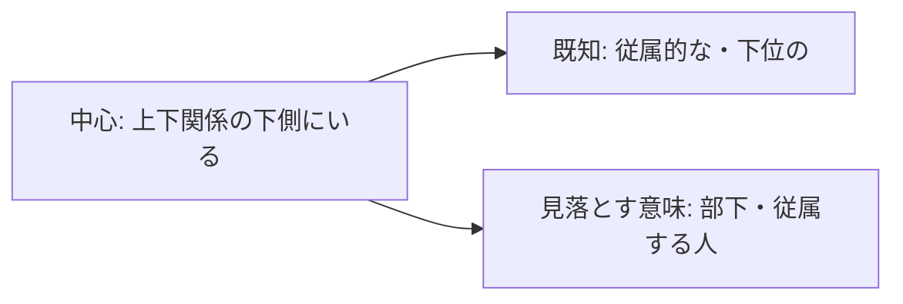

**重要語法**：`a subordinate（部下）`

---

## 2894. subordinate

**品詞**：verb　**発音**：/səˈbɔːrdɪneɪt/

<small>よく知られている意味：従属的な</small>

### 見落としやすい意味

**重要度を低く位置付ける・従属させる**

**例文**：The policy subordinates short-term profit to public safety.

**和訳**：その方針は短期的な利益より公共の安全を優先する。

**コアイメージ**：subordinate を動詞で使うと、あるものを別のものより下位に置くことになる。人を従属させる場合だけでなく、利益などの重要度を下げる場合にも使う。

**図**

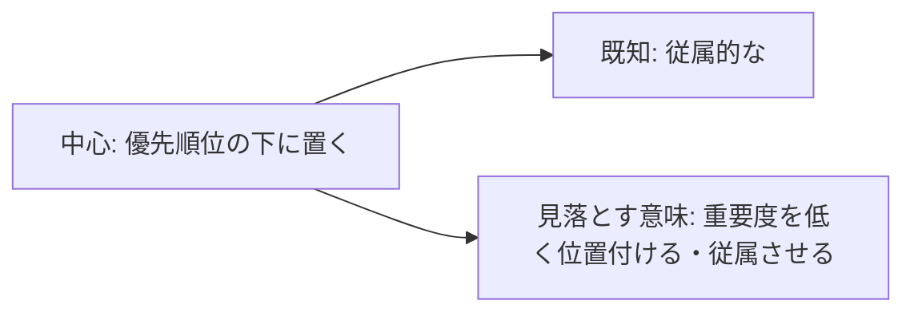

**重要語法**：`subordinate A to B（AをBより下位に置く）`

---

## 2895. dependency

**品詞**：noun　**発音**：/dɪˈpɛndənsi/

<small>よく知られている意味：依存・頼ること</small>

### 見落としやすい意味

**属領・従属地域**

**例文**：The island was once a dependency of the larger country.

**和訳**：その島はかつて、より大きな国の属領だった。

**コアイメージ**：dependency は自立せず何かに頼る状態を表す。政治・地理の文脈では、他国に従属して統治される地域を指す名詞にもなる。

**図**

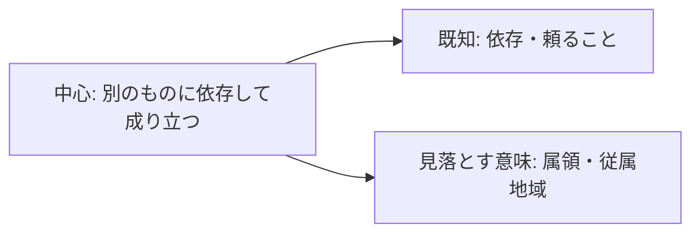

**重要語法**：`an overseas dependency（海外属領）`

---

## 2896. cascade

**品詞**：noun　**発音**：/kæˈskeɪd/

<small>よく知られている意味：滝・小滝</small>

### 見落としやすい意味

**連続して起こる工程・段階**

**例文**：The project involved a cascade of approval stages.

**和訳**：その計画には、承認が次々と続く一連の段階があった。

**コアイメージ**：cascade は水が段になって流れ落ちるイメージが出発点。そこから、段階や手続きが連続して続く様子にも使われる。

**図**

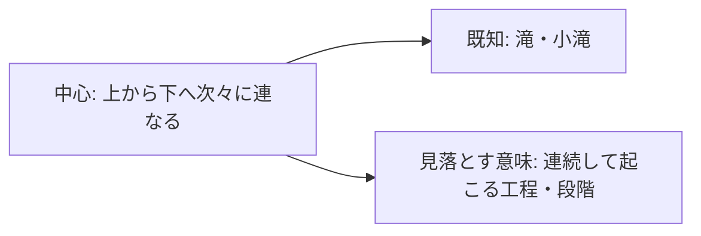

**重要語法**：`a cascade of ...（相次ぐ…）`

---

## 2897. cascade

**品詞**：verb　**発音**：/kæˈskeɪd/

<small>よく知られている意味：滝のように流れる</small>

### 見落としやすい意味

**連鎖的に広がる・次々に起こる**

**例文**：A small mistake can cascade through the entire system.

**和訳**：小さなミスがシステム全体に連鎖的に広がることがある。

**コアイメージ**：水が次々と段を落ちるように、一つの出来事が次に影響する動きを表す。問題や変更などが連鎖的に広がる場面でよく使われる。

**図**

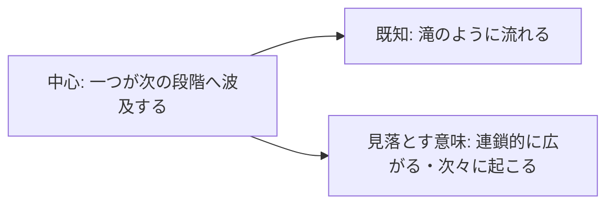

**重要語法**：`cascade through ...（…全体に連鎖的に及ぶ）`

---

## 2898. crane

**品詞**：noun　**発音**：/kreɪn/

<small>よく知られている意味：ツル（鳥）</small>

### 見落としやすい意味

**建設機械のクレーン**

**例文**：A crane lifted the steel beams onto the roof.

**和訳**：クレーンが鉄骨を屋根の上へ持ち上げた。

**コアイメージ**：鳥の crane は長い首を持つツルのこと。建設機械の crane も長く伸びた腕を持ち、物を持ち上げる姿が似ている。

**図**

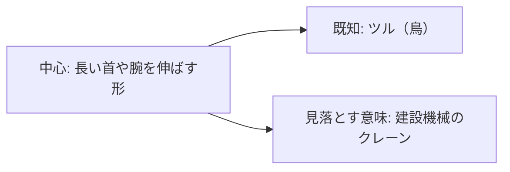

**重要語法**：`tower crane（タワークレーン）`

---

## 2899. crane

**品詞**：verb　**発音**：/kreɪn/

<small>よく知られている意味：ツル・クレーン（名詞）</small>

### 見落としやすい意味

**見ようとして首を伸ばす**

**例文**：She craned her neck to see the stage.

**和訳**：彼女は舞台を見ようと首を伸ばした。

**コアイメージ**：ツルのように長く首を伸ばす動きから、crane は動詞にもなる。見えにくいものを見ようとして首を伸ばすときに使う。

**図**

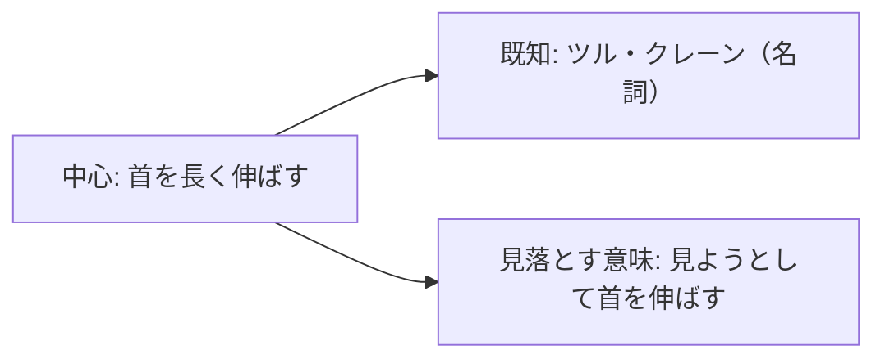

**重要語法**：`crane one's neck（首を伸ばして見る）`

---

## 2900. designation

**品詞**：noun　**発音**：/ˌdɛzɪɡˈneɪʃən/

<small>よく知られている意味：指定・指名</small>

### 見落としやすい意味

**名称・呼称**

**例文**：The park's official designation is a wildlife reserve.

**和訳**：その公園の正式な名称区分は野生生物保護区だ。

**コアイメージ**：designate は人や場所の役割・区分を指定すること。指定した結果として与えられた名称や呼称そのものも designation と呼ぶ。

**図**

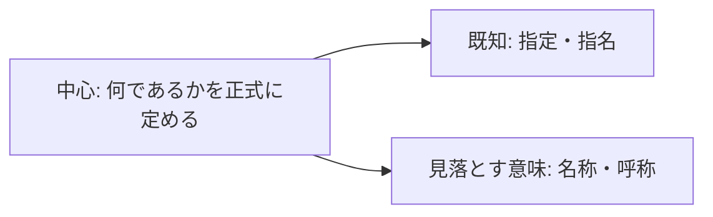

**重要語法**：`official designation（正式名称・指定区分）`

---

## 2901. elegance

**品詞**：noun　**発音**：/ˈɛlɪɡəns/

<small>よく知られている意味：上品さ・優雅さ</small>

### 見落としやすい意味

**解法などの巧みで簡潔な美しさ**

**例文**：The elegance of her proof impressed the mathematics teacher.

**和訳**：彼女の証明の簡潔で巧みな美しさに数学の先生は感心した。

**コアイメージ**：elegance は見た目や振る舞いの優雅さを表す。数式や解法については、余分な手順がなく巧みにまとまっている美しさを指す。

**図**

```mermaid
flowchart LR
    A["中心: 無駄がなく美しく整う"]
    B["既知: 上品さ・優雅さ"]
    C["見落とす意味: 解法などの巧みで簡潔な美しさ"]
    A --> B
    A --> C
```

**重要語法**：`an elegant solution（洗練された解法）`

---

## 2902. eventual

**品詞**：adj　**発音**：/ɪˈvɛntʃuəl/

<small>よく知られている意味：最終的な・結局の</small>

### 見落としやすい意味

**最終的に生じる・実現する**

**例文**：The eventual winner surprised everyone.

**和訳**：最終的な優勝者は皆を驚かせた。

**コアイメージ**：eventual は途中の出来事ではなく、いろいろな経過の末に実際に生じる結果を表す。英語の eventual は「可能性がある」という意味ではない点にも注意する。

**図**

```mermaid
flowchart LR
    A["中心: 経過をたどった末に行き着く"]
    B["既知: 最終的な・結局の"]
    C["見落とす意味: 最終的に生じる・実現する"]
    A --> B
    A --> C
```

**重要語法**：`eventual outcome（最終的な結果）`

---

## 2903. filing

**品詞**：noun　**発音**：/ˈfaɪlɪŋ/

<small>よく知られている意味：書類の整理・ファイリング</small>

### 見落としやすい意味

**（裁判所や行政への）申請・書類の提出**

**例文**：The filing of the lawsuit took place on Monday.

**和訳**：その訴訟の提起は月曜日に行われた。

**コアイメージ**：file は書類を整理して保管すること。裁判所や行政機関に書類を正式に提出し、記録に載せる行為も filing という。

**図**

```mermaid
flowchart LR
    A["中心: 書類を正式な記録に入れる"]
    B["既知: 書類の整理・ファイリング"]
    C["見落とす意味: （裁判所や行政への）申請・書類の提出"]
    A --> B
    A --> C
```

**重要語法**：`filing a lawsuit（訴訟を提起すること）`

---

## 2904. fringe

**品詞**：noun　**発音**：/frɪndʒ/

<small>よく知られている意味：縁・周辺部</small>

### 見落としやすい意味

**主流から外れた少数派・周辺集団**

**例文**：Only a small fringe of the party supported the proposal.

**和訳**：その党では少数の周辺派だけが提案を支持した。

**コアイメージ**：fringe は布の房飾りや物の縁を指す。社会や政治では、中心的な集団の外側にいる少数派にも使う。

**図**

```mermaid
flowchart LR
    A["中心: 中心の外側にある部分"]
    B["既知: 縁・周辺部"]
    C["見落とす意味: 主流から外れた少数派・周辺集団"]
    A --> B
    A --> C
```

**重要語法**：`fringe group（周辺的な集団）`

---

## 2905. fringe

**品詞**：noun　**発音**：/frɪndʒ/

<small>よく知られている意味：縁・房飾り</small>

### 見落としやすい意味

**付加的な給付・福利厚生（熟語）**

**例文**：The company offers health insurance as a fringe benefit.

**和訳**：その会社は付加給付として健康保険を提供している。

**コアイメージ**：fringe は本体の端や付属部分を表す。fringe benefit は基本給とは別に付く給付を指し、福利厚生に相当する。

**図**

```mermaid
flowchart LR
    A["中心: 本体の外側に付くもの"]
    B["既知: 縁・房飾り"]
    C["見落とす意味: 付加的な給付・福利厚生（熟語）"]
    A --> B
    A --> C
```

**重要語法**：`fringe benefits（給与以外の福利厚生）`

---

## 2906. lord

**品詞**：verb　**発音**：/lɔːrd/

<small>よく知られている意味：領主・主君</small>

### 見落としやすい意味

**偉そうに振る舞い威張る**

**例文**：He kept lording it over his younger teammates.

**和訳**：彼は年下のチームメイトに偉そうな態度を取り続けた。

**コアイメージ**：lord は名詞では領主や主君を表す。動詞では自分が上位にいるかのように人を見下して威張る行動を指す。

**図**

```mermaid
flowchart LR
    A["中心: 支配者のように上から振る舞う"]
    B["既知: 領主・主君"]
    C["見落とす意味: 偉そうに振る舞い威張る"]
    A --> B
    A --> C
```

**重要語法**：`lord it over someone（人に威張り散らす）`

---

## 2907. perfume

**品詞**：verb　**発音**：/pɝːˈfjuːm/

<small>よく知られている意味：香水・香り</small>

### 見落としやすい意味

**香りをつける**

**例文**：The flowers perfumed the evening air.

**和訳**：花々が夕方の空気を香りで満たした。

**コアイメージ**：perfume は名詞では香水や芳香のこと。動詞になると、物や空気などに香りを付ける動作を表す。

**図**

```mermaid
flowchart LR
    A["中心: 香りを広げてまとわせる"]
    B["既知: 香水・香り"]
    C["見落とす意味: 香りをつける"]
    A --> B
    A --> C
```

**重要語法**：`perfume the air（空気を香りで満たす）`

---

## 2908. streamline

**品詞**：verb　**発音**：/ˈstriːmlaɪn/

<small>よく知られている意味：流線形</small>

### 見落としやすい意味

**手順や組織を合理化・効率化する**

**例文**：The school streamlined its application process.

**和訳**：その学校は出願手続きを簡素化した。

**コアイメージ**：流線形は空気や水の抵抗を小さくする形。そこから、手順や組織の無駄を減らして効率よくする動詞の意味へ広がる。

**図**

```mermaid
flowchart LR
    A["中心: 抵抗や無駄を取り除く"]
    B["既知: 流線形"]
    C["見落とす意味: 手順や組織を合理化・効率化する"]
    A --> B
    A --> C
```

**重要語法**：`streamline a process（手続きを効率化する）`

---

## 2909. takeover

**品詞**：noun　**発音**：/ˈteɪkˌoʊvər/

<small>よく知られている意味：引き継ぎ・乗っ取り</small>

### 見落としやすい意味

**企業・事業の買収・支配権取得**

**例文**：The board approved the takeover of the smaller firm.

**和訳**：取締役会はその小規模企業の買収を承認した。

**コアイメージ**：take over は他者から管理や支配を引き継ぐこと。企業の文脈では、所有や経営の支配権を得る買収を表す名詞になる。

**図**

```mermaid
flowchart LR
    A["中心: 管理・支配を引き受ける"]
    B["既知: 引き継ぎ・乗っ取り"]
    C["見落とす意味: 企業・事業の買収・支配権取得"]
    A --> B
    A --> C
```

**重要語法**：`hostile takeover（敵対的買収）`

---

## 2910. sunshine

**品詞**：noun　**発音**：/ˈsʌnʃaɪn/

<small>よく知られている意味：日光・日差し</small>

### 見落としやすい意味

**周囲を明るくする陽気さ**

**例文**：Her cheerful words brought sunshine into the gloomy room.

**和訳**：彼女の明るい言葉が沈んだ部屋の雰囲気を和ませた。

**コアイメージ**：sunshine は文字どおり日差しを指す。比喩的には、周囲を明るく感じさせる人の陽気さや温かさにも用いられる。

**図**

```mermaid
flowchart LR
    A["中心: 周囲を明るく温かくする"]
    B["既知: 日光・日差し"]
    C["見落とす意味: 周囲を明るくする陽気さ"]
    A --> B
    A --> C
```

**重要語法**：`a ray of sunshine（周囲を明るくする人・存在）`

---

## 2911. tired

**品詞**：adj　**発音**：/ˈtaɪərd/

<small>よく知られている意味：疲れた</small>

### 見落としやすい意味

**使い古されて聞き飽きた**

**例文**：The article repeats the same tired arguments.

**和訳**：その記事は使い古された議論を繰り返している。

**コアイメージ**：人が tired なら疲労している状態。考えや表現に使うと、何度も使われて新鮮味がなく、聞き飽きたという意味になる。

**図**

```mermaid
flowchart LR
    A["中心: 使われすぎて新鮮さを失う"]
    B["既知: 疲れた"]
    C["見落とす意味: 使い古されて聞き飽きた"]
    A --> B
    A --> C
```

**重要語法**：`a tired cliché（使い古された決まり文句）`

---

## 2912. burning

**品詞**：adj　**発音**：/ˈbɝːnɪŋ/

<small>よく知られている意味：燃えている</small>

### 見落としやすい意味

**差し迫った・切実な**

**例文**：We still need an answer to this burning question.

**和訳**：私たちはこの差し迫った問題にまだ答えを出さなければならない。

**コアイメージ**：burning は燃えて熱を放つこと。質問や課題に付くと、早く答えを出したいほど強く差し迫った状態を表す。

**図**

```mermaid
flowchart LR
    A["中心: 炎のように強い切迫感"]
    B["既知: 燃えている"]
    C["見落とす意味: 差し迫った・切実な"]
    A --> B
    A --> C
```

**重要語法**：`a burning question（差し迫った疑問）`

---

## 2913. sphere

**品詞**：noun　**発音**：/sfɪr/

<small>よく知られている意味：球・球体</small>

### 見落としやすい意味

**活動・影響が及ぶ領域・分野**

**例文**：Science and politics belong to different spheres of activity.

**和訳**：科学と政治は異なる活動領域に属する。

**コアイメージ**：sphere は空間的には球体のこと。比喩的には、人の活動や影響力が及ぶ範囲をひとまとまりの領域として表す。

**図**

```mermaid
flowchart LR
    A["中心: ある範囲を包むまとまり"]
    B["既知: 球・球体"]
    C["見落とす意味: 活動・影響が及ぶ領域・分野"]
    A --> B
    A --> C
```

**重要語法**：`sphere of influence（影響圏）`

---

## 2914. bump

**品詞**：verb　**発音**：/bʌmp/

<small>よく知られている意味：ぶつかる・衝突する</small>

### 見落としやすい意味

**順位・等級などを下げる**

**例文**：We were bumped down to economy class after a booking change.

**和訳**：予約変更の結果、私たちはエコノミークラスに格下げされた。

**コアイメージ**：bump はぶつかって位置を動かすことが基本。階級や座席の等級について使うと、上位から下位へ移す意味にもなる。

**図**

```mermaid
flowchart LR
    A["中心: 衝撃を与えて位置をずらす"]
    B["既知: ぶつかる・衝突する"]
    C["見落とす意味: 順位・等級などを下げる"]
    A --> B
    A --> C
```

**重要語法**：`bump someone down（人を格下げする）`

---

## 2915. bump

**品詞**：verb　**発音**：/bʌmp/

<small>よく知られている意味：ぶつかる</small>

### 見落としやすい意味

**偶然出会う・出くわす**

**例文**：I bumped into my old teacher at the station.

**和訳**：駅で昔の先生にばったり会った。

**コアイメージ**：bump は偶然ぶつかる動き。人に対する bump into は、実際に衝突せずとも偶然出会うことを表す。

**図**

```mermaid
flowchart LR
    A["中心: 予期せず接触する"]
    B["既知: ぶつかる"]
    C["見落とす意味: 偶然出会う・出くわす"]
    A --> B
    A --> C
```

**重要語法**：`bump into someone（人にばったり会う）`

---

## 2916. rider

**品詞**：noun　**発音**：/ˈraɪdər/

<small>よく知られている意味：乗り手・自転車に乗る人</small>

### 見落としやすい意味

**法案に添える付帯条項**

**例文**：A rider attached to the bill changed its funding rules.

**和訳**：法案に付けられた付帯条項が資金に関する規則を変更した。

**コアイメージ**：rider は乗り物に乗る人が基本の意味。法律分野では、本体の法案に付随する追加条項を指す専門的な意味もある。

**図**

```mermaid
flowchart LR
    A["中心: 本体に付いて加わるもの"]
    B["既知: 乗り手・自転車に乗る人"]
    C["見落とす意味: 法案に添える付帯条項"]
    A --> B
    A --> C
```

**重要語法**：`a rider to a bill（法案の付帯条項）`

---

## 2917. decisive

**品詞**：adj　**発音**：/dɪˈsaɪsɪv/

<small>よく知られている意味：決断力のある・きっぱりした</small>

### 見落としやすい意味

**勝敗・結論を左右する決定的な**

**例文**：The goalkeeper made the decisive save in the final minute.

**和訳**：ゴールキーパーは終了間際に勝敗を決めるセーブをした。

**コアイメージ**：decisive は決断をためらわない態度にも使われる。出来事や要因に付くと、結末を決定づけるほど重要だという意味になる。

**図**

```mermaid
flowchart LR
    A["中心: 結果をはっきり決める"]
    B["既知: 決断力のある・きっぱりした"]
    C["見落とす意味: 勝敗・結論を左右する決定的な"]
    A --> B
    A --> C
```

**重要語法**：`decisive factor（決定的な要因）`

---

## 2918. bidding

**品詞**：noun　**発音**：/ˈbɪdɪŋ/

<small>よく知られている意味：入札・競り</small>

### 見落としやすい意味

**命令・指図**

**例文**：The assistant acted at the director's bidding.

**和訳**：その助手は監督の指示に従って行動した。

**コアイメージ**：bid には価格を提示する意味のほか、人に何かを命じる古い用法がある。bidding はその延長で、特に at someone's bidding で「人の指図で」を表す。

**図**

```mermaid
flowchart LR
    A["中心: 相手に行動を求める"]
    B["既知: 入札・競り"]
    C["見落とす意味: 命令・指図"]
    A --> B
    A --> C
```

**重要語法**：`at someone's bidding（人の命令で）`、`do someone's bidding（人の言いなりに動く）`

---

## 2919. captive

**品詞**：adj　**発音**：/ˈkæptɪv/

<small>よく知られている意味：捕らわれた・捕虜の</small>

### 見落としやすい意味

**心を奪われて離れられない**

**例文**：The audience was held captive by the storyteller's voice.

**和訳**：聴衆は語り手の声にすっかり引き込まれた。

**コアイメージ**：captive はもともと自由を奪われている状態を表す。比喩的には、魅力に心を奪われてそこから意識を離せない状態にも使う。

**図**

```mermaid
flowchart LR
    A["中心: 注意を引きつけて離さない"]
    B["既知: 捕らわれた・捕虜の"]
    C["見落とす意味: 心を奪われて離れられない"]
    A --> B
    A --> C
```

**重要語法**：`hold someone captive（人を夢中にさせる）`

---

## 2920. captive

**品詞**：adj　**発音**：/ˈkæptɪv/

<small>よく知られている意味：捕虜の・とらわれた</small>

### 見落としやすい意味

**その場から離れられない・逃げられない**

**例文**：The passengers on the delayed train were a captive audience for the announcement.

**和訳**：遅延した列車の乗客たちは、その案内放送を聞かざるを得ない立場だった。

**コアイメージ**：captive の基本は自由に動けない状態。captive audience は、状況上その場を離れられず、話などを聞くしかない聴衆を指す。

**図**

```mermaid
flowchart LR
    A["中心: その場から自由に離れられない"]
    B["既知: 捕虜の・とらわれた"]
    C["見落とす意味: その場から離れられない・逃げられない"]
    A --> B
    A --> C
```

**重要語法**：`captive audience（その場を離れられない聴衆）`

---

## 2921. cocktail

**品詞**：noun　**発音**：/ˈkɑːkˌteɪl/

<small>よく知られている意味：カクテル・混合飲料</small>

### 見落としやすい意味

**異種の要素を混ぜ合わせたもの**

**例文**：The exhibition offered a cocktail of art, science, and technology.

**和訳**：その展示会は芸術・科学・技術を混ぜ合わせた内容だった。

**コアイメージ**：cocktail は複数の材料を組み合わせた飲み物を表す。比喩的には、性質の異なる要素を混ぜ合わせたもの全般を指す。

**図**

```mermaid
flowchart LR
    A["中心: 異なる材料を混ぜたもの"]
    B["既知: カクテル・混合飲料"]
    C["見落とす意味: 異種の要素を混ぜ合わせたもの"]
    A --> B
    A --> C
```

**重要語法**：`a cocktail of ...（さまざまな…を混ぜたもの）`

---

## 2922. slash

**品詞**：verb　**発音**：/slæʃ/

<small>よく知られている意味：斜線・切りつける</small>

### 見落としやすい意味

**価格・予算などを大幅に引き下げる**

**例文**：The company slashed ticket prices for students.

**和訳**：その会社は学生向けのチケット価格を大幅に引き下げた。

**コアイメージ**：slash には勢いよく切る動きがある。価格や予算を目的語にすると、数字を大幅に削減するという比喩になる。

**図**

```mermaid
flowchart LR
    A["中心: 一気に大きく切り落とす"]
    B["既知: 斜線・切りつける"]
    C["見落とす意味: 価格・予算などを大幅に引き下げる"]
    A --> B
    A --> C
```

**重要語法**：`slash prices（価格を大幅に下げる）`

---

## 2923. lump

**品詞**：verb　**発音**：/lʌmp/

<small>よく知られている意味：塊・こぶ</small>

### 見落としやすい意味

**異なるものを一括りにする**

**例文**：We should not lump all these different problems together.

**和訳**：こうした異なる問題を全部ひとまとめにすべきではない。

**コアイメージ**：lump は名詞なら一つの塊を指す。動詞では、違うものでも区別せずに一つのグループとして扱う意味になる。

**図**

```mermaid
flowchart LR
    A["中心: 一つの塊として扱う"]
    B["既知: 塊・こぶ"]
    C["見落とす意味: 異なるものを一括りにする"]
    A --> B
    A --> C
```

**重要語法**：`lump A together with B（AとBを一括りにする）`

---

## 2924. plaque

**品詞**：noun　**発音**：/plæk/

<small>よく知られている意味：記念の銘板</small>

### 見落としやすい意味

**歯垢・細菌の膜**

**例文**：Regular brushing helps prevent the buildup of dental plaque.

**和訳**：定期的な歯磨きは歯垢がたまるのを防ぐのに役立つ。

**コアイメージ**：plaque は表面に付着した平たいものや層を指す語。歯科では歯の表面に付く細菌の膜、つまり歯垢を表す。

**図**

```mermaid
flowchart LR
    A["中心: 表面に付いて層になるもの"]
    B["既知: 記念の銘板"]
    C["見落とす意味: 歯垢・細菌の膜"]
    A --> B
    A --> C
```

**重要語法**：`dental plaque（歯垢）`

---

## 2925. differentiate

**品詞**：verb　**発音**：/ˌdɪfəˈrɛnʃieɪt/

<small>よく知られている意味：区別する・違いを生む</small>

### 見落としやすい意味

**数学で関数を微分する**

**例文**：In this problem, differentiate the function with respect to x.

**和訳**：この問題では、その関数を x で微分しなさい。

**コアイメージ**：differentiate は基本的に違いを明らかにすること。数学では、変数の微小な変化に対する関数の変化率を求める操作を表す。

**図**

```mermaid
flowchart LR
    A["中心: 変化の違いを捉える"]
    B["既知: 区別する・違いを生む"]
    C["見落とす意味: 数学で関数を微分する"]
    A --> B
    A --> C
```

**重要語法**：`differentiate with respect to x（xで微分する）`

---

## 2926. fossil

**品詞**：noun　**発音**：/ˈfɑːsəl/

<small>よく知られている意味：化石</small>

### 見落としやすい意味

**古い考えに固執する時代遅れの人**

**例文**：My grandfather jokingly calls himself a fossil when discussing new technology.

**和訳**：祖父は新しい技術の話になると、冗談で自分を時代遅れの人間と呼ぶ。

**コアイメージ**：fossil は古い生物の形が地中に残った化石のこと。人に使うと、古い考えや習慣から変わらない人という皮肉になる。

**図**

```mermaid
flowchart LR
    A["中心: 昔の形のまま残っている"]
    B["既知: 化石"]
    C["見落とす意味: 古い考えに固執する時代遅れの人"]
    A --> B
    A --> C
```

**重要語法**：`an old fossil（時代遅れの人：くだけた・失礼にもなり得る表現）`

---

## 2927. diagnose

**品詞**：verb　**発音**：/ˌdaɪəɡˈnoʊs/

<small>よく知られている意味：病気を診断する</small>

### 見落としやすい意味

**不具合・問題の原因を見極める**

**例文**：The engineer diagnosed the cause of the network failure.

**和訳**：技術者はネットワーク障害の原因を突き止めた。

**コアイメージ**：diagnose は症状を調べて病気を特定すること。機械や組織の問題にも広がり、表面に現れた不具合から原因を見極める意味で使う。

**図**

```mermaid
flowchart LR
    A["中心: 症状から原因を見極める"]
    B["既知: 病気を診断する"]
    C["見落とす意味: 不具合・問題の原因を見極める"]
    A --> B
    A --> C
```

**重要語法**：`diagnose a problem（問題の原因を特定する）`

---

## 2928. defer

**品詞**：verb　**発音**：/dɪˈfɝː/

<small>よく知られている意味：延期する・先送りする</small>

### 見落としやすい意味

**他人の考え・意向を尊重して従う**

**例文**：On this issue, I defer to the judgment of the experts.

**和訳**：この問題では、専門家の判断を尊重して従う。

**コアイメージ**：defer は何かを後回しにする意味で知られる。同じ綴りの defer to は、自分の判断を控えて相手の意見や権威を優先する意味になる。

**図**

```mermaid
flowchart LR
    A["中心: 判断を相手に譲る"]
    B["既知: 延期する・先送りする"]
    C["見落とす意味: 他人の考え・意向を尊重して従う"]
    A --> B
    A --> C
```

**重要語法**：`defer to someone（人の判断を尊重して従う）`

---

## 2929. defer

**品詞**：verb　**発音**：/dɪˈfɝː/

<small>よく知られている意味：他人の判断を尊重する（defer to）</small>

### 見落としやすい意味

**延期する・先送りする**

**例文**：The committee decided to defer its decision until next month.

**和訳**：委員会は決定を来月まで延期することにした。

**コアイメージ**：defer は実施する時期を後にずらす意味にもなる。defer to（人の判断を尊重する）と異なり、ここでは予定や決定を先送りする。

**図**

```mermaid
flowchart LR
    A["中心: 実行・判断をいったん後に送る"]
    B["既知: 他人の判断を尊重する（defer to）"]
    C["見落とす意味: 延期する・先送りする"]
    A --> B
    A --> C
```

**重要語法**：`defer a decision（決定を延期する）`

---

## 2930. chunk

**品詞**：noun　**発音**：/tʃʌŋk/

<small>よく知られている意味：大きな塊</small>

### 見落としやすい意味

**かなり大きな量・部分**

**例文**：A large chunk of the budget goes to maintaining the library.

**和訳**：予算のかなり大きな部分が図書館の維持に使われている。

**コアイメージ**：chunk は物理的な大きな塊を表す。予算や時間など、形のない全体についても、かなりの割合を占める部分を指す。

**図**

```mermaid
flowchart LR
    A["中心: 全体から切り取った大きな塊"]
    B["既知: 大きな塊"]
    C["見落とす意味: かなり大きな量・部分"]
    A --> B
    A --> C
```

**重要語法**：`a large chunk of ...（…のかなり大きな部分）`

---

## 2931. fuss

**品詞**：verb　**発音**：/fʌs/

<small>よく知られている意味：騒ぎ・大騒ぎ（名詞）</small>

### 見落としやすい意味

**小さなことで騒ぎ立てる・気を揉む**

**例文**：Don't fuss over every tiny detail.

**和訳**：細かな点を一つ一つ気にして騒がなくてもいい。

**コアイメージ**：fuss は些細なことを大きく扱う騒ぎを表す名詞にもなる。動詞では、細かいことを過度に気にしたり騒いだりすることをいう。

**図**

```mermaid
flowchart LR
    A["中心: 小さなことに過剰に反応する"]
    B["既知: 騒ぎ・大騒ぎ（名詞）"]
    C["見落とす意味: 小さなことで騒ぎ立てる・気を揉む"]
    A --> B
    A --> C
```

**重要語法**：`fuss over/about ...（…について細かく気にする）`

---

## 2932. inscription

**品詞**：noun　**発音**：/ɪnˈskrɪpʃən/

<small>よく知られている意味：文字を刻んだ碑文</small>

### 見落としやすい意味

**書物などに書く献辞・贈り言葉**

**例文**：The author wrote a warm inscription inside the book.

**和訳**：著者はその本の内側に温かい献辞を書いた。

**コアイメージ**：inscription は物に書いたり刻んだりした言葉を指す。記念碑の文字だけでなく、贈る本に書き添える献辞にも使う。

**図**

```mermaid
flowchart LR
    A["中心: 残るように書き込む言葉"]
    B["既知: 文字を刻んだ碑文"]
    C["見落とす意味: 書物などに書く献辞・贈り言葉"]
    A --> B
    A --> C
```

**重要語法**：`a personal inscription（個人的な献辞）`

---

## 2933. lookout

**品詞**：noun　**発音**：/ˈlʊkˌaʊt/

<small>よく知られている意味：見張り役・見張り台</small>

### 見落としやすい意味

**警戒・見張り（熟語）**

**例文**：We are on the lookout for a quieter place to study.

**和訳**：私たちはもっと静かに勉強できる場所を探している。

**コアイメージ**：lookout は危険や変化を見張る役目や場所を指す。on the lookout for は見つける機会を逃さないよう注意して探している状態になる。

**図**

```mermaid
flowchart LR
    A["中心: 周囲を注意深く見渡す"]
    B["既知: 見張り役・見張り台"]
    C["見落とす意味: 警戒・見張り（熟語）"]
    A --> B
    A --> C
```

**重要語法**：`be on the lookout for ...（…を注意して探している）`

---

## 2934. mold

**品詞**：noun　**発音**：/moʊld/

<small>よく知られている意味：型・鋳型</small>

### 見落としやすい意味

**カビ**

**例文**：Mold appeared on the bread after it was left in a damp room.

**和訳**：湿った部屋に置いていたパンにカビが生えた。

**コアイメージ**：mold には「型」とは別に、湿気の多い場所で広がる菌類を表す意味がある。発音と綴りは同じでも、型の意味から無理に推測しない方がよい。

**図**

```mermaid
flowchart LR
    A["中心: 表面に広がって育つもの"]
    B["既知: 型・鋳型"]
    C["見落とす意味: カビ"]
    A --> B
    A --> C
```

**重要語法**：`black mold（黒いカビ）`

---

## 2935. mold

**品詞**：verb　**発音**：/moʊld/

<small>よく知られている意味：型に入れて形作る</small>

### 見落としやすい意味

**人の性格や考えを形成する**

**例文**：Early experiences can mold a child's attitudes toward learning.

**和訳**：幼いころの経験は学びに対する子どもの考え方を形作ることがある。

**コアイメージ**：mold は型に入れて形を作ること。人の性格や考えにも使え、経験や環境がそれらの形を作っていくことを表す。

**図**

```mermaid
flowchart LR
    A["中心: 材料に形を与える"]
    B["既知: 型に入れて形作る"]
    C["見落とす意味: 人の性格や考えを形成する"]
    A --> B
    A --> C
```

**重要語法**：`mold someone's character（人の性格を形成する）`

---

## 2936. nod

**品詞**：noun　**発音**：/nɑːd/

<small>よく知られている意味：うなずき</small>

### 見落としやすい意味

**承認・指名の合図**

**例文**：After the audition, she got the nod for the leading role.

**和訳**：オーディションの後、彼女は主役に選ばれた。

**コアイメージ**：nod は頭をうなずかせる動き。そこから、言葉にしない承認や選出の合図を指す名詞として使われる。

**図**

```mermaid
flowchart LR
    A["中心: 小さな動きで賛意を示す"]
    B["既知: うなずき"]
    C["見落とす意味: 承認・指名の合図"]
    A --> B
    A --> C
```

**重要語法**：`get the nod（選ばれる・承認を得る）`

---

## 2937. ounce

**品詞**：noun　**発音**：/aʊns/

<small>よく知られている意味：重量単位のオンス</small>

### 見落としやすい意味

**わずかな量（否定語とともに）**

**例文**：There isn't an ounce of truth in that rumor.

**和訳**：そのうわさには真実が少しも含まれていない。

**コアイメージ**：ounce は本来重さを測る単位。否定文などでは、ほんのわずかな量さえないことを強調する比喩になる。

**図**

```mermaid
flowchart LR
    A["中心: ごく小さな一部分"]
    B["既知: 重量単位のオンス"]
    C["見落とす意味: わずかな量（否定語とともに）"]
    A --> B
    A --> C
```

**重要語法**：`not an ounce of ...（…が少しもない）`

---

## 2938. qualification

**品詞**：noun　**発音**：/ˌkwɑːlɪfɪˈkeɪʃən/

<small>よく知られている意味：資格・適格性</small>

### 見落としやすい意味

**主張に付ける留保・限定**

**例文**：I agree with the proposal, but with one qualification.

**和訳**：私はその提案に賛成だが、一点だけ留保がある。

**コアイメージ**：qualification は条件を満たす資格の意味でよく使う。発言や賛成の度合いについては、そのまま受け入れないための留保や限定条件を指す。

**図**

```mermaid
flowchart LR
    A["中心: 無条件ではなく範囲を限定する"]
    B["既知: 資格・適格性"]
    C["見落とす意味: 主張に付ける留保・限定"]
    A --> B
    A --> C
```

**重要語法**：`with qualifications（一定の留保付きで）`

---

## 2939. qualification

**品詞**：noun　**発音**：/ˌkwɑːlɪfɪˈkeɪʃən/

<small>よく知られている意味：限定・留保</small>

### 見落としやすい意味

**資格・適格性**

**例文**：The position requires teaching qualifications and practical experience.

**和訳**：その職には教員としての資格と実務経験が必要だ。

**コアイメージ**：qualify はある条件を満たして適格になること。qualification はその結果として得られる資格や、それを証明する能力・条件を表す。

**図**

```mermaid
flowchart LR
    A["中心: 条件を満たして適格になる"]
    B["既知: 限定・留保"]
    C["見落とす意味: 資格・適格性"]
    A --> B
    A --> C
```

**重要語法**：`professional qualifications（専門職の資格）`

---

## 2940. spike

**品詞**：verb　**発音**：/spaɪk/

<small>よく知られている意味：釘・とがった突起</small>

### 見落としやすい意味

**数値が急増する**

**例文**：Demand for electricity spiked during the heat wave.

**和訳**：熱波の間、電力需要が急増した。

**コアイメージ**：spike は先のとがった突起を表す。グラフの数値が針のように急上昇する様子から、急増するという動詞の意味になる。

**図**

```mermaid
flowchart LR
    A["中心: 針のように急に突き上がる"]
    B["既知: 釘・とがった突起"]
    C["見落とす意味: 数値が急増する"]
    A --> B
    A --> C
```

**重要語法**：`prices spike（価格が急騰する）`

---

