# EasyVoca｜完成教材カード Batch 037

採用済み語義の global_order 2881〜2960 を収録。既知の意味は補足、見落としやすい意味が学習の中心です。

## 2881. momentum

**品詞**：noun　**発音**：/moʊˈmɛntəm/

<small>よく知られている意味：勢い・弾み</small>

### 見落としやすい意味

**運動量（物理学）**

**例文**：In a closed system, total momentum remains constant.

**和訳**：閉じた系では、運動量の合計は一定に保たれる。

**コアイメージ**：もともとは物体の運動に関係する概念で、物理学では質量と速度を掛けた量を指す。そこから、物事が進み続ける「勢い」という比喩的な意味も生まれる。

**図**

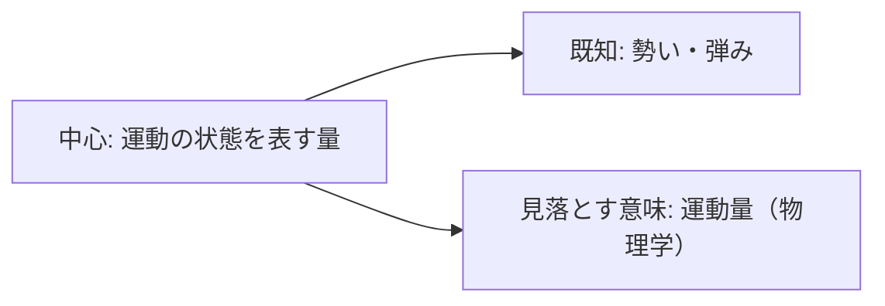

**重要語法**：`conservation of momentum（運動量保存）`

---

## 2882. placement

**品詞**：noun　**発音**：/ˈpleɪsmənt/

<small>よく知られている意味：配置・置くこと</small>

### 見落としやすい意味

**職業紹介・就職先への配属**

**例文**：The college offers job placement support to its graduates.

**和訳**：その大学は卒業生に就職先の紹介支援を提供している。

**コアイメージ**：placement の中心は、人や物を適切な位置に置くこと。人を仕事の場に置くことから、職業紹介や配属という意味になる。

**図**

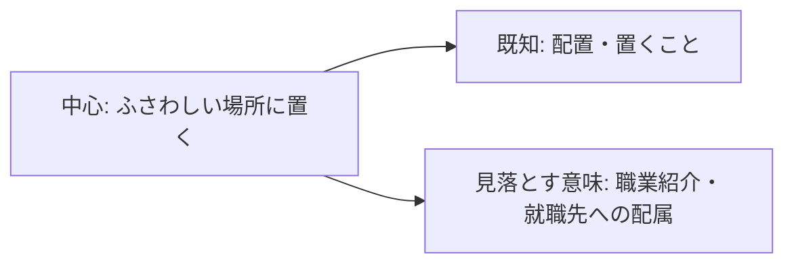

**重要語法**：`job placement（就職あっせん）`

---

## 2883. proxy

**品詞**：noun　**発音**：/ˈprɑksi/

<small>よく知られている意味：代理・代用</small>

### 見落としやすい意味

**代理人・代理権・代行手段**

**例文**：She voted by proxy because she could not attend the meeting.

**和訳**：彼女は会議に出席できなかったため、代理人を通して投票した。

**コアイメージ**：proxy は、本人が直接行わず、別の人やものが代わりに役割を担う考え方。人を指せば代理人、権限を指せば代理権になる。

**図**

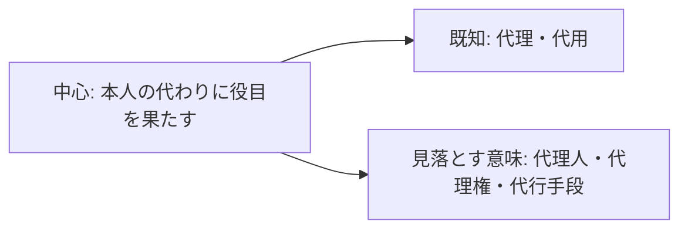

**重要語法**：`by proxy（代理で）`、`proxy vote（代理投票）`

---

## 2884. sweeping

**品詞**：adj　**発音**：/ˈswiːpɪŋ/

<small>よく知られている意味：広範囲に及ぶ</small>

### 見落としやすい意味

**細かい区別を無視した大ざっぱな**

**例文**：The report made sweeping claims without enough evidence.

**和訳**：その報告書は十分な証拠もないまま大ざっぱな主張をした。

**コアイメージ**：sweep は広い範囲をさっと通過する動きを表す。sweeping が主張や一般化に使われると、個々の違いを飛ばして広く言い切るニュアンスになる。

**図**

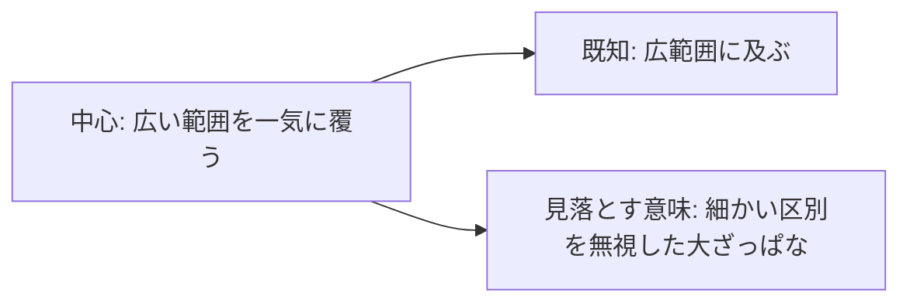

**重要語法**：`sweeping generalization（乱暴な一般化）`

---

## 2885. rude

**品詞**：adj　**発音**：/ruːd/

<small>よく知られている意味：失礼な</small>

### 見落としやすい意味

**未熟で粗末な・原始的な**

**例文**：They lived in a rude shelter built from branches.

**和訳**：彼らは枝で組み立てた粗末な小屋に暮らしていた。

**コアイメージ**：rude の核には、整えられず洗練されていないという感覚がある。人の態度なら「無礼な」、建物や道具なら「粗末な・原始的な」となる。

**図**

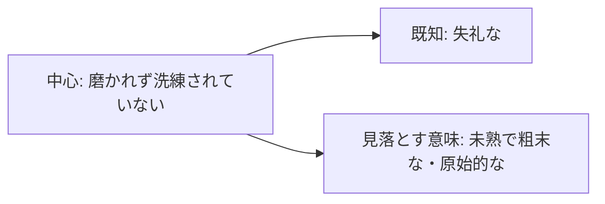

**重要語法**：`a rude shelter（粗末な避難小屋）`

---

## 2886. tackle

**品詞**：noun　**発音**：/ˈtækəl/

<small>よく知られている意味：取り組む・タックルする</small>

### 見落としやすい意味

**釣りなどの用具一式**

**例文**：He packed his fishing tackle before sunrise.

**和訳**：彼は日の出前に釣り道具一式を荷造りした。

**コアイメージ**：tackle は問題に取り組む動詞としてよく使われる。一方、名詞では釣りなどで何かを扱うための用具一式を指す。

**図**

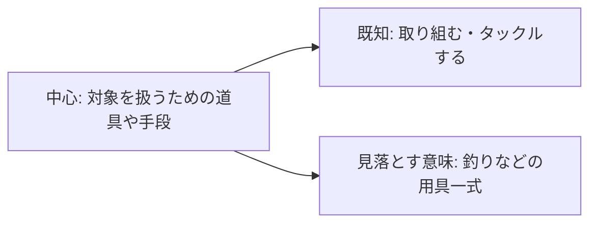

**重要語法**：`fishing tackle（釣り道具一式）`

---

## 2887. suspension

**品詞**：noun　**発音**：/səˈspɛnʃən/

<small>よく知られている意味：つるすこと・一時停止</small>

### 見落としやすい意味

**停学・停職などの処分**

**例文**：The student received a three-day suspension for breaking the rules.

**和訳**：その生徒は規則違反で3日間の停学処分を受けた。

**コアイメージ**：suspend は「つるす」ほか、活動や資格を一時的に止めることを表す。学校や職場での suspension は、通学・勤務を一時的に認めない処分を意味する。

**図**

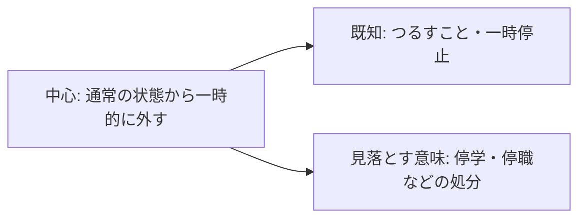

**重要語法**：`suspension from school（停学）`

---

## 2888. offspring

**品詞**：noun　**発音**：/ˈɔːfˌsprɪŋ/

<small>よく知られている意味：子孫・子ども</small>

### 見落としやすい意味

**結果として生まれた産物**

**例文**：The invention was an offspring of years of patient research.

**和訳**：その発明は、何年にもわたる地道な研究から生まれた成果だった。

**コアイメージ**：offspring は親から生まれた子を指すのが基本。比喩的には、研究や発想などから生まれた成果・産物にも使う。

**図**

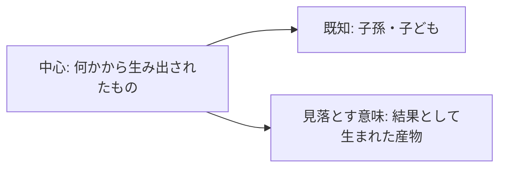

**重要語法**：`the offspring of ...（…から生まれたもの）`

---

## 2889. displacement

**品詞**：noun　**発音**：/dɪsˈpleɪsmənt/

<small>よく知られている意味：移動・置き換え</small>

### 見落としやすい意味

**人々の強制的な移住・立ち退き**

**例文**：The flood caused the displacement of thousands of residents.

**和訳**：洪水によって何千人もの住民が住まいを追われた。

**コアイメージ**：displace は人や物を元の位置から移すこと。人について使われると、災害や紛争などで住み慣れた土地を離れざるを得ない状況を表す。

**図**

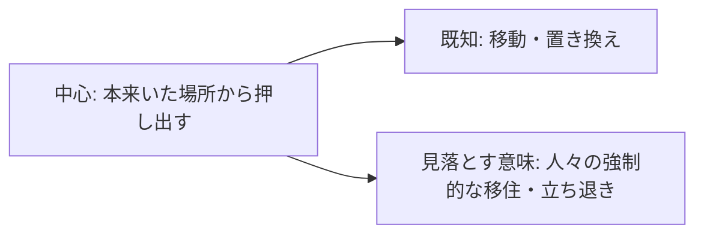

**重要語法**：`forced displacement（強制移住）`

---

## 2890. finite

**品詞**：adj　**発音**：/ˈfaɪnaɪt/

<small>よく知られている意味：有限の</small>

### 見落としやすい意味

**動詞の時制・人称などを示す定形の**

**例文**：In the sentence, 'walked' is a finite verb.

**和訳**：その文では、walked は定形動詞だ。

**コアイメージ**：finite は一般には「限りがある」という意味。文法では、時制や人称などに応じて形が定まる動詞形を finite と呼び、不定詞などと区別する。

**図**

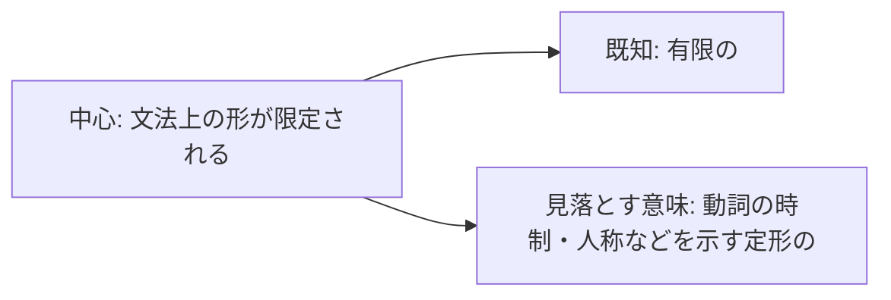

**重要語法**：`finite verb（定形動詞）`、`non-finite verb（非定形動詞）`

---

## 2891. affirm

**品詞**：verb　**発音**：/əˈfɝːm/

<small>よく知られている意味：肯定する・断言する</small>

### 見落としやすい意味

**新たな証拠で裏付ける**

**例文**：The new evidence affirmed the witness's account.

**和訳**：新たな証拠は目撃者の証言を裏付けた。

**コアイメージ**：affirm はある主張や判断を正しいものとして認め、支持すること。証拠が主語になると、その主張を裏付けて確かなものにする意味になる。

**図**

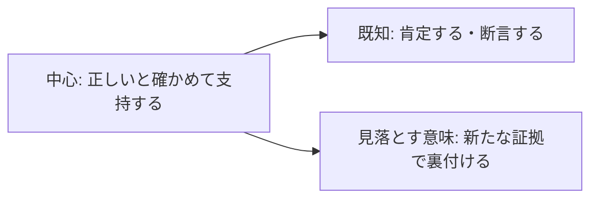

**重要語法**：`affirm a finding（判断を裏付ける）`

---

## 2892. benign

**品詞**：adj　**発音**：/bɪˈnaɪn/

<small>よく知られている意味：穏やかな・親切な</small>

### 見落としやすい意味

**良性の・悪性でない**

**例文**：The tests showed that the tumor was benign.

**和訳**：検査の結果、その腫瘍は良性だと分かった。

**コアイメージ**：benign の中心は、人や物が有害ではなく穏やかなこと。医療では、悪性ではない状態を指して「良性の」と訳す。

**図**

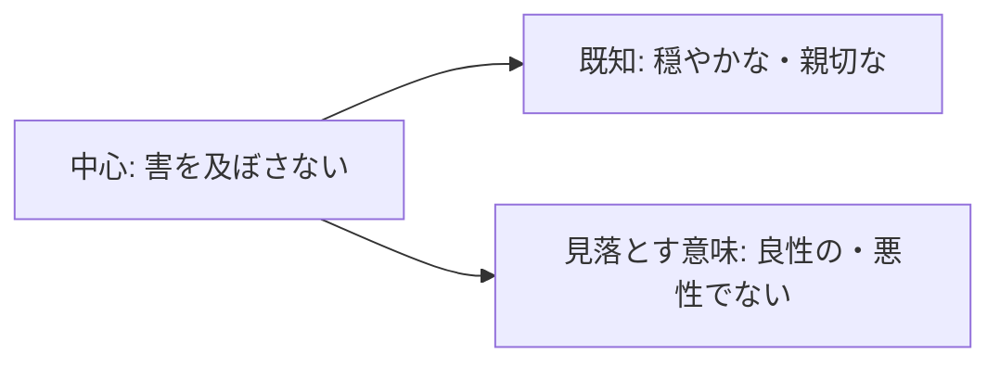

**重要語法**：`benign tumor（良性腫瘍）`

---

## 2893. subordinate

**品詞**：noun　**発音**：/səˈbɔːrdɪnət/

<small>よく知られている意味：従属的な・下位の</small>

### 見落としやすい意味

**部下・従属する人**

**例文**：The manager asked a subordinate to prepare the report.

**和訳**：部長は部下にその報告書を準備するよう頼んだ。

**コアイメージ**：subordinate は上位のものに従う立場を表す。形容詞では「下位の」だが、名詞ではその立場にいる人、つまり部下を指す。

**図**

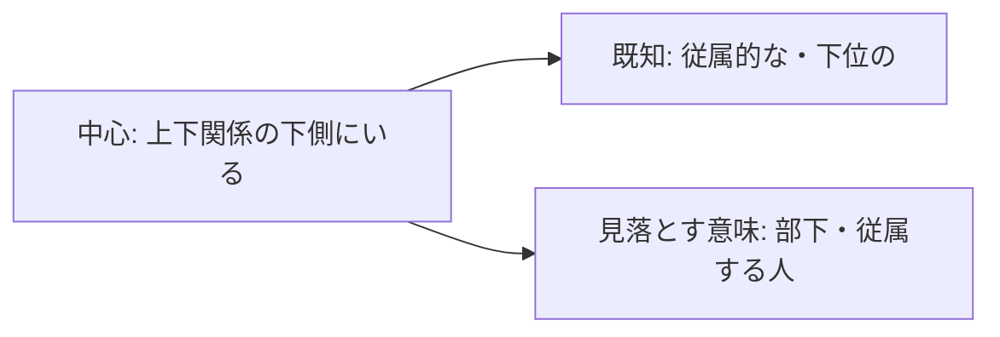

**重要語法**：`a subordinate（部下）`

---

## 2894. subordinate

**品詞**：verb　**発音**：/səˈbɔːrdɪneɪt/

<small>よく知られている意味：従属的な</small>

### 見落としやすい意味

**重要度を低く位置付ける・従属させる**

**例文**：The policy subordinates short-term profit to public safety.

**和訳**：その方針は短期的な利益より公共の安全を優先する。

**コアイメージ**：subordinate を動詞で使うと、あるものを別のものより下位に置くことになる。人を従属させる場合だけでなく、利益などの重要度を下げる場合にも使う。

**図**

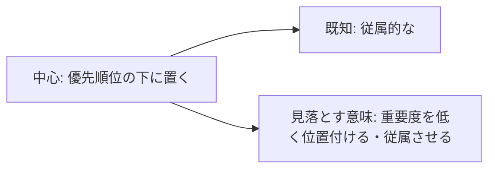

**重要語法**：`subordinate A to B（AをBより下位に置く）`

---

## 2895. dependency

**品詞**：noun　**発音**：/dɪˈpɛndənsi/

<small>よく知られている意味：依存・頼ること</small>

### 見落としやすい意味

**属領・従属地域**

**例文**：The island was once a dependency of the larger country.

**和訳**：その島はかつて、より大きな国の属領だった。

**コアイメージ**：dependency は自立せず何かに頼る状態を表す。政治・地理の文脈では、他国に従属して統治される地域を指す名詞にもなる。

**図**

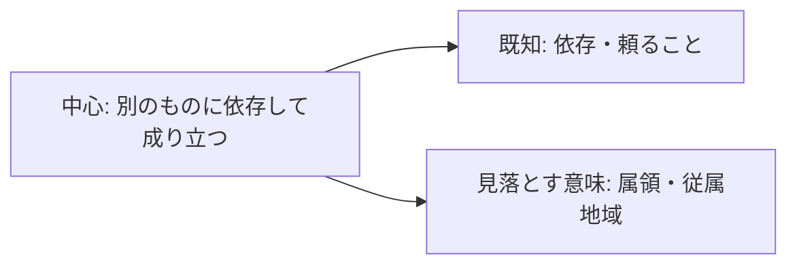

**重要語法**：`an overseas dependency（海外属領）`

---

## 2896. cascade

**品詞**：noun　**発音**：/kæˈskeɪd/

<small>よく知られている意味：滝・小滝</small>

### 見落としやすい意味

**連続して起こる工程・段階**

**例文**：The project involved a cascade of approval stages.

**和訳**：その計画には、承認が次々と続く一連の段階があった。

**コアイメージ**：cascade は水が段になって流れ落ちるイメージが出発点。そこから、段階や手続きが連続して続く様子にも使われる。

**図**

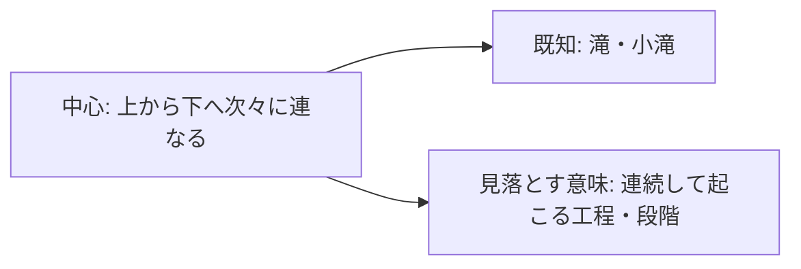

**重要語法**：`a cascade of ...（相次ぐ…）`

---

## 2897. cascade

**品詞**：verb　**発音**：/kæˈskeɪd/

<small>よく知られている意味：滝のように流れる</small>

### 見落としやすい意味

**連鎖的に広がる・次々に起こる**

**例文**：A small mistake can cascade through the entire system.

**和訳**：小さなミスがシステム全体に連鎖的に広がることがある。

**コアイメージ**：水が次々と段を落ちるように、一つの出来事が次に影響する動きを表す。問題や変更などが連鎖的に広がる場面でよく使われる。

**図**

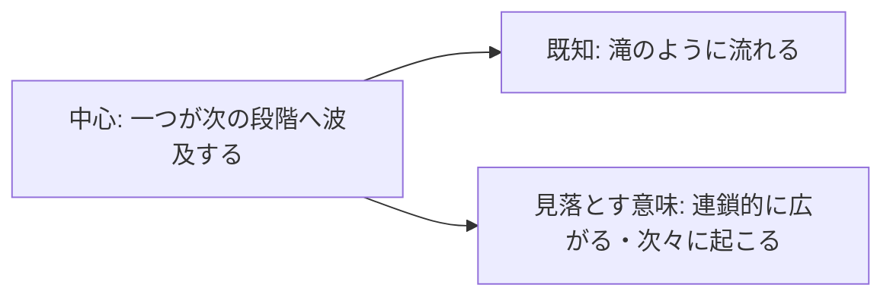

**重要語法**：`cascade through ...（…全体に連鎖的に及ぶ）`

---

## 2898. crane

**品詞**：noun　**発音**：/kreɪn/

<small>よく知られている意味：ツル（鳥）</small>

### 見落としやすい意味

**建設機械のクレーン**

**例文**：A crane lifted the steel beams onto the roof.

**和訳**：クレーンが鉄骨を屋根の上へ持ち上げた。

**コアイメージ**：鳥の crane は長い首を持つツルのこと。建設機械の crane も長く伸びた腕を持ち、物を持ち上げる姿が似ている。

**図**

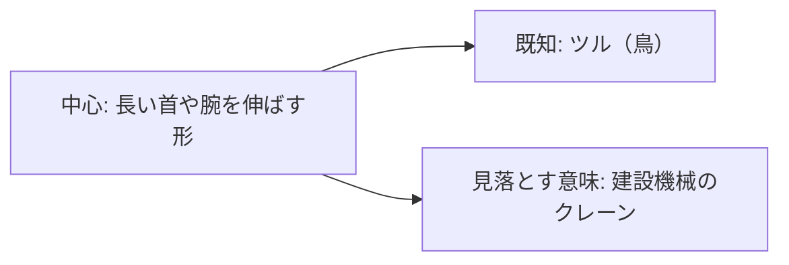

**重要語法**：`tower crane（タワークレーン）`

---

## 2899. crane

**品詞**：verb　**発音**：/kreɪn/

<small>よく知られている意味：ツル・クレーン（名詞）</small>

### 見落としやすい意味

**見ようとして首を伸ばす**

**例文**：She craned her neck to see the stage.

**和訳**：彼女は舞台を見ようと首を伸ばした。

**コアイメージ**：ツルのように長く首を伸ばす動きから、crane は動詞にもなる。見えにくいものを見ようとして首を伸ばすときに使う。

**図**

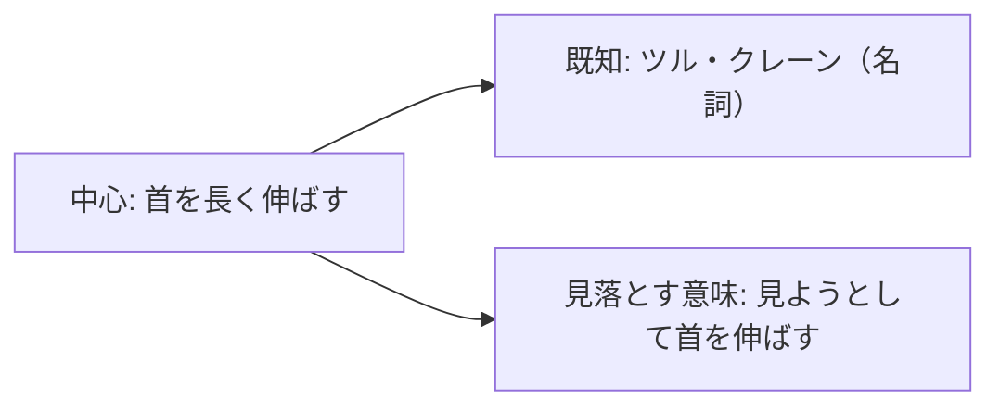

**重要語法**：`crane one's neck（首を伸ばして見る）`

---

## 2900. designation

**品詞**：noun　**発音**：/ˌdɛzɪɡˈneɪʃən/

<small>よく知られている意味：指定・指名</small>

### 見落としやすい意味

**名称・呼称**

**例文**：The park's official designation is a wildlife reserve.

**和訳**：その公園の正式な名称区分は野生生物保護区だ。

**コアイメージ**：designate は人や場所の役割・区分を指定すること。指定した結果として与えられた名称や呼称そのものも designation と呼ぶ。

**図**

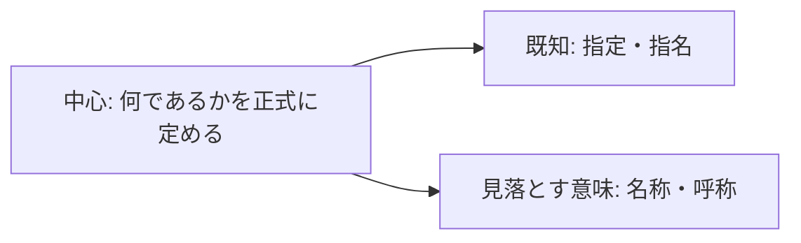

**重要語法**：`official designation（正式名称・指定区分）`

---

