# EasyVoca 完成教材｜バッチ038

> 採用済み語義のみを教材化。global_order 2961〜3040、80カード。元データ：`data/candidates/batch_05501_06000.jsonl`（main、`decision == "accepted"`）。並び順：`index`、次に `candidate_id` の昇順。発音は主に米音の目安。

## 2961. dial

**品詞：** 句動詞  **発音：** /ˈdaɪəl/

<small>よく知られている意味：電話番号を回す・入力する</small>

### 見落としやすい意味

**dial down / dial up：程度・強さなどを下げる／上げる**

**例文：** Could you dial down the volume and dial up the brightness?

**和訳：** 音量を下げて、画面の明るさを上げてくれますか。

**コアイメージ：** ダイヤルを回すと設定値が変わる、という操作が出発点。電話番号を入力する動作から、音量や明るさなどの強さを調節する動作へ広がる。

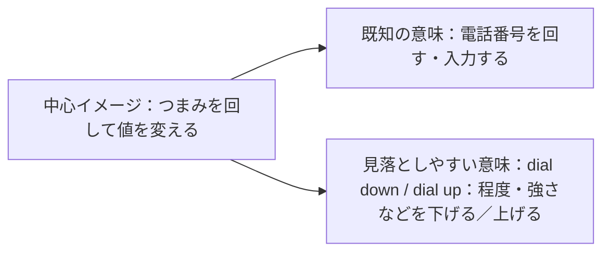

**重要語法：** dial down the volume／dial up the brightness

<small>候補ID：`ev-05531-ai-01`／index：5531</small>

---

## 2962. gravity

**品詞：** 名詞  **発音：** /ˈɡrævəti/

<small>よく知られている意味：重力</small>

### 見落としやすい意味

**（事態・問題の）深刻さ、重大さ**

**例文：** She did not realize the gravity of the situation until later.

**和訳：** 彼女は後になってようやく事態の深刻さに気づいた。

**コアイメージ：** 重力は物を下に引く力を指す。比喩では、事態が人に重くのしかかるような「重大さ」を表す。

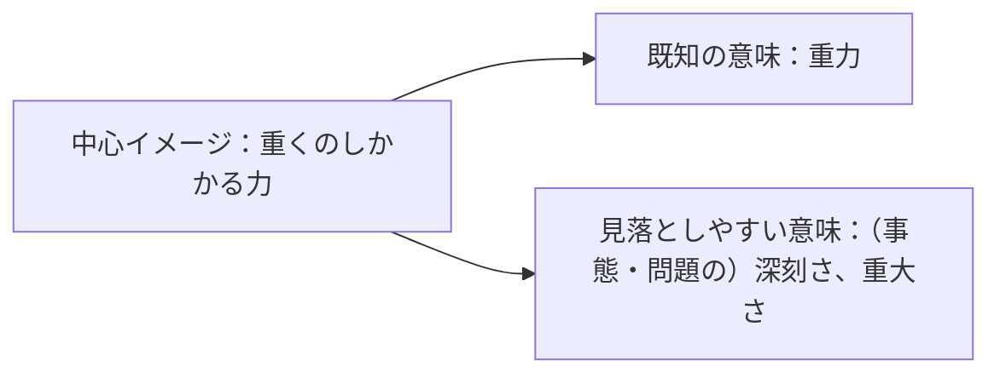

**重要語法：** the gravity of the situation

<small>候補ID：`ev-05532-noun-01`／index：5532</small>

---

## 2963. vein

**品詞：** 慣用表現  **発音：** /veɪn/

<small>よく知られている意味：静脈、血管</small>

### 見落としやすい意味

**in a similar vein：同じような調子・観点で**

**例文：** He continued in a similar vein, focusing on the costs.

**和訳：** 彼は費用に焦点を当てながら、同じような調子で話を続けた。

**コアイメージ：** vein は血液が通る筋道を表す。比喩では話や考えの流れ・調子を指し、in a similar vein で同種の方向性を示す。

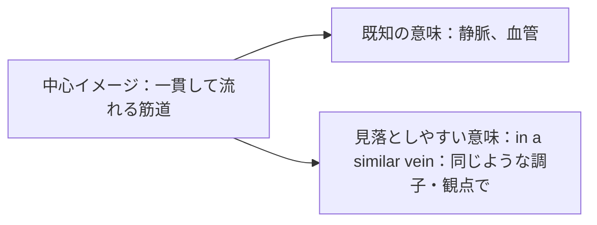

**重要語法：** in the same vein／in a similar vein

<small>候補ID：`ev-05533-ai-01`／index：5533</small>

---

## 2964. ash

**品詞：** 名詞  **発音：** /æʃ/

<small>よく知られている意味：灰</small>

### 見落としやすい意味

**トネリコの木、またはその木材**

**例文：** An old ash tree stands beside the school gate.

**和訳：** 校門のそばに古いトネリコの木が立っている。

**コアイメージ：** 灰を表す ash と、樹木のトネリコを表す ash は別の語義として覚える。両者を無理に一つのイメージで結びつけず、文脈で区別する。

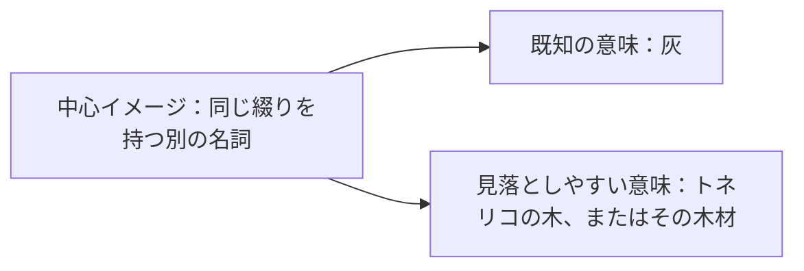

**重要語法：** ash tree／ash wood

<small>候補ID：`ev-05534-noun-01`／index：5534</small>

---

## 2965. uncommon

**品詞：** 形容詞  **発音：** /ʌnˈkɑːmən/

<small>よく知られている意味：珍しい、めったにない</small>

### 見落としやすい意味

**（能力・美徳などの程度が）並外れた、非常に大きい**

**例文：** She showed uncommon patience with the younger children.

**和訳：** 彼女は年下の子どもたちに対して並外れた忍耐力を示した。

**コアイメージ：** 普通ではないという核から、頻度が低い「珍しさ」と、程度が普通を超える「並外れた」が生まれる。能力や美徳を修飾すると後者になる。

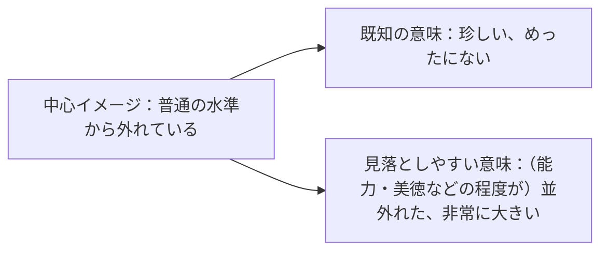

**重要語法：** uncommon courage／uncommon skill

<small>候補ID：`ev-05536-adj-01`／index：5536</small>

---

## 2966. smash

**品詞：** 名詞  **発音：** /smæʃ/

<small>よく知られている意味：粉々に砕く</small>

### 見落としやすい意味

**大成功、非常に人気のあるヒット作**

**例文：** The new play became a surprise smash.

**和訳：** その新作劇は予想外の大ヒットとなった。

**コアイメージ：** smash は勢いの強い衝撃を連想させる語。作品の評価では、注目を強く集める大成功を表す名詞として使う。

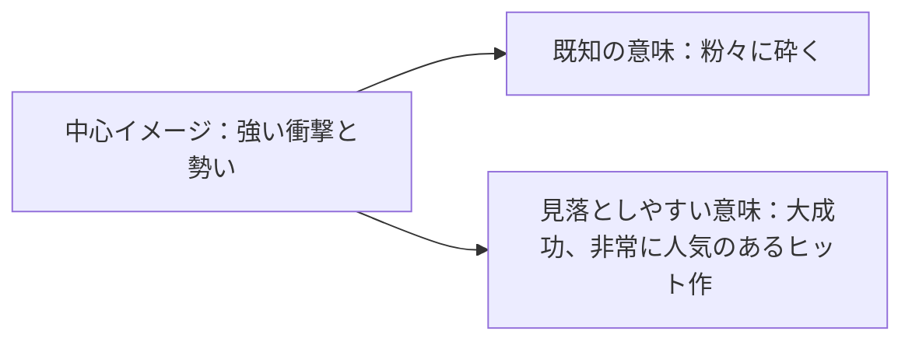

**重要語法：** a smash hit

<small>候補ID：`ev-05537-noun-01`／index：5537</small>

---

## 2967. differential

**品詞：** 名詞  **発音：** /ˌdɪfəˈrenʃəl/

<small>よく知られている意味：差異に関する、微分の</small>

### 見落としやすい意味

**（賃金・価格などの）差額、格差**

**例文：** The wage differential between the two jobs has narrowed.

**和訳：** その二つの仕事の賃金格差は縮小した。

**コアイメージ：** differential の中心には二つのものの間の「差」がある。形容詞だけでなく、その差の大きさや金額自体を名詞で表せる。

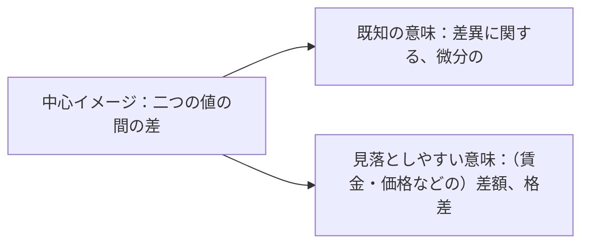

**重要語法：** wage differential／price differential

<small>候補ID：`ev-05541-ai-01`／index：5541</small>

---

## 2968. flick

**品詞：** 名詞  **発音：** /flɪk/

<small>よく知られている意味：軽くはじく動作</small>

### 見落としやすい意味

**映画、映画作品（くだけた表現）**

**例文：** We watched a funny flick after dinner.

**和訳：** 私たちは夕食後に面白い映画を一本見た。

**コアイメージ：** flick は素早い動きやちらつきを表す語。映画を指す名詞としても使われるが、この意味は語源から無理に推測せず、くだけた表現として覚える。

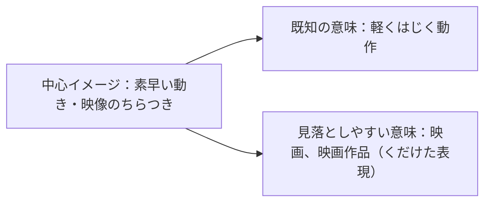

**重要語法：** flick はくだけた言い方

<small>候補ID：`ev-05544-noun-01`／index：5544</small>

---

## 2969. flick

**品詞：** 動詞  **発音：** /flɪk/

<small>よく知られている意味：指先ではじく</small>

### 見落としやすい意味

**本や資料をぱらぱらと素早くめくる**

**例文：** She flicked through the report to find the chart.

**和訳：** 彼女は図表を探して報告書をぱらぱらとめくった。

**コアイメージ：** flick の基本は素早く軽い動き。本のページを次々に軽く動かすことから、ぱらぱらとめくる意味になる。

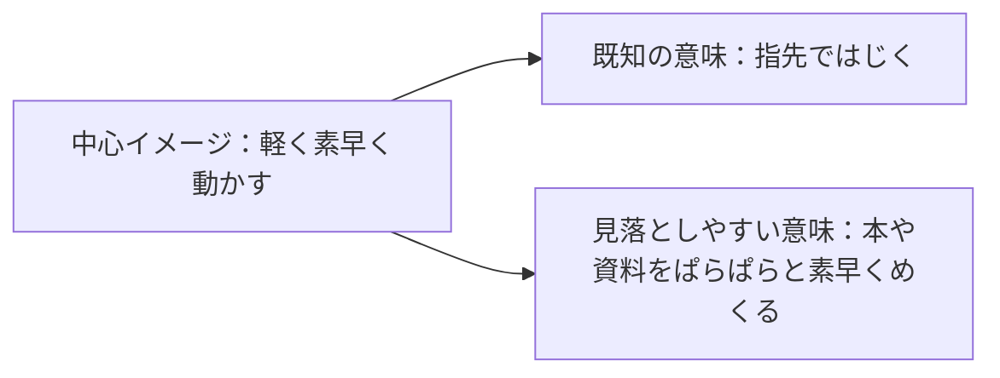

**重要語法：** flick through a book／flick through pages

<small>候補ID：`ev-05544-verb-01`／index：5544</small>

---

## 2970. endowment

**品詞：** 名詞  **発音：** /ɪnˈdaʊmənt/

<small>よく知られている意味：寄付基金、寄贈財産</small>

### 見落としやすい意味

**生まれつきの才能、資質**

**例文：** Her artistic endowment was clear from an early age.

**和訳：** 彼女の生まれつきの芸術的才能は幼い頃から明らかだった。

**コアイメージ：** endowment は何かを授けられ、備えていること。財産として与えられる基金だけでなく、生まれながら授かった能力・資質にも使う。

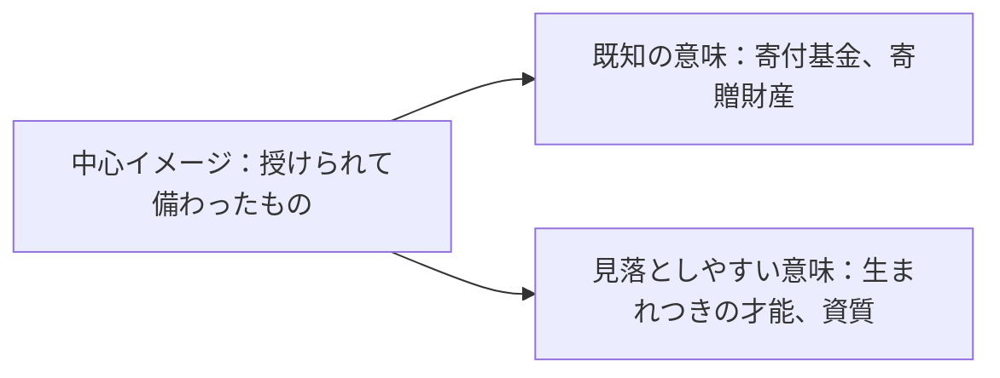

**重要語法：** natural endowment

<small>候補ID：`ev-05546-noun-01`／index：5546</small>

---

## 2971. conjure

**品詞：** 句動詞  **発音：** /ˈkɑːndʒər/

<small>よく知られている意味：魔法で何かを出す</small>

### 見落としやすい意味

**conjure up：記憶・イメージなどを心に呼び起こす**

**例文：** The smell of bread conjured up memories of childhood.

**和訳：** パンの香りが子どもの頃の記憶を呼び起こした。

**コアイメージ：** 魔法のように目の前へ現れさせるイメージがある。conjure up では記憶や情景を心の中に鮮やかに浮かび上がらせる。

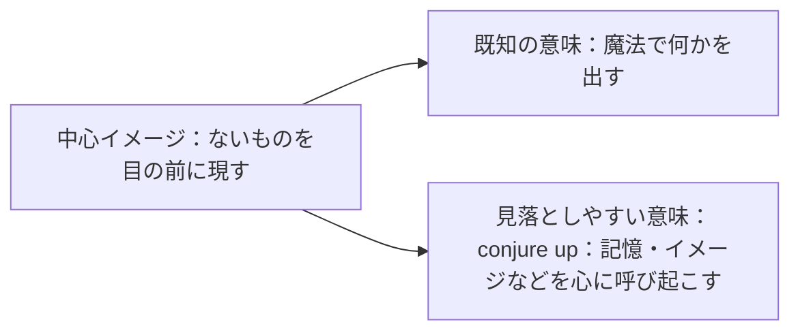

**重要語法：** conjure up memories／images

<small>候補ID：`ev-05548-ai-01`／index：5548</small>

---

## 2972. bail

**品詞：** 句動詞  **発音：** /beɪl/

<small>よく知られている意味：保釈する、保釈金</small>

### 見落としやすい意味

**bail out：財政的に救済する、資金援助で窮地から救う**

**例文：** The government refused to bail out the struggling company.

**和訳：** 政府は経営難の会社への資金援助を拒否した。

**コアイメージ：** bail out は困難な状態から外へ引き出す表現。法的な保釈だけでなく、資金面の危機から会社などを救うことにも用いる。

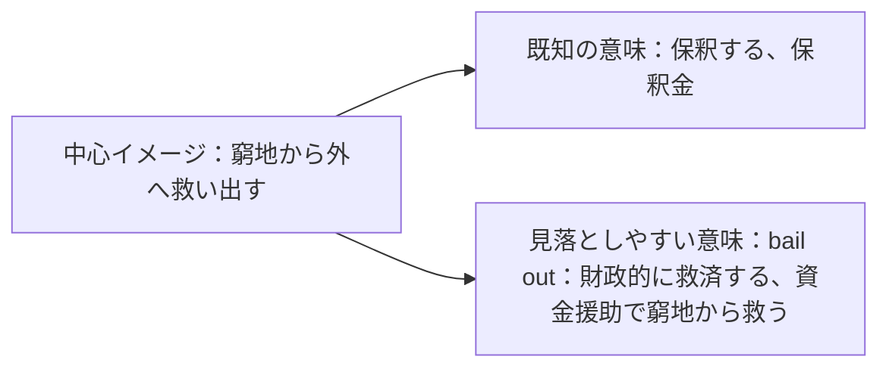

**重要語法：** bail out a bank／company

<small>候補ID：`ev-05556-ai-01`／index：5556</small>

---

## 2973. bail

**品詞：** 句動詞  **発音：** /beɪl/

<small>よく知られている意味：保釈する、保釈金</small>

### 見落としやすい意味

**bail on：人との約束・責任を放棄して見捨てる**

**例文：** Don't bail on your teammates when things get difficult.

**和訳：** 状況が厳しくなってもチームメートを見捨ててはいけない。

**コアイメージ：** bail on は困難になった場面から自分だけ抜けるような感覚。約束した相手や責任を放棄する口語表現になる。

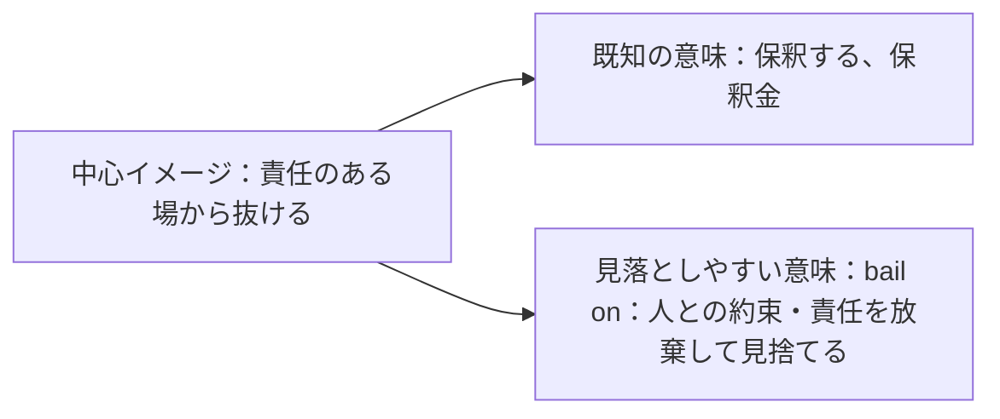

**重要語法：** bail on a friend／a plan

<small>候補ID：`ev-05556-ai-02`／index：5556</small>

---

## 2974. constituency

**品詞：** 名詞  **発音：** /kənˈstɪtʃuənsi/

<small>よく知られている意味：選挙区</small>

### 見落としやすい意味

**（支持者・顧客などの）一定の支持層**

**例文：** The museum has built a loyal constituency among local families.

**和訳：** その博物館には地元の家族層に根強い支持者ができた。

**コアイメージ：** 選挙区は代表を支える人々と結びつく概念。そこから政治以外でも、組織や活動を継続的に支える集団を表す。

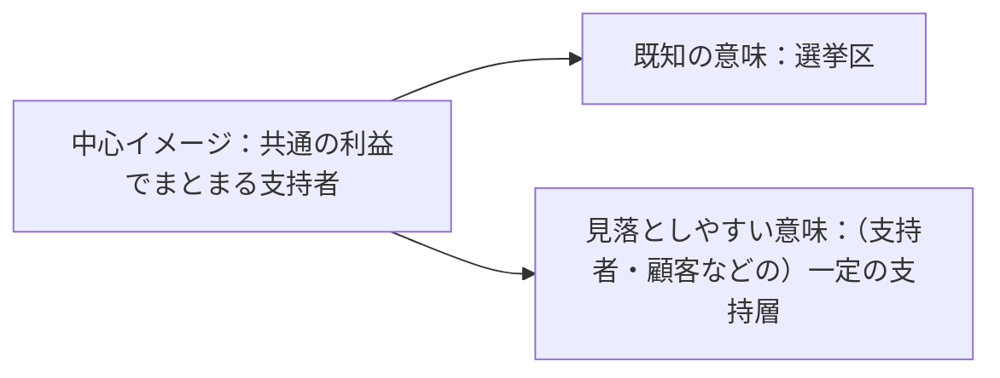

**重要語法：** a loyal constituency

<small>候補ID：`ev-05559-ai-01`／index：5559</small>

---

## 2975. demon

**品詞：** 名詞  **発音：** /ˈdiːmən/

<small>よく知られている意味：悪魔</small>

### 見落としやすい意味

**非常に有能で熱心な人、すご腕の人**

**例文：** She is a demon at solving difficult puzzles.

**和訳：** 彼女は難しいパズルを解くのが驚くほど得意だ。

**コアイメージ：** demon の強烈で手ごわい印象を人の能力に転用した口語表現。文脈によっては、圧倒的な熱心さや腕前を褒める意味になる。

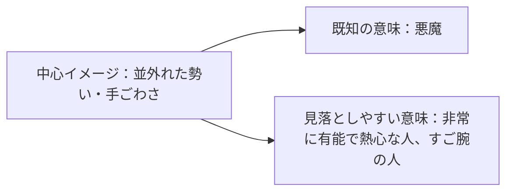

**重要語法：** a demon at／a demon for

<small>候補ID：`ev-05562-noun-01`／index：5562</small>

---

## 2976. depress

**品詞：** 動詞  **発音：** /dɪˈpres/

<small>よく知られている意味：憂鬱にさせる</small>

### 見落としやすい意味

**物価・市場価格などを引き下げる**

**例文：** The sudden increase in supply depressed prices.

**和訳：** 供給の急増によって価格が下落した。

**コアイメージ：** depress の基本は何かを下へ押し下げること。気分を沈ませるだけでなく、価格や景気の水準を下げる場合にも使う。

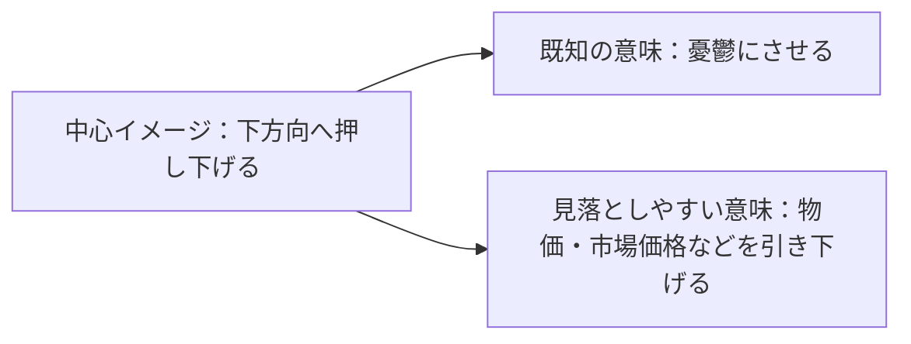

**重要語法：** depress prices／demand

<small>候補ID：`ev-05563-verb-01`／index：5563</small>

---

## 2977. fertility

**品詞：** 名詞  **発音：** /fərˈtɪləti/

<small>よく知られている意味：繁殖力、出生力</small>

### 見落としやすい意味

**土地の肥沃さ、作物を生み出す力**

**例文：** Farmers tested the fertility of the soil before planting.

**和訳：** 農家の人々は作付け前に土壌の肥沃さを調べた。

**コアイメージ：** fertility は新しい生命や成果を生み出せる力を表す。人や動物の生殖能力から、土地が作物を育てる力へ意味が広がる。

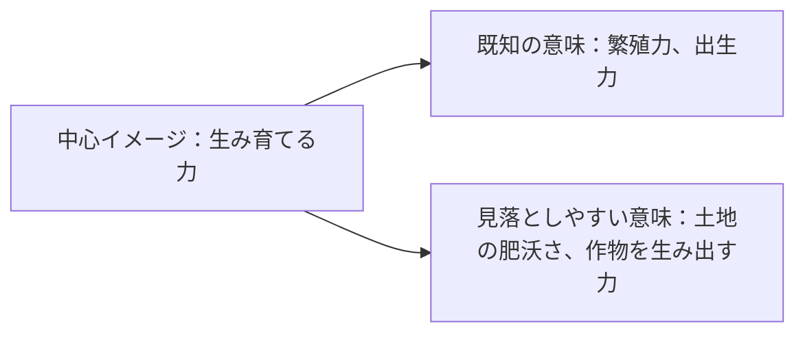

**重要語法：** soil fertility

<small>候補ID：`ev-05570-ai-01`／index：5570</small>

---

## 2978. frustration

**品詞：** 名詞  **発音：** /frʌˈstreɪʃən/

<small>よく知られている意味：苛立ち、不満</small>

### 見落としやすい意味

**計画・努力などの妨害、阻止**

**例文：** The delays led to the frustration of their plans for the event.

**和訳：** 度重なる遅れによって、行事の計画は実現を妨げられた。

**コアイメージ：** frustration は期待どおりに進まないことが中心にある。人の感情なら苛立ち、計画についてなら実現が妨げられることを表す。

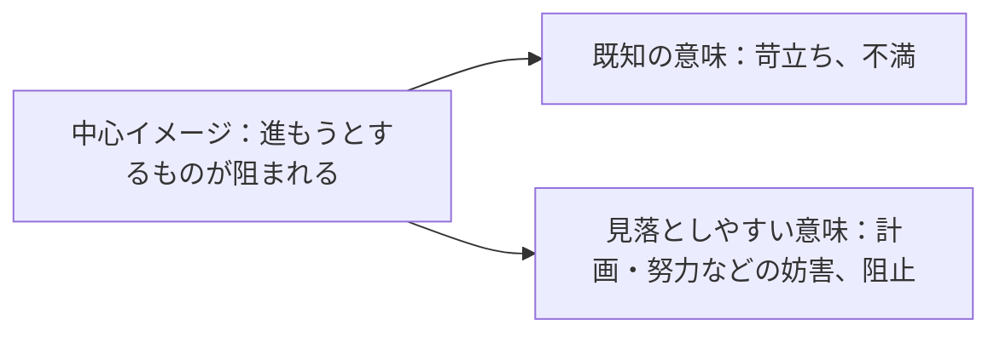

**重要語法：** frustration of a plan はやや硬い表現

<small>候補ID：`ev-05574-noun-01`／index：5574</small>

---

## 2979. rhetorical

**品詞：** 形容詞  **発音：** /rɪˈtɔːrɪkəl/

<small>よく知られている意味：修辞の、表現技法の</small>

### 見落としやすい意味

**言葉遣い・演出ばかりが目立ち、内容が乏しい**

**例文：** The speech was full of rhetorical flourishes but offered no real plan.

**和訳：** その演説は言葉の飾りは多かったが、実質的な計画は示さなかった。

**コアイメージ：** rhetorical は話し方や言葉の技巧に関係する。文脈によっては、内容よりも言い回しばかりが目立つという批判を込める。

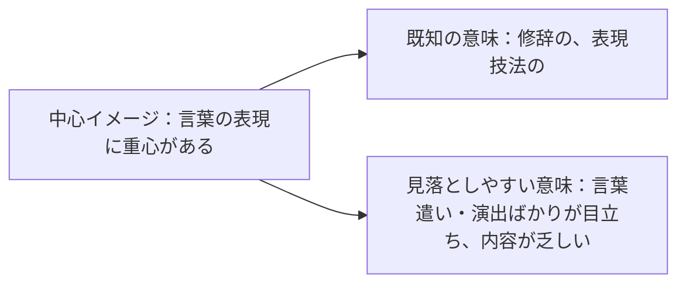

**重要語法：** rhetorical flourishes／mere rhetoric

<small>候補ID：`ev-05591-adj-01`／index：5591</small>

---

## 2980. richly

**品詞：** 副詞  **発音：** /ˈrɪtʃli/

<small>よく知られている意味：豊かに、ぜいたくに</small>

### 見落としやすい意味

**richly deserve：十分に、まさに（〜に値する）**

**例文：** She richly deserves the award for her years of service.

**和訳：** 長年の貢献を考えれば、彼女はまさにその賞にふさわしい。

**コアイメージ：** richly は量や程度が十分にある様子を示す。deserve と組むと、何かを受ける資格が十分にあるという評価を強める。

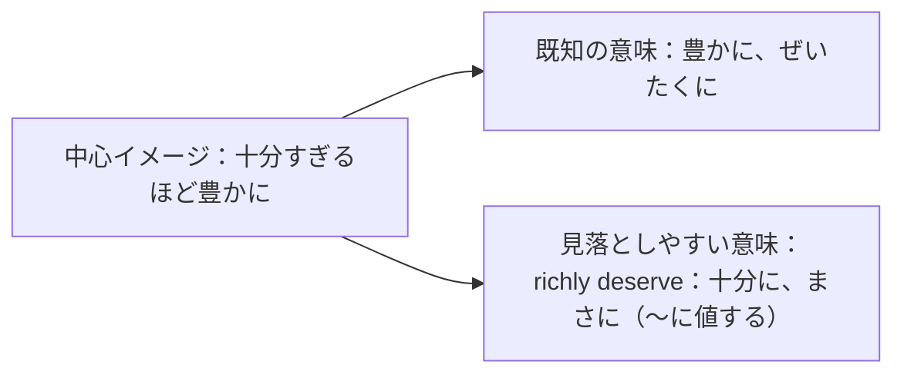

**重要語法：** richly deserve

<small>候補ID：`ev-05592-ai-01`／index：5592</small>

---

## 2981. riddle

**品詞：** 語句  **発音：** /ˈrɪdəl/

<small>よく知られている意味：なぞなぞ、謎</small>

### 見落としやすい意味

**be riddled with：欠陥・問題などが至る所にある**

**例文：** The first draft was riddled with factual errors.

**和訳：** 初稿には事実関係の誤りが至るところにあった。

**コアイメージ：** riddle の動詞には穴をたくさん開けるような感覚がある。be riddled with は、問題や欠陥が全体に散らばっている状態を表す。

```mermaid
flowchart LR
    A["中心イメージ：至る所に穴がある"]
    B["既知の意味：なぞなぞ、謎"]
    C["見落としやすい意味：be riddled with：欠陥・問題などが至る所にある"]
    A --> B
    A --> C
```

**重要語法：** be riddled with errors／problems

<small>候補ID：`ev-05593-ai-01`／index：5593</small>

---

## 2982. temper

**品詞：** 動詞  **発音：** /ˈtempər/

<small>よく知られている意味：気質、かんしゃく</small>

### 見落としやすい意味

**勢い・強さ・感情を和らげる、調節する**

**例文：** The coach tempered his criticism with a few encouraging words.

**和訳：** コーチは励ましの言葉を少し添えて批判を和らげた。

**コアイメージ：** temper には強すぎるものを調整する感覚がある。感情や批判の勢いを弱め、適度な強さにする動詞として使う。

```mermaid
flowchart LR
    A["中心イメージ：強さを適度に整える"]
    B["既知の意味：気質、かんしゃく"]
    C["見落としやすい意味：勢い・強さ・感情を和らげる、調節する"]
    A --> B
    A --> C
```

**重要語法：** temper A with B

<small>候補ID：`ev-05597-verb-01`／index：5597</small>

---

## 2983. terribly

**品詞：** 副詞  **発音：** /ˈterəbli/

<small>よく知られている意味：ひどく、恐ろしく</small>

### 見落としやすい意味

**とても、非常に（程度の強調）**

**例文：** I'm terribly pleased with the results.

**和訳：** その結果をとてもうれしく思っています。

**コアイメージ：** terribly は強い程度を示す副詞としても使われる。後ろが肯定的な形容詞なら、必ずしも悪い意味にはならない。

```mermaid
flowchart LR
    A["中心イメージ：程度が非常に大きい"]
    B["既知の意味：ひどく、恐ろしく"]
    C["見落としやすい意味：とても、非常に（程度の強調）"]
    A --> B
    A --> C
```

**重要語法：** terribly pleased／terribly sorry

<small>候補ID：`ev-05598-adv-01`／index：5598</small>

---

## 2984. holding

**品詞：** 名詞  **発音：** /ˈhoʊldɪŋ/

<small>よく知られている意味：持っていること、保持</small>

### 見落としやすい意味

**保有資産・株式、持ち分**

**例文：** Her holdings include shares in three companies.

**和訳：** 彼女の保有資産には三つの会社の株式が含まれる。

**コアイメージ：** holding は手元に持ち続けることを表す。金融の文脈では、実際に保有している株式や資産を具体的に指す。

```mermaid
flowchart LR
    A["中心イメージ：手放さず保有するもの"]
    B["既知の意味：持っていること、保持"]
    C["見落としやすい意味：保有資産・株式、持ち分"]
    A --> B
    A --> C
```

**重要語法：** holdings は複数形で資産を表すことが多い

<small>候補ID：`ev-05601-ai-01`／index：5601</small>

---

## 2985. fog

**品詞：** 名詞  **発音：** /fɑːɡ/

<small>よく知られている意味：霧</small>

### 見落としやすい意味

**頭がぼんやりした状態、思考の混乱**

**例文：** After the long trip, my mind was in a fog.

**和訳：** 長旅の後、頭がぼんやりしていた。

**コアイメージ：** 霧の中では周囲がはっきり見えない。思考にもこのイメージを移し、頭が明瞭に働かない状態を表す。

```mermaid
flowchart LR
    A["中心イメージ：視界がぼやける"]
    B["既知の意味：霧"]
    C["見落としやすい意味：頭がぼんやりした状態、思考の混乱"]
    A --> B
    A --> C
```

**重要語法：** be in a fog

<small>候補ID：`ev-05602-noun-01`／index：5602</small>

---

## 2986. slim

**品詞：** 形容詞  **発音：** /slɪm/

<small>よく知られている意味：細い、ほっそりした</small>

### 見落としやすい意味

**（可能性・見込みが）わずかな、ほとんどない**

**例文：** There is only a slim chance of success.

**和訳：** 成功する可能性はほんのわずかしかない。

**コアイメージ：** slim は幅や厚みが小さいことを表す。可能性や見込みについて言えば、その「幅」が小さく、実現しにくいという意味になる。

```mermaid
flowchart LR
    A["中心イメージ：幅・量が小さい"]
    B["既知の意味：細い、ほっそりした"]
    C["見落としやすい意味：（可能性・見込みが）わずかな、ほとんどない"]
    A --> B
    A --> C
```

**重要語法：** a slim chance／slim prospects

<small>候補ID：`ev-05603-adj-01`／index：5603</small>

---

## 2987. powder

**品詞：** 慣用表現  **発音：** /ˈpaʊdər/

<small>よく知られている意味：粉末</small>

### 見落としやすい意味

**powder keg：爆発しかねない危険な情勢**

**例文：** The dispute turned the region into a powder keg.

**和訳：** その対立によって、その地域は一触即発の状況となった。

**コアイメージ：** powder keg は火薬のたるを指す表現。少しのきっかけで状況が激変しかねない、緊張が蓄積した場面の比喩になる。

```mermaid
flowchart LR
    A["中心イメージ：刺激で一気に変化する危険"]
    B["既知の意味：粉末"]
    C["見落としやすい意味：powder keg：爆発しかねない危険な情勢"]
    A --> B
    A --> C
```

**重要語法：** a political powder keg

<small>候補ID：`ev-05605-ai-01`／index：5605</small>

---

## 2988. dim

**品詞：** 慣用表現  **発音：** /dɪm/

<small>よく知られている意味：薄暗い</small>

### 見落としやすい意味

**take a dim view of：〜をよく思わない、否定的に評価する**

**例文：** The manager takes a dim view of repeated lateness.

**和訳：** その管理者は遅刻が繰り返されることをよく思っていない。

**コアイメージ：** dim は明るさが足りず、よく見えない感覚。take a dim view of は対象を好意的・明るく見られないことから、否定的な評価を表す。

```mermaid
flowchart LR
    A["中心イメージ：明るく評価できない"]
    B["既知の意味：薄暗い"]
    C["見落としやすい意味：take a dim view of：〜をよく思わない、否定的に評価する"]
    A --> B
    A --> C
```

**重要語法：** take a dim view of

<small>候補ID：`ev-05609-ai-01`／index：5609</small>

---

## 2989. dim

**品詞：** 動詞  **発音：** /dɪm/

<small>よく知られている意味：薄暗い</small>

### 見落としやすい意味

**他の物をかすませ、目立たなくする**

**例文：** The latest victory dimmed memories of the team's earlier losses.

**和訳：** 最近の勝利によって、そのチームの以前の敗北の記憶は薄れた。

**コアイメージ：** dim は光を弱くして目立たなくすること。思い出や評判など抽象的なものも、存在感が薄れる意味で使える。

```mermaid
flowchart LR
    A["中心イメージ：明るさ・存在感を弱める"]
    B["既知の意味：薄暗い"]
    C["見落としやすい意味：他の物をかすませ、目立たなくする"]
    A --> B
    A --> C
```

**重要語法：** dim memories／hopes

<small>候補ID：`ev-05609-verb-01`／index：5609</small>

---

## 2990. approximate

**品詞：** 動詞  **発音：** /əˈprɑːksəmeɪt/

<small>よく知られている意味：おおよその、近似の</small>

### 見落としやすい意味

**おおよその値を見積もる**

**例文：** Researchers approximated the number of visitors at five thousand.

**和訳：** 研究者たちは来場者数を約五千人と見積もった。

**コアイメージ：** approximate の中心は正確な値に近づけること。形容詞なら「おおよその」、動詞なら数値を概算する動作になる。

```mermaid
flowchart LR
    A["中心イメージ：正確な値に近づける"]
    B["既知の意味：おおよその、近似の"]
    C["見落としやすい意味：おおよその値を見積もる"]
    A --> B
    A --> C
```

**重要語法：** approximate A at B

<small>候補ID：`ev-05610-verb-01`／index：5610</small>

---

## 2991. cough

**品詞：** 句動詞  **発音：** /kɔːf/

<small>よく知られている意味：せきをする</small>

### 見落としやすい意味

**cough up：しぶしぶ金銭などを出す**

**例文：** He finally coughed up the money for the repairs.

**和訳：** 彼は結局、修理代をしぶしぶ支払った。

**コアイメージ：** せきで物を外へ吐き出すようなイメージから、出し渋っていたお金をようやく出す表現になる。cough up は口語的で不本意な気持ちを含みやすい。

```mermaid
flowchart LR
    A["中心イメージ：渋りながら外へ出す"]
    B["既知の意味：せきをする"]
    C["見落としやすい意味：cough up：しぶしぶ金銭などを出す"]
    A --> B
    A --> C
```

**重要語法：** cough up the money

<small>候補ID：`ev-05615-ai-01`／index：5615</small>

---

## 2992. wrongly

**品詞：** 副詞  **発音：** /ˈrɔːŋli/

<small>よく知られている意味：間違って</small>

### 見落としやすい意味

**不当に、不公正に**

**例文：** She was wrongly blamed for the accident.

**和訳：** 彼女はその事故について不当に責められた。

**コアイメージ：** wrongly は単に事実認識が間違っているだけではない。扱いが正義や道理に反している場合にも使う。

```mermaid
flowchart LR
    A["中心イメージ：正しさ・公正さから外れる"]
    B["既知の意味：間違って"]
    C["見落としやすい意味：不当に、不公正に"]
    A --> B
    A --> C
```

**重要語法：** wrongly accused／wrongly dismissed

<small>候補ID：`ev-05616-adv-01`／index：5616</small>

---

## 2993. inheritance

**品詞：** 名詞  **発音：** /ɪnˈherɪtəns/

<small>よく知られている意味：相続財産、遺産</small>

### 見落としやすい意味

**先祖から受け継ぐ性質・資質**

**例文：** Her love of music is part of her family's inheritance.

**和訳：** 彼女の音楽好きは家族から受け継いだ性質の一つだ。

**コアイメージ：** inheritance は前の世代から引き継ぐものを指す。お金や土地だけでなく、性質・習慣・文化など目に見えないものにも使える。

```mermaid
flowchart LR
    A["中心イメージ：前の世代から受け継ぐ"]
    B["既知の意味：相続財産、遺産"]
    C["見落としやすい意味：先祖から受け継ぐ性質・資質"]
    A --> B
    A --> C
```

**重要語法：** cultural inheritance

<small>候補ID：`ev-05617-noun-01`／index：5617</small>

---

## 2994. apt

**品詞：** 形容詞  **発音：** /æpt/

<small>よく知られている意味：適切な、ふさわしい</small>

### 見落としやすい意味

**〜しがちである、〜する傾向がある**

**例文：** Young children are apt to ask unexpected questions.

**和訳：** 幼い子どもは思いがけない質問をしがちだ。

**コアイメージ：** apt にはある方向にぴったり合う、または向きやすいという感覚がある。be apt to do では、その行動が起こりがちな傾向を表す。

```mermaid
flowchart LR
    A["中心イメージ：ある方向へ向きやすい"]
    B["既知の意味：適切な、ふさわしい"]
    C["見落としやすい意味：〜しがちである、〜する傾向がある"]
    A --> B
    A --> C
```

**重要語法：** be apt to do

<small>候補ID：`ev-05619-adj-01`／index：5619</small>

---

## 2995. cement

**品詞：** 動詞  **発音：** /sɪˈment/

<small>よく知られている意味：セメント</small>

### 見落としやすい意味

**関係・結び付きを強固にする**

**例文：** Working together cemented their friendship.

**和訳：** 一緒に活動したことで、彼らの友情はいっそう強固になった。

**コアイメージ：** セメントは物を固く結びつける材料。動詞として使うと、人間関係や合意などを強く結びつけ、安定させる意味になる。

```mermaid
flowchart LR
    A["中心イメージ：固めて強く結びつける"]
    B["既知の意味：セメント"]
    C["見落としやすい意味：関係・結び付きを強固にする"]
    A --> B
    A --> C
```

**重要語法：** cement a friendship／relationship

<small>候補ID：`ev-05632-verb-01`／index：5632</small>

---

## 2996. constituent

**品詞：** 名詞  **発音：** /kənˈstɪtʃuənt/

<small>よく知られている意味：構成要素</small>

### 見落としやすい意味

**（議員の）選挙区の有権者・住民**

**例文：** The senator met with constituents to hear their concerns.

**和訳：** その上院議員は地元の有権者と会い、意見を聞いた。

**コアイメージ：** constituent は全体を形作る一員を表す。政治では議員が代表する地域や集団を構成する人を指す。

```mermaid
flowchart LR
    A["中心イメージ：全体を形作る一員"]
    B["既知の意味：構成要素"]
    C["見落としやすい意味：（議員の）選挙区の有権者・住民"]
    A --> B
    A --> C
```

**重要語法：** a constituent of a senator

<small>候補ID：`ev-05633-ai-01`／index：5633</small>

---

## 2997. constituent

**品詞：** 名詞  **発音：** /kənˈstɪtʃuənt/

<small>よく知られている意味：選挙区の有権者</small>

### 見落としやすい意味

**全体を構成する一部分、構成要素**

**例文：** Protein is an important constituent of many foods.

**和訳：** タンパク質は多くの食品の重要な構成成分だ。

**コアイメージ：** constituent の基本は全体を作る一部分。政治の有権者も、物質の構成要素も「全体の一員」という共通点で理解できる。

```mermaid
flowchart LR
    A["中心イメージ：全体を作る一部分"]
    B["既知の意味：選挙区の有権者"]
    C["見落としやすい意味：全体を構成する一部分、構成要素"]
    A --> B
    A --> C
```

**重要語法：** a constituent of／constituent parts

<small>候補ID：`ev-05633-noun-01`／index：5633</small>

---

## 2998. default

**品詞：** 慣用表現  **発音：** /dɪˈfɔːlt/

<small>よく知られている意味：債務不履行、初期設定</small>

### 見落としやすい意味

**by default：特に指定・変更しなければ、自動的に**

**例文：** If you do not choose a language, English is selected by default.

**和訳：** 言語を選ばなければ、自動的に英語が選択される。

**コアイメージ：** default は特別な行動や指定がない状態と関係する。by default は、別の設定をしなければ採用される標準の結果を示す。

```mermaid
flowchart LR
    A["中心イメージ：指定がないときの標準状態"]
    B["既知の意味：債務不履行、初期設定"]
    C["見落としやすい意味：by default：特に指定・変更しなければ、自動的に"]
    A --> B
    A --> C
```

**重要語法：** by default

<small>候補ID：`ev-05634-ai-01`／index：5634</small>

---

## 2999. default

**品詞：** 動詞  **発音：** /dɪˈfɔːlt/

<small>よく知られている意味：初期設定、既定値</small>

### 見落としやすい意味

**支払うべき債務を履行しない**

**例文：** The borrower could default on the loan if sales decline.

**和訳：** 売上げが減れば、借り手は融資の返済を怠るおそれがある。

**コアイメージ：** default には要求された行動がなされないという意味がある。金融では、支払うべきものを契約どおりに支払わないことを指す。

```mermaid
flowchart LR
    A["中心イメージ：求められた義務を果たさない"]
    B["既知の意味：初期設定、既定値"]
    C["見落としやすい意味：支払うべき債務を履行しない"]
    A --> B
    A --> C
```

**重要語法：** default on a loan／debt

<small>候補ID：`ev-05634-verb-01`／index：5634</small>

---

## 3000. delegation

**品詞：** 名詞  **発音：** /ˌdelɪˈɡeɪʃən/

<small>よく知られている意味：代表団、派遣団</small>

### 見落としやすい意味

**（責任・権限の）委任**

**例文：** The delegation of authority allowed the team to act quickly.

**和訳：** 権限を委任したことで、チームは迅速に行動できた。

**コアイメージ：** delegate は他者に役割を任せること。delegation は任された人々の集団だけでなく、権限や仕事を他人に託す行為自体を表す。

```mermaid
flowchart LR
    A["中心イメージ：仕事や権限を託す"]
    B["既知の意味：代表団、派遣団"]
    C["見落としやすい意味：（責任・権限の）委任"]
    A --> B
    A --> C
```

**重要語法：** delegation of authority

<small>候補ID：`ev-05635-ai-01`／index：5635</small>

---

## 3001. demolish

**品詞：** 動詞  **発音：** /dɪˈmɑːlɪʃ/

<small>よく知られている意味：取り壊す、破壊する</small>

### 見落としやすい意味

**食べ物を勢いよく全部食べてしまう**

**例文：** The hungry hikers demolished all the sandwiches.

**和訳：** 空腹のハイカーたちはサンドイッチを全部たいらげた。

**コアイメージ：** demolish は残らないほど徹底的に壊す勢いのある動詞。くだけた文脈では食べ物を一気に全部食べることにも使う。

```mermaid
flowchart LR
    A["中心イメージ：あとに残さず片づける"]
    B["既知の意味：取り壊す、破壊する"]
    C["見落としやすい意味：食べ物を勢いよく全部食べてしまう"]
    A --> B
    A --> C
```

**重要語法：** demolish a meal はくだけた表現

<small>候補ID：`ev-05636-verb-01`／index：5636</small>

---

## 3002. demolish

**品詞：** 動詞  **発音：** /dɪˈmɑːlɪʃ/

<small>よく知られている意味：建物などを取り壊す</small>

### 見落としやすい意味

**理論・主張・論拠を完全に論破する**

**例文：** One clear example demolished his argument.

**和訳：** たった一つの明確な例によって、彼の主張は完全に論破された。

**コアイメージ：** 建物を壊すのと同じように、主張の支えを崩すイメージがある。証拠や反例が議論を成り立たなくさせるときに使う。

```mermaid
flowchart LR
    A["中心イメージ：支えを崩して成立させなくする"]
    B["既知の意味：建物などを取り壊す"]
    C["見落としやすい意味：理論・主張・論拠を完全に論破する"]
    A --> B
    A --> C
```

**重要語法：** demolish an argument

<small>候補ID：`ev-05636-verb-02`／index：5636</small>

---

## 3003. drape

**品詞：** 動詞  **発音：** /dreɪp/

<small>よく知られている意味：カーテン、ひだのある布</small>

### 見落としやすい意味

**布などを無造作に掛ける**

**例文：** She draped a scarf over the back of the chair.

**和訳：** 彼女は椅子の背にスカーフを無造作に掛けた。

**コアイメージ：** drape は布が自然に垂れ、折り目を作るような状態を連想させる。動詞では、布や衣服を上からふわりと掛ける動作になる。

```mermaid
flowchart LR
    A["中心イメージ：布を掛けて垂らす"]
    B["既知の意味：カーテン、ひだのある布"]
    C["見落としやすい意味：布などを無造作に掛ける"]
    A --> B
    A --> C
```

**重要語法：** drape A over B

<small>候補ID：`ev-05639-verb-01`／index：5639</small>

---

## 3004. drown

**品詞：** 動詞  **発音：** /draʊn/

<small>よく知られている意味：溺れる、水没する</small>

### 見落としやすい意味

**音・声・感情などをかき消す、覆い隠す**

**例文：** The loud music drowned out our voices.

**和訳：** 大音量の音楽に私たちの声がかき消された。

**コアイメージ：** 水の中に沈んで見えなくなるイメージから、別の大きな音などに覆われて聞こえなくなる意味になる。感情や思考を紛らわす場合にも使う。

```mermaid
flowchart LR
    A["中心イメージ：周囲のものに覆われる"]
    B["既知の意味：溺れる、水没する"]
    C["見落としやすい意味：音・声・感情などをかき消す、覆い隠す"]
    A --> B
    A --> C
```

**重要語法：** drown out noise／voices

<small>候補ID：`ev-05640-verb-01`／index：5640</small>

---

## 3005. ensemble

**品詞：** 名詞  **発音：** /ɑːnˈsɑːmbəl/

<small>よく知られている意味：合奏団、演奏グループ</small>

### 見落としやすい意味

**組み合わせて着る一揃いの服装、コーディネート**

**例文：** She chose a simple ensemble for the ceremony.

**和訳：** 彼女は式典にシンプルな一揃いの服を選んだ。

**コアイメージ：** ensemble の中心には、複数の要素を合わせて一つにする考えがある。演奏者の集まりだけでなく、組み合わせて完成する服装にも使う。

```mermaid
flowchart LR
    A["中心イメージ：複数を組み合わせた一組"]
    B["既知の意味：合奏団、演奏グループ"]
    C["見落としやすい意味：組み合わせて着る一揃いの服装、コーディネート"]
    A --> B
    A --> C
```

**重要語法：** a matching ensemble

<small>候補ID：`ev-05641-noun-01`／index：5641</small>

---

## 3006. famine

**品詞：** 名詞  **発音：** /ˈfæmɪn/

<small>よく知られている意味：飢饉</small>

### 見落としやすい意味

**物資・知識・機会などの深刻な欠乏**

**例文：** The project suffered from a famine of fresh ideas.

**和訳：** その企画は新しい発想の深刻な不足に悩まされた。

**コアイメージ：** famine は生存に必要な食料が極端に足りない状態。比喩では、アイデアや情報など必要なものが深刻に不足する状態を表す。

```mermaid
flowchart LR
    A["中心イメージ：必要なものが深刻に足りない"]
    B["既知の意味：飢饉"]
    C["見落としやすい意味：物資・知識・機会などの深刻な欠乏"]
    A --> B
    A --> C
```

**重要語法：** a famine of ideas

<small>候補ID：`ev-05644-noun-01`／index：5644</small>

---

## 3007. fragile

**品詞：** 形容詞  **発音：** /ˈfrædʒəl/

<small>よく知られている意味：壊れやすい、もろい</small>

### 見落としやすい意味

**根拠・内容が薄弱な、実質に乏しい**

**例文：** The argument rests on fragile assumptions.

**和訳：** その議論は根拠の弱い前提に成り立っている。

**コアイメージ：** fragile は少しの力で壊れそうなこと。考えや議論なら、反論や新事実によって簡単に崩れそうな弱さを表す。

```mermaid
flowchart LR
    A["中心イメージ：少しの衝撃で崩れる"]
    B["既知の意味：壊れやすい、もろい"]
    C["見落としやすい意味：根拠・内容が薄弱な、実質に乏しい"]
    A --> B
    A --> C
```

**重要語法：** fragile evidence／assumptions

<small>候補ID：`ev-05646-adj-01`／index：5646</small>

---

## 3008. heap

**品詞：** 動詞  **発音：** /hiːp/

<small>よく知られている意味：山、積み重なり</small>

### 見落としやすい意味

**大量に与える、惜しみなく浴びせる**

**例文：** Critics heaped praise on the young painter.

**和訳：** 批評家たちはその若い画家を惜しみなく褒めたたえた。

**コアイメージ：** heap は山のように積み重なること。動詞では褒め言葉や非難などを大量に一人へ注ぐ意味になる。

```mermaid
flowchart LR
    A["中心イメージ：山のように積み上げる"]
    B["既知の意味：山、積み重なり"]
    C["見落としやすい意味：大量に与える、惜しみなく浴びせる"]
    A --> B
    A --> C
```

**重要語法：** heap praise on／heap criticism on

<small>候補ID：`ev-05649-verb-01`／index：5649</small>

---

## 3009. impotence

**品詞：** 名詞  **発音：** /ˈɪmpətəns/

<small>よく知られている意味：特定の医学的な不能状態</small>

### 見落としやすい意味

**一般的な無力さ・力の欠如**

**例文：** The committee's impotence became clear when no action followed.

**和訳：** 何の対策も取られず、その委員会の無力さが明らかになった。

**コアイメージ：** impotence は必要な結果を生む力がない状態を指す。医学的な文脈に限らず、組織や個人が状況を変えられない無力さにも使う。

```mermaid
flowchart LR
    A["中心イメージ：働きかける力が足りない"]
    B["既知の意味：特定の医学的な不能状態"]
    C["見落としやすい意味：一般的な無力さ・力の欠如"]
    A --> B
    A --> C
```

**重要語法：** political impotence

<small>候補ID：`ev-05651-noun-01`／index：5651</small>

---

## 3010. mighty

**品詞：** 副詞  **発音：** /ˈmaɪti/

<small>よく知られている意味：強大な、力強い</small>

### 見落としやすい意味

**とても、たいへん（強調）**

**例文：** It's mighty cold outside this morning.

**和訳：** 今朝は外がとても寒い。

**コアイメージ：** mighty は「大きな力を持つ」という印象から、程度の大きさを強調する語になる。副詞としてはくだけた言い方で very に近い。

```mermaid
flowchart LR
    A["中心イメージ：大きな強さ・程度"]
    B["既知の意味：強大な、力強い"]
    C["見落としやすい意味：とても、たいへん（強調）"]
    A --> B
    A --> C
```

**重要語法：** mighty good／mighty cold は口語的

<small>候補ID：`ev-05654-adv-01`／index：5654</small>

---

## 3011. ministry

**品詞：** 名詞  **発音：** /ˈmɪnɪstri/

<small>よく知られている意味：省、官庁</small>

### 見落としやすい意味

**宗教上の職務、聖職者としての働き**

**例文：** She devoted many years to her ministry in the community.

**和訳：** 彼女は地域での聖職者としての活動に長年をささげた。

**コアイメージ：** ministry は人々に仕える職務や活動を指す。行政機関の仕事だけでなく、宗教上の奉仕や聖職にも使われる。

```mermaid
flowchart LR
    A["中心イメージ：人々に仕える務め"]
    B["既知の意味：省、官庁"]
    C["見落としやすい意味：宗教上の職務、聖職者としての働き"]
    A --> B
    A --> C
```

**重要語法：** ministry work／enter the ministry

<small>候補ID：`ev-05655-noun-01`／index：5655</small>

---

## 3012. outreach

**品詞：** 名詞  **発音：** /ˈaʊtriːtʃ/

<small>よく知られている意味：外へ手を伸ばすこと</small>

### 見落としやすい意味

**地域社会や支援対象への働きかけ、対外支援活動**

**例文：** The library expanded its outreach to families who rarely visit.

**和訳：** 図書館は普段あまり来館しない家族への働きかけを広げた。

**コアイメージ：** outreach は自分のいる範囲から外へ働きかけること。組織の活動では、まだ接点の薄い人々へ支援や情報を届ける取り組みを表す。

```mermaid
flowchart LR
    A["中心イメージ：外の人へ手を伸ばす"]
    B["既知の意味：外へ手を伸ばすこと"]
    C["見落としやすい意味：地域社会や支援対象への働きかけ、対外支援活動"]
    A --> B
    A --> C
```

**重要語法：** community outreach／outreach program

<small>候補ID：`ev-05659-noun-01`／index：5659</small>

---

## 3013. parcel

**品詞：** 句動詞  **発音：** /ˈpɑːrsəl/

<small>よく知られている意味：小包、包み</small>

### 見落としやすい意味

**parcel A out：Aを小分けにして、複数の相手や時点に分配する**

**例文：** The leader parceled out the tasks among the volunteers.

**和訳：** リーダーは仕事をボランティアたちに分担して配った。

**コアイメージ：** parcel はまとまったものを一つの区分として扱う感覚がある。parcel out は全体を小さな部分に分け、相手ごとに割り当てること。

```mermaid
flowchart LR
    A["中心イメージ：全体を区分けして分ける"]
    B["既知の意味：小包、包み"]
    C["見落としやすい意味：parcel A out：Aを小分けにして、複数の相手や時点に分配する"]
    A --> B
    A --> C
```

**重要語法：** parcel out tasks／resources

<small>候補ID：`ev-05660-verb-01`／index：5660</small>

---

## 3014. pathetic

**品詞：** 形容詞  **発音：** /pəˈθetɪk/

<small>よく知られている意味：情けない、みじめな</small>

### 見落としやすい意味

**同情・哀れみを誘う、痛ましい**

**例文：** The lost puppy gave us a pathetic look.

**和訳：** 迷子の子犬は私たちに哀れみを誘う目を向けた。

**コアイメージ：** pathetic は見る人の感情を動かすほど痛ましい状態を表す。非難としての「情けない」と、同情を誘う「哀れな」は文脈で区別する。

```mermaid
flowchart LR
    A["中心イメージ：見る人の感情を強く動かす"]
    B["既知の意味：情けない、みじめな"]
    C["見落としやすい意味：同情・哀れみを誘う、痛ましい"]
    A --> B
    A --> C
```

**重要語法：** a pathetic sight

<small>候補ID：`ev-05661-adj-01`／index：5661</small>

---

## 3015. posit

**品詞：** 動詞  **発音：** /ˈpɑːzɪt/

<small>よく知られている意味：置く、配置する</small>

### 見落としやすい意味

**仮説・前提として置く**

**例文：** The theory posits that sleep plays a role in memory.

**和訳：** その理論は、睡眠が記憶に役割を果たすと仮定している。

**コアイメージ：** posit は考えを議論の出発点として置くこと。物を置くのではなく、まだ確定していない説明や仮説を提示する。

```mermaid
flowchart LR
    A["中心イメージ：考えを前提として置く"]
    B["既知の意味：置く、配置する"]
    C["見落としやすい意味：仮説・前提として置く"]
    A --> B
    A --> C
```

**重要語法：** posit that ...

<small>候補ID：`ev-05666-verb-01`／index：5666</small>

---

## 3016. shuttle

**品詞：** 動詞  **発音：** /ˈʃʌtəl/

<small>よく知られている意味：送迎バス、シャトル便</small>

### 見落としやすい意味

**二つの地点の間を繰り返し行き来する**

**例文：** The volunteers shuttled between the two centers all afternoon.

**和訳：** ボランティアたちは午後ずっと二つの施設の間を行き来した。

**コアイメージ：** shuttle は決まった二地点の間を往復する乗り物を連想させる。動詞では、人や物がその区間を繰り返し移動する動作になる。

```mermaid
flowchart LR
    A["中心イメージ：二地点の間を往復する"]
    B["既知の意味：送迎バス、シャトル便"]
    C["見落としやすい意味：二つの地点の間を繰り返し行き来する"]
    A --> B
    A --> C
```

**重要語法：** shuttle between A and B

<small>候補ID：`ev-05670-verb-01`／index：5670</small>

---

## 3017. slap

**品詞：** 副詞  **発音：** /slæp/

<small>よく知られている意味：平手打ちする</small>

### 見落としやすい意味

**ぴったり、まさに、真ん中に（場所の強調）**

**例文：** The café is slap in the middle of the old town.

**和訳：** そのカフェは旧市街のまさに中心にある。

**コアイメージ：** slap は勢いよく接触する感覚を持つ語。位置を表す副詞では、目標の場所にぴったり当たるような強調になる。

```mermaid
flowchart LR
    A["中心イメージ：位置がぴたりと当たる"]
    B["既知の意味：平手打ちする"]
    C["見落としやすい意味：ぴったり、まさに、真ん中に（場所の強調）"]
    A --> B
    A --> C
```

**重要語法：** slap in the middle of は口語的

<small>候補ID：`ev-05671-adv-01`／index：5671</small>

---

## 3018. sleepy

**品詞：** 形容詞  **発音：** /ˈsliːpi/

<small>よく知られている意味：眠い</small>

### 見落としやすい意味

**（町などが）静かで活気のない**

**例文：** It is a sleepy town where little changes from year to year.

**和訳：** そこは年々ほとんど変化のない静かな町だ。

**コアイメージ：** sleepy は動きが少なく眠りそうな状態を表す。町や場所では、人の活動が少なく、のんびりして活気の乏しい様子になる。

```mermaid
flowchart LR
    A["中心イメージ：動きが少なく静まり返る"]
    B["既知の意味：眠い"]
    C["見落としやすい意味：（町などが）静かで活気のない"]
    A --> B
    A --> C
```

**重要語法：** a sleepy village／town

<small>候補ID：`ev-05672-ai-01`／index：5672</small>

---

## 3019. sooner

**品詞：** 慣用表現  **発音：** /ˈsuːnər/

<small>よく知られている意味：より早く</small>

### 見落としやすい意味

**would sooner do：むしろ〜したい**

**例文：** I'd sooner walk than wait another hour.

**和訳：** もう一時間待つくらいなら、むしろ歩きたい。

**コアイメージ：** sooner は「より先に」という比較の感覚がある。would sooner A than B では、時間の早さではなくAをBより優先したい気持ちを表す。

```mermaid
flowchart LR
    A["中心イメージ：別の選択より先に選ぶ"]
    B["既知の意味：より早く"]
    C["見落としやすい意味：would sooner do：むしろ〜したい"]
    A --> B
    A --> C
```

**重要語法：** would sooner A than B

<small>候補ID：`ev-05673-idiom-01`／index：5673</small>

---

## 3020. soap

**品詞：** 名詞  **発音：** /soʊp/

<small>よく知られている意味：石けん</small>

### 見落としやすい意味

**（略式）連続テレビドラマ、ソープオペラ**

**例文：** My grandmother watches her favorite soap every evening.

**和訳：** 祖母は毎晩お気に入りの連続ドラマを見ている。

**コアイメージ：** soap は石けんの意味とは別に、日常生活や人間関係を描く連続ドラマの略称として使う。soap opera という番組名からの短縮形として覚える。

```mermaid
flowchart LR
    A["中心イメージ：同じ綴りの番組ジャンル名"]
    B["既知の意味：石けん"]
    C["見落としやすい意味：（略式）連続テレビドラマ、ソープオペラ"]
    A --> B
    A --> C
```

**重要語法：** soap opera の略

<small>候補ID：`ev-05686-ai-01`／index：5686</small>

---

## 3021. pie

**品詞：** 慣用表現  **発音：** /paɪ/

<small>よく知られている意味：パイ</small>

### 見落としやすい意味

**a piece / share of the pie：利益・資源などの取り分**

**例文：** Every department wants a larger share of the pie.

**和訳：** どの部署も利益のより大きな取り分を求めている。

**コアイメージ：** パイを切り分けると一人ずつ取り分ができる。比喩では利益・予算・市場など、全体を分配する対象を指す。

```mermaid
flowchart LR
    A["中心イメージ：一つの全体を切り分ける"]
    B["既知の意味：パイ"]
    C["見落としやすい意味：a piece / share of the pie：利益・資源などの取り分"]
    A --> B
    A --> C
```

**重要語法：** a share of the pie／a piece of the pie

<small>候補ID：`ev-05691-ai-01`／index：5691</small>

---

## 3022. positively

**品詞：** 副詞  **発音：** /ˈpɑːzətɪvli/

<small>よく知られている意味：肯定的に、積極的に</small>

### 見落としやすい意味

**まったく、実に、断然（強調）**

**例文：** The final performance was positively brilliant.

**和訳：** 最後の演奏は実に素晴らしかった。

**コアイメージ：** positively には断定や評価を強く押し出す働きがある。肯定的な態度を表すだけでなく、形容詞を強調して「本当に」と言う場合がある。

```mermaid
flowchart LR
    A["中心イメージ：はっきりと強く断言する"]
    B["既知の意味：肯定的に、積極的に"]
    C["見落としやすい意味：まったく、実に、断然（強調）"]
    A --> B
    A --> C
```

**重要語法：** positively wonderful／brilliant

<small>候補ID：`ev-05693-adv-01`／index：5693</small>

---

## 3023. rub

**品詞：** 慣用表現  **発音：** /rʌb/

<small>よく知られている意味：こする、摩擦</small>

### 見落としやすい意味

**there's the rub：そこが難点だ、それこそが問題だ**

**例文：** We want to move, but there's the rub: we cannot afford it.

**和訳：** 引っ越したいが、そこが問題で、お金が足りない。

**コアイメージ：** rub には物事がぶつかって引っかかる感覚がある。there's the rub は、話を前へ進めようとしても障害になる核心を指し示す表現。

```mermaid
flowchart LR
    A["中心イメージ：進行を妨げる引っかかり"]
    B["既知の意味：こする、摩擦"]
    C["見落としやすい意味：there's the rub：そこが難点だ、それこそが問題だ"]
    A --> B
    A --> C
```

**重要語法：** there's the rub

<small>候補ID：`ev-05694-idiom-01`／index：5694</small>

---

## 3024. relay

**品詞：** 動詞  **発音：** /rɪˈleɪ/

<small>よく知られている意味：リレー競技、継走</small>

### 見落としやすい意味

**情報・伝言を別の人へ伝える**

**例文：** Please relay the message to everyone on the team.

**和訳：** その伝言をチーム全員に伝えてください。

**コアイメージ：** relay は一人から次の人へ引き継いで運ぶこと。競技のバトンだけでなく、情報やメッセージも他者へ中継できる。

```mermaid
flowchart LR
    A["中心イメージ：次の人へ受け渡す"]
    B["既知の意味：リレー競技、継走"]
    C["見落としやすい意味：情報・伝言を別の人へ伝える"]
    A --> B
    A --> C
```

**重要語法：** relay a message／information

<small>候補ID：`ev-05699-verb-01`／index：5699</small>

---

## 3025. lust

**品詞：** 名詞  **発音：** /lʌst/

<small>よく知られている意味：性的な欲望</small>

### 見落としやすい意味

**（権力・富などへの）強烈な欲望、渇望**

**例文：** His lust for power damaged his friendships.

**和訳：** 彼の権力への強い欲望は友情を損なった。

**コアイメージ：** lust は何かを強烈に欲しがる気持ちを表す。対象は人だけではなく、権力・富・名声など抽象的なものにも広がる。

```mermaid
flowchart LR
    A["中心イメージ：抑えがたい強い欲求"]
    B["既知の意味：性的な欲望"]
    C["見落としやすい意味：（権力・富などへの）強烈な欲望、渇望"]
    A --> B
    A --> C
```

**重要語法：** lust for power／wealth

<small>候補ID：`ev-05701-ai-01`／index：5701</small>

---

## 3026. derivative

**品詞：** 形容詞  **発音：** /dɪˈrɪvətɪv/

<small>よく知られている意味：派生した、二次的な</small>

### 見落としやすい意味

**独創性のない、他人の作品の模倣的な**

**例文：** The novel felt derivative rather than original.

**和訳：** その小説は独創的というより模倣的に感じられた。

**コアイメージ：** derivative は何かから派生して作られたこと。芸術作品の批評では他の作品への依存が大きく、独創性に欠けるという評価になる。

```mermaid
flowchart LR
    A["中心イメージ：別のものから生まれる"]
    B["既知の意味：派生した、二次的な"]
    C["見落としやすい意味：独創性のない、他人の作品の模倣的な"]
    A --> B
    A --> C
```

**重要語法：** derivative writing／work

<small>候補ID：`ev-05704-adj-01`／index：5704</small>

---

## 3027. derivative

**品詞：** 名詞  **発音：** /dɪˈrɪvətɪv/

<small>よく知られている意味：導関数、派生物</small>

### 見落としやすい意味

**金融派生商品、デリバティブ**

**例文：** The bank uses derivatives to manage financial risk.

**和訳：** その銀行は金融リスクを管理するためにデリバティブを利用している。

**コアイメージ：** derivative は元になる対象から価値を引き出すもの。金融では株式や通貨など別の資産の価格に価値が連動する商品を指す。

```mermaid
flowchart LR
    A["中心イメージ：別のものから価値が決まる"]
    B["既知の意味：導関数、派生物"]
    C["見落としやすい意味：金融派生商品、デリバティブ"]
    A --> B
    A --> C
```

**重要語法：** financial derivatives

<small>候補ID：`ev-05704-noun-01`／index：5704</small>

---

## 3028. linear

**品詞：** 形容詞  **発音：** /ˈlɪniər/

<small>よく知られている意味：直線状の</small>

### 見落としやすい意味

**（回路・関係式などが）入力と出力の量が比例する、線形の**

**例文：** The model assumes a linear relationship between hours worked and pay.

**和訳：** そのモデルでは労働時間と賃金の間に比例関係があると仮定している。

**コアイメージ：** linear は直線のような関係を表す。数量の文脈では、一方が増えると他方も一定の割合で変化する関係として使う。

```mermaid
flowchart LR
    A["中心イメージ：グラフ上で直線になる関係"]
    B["既知の意味：直線状の"]
    C["見落としやすい意味：（回路・関係式などが）入力と出力の量が比例する、線形の"]
    A --> B
    A --> C
```

**重要語法：** linear relationship

<small>候補ID：`ev-05707-adj-01`／index：5707</small>

---

## 3029. linear

**品詞：** 形容詞  **発音：** /ˈlɪniər/

<small>よく知られている意味：数学的に線形の</small>

### 見落としやすい意味

**（物語・展開などが）時間順に進む、直線的な**

**例文：** The film tells a linear story from childhood to adulthood.

**和訳：** その映画は幼少期から成人期へと時間順に物語を進める。

**コアイメージ：** linear の中心は一本の筋に沿って進むこと。物語では時間を前後させず、順序どおり展開する構造を表す。

```mermaid
flowchart LR
    A["中心イメージ：一本の線に沿って進む"]
    B["既知の意味：数学的に線形の"]
    C["見落としやすい意味：（物語・展開などが）時間順に進む、直線的な"]
    A --> B
    A --> C
```

**重要語法：** linear narrative／story

<small>候補ID：`ev-05707-ai-01`／index：5707</small>

---

## 3030. recite

**品詞：** 動詞  **発音：** /rɪˈsaɪt/

<small>よく知られている意味：暗唱する、朗読する</small>

### 見落としやすい意味

**事実や事項を一つずつ列挙する**

**例文：** The witness recited the events in chronological order.

**和訳：** 証人は出来事を時系列順に一つずつ述べた。

**コアイメージ：** recite は内容を順に言葉として述べること。詩の暗唱だけでなく、事実や項目を一つずつ列挙する場合にも使う。

```mermaid
flowchart LR
    A["中心イメージ：順番に声に出して述べる"]
    B["既知の意味：暗唱する、朗読する"]
    C["見落としやすい意味：事実や事項を一つずつ列挙する"]
    A --> B
    A --> C
```

**重要語法：** recite facts／events

<small>候補ID：`ev-05708-verb-01`／index：5708</small>

---

## 3031. atom

**品詞：** 名詞  **発音：** /ˈætəm/

<small>よく知られている意味：原子</small>

### 見落としやすい意味

**ほんのわずかなもの、ごく小さい量**

**例文：** There was not an atom of truth in the rumor.

**和訳：** そのうわさには真実がこれっぽっちもなかった。

**コアイメージ：** atom は物質を作るごく小さな単位。否定文では、どれほどわずかな量すら存在しないことを強調する比喩になる。

```mermaid
flowchart LR
    A["中心イメージ：これ以上ないほど小さい単位"]
    B["既知の意味：原子"]
    C["見落としやすい意味：ほんのわずかなもの、ごく小さい量"]
    A --> B
    A --> C
```

**重要語法：** not an atom of ...

<small>候補ID：`ev-05710-noun-01`／index：5710</small>

---

## 3032. bohemian

**品詞：** 形容詞  **発音：** /boʊˈhiːmiən/

<small>よく知られている意味：ボヘミア地方の</small>

### 見落としやすい意味

**因習にとらわれない、芸術家気質の**

**例文：** She led a bohemian life among artists and musicians.

**和訳：** 彼女は芸術家や音楽家に囲まれ、因習にとらわれない生活を送った。

**コアイメージ：** bohemian は地域名に由来する語だが、文化的には慣習に縛られない芸術家の生活様式を指す。地理的な意味とは区別して覚える。

```mermaid
flowchart LR
    A["中心イメージ：型にとらわれない芸術家の暮らし"]
    B["既知の意味：ボヘミア地方の"]
    C["見落としやすい意味：因習にとらわれない、芸術家気質の"]
    A --> B
    A --> C
```

**重要語法：** bohemian lifestyle

<small>候補ID：`ev-05712-ai-01`／index：5712</small>

---

## 3033. catholic

**品詞：** 形容詞  **発音：** /ˈkæθəlɪk/

<small>よく知られている意味：カトリック教会の</small>

### 見落としやすい意味

**偏見のない、広い範囲を受け入れる**

**例文：** He has catholic tastes in music, from folk to jazz.

**和訳：** 彼は民謡からジャズまで、音楽の好みが実に幅広い。

**コアイメージ：** 小文字の catholic には「広く包み込む」という意味がある。宗教の固有名詞 Catholic と区別し、対象を選り好みしない広さを読む。

```mermaid
flowchart LR
    A["中心イメージ：広く多様なものを受け入れる"]
    B["既知の意味：カトリック教会の"]
    C["見落としやすい意味：偏見のない、広い範囲を受け入れる"]
    A --> B
    A --> C
```

**重要語法：** catholic tastes／catholic interests

<small>候補ID：`ev-05714-adj-01`／index：5714</small>

---

## 3034. curb

**品詞：** 名詞  **発音：** /kɜːrb/

<small>よく知られている意味：縁石、抑制する</small>

### 見落としやすい意味

**行動や力を抑制する手段、制限**

**例文：** The new budget introduced a curb on unnecessary spending.

**和訳：** 新しい予算は不要な支出への制限を設けた。

**コアイメージ：** curb は勢いよく進むものを止めるための制御を表す。動詞で「抑える」、名詞ではその抑制策や制限を指す。

```mermaid
flowchart LR
    A["中心イメージ：動きを抑えて制御する"]
    B["既知の意味：縁石、抑制する"]
    C["見落としやすい意味：行動や力を抑制する手段、制限"]
    A --> B
    A --> C
```

**重要語法：** a curb on spending

<small>候補ID：`ev-05720-noun-01`／index：5720</small>

---

## 3035. curiously

**品詞：** 副詞  **発音：** /ˈkjʊriəsli/

<small>よく知られている意味：好奇心を持って</small>

### 見落としやすい意味

**不思議なことに、奇妙にも**

**例文：** Curiously, no one noticed the mistake.

**和訳：** 不思議なことに、誰もその間違いに気づかなかった。

**コアイメージ：** curious は興味深いことと奇妙なことの両方を表せる。文全体にかかる curiously は人の態度ではなく出来事の意外さを示す。

```mermaid
flowchart LR
    A["中心イメージ：普通と違い気になる"]
    B["既知の意味：好奇心を持って"]
    C["見落としやすい意味：不思議なことに、奇妙にも"]
    A --> B
    A --> C
```

**重要語法：** Curiously, ... は文全体を修飾

<small>候補ID：`ev-05721-adv-01`／index：5721</small>

---

## 3036. frenzy

**品詞：** 慣用表現  **発音：** /ˈfrenzi/

<small>よく知られている意味：熱狂、興奮状態</small>

### 見落としやすい意味

**feeding frenzy：大勢が利益・情報などを求めて殺到する熱狂状態**

**例文：** The announcement sparked a media feeding frenzy.

**和訳：** その発表をきっかけに、報道機関が一斉に情報を追う熱狂状態となった。

**コアイメージ：** feeding frenzy は多くのものが餌へ殺到する様子の比喩。報道や商取引では、集団が情報や利益へ競って押し寄せる状態を表す。

```mermaid
flowchart LR
    A["中心イメージ：獲物に一斉に群がる"]
    B["既知の意味：熱狂、興奮状態"]
    C["見落としやすい意味：feeding frenzy：大勢が利益・情報などを求めて殺到する熱狂状態"]
    A --> B
    A --> C
```

**重要語法：** a media feeding frenzy

<small>候補ID：`ev-05731-ai-01`／index：5731</small>

---

## 3037. fret

**品詞：** 名詞  **発音：** /fret/

<small>よく知られている意味：思い悩む</small>

### 見落としやすい意味

**（ギターなどの）指板に付いた金属の仕切り、フレット**

**例文：** He pressed the string just behind the third fret.

**和訳：** 彼は第三フレットのすぐ後ろで弦を押さえた。

**コアイメージ：** fret はギターの指板にある音程を区切る細い金属部分も表す。思い悩む動詞とは別の意味なので、楽器の文脈から判別する。

```mermaid
flowchart LR
    A["中心イメージ：指板を区切る金属の線"]
    B["既知の意味：思い悩む"]
    C["見落としやすい意味：（ギターなどの）指板に付いた金属の仕切り、フレット"]
    A --> B
    A --> C
```

**重要語法：** guitar fret／third fret

<small>候補ID：`ev-05732-ai-01`／index：5732</small>

---

## 3038. fret

**品詞：** 動詞  **発音：** /fret/

<small>よく知られている意味：ギターのフレット</small>

### 見落としやすい意味

**不必要に気をもむ、やきもきする**

**例文：** Don't fret over one small mistake.

**和訳：** たった一つの小さな間違いをくよくよ気にしないで。

**コアイメージ：** fret は心の中で不安や不満が繰り返しこすれるような感覚。動詞では、必要以上に心配して気をもむことを表す。

```mermaid
flowchart LR
    A["中心イメージ：小さな不安に心をすり減らす"]
    B["既知の意味：ギターのフレット"]
    C["見落としやすい意味：不必要に気をもむ、やきもきする"]
    A --> B
    A --> C
```

**重要語法：** fret over／fret about

<small>候補ID：`ev-05732-verb-01`／index：5732</small>

---

## 3039. intermediate

**品詞：** 動詞  **発音：** /ˌɪntərˈmiːdieɪt/

<small>よく知られている意味：中間の、中級の</small>

### 見落としやすい意味

**利害の異なる当事者の間に立って仲介する**

**例文：** A neutral group offered to intermediate between the two sides.

**和訳：** 中立的な団体が双方の間に入って仲介することを申し出た。

**コアイメージ：** intermediate の中心は二者の間に位置すること。動詞では間に入って連絡や調整を行い、対立する当事者を仲介する意味になる。

```mermaid
flowchart LR
    A["中心イメージ：二者の間に立つ"]
    B["既知の意味：中間の、中級の"]
    C["見落としやすい意味：利害の異なる当事者の間に立って仲介する"]
    A --> B
    A --> C
```

**重要語法：** intermediate between A and B は硬い表現

<small>候補ID：`ev-05737-verb-01`／index：5737</small>

---

## 3040. makeup

**品詞：** 名詞  **発音：** /ˈmeɪkʌp/

<small>よく知られている意味：化粧、メイク</small>

### 見落としやすい意味

**人・物の構成、組成、性質**

**例文：** The study examined the genetic makeup of the population.

**和訳：** その研究は集団の遺伝的構成を調べた。

**コアイメージ：** makeup は複数の要素が組み合わさって全体を作ること。外見を作る化粧だけでなく、集団や物事の構成・性質を表す。

```mermaid
flowchart LR
    A["中心イメージ：要素を組み合わせて全体を作る"]
    B["既知の意味：化粧、メイク"]
    C["見落としやすい意味：人・物の構成、組成、性質"]
    A --> B
    A --> C
```

**重要語法：** genetic makeup／social makeup

<small>候補ID：`ev-05745-noun-01`／index：5745</small>
